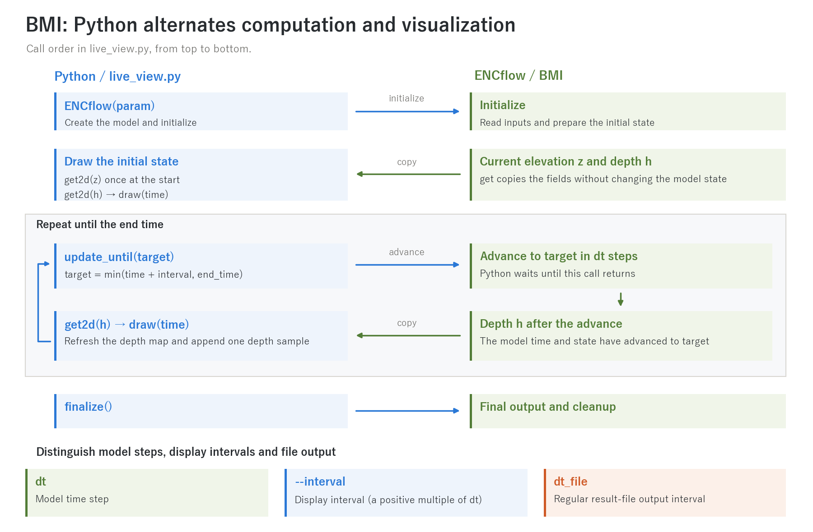
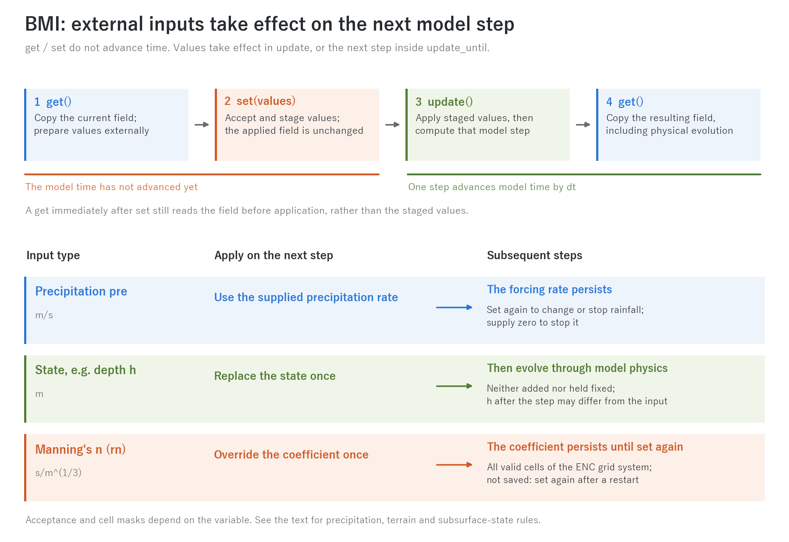
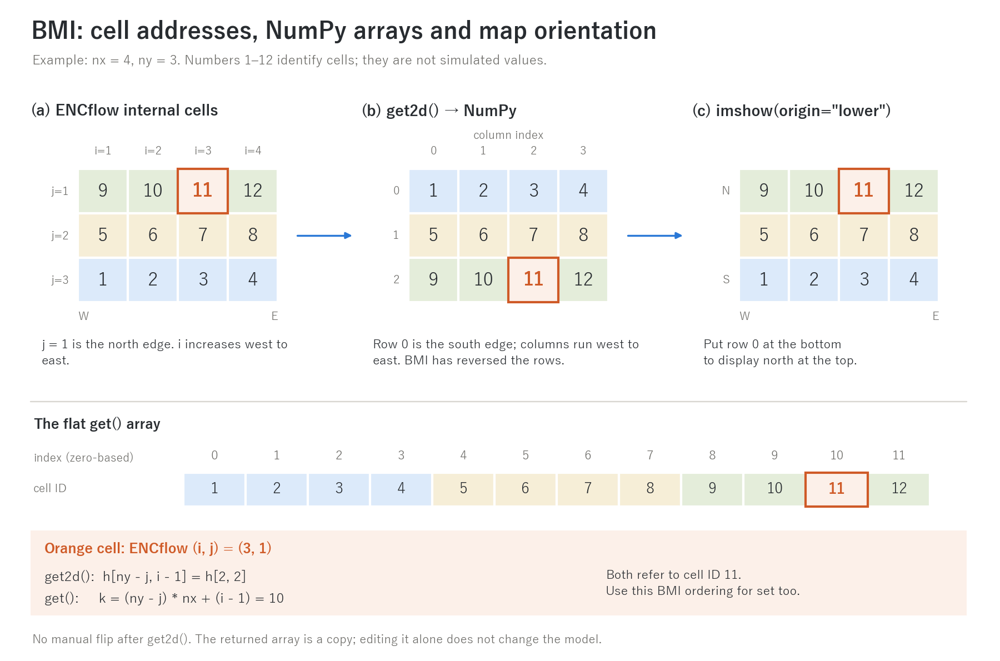

# bmi/ — CSDMS Basic Model Interface (BMI 2.0) adapter

[日本語 README](README.md)

This is the **standard interface for operating ENCflow from Python or
from other models**. The whole of ENCflow becomes a single BMI
component: through the common calls initialize / update / get_value /
set_value you can pause the run at any point, pull out the model state,
and feed forcings in from outside. A multi-level nesting run (fn_nest) is
also one component, with the grids told apart by BMI grid ids. It passes
the official CSDMS conformance test (bmi-tester), for a single grid and
for a nested system alike.

BMI is an optional feature. The regular builds (encflow / encflow_mpi)
do not depend on this directory and keep working with no external
libraries, as always. Using BMI adds only numpy on the Python side
(the BMI specification file is bundled here; no CMake or other tooling
is needed).

## Quick start (from Python)

```sh
cd bmi && make        # builds libencflow_bmi.so (and ../src on first run)
```

```python
import sys; sys.path.insert(0, "path/to/ENCflow/bmi/python")
from encflow import ENCflow, VAR_DEPTH

with ENCflow("param.txt") as model:          # any normal case works as-is
    interval = max(round(600.0 / model.time_step), 1) * model.time_step
    # Round about 10 minutes to a positive integer multiple of model dt.
    while model.time < model.end_time:
        target = min(model.time + interval, model.end_time)
        model.update_until(target)
        h = model.get2d(VAR_DEPTH)               # water depth, (ny, nx) numpy array
        print(model.time, h.max())
```

Parameter files, input data, and result output are exactly the same as
in a standalone run (BMI only adds a control handle — the dt_file
outputs and Log.txt are still written as usual).

A [sample](python/live_view.py) that renders the evolving depth map and
depth time series while the model runs (plotting also requires Matplotlib):

```sh
cd test/chichibu
python3 ../../bmi/python/live_view.py param.txt --probe 479 36
python3 ../../bmi/python/live_view.py param.txt --save frames   # PNG frames (headless)
```

The display interval is `--interval` in seconds. If omitted, the sample
uses `dt_file` or `dt_file_c` read from the parameter file, falling back
to `20 * dt` if neither can be read. It rounds the interval to a positive
integer multiple of `dt`. A target passed to `update_until` must be an
integer number of `dt` steps from the current time and must not exceed
the end time.

### Python alternates computation and visualization



**Figure 1 — Control flow for computation and live visualization.** Python
initializes the model and draws the initial state, then retrieves depth
and refreshes the display after `update_until(target)` returns. Here `z`
stands for elevation (`VAR_ELEVATION`) and `h` for depth (`VAR_DEPTH`).
`dt` is the model step, `--interval` the display interval, and `dt_file`
the regular result-file output interval.
[SVG](../docs/figs/bmi_control_en.svg).

This is the synchronous call sequence in [live_view.py](python/live_view.py):
Python waits for computation to finish before drawing. The sample reads
the elevation background once at the start, then updates the depth map
and depth time series at each display time. The time series shows depth
at the cell selected by `--probe i j`, or the domain maximum depth at
that time if no probe is specified (it does not show discharge). To
update the background in a case with changing terrain, add elevation
retrieval and the corresponding plot update inside the driver's loop.

The display reads in-memory arrays through BMI and does not need to
reload result files. Regular file output continues during model steps
under its normal settings. The display interval can match `dt_file`,
but plotting itself is independent of the file-output time window and
file numbering. Inputs for the sample commands above are in
[test/chichibu](../test/chichibu/).

### Combining BMI with parameter-file access

Use BMI variables and queries alongside ENCflow-specific run settings
as outlined below. BMI does not categorically prohibit exposing
parameters: ENCflow exposes Manning's coefficient through `get` / `set`.
However, [BMI 2.0's standard functions](https://bmi.csdms.io/en/stable/bmi.spec.html)
include neither a generic API for reading or writing arbitrary items
in a model's namelist nor `set_time_step` / `set_end_time`.

| Purpose | Route | ENCflow example |
| --- | --- | --- |
| Read the initialized model's state or settings | Exposed BMI variables and dedicated queries | `get2d` for depth and roughness, `model.time_step` for the step size, `model.end_time` for the end time |
| Reuse input settings that are not exposed through BMI | Read the parameter file directly | `live_view.py` reads `dt_file` / `dt_file_c` as the starting value for its display interval |
| Change conditions or output directories for the next run | Generate a configuration file before initialization | Set `dt`, `tt`, `dir_result`, etc. and pass the file to `ENCflow("param_run.txt")` |
| Exchange fields during a run | BMI `set` for variables whose acceptance conditions are met | Apply precipitation, depth or roughness on the next step (Figure 2) |

**Reading settings.** The [`read_dt_file` helper in live_view.py](python/live_view.py)
reads entries such as `dt_file = 3600` or `dt_file_c = "10 min"`, converting
them to seconds. This reuses explicitly written input values for the
display settings. It does not parse the complete Fortran namelist or
resolve omitted settings and model defaults. If no value can be read,
the sample uses `20 * dt` as described above. For information with a
BMI query, such as the time step, end time and grid metadata, query the
initialized model.

**Writing settings.** Python can choose experiment conditions, substitute
the desired items in a template containing a complete existing case,
and write a separate parameter file before initialization. For example,
filling in `dt` and `tt` allows repeated runs with different conditions.
An implemented example is [`make_param` in test_set_value.py](python/test_set_value.py).
It reads `param.txt` from [test/wave](../test/wave/), changes `dir_result`
for each run and, where needed, adds `fn_precip` and a rainfall namelist.
It then passes the generated file to `ENCflow(...)`.

ENCflow reads these run settings during initialization. Editing `dt`,
`tt`, `dt_file`, etc. in the file after computation starts does not
reload them into the running model. Generating a configuration file
**prepares conditions for the next initialization**; it does not replace
an in-run `set`. Finalizing one model and initializing another is also
distinct from preserving state through save/restart. To carry the state
forward, follow the [save/restart procedure](../docs/en/users_guide/restart.md).

## Exposed variables (get / set)

| CSDMS Standard Name | Quantity | Units | set (external supply) |
| --- | --- | --- | --- |
| `surface_water__depth` | water depth | m | Allowed (**replacement**, not addition; velocities are left unchanged) |
| `land_surface__elevation` | elevation | m | Allowed **only when geomorph, glacier, lavaflow and bedmotion are all disabled**. Water depth is preserved and the water level follows. Sea cells are not touched |
| `atmosphere_water__precipitation_leq-volume_flux` | precipitation rate | m/s | Allowed **only when the case sets no precipitation in its parameters**. Persists as a forcing until the next set |
| `surface_water__elevation` | water level (= elevation + depth) | m | No (get only) |
| `surface_water_flow__speed` | flow speed (magnitude) | m/s | No (get only) |
| `surface_water_flow__unit_width_volume_flow_rate` | unit-width discharge (magnitude) | m²/s | No (get only) |
| `surface_water__x_component_of_velocity` | x (eastward) velocity component | m/s | No (get only) |
| `surface_water__y_component_of_velocity` | y (northward) velocity component | m/s | No (get only) |
| `surface_water__time_max_of_depth` | maximum depth over the run | m | No (get only) |
| `surface_water_flow__time_max_of_speed` | maximum speed over the run | m/s | No (get only) |
| `surface_water_flow__time_max_of_unit_width_volume_flow_rate` | maximum unit-width discharge over the run | m²/s | No (get only) |
| `land_surface_water_flow__manning_n_parameter` | roughness coefficient (Manning's n) | s/m^(1/3) | Allowed (**parameter override**; persists until the next set; whole valid domain, including channel cells set by rn0_rw; ENC grid system only; not saved, so set again after a restart) |

These twelve variables exist in every case and can all be read with get
(the velocity components are cell-centered derived quantities composed
from the internal edge-based fields, in the conventional orientation
x = east, y = north). The first three and the roughness can also be set; a set value is
applied at the start of the next update. The "only when" conditions come from one
principle — **each quantity has a single source** (file forcing and
external supply are never combined) — and a set that violates them
returns an error (BMI_FAILURE). In Python:
`model.set(name, array)` (flattened standard form below, or a 2-D
(ny, nx) array).

### When external inputs take effect



**Figure 2 — When externally prepared values are applied.** Neither `get`
nor `set` advances model time. `set` stages values, which are applied on
that grid's next step before computing its physical processes. A `get`
immediately after `set` returns the field before application. A `get`
after `update` includes the physical evolution during that step, so a
state variable need not equal the supplied value.
[SVG](../docs/figs/bmi_exchange_en.svg).

- **Precipitation rate `pre`** persists as a forcing until the next
  `set`. To stop it, set a zero array. External precipitation cannot
  be combined with parameter-driven precipitation (internal `prtype != 0`).
- **Depth `h`, elevation `z`, subsurface storage `hg` and snow water
  equivalent `swe`** are replaced once in valid land cells. This neither
  adds the supplied values nor holds them fixed at every step. See the
  variable tables for acceptance conditions, including conflicting
  terrain processes and the subsurface vertical model.
- **Manning's coefficient `rn`** overrides the coefficient in all valid
  cells, including channel and sea cells, and persists until the next
  `set`. It is accepted only for the ENC grid system and is not included
  in save files, so supply it again after restarting.

`get` / `get2d` return copies, not references to the model's internal
arrays. Editing a NumPy array alone does not affect the model: `set`
and a subsequent model step are required. When `update_until` advances
several steps, staged state values are still replaced only once, on the
first step. In a nested system, application occurs on the target grid's
next step.

See the [Python wrapper](python/encflow.py), [BMI adapter](bmi_encflow.f90)
and [acceptance/application logic in m_main](../src/m_main.f90).
Verification examples include [test_set_value.py](python/test_set_value.py)
using [test/wave](../test/wave/) for precipitation equivalence and
state/roughness settings, [test/bmi_vars](../test/bmi_vars/) for
feature-dependent variables, and [test/bmi_nest](../test/bmi_nest/)
for multiple grids.

### Overriding roughness (calibration, time-varying roughness)

Roughness is a parameter, not a state, so a set **replaces it and
persists** (developer.md §77). This allows parameter searches without
rewriting files, and lets a driver update roughness from cumulative
discharge, terrain change or seasonal vegetation with a rule of its own
(the model holds no such rule). The field currently in effect is
available with get, so "get → modify → set" is the basic pattern.

```python
from encflow import ENCflow, VAR_MANNING_N, VAR_UNIT_DISCHARGE
with ENCflow("param.txt") as m:
    rn = m.get2d(VAR_MANNING_N)          # input values (rn0 / fn_rn / rn0_rw applied)
    m.set(VAR_MANNING_N, rn * 1.2)       # +20 % everywhere (applied at the first update)
    while m.time < m.end_time:
        m.update()
        if m.time % 3600 < m.time_step:  # hourly update from unit discharge, as an example
            qq = m.get2d(VAR_UNIT_DISCHARGE)
            m.set(VAR_MANNING_N, rn * (1.0 + 0.5 * (qq > 1.0)))
```

### Feature-dependent variables (present only when the feature is enabled)

The following variables are listed **only in cases (grids, in a nested
system) where the process that produces them is enabled**. In other cases
they do not appear in `get_output_var_names`, and get / set / metadata
queries return the same error as for an unknown name (so that "no snow"
and "no snow model" are distinguishable; no zero field is returned, and a
disabled feature costs no memory or time). In Python, `model.has(name)`
tells whether a variable exists.

| CSDMS Standard Name | Quantity | Units | Exists when | set |
| --- | --- | --- | --- | --- |
| `soil_water__leq-depth` | subsurface storage (layer 1, column-equivalent) | m | fn_gwflow (groundwater module enabled) | Allowed (**replacement**) when the vertical model is the bucket or none (lateral only); rejected with Green-Ampt, whose private cumulative infiltration would become inconsistent |
| `snowpack__liquid-equivalent_depth` | snow water equivalent | m | fn_snow | Allowed (**replacement**) |
| `soil__thickness` | soil thickness | m | a feature that uses it (lateral / Green-Ampt groundwater, geomorph) | No (get only) |
| `surface_water_sediment~suspended__volume-per-area` | suspended sediment (volume per unit area) | m | suspended-sediment transport of geomorph | No (get only) |
| `surface_water_solute__mass_concentration` | volume-averaged solute concentration | mg/L | fn_wq | No (get only) |
| `glacier_ice__thickness` | ice thickness | m | fn_glacier | No (get only) |
| `lava__thickness` | lava thickness | m | fn_lavaflow | No (get only) |

Setting the subsurface storage or the snow water equivalent has the same
"data-assimilation-style replacement" semantics as setting the depth
(not addition; applied once to land cells at the start of the next
update; negative values are an error). Being listed as an input (=
existing) and being accepted by set (= the conditions above) are
separate: a rejected set returns an error. The acceptance test is
[test/bmi_vars](../test/bmi_vars/).

**Choosing the exchange interval**: get/set copy whole fields, so
exchange at the **time scale of the quantity being exchanged** (minutes
for rainfall), not at every model time step. Exchanging too finely is
merely wasteful; exchanging too coarsely becomes a coupling error.

### Variables and grids of a nested system

A case whose root parameter file has `fn_nest` (docs/users_guide/nest.md)
becomes one component with all its grids. `update` is one step of the
root (the children sub-step inside it) and the time is the root's. Grids
are distinguished by **grid id**: grid 0 is the root and grid k is line
k+1 of the nest list. A variable on a non-root grid carries the qualifier
`~grid<k>` at the end of the object part of its name (within the CSDMS
Standard Names grammar):

| root (grid 0) | grid 2 |
| --- | --- |
| `surface_water__depth` | `surface_water~grid2__depth` |
| `atmosphere_water__precipitation_leq-volume_flux` | `atmosphere_water~grid2__precipitation_leq-volume_flux` |

The input/output variable lists grow with the number of grids (per grid,
the 12 always-present outputs and 4 inputs plus the variables of the
features enabled on that grid). get / set have the same conditions and semantics
on every grid; a set is applied at the start of that grid's next step.
In Python, `var_on_grid(VAR_DEPTH, 2)` builds the name, `model.grids`
lists the grid ids, `model.shape_of(k)` / `spacing_of(k)` /
`origin_of(k)` describe a grid, and `get / get2d / set` infer the grid
from the name. The origin of a child grid is derived from its parent's
origin and alignment when no georeferencing is given, so all grids are
self-described in the root's coordinate system (origin + index × spacing
places a child on its parent).

## Array and grid conventions

- Arrays are flattened 1-D as the BMI specification requires, with
  **element 0 at the south-west corner and rows running south to
  north** (consistent with the grid origin at the lower-left corner and
  positive spacing). They map one-to-one onto Landlab RasterModelGrid
  node arrays with no transformation.
- Python's `get2d()` returns (ny, nx) with row 0 in the south (use
  `origin='lower'` in matplotlib for a map-oriented display).
- Grids are uniform_rectilinear (grid 0 only without nesting, one per
  grid in a nested system), shape in [ny, nx] order. For cases with
  georeferencing (hdr), real coordinates appear in the origin (a nested
  child's origin is derived from its parent).
- References (get_value_ptr) and the unstructured-grid queries are not
  supported (they return BMI_FAILURE / NotImplementedError, as the BMI
  specification permits).



**Figure 3 — Following the same cell through internal addresses, arrays
and a map.** The example has 4 columns and 3 rows; the numbers identify
cells. Internal `j=1` is in the north, while BMI array row 0 is in the
south. The BMI adapter reverses the row order, and Python's `get2d`
reshapes the data to `(ny, nx)`. `imshow(..., origin="lower")` puts row 0
at the bottom to produce a north-up map. The orange cell `(i,j)=(3,1)`
corresponds to `h[2,2]`, or element 10 of the flat array.
[SVG](../docs/figs/bmi_arrays_en.svg).

For a one-based internal cell address `(i,j)`, the zero-based NumPy
index is `h[ny-j, i-1]`, and the flat index is `(ny-j)*nx + (i-1)`.
The `--probe` option in [live_view.py](python/live_view.py) uses this
mapping too. Do not manually flip the result of `get2d`. Pass arrays
in this same orientation to `set` (the Python wrapper flattens them in
row-major C order).

## Using with MPI

```sh
cd bmi && make clean && make MODE=mpi      # → test driver test_encflow_bmi_mpi
mpirun -np 4 ./test_encflow_bmi_mpi param.txt
```

- update / update_until / get / set are **called by all ranks
  together**. The global array returned by get, and the array given to
  set, are **valid on rank 0 only** (arrays on other ranks are not
  referenced).
- If MPI has already been initialized by the caller (mpi4py etc.),
  ENCflow neither takes it over nor finalizes it.
- The shared library for Python is currently serial only; with MPI,
  BMI is used from Fortran (the driver above is an example).

## Verification tools

| Tool | Purpose |
| --- | --- |
| `test_encflow_bmi [param] [set]` | Test driver that runs a case to completion through BMI (results match a standalone run; with `set`, also checks that a same-value set is harmless) |
| [python/test_set_value.py](python/test_set_value.py) | Equivalence tests for set_value (file forcing versus external supply; unchanged results for same-value h, z and rn; effect of a changed rn; run in [test/wave](../test/wave/)) |
| [python/test_vars.py](python/test_vars.py) | Acceptance test of feature-dependent variables (variable lists, values, re-initialize, same-value set of hg / swe and its acceptance rules; run in [test/bmi_vars](../test/bmi_vars/). `Run.sh` also runs the static driver and bmi-tester) |
| [python/test_nest.py](python/test_nest.py) | Acceptance test of multi-grid exposure (grid information, variable lists, 1:1 self-nesting identity, re-initialize, same-value set; run in [test/bmi_nest](../test/bmi_nest/). `Run.sh` also runs the static driver and bmi-tester) |
| `python/check_bmi.sh` | Runs the official CSDMS conformance test, bmi-tester (list the input files the parameter file refers to after it) |

To reproduce the conformance check:

```sh
pip install bmi-tester bmipy 'pytest<8' 'gimli.units==0.3.*'
cd test/wave
../../bmi/python/check_bmi.sh param.txt
cd ../bmi_nest && ./Run.sh          # nested system (acceptance test + bmi-tester)
```

## Files

| File | Role |
| --- | --- |
| `vendor/bmi.f90` | The BMI 2.0 specification (bundled from CSDMS bmi-fortran; MIT — see `vendor/LICENSE` and NOTICE) |
| `bmi_encflow.f90` | The adapter itself (use this module to call BMI from Fortran) |
| `bmi_encflow_c.f90` | C-compatible symbol layer (the shared-library entry) |
| `python/encflow.py` | Python wrapper: the `ENCflow` class (use this for everyday work) |
| `python/encflow_bmi.py` | bmipy-conformant class `EncflowBmi` (for bmi-tester and pymt-style tools) |
| `python/live_view.py` | Live visualization sample |
| `python/test_set_value.py`, `python/test_nest.py`, `python/test_vars.py` | Acceptance tests (above) |

## Limitations and notes

- One model per process (two independent ENCflow instances cannot
  coexist; a nested system is one model with all its grids.
  Re-initializing after finalize works in serial).
- The grid functions of the shared library's C interface
  (`encflow_bmi_get_grid_shape` etc.) take the grid id as their first
  argument (changed 2026-10-10; irrelevant when going through the Python
  wrapper).
- Runs through the shared library (.so) may not match a standalone run
  down to the last bit, because the compilation conditions differ (the
  physical outputs agree to the printed precision). For verification
  that needs strict bit reproducibility, use the static
  `test_encflow_bmi` driver.

## For developers

The three figures on this page are generated by
[fig_bmi.py](../docs/figs/guide/fig_bmi.py). From the repository root, run
`python docs/figs/make_guide_figs.py bmi` to rebuild the Japanese and English
PNG/SVG assets (requires Matplotlib, NumPy and a Japanese font).

The design history and roadmap are in
[docs/bmi_plan.md](../docs/bmi_plan.md) (in Japanese), and the
authoritative records of decisions and verification are in
[docs/developer.md](../docs/developer.md) Secs. 53–60, 73 (multiple grids),
76 (dynamic variable lists and feature-dependent variables) and
77 (roughness overrides), in Japanese.
