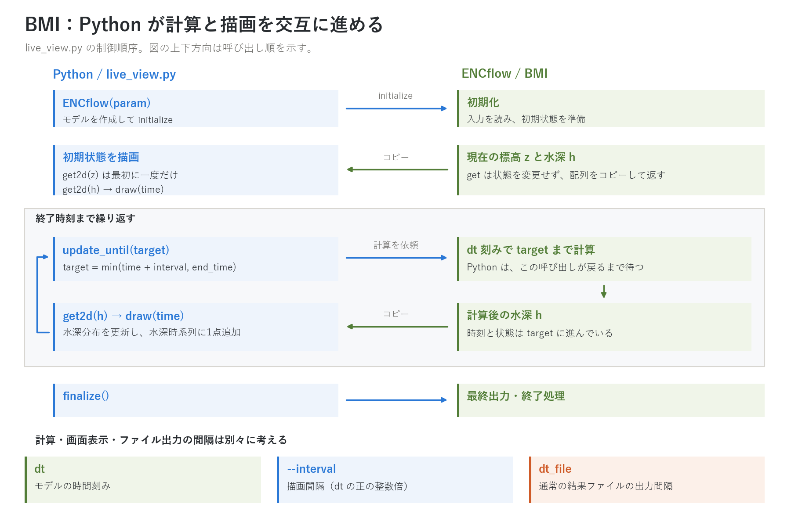
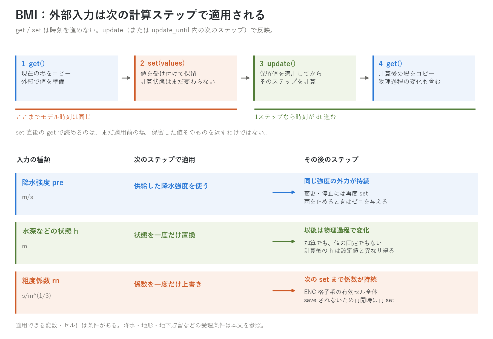
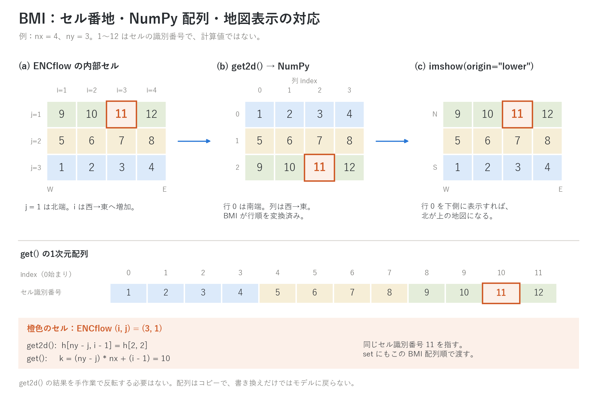

# bmi/ — CSDMS Basic Model Interface (BMI 2.0) アダプタ

[English README](README.en.md)

ENCflow を **Python や他モデルから操作するための標準インターフェース**
です。ENCflow 全体がひとつの BMI component となり、
initialize / update / get_value / set_value という共通の操作で、
計算を任意の時点で止めて状態を取り出したり、外部から強制を与えたり
できます。多段ネスティング(fn_nest)のランも全体がひとつの component で、
格子は BMI の grid id で区別します。CSDMS 公式の適合性テスト(bmi-tester)に
合格しています(単一格子・ネスト系とも)。

BMI はオプション機能です。通常のビルド(encflow / encflow_mpi)は
本ディレクトリに依存せず、従来どおり外部ライブラリなしで動きます。
BMI を使う場合も、必要な追加ソフトは Python 側の numpy だけです
(BMI 仕様ファイルは同梱しており、CMake 等のツールは不要です)。

## クイックスタート(Python から使う)

```sh
cd bmi && make        # libencflow_bmi.so を生成(初回は ../src もビルド)
```

```python
import sys; sys.path.insert(0, "path/to/ENCflow/bmi/python")
from encflow import ENCflow, VAR_DEPTH

with ENCflow("param.txt") as model:          # 通常のケースをそのまま使える
    interval = max(round(600.0 / model.time_step), 1) * model.time_step
    # 10 分を目安に、モデルの dt の正の整数倍へ丸める
    while model.time < model.end_time:
        target = min(model.time + interval, model.end_time)
        model.update_until(target)
        h = model.get2d(VAR_DEPTH)               # 水深 (ny, nx) の numpy 配列
        print(model.time, h.max())
```

パラメータファイル・入力データ・結果出力はスタンドアロン実行と
まったく同じです(BMI は操作口が増えるだけで、dt_file のファイル出力や
Log.txt もこれまでどおり書かれます)。

計算しながら水深分布と水深時系列を順次表示する
[サンプル](python/live_view.py)（描画には Matplotlib も必要）:

```sh
cd test/chichibu
python3 ../../bmi/python/live_view.py param.txt --probe 479 36
python3 ../../bmi/python/live_view.py param.txt --save frames   # PNG 連番(画面なし環境)
```

表示間隔は `--interval` 秒で指定できます。省略時はパラメータファイルから
読み取った `dt_file` または `dt_file_c`、読み取れなければ `20 * dt` を
使い、いずれも `dt` の正の整数倍へ丸めます。`update_until` の目標時刻は、
現在時刻から `dt` の整数倍先で、終了時刻を超えない必要があります。

### Python が計算と描画を交互に進める



**図1 — 計算とライブ表示の制御フロー。** Python が初期化・初期描画を行い、
`update_until(target)` が戻ってから水深を取り出して画面を更新します。
`z` は標高（`VAR_ELEVATION`）、`h` は水深（`VAR_DEPTH`）の略記です。
`dt` は計算刻み、`--interval` は表示間隔、`dt_file` は通常の結果出力間隔を
表します。[SVG](../docs/figs/bmi_control.svg)。

これは [live_view.py](python/live_view.py) の同期的な呼び出し順序です。
Python は計算の終了を待ってから描画します。背景の標高は最初に一度だけ取得し、
各表示時刻で水深分布と水深時系列を更新します。時系列は `--probe i j` で指定した
セルの水深、指定しない場合はその時刻の領域最大水深です（流量ではありません）。
標高も変化するケースで背景を追随させるには、利用側で標高の取得・描画更新を
ループ内に追加します。

画面表示は BMI 経由でメモリ上の配列を読み、結果ファイルの読み直しを必要と
しません。通常のファイル出力は計算中に従来の設定で行われます。
表示間隔を `dt_file` に合わせることはできますが、表示処理自体はファイル出力の
時刻窓や番号に連動しません。上の実行例に使う入力データは
[test/chichibu](../test/chichibu/) にあります。

### BMI とパラメータファイルを使い分ける

BMI で公開する変数・問い合わせと、ENCflow 固有の実行設定は次のように
使い分けます。BMI 規格がパラメータの公開を一律に禁止しているわけでは
ありません。ENCflow も粗度係数を `get` / `set` の対象として公開しています。
一方、モデル固有の namelist の任意の項目を読み書きする汎用 API や、
`set_time_step`・`set_end_time` は [BMI 2.0 の標準関数](https://bmi.csdms.io/en/stable/bmi.spec.html)
にありません。

| 目的 | 使う経路 | ENCflow での例 |
| --- | --- | --- |
| 初期化済みモデルの状態・設定を知る | BMI の公開変数・専用問い合わせ | 水深・粗度は `get2d`、計算刻みは `model.time_step`、終了時刻は `model.end_time` |
| BMI に公開していない入力設定を Python 側でも使う | パラメータファイルを直接読む | `live_view.py` が `dt_file` / `dt_file_c` を読み、表示間隔の元値に使う |
| 次のランの計算条件・出力先を変える | 設定ファイルを生成してから初期化 | `dt`・`tt`・`dir_result` などを設定し、`ENCflow("param_run.txt")` に渡す |
| 実行中の場を交換する | 受理条件を満たす変数に BMI の `set` | 降水・水深・粗度などを次のステップで適用（図2） |

**読む工夫。** [live_view.py の `read_dt_file`](python/live_view.py) は、たとえば
`dt_file = 3600` や `dt_file_c = "10 min"` を秒に換算して読み取ります。
これはファイルに明記された値を表示設定に再利用する補助処理です。
Fortran namelist 全体の解析や、省略値・既定値の解決までは行いません。
読み取れなければ上述の `20 * dt` を使います。BMI に問い合わせ口がある
計算刻み・終了時刻・格子情報は、初期化後のモデルに問い合わせます。

**書く工夫。** Python で実験条件を決め、既存ケースの完全な設定を雛形として
必要な項目を置き換え、別名のパラメータファイルを作ってから初期化できます。
たとえば `dt`・`tt` を雛形に埋め込めば、計算条件の異なるランを反復できます。
実装例は [test_set_value.py の `make_param`](python/test_set_value.py) です。
[test/wave](../test/wave/) の `param.txt` を読み、`dir_result` をランごとに変更し、
必要なランでは `fn_precip` と降雨 namelist を追加して、生成したファイルを
`ENCflow(...)` に渡しています。

ENCflow はこれらの実行設定を初期化時に読み込みます。計算開始後に `dt`・`tt`・
`dt_file` などをファイル上で書き換えても、実行中のモデルには再読込されません。
設定ファイルの生成は**次の初期化に渡す条件の準備**であり、実行中の `set` の
代わりにはなりません。既存モデルを終了して新たに初期化する操作と、状態を
引き継ぐ保存・再開も別です。状態を引き継ぐ場合は
[保存・再開の手順](../docs/users_guide/restart.md)に従います。

## 公開変数(get / set)

| CSDMS Standard Name | 内容 | 単位 | set(外部からの設定) |
| --- | --- | --- | --- |
| `surface_water__depth` | 水深 | m | 可(**置換**。加算ではない。流速は変更されない) |
| `land_surface__elevation` | 標高 | m | geomorph・glacier・lavaflow・bedmotion が**すべて無効のケースのみ**可。水深は保存され水位が追随。海セルには適用されない |
| `atmosphere_water__precipitation_leq-volume_flux` | 降水強度 | m/s | 降水を**パラメータで設定していないケースのみ**可。次に set するまで持続する強制 |
| `surface_water__elevation` | 水位(= 標高 + 水深) | m | 不可(get のみ) |
| `surface_water_flow__speed` | 流速の大きさ(速さ) | m/s | 不可(get のみ) |
| `surface_water_flow__unit_width_volume_flow_rate` | 比流量の大きさ(単位幅流量) | m²/s | 不可(get のみ) |
| `surface_water__x_component_of_velocity` | 流速の x(東)成分 | m/s | 不可(get のみ) |
| `surface_water__y_component_of_velocity` | 流速の y(北)成分 | m/s | 不可(get のみ) |
| `surface_water__time_max_of_depth` | 期間最大水深 | m | 不可(get のみ) |
| `surface_water_flow__time_max_of_speed` | 期間最大の速さ | m/s | 不可(get のみ) |
| `surface_water_flow__time_max_of_unit_width_volume_flow_rate` | 期間最大の比流量 | m²/s | 不可(get のみ) |
| `land_surface_water_flow__manning_n_parameter` | 粗度係数(Manning の n) | s/m^(1/3) | 可(**パラメータの上書き**。次の set まで持続。有効セル全体〔河道セルの rn0_rw も置換〕。ENC 格子系のみ。save されないので再開時は再 set) |

上の 12 変数はどのケースでも存在し、すべて get できます(流速成分は
セル中心の導出量で、内部のエッジ配置量から合成されます。x=東・y=北の
標準的な向きです)。set できるのは上 3 つと粗度で、値は次の update の
冒頭で適用されます。set の「〜のみ可」は、**同じ量の与え方は一つ**
(ファイル強制と外部供給を併用しない)という原則によるもので、条件を
満たさない set はエラー(BMI_FAILURE)になります。Python では
`model.set(名前, 配列)`(下記の 1 次元標準形か、(ny, nx) の 2 次元)。

### 外部入力が反映される時点



**図2 — 外部で準備した値の適用時点。** `get` と `set` はモデル時刻を進めません。
`set` は値を保留し、その格子の次の計算ステップで、物理過程の計算に先立って
適用します。`set` 直後の `get` が返すのは適用前の場です。`update` 後の `get` は
そのステップでの物理過程の変化も含むため、状態量が設定値と一致するとは
限りません。[SVG](../docs/figs/bmi_exchange.svg)。

- **降水強度 `pre`** は次の `set` まで続く外力です。止めるときはゼロの配列を
  `set` します。パラメータ駆動の降水（内部の `prtype != 0`）とは併用できません。
- **水深 `h`・標高 `z`・地下貯留 `hg`・積雪水量 `swe`** は、有効な陸セルに
  一度だけ適用する置換です。加算でも、毎ステップその値に固定する操作でも
  ありません。標高の機能競合や地下貯留の鉛直モデルなど、変数ごとの受理条件は
  上下の変数表を参照してください。
- **粗度係数 `rn`** は有効セル全体（河道・海セルを含む）の係数を上書きし、
  次の `set` まで持続します。ENC 格子系のみで受理され、保存ファイルには
  含まれないため、再開後は外部から再設定します。

`get` / `get2d` の戻り値はモデル内部への参照ではなくコピーです。NumPy 配列を
書き換えただけではモデルに反映されず、`set` とその後の計算ステップが必要です。
`update_until` で複数ステップ進める場合も、保留した状態の置換は最初のステップで
一度だけ行います。ネスト系では、対象格子の次のステップが適用時点です。

実装は [Python ラッパー](python/encflow.py)、[BMI アダプタ](bmi_encflow.f90)、
[m_main の受理・適用処理](../src/m_main.f90) を参照してください。
降水の等価性と状態・粗度の設定は [test/wave](../test/wave/) を使う
[test_set_value.py](python/test_set_value.py)、機能依存の変数は
[test/bmi_vars](../test/bmi_vars/)、多格子の扱いは
[test/bmi_nest](../test/bmi_nest/) が検証例です。

### 粗度の外部上書き(キャリブレーション・動的な粗度)

粗度係数は状態ではなくパラメータなので、set は「置換して以後持続」
です(developer.md §77)。ファイルを書き換えずにパラメータ探索ができ、
累積流量や地形変化・季節植生に応じた粗度の更新規則は利用側で計算して
与えます(モデル内に規則は持ちません)。現に効いている場は get で
得られるので、「get → 加工 → set」が基本形です。

```python
from encflow import ENCflow, VAR_MANNING_N, VAR_UNIT_DISCHARGE
with ENCflow("param.txt") as m:
    rn = m.get2d(VAR_MANNING_N)          # 入力値(rn0 / fn_rn / rn0_rw 適用済み)
    m.set(VAR_MANNING_N, rn * 1.2)       # 一括 20 % 増(最初の update の冒頭で適用)
    while m.time < m.end_time:
        m.update()
        if m.time % 3600 < m.time_step:  # 1 時間ごとに比流量で粗度を更新する例
            qq = m.get2d(VAR_UNIT_DISCHARGE)
            m.set(VAR_MANNING_N, rn * (1.0 + 0.5 * (qq > 1.0)))
```

### 機能依存の変数(有効なケースにだけ存在する)

次の変数は、**その量を生産する機能が有効なケース(ネスト系では格子)に
だけ変数表に載ります**。無効なケースでは `get_output_var_names` に現れず、
get / set / メタデータ問い合わせは未知の名前と同じエラーになります
(「雪がない」と「雪モデルがない」を区別するためで、ゼロ場は返しません。
無効時の追加メモリ・計算はゼロです)。Python では `model.has(名前)` で
確認できます。

| CSDMS Standard Name | 内容 | 単位 | 存在条件 | set |
| --- | --- | --- | --- | --- |
| `soil_water__leq-depth` | 地下貯留(層 1。柱状換算) | m | fn_gwflow(地下水モジュール有効) | 可(**置換**。鉛直モデルがバケツまたは無し〔側方のみ〕のとき。Green-Ampt は私有の累積浸透と不整合になるため不可) |
| `snowpack__liquid-equivalent_depth` | 積雪水量 | m | fn_snow | 可(**置換**) |
| `soil__thickness` | 土層厚 | m | 土層厚を使う機能(gwflow の側方・Green-Ampt、geomorph) | 不可(get のみ) |
| `surface_water_sediment~suspended__volume-per-area` | 浮遊砂の柱状量 | m | geomorph の浮遊砂輸送 | 不可(get のみ) |
| `surface_water_solute__mass_concentration` | 輸送物質の体積平均濃度 | mg/L | fn_wq | 不可(get のみ) |
| `glacier_ice__thickness` | 氷厚 | m | fn_glacier | 不可(get のみ) |
| `lava__thickness` | 溶岩厚 | m | fn_lavaflow | 不可(get のみ) |

地下貯留と積雪水量の set は水深の set と同じ「データ同化型の置換」です
(加算ではなく、次の update の冒頭で陸セルに一回適用。負値はエラー)。
入力変数表に載ること(= 存在)と set が受理されること(= 上の条件)は
別で、受理されない set はエラーになります。受け入れ試験は
[test/bmi_vars](../test/bmi_vars/) です。

**交換間隔の目安**: get/set は場のコピーなので、交換はモデルの
時間刻みごとではなく、**交換する量の時間スケール**で行ってください
(降雨なら分オーダー)。細かすぎる交換は無駄なだけですが、粗すぎる
交換は結合誤差になります。

### ネスト系(多段格子)の変数と格子

ルートのパラメータに `fn_nest` があるケース(docs/users_guide/nest.md)は、
全格子がひとつの component になります。`update` はルートの 1 歩(子はその
中でサブステップ)、時刻はルートのものです。格子は **grid id** で区別し、
grid 0 = ルート、grid k = 一覧の k+1 行目です。非ルート格子の変数は、名前の
object 部の末尾に `~grid<k>` を付けたものです(CSDMS Standard Names の
修飾の文法内):

| ルート(grid 0) | 格子 2(grid 2) |
| --- | --- |
| `surface_water__depth` | `surface_water~grid2__depth` |
| `atmosphere_water__precipitation_leq-volume_flux` | `atmosphere_water~grid2__precipitation_leq-volume_flux` |

入出力変数表は格子数に応じて自動的に増えます(格子ごとに、常時存在の
出力 12・入力 4 と、その格子で有効な機能の変数)。get / set は格子ごとに
同じ条件・同じ意味論で、set は
その格子の次の 1 歩の冒頭で適用されます。Python では
`var_on_grid(VAR_DEPTH, 2)` が名前を作り、`model.grids` が格子 id の一覧、
`model.shape_of(k)` / `spacing_of(k)` / `origin_of(k)` が格子の情報、
`get / get2d / set` は名前から格子を判別します。子格子の原点(origin)は、
georef がなければ親の原点と整列位置から導かれるので、全格子がルートの
座標系で自己記述されます(origin + index × spacing で子を親の上に置ける)。

## 配列と格子の規約

- 配列は BMI 仕様どおり flatten した 1 次元で、**要素 0 = 南西隅、
  行は南→北**(格子の origin = 左下隅・spacing 正と整合)。
  Landlab の RasterModelGrid ノード配列とは無変換で 1:1 対応します。
- Python の `get2d()` は (ny, nx) を返します(行 0 = 南。matplotlib
  では `origin='lower'` で地図の向きどおりに表示されます)。
- 格子は uniform_rectilinear(ネストなしは grid 0 のみ、ネスト系は格子ごと)、
  shape は [ny, nx] 順。georef(hdr)を使うケースでは origin に実座標が
  入ります(ネストの子は親から導いた座標)。
- 参照渡し(get_value_ptr)と非構造格子系の問い合わせは非対応です
  (BMI 仕様が認める BMI_FAILURE / NotImplementedError を返します)。



**図3 — 同じセルを内部番地・配列・地図でたどる。** 4 列 × 3 行の例で、数字は
セルの識別番号です。内部の `j=1` は北、BMI 配列の行 0 は南です。BMI アダプタが
行順を変換し、Python の `get2d` が `(ny, nx)` に整形します。
`imshow(..., origin="lower")` で行 0 を下に置くと、北が上の地図になります。
橙色のセル `(i,j)=(3,1)` は `h[2,2]`、1 次元では要素 10 に対応します。
[SVG](../docs/figs/bmi_arrays.svg)。

内部の 1 始まりのセル番地 `(i,j)` に対し、NumPy の 0 始まりの添字は
`h[ny-j, i-1]`、1 次元配列の添字は `(ny-j)*nx + (i-1)` です。
[live_view.py](python/live_view.py) の `--probe` もこの対応を使います。
`get2d` の結果を手作業で反転する必要はありません。`set` にも同じ向きの
配列を渡します（Python ラッパーは行優先の C 順で平坦化します）。

## MPI で使う

```sh
cd bmi && make clean && make MODE=mpi      # → 検証ドライバ test_encflow_bmi_mpi
mpirun -np 4 ./test_encflow_bmi_mpi param.txt
```

- update / update_until / get / set は**全ランクが揃って呼びます**。
  get で得られる全域配列と、set に与える配列は **rank 0 のみ有効**です
  (他ランクの配列は参照されません)。
- MPI が呼び出し側(mpi4py 等)で初期化済みの場合、ENCflow は
  MPI を横取り・終了しません。
- Python 用の共有ライブラリは現在は逐次版のみです。MPI で使えるのは
  Fortran からの呼び出し(上記ドライバが例)です。

## 検証ツール

| ツール | 内容 |
| --- | --- |
| `test_encflow_bmi [param] [set]` | ケースを BMI 経由で完走させる検証ドライバ(結果はスタンドアロン実行と一致する。`set` を付けると同値 set の無害性も検査) |
| [python/test_set_value.py](python/test_set_value.py) | set_value の等価性テスト(ファイル強制と外部供給で結果が一致すること、h・z・rn の同値 set の不変性、rn の set が効くこと。[test/wave](../test/wave/) で実行) |
| [python/test_vars.py](python/test_vars.py) | 機能依存の変数の受け入れ試験(変数表の内容・値・再 initialize・hg / swe の同値 set の不変性と受理条件。[test/bmi_vars](../test/bmi_vars/) で実行。`Run.sh` が静的ドライバと bmi-tester も含めて一括実行) |
| [python/test_nest.py](python/test_nest.py) | 多格子公開の受け入れ試験(格子情報・変数表・比 1:1 自己ネストの恒等・再 initialize・同値 set。[test/bmi_nest](../test/bmi_nest/) で実行。`Run.sh` が静的ドライバと bmi-tester も含めて一括実行) |
| `python/check_bmi.sh` | CSDMS 公式適合性テスト bmi-tester の実行スクリプト(param の後に、param が参照する入力ファイルを列挙) |

適合性テストの再現手順:

```sh
pip install bmi-tester bmipy 'pytest<8' 'gimli.units==0.3.*'
cd test/wave
../../bmi/python/check_bmi.sh param.txt
cd ../bmi_nest && ./Run.sh          # ネスト系(受け入れ試験 + bmi-tester)
```

## ファイル構成

| ファイル | 役割 |
| --- | --- |
| `vendor/bmi.f90` | BMI 2.0 仕様(CSDMS bmi-fortran 由来の同梱。MIT。`vendor/LICENSE`・NOTICE 参照) |
| `bmi_encflow.f90` | アダプタ本体(Fortran から BMI で使う場合はこれを use する) |
| `bmi_encflow_c.f90` | C 互換シンボル層(共有ライブラリの口) |
| `python/encflow.py` | Python ラッパー。`ENCflow` クラス(日常利用はこちら) |
| `python/encflow_bmi.py` | bmipy 準拠クラス `EncflowBmi`(bmi-tester・pymt 系ツール用) |
| `python/live_view.py` | ライブ表示サンプル |
| `python/test_set_value.py`, `python/test_nest.py`, `python/test_vars.py` | 受け入れ試験(上記) |

## 制約・注意

- 1 プロセスにつき 1 モデルです(同時に 2 つの独立な ENCflow を持てません。
  ネスト系は全格子で 1 モデル。finalize 後の再 initialize は逐次では可能です)。
- 共有ライブラリの C 関数のうち格子系(`encflow_bmi_get_grid_shape` 等)は
  grid id を第 1 引数に取ります(2026-10-10 に変更。Python ラッパ経由なら無関係)。
- 共有ライブラリ(.so)経由の実行は、コンパイル条件の違いにより
  スタンドアロン実行とビットまでは一致しないことがあります(物理量の
  出力は表示桁で一致します)。厳密なビット再現が必要な検証には
  静的な `test_encflow_bmi` を使ってください。

## 開発者向け

本ページの3図は [fig_bmi.py](../docs/figs/guide/fig_bmi.py) から、
リポジトリ直下で `python docs/figs/make_guide_figs.py bmi` を実行すると
日英 PNG・SVG を再生成できます（Matplotlib・NumPy と日本語フォントが必要）。

設計の経緯・全体計画は [docs/bmi_plan.md](../docs/bmi_plan.md)、
決定事項と検証記録の正本は
[docs/developer.md](../docs/developer.md) の §53〜§60、§73(多格子)、
§76(動的変数表と機能依存の変数)、§77(粗度の外部上書き)にあります。
