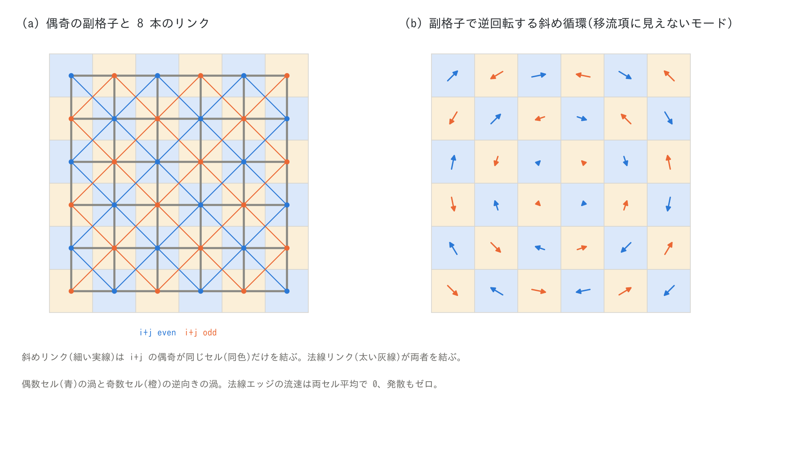
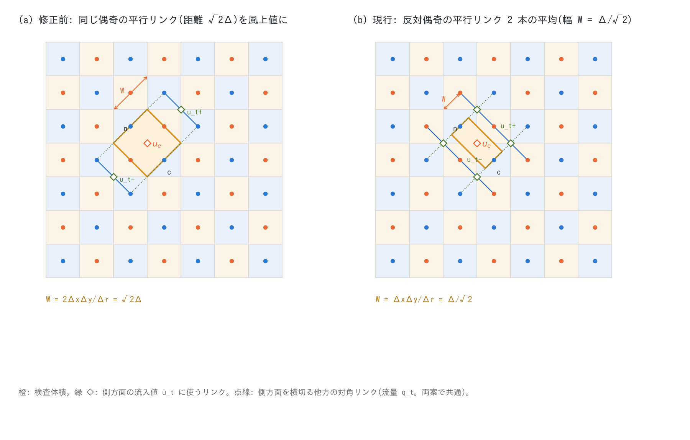

# ENC 格子における運動量保存形移流項の設計(詳説・論文化準備)

**位置づけ**: [users_guide/advection.md](users_guide/advection.md) は利用者向けに
スキームの選び方と要点を述べる章、[developer.md §68](developer.md)(§68.1〜68.36)は
設計判断と試行の時系列記録です。本書はその中間に立ち、ENC 格子(8 方向リンクを
持つセル中心ラスタ格子)の上で運動量保存形の移流項をどう定式化し、何を
検証し、何が未解決かを、**一つの筋の通った解説**として図入りでまとめます。
論文化の下準備を兼ねるため、§9 に新規性の整理と追加検証の候補、図表の一覧を
置きます。日付は実装・計測の日(2026-10)で、数値はすべて developer.md と
test/ の README に記録済みのものです。

図は `python3 docs/figs/make_guide_figs.py advscheme`(`docs/figs/guide/fig_advscheme.py`)
と、advection 章の `fig_advection.py` で生成します。

---

## 1. ENC 格子と状態変数(復習)

ENC 格子は正方(または矩形)ラスタで、セル中心に水深 $`h`$・地盤高 $`z`$・
セル平均流量 $`(m, n)`$・セル流速 $`(u, v)`$ を持ち、各セルは 8 近傍
(軸 4 方向・対角 4 方向)とエッジで結ばれます。エッジはリンクの法線流速
$`u_e`$ と単位幅流量 $`mn_e`$ を持ち、通過幅は軸・対角とも
$`\ell = \Delta/(1+\sqrt2) \approx 0.414\Delta`$(`p_diagratio` の既定。8 本の
通過幅が等しくなる値)です([encgrid.md](users_guide/encgrid.md) §2)。

- **連続式**は 8 本のエッジ流量の発散でセルの水深を更新する(§3)。
- **運動方程式**はエッジごとに法線流速 $`u_e`$ を更新する(§5)。項は
  重力(両セルの水位差)、摩擦(Manning、半陰)、移流、拡散(任意)。
- **セル流速**は 8 本のエッジ流速の重み付き再構成で、1 次元に落とすと
  $`u_c = (u_{i-1/2} + u_{i+1/2})/2`$ になる(§4)。

4 方向のスタガード格子(Arakawa C)と違うのは、(i) 対角リンクが通過幅の
0.293(= 2 × 0.293 + 0.414 = 1)を担うこと、(ii) 対角リンクは
$`i+j`$ の偶奇が同じセル同士だけを結ぶこと(§6 で効く)、(iii) 運動量は
エッジ法線成分だけを持ち、接線成分を持たないこと、です。

## 2. 移流項に求めたこと

1. **段波を正しい速度で伝える**(運動量保存)。非保存形では段波が遅れ、
   背後に過剰な水位が残る(§3)。
2. **滑らかな場での整合性**: 一様流で移流項がゼロ、線形な流速場で
   $`u\,\partial u/\partial s`$ を再現する。軸エッジと対角エッジで同形の
   更新式になること(対角リンクの流速は $`u_d = u\,n_x`$ の比例関係を保つ)。
3. **8 方向の対称性**: 軸と対角で異なる精度・減衰を持ち込まない。
4. **壁・乾燥セル・規定境界**が運動量を供給しないこと(供給すると屈曲や
   境界で人工損失・反拡散が出る)。
5. **格子収束**: 実地形で格子を細かくしたとき流出が収束すること。
6. **コスト**: 既定経路で +30 % 以内、追加メモリは同程度、MPI の通信は
   ハロ幅 2 で収まること。

## 3. スキーム 1(セル中心勾配・非保存形)の構造的問題

旧既定のスキーム 1 は、各セルで 3×3 の重み付き差分(風上側を重く)から
$`T = -(\mathbf u\cdot\nabla)\mathbf u`$ を求め、両側セルの $`T`$ を平均して
法線方向に投影します(図: [advection_cv.png](figs/advection_cv.png) (a))。
構造的な問題は 2 つです(developer.md §68.1)。

- セル流速がエッジ流速の平均なので、「中心 → 勾配 → エッジ平均」の連鎖は
  コンパクトなエッジ中心差分に対して $`\cos^2(\kappa\Delta/2)`$ 倍だけ余計に
  減衰する **5 エッジ幅の平滑化微分**になる(波長 4Δ で 0.50)。段波の
  移流項が半減し、風上化の有無にかかわらず波形が鈍る。
- 非保存形なので段波(不連続)で運動量の収支が合わない。Stoker 解の段波
  位置は −15.5 %、背後の過剰 3.2 m。実地形(chichibu)では格子を細かく
  するほど流出が増え、50 m で発散する(非収束)。

## 4. 運動量保存形(スキーム 2・3)の定式化

Stelling & Duinmeijer (2003)[^sd03] のスタガード格子向け定式化を 8 方向
エッジに拡張したものです。エッジ $`e`$(基準セル $`c`$ から $`k`$ 近傍 $`n`$ へ、
法線流速 $`u_e`$)の周りに**運動量検査体積**を取り、その面を通る質量流束
$`Q_f`$ と面での風上化流速 $`\bar u_f`$ から

```math
A_e = -\,\frac{\ell_m}{\bar h_e}\left[
\frac{q_n\,(\bar u_n - u_e) - q_c\,(\bar u_c - u_e)}{L_k}
+ \frac{q_{t+}\,(\bar u_{t+} - u_e) + q_{t-}\,(\bar u_{t-} - u_e)}{W_k}
\right],
\qquad
\bar h_e = \max\!\left(\frac{h_c + h_n}{2},\;\frac{dd}{2}\right)
```

を評価します(流出面では $`\bar u_f = u_e`$ で寄与ゼロ、流入面では流入側の
流速との差で緩和)。連続式と組み合わせると離散運動量収支が保存され、
段波速度の誤差が消えます。$`\ell_m`$ はスキーム 1 と同じ有効慣性係数です。

### 4.1 検査体積と面(図 [advection_cv.png](figs/advection_cv.png) (b)(c))

| エッジ | 長さ $`L_k`$ | 横断幅 $`W_k`$ | 面積 |
|---|---|---|---|
| 軸 | $`\Delta x`$(または $`\Delta y`$) | $`\Delta y`$(または $`\Delta x`$) | セル 1 個分 |
| 対角 | $`\Delta r = \sqrt{\Delta x^2+\Delta y^2}`$ | $`\Delta x\Delta y/\Delta r`$(正方で $`\Delta/\sqrt2`$。§6 で改定) | セル 1 個分 |

- **流向面 $`c`$, $`n`$**(セル中心を通り、法線 $`\mathbf n_k`$ の面): セル流量を
  線 $`k`$ 方向に投影した $`q_c = m_c n^x_k + n_c n^y_k`$。ENC の連続式が見る
  セル平均流量そのもので、1 次元では S&D の「線上 2 エッジの平均」に一致する。
- **側方面 $`\pm t`$**(線 $`k`$ に平行な面): 面を横切る 2 本の ENC エッジ
  ($`c \to c+\delta`$、$`n \to n+\delta`$)の実流量 $`mn`$ の平均。面中心のセル
  流量を投影する方式は、地形で遮られて実際には水が通らない面でも非ゼロに
  なり、薄い検査体積で $`1/\bar h_e`$ 倍に増幅された移流項が発散したため、
  実流量に改めた(§68.21)。

### 4.2 面の流速(図 [advection_muscl.png](figs/advection_muscl.png))

流向面の風上化流速は線 $`k`$ 上の 5 本のエッジ流速 $`u_{mm}, u_m, u_e, u_p, u_{pp}`$
から取ります。スキーム 2 は 1 次風上($`\bar u = `$ 風上側のエッジ値)、
スキーム 3 は MUSCL

```math
\bar u = u_{up} + \tfrac12\,\psi(r)\,(u_{dn} - u_{up}),\qquad
r = \frac{u_{up} - u_{upup}}{u_{dn} - u_{up}},\qquad
\psi(r) = \frac{r + |r|}{1 + |r|}\ (\text{van Leer})
```

で、滑らかな所は中心差分相当、極値・不連続で 1 次風上に退化します
(Sweby の TVD 領域内[^sweby84])。側方面は両スキームとも 1 次風上です。

### 4.3 1 次元での整合性

$`x`$ 方向の一様な流れ(流速 $`u(x)`$、$`v = 0`$)では、対角リンクの法線流速は
$`u_d = u\,n_x = u/\sqrt2`$ です。軸エッジの検査体積では側方面の流束がゼロで、
流向面だけが $`u\,\partial u/\partial x`$ を与えます。対角エッジでは流向面の
流束 $`q = uh/\sqrt2`$ と側方面の流束 $`q_t = \pm uh/\sqrt2`$(他方の対角リンクの
$`x`$ 成分)の両方が非ゼロで、両者の和がやはり $`u_d\,\partial u_d/\partial s`$ を
与えます。1 次風上の極限では軸・対角とも同形の
$`(m/(\bar h\Delta))\,(u(x - 3\Delta/2) - u_e)`$ になり、$`u_d = u\,n_x`$ の
比例関係が保たれます(developer.md §68.6)。この同形性が 8 方向の対称性の
根拠で、§6 の改定でも側方面の主要項 $`(\bar u_t - u_e)/W`$ を変えないことが
設計の制約になりました。

### 4.4 風上の供給元の規則(壁・乾燥・規定境界)

風上側の供給エッジが壁・領域外・乾燥セルに接するときは $`\bar u = u_e`$
(壁・乾床は運動量を供給しない)とします。これを 0 と読むと、ラスタ河道の
屈曲セルで下流エッジが「壁側から流速 0 の水が流入する」扱いになり、屈曲
ごとに人工的な損失水頭が生じました(§68.8。test/bendloss で K = 0 を確認)。
MUSCL の $`u_{upup}`$ も、その向こうのセルが領域外・無効なら使わず 1 次に
退化させます: 0 を使うと $`r \gg 1`$、$`\psi = 2`$ で面値が完全風下になり、
規定境界から流れ出す最初のエッジが反拡散になって指数的に発散しました
(§69.9)。潮位を規定する海セル(見かけ水柱厚 hsea0、流量 0)も同じ扱いで、
海セルに接するエッジは移流項を持たず、海セルは供給元にも $`u_{upup}`$ の
向こうにも使いません(§68.35。沖の水深と hsea0 が食い違う例題で正帰還の
発散を起こしていた)。河道—河道エッジでは流下方向の供給元を河道セルに限る
任意のフラグ(`f_advection_donor`)があります(§68.18)。

### 4.5 時間積分・通信

移流項はステップ頭に時刻 $`n`$ の量だけから前計算してエッジ配列に置き、
運動方程式は読むだけにします(`uv` は単一バッファで運動方程式の中で更新
されるため、他エッジの `uv` をその中で読んではならない)。適応ルンゲクッタの
再計算段では固定(比例形・アフィン形の更新は評価のうえ不採用。§68.19・
§68.23)。検査体積の水深 $`\bar h_e`$ は時刻 $`n`$ の値です(ENC は「運動方程式
→ 連続式」の順で解くため $`h^{n+1}`$ は未知。前ステップ流量で外挿した
$`\bar h^{n+1}`$ で割る案は段波速度を却って悪化させた)。MPI は `uv` を
エッジ幅 2、$`m, n`$ をセル幅 2 で交換し、帯分割に対してビット一致です。

## 5. 検証(段波・等流・横流入・格子収束)

| 検証 | スキーム 1 | スキーム 2 | スキーム 3(既定) |
|---|---|---|---|
| Stoker 段波の位置誤差 / 背後の過剰(test/dambreak) | −15.5 % / 3.2 m | +0.5 % / 0.8 m | +1.1〜1.25 % / 0.01〜0.04 m |
| 滑らかな洪水波のピーク(test/bendloss、1 セル水路) | 176.5 | 176.5 | 176.5(3 者同一) |
| 横流入のある空間変化流(物理解との水深比) | 1.7〜2.0 | ≈ 3 と同じ | 0.992 |
| 屈曲(90°)の損失係数 K(等流 Manning) | 0 | 0 | 0 |
| 実地形 chichibu の格子収束 500 → 50 m | 発散(非収束) | 3 と同じ | 収束 |
| コスト(壁時計) | 1.00 | 1.19 | 1.27 |

図 [advscheme_results.png](figs/advscheme_results.png) (a) は Stoker 解との比較
(t = 30 s。段波位置 +1.25 %、台地水深 −1.2 %、背後の行き過ぎ 0.014 m)。
既定を 3 に昇格させた経緯と、連続式側のフラグ(エッジ水深の風上化、塞がれた
開口の動的振り替え、乾燥セルへのエネルギー頭の頭打ち)との組合せの評価は
developer.md §68.19 にあります。

## 6. 斜め副格子モードと側方面の改定(2026-10-13 発見、10-17 修正)



対角リンクは $`i+j`$ の偶奇が同じセル同士だけを結びます(図 (a))。したがって
偶数セルだけの斜め循環と奇数セルだけの逆向きの斜め循環を重ねた場
(図 (b))は、法線エッジの流速が両セル平均でゼロ、発散もゼロで、水位を
変えません。圧力項はこのモードに作用せず、底面摩擦だけが減衰源です
(水深 5 m・0.1 m/s・n = 0.03 で減衰時間 ≈ 3 時間)。

2026-10-17 までの定式化では、対角エッジの検査体積が**流向面も側方面も同じ
偶奇のセル・リンクだけ**で構成されていました: 流向面は線 $`k`$ 上の
$`c-d, c, n, n+d`$(同じ偶奇)、側方面の流量は他方の対角リンク(同じ偶奇)、
側方面の風上値は距離 $`\sqrt2\Delta`$ の平行リンク(同じ偶奇)です。移流項は
このモードに一切作用せず、実例題(examples/tsunami_town・timberyard)の
深くて遅い滞留域で流速の市松模様(相対振幅 0.4〜0.6、清水でも同じ)が残り、
閾値型の堆積判定(瓦礫・流木の `vstop`)が片方の副格子だけを堆積させて、
堆積と最大流体力の図に市松が現れました(developer.md §68.36)。スキーム 1 は
セル流速の 8 近傍差分で副格子を混ぜるため、このモードは出ません(代わりに
非保存形の不規則なノイズが出ます)。

### 6.1 改定の幾何



対角エッジに平行な斜めリンクは、横断方向に $`\Delta x\Delta y/\Delta r`$
(正方で $`\Delta/\sqrt2`$)間隔で、偶奇が交互に並びます。距離 $`\Delta/\sqrt2`$ の
リンクは反対偶奇、$`\sqrt2\Delta`$ のリンクは同じ偶奇です。改定は 2 点です。

1. 横断幅 $`W_k`$ をリンクの間隔 $`\Delta x\Delta y/\Delta r`$ にする(検査体積の
   面積は軸エッジと同じセル 1 個分になる)。
2. 流入面の風上値 $`\bar u_{t\pm}`$ を、面の上にある反対偶奇の平行リンク 2 本
   (面の前後に 1 本ずつ。$`c + (\delta_t^x, 0)`$ と $`c + (0, \delta_t^y)`$ から
   $`k`$ 方向)の平均にする。両端セルが有効なリンクだけを使い、無ければ $`u_e`$。

側方面の流量 $`q_{t\pm}`$(面を横切る他方の対角リンクの $`mn`$ の平均)は
変えません。滑らかな場では、風上値の位置が $`\sqrt2\Delta`$ から $`\Delta/\sqrt2`$ に
半分になると同時に幅 $`W`$ も半分になるので、主要項 $`(\bar u_t - u_e)/W`$ は
従来と同一です(§4.3 の整合性が保たれる)。副格子モードでは反対偶奇のリンクが
$`-u_e`$ を持つので $`|q_t|\cdot 2u_e/W`$ の減衰が働きます。

**途中で棄却した案**(記録): 風上値だけを反対偶奇に替えて幅 $`\sqrt2\Delta`$ を
残すと、主要項が半分になって Stoker 解が壊れた(段波位置 −2.95 %、台地
水深 +6.0 %、行き過ぎ 1.28 m)。拡散項の定数粘性(ν = 0.2 m²/s)でも市松は
消えるが、校正量を増やし、流れが止まった滞留域には届かないので採らなかった。

### 6.2 減衰率の計測(test/sublattice)

無摩擦の閉じた水槽(1 km 四方、Δ = 10 m、h0 = 5 m)に 1 セル渦
$`\psi = A\sin(\pi x/L)\sin(\pi y/L)`$(V0 = 0.2 m/s)を置き、
(−1)^(i+j) を乗じた副格子モードだけ(alternating)、分けない渦(smooth)、
滑らかな渦に副格子モード 0.5 を重ねた構成(mixed。背景流下の線形減衰率
= 実例題の状況)で、u・v の出力を初期パターンに射影して振幅の時間変化を
測ります(図 [advscheme_results.png](figs/advscheme_results.png) (b))。

| mixed 構成 | スキーム 3(修正前) | スキーム 3(現行) | スキーム 1 |
|---|---|---|---|
| 副格子モードの e-folding 時間 | 1,094 s(1 時間後も符号を変えて残る) | **87 s** | 364 s |
| 背景の渦の残存(1 時間) | 0.72 | 0.89 | 0.88 |
| smooth 構成の渦の残存(1 時間) | 0.96 | 0.97 | 0.94 |

修正前は減衰しない副格子モードが背景の渦を侵食していました。alternating
だけの構成は流束がモード自身しかないため代数的に減衰し(e-folding 4,570 →
2,270 s)、減衰率の指標には mixed を使います。

### 6.3 改定の影響

Stoker 解(段波位置 +1.25 %、台地水深 −1.22 %、行き過ぎ 0.014 m)と等流・
屈曲損失は不変で、段波の y 方向の列間ばらつきは 2.85 → 2.36 m に減りました。
2 次元の流れを含むスキーム 2・3 の全ケースの結果は変わり(chichibu の域内
最大流速で最大 6 %、ピーク流量 −0.9 %、水深 −0.1 %。静止した貯水池では
0.03 → 0.01 m/s 級の残留流速が消える)、reference は利用者承認で更新しました。
tsunami_town の沖合の流速の市松は 0.43 → 0.01、瓦礫堆積の市松 0.47 → 0.08、
timberyard の壁背後の流木堆積 0.22 → 0.04 で、開口部のジェットは 1 % 以内の
変化です。

## 7. 未解決の性質

- **河道の横断 2Δx(列縞)モード**(handoff 00a): 区間流入で駆動した直線
  河道で、列ごとに流量が交互する横断モードが縦断の定在波と結合して
  ±6 % の流量振動を自励する。列縞は偶奇で分かれないので §6 の改定では
  治らない見込み。側方面の運動量交換が「流入側のみ隣接エッジ、壁側は
  $`u_e`$」である点が疑われる。
- **壁沿いの行の前線遅れ**(§68.6): 壁沿いの行は対角エッジを 1 系統欠くため
  軸方向の通水能が落ち、前線が遅れて横流が生じる。ENC の壁処理の性質で
  移流項とは独立。
- **側方面の安定条件**: 改定で対角エッジの側方面の風上間隔が $`\Delta/\sqrt2`$ に
  なり、横断流速の CFL は $`\sqrt2\,|v_t|\,\Delta t/\Delta`$。通常の Cn ≤ 0.5
  では問題ないが、超臨界の強い横断流では拘束条件になりうる。
- **乾湿前縁の 1 セル幅スパイク**(§68.6): 連続式のエッジ水深 $`(h_c+h_n)/2`$ が
  前線で小さく、手前の 1 セルに水が積み上がる。エッジ水深の風上化
  (`f_hcap_upwind = 2`)で消えるが乾床への前縁流出が増える。

## 8. コストと並列

スキーム 3 の壁時計は既定経路で +19〜27 %(dambreak・wave・chichibu)。
増分はエッジごとの前計算(線上 5 エッジ+側方 2〜4 エッジ+セル流量の投影)と
`uv` エッジ幅 2・$`m, n`$ セル幅 2 の交換で、MUSCL の限定器の分は 5〜7 %。
スキーム 1 の 3〜4 配列が不要になる代わりにエッジ配列 4 成分を持つので
メモリは同程度。§6 の改定は側方面の参照が 2 → 4 リンクになるだけで
計測可能な差はありません。帯分割に対しては np = 1, 2, 4 がビット一致です
(ハロ幅 2 の範囲内。海マスクの帯は §68.35 で 1 行広げた)。

## 9. 論文化に向けたメモ

**新規性として主張できる点**

1. 8 方向リンクを持つセル中心ラスタ格子(ENC)に対する運動量保存形移流の
   定式化: エッジごとの運動量検査体積(軸: セル 1 個分、対角: セル 1 個分)、
   流向面はセル流量の投影、側方面は面を横切る実リンク流量、という組合せで
   1 次元の整合性(軸・対角の同形性)と離散運動量保存を両立したこと。
2. 対角リンクが作る偶奇の副格子構造の解析: 発散ゼロ・圧力項不感の副格子
   モードが存在し、同じ偶奇だけを見る検査体積では移流項も不感になること、
   側方面を反対偶奇のリンク間隔で定義し直すと主要項を変えずに結合できること、
   その減衰率を測る標準ケース(test/sublattice)。
3. ラスタ河道(1 セル幅)と堤防壁・乾燥セルを「壁」とする実地形での供給元
   規則(壁は運動量を供給しない、規定境界の $`u_{upup}`$ は使わない、海セルは
   領域外扱い)と、それぞれが欠けたときに起きる人工損失・反拡散・正帰還の
   実例。

**追加で要る検証(候補)**

- 格子の向きに対する不変性: 同じ段波・同じ渦を 0°・22.5°・45° に回した
  格子で解き、軸と対角の精度差を定量化する(4 方向格子との比較を含む)。
- 2 次元の解析解: 円形ダム破壊(半径方向の段波)、斜めの定常跳水、
  放物線水槽の振動(Thacker 解)で収束次数を出す。
- 副格子モードの線形解析: mixed 構成の減衰率が背景流速と $`\Delta`$ に
  どう依存するか(理論値 $`\sim |v_t|/W`$)を計測で確かめる。
- 列縞モード(§7)の機構と対策。

**図表の一覧**(本書の図はすべて `docs/figs/` に PNG・SVG で生成)

| 図 | 内容 | 生成 |
|---|---|---|
| advection_cv | スキーム 1 のステンシル、軸・対角エッジの検査体積と面 | fig_advection.py |
| advection_muscl | 面値の再構成と限定器 | fig_advection.py |
| advscheme_parity | 偶奇の副格子と 8 本のリンク、副格子で逆回転する斜め循環 | fig_advscheme.py |
| advscheme_lateral | 対角エッジの側方面の改定前後 | fig_advscheme.py |
| advscheme_results | Stoker 解との比較、副格子モードの減衰曲線 | fig_advscheme.py(数値は test/dambreak・test/sublattice から転記) |

表は §5(スキーム比較)、§6.2(減衰率)、developer.md §68.19(フラグの組合せ)。

## 参考文献

[^sd03]: Stelling, G. S. and Duinmeijer, S. P. A. (2003): A staggered conservative scheme for every Froude number in rapidly varied shallow water flows. *Int. J. Numer. Meth. Fluids*, 43, 1329–1354.
[^sweby84]: Sweby, P. K. (1984): High resolution schemes using flux limiters for hyperbolic conservation laws. *SIAM J. Numer. Anal.*, 21, 995–1011.
