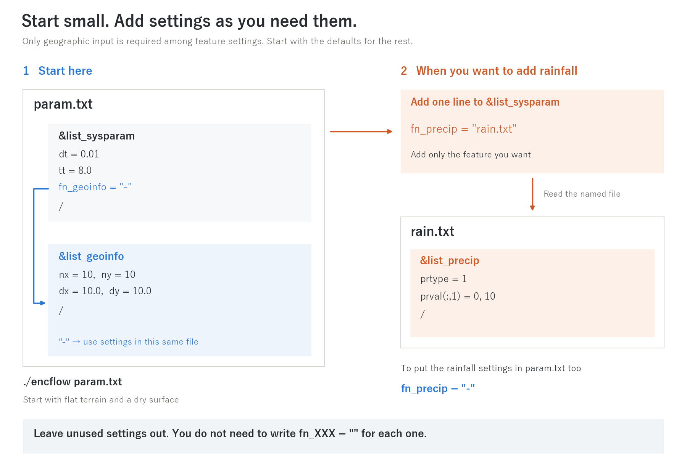

> English mirror of docs/users_guide.md. The Japanese file is the master copy.

# ENCflow User's Guide

This is the reference for configuring and running ENCflow. If you are
new to ENCflow, we recommend running it once through the
[tutorial](tutorial.md) before coming back here (its "Learning path"
says what to read in which order). This page (Part I) explains the
overall structure of ENCflow and the conventions of its input;
individual topics are split into per-chapter pages. The chapter pages
give priority to "getting a run going casually": read them in the order
"overview → just try it (minimal input) → recommended values by pattern
→ the sections you need". Theory, equations, the basis of the defaults
and detailed settings are in the explanation pages that hang under each
chapter (indented "... explained" entries in the table of contents).
There is no need to read every field; the chapters of the fields you
are interested in are enough.

See the [test catalogue](../../test/README.en.md) for checks and execution
procedures, and the [examples catalogue](../../examples/README.en.md) for
phenomenon-specific setups. Individual chapters also link to relevant cases.

## Table of contents

**Part I: The big picture** (this page)
- [The skeleton of ENCflow](#the-skeleton-of-encflow)
- [Enabling features: the fn_\* principle](#enabling-features-the-fn_-principle)
- [How to read a parameter file](#how-to-read-a-parameter-file)
- [Running a computation](#running-a-computation)
- [User routines](#user-routines)
- [Finding features by task](#finding-features-by-task)

**Part II: Cross-cutting facilities**
- [Time management](users_guide/time.md) -- time axis, time step, output interval, calendar
  - [Courant number and how to choose the time step](users_guide/courant.md) -- primer for newcomers to numerical computation: grid and step, Courant number, velocity and wave speed, explicit vs implicit, reading Cn_max, procedure for estimating dt (primer for time management)
  - [Time-step design policy](users_guide/timestep_policy.md) -- why mainly explicit with a fixed step, relation to variable steps and sub-cycling, solving the equations accurately vs reproducing the phenomenon (supplement to time management; intermediate to advanced)
- [Coordinate systems](users_guide/coordinates.md) -- absolute vs. local coordinates, EPSG, geographic (lat-lon) grids
- [Input and output formats](users_guide/io.md) -- text / bil / GeoTIFF, output file organization
- [Writing user routines](users_guide/user_routines.md) — giving topography and initial conditions in code (procedure, index contract, pitfalls)
- [Suspend and restart](users_guide/restart.md) -- state files, time continuation, use as initial conditions
- [Nesting (multi-level grids)](users_guide/nest.md) (fn_nest, &list_nest) -- child grids solved inside a parent grid in the same run (multi-level, two-way, Flather radiation, non-hydrostatic band)
  - [Nesting explained](users_guide/nest_models.md) -- time interpolation, boundary-band methods, the Flather condition, the sponge, child-to-parent replacement and the conservation correction, with the basis of the defaults (supplement to nesting)
- [Parallel execution](users_guide/parallel.md) -- OpenMP, MPI, reproducibility of results

**Part III: Feature reference**
- [Shallow water computation](users_guide/swflow.md) (&list_enc, numerical parameters) -- scheme selection, adaptive Runge-Kutta, numerical constants
  - [ENC grid and time integration](users_guide/encgrid.md) -- passage widths of the eight-direction grid, continuity, cell-velocity reconstruction, pressure/friction/drag terms, adaptive Runge-Kutta, Courant number, parameters and the basis of their defaults (supplement to the shallow water chapter)
  - [Advection schemes](users_guide/advection.md) -- equations, the momentum control volume of the conservative form, stencils, the limiter (supplement to the shallow water chapter)
  - [Non-hydrostatic correction](users_guide/nonhydrostatic.md) -- equations of the one-layer model, projection algorithm, active set, breaking, moving bottom, the models it drew on (supplement to the shallow water chapter)
  - [Diffusion term](users_guide/diffusion.md) -- eddy-viscosity models (constant, zero-equation), nine-point Laplacian, stability condition (supplement to the shallow water chapter)
- [Geographic information](users_guide/geoinfo.md) (&list_geoinfo) -- grid, terrain, roughness, masks, seawalls
- [Initial conditions](users_guide/initial.md) (&list_initial) -- depth, water level, depression filling
- [Boundary conditions](users_guide/boundary.md) (&list_bound_edge/source/stage/inflow) -- edge boundaries, sources, prescribed stages, reach inflow
- [Tide and sea surface](users_guide/tide.md) (&list_tide) -- storm surge, rising-tide inundation, drainage
- [Internal hydraulic structures](users_guide/structure.md) (&list_struct_pump/culvert/diversion/dam) -- pumps, culverts, diversions, dams and lakes
  - [Hydraulics of structures and boundaries](users_guide/hydraulics.md) -- Honma weir formula, the three culvert regimes, dam operation rules, free-outflow and radiation boundaries, inflow distribution, with equations and the basis of the coefficients (supplement)
- [Channels](users_guide/channel.md) (&list_channel) -- levees, channel width, cross-section shape, breach
  - [Channels explained](users_guide/channel_models.md) -- crest and opening correction of the virtual walls, plan-area fraction of the subgrid width, equivalent depth of the section shape σ, breach crest and the basis of the defaults (supplement to channels)
- [Rainfall and weather](users_guide/forcing.md) (&list_precip / intercept / meteo / evap / snow) -- precipitation, interception, air temperature, evapotranspiration, snow accumulation and snowmelt
  - [Rainfall and meteorology models explained](users_guide/forcing_models.md) -- interception models, elevation corrections, Hamon/Thornthwaite PET and the degree-day method, with the basis of the defaults (supplement to rainfall and weather)
- [Groundwater](users_guide/gwflow.md) (&list_gwflow plus model-specific settings) -- infiltration, lateral flow, weathered bedrock layer, conduit continuum layer (sewer networks, fractured bedrock)
  - [Groundwater models](users_guide/gwflow_models.md) -- bucket, Green-Ampt, Boussinesq lateral flow, weathered bedrock layer, conduit continuum layer, pumping and frozen ground, with equations and the basis of the defaults (supplement)
- [Fresh and salt water layers](users_guide/salt.md) (&list_salt) -- salt wedges, seawater intrusion, freshwater lenses (sharp-interface approximation)
- [Sediment and landform change](users_guide/geomorph.md) (&list_geomorph) -- bedload, suspended sediment, hillslope erosion, debris flow, long-term landscape evolution, development of meandering channels (bank erosion, fixation, neck cutoff)
  - [Sediment transport, hillslope and long-term processes](users_guide/sediment.md) -- creep, bedload formulas, Exner, suspended-load exchange, hillslope erosion, dry-slope erosion, weathering/uplift, MORFAC, with equations and the basis of the defaults (supplement)
  - [Debris flow, slope failure and moving bed layer](users_guide/massflow.md) -- single-layer mixture, five resistance laws, erosion/deposition laws, curvature term, safety factor, moving bed layer, with equations and the models referred to (supplement)
- [Driftwood](users_guide/driftwood.md) (&list_driftwood) -- wood recruitment (hydraulic washout / erosion entrainment), transport and deposition (raster-field estimate)
  - [Driftwood models explained](users_guide/driftwood_models.md) -- transfer rules of the three ledgers, draft, area bases and volume budget, sources of the practical values and basis of the defaults (supplement to driftwood)
- [Building destruction and debris](users_guide/bldgdebris.md) (&list_bldgdebris) -- destruction of wooden houses by inundation flows and driftwood, debris transport and deposition, feedback to the void ratio (raster-field estimate)
  - [Building destruction and debris models explained](users_guide/bldgdebris_models.md) -- destruction criterion and ramp, destruction rate, void-ratio feedback, volume budget, thresholds versus the literature and the basis of the defaults (supplement to building destruction and debris)
- [Glaciers](users_guide/glacier.md) (&list_glacier) -- accumulation, melt, ice flow, glacial erosion, avalanche redistribution
- [Lava flows](users_guide/lavaflow.md) (&list_lavaflow) -- vent effusion, Bingham viscous spreading, stopping and solidification (lava fields as topography)
- [Prescribed bed motion](users_guide/bedmotion.md) (&list_bedmotion) -- forcing z with a time history of ground displacement (tsunami generation from faults, coastal uplift/subsidence, breaching a resolved levee)
  - [Prescribed bed motion explained](users_guide/bedmotion_models.md) -- time interpolation of the displacement, fault displacement field and initial sea surface, relation to the non-hydrostatic correction, restart and MPI contract (supplement to prescribed bed motion)
- [Water quality](users_guide/wq.md) (&list_wq) -- load input, transport, decay, washoff, Kd two-phase partitioning, groundwater pathway, reservoirs
  - [Water-quality models](users_guide/wq_models.md) -- decay, settling, Kd partitioning, infiltration and groundwater transport, buildup/washoff, reservoirs and sewer surcharge, with equations and the sources of the representative values (supplement)
- [Soil Water Index](users_guide/swi.md) (&list_swi) - the operational sediment-disaster warning index (JMA 3-tank model; dedicated runs)
- [Measurement](users_guide/record.md) (&list_record) -- probes, flux transects
- [Use cases](users_guide/usecases.md) -- lookup from phenomenon names to feature combinations (unsupported phenomena are listed too)

**Appendix**
- [Full parameter index](users_guide/params_index.md) -- reverse lookup from all 668 parameter names to their chapters

---

## The skeleton of ENCflow

ENCflow computes surface water flow. You can add rainfall, groundwater,
sediment and other processes on the same grid as you need them.

## Enabling features: the fn_\* principle

**Start with just the settings you need.** Among feature settings, only
[geographic input](users_guide/geoinfo.md) (`fn_geoinfo`) is required.
Leave the others out to use their defaults or leave the feature disabled.
**You do not need to write a list of `fn_XXX=""` entries.**

To change the initial conditions or numerical settings, or add a feature
such as rainfall, add its `fn_XXX` entry to `&list_sysparam`.

- Settings in the **same file**: `fn_XXX="-"`
- Settings in a **separate file**: `fn_XXX="filename"`



*Left: a minimal setup with flat terrain. Right: adding rainfall. Leave out the settings for features you do not use.*

**What happens when you leave an entry out?**

| Setting | When omitted |
|---|---|
| Geographic input `fn_geoinfo` | Read `&list_geoinfo` from the same file (geographic input must still be provided) |
| [Initial conditions](users_guide/initial.md) `fn_initial` | Start dry |
| [Shallow water computation](users_guide/swflow.md) `fn_enc` | Compute water flow with the default numerical settings |
| [Boundary conditions](users_guide/boundary.md) `fn_boundary` | All four sides of the domain are impermeable walls (no water passes through) |

The additional features below stay disabled unless you specify their `fn_XXX` entries.

<details>
<summary>Features you can add</summary>

| Feature | Configuration-file entry | namelist group |
|---|---|---|
| Tide and sea surface | `fn_tide` | &list_tide |
| Wave-driven longshore transport (arcuate and cuspate deltas, shoreline smoothing) | `fn_wave` | &list_wave ([Sediment and landform change](users_guide/geomorph.md), "Wave-driven longshore transport"; needs f_fluvial=1 in fn_geomorph) |
| Internal hydraulic structures | `fn_structure` | &list_struct_pump / culvert / diversion / dam |
| Ponds | `fn_reservoir` | (used together with geographic information) |
| Channels | `fn_channel` | &list_channel (+ breach) |
| [Precipitation](users_guide/forcing.md) | `fn_precip` | &list_precip |
| Rainfall interception | `fn_intercept` | &list_intercept (+ model-specific) |
| Weather forcing fields (air temperature etc.) | `fn_meteo` | &list_meteo |
| Evapotranspiration | `fn_evap` | &list_evap |
| Snow accumulation and snowmelt | `fn_snow` | &list_snow |
| Glaciers | `fn_glacier` | &list_glacier |
| Lava flows | `fn_lavaflow` | &list_lavaflow |
| Prescribed bed motion | `fn_bedmotion` | &list_bedmotion |
| Groundwater | `fn_gwflow` | &list_gwflow (+ model-specific) |
| Fresh and salt water layers | `fn_salt` | &list_salt |
| Sediment and landform change | `fn_geomorph` | &list_geomorph |
| Driftwood | `fn_driftwood` | &list_driftwood |
| Building destruction and debris | `fn_bldgdebris` | &list_bldgdebris |
| Water quality (load runoff) | `fn_wq` | &list_wq |
| Soil Water Index | `fn_swi` | &list_swi |
| Measurement (probes, transects) | `fn_record` | &list_record |

</details>

For examples to build on, see the [working setup in test/wave](../../test/wave/en/README.md)
or the [annotated parameter list](../../examples/List_samples/en/list_sysparam.txt).

## How to read a parameter file

A parameter file is a text file in Fortran **namelist format**.

```
&list_sysparam            ! start of a group
  dt = 0.01               ! "name = value" entries; ! starts a comment
  tt = 8.0
  fn_geoinfo = "-"        ! strings are quoted
/                         ! end of the group
```

- Entries may appear in any order; parameters you do not write take
  their default values.
- Arrays can be written line by line with subscripts, as in
  `prval(:,1) = 0, 15`.
- **A parameter name that does not exist (a misspelling) stops the run
  with an error**. When a parameter has been renamed in a version
  update, the same mechanism detects it and the error message points
  you to the new name.
- Error messages and runtime output are in English (we prioritize the
  ability of users worldwide to search and ask about them; Japanese
  explanations are the documentation's job).

### How to read the basis of a default

The explanation page of each chapter (or the chapter page where there is
no explanation page) has a section "**Parameters and the basis of their
defaults**". Each cell of its "Basis" column starts with one of the labels
below. Use them to decide whether a default can be used as it is or must
be calibrated. Literature values carry a footnote, and the bibliography is
in the "References" section at the end of each page.

| Label | Meaning | What to do |
|---|---|---|
| **literature value** | a value from the literature or another model (source in a footnote) | usable as is; when your case differs from the conditions of the source, replace it from the source's tables |
| **customary value** | a standard value widely used in practice or textbooks (no single source) | usable as is; replace it when measurements exist |
| **verification case** | a value chosen with this model's test / examples (linked) | a choice of numerical behaviour; normally left alone |
| **derived** | follows from other parameters or from theory (the formula is given) | follows when the underlying quantity changes |
| **method** | a model option (flag) whose default is the recommended method | pick the method for your case from the chapter's "recommended values by pattern" |
| **empirical** | weak basis, a placeholder chosen during development | meant to be calibrated; check the sensitivity |
| **calibration** | has no universal value and is calibrated case by case | the default is only a starting point |
| **numerical** | a stabilisation, regularisation or iteration setting of the numerics | no physical meaning; normally unchanged |
| **given** | a quantity you supply for your case (default 0 or "none") | always supply it |
| **compatibility** | a default that keeps the earlier behaviour | for new runs, see the recommended values |

Hints on where to look when revising a default (tables from soil texture
to conductivity, from land use to roughness, and so on) follow each table
as "Where to look when revising the defaults".

## Running a computation

```bash
./encflow param.txt
```

You run ENCflow by giving it a single parameter file. To set up the
executable, just place a link to `bin/encflow` (or a copy of it) in
the directory where you want to compute -- it works anywhere
([installation guide Sec. 3.4](install.md#34-run-your-computations-anywhere)).
The screen shows the configuration loading progress, followed by
monitoring columns such as time, conserved quantity S, Runge-Kutta
application rate, and Courant number (how to read the columns:
[tutorial Step 1](../../tutorials/wave/en/README.md#running);
selecting columns: f_disp_\* -- see the
[input and output chapter](users_guide/io.md)).

Results are written to the output directory (default `result/`) as
distribution files (`H0001.txt` etc.), the computation log `Log.txt`,
and a copy of the parameters used. The file naming scheme and formats
are collected in the [input and output chapter](users_guide/io.md).

When a computation stops midway, ENCflow identifies the cause and
**stops with an explicit error** (it never silently continues with
invalid values). The message includes the offending parameter name
and file name, so check those first.

## User routines

For cases where you want to specify terrain or initial conditions by
formulas or code (idealized experiments, benchmarks), there is a
mechanism of user routines invoked by name.

```
&list_initial
  f_user_routine = "wave_hump"   ! identifier of a registered routine
/
```

The registered identifiers are listed at the top of
`src/user_geoinfo.f90` (terrain) and `src/user_initial.f90` (initial
conditions). To write your own, duplicate the `template` at the end
of each file, register an identifier, and rebuild. The procedure, the
variables you can use and the **index contract** (arrays are allocated
only over the window of the domain mask, so loops run over
`lbound`/`ubound`) are explained step by step in
[Writing user routines](users_guide/user_routines.md). User routines are
not used in ordinary computations with real data.

## Finding features by task

For a more detailed list (phenomenon -> feature combination -> key
settings, including unsupported phenomena), see
**[Use cases](users_guide/usecases.md)**.

| What you want to do | Features to use (chapters) |
|---|---|
| Flood inundation | [Geographic information](users_guide/geoinfo.md) + [boundary conditions](users_guide/boundary.md) (+ channels, structures) |
| Dam / farm-pond breach floods | [Channels](users_guide/channel.md) (levees + breach) + [Use cases](users_guide/usecases.md) |
| River levee breach flooding | [Channels](users_guide/channel.md) (breach of a virtual wall) or [Prescribed bed motion](users_guide/bedmotion.md) (breach of a resolved levee) |
| Open levees, detention basins, secondary levees | [Channels](users_guide/channel.md) (levees, openings) + [Structures](users_guide/structure.md) |
| Polder / lowland drainage by pumping | [Structures](users_guide/structure.md) (pumps) + [Tide and sea surface](users_guide/tide.md) |
| Storm surge / tsunami run-up | [Tide and sea surface](users_guide/tide.md) + [boundary conditions](users_guide/boundary.md) |
| Tsunami generation by an earthquake (fault): generation, propagation, run-up, coastal uplift/subsidence | [Prescribed bed motion](users_guide/bedmotion.md) (+ utils/fault2disp) + [boundary conditions](users_guide/boundary.md) (radiation) |
| Tsunamis from landslides, sector collapses, submarine slides | [Sediment and landform change](users_guide/geomorph.md) (moving bed layer) (+ the non-hydrostatic correction in [Shallow water flow](users_guide/swflow.md)) |
| Dispersive tsunamis and waves (soliton fission of river-intruding tsunamis, undular bores, solitary waves) | [Shallow water flow](users_guide/swflow.md) (non-hydrostatic correction f_nonhydrostatic) |
| Rainfall runoff (catchment hydrology) | [Rainfall and weather](users_guide/forcing.md) (+ groundwater) |
| Urban pluvial flooding (sewer drainage and surcharge) | [Groundwater](users_guide/gwflow.md) (conduit continuum layer) + [Rainfall and weather](users_guide/forcing.md) |
| Seawater intrusion, salt wedges, freshwater lenses | [Fresh and salt water layers](users_guide/salt.md) + [Tide and sea surface](users_guide/tide.md) |
| Sediment transport / debris flow | [Sediment and landform change](users_guide/geomorph.md) |
| Development of meandering channels (outer-bank retreat, inner-bank bars turning into land, neck cutoff) | [Sediment and landform change](users_guide/geomorph.md) (bed-load direction correction, bank erosion, angle-of-repose avalanching, fixation; examples/meander and meander_cutoff) |
| Floods and debris flows with driftwood | [Driftwood](users_guide/driftwood.md) (+ sediment and landform change) |
| House destruction and debris by tsunami or storm surge | [Building destruction and debris](users_guide/bldgdebris.md) (+ driftwood, tide) |
| Rainfall-induced slope failure and debris flow | [Sediment and landform change](users_guide/geomorph.md) + [Groundwater](users_guide/gwflow.md) (infiltration -> pore pressure) |
| Reservoir sedimentation and flushing | [Sediment and landform change](users_guide/geomorph.md) + [Structures](users_guide/structure.md) |
| Pollutant loads / mass transport | [Water quality](users_guide/wq.md) |
| Runs including snowmelt | [Rainfall and weather](users_guide/forcing.md) (snow accumulation / snowmelt + temperature lapse rate) |
| Glacier meltwater / cirque formation | [Glaciers](users_guide/glacier.md) (+ rainfall and weather; suspend and restart for long runs) |
| Glacial lake outburst floods (GLOF) | [Glaciers](users_guide/glacier.md) + [Channels](users_guide/channel.md) (breach) |
| Comparison with gauging stations / discharge transects | [Measurement](users_guide/record.md) |
| Splitting long runs / scenario branching | [Suspend and restart](users_guide/restart.md) |
| GIS data (GeoTIFF etc.) input and output | [Coordinate systems](users_guide/coordinates.md) + [input and output](users_guide/io.md) |
| Large-scale runs / cluster execution | [Parallel execution](users_guide/parallel.md) |
