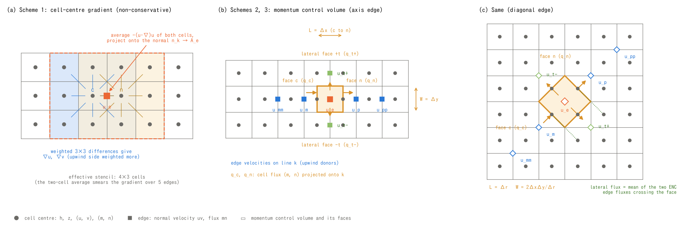
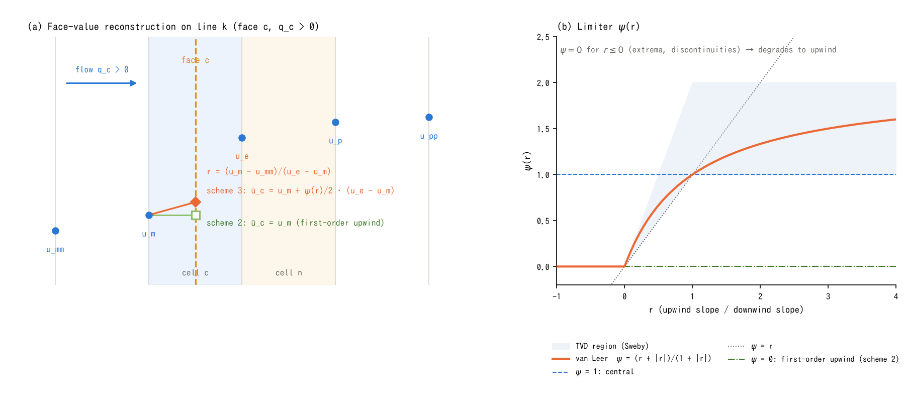

# Advection schemes (supplement to the shallow water chapter)

> English mirror of docs/users_guide/advection.md (based on commit e693e81). The Japanese file is the master copy.

[Back to the shallow water chapter](swflow.md) / [Back to the user's guide index](../users_guide.md)

This page explains how the advection (inertia) term of the momentum
equation is discretised. It gives the equations, the schemes and the
stencils behind `f_advection_scheme`, `p_adv_upwind_index` and
`f_advection_donor` of the [shallow water chapter](swflow.md), in enough
detail to understand what the settings mean. The design history and the
numerical experiments (for developers) are in docs/developer.md §68
(in Japanese).

Equations are written in the LaTeX notation that GitHub Markdown renders.
The figures are generated by `python3 docs/figs/make_guide_figs.py advection`
(`docs/figs/guide/fig_advection.py`), in Japanese and English.

## 1. Equations and the role of the advection term

ENCflow solves the two-dimensional shallow water equations, the continuity
equation and the momentum equation ($h$: depth, $z$: ground elevation,
$\mathbf{u} = (u, v)$: depth-averaged velocity, $n$: Manning's roughness).

$$
\frac{\partial h}{\partial t} + \nabla\cdot(h\mathbf{u}) = 0
$$

$$
\frac{\partial \mathbf{u}}{\partial t}
+ \underbrace{(\mathbf{u}\cdot\nabla)\,\mathbf{u}}_{\text{advection}}
= -\,g\,\nabla(z + h)
\;-\; \frac{g\,n^2\,|\mathbf{u}|}{h^{4/3}}\,\mathbf{u}
\;+\;\cdots
$$

The right-hand side holds the pressure (water-surface slope) term and the
friction term; drag, diffusion, non-hydrostatic and other terms are added
depending on the settings. The advection term is the term by which the flow
carries its own momentum. It matters wherever the velocity changes in space:
bores, hydraulic jumps, sudden contractions and expansions, bends and
confluences. On gentle hillslopes and in wide-area inundation its
contribution is small, and the diffusive-wave approximation
(`f_govequation = 1`) drops it.

Combined with the continuity equation, the same momentum equation can also be
written in **conservative form** (as a momentum flux).

$$
\frac{\partial (h\mathbf{u})}{\partial t}
+ \nabla\cdot(h\,\mathbf{u}\otimes\mathbf{u})
= -\,g\,h\,\nabla(z + h) \;-\;\cdots
$$

For smooth flow the two forms are the same thing, but **across a
discontinuity (a bore or a hydraulic jump) only the conservative form gives
the correct jump conditions (Rankine–Hugoniot)**. A finite difference of the
non-conservative term $(\mathbf{u}\cdot\nabla)\mathbf{u}$ loses momentum
across the discontinuity: the bore lags and oscillations appear behind it.
This is the essential difference between scheme 1 and schemes 2 and 3
(§3, §4).

**The update on the ENC grid.** The ENC grid takes the edge-normal velocity
$u_e$ as its unknown. For the edge $e$ from the reference cell $c$ to its
$k$-th neighbour $n$ (normal $\mathbf{n}_k$, distance between the cell
centres $L_k$), the update treats friction semi-implicitly:

$$
u_e^{\,n+1} = \frac{u_e^{\,n} + \left(A_e + G_e\right)\Delta t}{1 - F_e\,\Delta t},
\qquad
G_e = -\,g\,\frac{\eta_n - \eta_c}{L_k}
$$

$G_e$ is the pressure term from the slope of the water surface
$\eta = z + h$, $F_e \le 0$ is the friction and drag coefficient, and $A_e$
is **the subject of this page, the advection term**
$-\left[(\mathbf{u}\cdot\nabla)\mathbf{u}\right]\cdot\mathbf{n}_k$
evaluated on edge $e$. $A_e$ is precomputed for every edge at the start of
the step from time-level-$n$ quantities only, and it stays at that value
during the recomputation stages of the adaptive Runge–Kutta (scaling it by
the velocity ratio, and an affine update, were tried and rejected;
developer.md §68.19, §68.23).

## 2. The ENC grid layout (recap)

As in figure (a) of the [shallow water chapter](swflow.md), depth $h$ and
ground elevation $z$ sit at the cell centres, and the normal velocity $uv$
and the flux per unit width $mn$ sit on the edges to the eight surrounding
cells (four axis and four diagonal directions). Three quantities are used in
the explanation below.

| Symbol | Location | Meaning |
|---|---|---|
| $u_e$ (array uv) | edge | normal velocity, positive from the reference cell toward the neighbour |
| $q_c = (m_c, n_c)$ (arrays m, n) | cell centre | cell-average flux per unit width; the same definition the continuity equation sees, composed from the edge fluxes $mn$ with geometric weights |
| $\mathbf{u}_c = (u_c, v_c)$ (arrays u, v) | cell centre | cell velocity, reconstructed from the edge velocities with geometric weights |

The geometry of edge $k$ is the distance between the cell centres $L_k$
(axis: $\Delta x$ or $\Delta y$; diagonal:
$\Delta r = \sqrt{\Delta x^2 + \Delta y^2}$) and the unit normal
$\mathbf{n}_k = (n^x_k, n^y_k)$. Reduced to one dimension, the reconstructed
cell velocity is exactly the mean of the two edges,
$u_c = (u_{i-1/2} + u_{i+1/2})/2$, whatever `p_diagratio` is. The
properties of scheme 1 (§3) follow from this fact.

## 3. Scheme 1: cell-centre gradient (non-conservative; former default)

**(a)** is the stencil of scheme 1. It is computed in three steps.

**(1) Gradient at the cell centre.** At every wet cell $c$, $\nabla u$ and
$\nabla v$ are weighted averages of the differences to the eight neighbours
(the $x$ derivative as an example; $\delta i_k \in \{-1, 0, 1\}$ is the
$i$ offset of neighbour $k$).

$$
\left.\frac{\partial u}{\partial x}\right|_c
\approx \frac{\displaystyle\sum_{k=1}^{8} w_k\,(u_k - u_c)\,\frac{\delta i_k}{\Delta x}}
{\displaystyle\sum_{k=1}^{8} w_k},
\qquad
w_k = w^{x}_k\;\omega_k\;\chi_k
$$

$w^x_k$ is the geometric weight of the axis and diagonal directions (the
passage-width share), $\chi_k$ is 1 when the neighbour is valid and wet and
0 otherwise (dry cells and cells outside the domain are left out of the
difference), and $\omega_k$ is the **upwind weight**.

$$
\omega_k = \max\!\left(1 - \frac{p}{2}\,\bigl(1 - \hat w_k\bigr),\; 0\right),
\qquad
\hat w_k = -\,\frac{\mathbf{u}_c\cdot\mathbf{n}_k}{|\mathbf{u}_c|}\in[-1, 1]
$$

$p$ is `p_adv_upwind_index`. An upwind neighbour ($\hat w_k = 1$) always
has weight 1, a downwind neighbour ($\hat w_k = -1$) has weight $1 - p$.
$p = 0$ is a symmetric central difference, $p = 1$ a one-sided (first-order
upwind) difference that ignores the downwind side (the default 0.5 is in
between). The velocity enters as $u\,\ell_m$, with the effective inertia
coefficient $\ell_m$ derived from the building porosity `gv`
([Geographic information](geoinfo.md)).

**(2) Advection term of the cell.**

$$
\mathbf{T}_c = -\left(
u_c\frac{\partial u}{\partial x} + v_c\frac{\partial u}{\partial y},\;
u_c\frac{\partial v}{\partial x} + v_c\frac{\partial v}{\partial y}
\right)
$$

**(3) Projection onto the edge.** The mean of the two cells is projected
onto the normal.

$$
A_e = \tfrac{1}{2}\left(\mathbf{T}_c + \mathbf{T}_n\right)\cdot\mathbf{n}_k
$$

**Properties.**

- **Non-conservative.** Because it is not written as a momentum flux, it
  loses momentum at discontinuities. In the wet-bed dam break (Stoker's
  analytical solution, test/dambreak) the bore position lags by 15%, an
  overshoot of 3 m (a 2Δx oscillation) appears behind the bore, and a
  standing hump remains at the dam site. Stronger upwinding ($p \to 1$)
  increases the lag.
- **Smoothing over five edges.** The cell velocity is the mean of the two
  edges, so the chain "centre → gradient → two-cell mean" is a derivative
  damped by an extra factor $\cos^2(\kappa L/2)$ relative to the compact
  central difference on the edges, $(u_{e+1} - u_{e-1})/2L$ (0.5 at a
  wavelength of $4L$, 0.85 at $8L$). The advection term of short waves is
  halved, so wave forms are smeared whether or not upwinding is used. The
  effective stencil is the dashed 4×3 cells of figure (a).
- **No grid convergence on real terrain.** On a stepped river bed the
  dissipation at each step is underestimated, and the runoff gets faster and
  larger as the grid is refined (table in §5).
- Kept for reproducing cases calibrated with older versions. Use the default
  scheme 3 for new computations.

## 4. Schemes 2 and 3: momentum-conservative form (Stelling & Duinmeijer 2003)

### 4.1 Idea: a momentum control volume around the edge

Even on a staggered layout, if a control volume $\Omega_e$ is taken around
edge $e$ and the conservative momentum equation is integrated over it, the
advection term can be written as the momentum flux through its faces.

$$
\frac{d}{dt}\int_{\Omega_e} h\,u\;dA
\;+\;\oint_{\partial\Omega_e} u\,\bigl(h\mathbf{u}\cdot\mathbf{n}\bigr)\,ds
\;=\;\cdots
$$

Subtracting $u_e$ times the continuity equation over the same volume,

$$
u_e\left[\frac{d}{dt}\int_{\Omega_e} h\;dA
+ \oint_{\partial\Omega_e}\bigl(h\mathbf{u}\cdot\mathbf{n}\bigr)\,ds\right] = 0,
$$

gives an equivalent non-conservative expression in terms of the mass flux
$Q_f$ through each face $f$ (positive outward) and the velocity $\bar u_f$
carried through that face.

$$
\boxed{\;
A_e = -\,\frac{1}{\bar h_e\,L_k\,W_k}\,\sum_{f}\,Q_f\,\bigl(\bar u_f - u_e\bigr)
\;}
$$

$\bar h_e$ is the depth of the control volume and $L_k W_k$ its area. This
form has two merits.

- **Discrete momentum is conserved.** The same mass fluxes $Q_f$ as in the
  continuity equation are used, so when summed over all edges the face
  fluxes cancel and no momentum is lost across a discontinuity. Without a
  Riemann solver, bores and hydraulic jumps travel at the correct speed for
  every Froude number (S&D 2003; adopted by SWASH, D-Flow FM and 3Di).
- **The direction is intuitive.** With first-order upwinding ($\bar u_f$ =
  the velocity on the inflow side) an outflow face has $\bar u_f = u_e$ and
  contributes nothing; only the inflow faces pull $u_e$ toward the velocity
  of the water that enters. Nothing flows in from a wall or a dry bed
  (§4.4), so they contribute nothing either.

### 4.2 Control volume and faces (figures (b), (c))

The control volume is a rectangle centred on edge $e$: its length along
line $k$ is $L_k$ (from the centre of cell $c$ to the centre of $n$) and its
width across is $W_k$ (the perpendicular distance to the parallel
neighbouring edges).

| Edge | $L_k$ | $W_k$ | Area $L_k W_k$ (square cells) |
|---|---|---|---|
| axis ($x$ normal) | $\Delta x$ | $\Delta y$ | one cell |
| axis ($y$ normal) | $\Delta y$ | $\Delta x$ | one cell |
| diagonal | $\Delta r$ | $2\Delta x\Delta y/\Delta r$ | two cells (the diamond through the centres of c, n and the two side cells) |

There are four faces, with the following mass fluxes ($Q_f$ is the flux per
unit width $q$ times the length of the face).

- **Flow-direction faces $c$, $n$** (through the cell centres, with
  normal $\mathbf{n}_k$): the cell flux projected onto line $k$,
  $q_c = m_c\,n^x_k + n_c\,n^y_k$, and likewise $q_n$; $Q = q\,W_k$.
  This is exactly the cell-average flux the ENC continuity equation sees,
  and in one dimension it equals the "mean of the two edges on the line" of
  S&D.
- **Lateral faces $\pm t$** (parallel to line $k$): the mean $q_{t\pm}$ of
  the actual fluxes $mn$ of the two ENC edges that cross the face (c → c+δ
  and n → n+δ, the dotted lines in figure (c)), positive outward;
  $Q = q_{t\pm}\,L_k$. Projecting the cell flux at the face centre instead
  gave a non-zero flux even on faces blocked by terrain where no water
  actually passes, and the advection term, amplified by $1/\bar h_e$ in a
  thin control volume, blew up; hence the actual edge fluxes
  (developer.md §68.21).

The implemented expression expands to the following ($q_c$ positive from
$c$ to $n$, $q_{t\pm}$ positive outward).

$$
A_e = -\,\frac{\ell_m}{\bar h_e}\left[
\frac{q_n\,(\bar u_n - u_e) - q_c\,(\bar u_c - u_e)}{L_k}
+ \frac{q_{t+}\,(\bar u_{t+} - u_e) + q_{t-}\,(\bar u_{t-} - u_e)}{W_k}
\right],
\qquad
\bar h_e = \max\!\left(\frac{h_c + h_n}{2},\;\frac{dd}{2}\right)
$$

$\bar h_e$ is taken at time level $n$ (ENC solves momentum before
continuity, so $h^{n+1}$ is unknown; dividing by a $\bar h^{n+1}$
extrapolated with the previous step's fluxes made the bore speed worse).
With sub-grid channels ([Channels](channel.md)) the water volume per unit
area of the cell ($h \times$ channel width fraction, or the equivalent depth
when the cross-section σ is active) replaces $h$, so that it stays
consistent with $q$. $\ell_m$ is the same effective inertia coefficient as
in scheme 1.

### 4.3 Face velocities: first-order upwind (scheme 2) and MUSCL (scheme 3)

For the flow-direction faces, $\bar u$ is taken from the **upwind side** of
the flow through the face, among the five edge velocities on line $k$,
$u_{mm}, u_m, u_e, u_p, u_{pp}$ (the blue squares in figures (b), (c)).
For face $c$:

| Flow through face $c$ | upwind $u_\mathrm{up}$ | downwind $u_\mathrm{dn}$ | further upwind $u_\mathrm{upup}$ |
|---|---|---|---|
| $q_c \ge 0$ (into the control volume) | $u_m$ | $u_e$ | $u_{mm}$ |
| $q_c < 0$ (out of the control volume) | $u_e$ | $u_m$ | $u_p$ |

Face $n$ is symmetric. The face value is reconstructed from these three
values.

$$
\bar u =
\begin{cases}
u_\mathrm{up} & \text{scheme 2 (first-order upwind)}\\[4pt]
u_\mathrm{up} + \dfrac{\psi(r)}{2}\,\bigl(u_\mathrm{dn} - u_\mathrm{up}\bigr),
\quad r = \dfrac{u_\mathrm{up} - u_\mathrm{upup}}{u_\mathrm{dn} - u_\mathrm{up}}
& \text{scheme 3 (MUSCL)}
\end{cases}
$$

$$
\psi(r) = \frac{r + |r|}{1 + |r|}\quad\text{(van Leer)}
$$

The limiter $\psi$ is the curve in figure (b). At $r = 1$ (uniform slope)
$\psi = 1$ and $\bar u = (u_\mathrm{up} + u_\mathrm{dn})/2$ is the
second-order central value; for $r \le 0$ (extrema, discontinuities)
$\psi = 0$ and the face value degrades to first-order upwind. The curve
lies inside Sweby's TVD region (light blue), so no new extrema (overshoots)
are created on either side of a discontinuity. Schemes 2 and 3 differ in
this one line of the face value only; the rest of the path is shared.

The lateral faces use first-order upwinding: on inflow ($q_t < 0$) the
velocity of the parallel neighbouring edge $u_{t\pm}$ (green in the figure),
on outflow $u_e$ (no contribution).

### 4.4 Walls, dry cells and boundaries

- **Walls and dry beds supply no momentum.** If the upwind donor cell is
  outside the domain, invalid (outside the mask) or dry ($h < dd$), the face
  takes $\bar u = u_e$ and contributes nothing. Reading the stored value 0
  instead would mean "still water flows in from the wall side", and in a
  one-cell-wide raster channel every bend would lose about 0.55 m of
  artificial head (developer.md §68.8).
- **The far donor of MUSCL.** If the cell beyond the $u_\mathrm{upup}$ edge
  is outside the domain or invalid, that face degrades to first-order
  upwind (reading 0 would give $r \gg 1 \to \psi = 2$, anti-diffusion, and
  the first edge leaving a prescribed boundary would blow up; §69.9).
- **Donors limited to channel cells (`f_advection_donor = 1`).** On edges
  between channel cells of the channel mask (`fn_rw`), the donors of the
  flow-direction faces are limited to channel cells (a face whose donor is a
  non-channel cell takes $\bar u = u_e$). This prevents the artificial loss
  that accumulates at bends, confluences and irregular two-cell-wide reaches
  when the upwind edge on line $k$ falls onto a flooded valley-floor or
  hillslope cell whose slow water becomes the momentum donor. Lateral faces
  are not affected (the deceleration by lateral inflow from the hillslopes
  is physical and stays). It also cuts the momentum exchange between the
  main channel and the flooded valley floor, so the default is 0; judge its
  validity against observations (§68.18).
- **Excluded edges.** Edges excluded from the momentum equation (invalid
  neighbour, zero passage width, both cells dry) have $A_e = 0$. With
  `f_channel_advection = 0` the term is also dropped on edges touching a
  channel cell ([Channels](channel.md)).

### 4.5 Time integration, stencil and parallelism

- All inputs are time-level-$n$ values (edge velocity $uv$, cell fluxes
  $m, n$, depth $h$). The term is precomputed for every edge into an array
  at the start of the step, and the momentum equation only reads it.
- The stencil spans ±2 edges along line $k$ and ±1 edge across. With MPI
  band decomposition the exchange at the start of the step covers $uv$ with
  an edge width of 2 and $m, n$ with a cell width of 2 (scheme 1 does not
  exchange them: no extra communication or memory). Results are bitwise
  identical for any number of ranks ([Parallel execution](parallel.md)).
- Diagonal edges use the same formula as axis edges. In the one-dimensional
  uniform-flow limit both update formulas have the same form, preserving the
  relation $u_d = u_a\,n^x_k$ between the diagonal velocity and the
  projection of the axis velocity.
- The cost relative to scheme 1 is +12–20% for scheme 2 and +19–27% for
  scheme 3 (five edges on the line plus two lateral edges read per edge, and
  the exchange at the start of the step). Memory is about the same.

## 5. Properties and choice

The essentials of the numerical experiments of developer.md §68 (2026-10).

| | Scheme 1 | Scheme 2 | Scheme 3 (default) |
|---|---|---|---|
| Formulation | cell-centre $(\mathbf{u}\cdot\nabla)\mathbf{u}$ (non-conservative), two-cell mean | momentum-conservative, first-order upwind face values | momentum-conservative + MUSCL (van Leer) |
| Upwinding | `p_adv_upwind_index` (weak; the two-cell mean is the main cause of smearing) | full first-order upwind | central where smooth, upwind at extrema and discontinuities |
| Bore (Stoker) position error / overshoot behind it | −15.5% / 3.2 m | +0.5% / 0.8 m | +1.1% / 0.04 m |
| Smooth flood wave (1-cell channel, peak at 3.8 km) | 176.5 | 176.5 | 176.5 (all three identical) |
| Spatially varied flow with lateral inflow (depth ratio to the physical solution) | 1.7–2.0 (no momentum sink; supercritical flow turns subcritical) | about the same as 3 | 0.992 |
| Grid convergence on real terrain (chichibu) 500 → 50 m | runoff keeps growing; blows up at 50 m | about the same as 3 | converges |
| Stability | blows up on the 50 m DEM and in 1–2 cell incised channels | upwinding provides the stability | same |
| Cost | 1.00 | 1.19 | 1.27 |
| Role | legacy; reproducing existing calibrations | fallback for 3 (coarse problems that tolerate the overshoot at the bore front) | **default**; best for bores, jumps, lateral inflow, convergence and stability |

**Guidance.**

- Bores, hydraulic jumps, tsunami run-up and other flows with
  discontinuities: the default (3).
- Rainfall runoff on a real DEM with a channel mask: 3 +
  `f_opening_dynamic = 1` + `f_dry_head_cap = 1` (the defaults). If the
  result is later and smaller than observed, try `f_advection_donor = 1`.
  Roughness calibrated with scheme 1 needs recalibration.
- Inundation, incised terrain and dam breaks without a channel mask: 3 +
  `f_opening_dynamic = 2`. Use `f_hcap_upwind = 2` only when a sharp bore
  front on a wet bed is wanted.
- Smooth hillslope flow, kinematic waves, coarse grids (≥ 500 m): 1 and 3
  agree within a few percent. Use 3 for consistency.
- Reproducing cases calibrated with older versions:
  `f_advection_scheme = 1`, `f_opening_dynamic = 0`, `f_dry_head_cap = 0`
  (the defaults before 2026-10-03).

**Neighbouring switches that interact with the advection term.** All are
listed in the [shallow water chapter](swflow.md).

- `f_opening_dynamic`: in one-cell-wide channels and along walls the blocked
  diagonal passage widths make the axis edge velocity about 2.4 times the
  cell velocity, which amplifies the acceleration and deceleration by the
  advection term (scheme 3 in particular). Reassigning the blocked shares to
  the open edges removes this.
- `f_dry_head_cap`: the pressure term stops water from climbing onto dry
  ground above the water surface, but where the advection term wins, water
  can leak over at bore fronts and in incised channels. Capping the edge
  depth toward a dry cell by the energy head prevents it.
- `f_hcap_upwind = 2`: with schemes 2 and 3 the edge depth of the
  continuity equation, $h_e = (h_c + h_n)/2$, is small at the bore front and
  water can pile up in the one cell behind it (a spike). Using the upwind
  depth removes the spike but increases the frontal outflow onto dry beds.

## 6. Verification cases

- **test/dambreak** -- Stoker's wet-bed dam break (flat, frictionless;
  $h_l = 10$ m, $h_r = 1$ m). Bore position, the depth and velocity of the
  intermediate state and the L1 error are compared with the analytical
  solution (`Check_stoker.py`). Source of the bore row in §5.
- **test/bendloss** -- one-cell-wide channels: straight vs. bent (bend
  loss), stepped beds (dissipation at steps), lateral inflow (physical
  solution of spatially varied flow). The README lists the cases.
- **test/hillslope** -- smooth hillslope and V-shaped catchment. Confirms
  that schemes 1 and 3 agree.
- **test/chichibu** -- real terrain (100 m). The place for grid convergence
  and comparison with observations.

## References

- Stelling, G. S. and Duinmeijer, S. P. A. (2003): A staggered conservative
  scheme for every Froude number in rapidly varied shallow water flows.
  *Int. J. Numer. Meth. Fluids*, 43, 1329–1354.
- van Leer, B. (1979): Towards the ultimate conservative difference scheme V.
  A second-order sequel to Godunov's method. *J. Comput. Phys.*, 32, 101–136.
- Sweby, P. K. (1984): High resolution schemes using flux limiters for
  hyperbolic conservation laws. *SIAM J. Numer. Anal.*, 21, 995–1011.
- Stoker, J. J. (1957): *Water Waves*. Interscience, New York.
