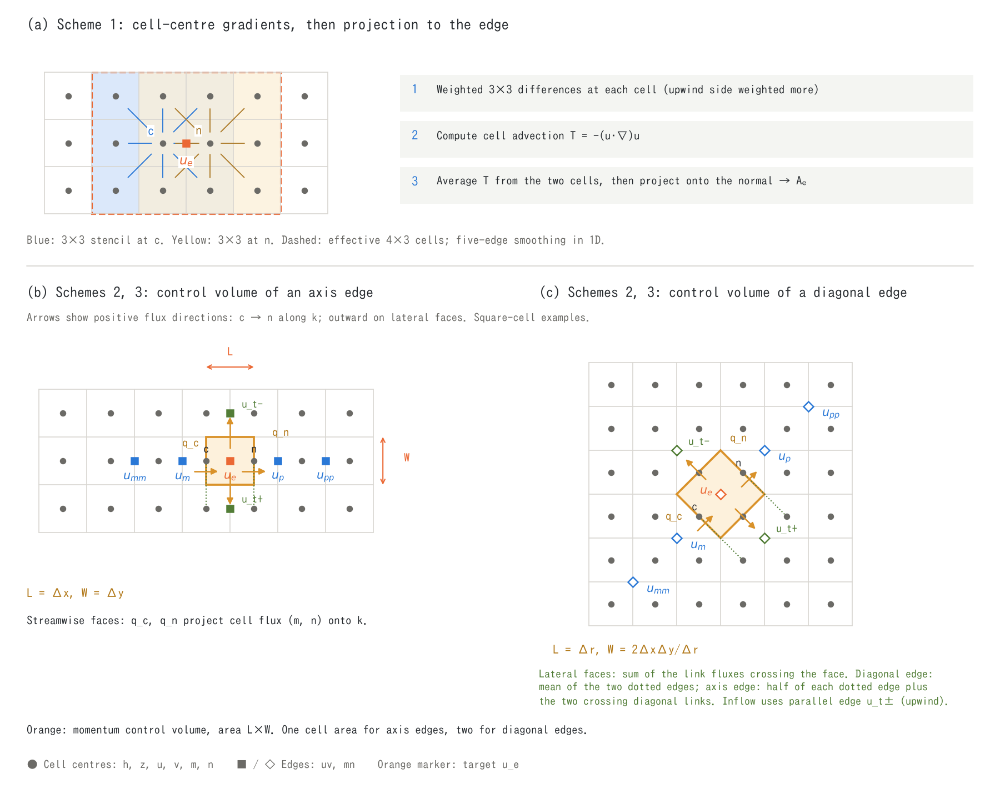
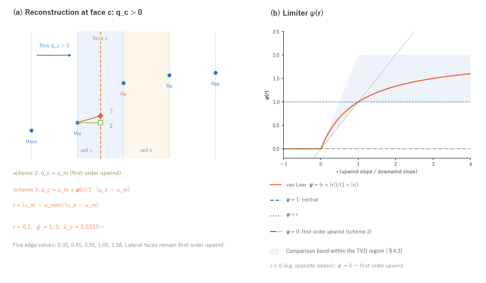

# Advection schemes (supplement to the shallow water chapter)

> English mirror of docs/users_guide/advection.md. The Japanese file is the master copy.

[Back to the shallow water chapter](swflow.md) | [Back to the user's guide index](../users_guide.md)

This page explains how the advection (inertia) term of the momentum
equation is discretised. It gives the equations, the schemes and the
stencils behind `f_advection_scheme`, `p_adv_upwind_index` and
`f_advection_donor` of the [shallow water chapter](swflow.md), in enough
detail to understand what the settings mean. The design history and the
numerical experiments (for developers) are in docs/developer.md §68
(in Japanese).

A detailed design note (control-volume geometry, one-dimensional consistency,
the diagonal sub-lattice mode and the revised lateral faces, verification and
open issues) is in [docs/advection_design.md](../../advection_design.md)
(Japanese). The size of the crosswind numerical diffusion that the fluxes of
diagonal edges produce (for momentum and for scalar transport), and an
overview of the countermeasures for each case, are in
[Numerical diffusion by diagonal-edge fluxes](diagonal_diffusion.md).
How the upwind donor of the advection term is treated when it falls on a thin
film on the bank of a one-cell-wide channel oblique to the grid
(`f_advection_donor`) is explained with figures in
[One-cell-wide channels and the upwind donors of the advection term](advection_donor.md).
The rule and the limits of the cap on the edge depth toward ground above the
water surface (`f_dry_head_cap`) are in
[The cap on the edge depth toward higher ground](dry_head_cap.md).

## 1. Equations and the role of the advection term

ENCflow solves the two-dimensional shallow water equations, the continuity
equation and the momentum equation ($`h`$: depth, $`z`$: ground elevation,
$`\mathbf{u} = (u, v)`$: depth-averaged velocity, $`n`$: Manning's roughness).

```math
\frac{\partial h}{\partial t} + \nabla\cdot(h\mathbf{u}) = 0
```

```math
\frac{\partial \mathbf{u}}{\partial t}
+ \underbrace{(\mathbf{u}\cdot\nabla)\,\mathbf{u}}_{\text{advection}}
= -\,g\,\nabla(z + h)
\;-\; \frac{g\,n^2\,|\mathbf{u}|}{h^{4/3}}\,\mathbf{u}
\;+\;\cdots
```

The right-hand side holds the pressure (water-surface slope) term and the
friction term; drag, diffusion, non-hydrostatic and other terms are added
depending on the settings. The advection term is the term by which the flow
carries its own momentum. It matters wherever the velocity changes in space:
bores, hydraulic jumps, sudden contractions and expansions, bends and
confluences. On gentle hillslopes and in wide-area inundation its
contribution is small, and the local-inertia setting
(`f_govequation = 1`; formerly written "diffusive wave") drops it.
The meaning of each term and the kinds of approximation that drop terms
are in the primer
[The shallow water equations and the dynamic, diffusion and kinematic waves](shallow_water.md).

Combined with the continuity equation, the same momentum equation can also be
written in **conservative form** (as a momentum flux).

```math
\frac{\partial (h\mathbf{u})}{\partial t}
+ \nabla\cdot(h\,\mathbf{u}\otimes\mathbf{u})
= -\,g\,h\,\nabla(z + h) \;-\;\cdots
```

For smooth flow the two forms are the same thing, but **across a
discontinuity (a bore or a hydraulic jump) only the conservative form gives
the correct jump conditions (Rankine–Hugoniot)**. A finite difference of the
non-conservative term $`(\mathbf{u}\cdot\nabla)\mathbf{u}`$ loses momentum
across the discontinuity: the bore lags and oscillations appear behind it.
This is the essential difference between scheme 1 and schemes 2 and 3
(§3, §4).

**The update on the ENC grid.** The ENC grid takes the edge-normal velocity
$`u_e`$ as its unknown. For the edge $`e`$ from the reference cell $`c`$ to its
$`k`$-th neighbour $`n`$ (normal $`\mathbf{n}_k`$, distance between the cell
centres $`L_k`$), the update treats friction semi-implicitly:

```math
u_e^{\,n+1} = \frac{u_e^{\,n} + \left(A_e + G_e\right)\Delta t}{1 - F_e\,\Delta t},
\qquad
G_e = -\,g\,\frac{\eta_n - \eta_c}{L_k}
```

$`G_e`$ is the pressure term from the slope of the water surface
$`\eta = z + h`$, $`F_e \le 0`$ is the friction and drag coefficient, and $`A_e`$
is **the subject of this page, the advection term**
$`-\left[(\mathbf{u}\cdot\nabla)\mathbf{u}\right]\cdot\mathbf{n}_k`$
evaluated on edge $`e`$. $`A_e`$ is precomputed for every edge at the start of
the step from time-level-$`n`$ quantities only, and it stays at that value
during the recomputation stages of the adaptive Runge–Kutta (scaling it by
the velocity ratio, and an affine update, were tried and rejected;
developer.md §68.19, §68.23).

## 2. The ENC grid layout (recap)

As in figure (a) of the [shallow water chapter](swflow.md), depth $`h`$ and
ground elevation $`z`$ sit at the cell centres, and the normal velocity $`uv`$
and the flux per unit width $`mn`$ sit on the edges to the eight surrounding
cells (four axis and four diagonal directions). Three quantities are used in
the explanation below.

| Symbol | Location | Meaning |
|---|---|---|
| $`u_e`$ (array uv) | edge | normal velocity, positive from the reference cell toward the neighbour |
| $`q_c = (m_c, n_c)`$ (arrays m, n) | cell centre | cell-average flux per unit width; the same definition the continuity equation sees, composed from the edge fluxes $`mn`$ with geometric weights |
| $`\mathbf{u}_c = (u_c, v_c)`$ (arrays u, v) | cell centre | cell velocity, reconstructed from the edge velocities with geometric weights |

The geometry of edge $`k`$ is the distance between the cell centres $`L_k`$
(axis: $`\Delta x`$ or $`\Delta y`$; diagonal:
$`\Delta r = \sqrt{\Delta x^2 + \Delta y^2}`$) and the unit normal
$`\mathbf{n}_k = (n^x_k, n^y_k)`$. Reduced to one dimension, the reconstructed
cell velocity is exactly the mean of the two edges,
$`u_c = (u_{i-1/2} + u_{i+1/2})/2`$, whatever `p_diagratio` is. The
properties of scheme 1 (§3) follow from this fact.

## 3. Scheme 1: cell-centre gradient (non-conservative; former default)



**Figure: advection stencils and control volumes.** (a) Cell-centre gradients and projection to the edge for scheme 1; (b)(c) axis and diagonal edges for schemes 2 and 3. Orange areas are momentum control volumes and orange markers are the updated edges. Arrows indicate positive flux directions: c → n on the streamwise faces, outward on the lateral faces. Dotted lines are the two ENC edges used for a lateral flux (for axis edges the two diagonal links crossing the face are added; see the text); green markers are parallel edges supplying the inflow velocity. For square cells, the control-volume areas are one and two cell areas, respectively.

**(a)** is the stencil of scheme 1. It is computed in three steps.

**(1) Gradient at the cell centre.** At every wet cell $`c`$, $`\nabla u`$ and
$`\nabla v`$ are weighted averages of the differences to the eight neighbours
(the $`x`$ derivative as an example; $`\delta i_k \in \{-1, 0, 1\}`$ is the
$`i`$ offset of neighbour $`k`$).

```math
\left.\frac{\partial u}{\partial x}\right|_c
\approx \frac{\displaystyle\sum_{k=1}^{8} w_k\,(u_k - u_c)\,\frac{\delta i_k}{\Delta x}}
{\displaystyle\sum_{k=1}^{8} w_k},
\qquad
w_k = w^{x}_k\;\omega_k\;\chi_k
```

$`w^x_k`$ is the geometric weight of the axis and diagonal directions (the
passage-width share), $`\chi_k`$ is 1 when the neighbour is valid and wet and
0 otherwise (dry cells and cells outside the domain are left out of the
difference), and $`\omega_k`$ is the **upwind weight**.

```math
\omega_k = \max\!\left(1 - \frac{p}{2}\,\bigl(1 - \hat w_k\bigr),\; 0\right),
\qquad
\hat w_k = -\,\frac{\mathbf{u}_c\cdot\mathbf{n}_k}{|\mathbf{u}_c|}\in[-1, 1]
```

$`p`$ is `p_adv_upwind_index`. An upwind neighbour ($`\hat w_k = 1`$) always
has weight 1, a downwind neighbour ($`\hat w_k = -1`$) has weight $`1 - p`$.
$`p = 0`$ is a symmetric central difference, $`p = 1`$ a one-sided (first-order
upwind) difference that ignores the downwind side (the default 0.5 is in
between). The velocity enters as $`u\,\ell_m`$, with the effective inertia
coefficient $`\ell_m`$ derived from the building porosity `gv`
([Geographic information](geoinfo.md)).

**(2) Advection term of the cell.**

```math
\mathbf{T}_c = -\left(
u_c\frac{\partial u}{\partial x} + v_c\frac{\partial u}{\partial y},\;
u_c\frac{\partial v}{\partial x} + v_c\frac{\partial v}{\partial y}
\right)
```

**(3) Projection onto the edge.** The mean of the two cells is projected
onto the normal.

```math
A_e = \tfrac{1}{2}\left(\mathbf{T}_c + \mathbf{T}_n\right)\cdot\mathbf{n}_k
```

**Properties.**

- **Non-conservative.** Because it is not written as a momentum flux, it
  loses momentum at discontinuities. In the wet-bed dam break (Stoker's
  analytical solution[^stoker57], [test/dambreak](../../../test/dambreak/en/README.md)) the bore position lags by 15%, an
  overshoot of 3 m (a 2Δx oscillation) appears behind the bore, and a
  standing hump remains at the dam site. Stronger upwinding ($`p \to 1`$)
  increases the lag.
- **Smoothing over five edges.** The cell velocity is the mean of the two
  edges, so the chain "centre → gradient → two-cell mean" is a derivative
  damped by an extra factor $`\cos^2(\kappa L/2)`$ relative to the compact
  central difference on the edges, $`(u_{e+1} - u_{e-1})/2L`$ (0.5 at a
  wavelength of $`4L`$, 0.85 at $`8L`$). The advection term of short waves is
  halved, so wave forms are smeared whether or not upwinding is used. The
  effective stencil is the dashed 4×3 cells of figure (a).
- **The result on real terrain changes a great deal with the upwind index.**
  With a small index the velocity grows on a fine grid and the computation
  becomes unstable (with index 0.1 on the 50 m grid of Chichibu the maximum
  velocity reaches 81 m/s and the discharge near the catchment outlet goes up
  and down by up to 13,000 m³/s from one minute to the next; depending on the
  time step, the Courant number exceeds 1 and the run stops). A large index
  makes the runoff slower and smaller (the peak discharge near the
  catchment outlet differs by a factor of 1.6 to 1.8 between the indices 0.1
  and 1.0; table in §5).
- Kept for reproducing cases calibrated with older versions. Use the default
  scheme 3 for new computations.

## 4. Schemes 2 and 3: momentum-conservative form

### 4.1 Idea: a momentum control volume around the edge

Even on a staggered layout, if a control volume $`\Omega_e`$ is taken around
edge $`e`$ and the conservative momentum equation is integrated over it, the
advection term can be written as the momentum flux through its faces (the
staggered conservative scheme of Stelling & Duinmeijer[^sd03], extended to
the eight directions of the ENC grid).

```math
\frac{d}{dt}\int_{\Omega_e} h\,u\;dA
\;+\;\oint_{\partial\Omega_e} u\,\bigl(h\mathbf{u}\cdot\mathbf{n}\bigr)\,ds
\;=\;\cdots
```

Subtracting $`u_e`$ times the continuity equation over the same volume,

```math
u_e\left[\frac{d}{dt}\int_{\Omega_e} h\;dA
+ \oint_{\partial\Omega_e}\bigl(h\mathbf{u}\cdot\mathbf{n}\bigr)\,ds\right] = 0,
```

gives an equivalent non-conservative expression in terms of the mass flux
$`Q_f`$ through each face $`f`$ (positive outward) and the velocity $`\bar u_f`$
carried through that face.

```math
\boxed{\;
A_e = -\,\frac{1}{\bar h_e\,L_k\,W_k}\,\sum_{f}\,Q_f\,\bigl(\bar u_f - u_e\bigr)
\;}
```

$`\bar h_e`$ is the depth of the control volume and $`L_k W_k`$ its area. This
form has two merits.

- **Discrete momentum is conserved.** The same mass fluxes $`Q_f`$ as in the
  continuity equation are used, so when summed over all edges the face
  fluxes cancel and no momentum is lost across a discontinuity. Without a
  Riemann solver, bores and hydraulic jumps travel at the correct speed for
  every Froude number (adopted by SWASH, D-Flow FM and 3Di)[^sd03].
- **The direction is intuitive.** With first-order upwinding ($`\bar u_f`$ =
  the velocity on the inflow side) an outflow face has $`\bar u_f = u_e`$ and
  contributes nothing; only the inflow faces pull $`u_e`$ toward the velocity
  of the water that enters. Nothing flows in from a wall or a dry bed
  (§4.4 describes a face that the flow enters by turning in from the side,
  with a wall behind it).

### 4.2 Control volume and faces (figures (b), (c))

The control volume is a rectangle centred on edge $`e`$: its length along
line $`k`$ is $`L_k`$ (from the centre of cell $`c`$ to the centre of $`n`$) and its
width across is $`W_k`$ (the perpendicular distance to the parallel
neighbouring links).

| Edge | $`L_k`$ | $`W_k`$ | Area $`L_k W_k`$ (square cells) |
|---|---|---|---|
| axis ($`x`$ normal) | $`\Delta x`$ | $`\Delta y`$ | one cell |
| axis ($`y`$ normal) | $`\Delta y`$ | $`\Delta x`$ | one cell |
| diagonal | $`\Delta r`$ | $`\Delta x\Delta y/\Delta r`$ | one cell (c and n are the streamwise face centres) |

The diagonal links parallel to a diagonal edge are spaced
$`\Delta x\Delta y/\Delta r`$ apart across it ($`\Delta x/\sqrt2`$ for square
cells) with alternating parity of $`i+j`$; $`W_k`$ is that spacing (until
2026-10-17 the distance $`2\Delta x\Delta y/\Delta r`$ to the link of the same
parity was used; see the known property in §5).

There are four faces, with the following mass fluxes ($`Q_f`$ is the flux per
unit width $`q`$ times the length of the face).

- **Flow-direction faces $`c`$, $`n`$** (through the cell centres, with
  normal $`\mathbf{n}_k`$): the cell flux projected onto line $`k`$,
  $`q_c = m_c\,n^x_k + n_c\,n^y_k`$, and likewise $`q_n`$; $`Q = q\,W_k`$.
  This is exactly the cell-average flux the ENC continuity equation sees,
  and in one dimension it equals the "mean of the two edges on the line" of
  S&D.
- **Lateral faces $`\pm t`$** (parallel to line $`k`$): the sum of the
  actual fluxes of the ENC links that cross the face, divided by the face
  length, $`q_{t\pm}`$ (positive outward); $`Q = q_{t\pm}\,L_k`$. For
  diagonal edges this is the mean of the unit-width fluxes $`mn`$ of the two
  ENC edges that cross the face (c → c+δ and n → n+δ, the dotted lines in
  figure (c)), multiplied by the open fraction of the two axis links that
  cross the face (0.29 less per link whose far cell is invalid or dry; 0.41
  with both blocked; developer.md §68.43. Replacing the mean by the sum of
  the actual crossing link fluxes slows the bore by 2 to 5%, so the diagonal
  edges keep the averaged form). For axis edges it uses the discharge the continuity equation
  passes through each link (unit-width flux $`mn`$ × passage width ×
  reassignment factor of blocked diagonal openings; see the
  [ENC grid chapter](encgrid.md) and `f_opening_dynamic`): half of each
  parallel axis link of c and n (the dotted lines in figure (b)) plus the
  full diagonal links (±t, +k) of c and (±t, −k) of n. In uniform flow this
  equals the averaged form, and a link blocked by terrain or a wall
  contributes zero (on faces where only the axis link is open the averaged
  form assumed 2.4 times the actual flux and blew up at the edge of a pool;
  developer.md §68.42). The upwind velocity $`\bar u_{t\pm}`$ of an inflow face
  is the value of the parallel neighbouring edge for axis edges, and for
  diagonal edges the mean of the two parallel links of the opposite parity
  that lie on either end of the face (a face with only one such link is
  treated like a wall, $`\bar u_t = u_e`$). Projecting the cell flux at the face centre instead
  gave a non-zero flux even on faces blocked by terrain where no water
  actually passes, and the advection term, amplified by $`1/\bar h_e`$ in a
  thin control volume, blew up; hence the actual edge fluxes
  (developer.md §68.21).

The implemented expression expands to the following ($`q_c`$ positive from
$`c`$ to $`n`$, $`q_{t\pm}`$ positive outward).

```math
A_e = -\,\frac{\ell_m}{\bar h_e}\left[
\frac{q_n\,(\bar u_n - u_e) - q_c\,(\bar u_c - u_e)}{L_k}
+ \frac{q_{t+}\,(\bar u_{t+} - u_e) + q_{t-}\,(\bar u_{t-} - u_e)}{W_k}
\right],
\qquad
\bar h_e = \max\!\left(\frac{h_c + h_n}{2},\;\frac{dd}{2}\right)
```

$`\bar h_e`$ is taken at time level $`n`$ (ENC solves momentum before
continuity, so $`h^{n+1}`$ is unknown; dividing by a $`\bar h^{n+1}`$
extrapolated with the previous step's fluxes made the bore speed worse).
With sub-grid channels ([Channels](channel.md)) the water volume per unit
area of the cell ($`h \times`$ channel width fraction, or the equivalent depth
when the cross-section σ is active) replaces $`h`$, so that it stays
consistent with $`q`$. $`\ell_m`$ is the same effective inertia coefficient as
in scheme 1.

### 4.3 Face velocities: first-order upwind (scheme 2) and MUSCL (scheme 3)



**Figure: streamwise face reconstruction and limiter.** (a) First-order upwind (2) and MUSCL (3) for inflow through face c. The five edge values are 0.35, 0.45, 0.95, 1.05 and 1.08, giving r = 0.2 and ψ = 1/3 at face c. (b) The van Leer limiter and the references ψ = 0, 1, r. The pale-blue comparison band lies between min(r, 1) and min(2r, 2) for r ≥ 0. Lateral faces use first-order upwinding.

For the flow-direction faces, $`\bar u`$ is taken from the **upwind side** of
the flow through the face, among the five edge velocities on line $`k`$,
$`u_{mm}, u_m, u_e, u_p, u_{pp}`$ (the markers along line k in control-volume panels (b), (c)).
For face $`c`$:

| Flow through face $`c`$ | upwind $`u_\mathrm{up}`$ | downwind $`u_\mathrm{dn}`$ | further upwind $`u_\mathrm{upup}`$ |
|---|---|---|---|
| $`q_c \ge 0`$ (into the control volume) | $`u_m`$ | $`u_e`$ | $`u_{mm}`$ |
| $`q_c < 0`$ (out of the control volume) | $`u_e`$ | $`u_m`$ | $`u_p`$ |

Face $`n`$ is symmetric. The face value is reconstructed from these three
values.

```math
\bar u =
\begin{cases}
u_\mathrm{up} & \text{scheme 2 (first-order upwind)}\\[4pt]
u_\mathrm{up} + \dfrac{\psi(r)}{2}\,\bigl(u_\mathrm{dn} - u_\mathrm{up}\bigr),
\quad r = \dfrac{u_\mathrm{up} - u_\mathrm{upup}}{u_\mathrm{dn} - u_\mathrm{up}}
& \text{scheme 3 (MUSCL)}
\end{cases}
```

```math
\psi(r) = \frac{r + |r|}{1 + |r|}\quad\text{(van Leer)}
```

The limiter $`\psi`$ is van Leer's[^vanleer79], the curve in figure (b). At $`r = 1`$ (uniform slope)
$`\psi = 1`$ and $`\bar u = (u_\mathrm{up} + u_\mathrm{dn})/2`$ is the
second-order central value; for $`r \le 0`$ (e.g. opposite signs of adjacent slopes)
$`\psi = 0`$ and the face value degrades to first-order upwind. The curve
lies inside Sweby's TVD region[^sweby84], limiting slopes near extrema in accordance
with a one-dimensional TVD design. The pale-blue area is a comparison band
within that region. Schemes 2 and 3 differ in
this one line of the face value only; the rest of the path is shared.

The lateral faces use first-order upwinding: on inflow ($`q_t < 0`$) the
velocity of the parallel neighbouring edge $`u_{t\pm}`$ (green in the control-volume figure),
on outflow $`u_e`$ (no contribution).
With `f_advection_donor` = 3 or 4 (the default is 4) the wet/dry test of the parallel edge becomes a continuous weight (§4.4, [One-cell-wide channels and the upwind donors of the advection term](advection_donor.md)).

### 4.4 Walls, dry cells and boundaries

- **Walls and dry beds supply no momentum.** On a face whose upwind donor
  cell is outside the domain, invalid (outside the mask) or dry
  ($`h < dd`$), reading the stored value 0 would mean "still water flows in
  from the wall side", and in a one-cell-wide raster channel every bend
  would lose about 0.55 m of artificial head (developer.md §68.8; the bend
  cases of [test/bendloss](../../../test/bendloss/en/README.md)). The upwind
  value of such a face is therefore not taken from the wall side but built
  from the water that actually enters the face cell (next item).
- **Upwind value on the edge just after a bend (`f_advection_bend = 1`; the
  default 2 adds to this rule the acceleration of the item "A deep neighbour
  cell that hardly flows" below).** A flow-direction face whose donor is a wall or dry is a face that the
  flow enters by turning in from the side (the edge just after a bend of a
  one-cell-wide channel). Its upwind value is built from the water that
  actually enters the face cell (ENCflow's own treatment; developer.md §110,
  in Japanese).

  ```math
  \bar u = u_e + f\left(\sigma\,\frac{f\,Q_\mathrm{in}}{W_e\,\breve h_\mathrm{in}} - u_e\right),\qquad
  \breve h_\mathrm{in} = \frac{\sum_l Q_l\,s_l\,h_{e,l}}{\sum_l Q_l\,s_l},\qquad f = \frac{Q_e}{Q_\mathrm{out}}
  ```

  $`l`$ runs over the links that carry water into the face cell (excluding
  this edge), $`Q_l`$ is their discharge, $`s_l`$ the magnitude of their
  velocity, $`h_{e,l}`$ their edge depth, and
  $`Q_\mathrm{in} = \sum_l Q_l`$. $`W_e`$ is the conveying width of this
  edge, $`Q_e`$ its discharge, $`Q_\mathrm{out}`$ the total outflow of the
  face cell, and $`\sigma`$ is +1 when the positive direction of this edge
  points out of the face cell and −1 when it points into it. The first term
  in the parentheses is "the velocity the part of the inflow that turns into
  this edge would have at the width of this edge and at the depth it arrived
  with".
  - When the depth does not change along the path, $`\bar u = u_e`$ (no
    contribution): no loss is created at a bend in uniform flow (the loss of
    the zigzag channel of [test/bendloss](../../../test/bendloss/en/README.md)
    is K = 0.00). Where the depth decreases along the path (the flow
    accelerates), it is smaller than $`u_e`$, and the difference is the
    inertia the acceleration needs. Where the depth increases (the flow
    decelerates), it is larger than $`u_e`$, and the momentum from upstream
    is retained.
  - The velocity of the inflow link itself is not used, because the
    conveying width of a diagonal link is 0.707 times that of an axis link,
    so the velocity is 1.41 times larger even in uniform flow. The difference
    in width is not counted as acceleration or deceleration (in a channel in
    uniform flow where east and north-east links alternate, the depth
    differs from that of `f_advection_bend = 0` by 0.3 %).
  - An edge that carries only part of the outflow of the face cell
    ($`f \ll 1`$), such as an edge spilling sideways from the main stream
    onto a bank, stays almost at $`u_e`$. The same value is used for the part
    that `f_advection_donor = 3` of the next item pulls toward $`u_e`$ for a
    thin-film donor.
  - When the line of an inflow continues beyond the face cell (the neighbour
    on the opposite side of inflow link $`l`$ belongs to the same water body
    as the face cell), the momentum of that inflow is carried to the next
    edge on the same line by the ordinary upwind value. So that the same
    momentum is not added again to this edge, which turns away, the depth of
    that inflow is counted with a lower bound at the depth of this edge,
    $`h_e = Q_e/(W_e\,|u_e|)`$.

    ```math
    h'_{e,l} = \beta_l\,h_{e,l} + (1-\beta_l)\max(h_{e,l},\,h_e),\qquad
    \beta_l = 1 - \min\!\left(1,\ \frac{h_o}{\varepsilon\,h_c}\right)
    ```

    $`h_o`$ is the depth of the neighbour on the opposite side, $`h_c`$ the
    depth of the face cell and $`\varepsilon`$ is `p_adv_donor_eps` (when the
    opposite side is a wall or dry, $`\beta_l = 1`$ and the inflow is counted
    as it is). The part in which the inflow is shallower than this edge (a
    decelerating bend, where $`\bar u`$ would exceed $`u_e`$) is not counted;
    the part in which the inflow is deeper than this edge (the inertia needed
    in an accelerating bend) is counted as it is. In a one-cell-wide channel
    the line of the inflow ends at a wall, so the formula above applies
    unchanged. With this treatment the water surface settles to a steady
    state also in a confluence pond (a water surface two or more cells wide)
    into which a shallow, fast flow drops (a check where two streams drop at
    constant discharge into a pond with a dead-end bay; the junction pond of
    [test/brink](../../../test/brink/en/README.md); without this treatment an
    oscillation with a range of 0.6 m persists, or the depth at the head of
    the bay becomes 0.7 m lower than with `f_advection_bend = 0`). Uniform
    flow in a channel two or more cells wide has the same depth as with
    `f_advection_bend = 0`.
  - When the inflow into the face cell is less than $`\varepsilon`$ times its
    outflow (`p_adv_donor_eps`, default 0.1), the $`f`$ in front of the
    parentheses is multiplied by
    $`Q_\mathrm{in}/(\varepsilon\,Q_\mathrm{out})`$, which joins the value
    continuously to $`u_e`$. A face cell without inflow (a cell fed only by a
    source or by rain, the tip of a receding front) has $`\bar u = u_e`$.
    The formula counts the part of the outflow that is not supplied by inflow
    as "water starting from rest"; this treatment keeps the value from
    jumping depending on whether a tiny inflow exists or not.
  - **`f_advection_bend = 0`** sets $`\bar u = u_e`$ (no contribution) on
    these faces (the default until 2026-11-15). At a bend where the velocity
    is nearly uniform along the path it is the same as 1, but where a bend
    coincides with an accelerating or a decelerating reach, the edge just
    after the bend does not receive the momentum of the upstream flow. In an
    accelerating reach (the outlet of a pond, just before a drop) its
    velocity rises until the surface slope balances the friction, and it
    sends downstream a supercritical flow whose energy head exceeds the one
    set by the level of the upstream pond (in a one-cell-wide channel whose
    last link before the drop is diagonal, the energy head on the apron is
    9–29 m above that of the pond; with 1 it is 2.5–3.3 m below the pond). In
    a decelerating reach (the foot of a drop) the momentum of the falling
    flow is lost, the supercritical reach disappears and the water surface
    at the foot is heaped up (in a channel with a pond below the drop whose
    link at the foot is diagonal; with 1 the jump stands at the same position
    as in the straight channel). In a confluence pond where the main stream
    enters straight and turns where it meets the bank, the water surface does
    not settle to a steady state under constant inflow and keeps oscillating
    with a range of 0.5–1.5 m (1 is steady). All three are checked by
    [test/brink](../../../test/brink/en/README.md). On the 50 m grid of
    Chichibu (channel roughness 0.02; computed in combination with
    `f_advection_lateral = 0` and `f_dry_head_cap = 2`), with 0 the flow in the gorge at the
    outlet where a pond drains into it becomes 4 m deep and 22 m/s fast (the
    energy of the pond can drive only about 5 m depth and 16 m/s), and this
    alternates with the lateral-face braking by wet banks
    ([One-cell-wide channels and the upwind donors of the advection term](advection_donor.md) §7),
    so that the largest one-minute changes of the discharge at transect 3
    are +1,209 and −1,193 m³/s (with 1: +434 and −211 m³/s, and the peak
    changes by +1 %). It does not appear in a run with a channel roughness of
    0.04.
  - Limits: there is no coefficient for tuning the bend loss. When there is
    a bend just before a drop, the supercritical flow has an energy head
    0.4–1.4 m below that of the straight channel (the loss due to the bend),
    and the jump beyond it stands one to five cells upstream of that of the
    straight channel (test/brink). Only the inflow faces in the flow
    direction change; the treatment of the lateral faces is set by
    `f_advection_lateral` (the item below). Dips and wobbles of the discharge
    when the flow at a pond outlet or at the foot of a drop switches between
    a shallow, fast state and a deep state remain with 1 (on the 50 m grid of
    Chichibu computed in combination with `f_advection_lateral = 0` and
    `f_dry_head_cap = 2`, a smaller dip and bump remain at transect 3, and a
    one-minute dip of −401 m³/s appears at transect 2 at 42 minutes on the
    rising limb, where with 0 the growth of the discharge merely slows at the
    same switch; for the wobble that remains with the combination of the old
    values (3, 1, 1, 3), see the limits in the `f_advection_lateral` item below).
    Inflow from sea cells is not counted in $`Q_\mathrm{in}`$, and the
    fraction of the inflow that does not come from sea cells is applied as a
    factor to the degree of pulling (a face cell fed only from the sea has
    $`\bar u = u_e`$). It has no effect on edges without an advection term
    (the "Excluded edges" below, the outer cells of a reach inflow), nor on
    scheme 1.
  - The results of 0 and 1 differ in computations that contain places where
    the flow turns next to a wall or a dry cell. In the Chichibu catchment
    (channel roughness 0.02; the settings of
    [the example chichibu_flood](../../../examples/chichibu_flood/en/README.md);
    the other three at the old combination `f_advection_donor = 3`,
    `f_advection_lateral = 1`, `f_dry_head_cap = 3`) 1 changes the peak at
    transect 3 by +1.5 and +5.4 % on the 200 and 100 m grids relative to 0,
    and the peak at transect 4 by +1.2 and −4.6 %
    (transects 1 and 2: −0.6 to +2.8 %). The depth of individual channel cells
    can change by several metres, for example at the foot of a drop. The run
    time is two to three tenths longer than with 0 (+24 % on the 200 m grid
    of the same catchment).
- **Sea cells (tide-prescribed boundary) supply no momentum either.** The
  cells of the sea mask (fn_sw) are the side whose water level is forced;
  their apparent water column hsea0 and their zero flux have nothing to do
  with the real water column and flux. Edges touching a sea cell get no
  lateral momentum supply, exactly like prescribed boundaries, and a sea
  cell is never used as a donor nor as the far donor of MUSCL
  (developer.md §68.35; fix of a real bug in which, with hsea0 very
  different from the offshore depth, the velocity on the sea-land edges
  grew to several times the land-side velocity and diverged by positive
  feedback).
- **Edges touching an outer cell with a segment-inflow face get no
  advection term either.** A cell with a normal face of
  [segment inflow](boundary.md#segment-inflow-list_bound_inflow) (closed
  corner cells included) passes the whole segment discharge through a
  normal face of passage width 0.414 dx (the unit-width discharge is 2.4
  times the cell mean) and lacks the diagonal links outside the frame, so
  its cell-mean discharge is not consistent as the face flux of a control
  volume. As for sea cells, the edges touching such a cell get a zero
  advection term (developer.md §68.40; fix of a real behaviour in which,
  in a straight channel of odd width between walls, the inflow
  concentrated at the centre by the closure of the corner cells coupled
  with the advection terms of the boundary row and self-excited a
  discharge oscillation of 5-minute period. Only the inflow row is
  affected, so uniform-flow and flood-wave results hardly change).
  This is the default (`f_inflow_edge = 0`); two alternatives can be
  chosen ([test/inflowadv](../../../test/inflowadv/en/README.md)).
  - `f_inflow_edge = 1`: only the edges from an inflow cell into the
    section (the normal edges from the inflow face inwards and the diagonal
    edges within the width of the section) get a zero advection term. The
    edges along the inflow face (both ends inflow cells) and the edges that
    leave the section at its two ends keep their advection term. On an
    edge without it the velocity tends to the balance of surface gradient
    and friction, so with the default a flow falling from the end of the
    section into a lower cell beside it can exceed the velocity that energy
    conservation allows (with the default, param_feed of examples/meander,
    whose capacity feed fixes the bed of the inflow cells, stops through
    scour of the outer cell beside the section feeding a jet).
  - `f_inflow_edge = 2`: as 1, and the velocity on the edges into the
    section is capped by the speed allowed by the energy head of the
    upstream cell, $`\sqrt{2g\max(E_\mathrm{up} - \eta_\mathrm{dn}, 0)}`$
    with $`E_\mathrm{up} = \eta + V^2/2g`$ ($`V`$ is the speed of the
    upstream cell and $`\eta`$ the water level, $`z + h + h_s`$ for debris
    flows); the discharge is scaled by the same ratio (a Bernoulli bound
    without losses; developer.md §68.40, second revision, in Japanese). On
    the edges into the section, which have no advection term, a
    supercritical jet can form right below the inflow in a channel of mild
    slope and create energy head (in a 3-column channel between walls, 1.0
    to 1.3 m deep at 13 m/s, where uniform flow is 4.7 m at 3.0 m/s; it
    appears with the default and with 1). For an inflow cell on a steep
    slope, where the uniform flow of the face discharge is supercritical
    (the Manning normal depth is below the critical depth), the supply
    speed (the face discharge per cell width and depth) also counts as the
    upstream speed, so a supercritical inflow is hardly throttled. Inflow
    cells without a supply (cells closed because they touch nodata or a
    wall corner) are capped by the cell speed alone, so near a steep inflow
    the depth can come out about 10 % larger.
  - Which to use: use 2 for landform-evolution runs in which the bed right
    beside or below the inflow moves, and for narrow inflows (channels a
    few columns wide between walls). The cap of 2 acts almost all the time
    near the inflow: with a subcritical uniform inflow the discharge can
    keep wavering slightly at the threshold of the cap (0.02 % in the
    configuration of test/fluxline), and in a flood the level of the inflow
    cells can rise and leave a step to the next cell downstream (0.2 to
    0.3 m at 200 m³/s in examples/estuary_barrage). With 1 and 2 the inflow
    has no momentum on the first edge into the section and tends to spread
    sideways. Results near the inflow depend on the chosen rule, so keep the
    reach of interest away from the inflow section.
- **The far donor of MUSCL.** If the cell beyond the $`u_\mathrm{upup}`$ edge
  is outside the domain or invalid, that face degrades to first-order
  upwind (reading 0 would give $`r \gg 1 \to \psi = 2`$, anti-diffusion, and
  the first edge leaving a prescribed boundary would blow up; §69.9).
- **Thin donors that carry almost no water (`f_advection_donor = 3`; the default 4 adds to this rule the weights by
  stream of the item "A deep neighbour cell that hardly flows" below).**
  The upwind value of a flow-direction face is the MUSCL face value
  $`\bar u_k`$ of the link on line $`k`$, but only when the real flux $`Q_k`$
  that this link carries into the face cell is below $`\varepsilon`$ times
  (`p_adv_donor_eps`, default 0.1) the largest flux $`Q_\mathrm{max}`$ of the
  links entering the face cell, and the depth $`h_d`$ of the donor cell is
  also below $`\varepsilon`$ times the depth $`h_c`$ of the face cell, is the
  upwind value pulled toward the control volume's own velocity $`u_e`$:
  $`\bar u = u_e + w(\bar u_k - u_e)`$ with
  $`w = \max(Q_k/Q_\mathrm{max},\ h_d/h_c)/\varepsilon`$. The test of whether
  the parallel link of a lateral face is used as the inflow value (both end
  cells at least `dd` deep) and the test of the opening fraction of the
  lateral faces of diagonal edges also become a weight $`w = \min(1, h/dd)`$
  below `dd` (for an axis edge $`\bar u_t = u_e + w(u_{t\pm} - u_e)`$). This
  removes the artificial brake that a thin film on a bank puts on the main
  flow in one-cell-wide channels oblique to the grid, and the jump of the
  recession limb that appears the moment the film drops below `dd`; physical
  braking by confluences, lateral inflow and the like remains the same as
  with 0. The mechanism, the difference from 0 in the Chichibu catchment, the
  verification and the limits (such as the lateral-face braking that remains)
  are summarized in
  [One-cell-wide channels and the upwind donors of the advection term](advection_donor.md).
  To reproduce results computed with the default before 2026-11-09 (0), set
  `f_advection_donor = 0` explicitly (and also restore the defaults of the other
  switches changed since then; "Guidelines" in §5). Options 1 and 2 were removed on
  2026-11-07 (setting them stops the run).
- **Water entering through the lateral faces (`f_advection_lateral = 1`; the default 2 adds to this rule the
  similarity of discharge of the item "A deep neighbour cell that hardly flows" below).**
  The inflow value of a lateral face is the velocity of the parallel adjacent
  edge (the parallel link). 0 (the default until 2026-11-16) treats the face as
  neutral ($`\bar u_t = u_e`$) when the end cells of the parallel link are dry,
  and uses its velocity when they are at least `dd` deep. As a result, with 0,
  (1) in a channel beside a bank thinly wetted by rain, the slow velocity of the
  film on the bank is applied to all the water entering from the side and brakes
  the channel artificially (the depth of a one-cell-wide channel oblique to the
  grid rises by up to 17 %; [test/wetbank](../../../test/wetbank/en/README.md)),
  and (2) at a junction, the loss needed to accelerate the tributary water in
  the direction of the main channel is counted only while the banks are wet
  (with dry banks the flow is close to a flow without loss;
  [test/tjunction](../../../test/tjunction/en/README.md)).
  1 (and the default 2) changes three things (it takes effect only when
  `f_advection_donor` is 3 or 4; otherwise it is the same as 0, and a message at
  start-up says so; $`\varepsilon`$ is `p_adv_donor_eps`).
  1. **Representativeness of the parallel link.** The weight of the parallel
     link is multiplied by
     $`R' = \sum_l Q_l \min\bigl(1,\ h_p / (\varepsilon \min(h_{o,l}, h_e))\bigr) / \sum_l Q_l`$.
     Here $`l`$ runs over the links entering across the face, $`Q_l`$ is their
     discharge, $`h_p`$ is the shallower of the end cells of the parallel link,
     $`h_{o,l}`$ is the depth of the cell the water comes from, and $`h_e`$ is
     the shallower of the end cells of this edge. When the water of the parallel
     link is thinner than $`\varepsilon`$ times both the cell the entering water
     comes from and this edge itself, its velocity is regarded as not
     representing the entering water. Water entering from the film on a bank
     (the entering water itself is thin) and the fronts of bores and run-up
     (this edge itself is thin) are treated as with 0.
  2. **Momentum deficit of joining water.** The part not represented by the
     parallel link is counted, for each entering link, as
     $`\bar u_l - u_e = -\omega_X (1 - \omega_o)(1 - \cos\theta_l)\,u_e`$. $`\omega_X`$ is the
     degree to which the cell the water enters has a flow along the line of this
     edge (if 0, the flow that turns in is itself the flow of this edge = a
     bend, and the face stays neutral). $`\omega_o`$ is the degree to which the
     cell the water comes from has a flow in the same direction (if 1, the water
     moves between rows of water flowing side by side, and the face stays
     neutral; this keeps the property of carrying the staircase of the grid as a
     straight channel). $`\theta_l`$ is the angle between the entering link and
     the edge: 90° for a perpendicular link ($`\cos\theta = 0`$ = no momentum in
     the direction of the edge, the standard treatment of open-channel
     junctions[^taylor44]) and 45°, regardless of direction, for a diagonal link
     crossing the face of an axis edge.
  3. **Opening fraction of the lateral faces of diagonal edges.** The weight of
     whether the cell beyond an axis link crossing the face is open is also
     multiplied by the same $`R'`$ ($`h_p`$ = the depth of that cell). An axis
     link through a film-covered bank is not counted as carrying the same
     unit-width discharge as the tributary.

  With 1 the backwater of a right-angle junction is 60 % (junction along the
  grid axes) to 80 % (junction rotated 45° to the grid) of that of the momentum
  theory, regardless of the wetness of the banks (test/tjunction; the difference
  between wet and dry banks is below 0.01 m, against 0.14–1.09 m with 0). The
  increase in depth caused by banks wetted by rain becomes −0.4 to 3.7 %
  (test/wetbank; 0.2–17.2 % with 0), the water surface of a junction pond stays steady and the loss
  at bends stays 0 (test/brink, test/bendloss).
  Limits of 1 (the values in this paragraph are from runs with the combination of the old values 3, 1, 1, 3): the backwater of a junction is smaller than that of the momentum
  theory and changes with the grid orientation, because an eight-neighbour grid
  represents a right-angle junction as a combination of perpendicular links and
  diagonal links, and the water of the diagonal links is counted as carrying
  cos 45° times the momentum of the main-channel velocity (counting it as
  carrying no momentum brings the result closer to the theory, but a junction
  pond then keeps oscillating). Junctions where a narrow tributary enters a
  main channel several cells wide, junctions that are not at a right angle and
  the separation zone downstream of a junction are not tested. Lateral Neumann
  boundary faces are treated as with 0. Because the brake of wet banks does not
  act, the flow in a steep channel is the same as with dry banks even in runs
  with rain. On the 50 m grid of Chichibu (depression-filled elevation, channel
  roughness 0.02; a run with rain), at the outlet of a
  pool along the channel, a shallow fast flow (supercritical) and a deep slow
  flow switch within one to a few minutes around a discharge of
  4,100–5,100 m³/s (the depth of the outlet cell goes from 5.6 to 11.1 m at
  63–65 min on the rising limb, and from 11.0 to 5.8 m at 99–103 min on the
  recession), and the one-minute discharge at a transect 400 m downstream shows
  6 reversals in which both successive changes exceed 100 m³/s, at 98–106 min on
  the recession (the largest deviation from the five-point median is 670 m³/s;
  the peak is 6,800 m³/s; with the defaults until 2026-11-16, that is 0 combined
  with `f_dry_head_cap = 2`, the brake of the water film makes the outlet deep
  from early on, and there are 4 on the rising limb with a largest deviation of
  211 m³/s; in a run without rain, with dry banks, that combination oscillates
  more). The maximum velocity in the domain of the same run rises from 30 to
  37 m/s (the head of the flow does not exceed the head upstream; when 1 is
  combined with `f_dry_head_cap = 2` it becomes 48 m/s and does exceed it = a
  limit of cap 2; see §5.3 of
  [The cap on the edge depth toward higher ground](dry_head_cap.md) and
  [test/cascade](../../../test/cascade/en/README.md)).
  On the 50 m grid with the conditioned bed and a channel roughness of 0.04 (the
  setting of the [example chichibu_flood](../../../examples/chichibu_flood/en/README.md)),
  the pools along the channel are gone, but ups and downs of another kind appear
  when the discharge is large. Ahead of a bend 0.5–1 km downstream of transect 3,
  the flow goes back and forth between "shallow fast flow + hydraulic jump" and
  "backed up and deep throughout", and the one-minute discharge at transect 3
  goes up and down by up to 2,300 m³/s per minute at 63–98 min, around the peak
  (19 reversals in which both successive changes exceed 100 m³/s; the maximum of
  the one-minute values is 8,954 m³/s and the 11-minute moving average peaks at
  8,026 m³/s). In a reach where the channel water has spilled onto the cells on
  both sides, a neighbouring cell that is deep but hardly flowing is counted as
  the donor of the whole flow (in a cut-out computation of this reach, turning
  the non-channel cells into walls removes the ups and downs; developer.md
  §111.14). They do not appear at the same transect on the 100 m and 200 m
  grids. On the 100 m grid, transect 4 shows ups and downs of up to 1,200 m³/s
  per minute at the water level at which the channel water starts to spill onto
  the cells on both sides. Neither changes the total runoff.
  Compared with 0, flood waves through oblique channels become faster and larger
  (the peak at the downstream transect of the Chichibu basin (depression-filled
  elevation, channel roughness 0.02) is 5–15 % higher and
  9–18 min earlier on the 200 to 50 m grids, including the part due to changing
  `f_dry_head_cap` from 2 to 3; which is closer to reality has not been checked
  against observations). The run time is about 20 % longer than with 0 (a
  Chichibu run on the 200 m grid). To reproduce cases computed or calibrated
  with the defaults until 2026-11-16, set `f_advection_lateral = 0` and
  `f_dry_head_cap = 2`, and in addition `f_advection_donor = 3` and
  `f_advection_bend = 1`, explicitly (§5). The construction of $`R'`$, $`\omega`$ and
  $`\cos\theta`$ is ENCflow's own.
- **A deep neighbour cell that hardly flows (`f_advection_donor = 4`, `f_advection_bend = 2`,
  `f_advection_lateral = 2`; the default since 2026-11-21).** The three rules above (3, 1, 1; the defaults until 2026-11-21) keep the slow velocity of the cell
  on the upstream side of line $`k`$, or of the parallel link, from being used when it is a "thin film". When the
  upstream cell is deep but hardly flowing (a shelf onto which channel water has spilled, a pool at the corner of a
  bend), the slow velocity of that link is applied to the whole discharge passing the face. In a one-cell-wide
  channel oblique to the grid this becomes an artificial brake that strengthens as the water level rises, so two
  depths arise at the same discharge and the discharge moves up and down. An edge for which no inertia is counted
  (an edge whose line has a wall on its upstream side) accelerates beyond the energy of the water that entered once
  water circulates among corner cells and channel cells ([test/stairbank](../../../test/stairbank/en/README.md);
  the ups and downs of the transect discharge on the 50 m grid of the Chichibu basin in the item above have the
  same mechanism). The following three values, combined with `f_dry_head_cap = 4` of
  [The cap on the edge depth toward higher ground](dry_head_cap.md), avoid this (these four are the default).
  **Use the four together.** To reproduce earlier results, set all four to the old values (3, 1, 1, 3). Combinations
  of one or two of the values have been checked only in some of the tests (adding `f_advection_donor = 4` alone to
  the rules of the old values makes the backwater of a tributary-dominant right-angle junction fall to 20 % of
  that of the momentum theory, and adding `f_dry_head_cap = 4` alone made the ups and downs of the discharge larger
  in one case; conversely, specifying only `f_dry_head_cap = 2` and `f_advection_lateral = 0` (the defaults until
  2026-11-16) on top of the defaults makes the downstream discharge of the steep stepped channel
  [test/cascade](../../../test/cascade/en/README.md) keep oscillating with a standard deviation of
  600–780 m³/s). All of them are ENCflow's own (developer.md §112, §113 and §114).
  1. **Weights by stream (`f_advection_donor = 4`).** The flux $`F`$ of a flow-direction face is split into the
     streams of the links $`l`$ entering the face cell, and the velocity $`\bar u_k`$ of the link on line $`k`$ is
     applied only to the streams that link represents.

     ```math
     \bar u = u_e + w(\bar u_k - u_e),\qquad
     w = \frac{\sum_l \omega_l F_l}{\sum_l F_l},\qquad
     F_l = g_l Q_l + \Bigl(F - \sum_m g_m Q_m\Bigr)\frac{Q_l}{\sum_m Q_m}
     ```

     $`Q_l`$ is the discharge entering through link $`l`$, and $`g_l`$ is the geometric coefficient of the share
     of that inflow in the face flux (the same weights that compose the mean discharge of a cell from the
     discharges of its eight links). The second term of $`F_l`$ distributes the part of the face flux on the
     outflow side in proportion to the inflows. $`\omega_l`$ is the degree to which the velocity of the link on
     line $`k`$ represents stream $`l`$.

     ```math
     \omega_l = \begin{cases}
     1 & \text{the link on line } k \\
     \theta_l + (1-\theta_l)(1-\omega_o)\,w_3,\quad \theta_l = \min\!\left(1,\ \dfrac{\kappa\,Q_k}{Q_l}\right) & \text{an oblique link pointing forward along the edge} \\
     w_3 & \text{a perpendicular or backward link}
     \end{cases}
     ```

     $`w_3`$ is the weight of 3, $`\kappa = 2`$, and $`\omega_o`$ is the fraction of the inflow of the cell the
     oblique stream comes from that entered through links pointing forward along the edge.
     - If the link on line $`k`$ carries at least $`1/\kappa`$ of the discharge of a forward-oblique stream, it
       represents that stream as well. In a uniform flow the ratio of the discharges of the link on line $`k`$ and
       a forward-oblique link is $`\cos\varphi/\cos(\varphi - 45^\circ)`$ ($`\varphi`$ is the angle between the
       flow and the edge), so $`w = 1`$ (the same as 3 and 0) as long as the edge is within ±61° of the flow
       direction. A flow resolved by the grid is unchanged; only faces whose link on line $`k`$ carries hardly any
       water are pulled toward neutral.
     - $`\omega_o`$ separates water that has come down the staircase of the same channel ($`\omega_o = 1`$; the
       slow velocity of the link on line $`k`$ is not applied) from water of a tributary that has come from
       another direction ($`\omega_o = 0`$; treated like a stream entering at right angles). Without it, in a
       junction rotated 45° against the grid the depth upstream of the junction becomes smaller than the no-loss
       theory (energy is gained).
     - The part of the weight below 1 is neutral and is counted by the path value of `f_advection_bend` (and the
       next item).
     - When the flow to be split is negligibly small, $`w`$ is pulled toward the weight of 3, $`w_3`$
       ($`\varepsilon`$ is `p_adv_donor_eps`, $`Q_\mathrm{out}`$ the sum of the outflows of the face cell, $`q_f`$
       the unit-width discharge through the face and $`q_e`$ the unit-width discharge of this edge).

       ```math
       w \leftarrow w_3 + (w - w_3)\,\min\!\left(1,\ \frac{\sum_l Q_l}{\varepsilon\,Q_\mathrm{out}}\right)
       \min\!\left(1,\ \frac{q_f}{\varepsilon\,|q_e|}\right)
       ```

       In a face cell with hardly any inflow (a cell from which water leaves in all directions, a cell where the
       discharge is given), the formula that splits the face flux in proportion to the inflows cannot determine the
       proportions. On a face with hardly any discharge through it (a face of a cell from which water leaves to
       both sides along the line of the edge), there is no flux to split, yet the ratio of the split streams
       remains. $`\omega_o`$ is likewise pulled toward 1 when the inflow of the cell the oblique stream comes from
       is less than $`\varepsilon`$ times the outflow of that cell. This keeps the weights from being decided by
       round-off at the centre and on the symmetry axes of a symmetric flow (a circular mound of water).
  2. **Acceleration from the arrival speed of the water (`f_advection_bend = 2`).** The path value of 1 is a
     velocity set by continuity (the velocity the part of the inflow that leaves through this edge would have at
     the width of this edge), so it counts only the acceleration due to the change of depth along the path. It does
     not count the acceleration of inflows from several links that merge and leave faster, or that of an edge that
     takes only part of the outflow ($`f \ll 1`$). With 2, on the same faces, the acceleration by which the edge
     runs faster than the "arrival speed" $`a`$ of the water is counted by an advection term in energy-head form.

     ```math
     \Delta\!\left(\frac{\partial u_e}{\partial t}\right) = -\operatorname{sign}(u_e)\,(1-w)\,\phi\,\frac{\max(u_e^2 - a^2,\ 0)}{2L_e},\qquad
     a^2 = \frac{\sum_l Q_l\,(s_l c_l)^2}{\max\bigl(\sum_l Q_l,\ \varepsilon(\sum_l Q_l + Q_\mathrm{un})\bigr)},\qquad
     c_l = \max\!\left(f\,\frac{W_l}{W_e},\ \min\!\left(1,\ \frac{W_l}{W_e}\right)\right)
     ```

     $`L_e`$ is the length of the control volume, $`s_l`$ and $`W_l`$ are the speed and the passage width of link
     $`l`$, $`W_e`$ is the passage width of this edge, and $`f = Q_e/Q_\mathrm{out}`$ is the share of this edge in
     the outflow of the face cell. When the term of the path value of 1 acts to decelerate, the larger of the two
     is taken (both count the same acceleration, so they are not added).
     - In a steady state an edge with $`w = 0`$ satisfies $`u_e^2 = a^2 + 2g(\eta_\mathrm{up} - \eta_\mathrm{dn})`$
       minus the part of friction, and does not exceed the energy of the water that entered. The velocity is not
       capped; the term enters the momentum equation, so it also acts as it is in unsteady flows (long waves,
       bores).
     - When the edge is slower than the arriving water ($`u_e^2 \le a^2`$), nothing is done (the momentum of the
       entering water does not push the edge).
     - $`c_l`$ converts the speed of link $`l`$ to the passage width of this edge. Leaving through a wider link,
       the water slows by the ratio of the widths (0.707 from a diagonal to an axis link). Entering a narrower
       link, the speed-up by the ratio of the widths is counted if the whole flow enters it ($`f = 1`$; 1.41 from
       an axis to a diagonal link, the same as "the difference in width is not counted as acceleration" of 1), and
       the water keeps the speed it arrived with if only a branch enters it.
     - $`Q_\mathrm{un} = \max(Q_\mathrm{out} - \sum_l Q_l - Q_\mathrm{sea},\ 0)`$ is the part of the outflow not
       supplied by inflow (water leaving the storage of the face cell, or rain). When the inflow is less
       than $`\varepsilon`$ (`p_adv_donor_eps`) times the supply not coming from sea cells, $`a`$ approaches 0 (the
       unsupplied part is water starting from rest). An edge leaving a cell wetted only by rain, or the outlet
       of a pond with no inflow, is therefore charged the acceleration from rest (the path value of 1 leaves
       this case neutral). $`\phi`$ is the fraction of the inflow not coming from sea cells
       ($`Q_\mathrm{sea}`$).
     - Water leaving a cell given as a boundary, that is, a stage-prescribed cell (a cell forced to a prescribed
       water level) or a cell where the discharge is given as a source or a sink (`&list_bound_source`), is not
       charged this acceleration. Water entering through these cells has flowed in from outside the domain and
       does not start from rest (the same treatment as sea cells and the faces of an inflow section). Charging
       it would make a drop of the size of the velocity head just inside a stage boundary through which water
       enters, and would make a cell where the discharge is given deeper by the velocity head of its outflow.
       When these cells are used in place of a still pond, the water flows out without being charged the
       acceleration from rest (the same as with the old values). With stage-prescribed cells, the energy head of
       the water that has flowed out is then higher than the prescribed level by the velocity head
       ([test/stageside](../../../test/stageside/en/README.md)).
     - In combination with `f_advection_donor = 4`, the path value of 1 is pulled toward neutral by the ratio
       when the outflow of the face cell is less than $`\varepsilon`$ times its inflow (a cell that water enters
       from all directions and that only fills); this is the counterpart, in the opposite direction, of pulling
       it toward neutral when the inflow is less than $`\varepsilon`$ times the outflow.
     - In a flow that accelerates along a single path (one inflow link and $`f = 1`$) the term of the path value of
       1 is the larger one, and the result is the same as with 1 (bends and drops of a one-cell-wide channel do
       not change). What changes are face cells where inflows merge and edges that take only part of the outflow.
  3. **Not bringing in the velocity of a fast parallel link (`f_advection_lateral = 2`).** The representativeness
     $`R'`$ of 1 (a parallel link that is a thin film is not used) is multiplied by a similarity of discharges.
     The unit-width discharge $`a_p`$ of the parallel link is compared with the unit-width discharge $`b_l`$, in
     the direction of the edge, of the cell that link $`l`$ crossing the face comes from (a component of the mean
     discharge of that cell); when the parallel link carries more than $`\kappa`$ times as much, the use of the
     velocity of the parallel link is reduced by that ratio.

     ```math
     r_l = \min\!\left(1,\ \kappa\,\frac{b_l^{+} + q_0}{|a_p| + q_0}\right),\qquad
     b_l^{+} = \max\bigl(0,\ b_l\,\operatorname{sign}(a_p)\bigr),\qquad q_0 = \varepsilon\,q_t
     ```

     $`b_l^{+}`$ is the component of $`b_l`$ in the direction of the flow of the parallel link (0 when they are
     opposite). $`q_t`$ is the discharge per unit length entering across the face ($`r_l = 1`$ when $`a_p`$ is
     smaller than $`\varepsilon`$ times it). The weight of the parallel link is multiplied by
     $`R = \sum_l Q_l r_l/\sum_l Q_l`$, and the part it does not represent is counted by the junction deficit, as
     in 1.
     - The rule keeps the fast velocity of the main stream running alongside from being brought into an edge
       through a corner cell or a pool (bringing it in feeds a flow circulating among corner cells and channel
       cells).
     - The direction in which the parallel link is the slower one (the braking direction) is left as in 1.
       Reducing this direction as well would count as "dissimilar" the difference between the discharge of the
       upstream cell the water comes from and that of the parallel link where the discharge changes sharply along
       the flow (the front of a bore), and the error of the bore position of the dam break grows from 1.25 to
       1.44 % (with 2 it is 1.23 %, unchanged from 1).
     - When the parallel link flows against this edge, it is not reduced either. With
       $`s = q_e\,\operatorname{sign}(a_p)/|a_p|`$, the unit-width discharge $`q_e`$ of this edge measured in the
       direction of the parallel link and divided by its magnitude, $`R \leftarrow 1 - (1 - R)\max(0,\ 1 + \kappa s)`$
       is used when $`s`$ is negative ($`R = 1`$ for $`s \le -1/\kappa`$). The velocity of a parallel link flowing
       the opposite way acts to decelerate the edge. Reducing it as well would remove the damping by the advection
       term of the circulation that turns in opposite senses on the two parities of the grid, in which the mean
       discharge of a cell is 0 ([test/sublattice](../../../test/sublattice/en/README.md)).
     - A link whose source cell is a cell given as a boundary (a stage-prescribed cell, or a cell where the
       discharge is given as a source) has $`r_l = 1`$ (as when the source is a dry cell or a sea cell). The mean
       discharge of such a cell lacks the links that would carry what enters from outside, so it cannot be
       compared in the same way as that of an interior cell.

  What has been checked (the default four values compared with the combination of the old values 3, 1, 1, 3; the
  runs and values are recorded in developer.md §113 and §114):
  - **A one-cell-wide oblique channel with higher cells beside it
    ([test/stairbank](../../../test/stairbank/en/README.md)).** In a channel with shelves or corner cells, the
    depths on the rising and falling stages agree (with the old values, 6.6 m and 10.4 m at the same 2,000 m³/s),
    the maximum velocity in the domain does not exceed that of the walls-only channel (2.1 times with the old
    values), and water does not climb onto wall cells. A channel whose banks are walls only has the same depths as
    with the old values.
  - **A reach of real terrain.** In a run that gives a constant discharge to a reach cut out around transect 3 of
    the 50 m grid of the Chichibu basin, the flow is steady at every discharge from 4,000 to 10,000 m³/s (the
    standard deviation of the discharge is at most 40 m³/s, 0.5 % of the given discharge; with the old values it is
    543–1,627 m³/s at 6,000 m³/s).
  - **The whole basin (the 50 m grid of the Chichibu basin, 100 mm of rain; the setup of the
    [example chichibu_flood](../../../examples/chichibu_flood/en/README.md)).** The discharge at transect 3, which goes up and down
    with the old values (the one-minute values deviate from the five-point median by up to 1,250 m³/s and reverse
    direction 19 times in succession), becomes smooth (deviation at most 39 m³/s, no reversals). The peak at
    transect 3 goes from 8,954 m³/s at 72 minutes to 7,560 m³/s at 77 minutes, closer to the value of the 100 m
    grid (7,831 m³/s at 73 minutes). The peak at transect 4 downstream goes from 8,688 to 8,737 m³/s, and the
    volume of water passing the transects does not change. The maximum velocity in the domain goes from 29.5 to
    24.3 m/s. On the 100 m grid with the same setup, the oscillation that appears at transect 4 with the old values
    (deviation from the five-point median of up to 921 m³/s, 16 reversals) disappears (deviation at most 4 m³/s,
    no reversals). The peak at transect 4 then becomes lower and later, from 8,639 m³/s at 134 minutes to
    7,783 m³/s at 145 minutes (the volume of water is the same). The time agrees with the 50 m grid (147 minutes),
    but the peak is 11 % lower than on the 50 m grid, and these runs cannot tell which is closer to reality.
  - **A right-angle junction ([test/tjunction](../../../test/tjunction/en/README.md)).** No energy is gained at
    the junction, and the backwater is 0.47–0.57 times that of the momentum theory (a junction along the grid axes;
    0.57–0.62 times with the old values) and 0.81–0.84 times (a junction rotated 45°; the same as with the old
    values).
    The difference between wet and dry banks is below 0.01 m, and mirrored grid orientations give the same values.
  - **Non-hydrostatic runs (`f_nonhydrostatic = 1`).** The agreement of a nested child with its parent (the
    non-hydrostatic item of [test/nest_identity](../../../test/nest_identity/en/README.md); a circular mound of
    water) holds to round-off (depth differences of 1e-13 m), as with the old values. A wave on a uniform current
    in a channel whose two ends are stage-prescribed cells
    ([test/nhcurrent](../../../test/nhcurrent/en/README.md)) gives the same result as with the old values (depth
    differences of 0.1 mm or less).
  - **A column of cells given as a boundary and lateral Neumann sides
    ([test/stageside](../../../test/stageside/en/README.md)).** Water flowing into a channel of still water from a
    column of stage-prescribed cells, or from a column of source cells, that touches lateral Neumann sides is
    steady and uniform alongshore, and gives the same result as with the old values (differences in depth and
    velocity of 1e-6 or less).
  - **The existing checks computed with the four values.** The dam break (difference from Stoker's solution),
    uniform flow, the travel time of a long wave, the water-surface profile at a drop, the loss at a bend, and the
    dependence of the onset of spilling onto a bank on the time step keep the accuracy they have with the old values.
    What moves is the water level at which water starts to get onto a bank
    ([test/bankcap](../../../test/bankcap/en/README.md); from 0.289 m to 0.302 m below the bank), the depth of a
    pond where two inflows merge (the pond with a dead-end bay of [test/brink](../../../test/brink/en/README.md);
    the difference from `f_advection_bend = 0` goes from +0.03–0.07 m to +0.05–0.15 m), and the depth of a
    channel beside banks wetted by rain, described under the limits below.

  Limits:
  - **The computation takes longer and uses more memory.** In a run where rain wets every cell it takes 1.3 to
    1.6 times as long as with the combination of the old values (3, 1, 1, 3). This is the range over the runs
    measured, and the increase depends on the run (grid, terrain, size of the domain) and on the number of
    threads (+32 % on the 200 m grid of the Chichibu basin on 1 thread and on 4 threads, +37 % on the 100 m grid
    on 4 threads; for a mountain headwater catchment ([example source_area](../../../examples/source_area/en/README.md);
    50 m grid, 14,000 cells) with all the rain flowing over the surface, +48 % on 1 thread and +61 % on 4 threads;
    developer.md §113.7, §114.9). Added one at a time on the 200 m grid of the Chichibu basin (4 threads),
    `f_advection_lateral = 2` costs +11 %, `f_advection_donor = 4` +9 %, and `f_advection_bend = 2` and
    `f_dry_head_cap = 4` a few percent at most (within the scatter of the measurement). Against the defaults until
    2026-11-13 (3, 0, 0, 1), the same headwater run takes 1.8 to 1.9 times as long. As for memory, specifying
    any of `f_advection_donor = 4`, `f_advection_bend = 2` and `f_advection_lateral = 2` allocates a work array of
    8 reals per cell (the table of the discharges of the links from a cell to its 8 neighbours), and
    `f_advection_donor = 4` allocates a further 8 reals per cell (the weights kept for each face).
  - **The backwater caused by corner cells is less than half as large, but it remains.** In the shape with one
    corner cell open on the inside of a stair, the cell just after the stair is 1.9–4.9 m deeper than in the
    walls-only channel, and the discharge keeps oscillating with a standard deviation of 1.5–2.9 % of the given
    discharge. This is the acceleration, up to the velocity of the main stream, of water that passes slowly through
    the corner cell and returns to the channel, and the values are not those of a real flow. It is a limit of
    counting the exchange of momentum between a one-cell-wide channel and the wet cells beside it by rules for each
    link of the grid. On real terrain, in the pool around transect 4 on the 100 m grid of Chichibu (a reach where
    the corner cells of a stair-stepped one-cell-wide channel go under water), the water level is 2.1–2.5 m higher
    than in a one-cell-wide channel whose side cells are turned into walls (runs with a constant discharge of
    7,000–9,000 m³/s), and the flood peak is 1.6 % lower. Since submerged side cells add to the flowing section,
    the correct water level should be equal to or lower than that of the walled channel (developer.md §113.8; with
    the combination of the old values the same pool turns into a flow that gains energy, and the water level is
    lower by up to 4.4 m (8,000 m³/s) and 6.1 m (9,000 m³/s)).
  - **When stage-prescribed cells or sources are used in place of a still pond (a spring or an outfall), the
    water flowing out of them is not charged the acceleration from rest** (the same as with the old values). To
    account for the acceleration of water leaving a pond, include the pond in the domain as computed water. A
    cell into which a structure (a culvert, a pump or a dam) releases water is treated like a cell with no
    inflow and is charged the acceleration from rest (the receiving cell becomes deeper by the velocity head of
    its outflow).
  - **The depth of an oblique channel beside banks thinly wetted by rain changes by −7 to +7 % from the combination
    of the old values even with dry banks** (depending on the orientation and spacing of the grid; the ratio to the
    Manning uniform-flow depth is 0.94–1.27, against 0.94–1.37 with the old values; the configurations of
    [test/wetbank](../../../test/wetbank/en/README.md)).
  - $`\kappa = 2`$ and the forms of $`\omega`$, $`c_l`$ and $`r_l`$ are not derived from theory (changing
    $`\kappa`$ between 1 and 2 hardly changes the results).
  - On the boundary faces of a lateral Neumann side, `f_advection_donor = 4` and `f_advection_lateral = 2` do not
    act (treated as with 3 and 1).
    As a result, even in a flow that is uniform alongshore, a very small alongshore difference spreads from the
    lateral Neumann sides wherever the flow changes abruptly (at a shoreline, for example). In the
    configuration with a foreshore milder than equilibrium of [test/wfswash](../../../test/wfswash/en/README.md),
    a check of the change of a foreshore by waves, the difference between rows is 1.8e-9 m against a bed change
    of 0.24 m (4e-16 m with the old values).
  - The idea of using an advection term in energy-head form where the flow contracts strongly is understood to
    come from the original paper of the momentum-conservative scheme[^sd03], but this has not been checked against
    the text (unverified).
- **Excluded edges.** Edges excluded from the momentum equation (invalid
  neighbour, zero passage width, both cells dry) have $`A_e = 0`$. With
  `f_channel_advection = 0` the term is also dropped on edges touching a
  channel cell ([Channels](channel.md)).

### 4.5 Time integration, stencil and parallelism

- All inputs are time-level-$`n`$ values (edge velocity $`uv`$, cell fluxes
  $`m, n`$, depth $`h`$). The term is precomputed for every edge into an array
  at the start of the step, and the momentum equation only reads it.
- The stencil spans ±2 edges along line $`k`$ and ±1 edge across. With MPI
  band decomposition the exchange at the start of the step covers $`uv`$ with
  an edge width of 2 and $`m, n`$ with a cell width of 2 (scheme 1 does not
  exchange them: no extra communication or memory). Results are bitwise
  identical for any number of ranks ([Parallel execution](parallel.md)).
- Diagonal edges use the same formula as axis edges. In the one-dimensional
  uniform-flow limit both update formulas have the same form, preserving the
  relation $`u_d = u_a\,n^x_k`$ between the diagonal velocity and the
  projection of the axis velocity.
- The cost relative to scheme 1 is +12–20% for scheme 2 and +19–27% for
  scheme 3 (five edges on the line plus two lateral edges read per edge, and
  the exchange at the start of the step; wall-clock of [test/dambreak](../../../test/dambreak/en/README.md),
  [test/wave](../../../test/wave/en/README.md) and [test/chichibu](../../../test/chichibu/en/README.md)). Memory is about the same.

## 5. Properties and choice

The essentials of the numerical experiments of developer.md §68 (2026-10).

| | Scheme 1 | Scheme 2 | Scheme 3 (default) |
|---|---|---|---|
| Formulation | cell-centre $`(\mathbf{u}\cdot\nabla)\mathbf{u}`$ (non-conservative), two-cell mean | momentum-conservative, first-order upwind face values | momentum-conservative + MUSCL (van Leer) |
| Upwinding | `p_adv_upwind_index` (weak; the two-cell mean is the main cause of smearing) | full first-order upwind | central where smooth, upwind at extrema and discontinuities |
| Bore (Stoker) position error / overshoot behind it | −15.5% / 3.2 m | +0.5% / 0.8 m | +1.1% / 0.04 m |
| Smooth flood wave (1-cell channel, peak at 3.8 km) | 176.5 | 176.5 | 176.5 (all three identical) |
| Spatially varied flow with lateral inflow (depth ratio to the physical solution) | 1.7–2.0 (no momentum sink; supercritical flow turns subcritical) | about the same as 3 | 0.992 |
| Grid dependence on real terrain (chichibu; conditioned bed, channel roughness 0.04) 200 → 100 → 50 m (peak discharge near the catchment outlet; [examples/chichibu_flood](../../../examples/chichibu_flood/en/README.md#treatment-of-the-advection-term)) | depends on the upwind index (0.1: −7%, then the discharge goes up and down violently at 50 m; 0.5: −16% and +3%, one to three tenths below 3; 1.0: −18% and +9%, three to five tenths below 3) | not compared under the default rules (about the same as 3 in the measurements of 2026-10) | −9% and +12% (near the catchment outlet only the 100 m grid is about 10% lower = a large tributary delivers its flood differently on each grid, developer.md §113.8; the upstream transects almost converge at 100 m and below; the transect in the gorge grows by 19% from 200 to 100 m) |
| Stability | blows up on the 50 m DEM (upwind index 0.1) and in 1–2 cell incised channels | upwinding provides the stability | same |
| Cost (measured with `f_advection_bend = 0`; with `f_advection_bend = 1`, scheme 3 takes another two to three tenths, and with the default four values a further 1.3 to 1.6 times that (depending on the run and the number of threads; the same treatment is added to 2); §4.4) | 1.00 | 1.19 | 1.27 |
| Role | legacy; reproducing existing calibrations | fallback for 3 (coarse problems that tolerate the overshoot at the bore front) | **default**; best for bores, jumps, lateral inflow and stability (the peak discharge on real terrain changes with the grid; row above) |

Sources of the numbers: the bore from [test/dambreak](../../../test/dambreak/en/README.md), the smooth flood
wave, lateral inflow and stepped bed from [test/bendloss](../../../test/bendloss/en/README.md), grid
dependence on real terrain from the [example chichibu_flood](../../../examples/chichibu_flood/en/README.md#treatment-of-the-advection-term),
stability and cost on real terrain from [test/chichibu](../../../test/chichibu/en/README.md),
the agreement on hillslopes from [test/hillslope](../../../test/hillslope/en/README.md) (each README
has the figures, tables and the list of derived cases).

**Guidance.**

- Bores, hydraulic jumps, tsunami run-up and other flows with
  discontinuities: the default (3).
- Rainfall runoff on a real DEM with a channel mask: 3 +
  `f_opening_dynamic = 3` + `f_dry_head_cap = 4` + `f_advection_donor = 4` +
  `f_advection_bend = 2` + `f_advection_lateral = 2` (the defaults). Roughness
  calibrated with scheme 1 needs recalibration. To reproduce cases computed or
  calibrated with an earlier default, restore every default changed after that
  date, starting from the newest (restoring only one gives a combination that
  is not meant to be used; §4.4):
  - The defaults until 2026-11-21: `f_advection_donor = 3`,
    `f_advection_bend = 1`, `f_advection_lateral = 1` and `f_dry_head_cap = 3`
    (set all four; §4.4).
  - The defaults until 2026-11-16: of the four above, set
    `f_advection_lateral = 0` and `f_dry_head_cap = 2` (§6 of
    [The cap on the edge depth toward higher ground](dry_head_cap.md) and §4.4).
  - The defaults until 2026-11-15: in addition `f_advection_bend = 0` (§4.4).
  - The defaults until 2026-11-13: in addition `f_dry_head_cap = 1` (§6 of the
    same page).
  - The defaults before 2026-11-09: in addition `f_advection_donor = 0`
    ([One-cell-wide channels and the upwind donors of the advection term](advection_donor.md)).
- Inundation, incised terrain and dam breaks without a channel mask: the
  defaults (3 + `f_opening_dynamic = 3`; until 2026-10-18 the 2 had to be
  set explicitly, and from 2026-10-18 to 31 the default was 2). Use
  `f_hcap_upwind = 2` only when a sharp bore front on a wet bed is wanted.
- Smooth hillslope flow, kinematic waves, coarse grids (≥ 500 m): 1 and 3
  agree within a few percent. Use 3 for consistency.
- Reproducing cases calibrated with older versions:
  `f_advection_scheme = 1`, `f_opening_dynamic = 0`, `f_dry_head_cap = 0`
  (the defaults before 2026-10-03).

**Neighbouring switches that interact with the advection term.** All are
listed in the [shallow water chapter](swflow.md).

- `f_opening_dynamic`: in one-cell-wide channels and along walls the blocked
  diagonal passage widths make the axis edge velocity about 2.4 times the
  cell velocity, which amplifies the acceleration and deceleration by the
  advection term (scheme 3 in particular). Reassigning the blocked shares to
  the open edges removes this. In steep, shallow flows the default 2 of 2026-10-18 to 31 also
  counts the upslope ground of a uniform slope as blocking and makes the flow
  too fast; use 3 (blockage measured above the local plane) there. The idea
  and its history are in [Passage-width adjustment](passage_width.md).
- `f_dry_head_cap`: the pressure term stops water from climbing onto
  ground above the water surface, but where the advection term wins, water
  can leak over at bore fronts and in incised channels. Capping the edge
  depth toward high ground by the energy head prevents it. The default 4 caps
  climbing edges (edges where the bed of the receiver is above the bed of the
  sender), whether the receiver is dry or wet, counting also the velocity head
  of the flow entering the sending cell (the rule of 3; the time and amount at
  which channel water starts to spill onto a bank do not depend on the time
  step), and limits the speed of that entering flow by the mean velocity of the
  sending cell (the four values of §4.4). 1 (the default until 2026-11-13),
  2 (the default until 2026-11-16) and 3 (the default until 2026-11-21) are for
  reproducing earlier results. The formula of the rule, the differences
  between the options and the limits are in
  [The cap on the edge depth toward higher ground](dry_head_cap.md).
- `f_hcap_upwind = 2`: with schemes 2 and 3 the edge depth of the
  continuity equation, $`h_e = (h_c + h_n)/2`$, is small at the bore front and
  water can pile up in the one cell behind it (a spike). Using the upwind
  depth removes the spike but increases the frontal outflow onto dry beds.

**Diagonal sub-lattice mode (found 2026-10-13, resolved 10-17; developer.md
§68.36).** The diagonal links of the ENC grid connect only cells of the same
parity of $`i+j`$. While the lateral faces of diagonal edges were evaluated
with the parallel links of the same parity (distance $`\sqrt2\Delta x`$), a
diagonal circulation rotating oppositely on the even and odd sub-lattices
(divergence-free, so untouched by the pressure term) was untouched by the
advection term as well, and a checkerboard in the velocity field (relative
amplitude 0.4–0.6) persisted in deep, slow stagnant areas and was imprinted on
threshold-type deposition (`vstop` of debris and driftwood) and on the maximum
fluid force. With the lateral width set to the spacing $`\Delta x/\sqrt2`$ of
the opposite-parity links and their mean as the upwind value, the mode now
decays through the flux of the background flow
([test/sublattice](../../../test/sublattice/en/README.md): the e-folding time of a
sub-lattice mode superposed on a gyre drops from 1094 s to 87 s; the offshore
checkerboard of tsunami_town from 0.43 to 0.01). The leading terms are
unchanged for smooth fields, so the bore (Stoker), uniform-flow and bend-loss
verification values are unchanged.

### Parameters and the basis of their defaults

The labels in the Basis column are explained in [How to read the basis of a default](../users_guide.md#how-to-read-the-basis-of-a-default).

| Parameter | Default | Meaning | Basis |
|---|---:|---|---|
| f_advection_scheme | 3 | scheme of the advection term (1: cell-centre gradient, 2: conservative + first-order upwind, 3: conservative + MUSCL) | **verification case** bore position error +1.1% in [test/dambreak](../../../test/dambreak/en/README.md), depth ratio 0.992 with lateral inflow in [test/bendloss](../../../test/bendloss/en/README.md), grid dependence on real terrain in the [example chichibu_flood](../../../examples/chichibu_flood/en/README.md#treatment-of-the-advection-term) (table above) |
| p_adv_upwind_index | 0.5 | upwinding index of scheme 1 (0: central, 1: first-order upwind) | **empirical** halfway between central and first-order upwind. The bore lag grows with $`p`$ (§3) |
| f_advection_donor | 4 | upwind donors (4: in addition to 3, the flux of the face is split into the streams of the links entering the face cell, and the velocity of the line-k donor is applied only to the streams that link represents; used together with `f_advection_bend = 2`, `f_advection_lateral = 2` and `f_dry_head_cap = 4`. 3: the upwind value is pulled toward u_e only on faces where the real flux of the line-k donor is below ε times the largest inflow link of the face cell and the donor's depth is also below ε times the face cell's depth, and the wet/dry tests of the lateral faces become a continuous weight below dd (the default until 2026-11-21); 0: wet cells on line k (the default until 2026-11-09); 1 and 2 were removed; §4.4) | **method** 3 reduces the artificial brake when the banks of a raster channel oblique to the grid are wet (in [test/wetbank](../../../test/wetbank/en/README.md) the increase of the channel depth beyond the rain inflow drops from 10–40% with 0 to 4–17%); the lateral-inflow, vortex and wall tests stay the same as 0; the flood wave becomes faster and larger than with 0. 4 does not apply the slow velocity of a deep neighbour cell that hardly flows to the whole discharge of the face (in [test/stairbank](../../../test/stairbank/en/README.md) the two depths at the same discharge and the ups and downs of the discharge in an oblique channel with shelves or corner cells disappear; ENCflow's own). 0 and 3 reproduce earlier results ([explanation](advection_donor.md)) |
| p_adv_donor_eps | 0.1 | threshold ε of `f_advection_donor` = 3 or 4 (used for both the real flux of the line-k donor / largest real flux of the links entering the face cell and the donor's depth / face cell's depth). With `f_advection_bend` = 1 or 2 it is also the threshold for inflow / outflow of the face cell and the threshold that decides whether the cell beyond the face cell on the line of an inflow belongs to the same water body (its depth is at least ε times that of the face cell). With the four values (`f_advection_donor = 4`, `f_advection_bend = 2`, `f_advection_lateral = 2`) it is also the threshold for whether the discharge being split or compared is negligible (§4.4) | **empirical** with the four values of the default, the peak at transect 4 of the 200 m grid of Chichibu changes by −0.3 % at 0.05 and by +0.5 % at 0.2 (explanation §7); values outside 0.05–0.2 have not been checked ([explanation](advection_donor.md)) |
| f_advection_bend | 2 | upwind value on a flow-direction face whose donor is a wall or dry (2: in addition to 1, on the same faces the acceleration of an edge running faster than the arrival speed of the water is charged by an advection term in energy-head form. 1: the velocity the water entering the face cell would have at the width of this edge and at the depth it arrived with = the default until 2026-11-21; 0: the velocity u_e of the control volume itself = the default until 2026-11-15; §4.4) | **method** 1 lets the edge just after a bend receive the momentum of the flow from upstream ([test/brink](../../../test/brink/en/README.md): in a channel whose last link before the drop is diagonal, energy head on the apron − pond goes from +9 to +29 m with 0 to −2.5 to −3.3 m; in a channel whose link at the foot of a drop is diagonal, the hydraulic jump stands at the same position as in the straight channel, while with 0 the supercritical reach disappears; a junction pond settles to a steady state). The same as 0 at a bend in uniform flow. 2 keeps a face cell where inflows merge, and an edge carrying only part of the outflow, from accelerating beyond the energy of the water that entered ([test/stairbank](../../../test/stairbank/en/README.md); ENCflow's own). 0 and 1 are for reproducing earlier results |
| f_advection_lateral | 2 | treatment of water entering through the lateral faces (2: in addition to 1, when the unit discharge of the parallel link exceeds twice the unit discharge, along the edge, of the cell the entering water comes from, the use of the velocity of the parallel link is reduced by that ratio. 1: a parallel link that is a film thinner than ε times the entering water is not used, and the momentum deficit (1 − cos θ) u_e of water joining the flow along the line of the edge from another direction is counted; the opening fraction of the lateral faces of diagonal edges uses the same test = the default until 2026-11-21. 1 and 2 take effect only when `f_advection_donor` is 3 or 4, otherwise the same as 0. 0: the velocity of the parallel link, neutral when it is dry = the default until 2026-11-16; §4.4) | **method** 1 counts the junction loss regardless of the wetness of the banks and removes the artificial brake of banks wetted by rain ([test/tjunction](../../../test/tjunction/en/README.md): the backwater of a right-angle junction is 60–80 % of that of the momentum theory regardless of the wetness of the banks; with 0 it differs by 0.14–1.09 m between wet and dry banks. [test/wetbank](../../../test/wetbank/en/README.md): the increase in depth caused by banks wetted by rain is −0.4 to 3.7 %; 0.2–17.2 % with 0). The backwater of a junction is smaller than the theory and changes with the grid orientation. 2 does not bring the fast velocity of the main stream running alongside into an edge passing through a corner cell or a pool ([test/stairbank](../../../test/stairbank/en/README.md); ENCflow's own). 0 and 1 are for reproducing earlier results |
| limiter $`\psi`$ (fixed) | van Leer | flux limiter of scheme 3 | **literature value** van Leer[^vanleer79]; inside Sweby's TVD region[^sweby84] (§4.3) |
| f_scalar_scheme | 3 | face value of the scalar transport (suspended sediment, water quality, saline layer, driftwood, building debris) (1: first-order upwind, 3: link-wise MUSCL) | **verification case** measured numerical diffusion in [test/tracer](../../../test/tracer/en/README.md) (longitudinal D 1/3–1/5, lateral Dy 1/14; §7). First order is not the default because its numerical diffusion is proportional to the grid spacing |

## 6. Verification cases

- **[test/dambreak](../../../test/dambreak/en/README.md)** -- Stoker's wet-bed dam break (flat, frictionless;
  $`h_l = 10`$ m, $`h_r = 1`$ m). Bore position, the depth and velocity of the
  intermediate state and the L1 error are compared with the analytical
  solution (`Check_stoker.py`). Source of the bore row in §5.
- **[test/bendloss](../../../test/bendloss/en/README.md)** -- one-cell-wide channels: straight vs. bent (bend
  loss), stepped beds (dissipation at steps), lateral inflow (physical
  solution of spatially varied flow). The README lists the cases.
- **[test/brink](../../../test/brink/en/README.md)** -- free overfall at a pond outlet in a one-cell-wide
  channel. Compares the pond profile and the supercritical flow on the apron
  of a straight channel with the 1-D theory (critical flow, gradually varied
  flow), and checks that in a channel whose last link before the drop is
  diagonal the energy head on the apron does not exceed that of the pond
  (`f_advection_bend = 1`). In a channel with a pond below the overfall it
  compares the position of the hydraulic jump with the momentum relation
  (theory), and checks that a channel whose link at the foot of the overfall
  is diagonal gives the same profile as the straight channel with
  `f_advection_bend = 1`. It also checks that uniform flow in a channel two
  cells wide has the Manning depth with both 0 and 1, and that the water
  surface settles to a steady state with `f_advection_bend = 1` when two
  streams drop into a junction pond with a dead-end bay (including a record
  of the pond shape in which 0 keeps oscillating) (`Check_brink.py`).
- **[test/tjunction](../../../test/tjunction/en/README.md)** — T-junction of
  one-cell-wide channels (a junction along the grid axes and one rotated 45°).
  The depth in the main channel just upstream of the junction is compared with
  the one-dimensional momentum theory and the no-loss theory. With
  `f_advection_lateral = 1` the test judges that the backwater of the junction
  does not depend on the wetness of the banks, its position within the theory,
  and that mirrored grid orientations give the same values; the values with 0
  are displayed as limits (`Check_tjunction.py`).
- **[test/hillslope](../../../test/hillslope/en/README.md)** -- smooth hillslope and V-shaped catchment. Confirms
  that schemes 1 and 3 agree.
- **[test/chichibu](../../../test/chichibu/en/README.md)** -- real terrain (100 m). The place for grid convergence
  and comparison with observations.
- **[test/wave](../../../test/wave/en/README.md)** -- spreading of a hump of water at rest (frictionless
  closed basin). The reference case of the regression tests; shows the
  sensitivity of the maximum depth and velocity to the scheme (0.1–0.5%) and
  the preservation of the four-fold symmetry.

**Related examples and tutorials**

- [tutorials/wave](../../../tutorials/wave/en/README.md) / [tutorials/chichibu](../../../tutorials/chichibu/en/README.md) --
  step-by-step walkthroughs; how to read the sensitivity to the time step
  and the adaptive Runge–Kutta, and how a real-terrain case is assembled.
- [examples/List_samples/list_enc.txt](../../../examples/List_samples/en/list_enc.txt) --
  annotated list of every `&list_enc` parameter with its default.

## 7. Advection scheme of the scalar transport (f_scalar_scheme)

The column quantities of suspended sediment, water quality, the salt
layer, driftwood and debris are carried by a conservative transport
kernel (`advect_scalar`) separate from the momentum advection. It is in
flux form, the edge mass flux $`m_e`$ of the same step's continuity
equation times a face volumetric concentration $`c_{face}`$, so mass is
conserved to machine precision and a uniform concentration stays uniform.
The scheme is how the face value is taken.

- **f_scalar_scheme = 1 (former default)**: first-order upwind,
  $`c_{face} = c_{up}`$ (the upwind cell). Longitudinally the numerical
  diffusion is $`D \approx u\,\Delta x\,(1 - Cr)/2`$ (with the shallow-water
  dt, Cr = uΔt/Δx is 0.1–0.2, so effectively $`u\Delta x/2`$); laterally,
  even without lateral flow, the diagonal shares (0.293 each) of the
  eight-direction links average the two diagonal donors, a three-point
  smoothing that gives $`D_y \approx 0.29\,u\,\Delta y`$.
- **f_scalar_scheme = 3 (default since 2026-10-13)**: link-wise MUSCL.
  Along each link the face value
  is reconstructed from the upwind $`c_{up}`$, downwind $`c_{dn}`$ and
  further-upwind $`c_{uu}`$ cells:
  $`c_{face} = c_{up} + \tfrac{1}{2}\psi(r)\,(c_{dn} - c_{up})`$,
  $`r = (c_{up} - c_{uu})/(c_{dn} - c_{up})`$, ψ = van Leer (the same formula
  as §4.3). Diagonal links are reconstructed along the diagonal, so for a
  laterally linear field the face value is the link midpoint value and the
  0.414/0.293/0.293 weighted sum at the receiver equals the central value:
  the leading term of the lateral numerical diffusion disappears too. It
  falls back to first order when the downwind cell is outside, a sea cell
  or dry, when the further-upwind cell is invalid or dry, and for inflow
  from a boundary face (concentration table): walls, dry beds and
  prescribed boundaries supply no gradient (the reasoning of §4.4).

Measured in [test/tracer](../../../test/tracer/en/README.md) (u ≈ 0.9 m/s):

| Quantity | First-order upwind | MUSCL | Ratio |
|---|---:|---:|---:|
| Longitudinal D (Δx 10 m, dt 1 s, Cr 0.09) | 4.3 m²/s | 1.2 m²/s | 0.28 |
| Longitudinal D (Δx 10 m, dt 2 s, Cr 0.18) | 3.9 | 0.8 | 0.20 |
| Longitudinal D (Δx 20 m, dt 2 s, Cr 0.09) | 8.7 | 2.6 | 0.30 |
| Lateral Dy (point-source plume, Δy 10 m) | 2.7 | 0.19 | 0.07 |
| Plume σy 3 km downstream | 129 m | 38 m | |

The remaining longitudinal diffusion is the limiter degrading to first
order at the two ends of the front (extrema). No negative concentrations
or overshoots above 100 % appear (checked in the same case). The kernel
costs 2–3 times more per scalar, a few percent of the step. The default
is 3 because the numerical diffusion of first-order upwind is proportional
to the grid spacing (the lateral part is a product of the diagonal
distribution), and a default whose answer changes with the grid is no
basis for calibration. Processes that feed the concentration back into the
flow (the load criteria of driftwood and building debris, the
concentration-dependent rheology of debris flows, water-quality peaks)
shift towards higher peaks, so if existing calibrated values were fitted
with the smeared first-order concentration field, `f_scalar_scheme = 1`
restores the former results (for comparison and fallback; design and
verification in developer.md §78). Groundwater transport is not covered
(it stays first-order upwind).

## References

[^sd03]: Stelling, G. S. and Duinmeijer, S. P. A. (2003): A staggered conservative scheme for every Froude number in rapidly varied shallow water flows. *Int. J. Numer. Meth. Fluids*, 43, 1329–1354. (momentum-conservative advection; adopted by SWASH, D-Flow FM and 3Di)
[^vanleer79]: van Leer, B. (1979): Towards the ultimate conservative difference scheme V. A second-order sequel to Godunov's method. *J. Comput. Phys.*, 32, 101–136. (MUSCL and the limiter)
[^sweby84]: Sweby, P. K. (1984): High resolution schemes using flux limiters for hyperbolic conservation laws. *SIAM J. Numer. Anal.*, 21, 995–1011. (TVD region)
[^stoker57]: Stoker, J. J. (1957): *Water Waves*. Interscience, New York. (analytical solution of the wet-bed dam break)
[^taylor44]: Taylor, E. H. (1944): Flow characteristics at rectangular open-channel junctions. *Trans. ASCE*, 109, 893–902. (the treatment that applies the momentum equation to a junction and takes the water entering from the side as carrying no momentum in the direction of the main channel; the original has not been checked; the bibliographic data follow the ASCE Library record and citing papers)
