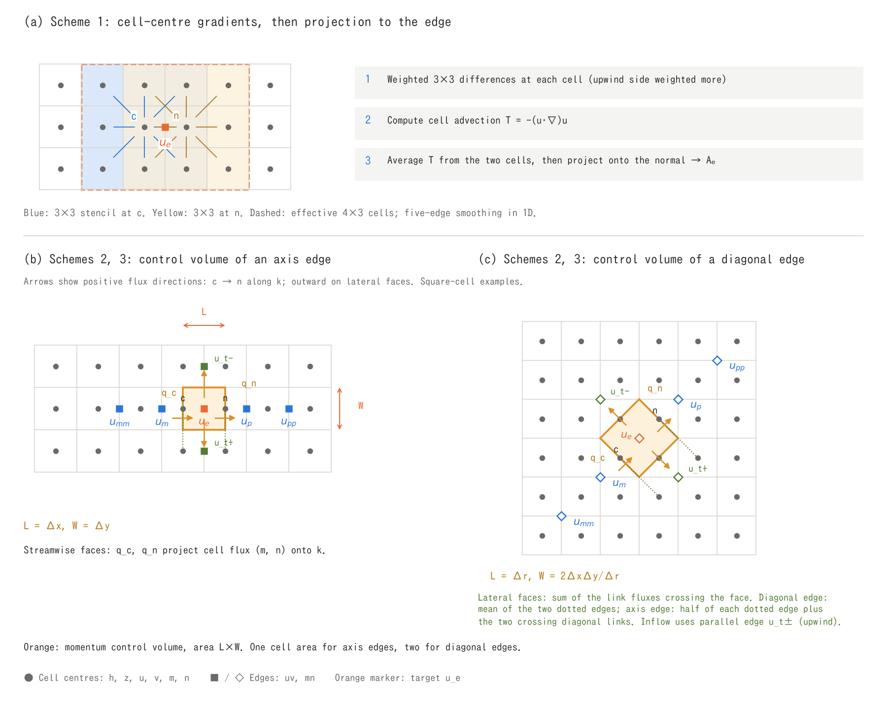
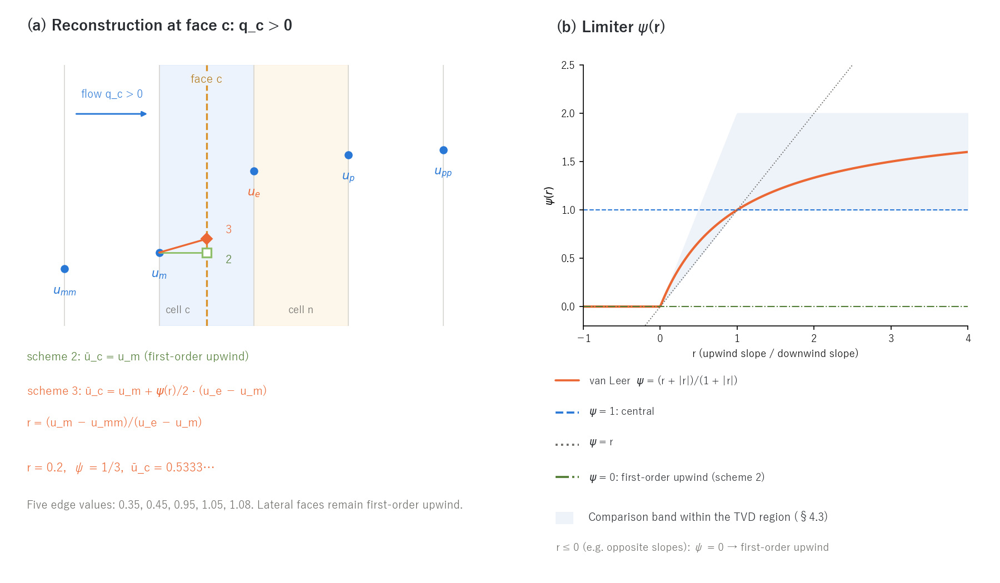

# Advection schemes (supplement to the shallow water chapter)

> English mirror of docs/users_guide/advection.md. The Japanese file is the master copy.

[Back to the shallow water chapter](swflow.md) | [Back to the user's guide index](../users_guide.md)

This page explains how the advection (inertia) term of the momentum
equation is discretised. It gives the equations, the schemes and the
stencils behind `f_advection_scheme`, `p_adv_upwind_index` and
`f_advection_donor` of the [shallow water chapter](swflow.md), in enough
detail to understand what the settings mean. The design history and the
numerical experiments (for developers) are in docs/developer.md §68
(in Japanese).

A detailed design note (control-volume geometry, one-dimensional consistency,
the diagonal sub-lattice mode and the revised lateral faces, verification and
open issues) is in [docs/advection_design.md](../../advection_design.md)
(Japanese). The size of the crosswind numerical diffusion that the fluxes of
diagonal edges produce (for momentum and for scalar transport), and an
overview of the countermeasures for each case, are in
[Numerical diffusion by diagonal-edge fluxes](diagonal_diffusion.md).

## 1. Equations and the role of the advection term

ENCflow solves the two-dimensional shallow water equations, the continuity
equation and the momentum equation ($`h`$: depth, $`z`$: ground elevation,
$`\mathbf{u} = (u, v)`$: depth-averaged velocity, $`n`$: Manning's roughness).

```math
\frac{\partial h}{\partial t} + \nabla\cdot(h\mathbf{u}) = 0
```

```math
\frac{\partial \mathbf{u}}{\partial t}
+ \underbrace{(\mathbf{u}\cdot\nabla)\,\mathbf{u}}_{\text{advection}}
= -\,g\,\nabla(z + h)
\;-\; \frac{g\,n^2\,|\mathbf{u}|}{h^{4/3}}\,\mathbf{u}
\;+\;\cdots
```

The right-hand side holds the pressure (water-surface slope) term and the
friction term; drag, diffusion, non-hydrostatic and other terms are added
depending on the settings. The advection term is the term by which the flow
carries its own momentum. It matters wherever the velocity changes in space:
bores, hydraulic jumps, sudden contractions and expansions, bends and
confluences. On gentle hillslopes and in wide-area inundation its
contribution is small, and the diffusive-wave approximation
(`f_govequation = 1`) drops it.

Combined with the continuity equation, the same momentum equation can also be
written in **conservative form** (as a momentum flux).

```math
\frac{\partial (h\mathbf{u})}{\partial t}
+ \nabla\cdot(h\,\mathbf{u}\otimes\mathbf{u})
= -\,g\,h\,\nabla(z + h) \;-\;\cdots
```

For smooth flow the two forms are the same thing, but **across a
discontinuity (a bore or a hydraulic jump) only the conservative form gives
the correct jump conditions (Rankine–Hugoniot)**. A finite difference of the
non-conservative term $`(\mathbf{u}\cdot\nabla)\mathbf{u}`$ loses momentum
across the discontinuity: the bore lags and oscillations appear behind it.
This is the essential difference between scheme 1 and schemes 2 and 3
(§3, §4).

**The update on the ENC grid.** The ENC grid takes the edge-normal velocity
$`u_e`$ as its unknown. For the edge $`e`$ from the reference cell $`c`$ to its
$`k`$-th neighbour $`n`$ (normal $`\mathbf{n}_k`$, distance between the cell
centres $`L_k`$), the update treats friction semi-implicitly:

```math
u_e^{\,n+1} = \frac{u_e^{\,n} + \left(A_e + G_e\right)\Delta t}{1 - F_e\,\Delta t},
\qquad
G_e = -\,g\,\frac{\eta_n - \eta_c}{L_k}
```

$`G_e`$ is the pressure term from the slope of the water surface
$`\eta = z + h`$, $`F_e \le 0`$ is the friction and drag coefficient, and $`A_e`$
is **the subject of this page, the advection term**
$`-\left[(\mathbf{u}\cdot\nabla)\mathbf{u}\right]\cdot\mathbf{n}_k`$
evaluated on edge $`e`$. $`A_e`$ is precomputed for every edge at the start of
the step from time-level-$`n`$ quantities only, and it stays at that value
during the recomputation stages of the adaptive Runge–Kutta (scaling it by
the velocity ratio, and an affine update, were tried and rejected;
developer.md §68.19, §68.23).

## 2. The ENC grid layout (recap)

As in figure (a) of the [shallow water chapter](swflow.md), depth $`h`$ and
ground elevation $`z`$ sit at the cell centres, and the normal velocity $`uv`$
and the flux per unit width $`mn`$ sit on the edges to the eight surrounding
cells (four axis and four diagonal directions). Three quantities are used in
the explanation below.

| Symbol | Location | Meaning |
|---|---|---|
| $`u_e`$ (array uv) | edge | normal velocity, positive from the reference cell toward the neighbour |
| $`q_c = (m_c, n_c)`$ (arrays m, n) | cell centre | cell-average flux per unit width; the same definition the continuity equation sees, composed from the edge fluxes $`mn`$ with geometric weights |
| $`\mathbf{u}_c = (u_c, v_c)`$ (arrays u, v) | cell centre | cell velocity, reconstructed from the edge velocities with geometric weights |

The geometry of edge $`k`$ is the distance between the cell centres $`L_k`$
(axis: $`\Delta x`$ or $`\Delta y`$; diagonal:
$`\Delta r = \sqrt{\Delta x^2 + \Delta y^2}`$) and the unit normal
$`\mathbf{n}_k = (n^x_k, n^y_k)`$. Reduced to one dimension, the reconstructed
cell velocity is exactly the mean of the two edges,
$`u_c = (u_{i-1/2} + u_{i+1/2})/2`$, whatever `p_diagratio` is. The
properties of scheme 1 (§3) follow from this fact.

## 3. Scheme 1: cell-centre gradient (non-conservative; former default)



**Figure: advection stencils and control volumes.** (a) Cell-centre gradients and projection to the edge for scheme 1; (b)(c) axis and diagonal edges for schemes 2 and 3. Orange areas are momentum control volumes and orange markers are the updated edges. Arrows indicate positive flux directions: c → n on the streamwise faces, outward on the lateral faces. Dotted lines are the two ENC edges used for a lateral flux (for axis edges the two diagonal links crossing the face are added; see the text); green markers are parallel edges supplying the inflow velocity. For square cells, the control-volume areas are one and two cell areas, respectively.

**(a)** is the stencil of scheme 1. It is computed in three steps.

**(1) Gradient at the cell centre.** At every wet cell $`c`$, $`\nabla u`$ and
$`\nabla v`$ are weighted averages of the differences to the eight neighbours
(the $`x`$ derivative as an example; $`\delta i_k \in \{-1, 0, 1\}`$ is the
$`i`$ offset of neighbour $`k`$).

```math
\left.\frac{\partial u}{\partial x}\right|_c
\approx \frac{\displaystyle\sum_{k=1}^{8} w_k\,(u_k - u_c)\,\frac{\delta i_k}{\Delta x}}
{\displaystyle\sum_{k=1}^{8} w_k},
\qquad
w_k = w^{x}_k\;\omega_k\;\chi_k
```

$`w^x_k`$ is the geometric weight of the axis and diagonal directions (the
passage-width share), $`\chi_k`$ is 1 when the neighbour is valid and wet and
0 otherwise (dry cells and cells outside the domain are left out of the
difference), and $`\omega_k`$ is the **upwind weight**.

```math
\omega_k = \max\!\left(1 - \frac{p}{2}\,\bigl(1 - \hat w_k\bigr),\; 0\right),
\qquad
\hat w_k = -\,\frac{\mathbf{u}_c\cdot\mathbf{n}_k}{|\mathbf{u}_c|}\in[-1, 1]
```

$`p`$ is `p_adv_upwind_index`. An upwind neighbour ($`\hat w_k = 1`$) always
has weight 1, a downwind neighbour ($`\hat w_k = -1`$) has weight $`1 - p`$.
$`p = 0`$ is a symmetric central difference, $`p = 1`$ a one-sided (first-order
upwind) difference that ignores the downwind side (the default 0.5 is in
between). The velocity enters as $`u\,\ell_m`$, with the effective inertia
coefficient $`\ell_m`$ derived from the building porosity `gv`
([Geographic information](geoinfo.md)).

**(2) Advection term of the cell.**

```math
\mathbf{T}_c = -\left(
u_c\frac{\partial u}{\partial x} + v_c\frac{\partial u}{\partial y},\;
u_c\frac{\partial v}{\partial x} + v_c\frac{\partial v}{\partial y}
\right)
```

**(3) Projection onto the edge.** The mean of the two cells is projected
onto the normal.

```math
A_e = \tfrac{1}{2}\left(\mathbf{T}_c + \mathbf{T}_n\right)\cdot\mathbf{n}_k
```

**Properties.**

- **Non-conservative.** Because it is not written as a momentum flux, it
  loses momentum at discontinuities. In the wet-bed dam break (Stoker's
  analytical solution[^stoker57], [test/dambreak](../../../test/dambreak/en/README.md)) the bore position lags by 15%, an
  overshoot of 3 m (a 2Δx oscillation) appears behind the bore, and a
  standing hump remains at the dam site. Stronger upwinding ($`p \to 1`$)
  increases the lag.
- **Smoothing over five edges.** The cell velocity is the mean of the two
  edges, so the chain "centre → gradient → two-cell mean" is a derivative
  damped by an extra factor $`\cos^2(\kappa L/2)`$ relative to the compact
  central difference on the edges, $`(u_{e+1} - u_{e-1})/2L`$ (0.5 at a
  wavelength of $`4L`$, 0.85 at $`8L`$). The advection term of short waves is
  halved, so wave forms are smeared whether or not upwinding is used. The
  effective stencil is the dashed 4×3 cells of figure (a).
- **No grid convergence on real terrain.** On a stepped river bed the
  dissipation at each step is underestimated, and the runoff gets faster and
  larger as the grid is refined (table in §5).
- Kept for reproducing cases calibrated with older versions. Use the default
  scheme 3 for new computations.

## 4. Schemes 2 and 3: momentum-conservative form

### 4.1 Idea: a momentum control volume around the edge

Even on a staggered layout, if a control volume $`\Omega_e`$ is taken around
edge $`e`$ and the conservative momentum equation is integrated over it, the
advection term can be written as the momentum flux through its faces (the
staggered conservative scheme of Stelling & Duinmeijer[^sd03], extended to
the eight directions of the ENC grid).

```math
\frac{d}{dt}\int_{\Omega_e} h\,u\;dA
\;+\;\oint_{\partial\Omega_e} u\,\bigl(h\mathbf{u}\cdot\mathbf{n}\bigr)\,ds
\;=\;\cdots
```

Subtracting $`u_e`$ times the continuity equation over the same volume,

```math
u_e\left[\frac{d}{dt}\int_{\Omega_e} h\;dA
+ \oint_{\partial\Omega_e}\bigl(h\mathbf{u}\cdot\mathbf{n}\bigr)\,ds\right] = 0,
```

gives an equivalent non-conservative expression in terms of the mass flux
$`Q_f`$ through each face $`f`$ (positive outward) and the velocity $`\bar u_f`$
carried through that face.

```math
\boxed{\;
A_e = -\,\frac{1}{\bar h_e\,L_k\,W_k}\,\sum_{f}\,Q_f\,\bigl(\bar u_f - u_e\bigr)
\;}
```

$`\bar h_e`$ is the depth of the control volume and $`L_k W_k`$ its area. This
form has two merits.

- **Discrete momentum is conserved.** The same mass fluxes $`Q_f`$ as in the
  continuity equation are used, so when summed over all edges the face
  fluxes cancel and no momentum is lost across a discontinuity. Without a
  Riemann solver, bores and hydraulic jumps travel at the correct speed for
  every Froude number (adopted by SWASH, D-Flow FM and 3Di)[^sd03].
- **The direction is intuitive.** With first-order upwinding ($`\bar u_f`$ =
  the velocity on the inflow side) an outflow face has $`\bar u_f = u_e`$ and
  contributes nothing; only the inflow faces pull $`u_e`$ toward the velocity
  of the water that enters. Nothing flows in from a wall or a dry bed
  (§4.4), so they contribute nothing either.

### 4.2 Control volume and faces (figures (b), (c))

The control volume is a rectangle centred on edge $`e`$: its length along
line $`k`$ is $`L_k`$ (from the centre of cell $`c`$ to the centre of $`n`$) and its
width across is $`W_k`$ (the perpendicular distance to the parallel
neighbouring links).

| Edge | $`L_k`$ | $`W_k`$ | Area $`L_k W_k`$ (square cells) |
|---|---|---|---|
| axis ($`x`$ normal) | $`\Delta x`$ | $`\Delta y`$ | one cell |
| axis ($`y`$ normal) | $`\Delta y`$ | $`\Delta x`$ | one cell |
| diagonal | $`\Delta r`$ | $`\Delta x\Delta y/\Delta r`$ | one cell (c and n are the streamwise face centres) |

The diagonal links parallel to a diagonal edge are spaced
$`\Delta x\Delta y/\Delta r`$ apart across it ($`\Delta x/\sqrt2`$ for square
cells) with alternating parity of $`i+j`$; $`W_k`$ is that spacing (until
2026-10-17 the distance $`2\Delta x\Delta y/\Delta r`$ to the link of the same
parity was used; see the known property in §5).

There are four faces, with the following mass fluxes ($`Q_f`$ is the flux per
unit width $`q`$ times the length of the face).

- **Flow-direction faces $`c`$, $`n`$** (through the cell centres, with
  normal $`\mathbf{n}_k`$): the cell flux projected onto line $`k`$,
  $`q_c = m_c\,n^x_k + n_c\,n^y_k`$, and likewise $`q_n`$; $`Q = q\,W_k`$.
  This is exactly the cell-average flux the ENC continuity equation sees,
  and in one dimension it equals the "mean of the two edges on the line" of
  S&D.
- **Lateral faces $`\pm t`$** (parallel to line $`k`$): the sum of the
  actual fluxes of the ENC links that cross the face, divided by the face
  length, $`q_{t\pm}`$ (positive outward); $`Q = q_{t\pm}\,L_k`$. For
  diagonal edges this is the mean of the unit-width fluxes $`mn`$ of the two
  ENC edges that cross the face (c → c+δ and n → n+δ, the dotted lines in
  figure (c)), multiplied by the open fraction of the two axis links that
  cross the face (0.29 less per link whose far cell is invalid or dry; 0.41
  with both blocked; developer.md §68.43. Replacing the mean by the sum of
  the actual crossing link fluxes slows the bore by 2 to 5%, so the diagonal
  edges keep the averaged form). For axis edges it uses the discharge the continuity equation
  passes through each link (unit-width flux $`mn`$ × passage width ×
  reassignment factor of blocked diagonal openings; see the
  [ENC grid chapter](encgrid.md) and `f_opening_dynamic`): half of each
  parallel axis link of c and n (the dotted lines in figure (b)) plus the
  full diagonal links (±t, +k) of c and (±t, −k) of n. In uniform flow this
  equals the averaged form, and a link blocked by terrain or a wall
  contributes zero (on faces where only the axis link is open the averaged
  form assumed 2.4 times the actual flux and blew up at the edge of a pool;
  developer.md §68.42). The upwind velocity $`\bar u_{t\pm}`$ of an inflow face
  is the value of the parallel neighbouring edge for axis edges, and for
  diagonal edges the mean of the two parallel links of the opposite parity
  that lie on either end of the face (a face with only one such link is
  treated like a wall, $`\bar u_t = u_e`$). Projecting the cell flux at the face centre instead
  gave a non-zero flux even on faces blocked by terrain where no water
  actually passes, and the advection term, amplified by $`1/\bar h_e`$ in a
  thin control volume, blew up; hence the actual edge fluxes
  (developer.md §68.21).

The implemented expression expands to the following ($`q_c`$ positive from
$`c`$ to $`n`$, $`q_{t\pm}`$ positive outward).

```math
A_e = -\,\frac{\ell_m}{\bar h_e}\left[
\frac{q_n\,(\bar u_n - u_e) - q_c\,(\bar u_c - u_e)}{L_k}
+ \frac{q_{t+}\,(\bar u_{t+} - u_e) + q_{t-}\,(\bar u_{t-} - u_e)}{W_k}
\right],
\qquad
\bar h_e = \max\!\left(\frac{h_c + h_n}{2},\;\frac{dd}{2}\right)
```

$`\bar h_e`$ is taken at time level $`n`$ (ENC solves momentum before
continuity, so $`h^{n+1}`$ is unknown; dividing by a $`\bar h^{n+1}`$
extrapolated with the previous step's fluxes made the bore speed worse).
With sub-grid channels ([Channels](channel.md)) the water volume per unit
area of the cell ($`h \times`$ channel width fraction, or the equivalent depth
when the cross-section σ is active) replaces $`h`$, so that it stays
consistent with $`q`$. $`\ell_m`$ is the same effective inertia coefficient as
in scheme 1.

### 4.3 Face velocities: first-order upwind (scheme 2) and MUSCL (scheme 3)



**Figure: streamwise face reconstruction and limiter.** (a) First-order upwind (2) and MUSCL (3) for inflow through face c. The five edge values are 0.35, 0.45, 0.95, 1.05 and 1.08, giving r = 0.2 and ψ = 1/3 at face c. (b) The van Leer limiter and the references ψ = 0, 1, r. The pale-blue comparison band lies between min(r, 1) and min(2r, 2) for r ≥ 0. Lateral faces use first-order upwinding.

For the flow-direction faces, $`\bar u`$ is taken from the **upwind side** of
the flow through the face, among the five edge velocities on line $`k`$,
$`u_{mm}, u_m, u_e, u_p, u_{pp}`$ (the markers along line k in control-volume panels (b), (c)).
For face $`c`$:

| Flow through face $`c`$ | upwind $`u_\mathrm{up}`$ | downwind $`u_\mathrm{dn}`$ | further upwind $`u_\mathrm{upup}`$ |
|---|---|---|---|
| $`q_c \ge 0`$ (into the control volume) | $`u_m`$ | $`u_e`$ | $`u_{mm}`$ |
| $`q_c < 0`$ (out of the control volume) | $`u_e`$ | $`u_m`$ | $`u_p`$ |

Face $`n`$ is symmetric. The face value is reconstructed from these three
values.

```math
\bar u =
\begin{cases}
u_\mathrm{up} & \text{scheme 2 (first-order upwind)}\\[4pt]
u_\mathrm{up} + \dfrac{\psi(r)}{2}\,\bigl(u_\mathrm{dn} - u_\mathrm{up}\bigr),
\quad r = \dfrac{u_\mathrm{up} - u_\mathrm{upup}}{u_\mathrm{dn} - u_\mathrm{up}}
& \text{scheme 3 (MUSCL)}
\end{cases}
```

```math
\psi(r) = \frac{r + |r|}{1 + |r|}\quad\text{(van Leer)}
```

The limiter $`\psi`$ is van Leer's[^vanleer79], the curve in figure (b). At $`r = 1`$ (uniform slope)
$`\psi = 1`$ and $`\bar u = (u_\mathrm{up} + u_\mathrm{dn})/2`$ is the
second-order central value; for $`r \le 0`$ (e.g. opposite signs of adjacent slopes)
$`\psi = 0`$ and the face value degrades to first-order upwind. The curve
lies inside Sweby's TVD region[^sweby84], limiting slopes near extrema in accordance
with a one-dimensional TVD design. The pale-blue area is a comparison band
within that region. Schemes 2 and 3 differ in
this one line of the face value only; the rest of the path is shared.

The lateral faces use first-order upwinding: on inflow ($`q_t < 0`$) the
velocity of the parallel neighbouring edge $`u_{t\pm}`$ (green in the control-volume figure),
on outflow $`u_e`$ (no contribution).
With `f_advection_donor = 3` the wet/dry test of the parallel edge becomes a continuous weight (§4.4).

### 4.4 Walls, dry cells and boundaries

- **Walls and dry beds supply no momentum.** If the upwind donor cell is
  outside the domain, invalid (outside the mask) or dry ($`h < dd`$), the face
  takes $`\bar u = u_e`$ and contributes nothing. Reading the stored value 0
  instead would mean "still water flows in from the wall side", and in a
  one-cell-wide raster channel every bend would lose about 0.55 m of
  artificial head (developer.md §68.8; the bend cases of [test/bendloss](../../../test/bendloss/en/README.md)).
- **Sea cells (tide-prescribed boundary) supply no momentum either.** The
  cells of the sea mask (fn_sw) are the side whose water level is forced;
  their apparent water column hsea0 and their zero flux have nothing to do
  with the real water column and flux. Edges touching a sea cell get no
  lateral momentum supply, exactly like prescribed boundaries, and a sea
  cell is never used as a donor nor as the far donor of MUSCL
  (developer.md §68.35; fix of a real bug in which, with hsea0 very
  different from the offshore depth, the velocity on the sea-land edges
  grew to several times the land-side velocity and diverged by positive
  feedback).
- **Edges touching an outer cell with a segment-inflow face get no
  advection term either.** A cell with a normal face of
  [segment inflow](boundary.md#segment-inflow-list_bound_inflow) (closed
  corner cells included) passes the whole segment discharge through a
  normal face of passage width 0.414 dx (the unit-width discharge is 2.4
  times the cell mean) and lacks the diagonal links outside the frame, so
  its cell-mean discharge is not consistent as the face flux of a control
  volume. As for sea cells, the edges touching such a cell get a zero
  advection term (developer.md §68.40; fix of a real behaviour in which,
  in a straight channel of odd width between walls, the inflow
  concentrated at the centre by the closure of the corner cells coupled
  with the advection terms of the boundary row and self-excited a
  discharge oscillation of 5-minute period. Only the inflow row is
  affected, so uniform-flow and flood-wave results hardly change).
  This is the default (`f_inflow_edge = 0`); two alternatives can be
  chosen ([test/inflowadv](../../../test/inflowadv/en/README.md)).
  - `f_inflow_edge = 1`: only the edges from an inflow cell into the
    section (the normal edges from the inflow face inwards and the diagonal
    edges within the width of the section) get a zero advection term. The
    edges along the inflow face (both ends inflow cells) and the edges that
    leave the section at its two ends keep their advection term. On an
    edge without it the velocity tends to the balance of surface gradient
    and friction, so with the default a flow falling from the end of the
    section into a lower cell beside it can exceed the velocity that energy
    conservation allows (with the default, param_feed of examples/meander,
    whose capacity feed fixes the bed of the inflow cells, stops through
    scour of the outer cell beside the section feeding a jet).
  - `f_inflow_edge = 2`: as 1, and the velocity on the edges into the
    section is capped by the speed allowed by the energy head of the
    upstream cell, $`\sqrt{2g\max(E_\mathrm{up} - \eta_\mathrm{dn}, 0)}`$
    with $`E_\mathrm{up} = \eta + V^2/2g`$ ($`V`$ is the speed of the
    upstream cell and $`\eta`$ the water level, $`z + h + h_s`$ for debris
    flows); the discharge is scaled by the same ratio (a Bernoulli bound
    without losses; developer.md §68.40, second revision, in Japanese). On
    the edges into the section, which have no advection term, a
    supercritical jet can form right below the inflow in a channel of mild
    slope and create energy head (in a 3-column channel between walls, 1.0
    to 1.3 m deep at 13 m/s, where uniform flow is 4.7 m at 3.0 m/s; it
    appears with the default and with 1). For an inflow cell on a steep
    slope, where the uniform flow of the face discharge is supercritical
    (the Manning normal depth is below the critical depth), the supply
    speed (the face discharge per cell width and depth) also counts as the
    upstream speed, so a supercritical inflow is hardly throttled. Inflow
    cells without a supply (cells closed because they touch nodata or a
    wall corner) are capped by the cell speed alone, so near a steep inflow
    the depth can come out about 10 % larger.
  - Which to use: use 2 for landform-evolution runs in which the bed right
    beside or below the inflow moves, and for narrow inflows (channels a
    few columns wide between walls). The cap of 2 acts almost all the time
    near the inflow: with a subcritical uniform inflow the discharge can
    keep wavering slightly at the threshold of the cap (0.02 % in the
    configuration of test/fluxline), and in a flood the level of the inflow
    cells can rise and leave a step to the next cell downstream (0.2 to
    0.3 m at 200 m³/s in examples/estuary_barrage). With 1 and 2 the inflow
    has no momentum on the first edge into the section and tends to spread
    sideways. Results near the inflow depend on the chosen rule, so keep the
    reach of interest away from the inflow section.
- **The far donor of MUSCL.** If the cell beyond the $`u_\mathrm{upup}`$ edge
  is outside the domain or invalid, that face degrades to first-order
  upwind (reading 0 would give $`r \gg 1 \to \psi = 2`$, anti-diffusion, and
  the first edge leaving a prescribed boundary would blow up; §69.9).
- **(Removed) Donors limited to channel cells (formerly `f_advection_donor = 1`).**
  This option limited the donors of the flow-direction faces to channel
  cells on edges between channel cells of the channel mask (against the
  artificial loss when the donor on line $`k`$ falls on a flooded valley-floor
  cell at bends and confluences and its slow water decelerates the flow;
  §68.18). Valley-floor donors carrying little water become neutral under 3
  below as well, so most of its effect is contained in 3 (on the 100 m grid
  of Chichibu, combining 1 and 3 gives only 3% more than 3 alone); it could
  not be combined with 3, and whether cutting the momentum exchange between
  the main channel and the flooded valley floor is right was never verified.
  It was therefore removed on 2026-11-07. Setting it stops the run; use 3
  (developer.md §100, in Japanese).
- **(Removed) Donors weighted by the fluxes of all inflow links (formerly `f_advection_donor = 2`).**
  This option took the upwind value of a flow-direction face as the average
  over all links that actually carry water into the face cell, weighted by
  their fluxes. It had the side effect of carrying the momentum of the flow
  passing through the face cell into places where the edge's own flow
  differs (on the exchange links across a bank step a channel with lateral
  inflow became deeper than the analytic solution; smooth vortices decayed,
  flows along walls slowed down, and a slope flow 22.5° off the axis was
  delayed), and 3 below handles the recession jumps and the sensitivity to
  `dd` without these side effects, so 2 was removed on 2026-11-07. Setting
  it stops the run; use 3 (developer.md §100, in Japanese).
- **Donors that carry almost no water, or are thin films, pulled toward neutral (`f_advection_donor = 3`).**
  The upwind value of a flow-direction face is the MUSCL face value
  $`\bar u_k`$ of the link on line $`k`$, as with the default (0). Only when
  the real flux $`Q_k`$ that this link carries into the face cell is below
  $`\varepsilon`$ times (`p_adv_donor_eps`, default 0.1) the largest real flux
  $`Q_\mathrm{max}`$ of the eight links entering the face cell is the upwind
  value pulled toward the control volume's own velocity $`u_e`$:
  $`\bar u = u_e + w(\bar u_k - u_e)`$ with $`w = (Q_k/Q_\mathrm{max})/\varepsilon`$
  (for $`w \ge 1`$ the value is the same as with 0). On a face whose line-$`k`$
  link is a thin film on a bank while the water reaches the face cell through
  the diagonal links, 0 produces the artificial brake "mass flux of the deep
  cell × velocity of the thin link" (a 0.6–1.2 m water-surface step at the
  entrance of a flat channel reach of a real DEM), and the brake is released
  all at once when the film recedes below the critical depth `dd` and drops
  out of the donor test, which **makes the recession limb of the hydrograph
  jump** ([tutorials/chichibu](../../../tutorials/chichibu/en/README.md)
  Step 4). With 3 the weight of the thin link goes to 0 with its flux ratio,
  so neither the brake nor the jump appears. It does not bring in the
  momentum of the water of other links; it only treats the incoming water as
  neutral ("entering at the control volume's own velocity").
  The lateral faces (±t) have a switch of the same type, so 3 also makes their
  wet/dry tests continuous. The test of whether the velocity of the parallel
  link is used as the inflow value (both end cells at least `dd` deep) and the
  test of the opening fraction of the lateral faces of diagonal edges become a
  weight $`w = \min(1, h/dd)`$ that moves toward neutral in proportion to the
  depth below `dd` (for an axis edge $`\bar u_t = u_e + w(u_{t\pm} - u_e)`$).
  When a cell with a thin film on a bank enters the parallel link, its slow
  velocity is applied to the lateral inflow of the main flow turning into the
  face and acts as a brake; with 0 the brake is released all at once the
  moment the film drops below `dd`, and the recession limb jumps (+222 m³/s at
  120 minutes at transect 3 on the 200 m grid of Chichibu). With 3 the brake
  is released gradually as the film thins. At depths of `dd` or more the value
  is the same as with 0.
  On faces whose line-$`k`$ link carries the water and whose banks have no
  film thinner than `dd` (main channel flow, uniform flow, bores, lateral
  inflow, vortices, along walls) the value is the same as with 0, and the
  checks of test/bendloss (lateral inflow and zigzag), test/dambreak,
  test/sublattice, test/uniflow, test/inflowadv, test/dbonset and
  test/sedfeed pass as with 0, with the judged values at the same level as 0. No
  channel mask is needed. The method is **original to ENCflow**
  (developer.md §100, in Japanese). **Known changes and limits**: relative to
  0, the Chichibu peak near the basin outlet is +15% and 22 min earlier on the
  200 m grid and +21% on the 100 m grid
  ([test/chichibu](../../../test/chichibu/en/README.md)) (the artificial brake
  distributed along the whole main channel is removed); the peak changes by
  8 m³/s when `dd` is divided by 10 (155 with 0); the run time is +6%
  (200 m grid, 4 threads). Because the flow becomes faster, the Courant
  number rises too (Chichibu on the 200 m grid with a 50 m wide subgrid
  channel ran to the end with dt = 6 s under 0 (maximum 0.88), but under 3
  exceeded 1 after 1.5 hours and needed dt = 4 s).
  $`\varepsilon`$ is empirical (in Chichibu the peak differs by less than 0.3%
  between 0.05 and 0.2, but where fine disturbances appear depends on
  $`\varepsilon`$; see the narrow subgrid channels below). The momentum of a
  main flow entering obliquely is not represented but treated as neutral, so
  the advective acceleration or deceleration at such a face is not counted.
  The lateral-face weight only removes the jump at the moment of switching; the lateral-face brake from
  banks with films of `dd` or more (the main flow turning at a grid bend is
  slowed by the slow bank link, the artificial loss of the type at the start
  of §4.4) remains as with 0. In Chichibu the films on slopes wetted by rain
  carry most of this brake; removing it in prototypes raised the peak at
  transect 4 of the 200 m grid by 6 to 12% and made the discharge rough or the
  run diverge on the 100 m and 50 m grids. Because this brake also provides
  damping that computations on real terrain rely on, it has not been removed
  (developer.md §100). Films thinner than `dd` are also counted in
  proportion to their thickness, so in a bent channel with banks wetted by
  rain the water level at the bend cells is a little higher than with 0
  (the zigzag channel of test/bendloss with 2 mm/h on the floodplain:
  1.73 → 1.81 m; 0 with `dd` divided by 10 gives 2.02 m; the reach-mean depths
  do not change). At transect 3 of the 50 m grid of Chichibu, fine
  oscillations with a period of 5 to 6 minutes remain; they are not wet/dry
  switches but an oscillation of a hydraulic jump and a pond in the stepped bed
  created by depression filling about 1 km downstream of the transect (a flat
  pond and a 7 m step), and they appear in the same way with 0 and with half
  the time step (an oscillation caused by the terrain; Step 6 and the
  supplement of tutorials/chichibu). On subgrid channels narrower than the
  cell (Chichibu on the 100 m grid with a 50 m width), 3 can also make the
  discharge oscillate with a period of 2 to 3 minutes. In a flat reach created
  by depression filling, when the line-$`k`$ donor is a deep stagnant pocket
  (carrying about a tenth of the inflow), its share moves back and forth across
  the threshold $`\varepsilon`$, the weight switches between 0 and 1, and the
  deceleration is switched on and off. With $`\varepsilon`$ of 0.07 or less this
  oscillation does not appear, but a smaller $`\varepsilon`$ brings other faces
  with even smaller shares to the threshold and produces jumps elsewhere (at
  transect 3 of the 50 m grid of Chichibu, +184 m³/s in one minute with 0.05
  and +194 m³/s with 0.02). No $`\varepsilon`$ removes all the disturbances, so the
  default stays 0.1 (a prototype that judges the donor by the ratio of depths
  removed this oscillation but roughened other places, so it was not adopted;
  developer.md §100). With a 50 m wide channel on the 200 m grid, a seiche
  (standing wave) with a period of about 4 minutes can remain in flat reaches
  created by depression filling (±30 to 100 m³/s per minute in the discharge).
  It becomes visible because 3 combined with MUSCL has little dissipation; it
  does not appear with 0, with first-order upwinding or without the width, and
  it vanishes when the flat reaches are removed from the terrain (an
  oscillation caused by the terrain). Boundary faces
  on lateral Neumann sides are not covered (both flow-direction and lateral
  faces are the same as with 0).
- **Excluded edges.** Edges excluded from the momentum equation (invalid
  neighbour, zero passage width, both cells dry) have $`A_e = 0`$. With
  `f_channel_advection = 0` the term is also dropped on edges touching a
  channel cell ([Channels](channel.md)).

### 4.5 Time integration, stencil and parallelism

- All inputs are time-level-$`n`$ values (edge velocity $`uv`$, cell fluxes
  $`m, n`$, depth $`h`$). The term is precomputed for every edge into an array
  at the start of the step, and the momentum equation only reads it.
- The stencil spans ±2 edges along line $`k`$ and ±1 edge across. With MPI
  band decomposition the exchange at the start of the step covers $`uv`$ with
  an edge width of 2 and $`m, n`$ with a cell width of 2 (scheme 1 does not
  exchange them: no extra communication or memory). Results are bitwise
  identical for any number of ranks ([Parallel execution](parallel.md)).
- Diagonal edges use the same formula as axis edges. In the one-dimensional
  uniform-flow limit both update formulas have the same form, preserving the
  relation $`u_d = u_a\,n^x_k`$ between the diagonal velocity and the
  projection of the axis velocity.
- The cost relative to scheme 1 is +12–20% for scheme 2 and +19–27% for
  scheme 3 (five edges on the line plus two lateral edges read per edge, and
  the exchange at the start of the step; wall-clock of [test/dambreak](../../../test/dambreak/en/README.md),
  [test/wave](../../../test/wave/en/README.md) and [test/chichibu](../../../test/chichibu/en/README.md)). Memory is about the same.

## 5. Properties and choice

The essentials of the numerical experiments of developer.md §68 (2026-10).

| | Scheme 1 | Scheme 2 | Scheme 3 (default) |
|---|---|---|---|
| Formulation | cell-centre $`(\mathbf{u}\cdot\nabla)\mathbf{u}`$ (non-conservative), two-cell mean | momentum-conservative, first-order upwind face values | momentum-conservative + MUSCL (van Leer) |
| Upwinding | `p_adv_upwind_index` (weak; the two-cell mean is the main cause of smearing) | full first-order upwind | central where smooth, upwind at extrema and discontinuities |
| Bore (Stoker) position error / overshoot behind it | −15.5% / 3.2 m | +0.5% / 0.8 m | +1.1% / 0.04 m |
| Smooth flood wave (1-cell channel, peak at 3.8 km) | 176.5 | 176.5 | 176.5 (all three identical) |
| Spatially varied flow with lateral inflow (depth ratio to the physical solution) | 1.7–2.0 (no momentum sink; supercritical flow turns subcritical) | about the same as 3 | 0.992 |
| Grid convergence on real terrain (chichibu) 500 → 50 m | runoff keeps growing; blows up at 50 m | about the same as 3 | converges |
| Stability | blows up on the 50 m DEM and in 1–2 cell incised channels | upwinding provides the stability | same |
| Cost | 1.00 | 1.19 | 1.27 |
| Role | legacy; reproducing existing calibrations | fallback for 3 (coarse problems that tolerate the overshoot at the bore front) | **default**; best for bores, jumps, lateral inflow, convergence and stability |

Sources of the numbers: the bore from [test/dambreak](../../../test/dambreak/en/README.md), the smooth flood
wave, lateral inflow and stepped bed from [test/bendloss](../../../test/bendloss/en/README.md), grid
convergence, stability and cost on real terrain from [test/chichibu](../../../test/chichibu/en/README.md),
the agreement on hillslopes from [test/hillslope](../../../test/hillslope/en/README.md) (each README
has the figures, tables and the list of derived cases).

**Guidance.**

- Bores, hydraulic jumps, tsunami run-up and other flows with
  discontinuities: the default (3).
- Rainfall runoff on a real DEM with a channel mask: 3 +
  `f_opening_dynamic = 3` + `f_dry_head_cap = 1` (the defaults). If the
  result is later and smaller than observed, or the recession limb of the
  hydrograph jumps or the result depends on `dd`, use
  `f_advection_donor = 3` (§4.4).
  Roughness calibrated with scheme 1 needs recalibration.
- Inundation, incised terrain and dam breaks without a channel mask: the
  defaults (3 + `f_opening_dynamic = 3`; until 2026-10-18 the 2 had to be
  set explicitly, and from 2026-10-18 to 31 the default was 2). Use
  `f_hcap_upwind = 2` only when a sharp bore front on a wet bed is wanted.
- Smooth hillslope flow, kinematic waves, coarse grids (≥ 500 m): 1 and 3
  agree within a few percent. Use 3 for consistency.
- Reproducing cases calibrated with older versions:
  `f_advection_scheme = 1`, `f_opening_dynamic = 0`, `f_dry_head_cap = 0`
  (the defaults before 2026-10-03).

**Neighbouring switches that interact with the advection term.** All are
listed in the [shallow water chapter](swflow.md).

- `f_opening_dynamic`: in one-cell-wide channels and along walls the blocked
  diagonal passage widths make the axis edge velocity about 2.4 times the
  cell velocity, which amplifies the acceleration and deceleration by the
  advection term (scheme 3 in particular). Reassigning the blocked shares to
  the open edges removes this. In steep, shallow flows the default 2 of 2026-10-18 to 31 also
  counts the upslope ground of a uniform slope as blocking and makes the flow
  too fast; use 3 (blockage measured above the local plane) there. The idea
  and its history are in [Passage-width adjustment](passage_width.md).
- `f_dry_head_cap`: the pressure term stops water from climbing onto dry
  ground above the water surface, but where the advection term wins, water
  can leak over at bore fronts and in incised channels. Capping the edge
  depth toward a dry cell by the energy head prevents it.
- `f_hcap_upwind = 2`: with schemes 2 and 3 the edge depth of the
  continuity equation, $`h_e = (h_c + h_n)/2`$, is small at the bore front and
  water can pile up in the one cell behind it (a spike). Using the upwind
  depth removes the spike but increases the frontal outflow onto dry beds.

**Diagonal sub-lattice mode (found 2026-10-13, resolved 10-17; developer.md
§68.36).** The diagonal links of the ENC grid connect only cells of the same
parity of $`i+j`$. While the lateral faces of diagonal edges were evaluated
with the parallel links of the same parity (distance $`\sqrt2\Delta x`$), a
diagonal circulation rotating oppositely on the even and odd sub-lattices
(divergence-free, so untouched by the pressure term) was untouched by the
advection term as well, and a checkerboard in the velocity field (relative
amplitude 0.4–0.6) persisted in deep, slow stagnant areas and was imprinted on
threshold-type deposition (`vstop` of debris and driftwood) and on the maximum
fluid force. With the lateral width set to the spacing $`\Delta x/\sqrt2`$ of
the opposite-parity links and their mean as the upwind value, the mode now
decays through the flux of the background flow
([test/sublattice](../../../test/sublattice/en/README.md): the e-folding time of a
sub-lattice mode superposed on a gyre drops from 1094 s to 88 s; the offshore
checkerboard of tsunami_town from 0.43 to 0.01). The leading terms are
unchanged for smooth fields, so the bore (Stoker), uniform-flow and bend-loss
verification values are unchanged.

### Parameters and the basis of their defaults

The labels in the Basis column are explained in [How to read the basis of a default](../users_guide.md#how-to-read-the-basis-of-a-default).

| Parameter | Default | Meaning | Basis |
|---|---:|---|---|
| f_advection_scheme | 3 | scheme of the advection term (1: cell-centre gradient, 2: conservative + first-order upwind, 3: conservative + MUSCL) | **verification case** bore position error +1.1% in [test/dambreak](../../../test/dambreak/en/README.md), depth ratio 0.992 with lateral inflow in [test/bendloss](../../../test/bendloss/en/README.md), grid convergence in [test/chichibu](../../../test/chichibu/en/README.md) (table above) |
| p_adv_upwind_index | 0.5 | upwinding index of scheme 1 (0: central, 1: first-order upwind) | **empirical** halfway between central and first-order upwind. The bore lag grows with $`p`$ (§3) |
| f_advection_donor | 0 | upwind donors (3: the upwind value is pulled toward u_e only on faces where the real flux of the line-k donor is below ε times the largest inflow link of the face cell, and the wet/dry tests of the lateral faces become a continuous weight below dd; 1 and 2 were removed) | **method** off by default; 3 removes the artificial brake along the whole main channel so the flood wave becomes faster and larger (the lateral-inflow, vortex and wall tests stay the same as 0); judge it against observations (§4.4) |
| p_adv_donor_eps | 0.1 | threshold ε of `f_advection_donor = 3` (real flux of the line-k donor / largest real flux of the links entering the face cell) | **empirical** in Chichibu the peak differs by less than 0.3% between 0.05 and 0.2. Disturbances at faces whose weight switches at the threshold move with ε (0.085 or more: the oscillation on narrow subgrid channels; 0.05 or less: other jumps; §4.4) |
| limiter $`\psi`$ (fixed) | van Leer | flux limiter of scheme 3 | **literature value** van Leer[^vanleer79]; inside Sweby's TVD region[^sweby84] (§4.3) |
| f_scalar_scheme | 3 | face value of the scalar transport (suspended sediment, water quality, saline layer, driftwood, building debris) (1: first-order upwind, 3: link-wise MUSCL) | **verification case** measured numerical diffusion in [test/tracer](../../../test/tracer/en/README.md) (longitudinal D 1/3–1/5, lateral Dy 1/14; §7). First order is not the default because its numerical diffusion is proportional to the grid spacing |

## 6. Verification cases

- **[test/dambreak](../../../test/dambreak/en/README.md)** -- Stoker's wet-bed dam break (flat, frictionless;
  $`h_l = 10`$ m, $`h_r = 1`$ m). Bore position, the depth and velocity of the
  intermediate state and the L1 error are compared with the analytical
  solution (`Check_stoker.py`). Source of the bore row in §5.
- **[test/bendloss](../../../test/bendloss/en/README.md)** -- one-cell-wide channels: straight vs. bent (bend
  loss), stepped beds (dissipation at steps), lateral inflow (physical
  solution of spatially varied flow). The README lists the cases.
- **[test/hillslope](../../../test/hillslope/en/README.md)** -- smooth hillslope and V-shaped catchment. Confirms
  that schemes 1 and 3 agree.
- **[test/chichibu](../../../test/chichibu/en/README.md)** -- real terrain (100 m). The place for grid convergence
  and comparison with observations.
- **[test/wave](../../../test/wave/en/README.md)** -- spreading of a hump of water at rest (frictionless
  closed basin). The reference case of the regression tests; shows the
  sensitivity of the maximum depth and velocity to the scheme (0.1–0.5%) and
  the preservation of the four-fold symmetry.

**Related examples and tutorials**

- [tutorials/wave](../../../tutorials/wave/en/README.md) / [tutorials/chichibu](../../../tutorials/chichibu/en/README.md) --
  step-by-step walkthroughs; how to read the sensitivity to the time step
  and the adaptive Runge–Kutta, and how a real-terrain case is assembled.
- [examples/List_samples/list_enc.txt](../../../examples/List_samples/en/list_enc.txt) --
  annotated list of every `&list_enc` parameter with its default.

## 7. Advection scheme of the scalar transport (f_scalar_scheme)

The column quantities of suspended sediment, water quality, the salt
layer, driftwood and debris are carried by a conservative transport
kernel (`advect_scalar`) separate from the momentum advection. It is in
flux form, the edge mass flux $`m_e`$ of the same step's continuity
equation times a face volumetric concentration $`c_{face}`$, so mass is
conserved to machine precision and a uniform concentration stays uniform.
The scheme is how the face value is taken.

- **f_scalar_scheme = 1 (former default)**: first-order upwind,
  $`c_{face} = c_{up}`$ (the upwind cell). Longitudinally the numerical
  diffusion is $`D \approx u\,\Delta x\,(1 - Cr)/2`$ (with the shallow-water
  dt, Cr = uΔt/Δx is 0.1–0.2, so effectively $`u\Delta x/2`$); laterally,
  even without lateral flow, the diagonal shares (0.293 each) of the
  eight-direction links average the two diagonal donors, a three-point
  smoothing that gives $`D_y \approx 0.29\,u\,\Delta y`$.
- **f_scalar_scheme = 3 (default since 2026-10-13)**: link-wise MUSCL.
  Along each link the face value
  is reconstructed from the upwind $`c_{up}`$, downwind $`c_{dn}`$ and
  further-upwind $`c_{uu}`$ cells:
  $`c_{face} = c_{up} + \tfrac{1}{2}\psi(r)\,(c_{dn} - c_{up})`$,
  $`r = (c_{up} - c_{uu})/(c_{dn} - c_{up})`$, ψ = van Leer (the same formula
  as §4.3). Diagonal links are reconstructed along the diagonal, so for a
  laterally linear field the face value is the link midpoint value and the
  0.414/0.293/0.293 weighted sum at the receiver equals the central value:
  the leading term of the lateral numerical diffusion disappears too. It
  falls back to first order when the downwind cell is outside, a sea cell
  or dry, when the further-upwind cell is invalid or dry, and for inflow
  from a boundary face (concentration table): walls, dry beds and
  prescribed boundaries supply no gradient (the reasoning of §4.4).

Measured in [test/tracer](../../../test/tracer/en/README.md) (u ≈ 0.9 m/s):

| Quantity | First-order upwind | MUSCL | Ratio |
|---|---:|---:|---:|
| Longitudinal D (Δx 10 m, dt 1 s, Cr 0.09) | 4.3 m²/s | 1.2 m²/s | 0.28 |
| Longitudinal D (Δx 10 m, dt 2 s, Cr 0.18) | 3.9 | 0.8 | 0.20 |
| Longitudinal D (Δx 20 m, dt 2 s, Cr 0.09) | 8.7 | 2.6 | 0.30 |
| Lateral Dy (point-source plume, Δy 10 m) | 2.7 | 0.19 | 0.07 |
| Plume σy 3 km downstream | 129 m | 38 m | |

The remaining longitudinal diffusion is the limiter degrading to first
order at the two ends of the front (extrema). No negative concentrations
or overshoots above 100 % appear (checked in the same case). The kernel
costs 2–3 times more per scalar, a few percent of the step. The default
is 3 because the numerical diffusion of first-order upwind is proportional
to the grid spacing (the lateral part is a product of the diagonal
distribution), and a default whose answer changes with the grid is no
basis for calibration. Processes that feed the concentration back into the
flow (the load criteria of driftwood and building debris, the
concentration-dependent rheology of debris flows, water-quality peaks)
shift towards higher peaks, so if existing calibrated values were fitted
with the smeared first-order concentration field, `f_scalar_scheme = 1`
restores the former results (for comparison and fallback; design and
verification in developer.md §78). Groundwater transport is not covered
(it stays first-order upwind).

## References

[^sd03]: Stelling, G. S. and Duinmeijer, S. P. A. (2003): A staggered conservative scheme for every Froude number in rapidly varied shallow water flows. *Int. J. Numer. Meth. Fluids*, 43, 1329–1354. (momentum-conservative advection; adopted by SWASH, D-Flow FM and 3Di)
[^vanleer79]: van Leer, B. (1979): Towards the ultimate conservative difference scheme V. A second-order sequel to Godunov's method. *J. Comput. Phys.*, 32, 101–136. (MUSCL and the limiter)
[^sweby84]: Sweby, P. K. (1984): High resolution schemes using flux limiters for hyperbolic conservation laws. *SIAM J. Numer. Anal.*, 21, 995–1011. (TVD region)
[^stoker57]: Stoker, J. J. (1957): *Water Waves*. Interscience, New York. (analytical solution of the wet-bed dam break)
