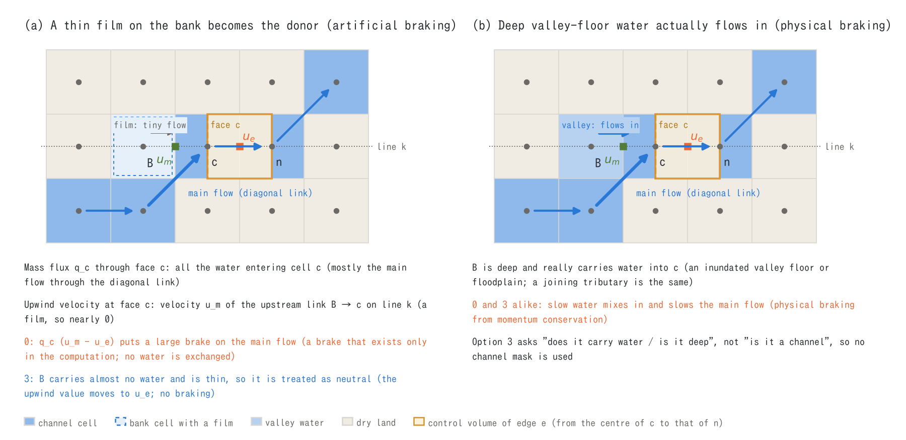
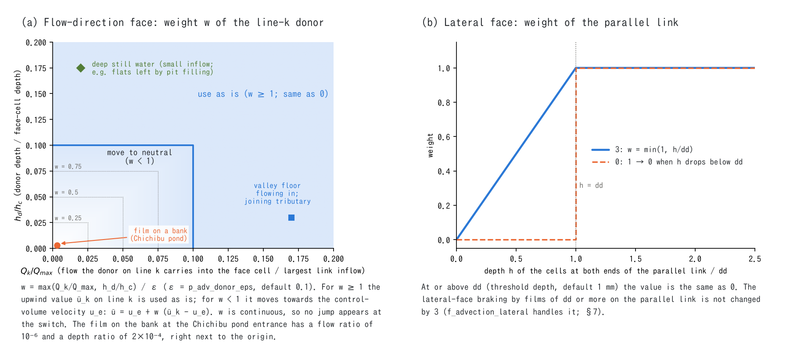
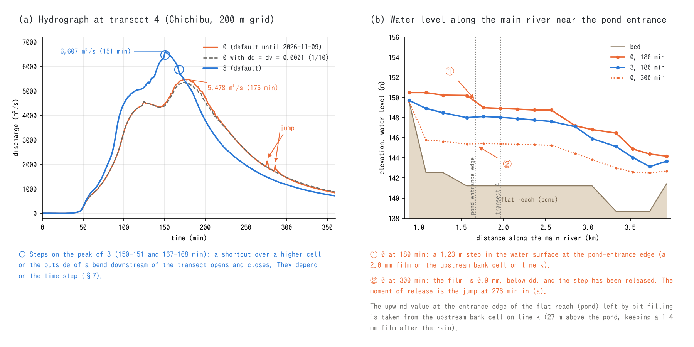
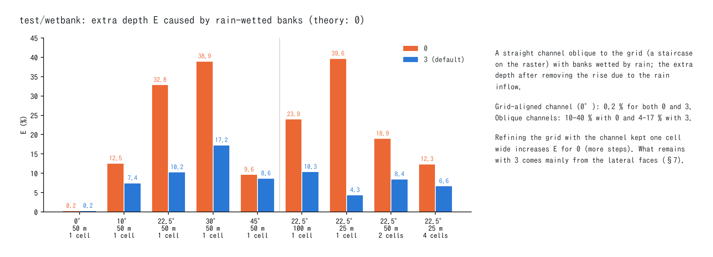

# One-cell-wide channels and the upwind donors of the advection term (f_advection_donor)

> English mirror of docs/users_guide/advection_donor.md. The Japanese file is the master copy.

[Advection schemes](advection.md) | [Shallow water chapter](swflow.md) | [User's guide index](../users_guide.md)

This page explains how the momentum budget of the advection term is handled
when a narrow channel (about one cell wide) flows on a two-dimensional grid.
It describes what `f_advection_donor` of `&list_enc` (default 3) does, why it
is needed and how it is verified. The equations and the control volumes of
the advection term are in §4 of [Advection schemes](advection.md); the records
of the design and the numerical experiments (for developers) are in
docs/developer.md §102 (in Japanese).

**Key points**

- The advection term counts the momentum carried by the water that enters and
  leaves the control volume around an edge (the boundary between two cells).
  When slow water really mixes into the main flow, the main flow slows down
  (confluences, lateral inflow, water returning from an inundated valley
  floor). This is physical braking, and the advection term of ENCflow
  represents it.
- Where a channel bends relative to the grid, the link from which the
  upstream velocity is read can land on a thin film on the bank that carries
  almost no water. Without a countermeasure, that slow velocity is multiplied
  by the whole discharge of the main flow and becomes a deceleration that
  does not happen in reality (a brake that exists only in the computation).
- The default `f_advection_donor = 3` separates the two by whether the
  upstream link "really carries water or is deep", and treats only thin
  donors that carry no water as neutral. The test uses no channel mask.
- To reproduce results computed with the default before 2026-11-09 (0), set
  `f_advection_donor = 0` explicitly (§7).

## 1. Scope of this page -- why narrow channels are a problem

The discretization of the advection term uses the velocity of a nearby edge
on the upstream side of the flow (the upwind value). If a channel runs
straight along the grid, the upstream edge is also inside the channel. Where
the channel bends or runs obliquely to the grid (a staircase on the raster),
however, the upstream edge can land on the bank.

This problem is not limited to the eight-neighbour ENC grid. It can occur in
the same way on four-neighbour structured grids and on unstructured grids, as
long as the advection term uses the velocities of nearby edges or cells (not
checked for individual models). On a grid that is fine enough for the
complexity of the terrain, that is, a grid that represents the channel width
with many cells, the places where the upstream edge lands on the bank become
relatively fewer and the effect becomes small. The decrease is slow, however.
In the check with a straight channel oblique to the grid (§6), representing a
100 m wide channel with 1, 2 and 4 cells gave an extra depth caused by
rain-wetted banks of 24, 19 and 12 % (with 0, which has no countermeasure).

Without a countermeasure, the resolution of the channel as seen by the
advection term is not the resolution of the terrain data (one cell) but the
size of the range from which the advection term reads values (the stencil:
five edges along the flow and three rows across). This is because the
momentum budget of a one-cell-wide channel gets mixed with the flow of the
bank cells within that range.

Instead of coupling a separate one-dimensional channel model, ENCflow runs a
one-cell-wide channel directly in the two-dimensional computation with the
advection term ([ENC grid](encgrid.md)). For this purpose it has built-in
mechanisms that make the advection term reflect from which cell to which
cell the water actually flows within the stencil: walls and dry cells supply
no momentum, the fluxes of the lateral faces are counted with the fluxes of
the links that actually pass through that face
([Advection schemes](advection.md) §4.2, §4.4), blocked openings are
reassigned ([Passage-width adjustment](passage_width.md)), and the
`f_advection_donor` described on this page. Combined with the passage-width
adjustment, which matches the conveyance of one-cell-wide channels, this
brings the computation close to one that uses the resolution of the terrain
data as fully as possible. Some artificial braking has not been removed,
however (§7).

## 2. Physical and artificial braking

The advection term (momentum-conservative form;
[Advection schemes](advection.md) §4) takes a strip-shaped control volume
around edge e and counts the momentum carried by the water that enters and
leaves through its faces. If the velocity of the water entering through a
face (the upwind value) is slower than the edge's own velocity $`u_e`$, the
flow at e slows down.

**Physical braking.** When slow water really enters the main flow -- the
water of a tributary (which has almost no momentum in the direction of the
main river) mixes in at a confluence, rain on a hillslope enters from the
side, water on an inundated valley floor or a floodplain returns to the main
flow -- the main flow slows down. This is momentum conservation itself, and
the advection term of ENCflow includes it (in a channel with lateral inflow
it agrees with the analytic solution of spatially varied flow within 1–2 %;
test/bendloss). The momentum exchanged by turbulent shear at the boundary of
a compound section without water entering or leaving belongs to the diffusion
term, not the advection term (`f_diffusion_term`; disabled by default;
[Diffusion term](diffusion.md)).

**Artificial braking.** Figure 1 (a) shows a one-cell-wide channel running
obliquely to the grid (a staircase on the raster). The mass flux $`q_c`$
through the upstream face c of the control volume of edge e (between cells c
and n) is counted as all the water entering cell c. Most of it is the main
flow entering from the cell at the lower left through a diagonal link. The
velocity that this water carries (the upwind value), however, is taken from
the velocity $`u_m`$ of the upstream link B → c on line k, which has the
same direction as e. At a corner of the staircase B is a bank cell, and the
slow velocity (almost 0) of the thin film left after the rain is multiplied
by the whole discharge of the main flow. Although almost no water enters from
B, the main flow is braked strongly. It is a brake that exists only in the
computation, with no exchange of water.



**Figure 1:** (a) A film on the bank becomes the donor on line k (artificial
braking). (b) B at the same position holds deep valley-floor water that
really flows into c (physical braking). The orange frame is the control
volume of edge e, the green mark is the velocity $`u_m`$ of the upstream link
on line k, and the orange mark is the velocity $`u_e`$ of the edge.

For a real-terrain example, see Chichibu in §5. At the entrance of a flat
reach (a pond) created by depression filling, a bank cell (27 m above the
pond, keeping a 1–4 mm film after the rain) supplied the upwind value, and a
deceleration of about the same size as the driving by the water-surface slope
of the pond (about 0.03 m/s²) created a water-surface step of 0.6–1.2 m
within one cell in the pond.

## 3. Jumps at the wet/dry switch

The film on the bank decreases slowly after the rain and at some point drops
below the threshold depth dd (default 1 mm). With 0, which has no
countermeasure, a film below dd is treated as "dry" and drops out of the
donors; the brake is released all at once and the water held back is let go.
This is the jump in the recession limb of the hydrograph (at transect 4 on
the 200 m grid of Chichibu, +147 m³/s in one minute at 276 min and
+205 m³/s at 286 min). The jumps
appear mostly in the recession because after the rain the films on the
hillslopes and banks all decrease slowly together and drop below dd one
after another at many places.

Making dd smaller removes the jumps, but it only postpones the release to a
later time in the computation; the brake remains (and the peak keeps the
held-back value). This structure, in which the wet/dry test of thin water
acts as a switch on the computation of the neighbouring deep flow, can occur
in two-dimensional models in general wherever a wet/dry threshold enters the
choice of the upwind value (a general remark; not checked for individual
models).

## 4. How `f_advection_donor = 3` separates them

**Flow-direction faces.** For the upstream link on line k, two ratios are
examined:

- the ratio of the discharge $`Q_k`$ that the link really carries into the
  face cell to the largest discharge $`Q_\mathrm{max}`$ among the links
  entering the face cell
- the ratio of the depth $`h_d`$ of the donor cell to the depth $`h_c`$ of
  the face cell

If either is ε (`p_adv_donor_eps`, default 0.1) or more, the upwind value
$`\bar u_k`$ on line k is used as is, as a real donor (the same value as 0).
Only when both are below ε (the donor carries almost no water and is thin) is
the upwind value moved toward the edge's own velocity $`u_e`$.

```math
\bar u = u_e + w\,(\bar u_k - u_e),\qquad
w = \min\!\left(1,\ \frac{\max(Q_k/Q_\mathrm{max},\ h_d/h_c)}{\varepsilon}\right)
```

w = 0 is the neutral treatment, regarding the incoming water as moving at
the same speed as the control volume; it neither decelerates nor
accelerates. The velocity of the water of other links itself is not brought
in. Because w changes continuously with the discharge and the depth, no jump
appears at the moment of switching either.

With the default `f_advection_bend = 1` the value is pulled not toward
$`u_e`$ itself but toward $`\bar u_p`$, a value built from the velocity the
water that actually enters the face cell would have at the width of this
edge and at the depth it arrived with
($`\bar u = \bar u_p + w\,(\bar u_k - \bar u_p)`$;
[the advection page](advection.md) §4.4). When the depth does not change
along the path, $`\bar u_p = u_e`$ and the formula above is unchanged. Only
at bends where the depth changes (the outlet of a pond, the foot of a drop)
is the corresponding acceleration or deceleration added. An edge that
carries only part of the outflow of the face cell (an edge spilling sideways
from the main stream onto a bank) keeps $`\bar u_p \approx u_e`$.
`f_advection_bend = 0` pulls toward $`u_e`$.

**Why the depth condition.** Judged by the discharge share alone, in the
stagnant water of flat reaches created by depression filling (deep, but with
a small inflow), the share moved back and forth across the threshold ε, the
weight switched between 0 and 1, and the reach oscillated with a period of
2–3 minutes (Chichibu on the 100 m grid with a 50 m wide subgrid channel).
Deep stagnant water is treated as a real donor.

**Lateral faces.** For the velocity of the water entering from the side, the
value of the parallel neighbouring link is used. The test of whether the
cells at both ends of that link are wet (at least dd deep) becomes a weight
min(1, h/dd), which weakens the effect in proportion to the depth below dd.
With 0 the test switches from 1 to 0 the moment the film drops below dd and
the flow jumps; with 3 the link drops out gradually as the film thins. At
depths of dd or more the value is the same as with 0.



**Figure 2:** (a) Weight w of the flow-direction face. The closer to white,
the more the value moves toward neutral; outside the blue line (either ratio
at least ε) the upwind value on line k is used as is. (b) Weight of the
parallel link of a lateral face. The dashed line is 0 (switching from 1 to 0
at dd); the solid line is 3.

Since the test asks "does it carry water, is it deep" and not "is it a
channel", no channel mask is used. As in Figure 1 (b), water on a valley
floor or a floodplain remains a real donor if it is deep or really flows in.
The method is **original to ENCflow** (developer.md §102, in Japanese).

## 5. Example: the Chichibu catchment (200 m grid)

With the settings of Step 3 of the
[Chichibu tutorial](../../../tutorials/chichibu/en/README.md) (the Chichibu
catchment of the upper Arakawa, 200 m grid, 100 mm of rain in total (peak
200 mm/h, one hour), no losses), 0 and 3 are compared.



**Figure 3:** (a) Hydrograph at transect 4 (main river near the catchment
outlet). (b) Water level of the main river around the entrance of the flat
reach (pond) created by depression filling, just upstream of transect 4.

- With 0, jumps appear in the recession at 275 and 285 min. At the pond
  entrance the film on the bank (1.9 mm at 180 min) becomes the donor on
  line k and creates a 1.16 m water-surface step in the pond, holding back
  water. After the film drops below dd (0.9 mm at 300 min) the step is
  released. The moment of release is the jump at 275 min.
- With 0 and dd and dv reduced to 1/10 (0.0001 m), no jumps appear, but the
  peak is 5,264 m³/s and the holding back remains.
- With 3 there are no jumps and no step forms. Because the artificial
  braking at many places along the main river is removed, the peak is
  6,960 m³/s, 28 % larger than the 5,437 m³/s of 0, and 36 minutes earlier
  (+26 % on the 100 m grid; test/chichibu). The change of the peak when dd is
  divided by 10 is less than 1 m³/s with 3, compared with 173 m³/s with 0.
  With the time step reduced from 6 s to 3 s the peak of 3 stays the same
  within 0.1 %.
- The difference between 0 and 3 also contains the part by which the default
  `f_advection_lateral = 1`, which works only with 3, removes the lateral-face
  braking by wet banks (§7). With 3 combined with `f_advection_lateral = 0`
  the peak is 6,339 m³/s (154 min), 17 % larger than with 0 and 24 minutes
  earlier. The part by which the default `f_advection_bend = 1` uses the path
  value for the neutral treatment of 3 (§4) is small: with
  `f_advection_bend = 0` in both, 3 gives 6,876 m³/s and 0 gives
  5,439 m³/s (+26 %).

To reproduce this, add `fn_enc = "-"` to `&list_sysparam` in
`en/param_step3.txt` of tutorials/chichibu, append the following
`&list_enc`, and run (for the dd comparison, also add `dd = 0.0001` and
`dv = 0.0001` to `&list_sysparam`).

```
&list_enc
  f_advection_donor = 0      ! default until 2026-11-09
/
```

There is no comparison with observations for this catchment, and whether the
result of 3 is closer to reality has not been checked. What 3 removes is
braking of a type known to be artificial from the checks with known answers
(§6).

## 6. How it is verified

- **A check with a known answer (test/wetbank).** The banks of a straight
  channel oblique to the grid (a one-cell-wide staircase on the raster) are
  wetted by rain. Physically, the rain falling on the banks only increases
  the discharge of the channel slightly, and the channel depth should change
  only by that amount. The extra depth E after subtracting the increase due
  to the rain inflow (theoretical value 0) was 0.2 % for every configuration in a
  grid-aligned channel; in oblique channels it was 10–40 % with 0, 4–17 % with 3
  combined with `f_advection_lateral = 0`, and −0.4 to 3.7 % with the default
  combination (3 with `f_advection_lateral = 1`) (Figure 4). In every geometry 3
  is the same as 0 or closer to the theoretical value than 0.
- **Confirming that physical braking remains.** The channels of
  test/bendloss with lateral inflow (agreeing with the analytic solution of
  spatially varied flow within 1–2 %), bends and zigzags, and test/dambreak
  (Stoker's analytic solution of the dam break; 3 agrees with 0 to all
  digits). Donors at wetting fronts and in the main flow carry water or are
  deep, so 3 uses the same values as 0.
- **Confirming that there are no side effects.** test/sublattice,
  test/uniflow, test/inflowadv, test/dbonset and test/sedfeed pass as with 0,
  with the judged values at the same level as with 0.
- **Regression and parallel runs.** With 0 set explicitly, the results agree
  bit for bit with those before 2026-11-09. Serial and MPI (np = 1, 2, 4)
  results also agree bit for bit.
- **Real terrain.** On the 200, 100 and 50 m grids of Chichibu it was
  confirmed that the jumps in the recession disappear and the dependence on
  dd almost vanishes (§5). After the default was changed to 3, the examples
  whose READMEs show values (meander and four others) were rerun.



**Figure 4:** Extra depth E in test/wetbank. The five groups on the left vary
the direction of the one-cell-wide channel; the four groups on the right vary
the grid spacing and the number of cells that represent the channel. The three
bars are 0, 3 with `f_advection_lateral = 0`, and the default combination
(3 with `f_advection_lateral = 1`).

## 7. Usage and limits

- **The default works as is.** No setting is needed. The threshold
  `p_adv_donor_eps` (default 0.1) is empirical. The peak at transect 4 on the
  200 m grid of Chichibu becomes 1.4 % smaller when it is set to 0.05 and
  0.6 % larger when it is set to 0.2 (the peaks at transects 1–3 differ by
  0.6 % or less). Values outside 0.05–0.2 have not been checked.
- **Reproducing earlier results.** To reproduce results computed with the
  default before 2026-11-09 (0) (including cases whose roughness was
  calibrated with 0), add `fn_enc = "-"` to `&list_sysparam` and set
  `f_advection_donor = 0` explicitly in `&list_enc`.
- **Faster flow.** Compared with 0, flood waves become faster and larger, and
  the Courant number rises. A time step that ran to the end with 0 may need
  to be reduced (Chichibu on the 200 m grid with a 50 m wide subgrid channel:
  dt 6 s → 4 s). Check Cn_max on the screen. The run time is about three tenths
  longer than with 0 (Chichibu, 200 m grid; this includes the default
  `f_advection_lateral = 1`, which works only with 3. With 3 combined with
  `f_advection_lateral = 0` it is about a tenth longer than with 0).
- **Lateral-face braking is handled by `f_advection_lateral`.** The velocity
  of the water entering the control volume from the side is taken from the
  parallel link beyond the face ([Advection schemes](advection.md) §4.2 and
  §4.3). When the bank cells are wet with a film of dd or more, the slow
  velocity of the film link (nearly 0) is applied to all the water that
  crosses the face. On lateral faces `f_advection_donor = 3` only changes the
  weight of films thinner than dd, so with `f_advection_lateral = 0` (the
  default until 2026-11-16) this braking remains with 3 as with 0 (the main
  cause of the 4–17 % in test/wetbank). Two parts of different nature are mixed
  in this braking.
  - **The artificial part.** The film velocity, which has nothing to do with
    the exchange of water, is applied to a main flow that turns or that
    passes along the edge of a pond. Whether the banks are wet then changes
    the depth of oblique channels and ponds (4–17 % in a one-cell-wide
    channel oblique to the grid; in ponds fed over a drop, wetting a single
    bank cell thinly raised the pond depth from 2.6 to 2.8 m in the
    junction-pond geometry of test/brink and from 2.4 to 3.3 m in a
    computation cut out around the pond of Chichibu). With the same terrain
    and roughness, the resistance of the channel thus differs between a run
    with rain and a run without rain (inflow from upstream only).
  - **The part by which momentum is diluted at a junction.** The water of a
    tributary carries no momentum in the direction of the main river, so the
    reach upstream of a junction is backed up in reality as well.
    `f_advection_lateral = 0` counts this backwater only when the banks are wet (the nearly zero
    velocity of the film link happens to stand in for "water entering from
    the side carries no momentum in the direction of the main river"; it is
    not an intended rule). In a one-cell-wide T-junction (grid spacing 50 m,
    slope 1/500, roughness 0.03, 1,000 m³/s after the junction, three ratios
    of main-river to tributary discharge), the depth of the main river just
    upstream of the junction was +0.00 to +0.21 m relative to the momentum
    theory with wet banks, and −0.34 to −0.41 m with dry banks (6–7 %
    shallower, close to a flow without loss). **With 0, at a junction with dry
    banks (for example a run without rain), almost no backwater from the
    junction appears.**

  **The default `f_advection_lateral = 1` treats these two parts
  separately** ([Advection schemes](advection.md) §4.4). When the parallel
  link is a film thin compared with the water crossing the face, its velocity
  is not used (the artificial part is removed), and water entering the flow
  along the line of the edge from another direction is charged its deficit of
  momentum in the direction of the edge (the junction part is counted
  regardless of the wetness of the banks). The increase in depth caused by
  banks wetted by rain (test/wetbank) becomes −0.4 to 3.7 % (0.2–17.2 % with
  0), and the backwater of a right-angle junction is 60–80 % of that of the
  momentum theory regardless of the wetness of the banks (test/tjunction; the
  difference between wet and dry banks is below 0.01 m, against 0.14–1.09 m
  with 0). The water surface of a junction pond stays steady. Compared with
  the defaults until 2026-11-16 (`f_advection_lateral = 0` and
  `f_dry_head_cap = 2`), the peaks at transects 3 and 4 of Chichibu rise by 3.3
  and 5.3 % on the 200 m grid (10 and 9 minutes earlier), by 11.7 and 9.4 % on
  the 100 m grid (8 and 16 minutes earlier) and by 13.0 and 14.1 % on the 50 m
  grid (3 and 15 minutes earlier), and the difference between grids widens (the
  brake of the film on the banks acted more strongly on finer grids, where the
  staircase has more steps; the times of the peak at transect 4 line up at 142,
  143 and 145 minutes). That the backwater of a junction is smaller than the
  theory and changes with the grid orientation (an eight-neighbour grid
  represents a right-angle junction as a combination of perpendicular links and
  diagonal links) and that the form loss of bends is not counted remain limits
  with 1 as well. With 0, in computations that read the water level upstream of
  a junction or the depth of ponds and oblique channels in detail, the result
  changes with how wet the banks are (rain or no rain, dd).

  This braking switches on and off when the water of a pond starts and stops
  overtopping a low valley wall, and can then make dips or bumps in the
  discharge (at transect 3 on the 50 m grid of Chichibu computed with
  `f_advection_lateral = 0` combined with `f_dry_head_cap = 2`, small dips just
  before the peak in which the discharge falls by 180–210 m³/s in one minute
  and recovers at once; when `f_advection_bend = 0` is combined as well, the
  over-acceleration at the edge just after a bend
  ([the advection page](advection.md) §4.4) alternates with this braking, and
  they become a dip and a bump of ±1,200 m³/s per minute). In the same run with
  the default combination (`f_advection_lateral = 1` with `f_dry_head_cap = 3`)
  the dips before the peak do not appear, but a wobble appears in the recession
  when the flow at the pond outlet switches from a deep, slow state to a
  shallow, fast one (the limit of 1 in [the advection page](advection.md) §4.4;
  item 3 of "Fine oscillations in the hydrograph" in the
  [supplement of the Chichibu tutorial](../../../tutorials/chichibu/en/README.md)).
- **Films thinner than dd are also counted according to their thickness.**
  Therefore, in bent channels whose banks are wetted by rain, the water level
  of the bend cells changes slightly from 0 (in the polyline channel of
  test/bendloss with 2 mm/h of rain on the floodplain, bend 1 goes from 1.46
  to 1.64 m and bends 2–4 from 1.73 to 1.65 m; 0 with dd divided by 10 gives
  2.02 m; the mean depth of the reach does not change).
- **The velocity of a main flow entering obliquely is not used as it is.**
  3 only treats thin donors as neutral; it does not use the velocity of the
  main flow entering through a diagonal link itself as the upwind value of
  the flow-direction face. For the neutral part, `f_advection_bend = 1` (the
  default) uses the velocity the water entering the face cell would have at
  the width of this edge and at the depth it arrived with, and counts the
  acceleration or deceleration for the change of depth along the path (with
  `f_advection_bend = 0` it is not counted;
  [the advection page](advection.md) §4.4).
- **Wobbles caused by the terrain.** In flat reaches created by depression
  filling and in subgrid channels narrower than the cell, fine wobbles due to
  hydraulic jumps or seiches can appear. Some also appear with 0, and some
  become more visible with the small dissipation of 3. At transect 3 of the
  run on the 200 m grid of Chichibu with a 50 m wide subgrid channel, the
  one-minute discharge in the recession (100–130 min) deviates from the
  11-minute moving average by up to 31 m³/s (within 9 m³/s without the
  width).
  The cause is the terrain, not the wet/dry switch, so treat the terrain first
  ([supplement of the Chichibu tutorial](../../../tutorials/chichibu/en/README.md)).
- **Faces where it does not apply.** It does not apply to the boundary faces
  of lateral Neumann sides (the same value as 0). The local-inertia setting
  (`f_govequation = 1`; formerly written "diffusion wave") has no advection
  term, so it is not affected.
- **Removed options.** 1 (donors limited to channel cells on edges between
  channel cells) and 2 (an average weighted by the fluxes of all inflow
  links) were removed on 2026-11-07. Setting them stops the run. Most of the
  effect of 1 is contained in 3, and 2 had the side effect of carrying the
  momentum of passing flow into other places (developer.md §102, in
  Japanese).

## Related documents

- [Advection schemes](advection.md) -- control volumes, face fluxes, limiter (§4)
- [Passage-width adjustment](passage_width.md) -- conveyance of one-cell-wide channels
- [ENC grid](encgrid.md)
- Checks: [test/wetbank](../../../test/wetbank/en/README.md),
  [test/bendloss](../../../test/bendloss/en/README.md),
  [test/chichibu](../../../test/chichibu/en/README.md)
- docs/developer.md §102 (records of the design, prototypes and
  verification; in Japanese)

## References

- Stelling, G. S. and Duinmeijer, S. P. A. (2003): A staggered conservative
  scheme for every Froude number in rapidly varied shallow water flows.
  *Int. J. Numer. Meth. Fluids*, 43, 1329–1354. (Basis of the
  momentum-conservative advection term; the treatment of the upwind donors is
  ENCflow's own.)
