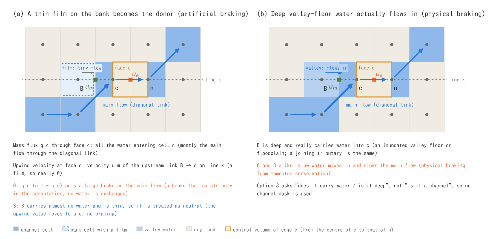
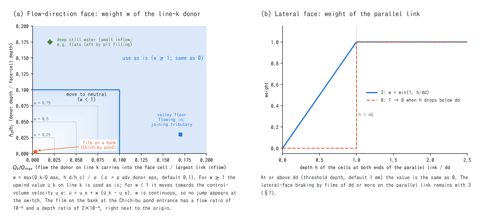
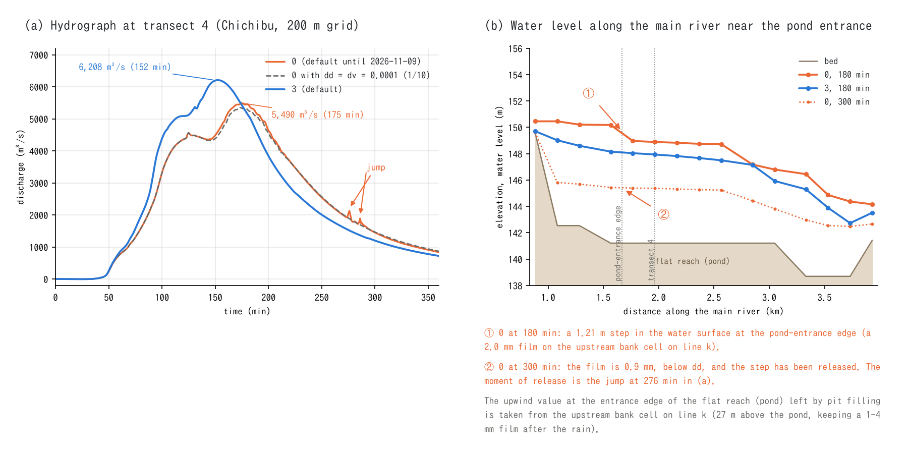
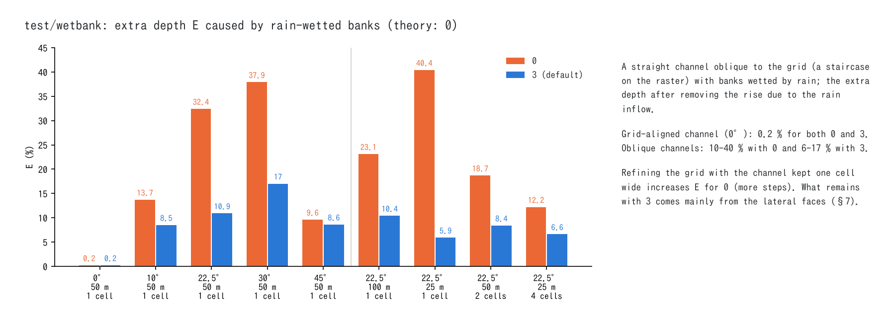

# One-cell-wide channels and the upwind donors of the advection term (f_advection_donor)

> English mirror of docs/users_guide/advection_donor.md. The Japanese file is the master copy.

[Advection schemes](advection.md) | [Shallow water chapter](swflow.md) | [User's guide index](../users_guide.md)

This page explains how the momentum budget of the advection term is handled
when a narrow channel (about one cell wide) flows on a two-dimensional grid.
It describes what `f_advection_donor` of `&list_enc` (default 3) does, why it
is needed and how it is verified. The equations and the control volumes of
the advection term are in §4 of [Advection schemes](advection.md); the records
of the design and the numerical experiments (for developers) are in
docs/developer.md §102 (in Japanese).

**Key points**

- The advection term counts the momentum carried by the water that enters and
  leaves the control volume around an edge (the boundary between two cells).
  When slow water really mixes into the main flow, the main flow slows down
  (confluences, lateral inflow, water returning from an inundated valley
  floor). This is physical braking, and the advection term of ENCflow
  represents it.
- Where a channel bends relative to the grid, the link from which the
  upstream velocity is read can land on a thin film on the bank that carries
  almost no water. Without a countermeasure, that slow velocity is multiplied
  by the whole discharge of the main flow and becomes a deceleration that
  does not happen in reality (a brake that exists only in the computation).
- The default `f_advection_donor = 3` separates the two by whether the
  upstream link "really carries water or is deep", and treats only thin
  donors that carry no water as neutral. The test uses no channel mask.
- To reproduce results computed with the default before 2026-11-09 (0), set
  `f_advection_donor = 0` explicitly (§7).

## 1. Scope of this page -- why narrow channels are a problem

The discretization of the advection term uses the velocity of a nearby edge
on the upstream side of the flow (the upwind value). If a channel runs
straight along the grid, the upstream edge is also inside the channel. Where
the channel bends or runs obliquely to the grid (a staircase on the raster),
however, the upstream edge can land on the bank.

This problem is not limited to the eight-neighbour ENC grid. It can occur in
the same way on four-neighbour structured grids and on unstructured grids, as
long as the advection term uses the velocities of nearby edges or cells (not
checked for individual models). On a grid that is fine enough for the
complexity of the terrain, that is, a grid that represents the channel width
with many cells, the places where the upstream edge lands on the bank become
relatively fewer and the effect becomes small. The decrease is slow, however.
In the check with a straight channel oblique to the grid (§6), representing a
100 m wide channel with 1, 2 and 4 cells gave an extra depth caused by
rain-wetted banks of 23, 19 and 12 % (with 0, which has no countermeasure).

Without a countermeasure, the resolution of the channel as seen by the
advection term is not the resolution of the terrain data (one cell) but the
size of the range from which the advection term reads values (the stencil:
five edges along the flow and three rows across). This is because the
momentum budget of a one-cell-wide channel gets mixed with the flow of the
bank cells within that range.

Instead of coupling a separate one-dimensional channel model, ENCflow runs a
one-cell-wide channel directly in the two-dimensional computation with the
advection term ([ENC grid](encgrid.md)). For this purpose it has built-in
mechanisms that make the advection term reflect from which cell to which
cell the water actually flows within the stencil: walls and dry cells supply
no momentum, the fluxes of the lateral faces are counted with the fluxes of
the links that actually pass through that face
([Advection schemes](advection.md) §4.2, §4.4), blocked openings are
reassigned ([Passage-width adjustment](passage_width.md)), and the
`f_advection_donor` described on this page. Combined with the passage-width
adjustment, which matches the conveyance of one-cell-wide channels, this
brings the computation close to one that uses the resolution of the terrain
data as fully as possible. Some artificial braking has not been removed,
however (§7).

## 2. Physical and artificial braking

The advection term (momentum-conservative form;
[Advection schemes](advection.md) §4) takes a strip-shaped control volume
around edge e and counts the momentum carried by the water that enters and
leaves through its faces. If the velocity of the water entering through a
face (the upwind value) is slower than the edge's own velocity $`u_e`$, the
flow at e slows down.

**Physical braking.** When slow water really enters the main flow -- the
water of a tributary (which has almost no momentum in the direction of the
main river) mixes in at a confluence, rain on a hillslope enters from the
side, water on an inundated valley floor or a floodplain returns to the main
flow -- the main flow slows down. This is momentum conservation itself, and
the advection term of ENCflow includes it (in a channel with lateral inflow
it agrees with the analytic solution of spatially varied flow within 1–2 %;
test/bendloss). The momentum exchanged by turbulent shear at the boundary of
a compound section without water entering or leaving belongs to the diffusion
term, not the advection term (`f_diffusion_term`; disabled by default;
[Diffusion term](diffusion.md)).

**Artificial braking.** Figure 1 (a) shows a one-cell-wide channel running
obliquely to the grid (a staircase on the raster). The mass flux $`q_c`$
through the upstream face c of the control volume of edge e (between cells c
and n) is counted as all the water entering cell c. Most of it is the main
flow entering from the cell at the lower left through a diagonal link. The
velocity that this water carries (the upwind value), however, is taken from
the velocity $`u_m`$ of the upstream link B → c on line k, which has the
same direction as e. At a corner of the staircase B is a bank cell, and the
slow velocity (almost 0) of the thin film left after the rain is multiplied
by the whole discharge of the main flow. Although almost no water enters from
B, the main flow is braked strongly. It is a brake that exists only in the
computation, with no exchange of water.



**Figure 1:** (a) A film on the bank becomes the donor on line k (artificial
braking). (b) B at the same position holds deep valley-floor water that
really flows into c (physical braking). The orange frame is the control
volume of edge e, the green mark is the velocity $`u_m`$ of the upstream link
on line k, and the orange mark is the velocity $`u_e`$ of the edge.

For a real-terrain example, see Chichibu in §5. At the entrance of a flat
reach (a pond) created by depression filling, a bank cell (27 m above the
pond, keeping a 1–4 mm film after the rain) supplied the upwind value, and a
deceleration of about the same size as the driving by the water-surface slope
of the pond (about 0.03 m/s²) created a water-surface step of 0.6–1.2 m
within one cell in the pond.

## 3. Jumps at the wet/dry switch

The film on the bank decreases slowly after the rain and at some point drops
below the threshold depth dd (default 1 mm). With 0, which has no
countermeasure, a film below dd is treated as "dry" and drops out of the
donors; the brake is released all at once and the water held back is let go.
This is the jump in the recession limb of the hydrograph (at transect 4 on
the 200 m grid of Chichibu, +159 m³/s in one minute at 274 min). The jumps
appear mostly in the recession because after the rain the films on the
hillslopes and banks all decrease slowly together and drop below dd one
after another at many places.

Making dd smaller removes the jumps, but it only postpones the release to a
later time in the computation; the brake remains (and the peak keeps the
held-back value). This structure, in which the wet/dry test of thin water
acts as a switch on the computation of the neighbouring deep flow, can occur
in two-dimensional models in general wherever a wet/dry threshold enters the
choice of the upwind value (a general remark; not checked for individual
models).

## 4. How `f_advection_donor = 3` separates them

**Flow-direction faces.** For the upstream link on line k, two ratios are
examined:

- the ratio of the discharge $`Q_k`$ that the link really carries into the
  face cell to the largest discharge $`Q_\mathrm{max}`$ among the links
  entering the face cell
- the ratio of the depth $`h_d`$ of the donor cell to the depth $`h_c`$ of
  the face cell

If either is ε (`p_adv_donor_eps`, default 0.1) or more, the upwind value
$`\bar u_k`$ on line k is used as is, as a real donor (the same value as 0).
Only when both are below ε (the donor carries almost no water and is thin) is
the upwind value moved toward the edge's own velocity $`u_e`$.

```math
\bar u = u_e + w\,(\bar u_k - u_e),\qquad
w = \min\!\left(1,\ \frac{\max(Q_k/Q_\mathrm{max},\ h_d/h_c)}{\varepsilon}\right)
```

w = 0 is the neutral treatment, regarding the incoming water as moving at
the same speed as the control volume; it neither decelerates nor
accelerates. The momentum of the water of other links is not brought in.
Because w changes continuously with the discharge and the depth, no jump
appears at the moment of switching either.

**Why the depth condition.** Judged by the discharge share alone, in the
stagnant water of flat reaches created by depression filling (deep, but with
a small inflow), the share moved back and forth across the threshold ε, the
weight switched between 0 and 1, and the reach oscillated with a period of
2–3 minutes (Chichibu on the 100 m grid with a 50 m wide subgrid channel).
Deep stagnant water is treated as a real donor.

**Lateral faces.** For the velocity of the water entering from the side, the
value of the parallel neighbouring link is used. The test of whether the
cells at both ends of that link are wet (at least dd deep) becomes a weight
min(1, h/dd), which weakens the effect in proportion to the depth below dd.
With 0 the test switches from 1 to 0 the moment the film drops below dd and
the flow jumps; with 3 the link drops out gradually as the film thins. At
depths of dd or more the value is the same as with 0.



**Figure 2:** (a) Weight w of the flow-direction face. The closer to white,
the more the value moves toward neutral; outside the blue line (either ratio
at least ε) the upwind value on line k is used as is. (b) Weight of the
parallel link of a lateral face. The dashed line is 0 (switching from 1 to 0
at dd); the solid line is 3.

Since the test asks "does it carry water, is it deep" and not "is it a
channel", no channel mask is used. As in Figure 1 (b), water on a valley
floor or a floodplain remains a real donor if it is deep or really flows in.
The method is **original to ENCflow** (developer.md §102, in Japanese).

## 5. Example: the Chichibu catchment (200 m grid)

With the settings of Step 3 of the
[Chichibu tutorial](../../../tutorials/chichibu/en/README.md) (the Chichibu
catchment of the upper Arakawa, 200 m grid, 100 mm of rain in total (peak
200 mm/h, one hour), no losses), 0 and 3 are compared.



**Figure 3:** (a) Hydrograph at transect 4 (main river near the catchment
outlet). (b) Water level of the main river around the entrance of the flat
reach (pond) created by depression filling, just upstream of transect 4.

- With 0, jumps appear in the recession at 276 and 286 min. At the pond
  entrance the film on the bank (2.0 mm at 180 min) becomes the donor on
  line k and creates a 1.21 m water-surface step in the pond, holding back
  water. After the film drops below dd (0.9 mm at 300 min) the step is
  released. The moment of release is the jump at 276 min.
- With 0 and dd and dv reduced to 1/10 (0.0001 m), no jumps appear, but the
  peak is 5,346 m³/s and the holding back remains.
- With 3 there are no jumps and no step forms. Because the artificial
  braking at many places along the main river is removed, the peak is
  6,208 m³/s, 13 % larger than the 5,490 m³/s of 0, and 23 minutes earlier
  (+19 % on the 100 m grid; test/chichibu). The change of the peak when dd is
  divided by 10 is 4 m³/s with 3, compared with 144 m³/s with 0.

To reproduce this, add `fn_enc = "-"` to `&list_sysparam` in
`en/param_step3.txt` of tutorials/chichibu, append the following
`&list_enc`, and run (for the dd comparison, also add `dd = 0.0001` and
`dv = 0.0001` to `&list_sysparam`).

```
&list_enc
  f_advection_donor = 0      ! default until 2026-11-09
/
```

There is no comparison with observations for this catchment, and whether the
result of 3 is closer to reality has not been checked. What 3 removes is
braking of a type known to be artificial from the checks with known answers
(§6).

## 6. How it is verified

- **A check with a known answer (test/wetbank).** The banks of a straight
  channel oblique to the grid (a one-cell-wide staircase on the raster) are
  wetted by rain. Physically, the rain falling on the banks only increases
  the discharge of the channel slightly, and the channel depth should change
  only by that amount. The extra depth E after subtracting the increase due
  to the rain inflow (theoretical value 0) was 0.2 % for both 0 and 3 in a
  grid-aligned channel, and 10–40 % with 0 and 6–17 % with 3 in oblique
  channels (Figure 4). In every geometry 3 is the same as 0 or closer to the
  theoretical value than 0.
- **Confirming that physical braking remains.** The channels of
  test/bendloss with lateral inflow (agreeing with the analytic solution of
  spatially varied flow within 1–2 %), bends and zigzags, and test/dambreak
  (Stoker's analytic solution of the dam break; 3 agrees with 0 to all
  digits). Donors at wetting fronts and in the main flow carry water or are
  deep, so 3 uses the same values as 0.
- **Confirming that there are no side effects.** test/sublattice,
  test/uniflow, test/inflowadv, test/dbonset and test/sedfeed pass as with 0,
  with the judged values at the same level as with 0.
- **Regression and parallel runs.** With 0 set explicitly, the results agree
  bit for bit with those before 2026-11-09. Serial and MPI (np = 1, 2, 4)
  results also agree bit for bit.
- **Real terrain.** On the 200, 100 and 50 m grids of Chichibu it was
  confirmed that the jumps in the recession disappear and the dependence on
  dd almost vanishes (§5). After the default was changed to 3, the examples
  whose READMEs show values (meander and four others) were rerun.



**Figure 4:** Extra depth E in test/wetbank. The five pairs on the left vary
the direction of the one-cell-wide channel; the four pairs on the right vary
the grid spacing and the number of cells that represent the channel.

## 7. Usage and limits

- **The default works as is.** No setting is needed. The threshold
  `p_adv_donor_eps` (default 0.1) is empirical. The peak at transect 4 on the
  200 m grid of Chichibu changes by only 0.1 % when it is set to 0.2. With
  0.05 the water level around the peak rises by 0.1 m, and at a bend 600 m
  downstream of the transect a shortcut opens for about 13 minutes, in which
  the channel water runs up onto the high cell on the outer side (7 m above
  the bed); the peak of the 1-minute values becomes 3.9 % larger (the maximum
  before the shortcut opens is 0.7 % smaller than with the default). The steps
  in the discharge when the run-up starts and stops are a property of the cap
  on the edge depth ([the advection page](advection.md) §5). Values outside
  0.05–0.2 have not been checked.
- **Reproducing earlier results.** To reproduce results computed with the
  default before 2026-11-09 (0) (including cases whose roughness was
  calibrated with 0), add `fn_enc = "-"` to `&list_sysparam` and set
  `f_advection_donor = 0` explicitly in `&list_enc`.
- **Faster flow.** Compared with 0, flood waves become faster and larger, and
  the Courant number rises. A time step that ran to the end with 0 may need
  to be reduced (Chichibu on the 200 m grid with a 50 m wide subgrid channel:
  dt 6 s → 4 s). Check Cn_max on the screen. The run time is about 8 %
  longer than with 0 (Chichibu, 200 m grid, 4 threads).
- **Lateral-face braking remains.** When a bank with a film of dd or more
  enters the parallel link, its slow velocity becomes the inflow value of the
  main flow turning in from the side; this braking remains with 3 as with 0
  (the main cause of the 6–17 % in test/wetbank). Removing it in a prototype
  raised the peak at transect 4 on the 200 m grid of Chichibu by 6–12 %, and
  on the 100 m and 50 m grids the discharge became rough or diverged. On real
  terrain this braking also provides damping for the computation, so it has
  not been removed (developer.md §102, in Japanese).
- **Films thinner than dd are also counted according to their thickness.**
  Therefore, in bent channels whose banks are wetted by rain, the water level
  of the bend cells changes slightly from 0 (in the polyline channel of
  test/bendloss with 2 mm/h of rain on the floodplain, bend 1 goes from 1.50
  to 1.68 m and bends 2–4 from 1.73 to 1.68 m; 0 with dd divided by 10 gives
  2.02 m; the mean depth of the reach does not change).
- **The momentum of a main flow entering obliquely is not counted.** 3 only
  treats thin donors as neutral; it does not use the momentum of the main
  flow entering through a diagonal link as the upwind value of the
  flow-direction face. The advective acceleration or deceleration at that
  face is not counted.
- **Wobbles caused by the terrain.** In flat reaches created by depression
  filling and in subgrid channels narrower than the cell, fine wobbles due to
  hydraulic jumps or seiches can appear. Some also appear with 0, and some
  become more visible with the small dissipation of 3. At transect 3 on the
  50 m grid of Chichibu, the hydraulic jump below a 10 m step just upstream
  is temporarily pushed up and returns at 93–95 min in the recession, which
  makes a −330/+330 m³/s notch in the one-minute discharge (about
  −145 m³/s at the same step with 0). On the 200 m grid with a 50 m wide
  subgrid channel, a seiche with a period of about 4 minutes remains in a
  flat reach, and the one-minute discharge deviates from the 11-minute moving
  average by about ±60 m³/s (it does not appear with 0 or without the width,
  and disappears with terrain without the flat reach). The cause is the
  terrain, not the wet/dry switch, so treat the terrain first
  ([supplement of the Chichibu tutorial](../../../tutorials/chichibu/en/README.md)).
- **Faces where it does not apply.** It does not apply to the boundary faces
  of lateral Neumann sides (the same value as 0). The local-inertia setting
  (`f_govequation = 1`; formerly written "diffusion wave") has no advection
  term, so it is not affected.
- **Removed options.** 1 (donors limited to channel cells on edges between
  channel cells) and 2 (an average weighted by the fluxes of all inflow
  links) were removed on 2026-11-07. Setting them stops the run. Most of the
  effect of 1 is contained in 3, and 2 had the side effect of carrying the
  momentum of passing flow into other places (developer.md §102, in
  Japanese).

## Related documents

- [Advection schemes](advection.md) -- control volumes, face fluxes, limiter (§4)
- [Passage-width adjustment](passage_width.md) -- conveyance of one-cell-wide channels
- [ENC grid](encgrid.md)
- Checks: [test/wetbank](../../../test/wetbank/en/README.md),
  [test/bendloss](../../../test/bendloss/en/README.md),
  [test/chichibu](../../../test/chichibu/en/README.md)
- docs/developer.md §102 (records of the design, prototypes and
  verification; in Japanese)

## References

- Stelling, G. S. and Duinmeijer, S. P. A. (2003): A staggered conservative
  scheme for every Froude number in rapidly varied shallow water flows.
  *Int. J. Numer. Meth. Fluids*, 43, 1329–1354. (Basis of the
  momentum-conservative advection term; the treatment of the upwind donors is
  ENCflow's own.)
