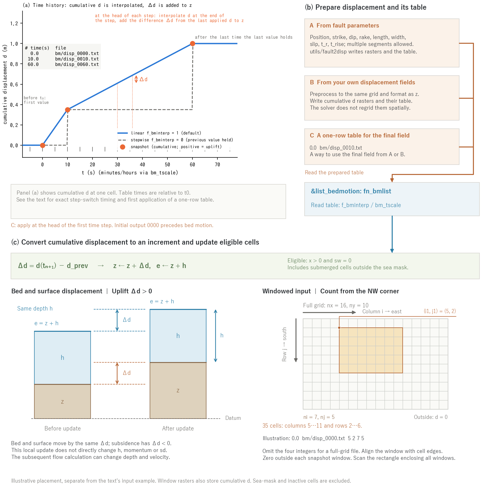

# Prescribed bed motion (&list_bedmotion)

> English mirror of docs/users_guide/bedmotion.md. The Japanese file is the master copy.

[Back to the User's Guide index](../users_guide.md)

Forces the bed elevation z with a prescribed **time history** of ground
displacement. The main use is tsunami generation from fault-derived
seafloor deformation, following generation, propagation, run-up and
inundation in a single run. Land cells move with the same displacement
field, so coseismic coastal uplift and subsidence (flooding of subsided
lowland, waves spreading from uplifted areas) are part of the same
computation. During the local displacement update, h is kept and z is
moved, so e = z + h moves by the same amount. The subsequent flow calculation
can change depth and velocity (the same contract as the morphological
modules). The design is in [docs/bedmotion_plan.md](../../bedmotion_plan.md),
the implementation record in developer.md §70, and the preprocessing from
fault parameters in [utils/fault2disp/README.md](../../../utils/fault2disp/README.md).

## 1. Minimal setup

The steps to generate the tsunami of a single reverse fault in an
idealised sea (no georeference). Three files are needed.

**(1) Fault parameters to a displacement time history** (utils/fault2disp)

```
&list_fault2disp
  nx = 200                  ! grid (same as ENCflow's list_geoinfo)
  ny = 150
  dx = 1000.0
  dy = 1000.0
  dir_out = 'bm'            ! writes bm/disp_0000.txt ... and bm/bmlist.txt
  nout = 10
  nseg = 1
  x_top(1) = 120000.0       ! top-edge centre (120 km east, 75 km north of the lower-left corner)
  y_top(1) = 75000.0
  d_top(1) = 5000.0         ! top-edge depth 5 km
  strike(1) = 0.0           ! strike N; the fault dips to the right of the strike (east)
  dip(1) = 15.0
  rake(1) = 90.0            ! reverse fault
  flength(1) = 60000.0
  fwidth(1) = 30000.0
  slip(1) = 5.0
  t_r(1) = 0.0              ! rupture start (s)
  t_rise(1) = 30.0          ! rise time 30 s
/
```

```
cd utils/fault2disp && make          # once (build src first if libencflow.a is missing)
cd <the case's dir_data> && <path>/fault2disp fault2disp.txt
```

**(2) The model parameters** (excerpt; only the settings specific to a
tsunami run are shown)

```
&list_sysparam
  fn_bedmotion = '-'        ! read &list_bedmotion from the same file
  f_out_z = 1               ! also output the deformed bed
  ...
/
&list_initial
  f_htype = 2               ! fixed initial water level (still water e0 = 0; z < 0 is sea)
  e0 = 0.0
/
&list_bound_edge
  f_bc_w = 0                ! landward edge: wall
  f_bc_e = 2                ! seaward edges: long-wave radiation (no reflection)
  f_bc_n = 2
  f_bc_s = 2
/
&list_bedmotion
  fn_bmlist = 'bm/bmlist.txt'   ! the table written by (1) (relative to dir_data)
/
```

**(3) Run**

As usual, `./encflow param.txt` (the MPI build likewise). At the start
the number of snapshots and their time range are printed; at the end the
maximum and minimum applied displacement, the number of snapshots read
and the number of steps applied. Complete examples:
[examples/tsunami_fault](../../../examples/tsunami_fault/README.md) (this
minimal setup itself) and
[examples/tsunami_coast](../../../examples/tsunami_coast/README.md)
(coastal subsidence/uplift and the offshore tsunami with their time lag).

## 2. Input conventions (snapshot table and displacement files)

The **table** has one line per snapshot, "time file" (blank lines and
lines starting with `#` or `!` are ignored). Times are relative to the
start t0 and **strictly increasing**; file names are relative to dir_data.
The internal snapshot time is `t0 + table time × bm_tscale`.

```
# time(s)  file
  0.0      bm/disp_0000.txt
 10.0      bm/disp_0010.txt
 60.0      bm/disp_0060.txt
```

Each **displacement file** holds the **cumulative** displacement d [m] at
that time, relative to the terrain at the start of the run (not the
increment since the previous time), in the same format and row order as
the bed elevation z (text matrix / bil / GeoTIFF according to
f_input_mode; row 1 is the northern edge). Positive is uplift, negative
subsidence.

- Before the first time the first value holds; after the last time the
  last value holds. A zero-displacement line at t = 0 is the usual start
  (fault2disp writes one).
- Between snapshots the displacement is interpolated linearly
  (f_bminterp=1, default) or held stepwise (f_bminterp=0, the previous
  snapshot is kept).
- Times are in seconds. A table written in minutes or hours is converted
  with bm_tscale (60, 3600).
- The model keeps two snapshots (previous and next) plus the applied
  displacement, reading the next file as time advances. The number of stored
  raster arrays is independent of table length, but the lists of times,
  file names, and windows grow with the number of snapshots.

## 3. Three ways to supply the displacement

### Pattern A: from fault parameters (utils/fault2disp)

Earthquake tsunamis use this pattern. From the fault position, strike,
dip, rake, length, width, slip, rupture start time and rise time the
utility computes the displacement field with Okada's (1985) formulas and
writes the table. Several segments (with rupture-time lags) and the
horizontal-displacement contribution u_h·∇z (Tanioka & Satake 1996, when
a bed elevation is given) are supported. Coordinates can be given in three
ways, all absorbed on the fault2disp side, so the model settings do not
change (details in fault2disp README §3).

| How the coordinates are held | fault2disp setting |
|---|---|
| Idealised experiment (no georeference) | x_top, y_top as distances (m) from the lower-left corner of the grid (the example in §1) |
| Georeferenced analysis in a projected system | give the bil+hdr / GeoTIFF bed elevation as fn_z: the grid and origin are taken from the file and x_top, y_top are absolute coordinates of that system. The Japanese plane rectangular order (X northing, Y easting) is f_jpr=1 |
| Longitude/latitude | f_lonlat=1 with lon_top, lat_top and the grid's projection (proj_lon0 etc.; UTM or plane rectangular). The strike is corrected for grid convergence |

### Pattern B: a displacement field of your own (geodetic data, slip inversions, other models)

When you already hold rasters of ground displacement without going
through a fault model, write the table yourself following §2. Resample
them to the same grid and format as z in preprocessing (ENCflow does not
interpolate) and make each one cumulative. A field available at a single
time (the final displacement only) can be used in the form of §3-C.

### Pattern C: a one-row table for the final displacement (instantaneous input)

To skip the rupture process, reduce the table to one line. The final
displacement raster can come from A or B. The table value `0.0` corresponds
to `t0`.

```
# instantaneous: final displacement at t = 0
0.0  bm/disp_0010.txt
```

In a fresh run, the final displacement is applied **at the head of the first
time step**, before solving the flow. Initial output `0000` precedes that
application and therefore contains the undeformed terrain and surface.
This omits the rupture process; it does not guarantee the same result as
changing only the initial water depth over fixed terrain. Bedmotion changes
the terrain while keeping the depth during application.

The time-history input differs in near-field arrival time and wave height.
The existing example READMEs report 2–3% in maximum level for tsunami_fault
and +24 to 40% at the bay mouth and shelf of tsunami_coast.

### Large domains: windowed displacement files

When the full grid is large and the deformation covers only part of it,
append four integers `i1 j1 ni nj` to the line. The file is then read as
an ni × nj matrix covering only the **window** of columns i1..i1+ni−1 and
rows j1..j1+nj−1 of the full grid, with zero displacement outside. The
window indices are 1-based from the northwest. Align the window with cell
edges, with `nj` file rows and `ni` columns. The z/e update loops scan the
**bounding rectangle enclosing all snapshot windows**. Gaps between separate
windows are included; this is not a scan of only their exact union. Each
snapshot is zero outside its own window before temporal interpolation.

Windowing reduces input files and read buffers, but the retained displacement
arrays and temporal interpolation still span each MPI band. Total work and
memory do not scale solely with window area. `f_window=1` in fault2disp
writes this format, using `d_min` as the threshold for the discarded region.

```
# time(s)  file               i1  j1  ni  nj
  0.0      bm/disp_0000.txt   90  40  80  70
 30.0      bm/disp_0010.txt   90  40  80  70
```



Figure: (a) An example of cumulative displacement at one cell and the
interpolation modes. See §5 for exact step-switch behavior at snapshot times.
(b) A creates displacement from fault parameters, B preprocesses existing
rasters, and C uses a one-row table for the final field; all feed a table to
`fn_bmlist`. C can use the output from A or B. (c) The local update adds
`Δd = d(tₙ₊₁) − d_prev` to the bed. Depth is the same immediately before and
after that update; bed and surface move by the same Δd. The window illustrates
`nx=16, ny=10, i1=5, j1=2, ni=7, nj=5`: 35 cells in columns 5–11 and rows
2–6. This schematic is separate from the input example in the text.
An [SVG version](../../figs/bedmotion_patterns_en.svg) is also available.
Regenerate only this figure with `python docs/figs/make_guide_figs.py bedmotion`.

## 4. Water body and boundaries

- A tsunami run does **not** use the sea mask: the water body is given
  by the fixed initial level f_htype=2 (still water e0; cells with
  z < e0 are sea), the "solved sea" configuration (the same as
  examples/landslide_tsunami). Cells in the sea mask (sw > 0) have their
  level prescribed and therefore do not move when a displacement is given.
- Open-ocean edges use long-wave radiation (f_bc_* = 2) to reduce reflection;
  it does not guarantee zero reflection for every wave. Landward edges use
  walls (0).
- Eligible cells have `x > 0` and `sw = 0`. Here “land cells” means outside
  the sea mask, including initially submerged seabed. Inundation after
  subsidence and drying after uplift are determined by subsequent flow and
  the normal wetting/drying treatment.

## 5. Time handling, hydrostatic and non-hydrostatic

- At the head of each step the displacement at the end-of-step time is
  interpolated and the **difference** from the previously applied
  displacement is added to z. With linear interpolation the bed velocity
  is constant between snapshots and jumps at their boundaries.
- In the current stepwise implementation, normal time advancement switches
  to the next snapshot only when the evaluation time **exceeds** its time.
  At exact equality, the previous value is kept (the advance condition in
  `m_bedmotion_calc`). The step line in panel (a) illustrates the interpolation
  mode; it does not specify which side is used at an exact switch time.
- In a hydrostatic run the bed uplift maps directly onto the surface.
  This is sufficient for subduction-zone earthquakes whose source width is
  much larger than the depth.
- For short deformation whose width is comparable to the depth (splay
  faults, narrow deep-sea slip, submarine slides) the inertia of the water
  column attenuates the short waves (the Kajiura filter). The
  [non-hydrostatic correction](swflow.md) with f_nonhydrostatic=1 and
  f_nh_bottom=1 provides it in the one-layer approximation 1/(1 + βk²)²
  (developer.md §69.10). The velocity jumps then enter as acceleration
  pulses, so write the snapshots densely (increase nout of fault2disp;
  test/nhbottom writes one per step). In examples/tsunami_fault the
  non-hydrostatic run lowers the coastal maximum level by 24% (dispersion),
  and the acceleration term contributes a further −2%.

## 6. Parameters

Set `fn_bedmotion = "-"` (read from the same file) or a file name in the
main parameters and write `&list_bedmotion`. When not specified there is
no memory or CPU cost.

| Parameter | Default | Meaning |
|---|---|---|
| f_bedmotion | 1 | 0 disables temporarily while keeping the file |
| fn_bmlist | (required) | snapshot table file (relative to dir_data) |
| f_bminterp | 1 | interpolation between snapshots: 1 linear, 0 step (hold the previous snapshot) |
| bm_tscale | 1.0 | unit of the times in the table (seconds; 60 for minutes, 3600 for hours) |

The displacement files follow the same f_input_mode (&list_geoinfo) as
the bed elevation.

## 7. Behaviour contract and interplay with other features

- The increment is added to z of eligible cells (x > 0, sw = 0);
  h is kept and e = z + h is recovered. Momentum is untouched. The
  soil depth sd is unchanged (the bedrock surface z − sd moves).
- Because the displacement is applied incrementally, it does not conflict
  with sediment/landform change (including f_bedslide) or lava flow moving
  z in the same run. An earthquake-triggered submarine slide (f_bedslide)
  can share the run.
- Restart: no private displacement history is saved. Mode 1 with a saved
  step `it0 > 0` reconstructs the displacement at restart time from the same
  table as “already applied”. However, the current stepwise initialization
  selects snapshots using an equality-inclusive condition, unlike normal
  advancement. Exact agreement is not guaranteed when saving and restarting
  exactly at a switch time. Mode 2 starts the history at zero; supply a series
  that does not reapply deformation already in the saved terrain. See
  [Suspend and Restart](restart.md).
- ENC only: initialization stops if bedmotion is enabled with STG.
- The library API set_value('z') is refused while fn_bedmotion is active
  (z has a single producer).
- MPI: every rank reads the whole displacement file and cuts out its own
  band (the file read is redundant, the application is per band). See
  [Parallel Execution](parallel.md) for reproducibility conditions.
- Output: the bed elevation Z (f_out_z) shows the deformed terrain. At the
  end the maximum and minimum of the applied displacement are printed.

## 8. Verification and examples

test/nhbottom configuration 3: a Hammack-type uplift of 0.2 m in 1 s over
|x − x_c| < 20 m in a 10 m deep channel, given as a snapshot table with
one entry per step, matches the driver that applies the same motion
through the library API (identical except the last digit of the
full-precision volume column of the Log). Restart (save → restore at
0.5 s) matches the uninterrupted run (hydrostatic; with the non-hydrostatic
f_nh_bottom it differs by one step of the acceleration term), and coexisting
with a submarine slide (f_bedslide) Σ(z − z0) = Σ d holds within output
precision (the internal transfer of the bed layer sums to zero).

- [examples/tsunami_fault](../../../examples/tsunami_fault/README.md): an
  idealised reverse fault (strike N-S, dip 15°, 60 km × 30 km, slip 5 m,
  30 s rise). Comparison of hydrostatic / instantaneous / non-hydrostatic
  + acceleration term, and setup examples of the fault2disp coordinate
  patterns (bil and GeoTIFF georeference, plane rectangular system,
  longitude/latitude).
- [examples/tsunami_coast](../../../examples/tsunami_coast/README.md):
  three segments, a deep fault under the coast (0.6 m coastal subsidence),
  a shallow offshore fault (the main tsunami, 30 s later) and a splay
  fault at the bay mouth (0.8 m uplift of the cape). The disturbance from
  the coastal deformation reaches the shore 10 minutes before the offshore
  tsunami, and the subsided plain at the bay head floods earlier.
