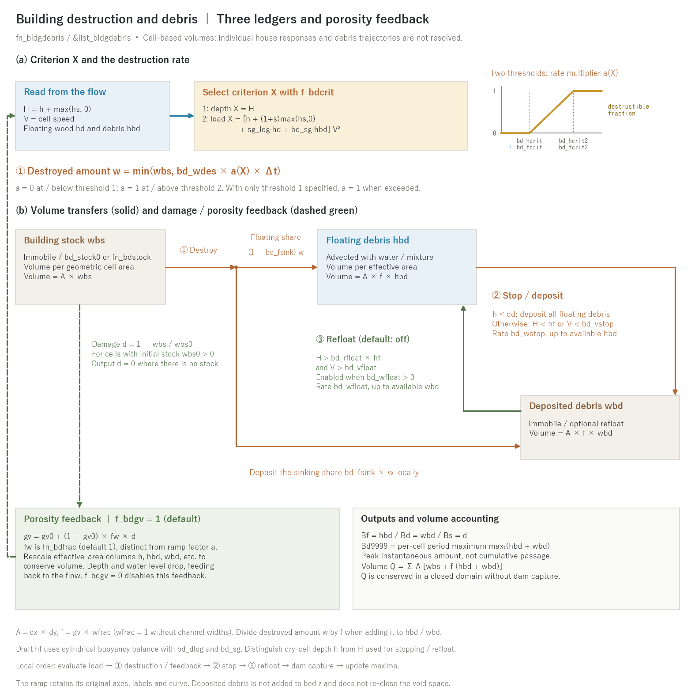

# Building destruction and debris (fn_bldgdebris)

[Back to the user's guide index](../users_guide.md)

Estimates the **destruction of wooden houses** by tsunami, storm-surge
and flood inundation flows, and the transport and deposition of the
resulting **debris**, as a **raster field** of debris volume per unit
area (m³/m²) in each cell. It is not a structural-response model of
individual houses nor a trajectory model of individual debris pieces;
the purpose is a map-scale potential assessment of "which houses are
destroyed and how much, how far the debris reaches, and where it
remains". It is a separate module of the same type as
[Driftwood](driftwood.md); enabling both represents **house
destruction by flows carrying driftwood**.

Debris moves through three ledgers:

```
building stock wbs --destroy--> floating debris hbd --ground/slow--> deposit wbd
 (immobile input)              (advected with the flow)              (can refloat)
                 `--sinking part (bd_fsink)-----------------------------'
```

Let `H = h + max(hs, 0)` be mixed flow depth, `V` cell speed, and `hf`
the draft. The draft follows the buoyancy balance of a horizontal cylinder
with `bd_dlog` and `bd_sg` (see the [driftwood draft diagram](driftwood.md)).

- **① Destruction:** `f_bdcrit=1` uses depth `X = H`; `f_bdcrit=2` uses
  load `X = [h + (1+s)max(hs,0) + sg_log·hd + bd_sg·hbd] V²`.
  Here s is submerged sediment specific gravity and sg_log is wood specific
  gravity; the wood term is included only when driftwood is enabled.
  This is the definition of Fd9999, freshwater-normalised in m³/s².
  F9999 retains its water-and-sediment-only definition.
- **② Stopping / deposition (`hbd → wbd`):** the dry-cell test `h ≤ dd`
  deposits all floating debris. Otherwise, `H < hf` or `V < bd_vstop`
  transfers debris at rate `bd_wstop`, capped by the remaining hbd.
- **③ Refloating (`wbd → hbd`):** enabled with `bd_wfloat > 0`.
  If `H > bd_rfloat × hf` and `V > bd_vfloat`, transfer at rate
  `bd_wfloat`, capped by the remaining wbd. The default is off.
- **Transport:** hbd is advected with water (or the water-sediment mixture
  during debris flow); wbs and wbd are not advected. Sunk or deposited debris
  is not added to bed elevation z and does not re-close the void space.

### Destruction rate, sinking share and porosity feedback

The destroyed amount in one step is the destruction rate bd_wdes times a
multiplier a(X) that rises linearly between the first and second threshold
(a piecewise-linear approximation of a fragility function), capped by the
remaining stock. The share bd_fsink of the destroyed amount deposits on the
spot into wbd and the rest enters hbd. With `f_bdgv=1` the void ratio is
raised from gv0 to gv0 + (1−gv0)·fw·d with the damage d = 1 − wbs/wbs0 (fw is
the destructible share of `fn_bdfrac`, default 1), and the effective-area
columns are re-read under volume conservation before the next flow
calculation; `f_bdgv=0` disables this feedback. The local order is load
evaluation → ① destruction / feedback → ② stop → ③ refloat → dam capture →
maximum update (equations and the correspondence with fragility functions
in [Building destruction and debris models explained](bldgdebris_models.md)
§1–§2).



(a) Evaluate criterion X from the flow, then compute destroyed amount w
from ramp multiplier a and rate bd_wdes. The original ramp's axes,
threshold names and curve are preserved pixel for pixel. (b) Solid orange
arrows show the floating / sinking shares and stopping, solid green shows
refloating, and dashed green shows damage-to-porosity feedback to the flow.
Conditions sit beside their paths; the three ledgers identify their area
bases. This is a schematic, not a simulation result. Regenerate Japanese
and English PNG/SVG with `python docs/figs/make_guide_figs.py bldgdebris`.
Only the original ramp is embedded as PNG in the SVG; the revised schematic
is vector artwork.

## Enabling and configuration

Specify `fn_bldgdebris` in `&list_sysparam`.

**The minimum input to "just try moving debris" is an empty
`&list_bldgdebris` on a terrain that has the building void ratio
`fn_gv`** (every item takes its default). A uniform building stock of
0.3 m³/m² is placed on the cells with buildings (gv < 1), and the
debris properties, the destruction criterion (a linear ramp from 1 m
to 3 m of inundation depth) and the rates all run with their
defaults. Defaults that were adopted are printed at start-up as
`bldgdebris: bd_hcrit = 1.0000 m (default)`, so they cannot go
unnoticed; review them for your case (type-specific starting values
are in "Recommended values by pattern" at the end of this chapter).

```
&list_bldgdebris
/
```

In practice give the stock map and the thresholds:

```
&list_bldgdebris
  fn_bdstock = 'bdstock.txt' ! building stock (m3/m2, destructible volume incl. wooden fraction)
  bd_dlog = 0.3             ! representative debris size (m)
  bd_sg = 0.5               ! apparent specific gravity of debris (0-1; draft derived automatically)
  f_bdcrit = 1              ! criterion (1: inundation depth, 2: load)
  bd_hcrit = 1.0            ! depth threshold (m; destruction starts)
  bd_hcrit2 = 3.0           ! second threshold (m; destructible fraction 1)
  bd_wdes = 5.0e-4          ! destruction rate (m/s)
  bd_wstop = 0.01           ! grounding deposition rate (m/s)
/
```

## Parameters

| Parameter | Default | Meaning |
|---|---|---|
| f_bd | 1 | 0 disables temporarily while keeping the file |
| bd_stock0 | (0.3 on building cells) | uniform building stock (m³/m², all cells). Exclusive with fn_bdstock. **If neither is given, 0.3 m³/m² is placed only on cells with buildings (gv < 1)** (the run stops if there are no such cells, e.g. without fn_gv) |
| fn_bdstock | — | building stock (destructible volume) map (m³/m², same matrix format as the terrain). Fold the wooden fraction into it (a cell with 30% wooden houses gets 30% of a fully wooden cell) |
| fn_bdfrac | — | map of the destructible share fw (0-1) of the building footprint. Default 1. Bounds porosity feedback at gv0 + (1−gv0)·fw; does not directly multiply stock or the destruction rate |
| bd_dlog | 0.3 | representative debris size (m). The default is the size class of wooden structural members (posts and beams; empirical) |
| bd_sg | 0.5 | apparent specific gravity of debris (0 < bd_sg < 1). The draft is the exact cylinder buoyancy solution as for driftwood (equation in [driftwood](driftwood.md); 0.15 m for 0.5 × 0.3 m) |
| f_bdcrit | 1 | criterion: 1 = inundation depth h+hs, 2 = load (h+(1+s)hs+sg_log·hd+sg_deb·hbd)·V² |
| bd_hcrit | 1.0 | depth threshold (m; f_bdcrit=1). The default 1.0-3.0 m ramp follows the empirical tsunami-damage relation of wooden houses |
| bd_hcrit2 | 3.0 | second depth threshold (m). A linear destructible fraction, 0 at threshold 1 and 1 at threshold 2, multiplies the rate (approximation of the fragility-curve width). **With both omitted the 1.0-3.0 m ramp applies; giving bd_hcrit alone means a single threshold without ramp** |
| bd_fcrit | 2.0 | load threshold (m³/s²; f_bdcrit=2). The default 2.0-6.0 corresponds to hV² at 2 m depth and 1-1.7 m/s (a calibration value) |
| bd_fcrit2 | 6.0 | second load threshold (m³/s²; ditto. bd_fcrit alone means no ramp) |
| bd_wdes | 5.0e-4 | destruction rate (m/s = m³/m²/s). With sustained a=1, time to destroy = stock ÷ rate (10 min for the default 0.3 m³/m²); a<1 slows destruction |
| bd_fsink | 0 | sinking fraction (0-1): this share of the destroyed amount deposits on the spot (abstraction of sinking debris such as tiles and foundations; 0 = all floats = upper bound of reach) |
| bd_wstop | 0.01 | grounding deposition rate (m/s) |
| bd_vstop | 0.05 | velocity threshold of slow-flow deposition (m/s; 0 = depth (draft) criterion only; the default deposits once the ponded flow stagnates) |
| bd_wfloat | 0 | refloat rate (m/s; 0 = no refloat; a positive rate also applies to deposits originating from bd_fsink) |
| bd_rfloat | 1.5 | refloat buoyancy margin (H > bd_rfloat×draft plus the speed condition; must be > 1) |
| bd_vfloat | — | velocity threshold of refloat (m/s; required with bd_wfloat > 0; must be >= bd_vstop) |
| f_bdgv | 1 | 1 = raise the void ratio with the destroyed fraction (feedback), 0 = one-way coupling |

**Guidance on thresholds** (all calibration parameters; the
correspondence with the literature and the basis of the defaults are in
[the explanation](bldgdebris_models.md) §4–§5):

- **Depth threshold (f_bdcrit=1)**: the default 1.0–3.0 m ramp follows
  the empirical tsunami-damage relation (wooden houses destroyed above
  about 2 m of inundation, partially damaged around 1 m) and the fragility
  functions of the 2011 Tohoku tsunami (washout probability of wooden
  houses rising steeply around 2 m). RC buildings are far less likely to
  be washed away at the same depth, which is why the stock (wooden
  fraction) and fn_bdfrac represent them.
- **Load threshold (f_bdcrit=2)**: the unit is that of F9999, m³/s²
  (freshwater-normalised). Convert it from force-based fragility functions
  or compare the water-only F9999 map with observed damage. It is the
  average destructive force of a flow carrying floating matter, not a
  replacement of the impact load of individual pieces.
- **Building stock**: floor area × structural volume per floor area ×
  wooden fraction, aggregated per cell (preprocessing). Conversion to
  building counts or monetary values is postprocessing.

## Recommended values by pattern

The defaults are a middle ground that "runs". When the type of event is
known, start from the following (calibration quantities; sources in
[the explanation](bldgdebris_models.md) §4):

| Type | Criterion | Thresholds | Stock and properties | Rates and deposition | Notes |
|---|---|---|---|---|---|
| Tsunami run-up into a dense wooden town | f_bdcrit=1 | bd_hcrit 1.0 / bd_hcrit2 3.0 m (the empirical "destroyed above 2 m" and the width of the wooden washout curves) | 0.2-0.4 m³/m² × wooden fraction; bd_dlog 0.3, bd_sg 0.5 | bd_wdes 5e-4 (destroyed within a 10-min surge), bd_fsink 0.2-0.4, bd_vstop 0.05 | feedback on; example tsunami_town |
| Tsunami, chain with driftwood and debris | f_bdcrit=2 | bd_fcrit 2 / bd_fcrit2 6 m³/s² (2 m depth at 1-1.7 m/s; convert from the force-based curves) | as above; enable fn_driftwood too | as above | re-place the thresholds after looking at the water-only F9999 map |
| Storm surge or river flood in a lowland town (slow flow) | f_bdcrit=1 | bd_hcrit 2.0 / bd_hcrit2 4.0 m (deep but slow inundation destroys less than a tsunami) | 0.2-0.3 × wooden fraction | bd_wdes 1e-4 (gradual over tens of minutes to hours), bd_vstop 0.02 | non-destructive flood damage is out of scope: only collapse/washout is counted |
| Debris flow or flood hitting a mountain village | f_bdcrit=2 | bd_fcrit 1 / bd_fcrit2 4 m³/s² (the mixed depth h+hs and density 1+sC enter the load) | 0.2-0.3 × wooden fraction; bd_sg 0.5 | bd_wdes 1e-3 (minutes), bd_fsink 0.5 (buried in sediment) | enable with f_debris; debris moves with the mixture |
| Upper-bound reach (hazard map) | per case | per case | as above | bd_fsink 0, bd_vstop 0, bd_wfloat 0 | use Bd9999; the remaining amount is sensitive to bd_vstop and bd_wfloat (example README) |
| Scenarios of tsunami-proofing / urbanisation | per case | per case | swap fn_bdstock (wooden fraction included) and fn_bdfrac | as above | two-case comparison, no code change |

## Output

| Switch | File | Contents |
|---|---|---|
| f_out_hbd | Bf0001… | floating debris volume (m³/m²) distribution (dt_file interval) |
| f_out_wbd | Bd0001… | deposited debris (m³/m²) distribution |
| f_out_wbd | Bd9999 | **maximum arrival over the run** max(floating+deposited) — the debris hazard map |
| f_out_bds | Bs0001… | destroyed fraction 1 − remaining stock/initial stock (0-1). The final frame is the damage-ratio map |
| f_out_fdmax | Fd9999 | maximum fluid force including driftwood and debris (h+(1+s)hs+sg_log·hd+sg_deb·hbd)·V² (the existing F9999 keeps its water-and-sediment definition) |

`Bd9999` is the per-cell `maxₜ(hbd+wbd)`: the period maximum of the
instantaneous amount, not cumulative passage or the sum of separately
maximised floating and deposited amounts.

wbs is volume per **geometric cell area**, while hbd and wbd use the
**effective area** (conversion formulas in
[the explanation](bldgdebris_models.md) §3). `result/bldgdebris.csv` records cumulative destruction
(floating / sinking), deposition, refloat and dam capture, plus current
stock, floating and deposited volumes at dt_recrd intervals. These values
are already area-weighted in m³.

In a **closed domain without dam capture**, current storage Q conserves
the initial volume, apart from numerical error. Account for outflow and dam
capture separately. Destruction, deposition and refloat are internal
transfers; adding their cumulative values to current storage double counts
the volume.

## Combinations and restrictions

- ENC grid only. Cannot be combined with morphological acceleration
  (morfac ≠ 1).
- Free to combine with [Driftwood](driftwood.md); with the load
  criterion (f_bdcrit=2) floating driftwood counts towards the
  destructive force. The driftwood module does not know about debris
  (one-way). Also compatible with
  [sediment and landform change](geomorph.md) and groundwater.
- With the **void-ratio feedback** (f_bdgv=1) the water depth of a
  destroyed cell shrinks under volume conservation (h × gv unchanged);
  subsurface storages are untouched. The mean building size bb is not
  changed (a fully destroyed cell with fw=1 reaches porosity 1 and the
  "no buildings" treatment; occupation remains when fw<1).
- Floating debris entering a **dam capture zone** is trapped by the
  dam. **Culverts and pumps** transfer water only, so debris
  accumulates upstream of such works.
- Save/restore stores six fields in `bldgdebris.dat`: hbd, wbd, wbs,
  wbs0, gv0 and gv; damage d is reconstructed. **The Bd9999 / Fd9999
  maximum statistics and cumulative CSV process totals are not carried
  over.** Distinguish outputs before and after restart and combine period
  statistics and budgets separately.

## Verification cases

[test/bldgdebris](../../../test/bldgdebris/) checks debris-volume conservation,
one-way coupling with driftwood, water-volume conservation under void-ratio
feedback, and split-run continuation. [test/gvchange](../../../test/gvchange/)
provides unit checks of the void-ratio update procedure.

## Worked example: tsunami run-up into a town with house destruction and debris

An idealized experiment of a tsunami running up into a coastal town,
destroying wooden houses and carrying debris inland, is included in
[examples/tsunami_town](../../../examples/tsunami_town/) (comparisons
without/with driftwood, depth/load criterion, and feedback on/off;
explained in its README, in Japanese).

## What is not modeled

Structural response of individual houses, trajectories, orientation,
rotation and interaction of individual debris pieces, individual
impact forces of debris and logs, geometric blockage by debris, fire,
and the conversion of deposited debris into terrain or re-closure of
the void space are out of scope (an explicit limit of the raster
representation policy). RC and steel structures are represented as
"non-destructible occupation" through fn_bdfrac; per-structure-type
thresholds (multi-class) are a future topic. Implementation details:
developer.md §63 (Japanese).
