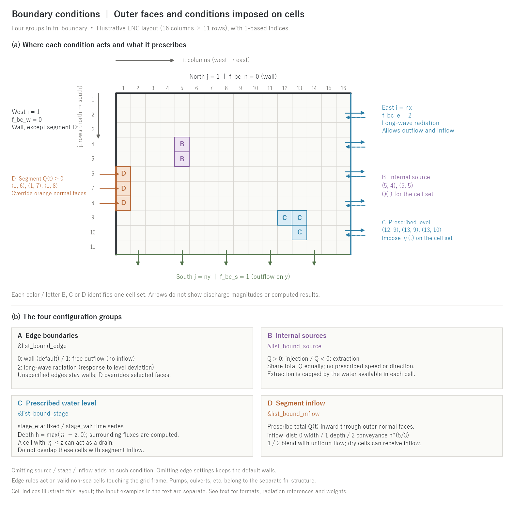

# Boundary conditions (&list_bound_edge / source / stage / inflow)

[Back to the user's guide index](../users_guide.md)

Defines the exchange of water between the computational domain and the
outside world. This chapter describes boundary conditions on the ENC grid.
Combine the following **four groups** as needed in the file specified by
`fn_boundary`.

| Family | Group | Where it acts and what it prescribes |
|---|---|---|
| A Edge boundaries | &list_bound_edge | Base type for each outer grid edge (0 wall / 1 free outflow / 2 long-wave radiation) |
| B Internal sources | &list_bound_source | Total Q(t) for a valid cell set; positive for injection, negative for extraction |
| C Prescribed water level | &list_bound_stage | Set depths in a valid cell set from the prescribed level η |
| D Segment inflow | &list_bound_inflow | Non-negative total Q(t) through the outer normal faces of edge cells |

Omitting source, stage or inflow adds no such condition. Omitting edge
settings **keeps the default walls**. Segment inflow overrides the
specified outer normal faces, so part of the west edge can admit flow even
with `f_bc_w = 0`. Internal works such as pumps and culverts belong to the
separate `fn_structure` file ([structures](structure.md)).

Cell sets and time series for B, C and D can be written directly in the
namelist or supplied via `fn_*` files (paths relative to `dir_data`).
Files take precedence over the corresponding inline values. Input times
are in minutes, discharge in m³/s, and water levels in m with the same
elevation datum as `z`. Series are linearly interpolated, holding the end
values outside their range. Family A uses `f_bc_*` and, if needed, `bc_eta_*`.

Cell indices `(i, j)` are **1-based**, with `i` increasing west→east and
`j` north→south (add +1 to 0-based GIS row/column indices;
[coordinates chapter](coordinates.md)).



(a) Illustrative 16-column × 11-row layout. North and west default to walls;
south uses free outflow and east long-wave radiation. D overrides only the
west normal faces at `(1, 6)` through `(1, 8)`; no wall is drawn over them.
B is the source set `(5, 4), (5, 5)`; C is the prescribed-level set
`(12, 9), (13, 9), (13, 10)`. (b) The quantities and main conditions for each
group. Arrows show permitted directions, not discharge magnitudes, computed
results or the ENC flux stencil. These indices illustrate the drawing;
the input examples below are separate. Generate with
`python docs/figs/make_guide_figs.py boundary`.

## Just try it (minimal input)

Rainfall runoff of a closed catchment **needs no fn_boundary** (all four
edges default to walls). The minimal input for outflow is one group (type 1 does not admit inflow):

```
&list_bound_edge
  f_bc_w = 1, f_bc_e = 1, f_bc_n = 1, f_bc_s = 1   ! free outflow on all four edges
/
```

**Configuration by pattern** (discharges and levels are given data; guides
are added)

| Type | Edges | Inflow | Outflow | Guides / notes |
|---|---|---|---|---|
| Catchment rainfall runoff | 0 (default) | rainfall | stage_eta = -999 at the outlet cell (complete drain) | Edge boundaries do not act on catchment terrain surrounded by nodata |
| River flood inundation | 0 (the downstream edge may be 1) | segment inflow Q(t), inflow_dist=2 | prescribed level (time series) or free outflow at the downstream end | Specific discharge guide: annual maximum 1-5, design flood 5-20 m³/s/km² (catchments of 10-100 km²) |
| Tsunami | 2 (long-wave radiation) on the seaward edges | initial level e0 + prescribed level stage_val on the seaward edge (incident waveform) | 2 | Inland edges 0 or 1 |
| Storm surge | - | the sea is fn_tide ([tide](tide.md)) | same | No edge boundary is needed inside the sea mask |
| Pluvial (urban) flooding | 0 | rainfall | drainage pumps ([structures](structure.md)); sewers via the [conduit layer](gwflow.md) | Omitting the outlet drains out of the domain |
| Dam break, bore | 0 | initial level (fn_hinit) | downstream edge 1 | Check the initial Cn_max |

## Edge boundaries (&list_bound_edge)

Free outflow (critical-depth drop) and long-wave radiation (Sommerfeld, Flather): [supplement](hydraulics.md#5-edge-boundaries).

Assigns a boundary condition type to each of the four outer edges
(west = i=1, east = i=nx, north = j=1, south = j=ny; row order is north
to south).

```
&list_bound_edge
  f_bc_w = 2                ! west edge
  f_bc_e = 2                ! east edge
  f_bc_n = 2                ! north edge
  f_bc_s = 2                ! south edge
/
```

| Type | Meaning | Suited for |
|---|---|---|
| 0 (default) | impermeable (wall) | tanks, closed catchments |
| 1 | free outflow. Advancing flow passes through as is, and standing water drains by free overfall along the flow direction (outward normal for still water), with total flux based on the natural width. At a subgrid channel outlet, upstream channel velocity and channel direction set the exit flux. No inflow | outflow of flood flows advancing over dry ground |
| 2 | long-wave radiation, projected along the outward normal with a natural-width total. No outflow at the reference still-water level; only the water level deviation of waves reaching the boundary is transmitted (inflow of receding waves is also allowed) | propagation of tsunamis, storm surges, and waves |

- The reference water level of type 2 is derived automatically from the
  initial condition if unspecified (with a constant initial water
  level, the radiation flux at t=0 is exactly zero). To fix it, give a
  uniform value in `bc_eta_w/e/n/s` (same elevation datum as z).
- Ordinary type 2 sets zero flux where `h < dd`; radiation alone does
  not rewet a dry boundary cell.
- For a nested child with `nest_bc = 3`, type 2 uses the parent level
  and outward normal velocity in a Flather condition:
  `u_n = u_n,e + sqrt(g/h) (η − η_e)`. Configure this in the child's
  `&list_nest` ([nesting](nest.md)).
- Edge boundaries take effect only on **edges where valid non-sea cells touch
  the grid frame**. They have no effect on catchment terrain surrounded
  by a rim of nodata (outside the mask) -- use prescribed water level
  cells for drainage in that case.
- For a working example see
  [tutorial Step 3](../../../tutorials/wave/en/README.md#step-3-setting-boundary-conditions).

## Internal sources (&list_bound_source)

Injection (Q > 0) or extraction (Q < 0) at an arbitrary cell set. The
third subscript is the source number (consecutive from 1).

```
&list_bound_source
  src_cell(:,1,1) = 10, 10       ! cell (i, j) of source 1
  src_cell(:,2,1) = 10, 11
  src_val(:,1,1) =   0,   0.0    ! (time (min), discharge (m3/s))
  src_val(:,2,1) =  60, 100.0
/
```

- The discharge is the **total over the whole cell set**, distributed
  equally among the cells.
- Extraction stops at zero depth in each cell. Shortfalls are not
  redistributed to other cells, so the actual total may be below the request.
- The injection carries no directionality (momentum). For river inflow,
  use the segment inflow.

## Prescribed water level cells (&list_bound_stage)

Forces the water level of a cell set to a fixed value `stage_eta(n)` or
a time series `stage_val`. Precedence is time-series file, inline time
series, then fixed value. The depth is set to h = max(eta - z, 0)
every step, and the exchange with the surroundings is computed by the
momentum equation from the gradient created by the prescribed level (so
it also appears in velocity/discharge output and transect measurement).
For a subgrid cross section, the prescribed depth is converted to the
internal rectangular-equivalent depth. The level clamp follows sources and
structure transfers, overwriting their depth at overlapping cells.
**Do not apply segment inflow and prescribed level to the same cell.**
The level clamp adds or removes water independently, so the prescribed
inflow volume is not preserved in that cell's budget.

```
&list_bound_stage
  stage_cell(:,1,1) = 100, 200
  stage_eta(1) = -999.0          ! water level below the bed -> perfect drain
/
```

- For the **outlet of a catchment-clipped computation** (drainage out
  of the catchment), set eta below the bed -- the cells become
  permanently empty perfect drains.
- For **tidal reaches and backwater**, use a water level time series
  `stage_val(:,k,n) = t, eta`.
- A large level difference between prescribed cells and their
  surroundings produces a local dam-break flow. If the initial Cn_max
  is large, review dt.

## Segment inflow (&list_bound_inflow)

Distribution weights and the Froude blending: [supplement](hydraulics.md#5-edge-boundaries).

A boundary through which a river or similar enters across the outer
edge of the domain. Prescribes the **total discharge** Q(t) of the
segment on the outward normal face of a cell segment touching the outer
edge. Unlike an injection, it is a directional inflow carrying
momentum.

```
&list_bound_inflow
  inflow_cell(:,1,1) = 1, 100    ! segment j=100..102 on the west edge
  inflow_cell(:,2,1) = 1, 101
  inflow_cell(:,3,1) = 1, 102
  inflow_val(:,1,1) =   0,   0.0 ! (time (min), total discharge (m3/s))
  inflow_val(:,2,1) =  60, 500.0
  inflow_dist(1) = 2             ! distribution mode within the segment
/
```

**Distribution modes (inflow_dist)** — normalize the assigned discharges
over open inflow faces to the total Q(t).

| Value | Distribution | Characteristics |
|---|---|---|
| 0 (default) | equal (proportional to opening width) | unit-width discharge is uniform over the segment |
| 1 | proportional to depth | depth-weighted component has unit-width discharge proportional to h; zero weight where h < dd |
| 2 | proportional to conveyance (h^(5/3)) | same as a uniform-slope Manning cross section. Distribution resembling a river cross section |

Modes 1 and 2 blend the weighted distribution with the uniform-width
distribution, according to the estimated Froude number at the deepest cell.
A cell with `h < dd` has zero weighted contribution but can still receive
the uniform contribution. These modes therefore do not always exclude the
dry floodplain. Dry or shallow sections move toward uniform distribution
to reduce concentration of discharge into thin water layers.

- Where wall corners or nodata reduce an inflow cell's ability to pass
  water inward relative to the best-connected cells of that segment, its
  inflow face is assigned zero flow. Total Q is distributed over the
  remaining faces. If all cells have equal connectivity, none is excluded.
  This avoids concentrating discharge at restricted segment ends
  (developer.md §69.9, Japanese).
- Discharges are non-negative only (for outflow use prescribed water
  level or extraction).
- When combined with sediment computation (suspended sediment), the
  incoming sediment can be given as a concentration time series
  `inflow_cs` or a sediment discharge time series `inflow_qs`
  (mutually exclusive) ([sediment and geomorphic change
  chapter](geomorph.md)). If unspecified, the inflow is clear water.

## Tests and examples

- [test/sedinflow](../../../test/sedinflow/): sediment concentration/flux specifications for segment inflow, with a ledger check against the injected total.
- [test/nhcurrent](../../../test/nhcurrent/): prescribed-stage settings that maintain a uniform current and generate a sinusoidal wave.
- [test/nest_identity](../../../test/nest_identity/): the `flather` configuration compares a nested boundary driven by a still-water parent with a stand-alone radiation boundary.
- Annotated example of all parameters: [examples/List_samples/list_boundary.txt](../../../examples/List_samples/en/list_boundary.txt)
- Edge boundary (radiation): [tutorials/wave](../../../tutorials/wave/en/README.md) Step 3
- Structures such as drainage pumps and sluice gates are on the fn_structure side ([structures chapter](structure.md)).
