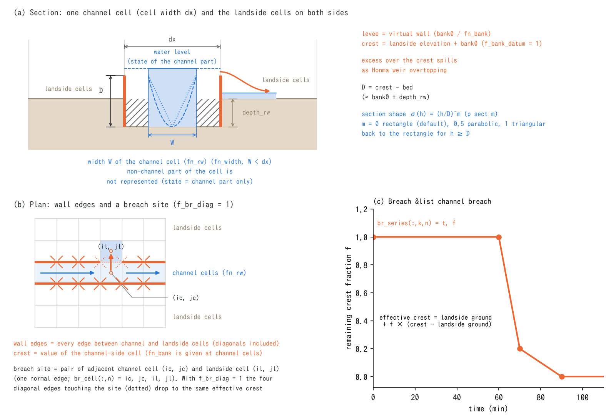

# Channels (&list_channel / channel_breach)

> English mirror of docs/users_guide/channel.md. The Japanese file is the master copy.

[Back to the user's guide index](../users_guide.md)

Handles the hydraulic structure of channels that cannot be resolved at
the cell size -- levees, subgrid channel width, cross-section shape,
and breach. Enabled via `fn_channel`.

**Prerequisites and division of roles**: designating channel cells (the
channel mask `fn_rw`), and the cell topography and properties (bed
incision `depth_rw`, channel roughness `rn0_rw`) are settings of the
[geographic information chapter](geoinfo.md). This chapter covers the
**conveyance structure** between cells (levees = virtual walls, channel
width, hydraulic modes). Specifying levees requires fn_rw.



(a) The state of a channel cell represents only the channel part of
width W (fn_width) inside the cell; the levee is a virtual wall on the
cell face (crest = landside elevation + bank0 with f_bank_datum = 1), and
whatever exceeds the crest spills to the landside cell as Honma weir
overtopping ([hydraulics supplement](hydraulics.md) §1). The section shape σ(h) = (h/D)^m (p_sect_m) sets the
conveyance ratio at depths below the transition depth D = crest − bed.
(b) Wall edges are every edge (diagonals included) between channel and
landside cells, and a breach site is a pair of a channel cell and a
landside cell (one edge) whose (c) effective crest is lowered by the
remaining fraction of br_series. The figure is generated by
docs/figs/make_guide_figs.py. The formulation of each mechanism and the
basis of the defaults are in [Channels explained](channel_models.md).

## Just try it (minimal input)

A channel runs as a "resolved channel" with only the channel mask fn_rw
and the incision depth_rw of the [geographic information](geoinfo.md)
(fn_channel is not needed). The minimal input that adds levees is one
line with a uniform height:

```
&list_channel
  bank0 = 2.0                   ! levee height above the landside cell elevation (m)
/
```

## Levees (virtual walls)

Erects a virtual wall, without widening cells, on the boundary between
channel cells and landside cells. Whatever exceeds the crest spills to
the landside as weir overtopping by the Honma formula.

Notes when giving the height with a distribution file `fn_bank`:

- The height is given at **channel-cell** positions (wall edges are
  erected on all edges — **including diagonals** — between channel
  cells and landside cells, and the crest uses the channel-side cell's
  value). Beware that this is the opposite of the coastal seawall
  `fn_seawall`, which is held by the land-side cells
  ([geographic information chapter](geoinfo.md)).
  The effective crest of each edge never falls below the landside
  ground or the channel bed (where the crest is lower, the ground itself
  is the wall, so the ground difference is never added to the overflow
  head; this matters on natural banks in V-shaped valleys and when the
  crest is given as an absolute elevation).
- **Also give a height to channel cells that touch landside cells only
  at a corner (diagonally)**. Edges of a channel cell without a value
  (−900 or below) get no wall, and since the ENC grid exchanges water
  through diagonal links too, water leaks to the landside there. The
  uniform value `bank0` is assigned to every channel cell, so this is
  not a concern.
- Conversely, **giving extra values is harmless**. Values on channel
  cells not adjacent to the landside are never used (no wall is
  erected), and values on non-channel cells are ignored. Painting a
  **generous buffer along the channel** is therefore the safe side,
  and it automatically prevents the corner-contact leaks above.

```
&list_channel
  bank0 = 1.0                   ! uniform levee height (mutually exclusive with fn_bank)
  f_bank_datum = 1              ! datum of the height (table below)
/
```

| Parameter | Default | Meaning |
|---|---|---|
| fn_bank / bank0 | "" / -- | levee height (distribution / uniform value; one or the other. In the distribution, -900 or below means no levee) |
| f_bank_datum | 1 | datum of the height. 0: bed (after incision), 1: landside cell elevation (recommended), 2: absolute elevation |
| f_bank_aggr | 0 | aggregation of the crest for datum=1. 0: mean of the adjacent landside cells (noise suppression), 1: minimum (faithful to overtopping onset), 2: maximum (conservative) |
| f_bank_mode | 0 | hydraulic mode. 0: overtopping only (impermeable up to the crest in both directions), 1: sluice gate (check valve; passes landside -> channel only), 2: forced drainage (for compatibility and experiments; for real-world pumping stations use the pumps of the [structures chapter](structure.md)) |
| f_bank_opening | 1 | opening correction that reallocates the passage width of openings blocked by levee walls to the open channel-channel edges of the same cross-section (corrects the under-conveyance of one-cell channels regardless of orientation; 0 is for comparison with the old behavior; [the explanation](channel_models.md) §1) |

## Subgrid channel width

Represents the conveyance and storage of rivers narrower than the cell
size as a subgrid channel of rectangular cross section. Enabled by
specifying `fn_width`.

**Key premise of the model**: once the width is active, the depth, water
level, discharge and storage of that cell represent **only the channel
portion of the cell**. The landside portion of the cell is treated as
nonexistent, and the water exchange between the channel and the landside
(overtopping inundation and return flow) takes place **directly with the
adjacent landside cells**. There is no model switching as the river width
crosses the cell size, so a single width dataset connects the thin
upstream streams to the large downstream river (formulation, design
rationale and accuracy limits in [the explanation](channel_models.md) §2).

```
  fn_width = "channel_width.txt"  ! channel width distribution (m; effective on channel cells only.
                                  !   0 or below means no width information = treated as resolved)
```

- If no levee is specified, the channel has **no wall (natural banks)**.
  For embanked rivers specify bank0 / fn_bank explicitly (`bank0 = 0` is
  the same as no levee).
- Cells whose width is at or above the cell size are automatically
  treated as a resolved channel (incision + wall), and **the width value
  itself does not affect the results**; paint reaches you want treated as
  resolved with a single large value (e.g. 9999).
- **Applicability**: use it at resolutions where the real channel runs
  more smoothly than the raster. Applying it to a small river that
  meanders within one cell underestimates the channel length and makes
  discharge and velocity too large. Where the topology of the river
  network dominates the result, the connectivity ambiguity of the raster
  representation limits the accuracy (refine the cells at suspect
  locations).

## Cross-section shape (sigma law)

A generalization of the cross-section shape that improves the
reproduction of water level drawdown and recession in the low-water
channel.

```
  p_sect_m = 0.5                ! shape exponent of the section (default 0 = rectangular)
```

A one-parameter cross-section shape with the conveyance ratio
sigma(h) = (h/D)^m; m = 0 is the rectangle, 0.5 roughly parabolic and 1
roughly triangular. The transition depth D is not specified directly: on
cells with an active levee it is "crest − bed" (about bank0 + depth_rw),
and on cells without a levee the incision depth depth_rw is D itself (with
neither, p_sect_m > 0 is an error). At h ≥ D it degenerates to the
rectangle. The channel width (fn_width) is not required; on cells without
a width, sigma is applied to a section of the full cell width. Enabling
sigma alone, without width data, is the simplest configuration, and
inaccurate widths do not break the model badly (equations, the tracking of
D on a moving bed and the interpretation of inaccurate widths are in
[the explanation](channel_models.md) §3).

## Breach (&list_channel_breach)

Lowers the effective crest of a levee along a time series to represent
a failure (levees must be enabled).

```
&list_channel_breach
  br_cell(:,1) = 120, 45, 120, 44   ! site 1: channel cell ic,jc and landside cell il,jl
  br_series(:,1,1) = 0.0,  1.0      ! (time min, remaining crest fraction 0-1)
  br_series(:,2,1) = 60.0, 1.0      !   no breach until 60 min
  br_series(:,3,1) = 70.0, 0.2      !   fails to 20% between 60 and 70 min
  br_series(:,4,1) = 90.0, 0.0      !   full failure down to the landside ground at 90 min
/
```

- A site is "a pair of adjacent channel and landside cells", and the
  crest of that single boundary edge varies as effective crest =
  landside ground elevation + fraction x (crest - landside ground
  elevation). Even on a one-cell-wide channel, the left and right banks
  are distinguished by which landside cell is specified. Cell
  coordinates are **1-based** (beware the 0-based numbering of GIS;
  [coordinates chapter](coordinates.md)).
- A failure spanning several cells is specified as multiple sites (the
  breach width is per edge). The effective flow width of one site is about
  dx/4 (only the normal edge passes flow; the diagonal links between
  neighbouring sites stay walls; measured 2.6 m per site for 1 to 5 sites
  with 10 m cells and 1.7–1.9 m of head in
  [examples/levee_breach](../../../examples/levee_breach/README.md)). For a
  real breach width W use about W ÷ (dx/4) sites as a guide.
- **When the levee is present as elevation in the DEM (a resolved levee)**
  there is no virtual wall and this breach cannot be used. Use the
  procedure of [prescribed bed motion](bedmotion.md) §5, which lowers the
  bed of the breach cells along a time history (both methods are compared
  in [examples/levee_breach](../../../examples/levee_breach/README.md)).

## Recommended values by pattern

| Type | Configuration | depth_rw (m) | bank0 (m) | rn0_rw | Width / section | Notes |
|---|---|---|---|---|---|---|
| Mountain stream (width < cell) | fn_rw + fn_width + p_sect_m | 0.5-1 | not needed (no wall = natural banks) | 0.04-0.06 | width 2-10 m, m 0.5 | Not for streams meandering within one cell |
| Small / medium river (width 10-50 m, cell 10-25 m) | fn_rw + depth_rw + bank0 | 1-3 | 1-3 (f_bank_datum=1) | 0.03-0.04 | fn_width not needed when width >= cell | Overtopping by the Honma formula |
| Large river (width > 100 m) | resolved channel + levees | 3-6 | 3-8 | 0.025-0.035 | p_sect_m 0.3-0.5 for low-water recession | Floodplain roughness via fn_rn |
| Urban incised channel, concrete flume | fn_rw + depth_rw | 2-4 | none | 0.015-0.025 | - | Sluice gates and pumping stations are [structures](structure.md) |
| Breach scenario | the above + &list_channel_breach | as above | as above | as above | - | br_series ramps to a remaining ratio of 0 over 10-30 min |

Roughness guides are the customary Manning n values (Japanese river
technical standards and Chow's tables; sources in
[the explanation](channel_models.md) §5): concrete 0.015-0.02, sand-bed low-water
channel 0.025-0.035, gravel bed 0.035-0.05, vegetated floodplain 0.05-0.1.

**When one run spans several channel types, from mountain streams to the
river mouth**, you do not have to pick a single value from the table.
rn0_rw, depth_rw and bank0 are shortcuts that give every channel cell the
same value, so for large-scale runs with mixed types leave rn0_rw
unspecified (negative) and put the per-cell n of the channel cells into
the roughness distribution fn_rn (f_rntype=1) of the
[geographic information](geoinfo.md) (likewise fn_depth_rw and fn_bank
distributions for the incision and the levee height). Painting the
table values reach by reach in GIS preprocessing is the way the policy
"conversions belong to preprocessing" intends.

**Guide for the cross-section shape sigma (p_sect_m)** - sets the
conveyance ratio sigma = (h/D)^m at depths below the transition depth D.
The larger m, the higher the low-water level and the slower the
recession. D is not a value you specify directly: on cells with an
active levee it is "crest - bed" (about bank0 + depth_rw), and on cells
without a levee depth_rw is D itself. The column "Settings that set D"
gives the combination of depth_rw ([geographic information](geoinfo.md))
and bank0 (this chapter) that realizes that D.

| Channel type | p_sect_m | Settings that set D | Notes |
|---|---|---|---|
| Concrete flume, rectangular section | 0 (default) | - | The conventional rectangle (D is not used) |
| Large compound-section river (low-water channel + floodplain) | 0.3-0.5 | With levees: bank0 + depth_rw of 3-8 m (e.g. bank0 3 + depth_rw 3) | Larger when the low-water channel is narrow relative to the full width |
| Single-section natural channel (gentle sand/gravel bed) | 0.5 | No levee: depth_rw 1-3 m is D itself | Parabolic. Works in the simplest configuration without width data |
| V-shaped mountain stream, steep gorge | 0.7-1 | No levee: depth_rw 0.5-1 m is D itself | Triangular. Combine with fn_width to narrow the thalweg |
| Calibrating low-water levels to observations | sweep 0.3-1 | unchanged | If the base-flow level is too high, raise m (smaller sigma raises the level for the same discharge) |

## Tests and examples

- [test/bendloss](../../../test/bendloss/): straight, bent and diagonal channels, subgrid width and opening correction, assessed against Manning uniform flow or a straight-channel comparison.
- [test/chichibu](../../../test/chichibu/): real-terrain examples comparing channel masks, roughness, width and levee settings through flood-wave behaviour.
- Format samples: [examples/List_samples/list_channel.txt](../../../examples/List_samples/en/list_channel.txt)
- Seawalls (fn_seawall) are the coastal application of the same
  virtual-wall mechanism, configured in the [geographic information
  chapter](geoinfo.md).
- To treat sluice pipes and sluice gates rigorously as conduits
  (section, invert elevation, gate), use the culverts of the
  [structures chapter](structure.md) (the check valve of f_bank_mode=1
  is the shortcut).
