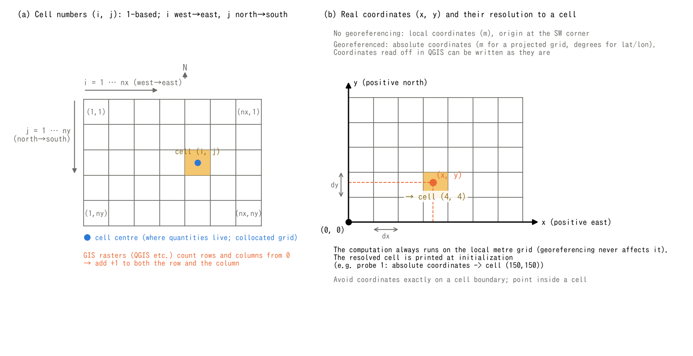

# Coordinate System Management

> English mirror of docs/users_guide/coordinates.md (based on commit 39bdba7). The Japanese file is the master copy.

[Back to the User's Guide index](../users_guide.md)

## The big picture

The coordinate system ENCflow computes in is a **planar orthogonal
coordinate system in meters** (the scale of a projected coordinate
system). On top of it sits the uniformly spaced computational grid.
Depth h, ground elevation z and other cell quantities are at cell centres,
and cells carry **numbers (i, j) starting from 1**. Some velocity and flux
quantities are handled on edges or cell faces (see [shallow-water flow](swflow.md)).
Coordinate transformation
and reprojection are not done on the model side (they are the job of
the GIS side).

When you specify locations or place results in a GIS, there are two
kinds of coordinate systems:

- **Absolute coordinates** — when the input data are georeferenced.
  The actual coordinates on the earth, in a projected coordinate
  system (m) or in geographic latitude/longitude (degrees).
- **Local coordinates** — when there is no georeferencing.
  Coordinates in meters with the domain's southwest corner at (0, 0);
  x is positive eastward and y is positive northward.

In both cases, **the computation runs on a planar grid in meters**.
Georeferencing can supply grid geometry. Once that geometry and the physical
conditions are fixed, the absolute origin and CRS label do not change the
governing calculations. The three main roles of georeferencing are:

1. Obtaining the grid geometry (nx, ny, dx, dy and the origin
   coordinates) from input files
2. Interpreting measurement locations (probes and flux transects)
   specified in absolute coordinates
3. Attaching georeferencing to outputs (so they open at the correct
   location in a GIS as-is)

You can compute without telling the model any georeferencing (which
is sufficient for idealized experiments).

### Cell numbering convention — 1-based

Cell numbers (i, j) used to specify locations of measurement points,
structures, boundaries, and so on are **1-based everywhere**
(following the Fortran array-index culture). i is 1 at the westernmost
column and increases eastward, 1..nx; j is 1 at the northernmost row
and increases southward, 1..ny (the same direction as the raster row
order, north to south; see [the input/output chapter](io.md)).

If the row and column indices obtained from a GIS tool are **0-based**,
specify **i = column + 1; j = row + 1** in ENCflow. Check the tool's index
convention and the row/column order; do not add 1 to indices already based on 1.
An off-by-one-cell
mistake is hard to notice with specifications that only take effect
on exactly that cell, such as channel cells or levee cells.



**(a) Cell indices and cell centres.** i increases west to east and j north
to south. The blue point is a cell centre, where depth h, ground elevation z
and other cell quantities are located. **(b) Specifying a location by coordinates.**
The example is a grid with nx = 7 and ny = 5, without georeferencing.
x is positive eastward and y northward; (0, 0) is the southwest outer corner.
The point P = (3.4 dx, 1.6 dy) resolves to cell (4, 4). It need not coincide
with that cell's centre at (3.5 dx, 1.5 dy). Both panels highlight the same cell.
When georeferencing is available, use the input raster's absolute coordinates
instead of the local coordinates illustrated here.
Run `python docs/figs/make_guide_figs.py coordinates` to generate both languages
in PNG and SVG.

## Input data and coordinate systems

Georeferencing is **obtained from the elevation file (fn_z)**. For
bil, a `.hdr` in the same place (an ESRI header; the hdr files that
GDAL / QGIS / ArcGIS create when writing bil can be used as they are)
is read automatically; for GeoTIFF, the georeferencing tags are read.
The handling by input kind is:

| Input data | Coordinate system | Cell size dx, dy |
|---|---|---|
| txt / bil without hdr / GeoTIFF without georeferencing tags | Local coordinates | Must be given in the namelist (dx, dy or lx, ly) |
| bil+hdr / GeoTIFF in a **projected coordinate system** | Absolute coordinates (m) | Not needed (filled in from the data) |
| bil+hdr / GeoTIFF in **geographic lat/lon** | Absolute coordinates (degrees) | Explicit specification in meters is mandatory |

- Values that can be filled in from the hdr / GeoTIFF (nx, ny, dx,
  dy) no longer need to be written in the namelist. **If both are
  specified and contradict each other, the run stops** (neither is
  silently preferred).
- Whether a grid is geographic or projected is determined
  definitively from the CRS tag for GeoTIFF; for hdr (which carries
  no CRS information) it is inferred from the cell size and the value
  range of the origin.

### Using a geographic (lat/lon) grid (data in degrees)

Geographic (lat/lon) grids such as the Japanese National Land
Numerical Information can also be input as they are, but the model
**does not convert grid spacing from degrees to meters**. The
computational grid is defined by the namelist dx, dy (m), and the
lat/lon information is used for interpreting location specifications
and for attaching georeferencing to outputs:

- **Explicit specification of `dx, dy` (in meters) is mandatory**
  (unspecified stops the run).
- The specified values are checked against approximate values derived
  from the degree spacing; a specification that differs greatly stops
  the run, while a customary approximation (e.g. specifying 100 m for
  a grid whose true size is 100.2 m) is accepted and both values are
  displayed.
- If no CRS is specified, WGS84 (EPSG:4326) is assumed (with a
  message; an explicit `epsg` takes precedence).

## What the EPSG code does

`epsg` in `&list_geoinfo` is a **label (metadata)** naming the grid's
CRS. **It is used neither in the computation nor in interpreting
coordinates.** It is used in exactly three places:

1. **Embedding the CRS (GeoKey) in GeoTIFF outputs** — this is its
   main purpose. The hdr format has no CRS field at all, so it never
   appears in bil outputs.
2. **Consistency check against the CRS of GeoTIFF inputs** — when a
   GeoTIFF carries a CRS, the file's value is adopted if the namelist
   is unspecified (0); if both are given, they are checked for
   agreement (a mismatch stops the run).
3. **Overriding the WGS84 assumption for geographic grids** — as
   described above.

```
&list_geoinfo
  epsg = 6677               ! e.g. JGD2011 Japan Plane Rectangular CS zone IX
  ...
```

In a computation without georeferencing (e.g. text input), specifying
`epsg` alone does nothing, since the location is unknown. It is also
not used to decide whether a grid is geographic or projected (that
decision comes from the file-side information as in the previous
section).

Examples of coordinate systems verified to work: EPSG:2451 (JGD2000
Plane Rectangular zone IX), 6677 (JGD2011 Plane Rectangular zone IX),
6668 (JGD2011 geographic (lat/lon)), 4326 (WGS84 geographic
(lat/lon)).

## Output data and coordinate systems

For the choice of output formats itself (f_output_mode), see
[the input/output chapter](io.md). Their relation to coordinate
systems is:

- **Without georeferencing** — txt and header-less bil are available.
  Requesting GeoTIFF output (bit 4 of `f_output_mode`) stops the run
  at initialization (to avoid creating GeoTIFFs without location
  information).
- **With georeferencing** — txt (no coordinate system information is
  attached), bil (a GDAL-compatible `.hdr` is written alongside), and
  GeoTIFF (the location is embedded, and the CRS too if `epsg` is
  given). They have been verified to display at the correct location
  as-is in QGIS / ArcGIS.

## Specifying measurement locations

Locations of measurements (probes and flux transects;
[the measurement chapter](record.md)) can be specified in two ways.

- **Cell numbers (i, j)** — always available (1-based; see above).
- **Real coordinates** — **x is positive eastward and y is positive
  northward** (the same convention as projected coordinate systems),
  and the interpretation switches automatically with the presence of
  georeferencing:
  - **When georeferencing is available** — interpreted as **absolute
    coordinates**: meters for a projected grid, degrees (longitude,
    latitude) for a geographic grid. When reading coordinates in a GIS,
    check that the coordinate system and units match the input raster
    (local coordinates and automatic conversion from a different CRS
    are not supported).
  - **When georeferencing is not available** — interpreted as **local
    coordinates (m) with the domain's southwest corner at (0, 0)**.

### How coordinates resolve to cell indices

For local input coordinates, let `ly = ny × dy` be the north-south domain
length. Convert to distances east and south from the northwest outer corner,
`xi = x`, `yi = ly - y`, then determine the cell indices as follows
(`floor` rounds down toward negative infinity):

```text
i = floor(xi / dx) + 1
j = floor(yi / dy) + 1
```

For P in the figure, `i = floor(3.4) + 1 = 4` and
`j = floor(5 - 1.6) + 1 = 4`. A cell centre has local coordinates
`((i - 0.5) × dx, (ny - j + 0.5) × dy)`.

For absolute coordinates, use the input raster's northwest outer corner
`(xul, yul)` and cell dimensions `csx, csy` (meters for a projected grid,
degrees for a geographic grid). Convert to
`xi = (x - xul) / csx × dx`, `yi = (yul - y) / csy × dy` and apply the same
index formulas. This maps positions to cells; it does not reproject between
CRSs. Computational `dx, dy` are in meters in both cases.

Which interpretation was used, and the resolved cell number, are
displayed at initialization like
`probe 1: absolute coordinates -> cell (150,150)`; always check this
(a mix-up almost always stops with an out-of-range error). A
coordinate that lands exactly on a cell boundary can resolve to
either side depending on rounding, so use coordinates that point to
the interior of a cell.

## Tests and examples

- [test/gtif](../../../test/gtif/): GeoTIFF input and georeferencing test assets for projected and geographic coordinates.
- [examples/tsunami_fault](../../../examples/tsunami_fault/): fault locations specified in longitude/latitude or projected coordinates, with bil/GeoTIFF georeferencing examples.
