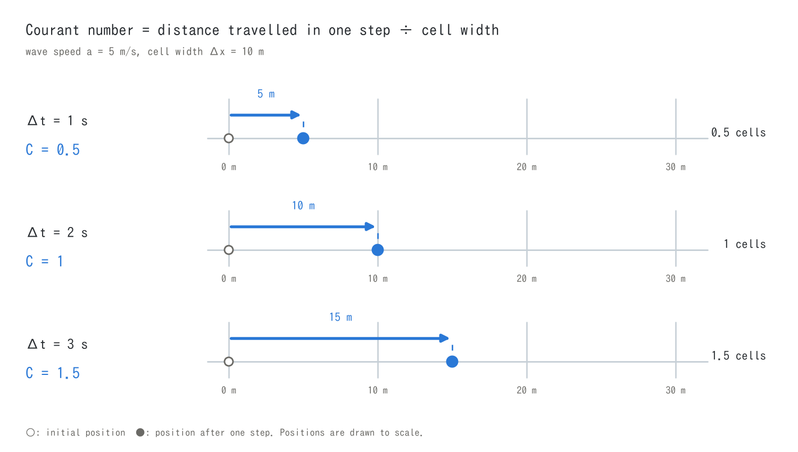
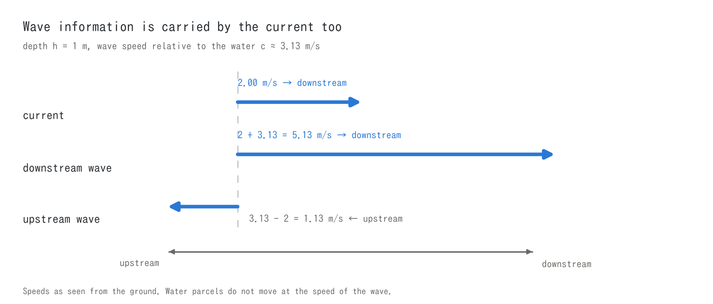
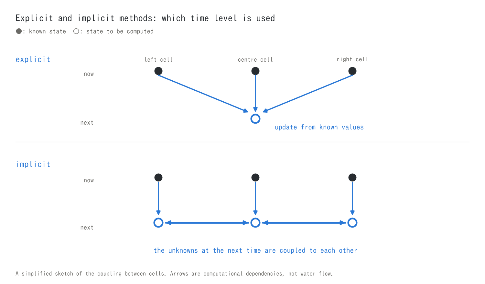
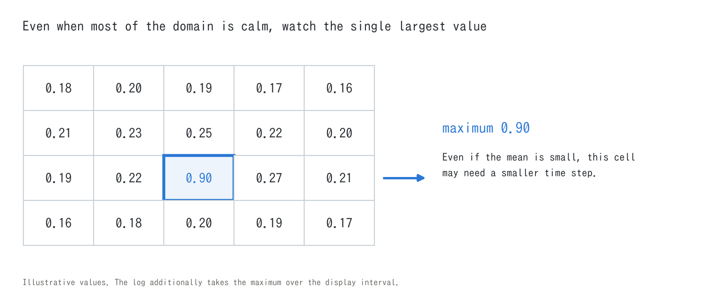
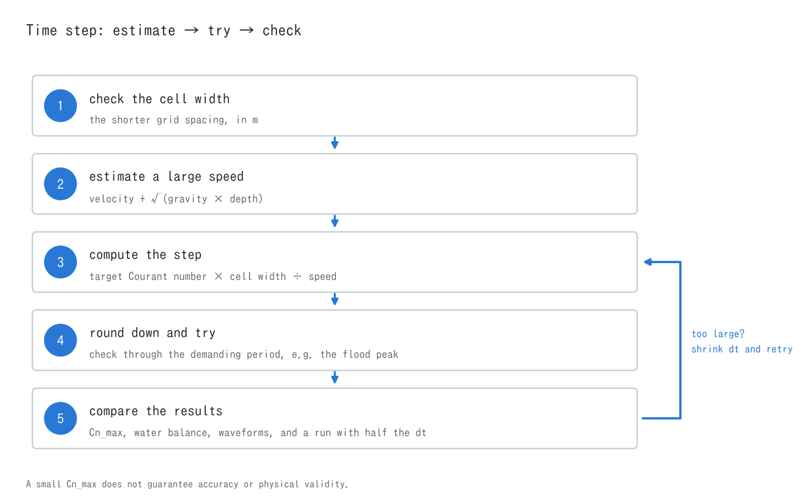
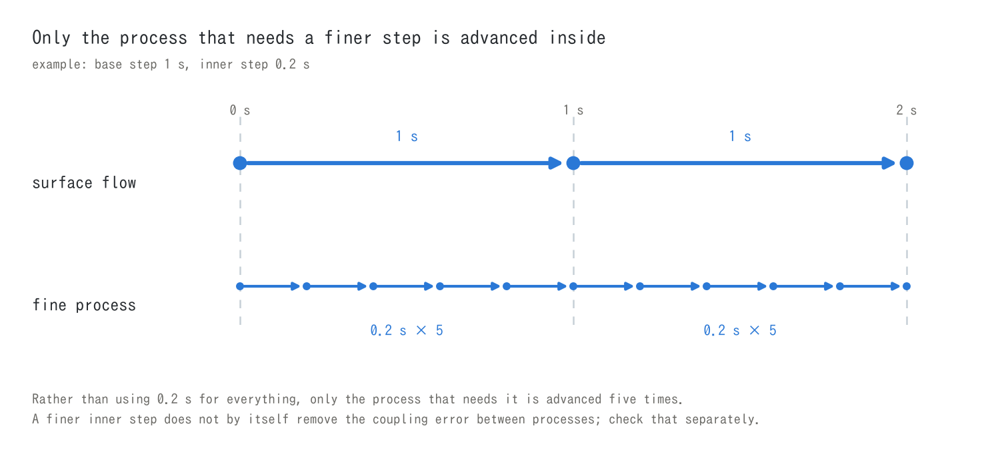

# Courant number and how to choose the time step (primer for time management)

> English mirror of docs/users_guide/courant.md. The Japanese file is the master copy.

[Back to Time management](time.md) | [Back to the User's Guide index](../users_guide.md) | [Design policy (intermediate to advanced)](timestep_policy.md)

**"How many seconds should each computational step advance?" Think about it from the cell size and the speed of the waves.**

This page is a primer for people meeting computational fluid dynamics (CFD)
for the first time. It explains, one formula at a time, the `Cn_max` column
that appears on the screen in the [wave tutorial](../../../tutorials/wave/en/README.md)
and how to choose the parameter `dt`. No calculus or fluid mechanics is
assumed. Why ENCflow uses this approach is summarized on a separate page,
[Time-step design policy](timestep_policy.md).

When you compute the flow of water, advancing a long way in time at once
reduces the number of steps. Advance too far, however, and the result
becomes unnatural or the computation stops. The **Courant number** is the
quantity that helps you judge this.

[What the Courant number means](#courant-number) · [Procedure for setting the time step](#choose-dt) · [Rough table of velocities and wave speeds](#speed-table) · [Reading Cn_max](#cn-max)

<a id="grid-and-time"></a>

## 1. Space is divided into a grid, time into steps

To compute a river or a water surface on a computer, the domain is divided
into small compartments. Each compartment is a **cell**, their arrangement is
the **grid**, and each cell holds values such as the water depth and the
velocity.

Time is also advanced little by little: from the state at 0 s to 1 s, 2 s,
3 s and so on. **The amount of time advanced in one step is the "time
step".**

| symbol | meaning | example |
|---|---|---|
| $`\Delta x`$ | cell width (grid spacing) | 10 m |
| $`\Delta t`$ | time step | 1 s |
| $`a`$ | speed at which a change travels | 5 m/s |

$`\Delta`$ (delta) denotes an interval. In ENCflow the time step
$`\Delta t`$ is given by `dt` ([Time management](time.md)).

**The computational step and the output interval are different things.**
With `dt = 1` (seconds) and an output interval `dt_file` of 60 s, the result
is saved after every 60 steps. Saving more often does not improve the
accuracy of the computation itself.[^time]

<a id="courant-number"></a>

## 2. The Courant number is "how many cells per step"

If a wave travels at 5 m per second, after 1 s it is 5 m ahead, after 2 s
10 m, after 3 s 15 m. With a cell width of 10 m these are **0.5 cells,
1 cell and 1.5 cells**.

The number that expresses "how many cells" is the Courant number.

```math
C = \frac{a\,\Delta t}{\Delta x}
```

The numerator $`a\Delta t`$ is the distance a change travels during one
step. Dividing a distance by the cell width leaves the Courant number
without units.



*Figure 1. Speed 5 m/s, cell width 10 m. The dots mark the position of the wave.*
[SVG](../../figs/courant_distance_en.svg)

For the same flow, **halving the time step halves the Courant number**.
Conversely, halving only the cell width doubles it.

### Why "advancing too far" is a problem

Consider a method that computes the next state from the information in the
neighbouring cells. If the real wave travels several cells during one step,
the information from farther away that is needed cannot be taken into the
computation.

**Keep the range over which the phenomenon transmits information within the
range the method can handle.** This is the idea of the **CFL condition**
(Courant–Friedrichs–Lewy condition). For typical explicit methods that use
neighbouring cells, $`C \le 1`$ is the guideline.[^cfl]

The limit, however, depends on the equations and the method. **It does not
mean that "1 is the limit for every method" or that "anything below 1 is
necessarily correct".**

<a id="wave-speed"></a>

## 3. Not only the water velocity, but also the wave speed

The **velocity** of the water and the **wave speed** at which a change in
water level travels are different. Waves spread even on still water, so a
zero velocity does not mean the time step can be made arbitrarily large.

For waves whose wavelength is long compared with the depth, the wave speed
relative to the water is estimated by[^swe]

```math
c = \sqrt{g h}
```

where $`h`$ is the water depth (m) and $`g`$ the gravitational
acceleration, taken here as $`9.81\ \mathrm{m/s^2}`$. For a depth of 1 m,
$`c = \sqrt{9.81 \times 1} \simeq 3.13`$ m/s. **Use the depth from the bed
to the surface, not the height of the wave.**

Even in the deep ocean this formula applies to tsunamis, whose wavelength is
long enough. It does not apply as it stands to short wind waves.

### With a current, waves are carried by the flow as well

With a velocity of 2 m/s and a wave speed of 3.13 m/s relative to the
water, a downstream wave travels at about $`2 + 3.13 = 5.13`$ m/s as seen
from the ground. An upstream wave travels upstream at about
$`3.13 - 2 = 1.13`$ m/s.



*Figure 2. Velocity 2 m/s, depth 1 m. The wave and the water itself do not travel at the same speed.*
[SVG](../../figs/courant_wave_en.svg)

When choosing the time step, look at **the velocity plus the wave speed**.
The default monitoring in ENCflow (`f_check_cfl = 1`) uses the following
Courant number.[^encgrid][^state]

```math
C = \frac{\left(V + \sqrt{g h}\right)\,\Delta t}{\min(\Delta x, \Delta y)}
```

$`V = \sqrt{u^2 + v^2}`$ is the magnitude of the horizontal velocity.
$`\min`$ picks the smaller value: for cells of 20 m by 10 m, 10 m is used.

<a id="explicit-implicit"></a>

## 4. Explicit and implicit methods: how the "next state" is obtained

The water in a cell is updated by adding what flowed in and subtracting what
flowed out. Methods differ in the time level from which those inflows and
outflows are evaluated.

An **explicit** method obtains the next state from the water levels and
velocities known now. An **implicit** method also uses the water levels and
velocities at the next time. Those values are still unknown, so a system of
equations is solved so that the related cells are mutually consistent.[^sundials]



*Figure 3. Filled circles are known states, open circles unknown ones. The arrows are computational relations, not water flow.*
[SVG](../../figs/courant_methods_en.svg)

| | explicit | implicit |
|---|---|---|
| one step | relatively simple and light | often needs a linear system or iteration |
| time step | restricted by stability | the restriction from the implicitly treated part can be relaxed |
| too large a step | instability or loss of accuracy | may be stable, yet fail to resolve rapid changes or waveforms |

**Even an implicit method does not necessarily compute accurately with a
large time step.** "The computation keeps going" and "the change is
captured correctly" are different things.

The surface flow in ENCflow is **mainly explicit**. Different physical
processes are easier to implement and combine, and in the surface-flow
computations so far the balance between accuracy and computing time has
been easier to strike. Checking the time step with the Courant number is
therefore important.

Friction is treated semi-implicitly, and the non-hydrostatic correction uses
iteration, so not every part is purely explicit. See the
[time-step design policy](timestep_policy.md) for details.[^encgrid][^nh]

<a id="cn-max"></a>

## 5. Cn_max is one of the "health checks" of the computation

Depth and velocity vary from place to place, so the Courant number differs
from cell to cell. Even when the average is small, a single large value can
cause trouble.



*Figure 4. An illustrative distribution. Most cells are around 0.2, but the maximum is 0.90.*
[SVG](../../figs/courant_max_en.svg)

**`Cn_max` in the log is the maximum of the Courant number over the cells,
further maximized over the display interval.** If the display is every
60 s, the peak within those 60 s is recorded. It is not the maximum since
the start of the run (the first line shows the initial state).[^state]

With the default `f_check_cfl = 1`, the run stops when the Courant number
exceeds 1. **But 1 is not a target to run as close to as possible.** Water
spreading over dry ground and flow on steep slopes need smaller values.[^encgrid]

Besides `Cn_max`, check the distributions of depth and velocity, the time
series of discharge, and the water balance. `Runge` and `ex_flux` indicate
how much local recomputation and suppression of excessive outflow were
needed (the columns are explained in
[wave tutorial Step 1](../../../tutorials/wave/en/README.md#running)).

> **A small `Cn_max` is not a guarantee of a correct result.** Turning the
> check off (`f_check_cfl = 0`) or dropping the wave speed
> (`f_check_cfl = 2`) does not solve a time-step problem either. Use the
> default monitoring in introductory runs.

<a id="choose-dt"></a>

## 6. Procedure for choosing the time step

**Estimate from the cell width and the speed, then try and verify.**



*Figure 5. Do not settle on the first estimate; check the result and adjust.*
[SVG](../../figs/courant_steps_en.svg)

### Step 1: check the shorter grid spacing

What matters is not the width of the whole domain but **the width of one
cell**. If it differs in the two directions, use the shorter one,
$`\Delta_{\min} = \min(\Delta x, \Delta y)`$, in metres.

### Step 2: estimate a large velocity and depth likely to occur during the run

From observations, the terrain, similar cases and so on, estimate a large
velocity $`V_{\mathrm{est}}`$ and depth $`h_{\mathrm{est}}`$ and compute

```math
a_{\mathrm{est}} = V_{\mathrm{est}} + \sqrt{g h_{\mathrm{est}}}
```

**Think of the flood peak and the places where water pools deeply, not the
average or the initial state.** Even when the ground is dry at the start,
never choose the time step with depth and velocity taken as zero.

If the maximum velocity and the maximum depth occur in different places this
sum is an overestimate, which is fine for a first try.

<a id="speed-table"></a>

### Rough table of velocities and wave speeds

The table gives a feel for the order of magnitude of the speeds in different
situations. **The depths and velocities are assumed values, not maxima
common to each phenomenon.** Replace them with values for your own domain.
The wave speed is computed from $`c = \sqrt{9.81 h}`$.

| situation | assumed depth | assumed velocity | wave speed $`c`$ | sum $`a`$ |
|---|---:|---:|---:|---:|
| thin sheet flow on a slope | 0.05 m | 1 m/s | 0.70 m/s | 1.70 m/s |
| inundation of a floodplain or town | 1 m | 2 m/s | 3.13 m/s | 5.13 m/s |
| river flood flow | 5 m | 5 m/s | 7.00 m/s | 12.0 m/s |
| fast surface flow on a steep slope | 2 m | 10 m/s | 4.43 m/s | 14.4 m/s |
| long waves or level changes in a bay or lake | 20 m | 2 m/s | 14.0 m/s | 16.0 m/s |
| tsunami propagation in the deep ocean | 4,000 m | 1 m/s | 198 m/s | 199 m/s |

A whole-catchment computation includes not only thin hillslope flow but also
the deep, fast flow in the channel (the
[supplement of the chichibu tutorial](../../../tutorials/chichibu/en/README.md#time-step-and-computational-cost)
shows a case in which a finer grid raised the maximum velocity in the
valleys, and a `dt` shrunk in proportion to the grid was not enough). When
adding debris flow, groundwater and so on, check the
[constraints of each process](#other-limits) as well as this clear-water
table.

### Step 3: compute the step at which the Courant number is 1

```math
\Delta t_{C=1} = \frac{\Delta_{\min}}{a_{\mathrm{est}}}
```

This is "the time to travel one cell at the estimated speed". It is not a
guaranteed stability limit.

For example, with an estimated **cell width of 20 m, maximum depth of 4 m
and maximum velocity of 3 m/s**,

```math
\begin{aligned}
c &= \sqrt{9.81 \times 4} \simeq 6.26\ \mathrm{m/s}\\
a_{\mathrm{est}} &= 3 + 6.26 = 9.26\ \mathrm{m/s}\\
\Delta t_{C=1} &= 20 / 9.26 \simeq 2.16\ \mathrm{s}
\end{aligned}
```

### Step 4: leave a margin and round down to a convenient value

For a case you set up for the first time, start with a **target Courant
number of about 0.5**. Wet/dry fronts and steep slopes may need about 0.4
or even less.[^encgrid]

```math
\Delta t_{\mathrm{start}} \ \le\ C_{\mathrm{target}}\,\frac{\Delta_{\min}}{a_{\mathrm{est}}}
```

With a target of 0.5 in the example above, $`0.5 \times 2.16 \simeq 1.08`$ s,
so start from **`dt = 1.0`**. The estimated Courant number is about 0.46.
When rounding to a convenient value, round down, never up.

If the flow is smooth and the effect on the result is confirmed to be small,
a target of about 0.8 can be considered to reduce the cost. 0.5 and 0.8 are
guidelines for trial runs, not universal stability limits.

*If the settings also contain `dt_c` (string form), that takes precedence.
Giving the time step by only one of `dt` and `dt_c` avoids editing the wrong
one.[^time]*

<a id="check-results"></a>

### Step 5: run through the peak and compare with a different step

Check `Cn_max` and the results not only just after the start but **through
the flood peak and the period when water pools deeply**.

| what to look at | what to check |
|---|---|
| `Cn_max` | has it exceeded the target? |
| depth, velocity, discharge | any unnatural jumps or oscillations? |
| water balance | does the change in storage balance rainfall, inflow, outflow and so on? |
| the run with half the `dt` | do the maximum inundation depth, discharge peak, arrival time and so on change little? |

If the Courant number is too large, assuming the flow stays similar,

```math
\Delta t_{\mathrm{new}} \simeq \Delta t_{\mathrm{old}}\,\frac{C_{\mathrm{target}}}{C_{\mathrm{observed}}}
```

gives a guideline for the change. For example with `dt = 2` (seconds),
`Cn_max = 0.9` and a target of 0.5, $`2 \times 0.5 / 0.9 \simeq 1.11`$ s,
so change to 1 s or so.

If, however, the depth or velocity is growing unnaturally, examine the
terrain, boundaries and inputs as well as the step. The distributed output
of the Courant number with `f_out_cn = 1` (`Cn0001` etc.) helps locate the
problem ([Input and output formats](io.md)).[^state]

Finally, for a representative case **halve `dt` and compare the quantities
you care about at the same times**. If the difference is large enough to
change the conclusion, reduce it further and check again. A single
comparison does not reveal every error, but it is an important clue to
whether the time step is adequate.[^nasa]

<a id="fixed-step"></a>

## 7. The base time step of ENCflow is fixed

ENCflow does not change the specified `dt` automatically during the run.
The step stays the same even when the depth and velocity grow, so `Cn_max`
has to be checked.[^state][^time]

A fixed step makes the time axis and the updates of several processes easy
to manage, but it may keep using a small step during calm periods. A
variable step can enlarge or shrink the step with the conditions and reduce
the number of steps. **A fixed step is not always the fastest.** Variable
steps can be used with explicit methods too.[^sundials][^clawpack]

Also, **the adaptive Runge–Kutta method of ENCflow is not a feature that
changes `dt`.** Within the same step it recomputes, in several stages, only
the edges whose discharge changed abruptly
([wave tutorial Step 2](../../../tutorials/wave/en/README.md#step-2-setting-enc-parameters)).[^encgrid]

<a id="other-limits"></a>

## 8. Other constraints, and sub-cycling

### The wave Courant number is not the only constraint

**Diffusion**, the spreading of matter or momentum into the surroundings,
imposes a time-step constraint separate from wave propagation. In basic
explicit methods, halving the grid spacing reduces the step allowed by the
diffusion constraint to roughly one quarter. A small step can be needed
even where the water moves slowly.[^diffusion]

When adding groundwater, conduits, sediment, reactions and so on, **check the
stability conditions and warnings of each module in addition to the
surface-flow `Cn_max`.**

### Advance only the process that needs a finer step inside the base step

Suppose the surface flow is fine with a 1 s step but another process needs
0.2 s or less. Using 0.2 s for everything would compute the surface flow
five times as often.

Instead, advance the surface flow 1 s at a time and, inside that step,
advance only the process that needs it five times at 0.2 s. This is
**sub-cycling**.



*Figure 6. An example of sub-cycling. The fine step is not imposed on every process.*
[SVG](../../figs/courant_subcycle_en.svg)

In ENCflow, for example, the lateral conveyance of the conduit continuum
layer sub-cycles automatically. Not every module is subdivided
automatically, though. And where processes interact strongly, refining only
the inner step is not enough; the base step and the exchange interval also
need review.[^gwflow]

<a id="accuracy"></a>

## 9. How fine is fine enough

Computing the same area in two dimensions, halving the cell width gives
about 4 times as many cells. Keeping the same speed and the same Courant
number halves the time step, so about twice as many steps. The cost is
**about $`4 \times 2 = 8`$ times**. This is a rule of thumb for cases where
the work per cell stays similar.

On the other hand, a smaller step does not fix errors in the terrain data or
physics the model leaves out. Solving the hydrostatic shallow water
equations accurately does not help when the dispersion of waves due to
vertical acceleration matters; a different physical model is needed. The
[supplement of the wave tutorial](../../../tutorials/wave/en/README.md#refining-the-grid)
shows the difference.

**"The computation keeps going", "the equations are solved accurately
enough" and "the phenomenon is reproduced appropriately" are separate
checks.**[^nasa]

In ENCflow, confirm that the quantities and conclusions you care about do
not depend on the time step, and **reconcile the accuracy the purpose needs
with the speed of the computation**. Once the accuracy is sufficient, it can
be more useful to vary the rainfall, roughness and other conditions than to
refine the step further. But numerical smearing of a wave is never used as a
substitute for omitted physics. The background to this way of thinking is in
the [time-step design policy](timestep_policy.md).

---

**The Courant number is "how many cells per step". For a water surface use
"velocity + wave speed", estimate the time step from the formula, and verify
it with `Cn_max` and a comparison of results.**

[Back to the procedure](#choose-dt) · [wave tutorial](../../../tutorials/wave/en/README.md) · [chichibu tutorial](../../../tutorials/chichibu/en/README.md) · [Time-step design policy](timestep_policy.md)

## References

[^cfl]: Driscoll, T. A. and Braun, R. J.: [Upwinding and stability](https://fncbook.com/upwind/), *Fundamentals of Numerical Computation*. An introductory account of the CFL condition. The original paper is Courant, R., Friedrichs, K. and Lewy, H. (1928): Über die partiellen Differenzengleichungen der mathematischen Physik. *Math. Ann.*, 100, 32–74.
[^swe]: Ketcheson, D. I., LeVeque, R. J. and del Razo, M. J.: [The shallow water equations](https://www.clawpack.org/riemann_book/html/Shallow_water.html), *Riemann Problems and Jupyter Solutions*. Long-wave approximation and wave speed.
[^encgrid]: ENCflow, [ENC grid and time integration](encgrid.md) §6–7. Time integration, adaptive Runge–Kutta, CFL monitoring and the 0.5 guideline.
[^state]: ENCflow, `src/m_state.f90` (`m_state_calcstat`, `m_state_printstate`). Courant number, display-interval maximum, `f_out_cn` output.
[^time]: ENCflow, [Time management](time.md). Base time step, `_c` string forms, display and output intervals.
[^sundials]: xSDK / ATPESC, [Time Integration with SUNDIALS](https://xsdk-project.github.io/MathPackagesTraining2020/lessons/time_integrators_sundials/). Explicit, implicit, fixed and variable steps.
[^nh]: ENCflow, [Non-hydrostatic correction](nonhydrostatic.md) §3. Iterative correction with the hydrostatic computation as predictor.
[^nasa]: NASA Glenn / NPARC Alliance, [Verification Assessment](https://www.grc.nasa.gov/www/wind/valid/tutorial/verassess.html), [Validation Assessment](https://www.grc.nasa.gov/www/wind/valid/tutorial/valassess.html). Numerical error and physical validity.
[^clawpack]: Clawpack, [Specifying classic run-time parameters](https://www.clawpack.org/setrun.html). Variable time step controlled by the CFL number.
[^diffusion]: ENCflow, [Diffusion term](diffusion.md) §4. Stability condition of diffusion.
[^gwflow]: ENCflow, [Groundwater](gwflow.md), conduit continuum layer. Sub-cycling of lateral conveyance.
