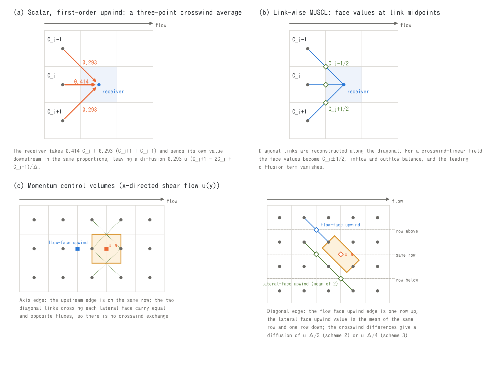
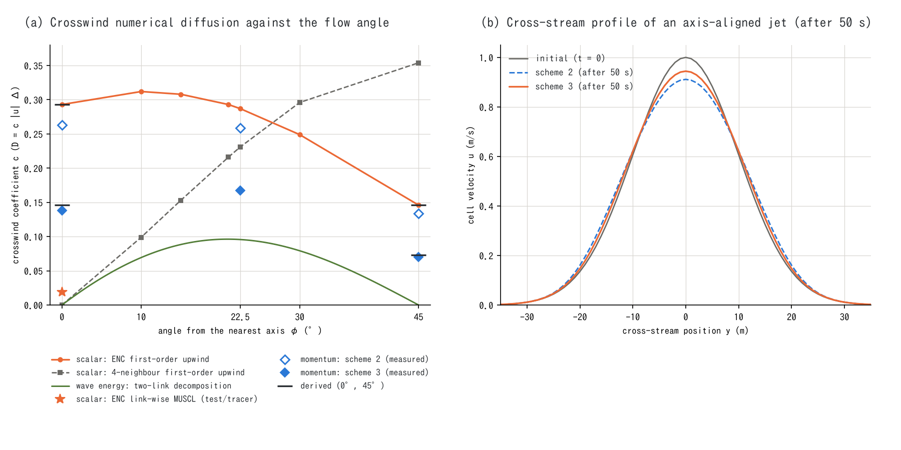
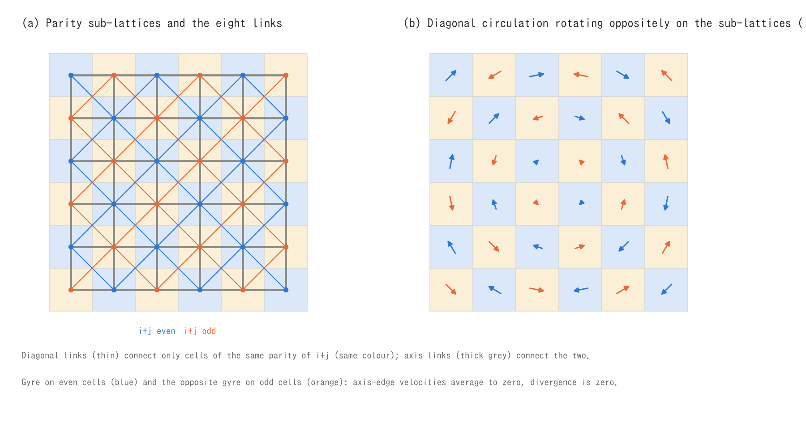

# Numerical diffusion by diagonal-edge fluxes -- how much the eight-direction links smooth the flow sideways, and the countermeasures (supplement to the shallow water chapter)

> English mirror of docs/users_guide/diagonal_diffusion.md. The Japanese file is the master copy.

[Back to the shallow water chapter](swflow.md) | [Back to the user's guide index](../users_guide.md) | [Advection schemes](advection.md)

The ENC grid moves water, momentum and transported substances to the
neighbours through the edges (links) of each cell: four along the axes and
four along the diagonals. Even in a uniform flow along $`x`$, 0.414 of the
flux passes through the axis link and 0.293 through each of the two diagonal
links on either side. The upstream side of a diagonal link is **a cell one
row to the side**, so if the upwind value is carried as it is (first-order
upwind), the receiver gets an average of three cells lined up across the
stream. Even with no cross-stream velocity at all, the cross-stream profiles
of concentration and velocity are smoothed -- this is the subject of this
page, the **numerical diffusion by diagonal-edge fluxes**. A 4-neighbour grid
has no such diffusion in a flow along an axis, but has it in an oblique flow
(§2.3).

This page summarises, for **scalar transport** (the concentrations of
suspended sediment, water quality, the salt-water layer, driftwood and
debris) and for **momentum** (velocity) separately, what this numerical
diffusion does, how large it is, which countermeasures are implemented for
which cases (including the options that were rejected), and what remains as
a limitation. For momentum, the diffusion is not only "too much": because of
the way the diagonal links are arranged there are places where it is "too
little" (the diagonal sub-lattice mode), and places where it becomes
"negative" when the flux through a lateral face disagrees with the mass
(anti-damping). Both have been fixed as problems of the lateral faces of the
diagonal-edge control volumes (§4.4 and §4.5).

The equations are in [ENC grid and time integration](encgrid.md) §2 and §4
and [Advection schemes](advection.md) §4 and §7, and the detailed design note
on the momentum-conservative formulation is
[docs/advection_design.md](../../advection_design.md) (in Japanese). The
master records of the design and verification are developer.md (§68.36 to
§68.45, §78, §90.2, §90.13; in Japanese) and the READMEs of
[test/tracer](../../../test/tracer/en/README.md) and
[test/sublattice](../../../test/sublattice/en/README.md). The formula of the
crosswind numerical diffusion of momentum (§2.4) is derived on this page
(ENCflow's own derivation), and its numerical check is recorded in
developer.md §68.45. The page is for intermediate to advanced users and
developers; if you compute with the defaults, §1 and §6 are enough.

<a id="summary"></a>

## 1. Key points

- **Mechanism**: the eight-direction links send 58.6 % of the flux of a
  flow along an axis to the diagonals, so a first-order upwind receiver gets
  a weighted average of three points across the stream. On square cells the
  crosswind numerical diffusion coefficient is
  $`D_\perp = (p_d/2)\,u\Delta \approx 0.293\,u\Delta`$ ($`p_d`$ =
  `p_diagratio`; §2.2). It depends on the flow direction and is half of that
  at 45° (§2.3).
- **Scalar transport**: with first-order upwind (`f_scalar_scheme = 1`),
  this crosswind diffusion and the longitudinal $`u\Delta(1 - Cr)/2`$ exceed
  the physical dispersion by one to two orders of magnitude and are
  proportional to the cell size. The default **link-wise MUSCL
  (`f_scalar_scheme = 3`; since 2026-10-13)** reconstructs diagonal links
  along the diagonal too, so the leading crosswind term vanishes; in
  [test/tracer](../../../test/tracer/en/README.md) the crosswind diffusion
  drops to 1/14. Integral quantities such as totals and deposited volumes
  are unaffected with either scheme (§3).
- **Momentum**: only the family of links that are oblique to the flow is
  smoothed across the stream, and the cross-stream profile of the cell
  velocity spreads with a coefficient of $`\approx 0.29\,u\Delta`$ with
  scheme 2 (first-order upwind; the same as first-order upwind for scalars)
  and $`\approx 0.15\,u\Delta`$ with the default scheme 3 (flow along an axis;
  §2.4). This is because the MUSCL of scheme 3 is applied only to the
  flow-direction faces, while the lateral faces stay first-order upwind. On
  practical grids it exceeds the eddy viscosity (the default of the
  zero-equation model) by one to two orders of magnitude, so the spreading of
  the cross-stream profiles of jets, shear layers and longshore currents
  depends on the grid (§4.1 and §4.2).
- **Too little and negative diffusion**: diagonal links connect only cells
  with the same parity of $`i + j`$, so until 2026-10-17 the advection term
  did not smooth a diagonal circulation running in opposite directions on
  the two parity sub-lattices (a checkerboard pattern; §4.4). When the flux
  through a lateral face is larger than the flow of the continuity equation,
  the exchange of momentum produces kinetic energy and blew up in finite time,
  for example at the edge of deep ponded water (§4.5). Both have been fixed
  in the formulation of the lateral faces without changing the leading term
  for smooth fields or the bore benchmarks.
- The **coastal wave field** carries wave energy with the **two-link
  decomposition**, which splits it between the two grid directions that
  bracket the propagation direction, so propagation along the axes and
  diagonals has no crosswind numerical diffusion (§5).
- The table in §6 lists the countermeasures and defaults for each case and
  what users can do.

<a id="mechanism"></a>

## 2. Mechanism -- diagonal links hand the flow to the side



*(a) Scalar, first-order upwind: even in a flow along $`x`$, the receiver (centre) takes 0.414 from straight upstream and 0.293 from each of the two diagonal upstream cells. This is an average of three points across the stream, and the profile is smoothed. (b) Link-wise MUSCL: diagonal links are also reconstructed along the diagonal, which puts the face value at the link midpoint (◇). For a crosswind-linear profile the weighted sum of the received values equals the central value, and the leading smoothing term vanishes. (c) Momentum control volumes (orange): for the axis edge (left) the flow-face upstream edge is on the same row, and the fluxes of the two diagonal links (dotted) crossing a lateral face cancel, so there is no crosswind exchange. For the diagonal edge (right) the flow-face upstream edge is one row to the side, and the upwind value of the inflow lateral face (the mean of two opposite-parity parallel links) is on the same row and the row on the other side, so crosswind differences are taken in.*

<a id="partition"></a>

### 2.1 Partition of a uniform flow

The ENC grid divides each side of a cell into three parts and assigns the
middle $`(1 - p_d)\Delta`$ to the normal (axis) edge and the two ends of
$`(p_d/2)\Delta`$ to the diagonal edges that wrap around the corners, as
passage widths ([ENC grid and time integration](encgrid.md) §2,
[Passage-width adjustment](passage_width.md) §2). With the default
$`p_d = 2/(2+\sqrt2) \approx 0.586`$, all eight passage widths are
$`0.414\Delta`$. In a uniform flow $`(u, 0)`$ along $`x`$ the normal velocity
of an axis link is $`u`$ and that of a diagonal link is $`u/\sqrt2`$, so the
flux leaving a cell on the $`+x`$ side splits as

```math
\underbrace{(1 - p_d)\,\Delta\,u h}_{\text{axis: } 0.414}
\;+\; 2 \times \underbrace{\frac{p_d}{2}\sqrt2\,\Delta \cdot \frac{u}{\sqrt2}\,h}_{\text{diagonal: } 0.293}
\;=\; \Delta\,u h
```

The total is correctly $`\Delta u h`$, but **58.6 % of the flux goes to the
cells one row to the side**. What leaves along the diagonals and what comes
in along them cancel, so the water budget of a uniform flow is not affected
at all. The effect appears when the transported quantity (concentration,
velocity) varies across the stream.

<a id="scalar-mechanism"></a>

### 2.2 First-order upwind scalars: an average of three points across the stream

Consider a field whose volumetric concentration $`C`$ is uniform in $`x`$
and varies only across the stream in $`y`$, carried with first-order upwind
(face value = value of the upwind cell). Cell $`(i, j)`$ takes 0.414 from
straight upstream $`(i-1, j)`$ and 0.293 from each of the diagonal upstream
cells $`(i-1, j\pm1)`$, and sends its own value $`C_j`$ downstream in the
same proportions (figure (a)), so on square cells
($`\Delta x = \Delta y = \Delta`$)

```math
\frac{\partial C_j}{\partial t}
= \frac{u}{\Delta}\cdot\frac{p_d}{2}\,\bigl(C_{j+1} - 2C_j + C_{j-1}\bigr)
\;\approx\; \frac{p_d}{2}\,u\,\Delta\;\frac{\partial^2 C}{\partial y^2},
\qquad
D_\perp = \frac{p_d}{2}\,u\,\Delta \approx 0.293\,u\,\Delta
```

Even with zero cross-stream velocity, a diffusion with the crosswind
coefficient $`0.293\,u\Delta`$ acts. Along the flow, the longitudinal
numerical diffusion of first-order upwind on any grid,
$`D \approx u\Delta(1 - Cr)/2`$ ($`Cr = u\Delta t/\Delta`$), is added. The
time step of the shallow water computation is set by the Courant condition
of gravity waves, so the $`Cr`$ of scalars is about 0.1 to 0.2, and both the
longitudinal and the crosswind diffusion are in practice **proportional to
the cell size**. [test/tracer](../../../test/tracer/en/README.md) measures
both in a straight channel with uniform flow and confirms that they agree with
the theoretical values of the modified equation (4.7 m²/s longitudinal and
2.7 m²/s crosswind at u = 1.0 m/s and Δ = 10 m, against 4.5 and 2.9; the
ratios to the theory are 0.93 to 1.05).

<a id="orientation"></a>

### 2.3 Dependence on the direction (comparison with the 4-neighbour grid and the two-link decomposition)



*(a) Crosswind numerical diffusion coefficient of first-order upwind with a uniform velocity (in units of $`u\Delta`$). φ is the angle from the nearest axis. The three scalar methods are the numerical values of Gaussian-blob advection in [wavefield_plan.md](../../wavefield_plan.md) §6.1 (in Japanese); the momentum points are the jet measurements of this page (developer.md §68.45, converted to the $`c`$ of $`D = c\,|u|\Delta`$). (b) Cross-stream profile after 50 s of a jet along an axis (initial centre velocity 1 m/s, width σ = 10 m, Δ = 1 m, frictionless).*

The crosswind numerical diffusion of first-order upwind is set by the
relation between the flow direction and the grid. The coefficients measured
on a square grid with a uniform velocity (in units of $`u\Delta`$; numerical
computation in [wavefield_plan.md](../../wavefield_plan.md) §6.1, in
Japanese) are:

| Angle from the nearest axis φ | 0° | 10° | 15° | 21° | 22.5° | 30° | 45° |
|---|---:|---:|---:|---:|---:|---:|---:|
| ENC (finite volume on eight links), first-order upwind | 0.293 | 0.312 | 0.308 | 0.293 | 0.287 | 0.249 | 0.146 |
| 4-neighbour grid, first-order upwind | 0 | 0.099 | 0.153 | 0.216 | 0.231 | 0.296 | 0.354 |
| Two-link decomposition, first-order upwind (§5) | 0 | 0.069 | 0.088 | 0.096 | 0.096 | 0.079 | 0 |

The 4-neighbour grid has no crosswind diffusion in a flow along an axis and
the largest at 45° (the well-known "grid orientation" error). ENC has about
0.29 even in a flow along an axis and half of that at 45°. The dependence on
the direction (the ratio of the largest to the smallest) is smaller than for
the 4-neighbour grid, but **it is not zero in any direction**. The diagonal
links of ENC are there to connect one-cell-wide diagonal valleys and to give
the correct conveyance of oblique flows
([Passage-width adjustment](passage_width.md) §6); the price is that they
send part of what is transported to the diagonals even in a flow along an
axis, and that is where this diffusion comes from.

<a id="momentum-mechanism"></a>

### 2.4 Momentum: only the family of links oblique to the flow is smoothed

The ENC momentum equation takes the edge-normal velocity $`u_e`$ as the
unknown, and the momentum-conservative advection term (schemes 2 and 3)
evaluates the fluxes through the faces of a momentum control volume around
each edge ([Advection schemes](advection.md) §4). Take a flow $`u(y)`$ along
$`x`$ (a shear flow that varies across the stream) and look at what the
edges of each family receive (figure (c)).

- **Axis edges (normal $`x`$)**: line $`k`$ runs along $`x`$, so the
  upwind edge of the flow-direction face is on the same row. On the lateral
  faces, the two diagonal links crossing the face (the two diagonals of a
  unit square) carry equal amounts in opposite directions, so the net flux
  through the face is zero and there is no crosswind exchange. This family
  is not smoothed across the stream.
- **Diagonal edges**: line $`k`$ is diagonal, so the upwind edge of the
  flow-direction face is one row to the side. The upwind value of the inflow
  lateral face is the mean of the two opposite-parity parallel links before
  and after the face (on the same row and one row to the other side; §4.4).
  Both are values shifted across the stream, and **after the first-order
  terms of the flow-direction face and the lateral face cancel, the
  second-order terms remain as a diffusion in conservative form**.

For the velocity $`u_d`$ of the diagonal edges, the advection term contains
the numerical diffusion

```math
\frac{\partial u_d}{\partial t}\bigg|_{\text{numerical}}
\approx \frac{\partial}{\partial y}\!\left(D_d\,\frac{\partial u_d}{\partial y}\right),
\qquad
D_d =
\begin{cases}
u\Delta/2 & \text{scheme 2 (flow-direction and lateral faces both first-order upwind)}\\[2pt]
u\Delta/4 & \text{scheme 3 (flow-direction faces MUSCL; where smooth and monotone)}
\end{cases}
```

(square cells; derived on this page). Scheme 3 reconstructs the values on
the flow-direction faces with MUSCL (where smooth, the face value lies midway
between the edges on either side), so the part from the flow-direction faces
disappears and only the part from the first-order lateral faces remains,
which halves it. At extrema (such as the centre line of a jet) the limiter
falls back to first-order upwind, so there it is $`u\Delta/2`$ as in
scheme 2.

The cell velocity is a weighted sum of the axis family and the diagonal
family ($`(1 - p_d)`$ and $`p_d`$; [ENC grid and time integration](encgrid.md)
§4), so the cross-stream profile of the output cell velocity spreads with
$`p_d D_d`$, that is

- $`\approx 0.293\,u\Delta`$ with scheme 2 -- **the same value as
  first-order upwind for scalars**
- $`\approx 0.146\,u\Delta`$ with scheme 3 (default)

In a flow at 45° the roles are swapped: the diagonal family along the flow
has no exchange, and the axis family, oblique to the flow, is smoothed (the
coefficient is $`\approx 0.146\,u\Delta`$ with scheme 2 and
$`\approx 0.073\,u\Delta`$ with scheme 3; half, like first-order upwind for
scalars at 45°).

**Measurement (developer.md §68.45)**: a Gaussian jet with a centre velocity
of 1 m/s and width σ = 10 m was placed in a flat, frictionless closed channel
(Δ = 1 m, depth 1 m), and the spreading of its cross-stream profile (growth
of $`\sigma^2`$) was measured over 50 seconds. There is no physical viscosity
and no friction, so all of the spreading is numerical. Assuming that the
diffusion coefficient is proportional to the local velocity
($`D = c\,u\Delta`$) and converting to $`c`$ gives the values below, 4 to 10 %
below the derived values (because the jet decays during the 40 seconds of the
fit, which lowers the coefficient proportional to the velocity).

| Jet direction | $`c`$ of scheme 2 | $`c`$ of scheme 3 | (Reference) first-order upwind for scalars |
|---|---:|---:|---:|
| 0° (along an axis) | 0.26 (derived 0.293) | 0.14 (derived 0.146) | 0.293 |
| 22.5° | 0.26 | 0.17 | 0.287 |
| 45° (along a diagonal) | 0.13 (derived 0.146) | 0.070 (derived 0.073) | 0.146 |

In 50 seconds the centre velocity at 0° dropped from 1.00 to 0.91 with
scheme 2 and to 0.94 with scheme 3 (figure (b)). At 0°, a calculation that
reduces the update formulas of the two families to one dimension across the
stream reproduces ENCflow's centre velocity within 0.1 % and $`\sigma^2`$
within 0.3 % (a check that the explanation of which family is smoothed is
correct). With a finer grid of Δ = 0.5 m (and half the time step), the
diffusion coefficient becomes 0.52 times with scheme 2 and 0.51 times with
scheme 3, that is, proportional to the cell size.

<a id="scalar"></a>

## 3. Effects and countermeasures for scalar transport

<a id="scalar-targets"></a>

### 3.1 What is transported

Column quantities on the surface are carried within the step of the shallow
water computation by a conservative transport kernel (`advect_scalar`) that
uses the same edge fluxes as the continuity equation
([Advection schemes](advection.md) §7). They are the sediment $`h_s`$ of
suspended load and debris flows, the water-quality substances $`c_q`$, the
salt-water layer $`h_{ss}`$ of the two-layer fresh/salt model, driftwood
$`h_d`$ and debris $`h_{bd}`$; `f_scalar_scheme` applies to all of them at
once. Mass is conserved to machine precision, and a uniform concentration
stays uniform.

<a id="scalar-impact"></a>

### 3.2 Effects

- **Local peaks drop, and fronts and plumes widen.** With first-order upwind,
  a clean-water front widens to 370 m (37 cells) in one hour, and a plume
  from a point source spreads to $`\sigma_y \approx 130`$ m 3 km downstream
  (test/tracer, Δ = 10 m). This exceeds the physical dispersion
  (Elder-type longitudinal $`5.9\,h u_* \approx 0.3`$ m²/s and crosswind
  $`0.15\,h u_* \approx 0.01`$ m²/s for $`h`$ = 1 m and $`u_*`$ = 0.05 m/s)
  by one to two orders of magnitude.
- **It affects processes decided by peaks or densities.** Quantities
  controlled by local concentrations -- the fluid force including driftwood
  and debris and the judgement of house destruction, the
  concentration-dependent resistance law of debris flows, peak
  concentrations of water quality, the position of the tip of a salt
  wedge -- are decided by a blunted concentration field under first-order
  upwind (switching to MUSCL changes them in the direction of higher peaks;
  developer.md §78).
- **The answer changes with the grid.** The numerical diffusion is
  proportional to the cell size, so changing the grid changes the result,
  which makes it no basis for calibration. This is the main reason why the
  default was made MUSCL.
- **Integral quantities are unaffected.** Totals, sums of deposited volume
  and total outflow are fixed by conservation and are not affected by the
  numerical diffusion. A front advancing onto dry ground carries the
  concentration of its source as it is, so the longitudinal diffusion acts on
  concentration differences inside the wet area (mixing with clean water,
  point sources, confluences).

<a id="scalar-muscl"></a>

### 3.3 Countermeasure: link-wise MUSCL (default)

`f_scalar_scheme = 3` (default; changed from 1 on 2026-10-13) reconstructs
the face value along the direction of each link from three points -- upwind
$`c_{up}`$, downwind $`c_{dn}`$ and further upwind $`c_{uu}`$ -- with the
van Leer limiter[^vanleer79].

```math
c_{face} = c_{up} + \tfrac12\,\psi(r)\,(c_{dn} - c_{up}),
\qquad
r = \frac{c_{up} - c_{uu}}{c_{dn} - c_{up}},
\qquad
\psi(r) = \frac{r + |r|}{1 + |r|}
```

The key is that **diagonal links are reconstructed along the diagonal
direction** too (figure (b)). For a crosswind-linear profile, the face value
from a diagonal upstream cell becomes the value at the link midpoint
$`C_{j\pm1/2}`$, the weighted sum of the values received equals the central
value, and the leading term of the crosswind numerical diffusion vanishes.
The same formula is shared with the face values of the flow advection term
(scheme 3).

In the measurement of test/tracer (u = 1.0 m/s, Δ = 10 m; the table of its
README) the ratios to first-order upwind are 1/5 to 1/14 longitudinally and
1/14 for the crosswind $`D_y`$ (2.7 → 0.19 m²/s, $`\sigma_y`$ 3 km downstream
129 → 38 m). No negative concentrations or values above the initial
concentration appear. The kernel costs 2 to 3 times as much per scalar, a few
percent of the whole step. As a property of the limiter, extrema (both ends
of a front, the centre of a plume) fall back to first-order upwind, and the
diffusion left there is most of the remaining longitudinal diffusion.

<a id="scalar-fallback"></a>

### 3.4 Where it falls back to first-order upwind, and transports that stay first-order upwind

**Where MUSCL degenerates to first order.** Faces with inflow from a boundary
face (concentration tables of reach inflows and the like), faces whose
downwind cell is outside the domain, a sea cell or dry, and faces whose
further-upwind cell is invalid, a sea cell or dry stay first-order upwind
(walls, dry beds and prescribed boundaries do not supply concentration
gradients; the same idea as the donor rules of the flow advection term,
[Advection schemes](advection.md) §4.4). Near walls, wet/dry fronts, coasts
and inflow openings, therefore, the first-order upwind diffusion effectively
remains.

**Transports that stay first-order upwind (outside `f_scalar_scheme`).**

- **Advective transport with groundwater, $`c_g`$** (the subsurface mass of
  water quality) is deliberately kept first-order upwind (decision of
  2026-10-22; [docs/handoff.md](../../handoff.md) 1l, in Japanese). The pore
  velocity underground is slow, and the ratio $`\Delta x/(2\alpha_L)`$ of the
  first-order numerical diffusion $`D \approx u\Delta x/2`$ to the physical
  longitudinal dispersion $`D_L = \alpha_L u`$ stays within the same order of
  magnitude; and $`c_g`$ has no physical dispersion term, so the first-order
  numerical diffusion stands in for it (introducing MUSCL alone would give
  dispersion-free groundwater and a breakthrough at seepage points steeper
  than reality). The plan is to introduce a parameter that gives the
  dispersivity directly together with MUSCL, in the same piece of work, when
  it becomes necessary.
- The heat flux of the **lava temperature** (`f_lvtemp = 1`) is the lava
  edge flux times the face temperature. Lava flow is a nonlinear diffusion
  equation of lava thickness and follows the same 4-neighbour conservative
  discretisation as the SIA of glaciers ([Lava flow](lavaflow.md),
  [lava_plan.md](../../lava_plan.md) §1 and §3, in Japanese), so it has no
  crosswind diffusion from diagonal edges. First-order upwind, which takes the
  temperature of the donor as the face temperature (`f_lvtemp_scheme = 1`,
  the default before 2026-11-05), has the properties of 4-neighbour
  first-order upwind (zero along the axes, largest at 45°; §2.3). The
  combination of first-order upwind and the
  donor-limited flux makes the new temperature a convex combination of the
  neighbouring temperatures of the previous time, so no new temperature
  maximum or minimum is created (lava_plan.md §8.7). Viscosity and yield
  stress are exponential functions of temperature and solidification is
  judged by a temperature threshold, so this property guarantees that
  overshoots do not upset those judgements. Measuring the numerical
  diffusion ([test/lava](../../../test/lava/en/README.md) configuration 10)
  shows no crosswind diffusion for a flow along a grid axis and, at 45°,
  $`0.357\,u\Delta`$ as the modified equation predicts (theory
  $`0.354\,u\Delta`$). The diffusion along the flow makes the length of a flow
  that stops as it cools, and the shape of its deposit, depend on the cell
  size (with first-order upwind at Δ = 5 m the largest deposit thickness is
  3–6 % thinner than on finer grids). The default `f_lvtemp_scheme = 3` is
  the same van Leer link-wise MUSCL as the surface scalars, and the crosswind
  diffusivity at 45° becomes $`0.034\,u\Delta`$ (0.09 times first order). The
  new temperature is kept within the range of the neighbouring temperatures,
  so the property of creating no new extremes is kept (the default from
  2026-11-05; "Numerical diffusion of the heat advection" in
  [Lava flow](lavaflow.md), developer.md §94, in Japanese).

<a id="scalar-limits"></a>

### 3.5 Remaining limits and how to use it

- Use the default (3). `f_scalar_scheme = 1` is for reproducing or comparing
  with existing calibrations fitted to the blunted concentration field of
  first-order upwind (switching back to 1 changes processes in which the
  concentration feeds back to the flow in the direction of lower peaks).
- In more than one dimension it is not strictly TVD, and slight clipping of
  extrema or overshoots are possible (none were seen in the measurements).
- If you discuss the shape of plumes a few cells wide or of thin
  concentration fronts, refine the grid and check how the result changes.
  Surface scalars have no physical dispersion term either (horizontal
  dispersion consists only of the numerical diffusion and the advective
  dispersion by the non-uniformity of the flow field).
- Where the lateral spreading of a deposit is decided by the flow (momentum
  and pressure), as on a debris-flow fan, the numerical diffusion of the
  scalar hardly changes the spreading. In
  [examples/debris_fan](../../../examples/debris_fan/en/README.md), switching
  back to `f_scalar_scheme = 1` changes the spreading of the fan by only
  0.8 % (what changes is the sharpness of the concentration, lowering the
  largest deposit thickness by about 10 %), and the 8-neighbour spreading does
  not depend on the grid, so it is not numerical diffusion.

<a id="momentum"></a>

## 4. Effects and countermeasures for momentum (velocity)

<a id="momentum-size"></a>

### 4.1 Magnitude -- comparison with the eddy viscosity

The crosswind numerical diffusion of the default scheme 3 is
$`D \approx 0.15\,|u|\Delta`$ in the profile of the cell velocity (flow
along an axis; 0.07 to 0.17 depending on the direction; §2.4). Compare this
with the physical eddy viscosity that can be added to the momentum equation
([Diffusion term](diffusion.md)). The ratio to the zero-equation model
$`\nu = \alpha u_* h`$ ($`u_* = \sqrt g\,n|u|h^{-1/6}`$, default
$`\alpha = \kappa/6 \approx 0.068`$[^elder59]) is

```math
\frac{D_{\text{numerical}}}{\nu}
\approx \frac{0.15\,\Delta}{\alpha\sqrt g\,n\,h^{5/6}}
```

and does not depend on the velocity. With $`n = 0.03`$ it is about
$`23\,\Delta`$[m] at a depth of 1 m and about $`6\,\Delta`$[m] at 5 m. Even a
1 m grid gives several to tens of times, and a 10 m grid tens to hundreds of
times. Even with the upper end of the measured range for transverse mixing,
$`\alpha = 0.8`$[^fischer79], the numerical diffusion is larger on a 10 m
grid. In other words, **on practical grids the crosswind mixing of momentum
is decided almost entirely by numerical diffusion**. As a real-world
magnitude, the $`\nu`$ of the zero-equation model off examples/tsunami_town
(depth 5 m, 0.1 m/s) was about 0.003 m²/s (in the investigation of the
checkerboard pattern; developer.md §68.36).

<a id="momentum-impact"></a>

### 4.2 Effects -- which flows are affected

It affects the width and the maximum of the profile of flows whose velocity
varies across the stream.

- The spreading and deceleration of **jets** (river mouths, outlets of
  culverts and breaches, jets through openings)
- **Shear layers** (the boundary between a channel and its floodplain, the
  edge of the recirculation zone behind a structure)
- **The cross-shore profile of longshore currents**: by default, without
  mixing by breaking waves, the profile of a longshore current is smoothed by
  the numerical lateral mixing of the advection across diagonal faces, and a
  current of up to a few percent appears at the outer edge of the start of
  breaking ([Coastal wave field](wavefield.md), developer.md §90.5 and
  §90.13). In [test/wfcurrent](../../../test/wfcurrent/en/README.md)
  (Δ = 10 m, maximum current 0.22 m/s) the numerical diffusion is estimated
  at $`\approx 0.3`$ m²/s, and adding the eddy viscosity of breaking waves
  (up to 0.54 m²/s; `wf_break_visc = 1`) changed the maximum current by
  −3.3 % and the spread of the profile by +3.8 %. This is consistent with the
  two being of the same order of magnitude.

A rule of thumb (an estimate of this page): compare the time
$`T_d = B^2/D`$ in which a profile of width $`B`$ across the stream is
smoothed by numerical diffusion with the time
$`T_f = h^{4/3}/(g n^2 |u|)`$ in which bed friction brings the velocity back
to the local balance. If $`T_f \ll T_d`$, the velocity is decided by the
local gradient and friction, and the effect of numerical diffusion is small.

- Shallow floodplain flow (h = 1 m, n = 0.04, u = 1 m/s, Δ = 10 m, B = 50 m):
  $`T_f \approx 64`$ s, $`T_d \approx 1{,}700`$ s. Friction dominates and the
  effect is small.
- Deep river-mouth or coastal jet (h = 5 m, n = 0.025, u = 0.5 m/s,
  Δ = 20 m, B = 100 m): $`T_f \approx 2{,}800`$ s, $`T_d \approx 6{,}800`$ s.
  Same order of magnitude; it affects the spreading of the jet.

Quantities such as the discharge of a flood, the extent of inundation and
the peak discharge are of the former kind and are hardly affected by the
crosswind numerical diffusion. When you look at the shape of jets or
circulations in deep, low-friction waters (lakes, reservoirs, coasts, deep
channels), check how the result depends on the grid.

<a id="momentum-countermeasures"></a>

### 4.3 Countermeasures and their reach

- **Scheme 3 (default; since 2026-10-03)**: the flow-direction faces are
  reconstructed with MUSCL, so the crosswind numerical diffusion is about half
  of scheme 2 (§2.4). Being conservative, it also gives the correct speed of
  bores and hydraulic jumps ([Advection schemes](advection.md) §5).
- **The lateral faces are first-order upwind in both schemes**
  ([Advection schemes](advection.md) §4.3). The remaining half of the crosswind
  numerical diffusion comes from these faces. As §4.4 and §4.5 show, the
  lateral faces carry both the coupling of the diagonal sub-lattices and the
  consistency with the mass; there is no record of an attempt to raise the
  order of the lateral faces.
- **Adding physical viscosity**: to treat crosswind mixing as physics, add the
  diffusion term (`f_diffusion_term`; [Diffusion term](diffusion.md)) or the
  mixing by breaking waves (`wf_break_visc`; [Coastal wave field](wavefield.md)).
  As §4.1 shows, however, a viscosity smaller than the numerical diffusion
  hardly changes the result. If you want the viscosity to decide the mixing,
  choose a cell size at which the viscosity clearly exceeds the numerical
  diffusion $`0.15\,|u|\Delta`$.
- **Refining the grid**: the numerical diffusion is proportional to the cell
  size. When you discuss, for example, the spreading of a jet, compare the
  results on two or more cell sizes.

<a id="sublattice"></a>

### 4.4 Too little diffusion -- the diagonal sub-lattice (checkerboard) mode (found 2026-10-13, fixed 10-17)



*Parity sub-lattices (the figure of [advection_design.md](../../advection_design.md) §6, in Japanese). (a) Diagonal links (thin lines) connect only cells with the same parity of $`i + j`$ (same colour); axis links (thick grey) connect the two. (b) Diagonal circulations running in opposite directions on even cells (blue) and odd cells (orange). The axis-edge velocities average to zero on both sides, and the divergence is zero.*

Diagonal links connect only cells with the same parity of $`i + j`$. A
field that superimposes a diagonal circulation on the even cells and an
opposite circulation on the odd cells has zero axis-edge velocity (the mean
of the two sides) and zero divergence, and does not change the water level,
so the pressure term does not act on it and bed friction is its only damping.
Until 2026-10-17, the flow-direction and lateral faces of the control volume
of a diagonal edge were all built from cells and links of the same parity, so
the advection term did not act on this mode either. In deep, slow stagnant
zones (such as offshore after the backwash of a tsunami) a checkerboard
pattern of velocity (relative amplitude 0.4 to 0.6) remained and was copied
into the deposits of debris and driftwood, which use a threshold to decide
deposition, and into the maximum fluid force (examples/tsunami_town and
timberyard; developer.md §68.36).

**Countermeasure**: the width of the lateral faces of a diagonal edge was set
to the actual spacing of the parallel diagonal links,
$`\Delta x\Delta y/\Delta r`$ ($`\Delta/\sqrt2`$ on square cells), and the
upwind value of the inflow face was made the mean of the two
**opposite-parity** parallel links before and after the face (figure in
[advection_design.md](../../advection_design.md) §6.1, in Japanese). In smooth
fields, the position of the upwind value is halved at the same time as the
width, so the leading term $`(\bar u_t - u_e)/W`$ is the same as before. The
crosswind numerical diffusion of §2.4 ($`u\Delta/2`$ and $`u\Delta/4`$) is
also unchanged by this fix. What changed is the sub-lattice mode only: the
opposite-parity links have values of opposite sign, so a damping of
$`|q_t|\cdot 2u_e/W`$ acts.

- [test/sublattice](../../../test/sublattice/en/README.md) (sub-lattice mode
  superimposed on a background gyre): e-folding time of the damping
  1,094 s → 87 s. The checkerboard in the offshore velocity of tsunami_town
  0.43 → 0.01, in its debris deposits 0.47 → 0.08, and in the driftwood
  deposits behind the wall of timberyard 0.22 → 0.04.
- The benchmark values of the Stoker bore, uniform flow and bend loss are
  unchanged (because the leading term for smooth fields is the same).
- Options not adopted: a constant viscosity of the diffusion term,
  ν = 0.2 m²/s, also removes the checkerboard, but adds a calibration quantity
  and does not reach stagnant zones where the flow has stopped. Replacing only
  the upwind value with the opposite-parity links while keeping the width
  halved the leading term and broke the bore benchmark (bore position
  −2.95 %).

This is the opposite of the "smoothing too much" problem: **a fix that adds
lateral coupling only where it is needed and does not increase the diffusion
of smooth fields**.

<a id="anti-diffusion"></a>

### 4.5 Negative diffusion -- lateral-face fluxes that disagree with the mass

The first-order upwind exchange on a lateral face acts as diffusion (damping)
only when the mass flux of the face agrees with the flow that the continuity
equation actually passes through the links crossing that face. In the form
$`du_e/dt = -\sum_f Q_f(\bar u_f - u_e)/(A\bar h)`$, obtained by rewriting the
momentum-conservative advection term in non-conservative form, if the
exchange uses $`f`$ times the actual flow as the face flux, the receiver gets
$`f`$ times the momentum while the mass of the donor decreases only once.
With $`s`$ (> 1) the ratio of the velocities, the kinetic energy of the pair
changes by

```math
\Delta K \propto (s - 1)\left[f - \frac{s + 1}{2}\right] Q\,u_e^2
```

(developer.md §68.42). With $`f = 1`$ it is always a dissipation
$`-\tfrac12 Q(\Delta u)^2 \le 0`$, but with $`f = 2.4`$ kinetic energy **is
created** for every pair with $`s < 3.8`$. Where diagonal links are blocked
by walls, dry ground or the edge of a pond, the lateral-face flux and the
actual flow easily disagree, and this has been fixed in the following order.

| When | Where and symptom | Countermeasure (current) |
|---|---|---|
| 2026-10-03 (§68.21) | The lateral-face flux was given by the projection of the cell flux at the face centre, so it was non-zero even on faces blocked by the terrain where no water passes, and was amplified by $`1/\bar h`$ in thin control volumes until the run diverged | Use the actual flow of the ENC links crossing the face |
| 2026-10-17 (§68.37) | On faces where only one of the opposite-parity parallel links was valid, the velocity of a shallow bank link rode on a deep crosswise flow and was injected, blowing up in finite time at the edge of deep ponded water | Treat one-sided faces like a wall ($`\bar u_t = u_e`$) |
| 2026-10-18 (§68.39) | With that treatment, the wall rows of a channel between dry banks lost their exchange with the inside and accelerated to 6 m/s in 15 minutes | Use the value of the single link only when its depth is 1/2 to 2 times the depth of the face (a two-sided depth window) |
| 2026-10-31 (§68.42) | On the lateral faces of axis edges, when the diagonal links were blocked, unit-width flux times face length was up to 2.4 times the actual flow, turning the oscillation at the mouth of a side valley opening onto ponded water into anti-damping until it diverged | Divide the sum of the actual flows of the links crossing the face by the face length (exactly equal to the old formula in uniform flow) |
| 2026-11-01 (§68.43) | On the lateral faces of diagonal edges, the same overestimate (up to 2.4 times) remained when the crossing axis links were blocked | Multiply by the opening ratio of the crossing axis links, $`\varphi = 1 - 0.293 \times`$ (number blocked) |

Replacing the lateral faces of diagonal edges with "the actual flow of the
crossing links", as for axis edges, delayed the Stoker bore by 1.5 to 5 % in
every formulation and did not improve with a finer grid, so it was not adopted
(the momentum inflow to the family of diagonal links is evaluated at the
position of the axis links, and the velocities of the families separate;
developer.md §68.43). The current formula samples with the flow of the same
family and keeps the speed of the bore, but faces where the sign of the flow
disagrees with reality and the underestimate (dissipative side) on faces where
the diagonals are blocked and the axis open remain. Since §68.42 there has
been no case that diverged through this path.

<a id="momentum-limits"></a>

### 4.6 Remaining properties

- The crosswind numerical diffusion (§2.4) remains as long as the lateral
  faces are first-order upwind. The width of profiles depends on the grid.
- In the unsteady phase of a bore, the velocities of the axis and diagonal
  families separate slightly (7.36 and 7.45 m/s on the plateau of the Stoker
  solution). On the row next to a wall aligned with the grid, combined with
  reassigning the missing diagonal links to the axis, the bore lags by one
  cell; in a channel a few cells wide every row is such a row, and the bore
  comes out about 0.25 % slower (developer.md §68.43).
- The upwind spacing of the lateral faces of diagonal edges is
  $`\Delta/\sqrt2`$, so the Courant number of the crosswise velocity is
  $`\sqrt2\,|v_t|\Delta t/\Delta`$. With the usual Cn ≤ 0.5 this is not a
  problem, but in strong crosswise flows it can become a constraint
  ([advection_design.md](../../advection_design.md) §7, in Japanese).
- The cell velocity in output and probes contains the smoothing of the
  reconstruction in which diagonal edges pick up the values of the next row,
  $`u_c = u + (p_d/4)\Delta^2\,\partial^2 u/\partial y^2`$
  ([ENC grid and time integration](encgrid.md) §4). This is a static
  smoothing that does not accumulate in time, and is separate from the
  numerical diffusion above (in the Gaussian jet of
  [test/diffusion](../../../test/diffusion/en/README.md), the centre looks
  0.14 % smaller at Δ = 1 m).
- Scheme 1 (the former default; non-conservative) has a different mechanism
  with its weighted 3×3 differences, and the formula of §2.4 does not apply
  (in the same jet, the integral of momentum decreased by 1 % in 40 seconds;
  developer.md §68.45).

<a id="wavefield"></a>

## 5. Energy of the coastal wave field -- the two-link decomposition

The coastal wave field ([Coastal wave field explained](wavefield_models.md)
§3) splits the wave energy of each directional bin non-negatively between the
two grid directions (axis and diagonal) that bracket the propagation
direction, and carries it upwind (ENCflow's own discretisation, on the same
idea as D∞[^tarboton97]). Its crosswind numerical diffusion is

```math
D_\perp = \frac{c\,\Delta}{2}\,(\cos\varphi - \sin\varphi)\sin\varphi\cos\varphi
```

**zero for propagation along the axes and diagonals (φ = 0° and 45°)**, with a
maximum of $`0.096\,c\Delta`$ at φ ≈ 21° (the table of §2.3). Carried by a
finite volume that distributes to the eight links by passage width, it would
be $`0.293\,c\Delta`$ even along an axis, and the edges of breakwater
shadows would blur.

This choice was made by comparing prototypes (developer.md §90.2). The width
(10 to 90 %) of the shadow edge in a steady solution with a half-plane
illuminated in a uniform medium was 0.8 to 0.9 cells along the axes and
diagonals with first-order two-link decomposition (effectively sharp), 9.7 to
11.8 cells in the directions between, and 4.6 to 6.0 cells along the axes and
diagonals for an ENC finite volume combined with MUSCL. Adding a higher-order
correction to the two-link decomposition sharpens the oblique directions to
about 3 cells, but in a model without diffraction, sharpening only the shadow
edge gives shadows sharper than the blur of real diffraction (about 220 m at a
distance of 1 km for a period of 8 s and a depth of 10 m), so it was not
adopted. The blur of shadow edges is numerical diffusion, not diffraction
([Coastal wave field](wavefield.md)). The numerical diffusion of refraction in
direction space is a separate problem, kept down by a second-order correction
with a limiter.

<a id="usage"></a>

## 6. Countermeasures by case and how to choose

| Case | What happens | Implemented countermeasure (default) | Remaining limits and what users can do |
|---|---|---|---|
| Fronts, plumes and peaks of water quality, suspended sediment, the salt-water layer, driftwood and debris | First-order upwind diffuses by $`0.293\,u\Delta`$ crosswind and $`u\Delta/2`$ longitudinally; peaks drop and the answer changes with the grid | Link-wise MUSCL (`f_scalar_scheme = 3`; §3.3) | First order at extrema, boundaries, wet/dry fronts and coasts. Check thin structures by refining the grid |
| Reproducing existing calculations calibrated with first-order upwind | -- | The previous results with `f_scalar_scheme = 1` | Concentration-dependent processes change in the direction of lower peaks |
| Advective transport with groundwater, $`c_g`$ | First-order upwind diffusion | Deliberately kept first order (stands in for physical dispersion; §3.4) | Explicit dispersivity and MUSCL in the same future work |
| Lava temperature | With first-order upwind, 4-neighbour diffusion (no diffusion from diagonal edges; crosswind 0 along the axes and $`0.354\,u\Delta`$ at 45°); a flow that stops as it cools depends on the cell size | Link-wise MUSCL (`f_lvtemp_scheme = 3`, the default from 2026-11-05; crosswind 0.09 times first order at 45°, creates no new temperature extrema; §3.4) | The limiter falls back to first order near temperature extrema, so temperature structures a few cells wide are blunted. `f_lvtemp_scheme = 1` gives the results from before 2026-11-05. An 8-neighbour version is being designed |
| Cross-stream profiles of jets, shear layers and longshore currents (momentum) | The oblique family is smoothed across the stream; $`\approx 0.15\,u\Delta`$ in the cell velocity (scheme 3) | MUSCL on the flow-direction faces (scheme 3; about half of scheme 2; §4.3) | Lateral faces are first order. Physical viscosity acts only when it exceeds the numerical diffusion. Compare by refining the grid |
| Checkerboard pattern in deep, slow stagnant zones | Circulations running oppositely on the parity sub-lattices are not damped | Build the lateral faces from opposite-parity parallel links (§4.4; always on) | -- |
| Lateral faces at walls, pond edges, shelves and diagonally blocked openings | Fluxes that disagree with the mass create kinetic energy and blow up in finite time | Actual-flow flux (axis), opening ratio (diagonal), depth window for one-sided links (§4.5; always on) | Disagreeing signs of the flow; the lag of the bore in wall rows |
| Grid-scale stripes offshore in wave-current coupling (`f_wf_current = 1` with `wf_flow = 2`) | Grid-scale positive feedback between refraction and forcing (a mechanism separate from diagonal numerical diffusion) | Add a small background viscosity in the settings (`f_diffusion_term = 2`, `p_diffusion_nu` ≈ 0.05 m²/s; developer.md §90.20) | A user setting; [Coastal wave field](wavefield.md) |
| Shadow edges of wave energy | Crosswind diffusion of the first-order two-link decomposition in the directions between | Two-link decomposition (§5; zero along the grid directions) | No diffraction. Do not read the blur of shadow edges as diffraction |

**How to choose.**

- Use the defaults (`f_advection_scheme = 3`, `f_scalar_scheme = 3`). There
  is no setting that makes the crosswind numerical diffusion smaller than
  this; only the cell size acts (the 4-neighbour grid with `p_diagratio = 0`
  removes the diffusion along the axes, but it grows in oblique directions and
  the conveyance of oblique flows is lost; §2.3,
  [Passage-width adjustment](passage_width.md)).
- Quantities such as the discharge of a flood, the extent of inundation and
  totals are hardly affected by the crosswind numerical diffusion.
- When you discuss concentration peaks, arrival times of fronts, plume widths,
  the spreading of jets or the profiles of longshore currents, check how the
  result depends on the cell size with calculations at different cell sizes.
  The numerical diffusion is proportional to the cell size.
- When you add a physical eddy viscosity to the momentum, compare it with the
  numerical diffusion by the ratio of §4.1 before deciding its size. The
  zero-equation model with the default coefficient hardly changes results on
  practical grids.

<a id="related"></a>

## 7. Related but different phenomena

- **Grid-orientation biases of judgements and gradients**: the yield-stop
  judgement (developer.md §28.16), the diffusivity of the glacier SIA
  (§45.1), the destination of avalanche redistribution (§45.2), the yield and
  stop of lava (§51.4), the gravity correction on steep slopes (§91) and the
  steepest slope of hillslopes (§92) were biases from judging and evaluating
  with per-edge quantities in eight directions, not numerical diffusion. All
  have been rewritten to evaluate with the gradient magnitude or D∞.
- **4-neighbour 5-point stencils of diffusion-type processes**: the 5-point
  Laplacian of creep and of the curvature of dry hillslope erosion (the default
  before 2026-11-05) is biased by the grid direction at short wavelengths close to
  the cell size (not numerical diffusion, but a bias in the direction of the
  discretisation error). The default is the isotropic 9-point stencil with
  `creep_diagratio` and `spl_diagratio` = 1/3
  ([Sediment transport and hillslope processes](sediment.md) §2 and §6, developer.md §93). The glacier
  SIA and lava flow remain 4-neighbour (an 8-neighbour version is being designed;
  landslide_tsunami_plan.md §11.1). How the diagonal share d is chosen for each
  process is summarised in [choosing the diagonal share d](diagratio.md).
- **The difference in spreading between 8 and 4 neighbours**: the lateral
  spreading of a debris-flow fan is larger with 8 neighbours, but it depends
  neither on the grid nor on the direction of the valley, so it is not
  numerical diffusion
  ([examples/debris_fan](../../../examples/debris_fan/en/README.md)).
- **Reassignment of passage widths**: the rules that hand diagonal passage
  widths blocked by walls or dry banks back to the open directions are a
  matter of conveyance, described in
  [Passage-width adjustment](passage_width.md). The lateral-face fluxes (§4.5),
  however, are problems that arose from the same geometry of "blocked
  diagonal links".
- **The smoothing of the cell-velocity reconstruction** (§4.6) is a smoothing
  in the output that does not accumulate in time.

<a id="verification"></a>

## 8. Verification and where the records are

| Case or record | Content | Key points |
|---|---|---|
| [test/tracer](../../../test/tracer/en/README.md) | Clean-water front and point-source plume in a straight channel with uniform flow | First-order upwind longitudinal $`u\Delta(1 - Cr)/2`$ and crosswind $`0.293\,u\Delta`$ agree with the theory (ratios 0.93 to 1.05). Crosswind 1/14 with MUSCL |
| [test/sublattice](../../../test/sublattice/en/README.md) | One-cell gyre and sub-lattice mode in a frictionless closed tank | e-folding time of the sub-lattice mode 1,094 s → 87 s |
| [test/dambreak](../../../test/dambreak/en/README.md) | Stoker wet-bed dam break | The revisions of the lateral faces (§4.4 and §4.5) left the bore benchmark unchanged |
| [test/diffusion](../../../test/diffusion/en/README.md) | Analytical solution of the diffusion term for a Gaussian jet | Size of the reconstruction smoothing (§4.6) |
| [test/wfcurrent](../../../test/wfcurrent/en/README.md) | Longshore current on a beach of uniform slope | Without breaking-wave mixing, the profile is smoothed by numerical lateral mixing (§4.2) |
| [test/wfshadow](../../../test/wfshadow/en/README.md) | Shadow of a breakwater | The two-link decomposition gives sharp shadows along the grid directions (§5) |
| developer.md §68.45 | Derivation of the crosswind numerical diffusion of momentum and the jet measurements | 0°, 22.5°, 45°; Δ = 1 and 0.5 m; schemes 2 and 3 |
| [test/lava](../../../test/lava/en/README.md) configuration 10, developer.md §94 | Sheet flows at 0° and 45° carrying a boundary of lava temperature | Crosswind first-order upwind is 0 at 0° and $`0.357\,u\Delta`$ at 45° (theory 0.354); MUSCL gives 0.09 times first order |
| developer.md §68.36 to §68.43, §78, §90.2, §90.13 | Sub-lattice mode, lateral-face fluxes, MUSCL for scalars, two-link decomposition, lateral mixing of longshore currents | Master records of the history and verification (in Japanese) |

## References

[^vanleer79]: van Leer, B. (1979): Towards the ultimate conservative difference scheme V. A second-order sequel to Godunov's method. *J. Comput. Phys.*, 32, 101–136. (MUSCL and the limiter)
[^elder59]: Elder, J. W. (1959): The dispersion of marked fluid in turbulent shear flow. *J. Fluid Mech.*, 5, 544–560. (depth-averaged eddy viscosity $`\kappa u_* h/6`$)
[^fischer79]: Fischer, H. B., List, E. J., Koh, R. C. Y., Imberger, J. and Brooks, N. H. (1979): *Mixing in Inland and Coastal Waters*. Academic Press. (measured range of transverse mixing coefficients)
[^tarboton97]: Tarboton, D. G. (1997): A new method for the determination of flow directions and upslope areas in grid digital elevation models. *Water Resour. Res.*, 33(2), 309–319. (D∞)
