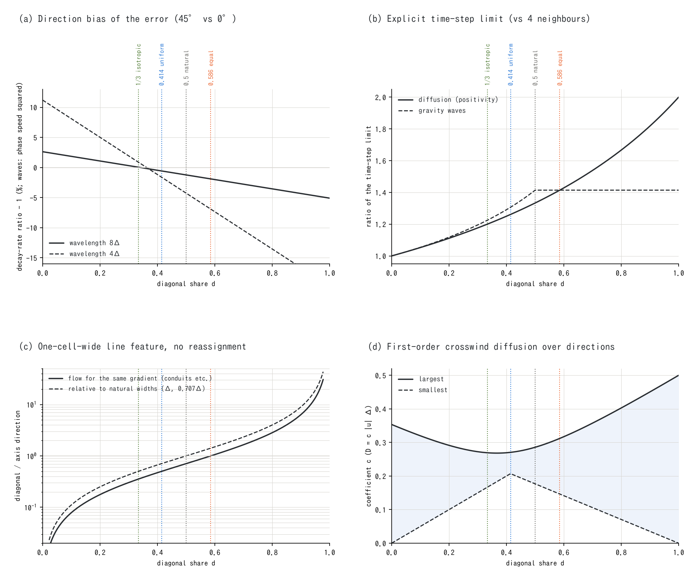

# Choosing the diagonal share d -- criteria for distributing the eight-direction passage widths, and the choice for each process (supplement)

> English mirror of docs/users_guide/diagratio.md. The Japanese file is the master copy.

[Back to the user's guide index](../users_guide.md) | [ENC grid and time integration](encgrid.md) | [Passage-width adjustment](passage_width.md) | [Numerical diffusion by diagonal-edge fluxes](diagonal_diffusion.md)

ENCflow exchanges water, sediment, groundwater and other quantities between a cell
and its eight neighbours. The share $`d`$ by which the middle $`(1 - d)`$ of each cell
face goes to the axis edge and the two ends of $`d/2`$ each are lent to the diagonal
edges that turn the corner appears not only as `p_diagratio` of the shallow water flow
but also as separate parameters of several processes. This page summarises what $`d`$
changes, which $`d`$ is best for each criterion, and which value each process uses
(and the recommended values).

## 1. Summary

- $`d`$ changes only the behaviour at the scale of the grid. For wavelengths well above
  the cell size every $`d`$ solves the same equation (the coefficient of the Laplacian
  is exactly 1).
- What changes is (1) the direction bias of the conveyance of one-cell-wide channels
  and conduits, (2) the direction bias of the discretisation error of diffusion and
  waves (isotropy), (3) the time-step limit of explicit schemes, and (4) the direction
  dependence of the crosswind numerical diffusion of first-order upwind. The best $`d`$
  differs between the criteria, and no value satisfies them all (§2).

  | Criterion | Best d |
  |---|---|
  | Without reassignment, a one-cell-wide line feature (a conduit, or a channel whose physical width does not depend on direction) has the same conveyance along an axis and a diagonal | $`2/(2+\sqrt2) \approx 0.586`$ (the eight passage widths are equal) |
  | The conveyance without reassignment is proportional to the natural width (axis Δ, diagonal 0.707Δ) | 0.5 |
  | The leading term of the discretisation error of diffusion and waves is isotropic | 1/3 |
  | The time-step limit of explicit gravity waves is largest | 0.5 or more |
  | The crosswind numerical diffusion of first-order upwind is the most uniform over directions | $`\sqrt2 - 1 \approx 0.414`$ |

- Values by process (§3): the shallow water flow keeps 0.586 (it is in the range of the
  largest time step, and the reassignment rules and the verification use this value).
  For processes that are pure diffusion (hillslope creep, the curvature of dry hillslope
  erosion, groundwater lateral flow) 1/3 is isotropic and recommended. The conduit layer,
  whose conduits follow the raster one cell wide, uses 0.586.
- The defaults rarely cause trouble. Change them when the direction bias of shapes close
  to the cell size (hills of a few cells, the drawdown cone of a well) matters (§4).

## 2. What d changes -- the best value for each criterion

*The diagonal share d and four properties (computed from closed forms). The dotted lines are 1/3 (isotropic), 0.414 (uniform crosswind numerical diffusion), 0.5 (proportional to the natural widths) and 0.586 (equal sides; the default of the shallow water flow). (a) The ratio of the decay rates at 45° and 0° for the same wavenumber, minus 1 (diffusion; for gravity waves the ratio of the squared phase speeds), (b) the time-step limit of explicit schemes (four-neighbour grid = 1), (c) the conveyance of a one-cell-wide line feature without reassignment, diagonal over axis (solid: the flow for the same gradient, dashed: the ratio to the natural widths), (d) the largest and smallest crosswind numerical diffusion coefficient of first-order upwind over the flow directions.*

### 2.1 Distribution of the passage widths

On square cells (cell size Δ) the passage width of an axis edge is $`(1 - d)\Delta`$ and that
of a diagonal edge is $`(d/2)\sqrt2\,\Delta`$ ([ENC grid](encgrid.md) §2,
[passage-width adjustment](passage_width.md) §2). The weights of a diffusive flux
(passage width / distance between centres) are $`(1 - d)`$ on the axes and $`d/2`$ on the
diagonals. For any $`d`$ the sum of the weights gives the coefficient 1 of the Laplacian,
so the behaviour at wavelengths well above the cell size does not depend on $`d`$.
$`d = 0`$ is the four-neighbour grid (the diagonal edges are not used).

### 2.2 Conveyance of one-cell-wide line features

In a channel or a conduit one cell wide with both sides blocked, only the axis edges
carry the flow when it runs along an axis, and only the diagonal edges when it runs
diagonally (a row of cells joined at their corners). Without reassignment the ratio of
the flows for the same gradient, diagonal over axis, is $`(d/\sqrt2)/(1 - d)`$, which is 1
at $`d = 2/(2+\sqrt2)`$ (the solid line in panel (c)). This is the value at which all eight
passage widths are equal (the virtual octagon is regular), and the default of the shallow
water flow is this value, for which the original paper of ENC[^tada26] took equal sides
of the octagon. For line features whose physical width or capacity does not depend on
their direction (conduits, channels narrower than the cell), this criterion -- the raw
conveyance does not depend on direction -- applies.

The natural conveyance of a channel that fills its cells is instead proportional to the
width of the passage (the natural width: Δ on the axes, 0.707Δ on the diagonals). The
value that makes the conveyance proportional to it is $`d = 0.5`$ (the dashed line in
panel (c)). At 0.586 the diagonal is favoured by a factor of 1.41, and at 1/3 the axis by
a factor of 2.

The shallow water flow and groundwater lateral flow, however, **reassign** the blocked
diagonal shares to the open directions (`f_opening_dynamic` of the shallow water flow,
`f_gw_opening` of groundwater, the reassignment next to walls of hillslope creep), and a
one-cell-wide channel blocked on both sides returns to its natural width for any $`d`$
([passage-width adjustment](passage_width.md) §4). This criterion matters for processes
without reassignment (the conduit layer) and at places that are only partly blocked.

### 2.3 Direction bias of the error (isotropy)

Both the diffusion term and the propagation of gravity waves are discretised by the
9-point Laplacian with these weights. The next term of the modified equation is
$`(\Delta^2/12)(f_{xxxx} + 6d\,f_{xxyy} + f_{yyyy})`$, which is proportional to
$`\nabla^4 f`$ and independent of direction when $`d = 1/3`$ (a stencil whose lowest-order
discretisation error is isotropic[^patra06]; that the partition rule of ENC gives
$`d = 1/3`$ is this guide's own derivation, developer.md §96, in Japanese). The ratio of the
decay rates at 45° and 0° for the same wavenumber (diffusion) is as follows; the direction
difference of the phase speed of gravity waves is about half of it.

| d | wavelength 16Δ | 8Δ | 4Δ |
|---|---:|---:|---:|
| 0 (four-neighbour 5-point) | +0.65 % | +2.62 % | +11.2 % |
| 1/3 | +0.00 % | +0.05 % | +0.89 % |
| 0.586 | −0.48 % | −1.89 % | −6.91 % |

The bias with the grid direction has also been measured. On a hill with σ = 2Δ, the
difference between the cells towards an axis and towards a diagonal at the same distance
from the centre (r² = 50) is −1.92 % for the 5-point stencil, −0.03 % for 1/3 and +1.46 % for
0.586 with hillslope creep ([test/stencil9](../../../test/stencil9/en/README.md)), −1.77 %,
+0.01 % and +1.42 % for a groundwater mound, and −1.1 to −0.6 %, 0.02 % or less, and +0.8 to
+0.5 % for the drawdown cone of a well (developer.md §98, in Japanese). 0.586 leaves 70–80 %
of the bias of the 5-point stencil, in the opposite direction.

The error of the phase speed of gravity waves itself (−2.6 % for a wavelength of 8Δ along a
grid axis, independent of $`d`$) is larger than the direction difference, so for waves
refining the grid helps more than changing $`d`$.

### 2.4 Time step of explicit schemes

The time-step limit that keeps an explicit diffusion scheme positive is
$`\Delta^2/(D(4 - 2d))`$, which is 1.2 times (1/3) or 1.41 times (0.586) that of the
four-neighbour grid (0.25 Δ²/D). The limit for gravity waves is largest for $`d \ge 0.5`$
(1.41 times the four-neighbour grid) and 0.87 times that at 1/3 (panel (b)). Eight
neighbours double the number of edges per update, so the cost of diffusion relative to
the four-neighbour grid is 1.67 times at 1/3 and 1.41 times at 0.586.

### 2.5 Crosswind numerical diffusion of first-order upwind

Transport by first-order upwind causes numerical diffusion across the flow
([numerical diffusion by diagonal-edge fluxes](diagonal_diffusion.md) §2.3). Weighting the
contributions of the family of axis edges and the family of diagonal edges by their
shares gives
$`D_\perp = [(1 - d)F(\varphi) + d\sqrt2\,F(\varphi - 45°)]\,u\Delta`$
($`F`$ is the coefficient of four-neighbour first-order upwind and $`\varphi`$ the flow
direction), which reproduces the table measured at $`d = 0.586`$. The largest and smallest
values over the flow directions are 0.146–0.312 (a factor of 2.1) at 0.586, 0.167–0.269
(1.6) at 1/3 and 0.207–0.271 (1.3) at 0.414 (panel (d)). With the default for surface
scalars (link-wise MUSCL) this leading term vanishes, so the effect on the results of the
shallow water flow is small.

## 3. d for each process

| Process | Parameter | Default | Recommended | Reason |
|---|---|---|---|---|
| Shallow water flow | `p_diagratio` | 0.586 | 0.586 (no need to change) | In the range of the largest gravity-wave time step. The reassignment rules and the verification of all tests and examples use this value. The advantage of 1/3 (isotropy of short waves) is smaller than the phase error itself |
| Distribution of bedload | `fluv_diagratio` | 0.586 | same as `p_diagratio` | Uses the reassignment table of the water as it is (a different value gives 2.41 times the bedload capacity in a one-cell-wide channel; [passage-width adjustment](passage_width.md) §7) |
| Bed sliding | `bs_diagratio` | 0.5858 | same as `p_diagratio` | The same "projected velocity × passage width" distribution as the ENC core. 0 is for comparison with analytical solutions |
| Hillslope creep | `creep_diagratio` | 1/3 | 1/3 | A pure diffusion process, so isotropy is the criterion. With reassignment next to walls. Changed from 0 (four-neighbour 5-point) on 2026-11-05 |
| Curvature of dry hillslope erosion | `spl_diagratio` | 1/3 | 1/3 | The curvature is the local value of a Laplacian, so isotropy is the criterion. Changed from 0 (5-point) on 2026-11-05 |
| Groundwater lateral flow (soil layer, layer 2) | `gw_diagratio` | 1/3 | 1/3 | A pure diffusion process (the measurements of §2.3). In exchange the time-step limit of the explicit scheme drops by 15 %, and the cap of the river-bed exchange (`f_gwbed`) drops by 8 % for a one-cell-wide channel. Changed from 0.586 on 2026-11-05 |
| Saltwater zone of the two-layer fresh/salt model | `salt_diagratio` | 1/3 | same as `gw_diagratio` | It shares the passage widths with the soil lateral flow (a different value stops the run) |
| Conduit layer | `gwc_diagratio` | 0.586 | 0.586 | The capacity of a conduit following the raster one cell wide does not depend on its direction (§2.2). The conduit layer has no reassignment. Independent of the d of the lateral flow |
| Flow of glaciers and lava | `gl_diagratio`, `lv_diagratio` | 1/3 | 1/3 | Processes flowing in valleys, where both the conveyance and the isotropy matter. The blocked diagonal shares are reassigned according to the thickness of the flow, so d can be chosen for isotropy while the conveyance of valleys along a grid axis is kept (with 1/3 a diagonal valley one cell wide has the same conveyance too; [Lava flows](lavaflow.md), developer.md §99, in Japanese). Changed from 0 (four neighbours) on 2026-11-05 |

## 4. How to use

- Normally keep the defaults. The references of the tests, the results of the examples
  and existing calibrations depend on the default values.
- For hillslope creep and the curvature of dry hillslope erosion, the defaults
  `creep_diagratio` and `spl_diagratio` = 1/3 nearly remove the bias with the grid direction
  ([sediment transport and landform change](sediment.md) §2 and §6). To reproduce the
  5-point results from before 2026-11-05, set them to 0.
- For the groundwater lateral flow, the default `gw_diagratio` = 1/3 makes shapes at the scale
  of the grid such as the drawdown cone of a well or a recharge mound isotropic too (from
  2026-11-05). To reproduce results with the earlier default 2/(2+√2), set 0.5857864, and in
  runs that use `salt_diagratio` give it the same value. The time-step limit of the explicit
  scheme is 15 % below that of 2/(2+√2) (the line `gwflow_lateral: dt limit` printed at
  initialisation).
- For glaciers and lava, the defaults `gl_diagratio` and `lv_diagratio` = 1/3 make flows
  down narrow valleys oblique to the grid independent of the valley orientation (with 0 on
  four neighbours, a diagonal valley one cell wide does not flow, and a band of three
  diagonal lines has 2/3 of the conveyance; the computation takes a little over 10 % longer
  than on four neighbours). To reproduce the four-neighbour results from before 2026-11-05,
  set them to 0.
- Some values go in pairs: `fluv_diagratio` and `bs_diagratio` take the same value as
  `p_diagratio`, and `salt_diagratio` the same value as `gw_diagratio`. `gwc_diagratio` of
  the conduit layer is independent.
- About the only reason to change `p_diagratio` of the shallow water flow is a comparison
  with the four-neighbour grid (0) ([passage-width adjustment](passage_width.md) §8.1).

## 5. What it cannot do, and the limits of accuracy

- What becomes isotropic at 1/3 is the leading error term of a linear diffusion operator
  with constant coefficients. Whether the same holds for nonlinear flows such as the flow
  law of glaciers or the yield stress of lava, and at fronts where the thickness goes to 0,
  has been checked only as far as the shape at rest of a dome and the sectors of the Halfar
  dome go (about the same as on four neighbours or slightly better; developer.md §99).
- The reassignment for glaciers and lava flows gives slightly too much conveyance at the
  edges of a band oblique to the grid (+6.5 % for a band of three lines, +4.0 % for five;
  from the same rule as the dynamic reassignment of surface water).
- What becomes isotropic is the direction of the error, not its size. On a well-resolved
  hill the 9-point stencil can give a larger error at the centre
  ([test/stencil9](../../../test/stencil9/en/README.md)).
- The crosswind numerical diffusion of §2.5 for values other than 0.586 is computed from the
  formula that reproduces the table measured at 0.586. The only measurement at another value
  is the first-order upwind lava temperature at $`d = 1/3`$ (0.167 at 0° and 0.238 at 45°,
  against 0.167 and 0.236 from the formula; [test/lava](../../../test/lava/en/README.md)
  configuration 10d); it has not been measured for surface scalars.
- Reassignment returns the conveyance to the natural width where both sides are blocked,
  but the conveyance at partly blocked places depends on $`d`$ and on how the blockage is
  measured ([passage-width adjustment](passage_width.md) §5).

## 6. Verification and where the records are

| Case or record | Content |
|---|---|
| [test/stencil9](../../../test/stencil9/en/README.md) | Isotropy of 9-point hillslope creep and curvature, reassignment next to walls (d = 0 and 1/3) |
| [test/conduit](../../../test/conduit/en/README.md) schematic experiment C | Changing the d of the soil lateral flow does not change the passage widths of the conduit layer |
| [test/salt](../../../test/salt/en/README.md) `Run_sea.sh` | A mismatch between `salt_diagratio` and `gw_diagratio` stops the run |
| developer.md §96 (in Japanese) | Analysis of the isotropy of the 5-point and 9-point stencils (the derivation of d = 1/3), the implementation for hillslope creep and curvature |
| developer.md §98 (in Japanese) | Measurement of the isotropy of groundwater lateral flow, the passage widths shared by layers, why the conduit layer uses 0.586, the effect of d = 1/3 |
| [Numerical diffusion by diagonal-edge fluxes](diagonal_diffusion.md) | Direction dependence of the crosswind numerical diffusion (measured at d = 0.586) |
| [Passage-width adjustment](passage_width.md) | The reassignment rules and how the default of `f_opening_dynamic` came to be 3 |

## References

[^tada26]: Tada, T. (2026): An eight-neighborhood connected collocated grid scheme for overland flow simulation. *Hydrological Research Letters*, 20(2), 113–118. doi:10.3178/hrl.25-00052. (The original paper of the ENC grid: eight-neighbourhood connected collocated grid and the split of passage widths.)
[^patra06]: Patra, M. and Karttunen, M. (2006): Stencils with isotropic discretization error for differential operators. *Numer. Methods Partial Differ. Equ.*, 22(4), 936–953. doi:10.1002/num.20129 (stencils whose lowest-order discretisation error is isotropic; checked against the bibliographic record and abstract)
