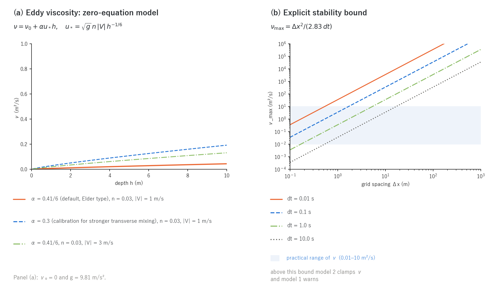
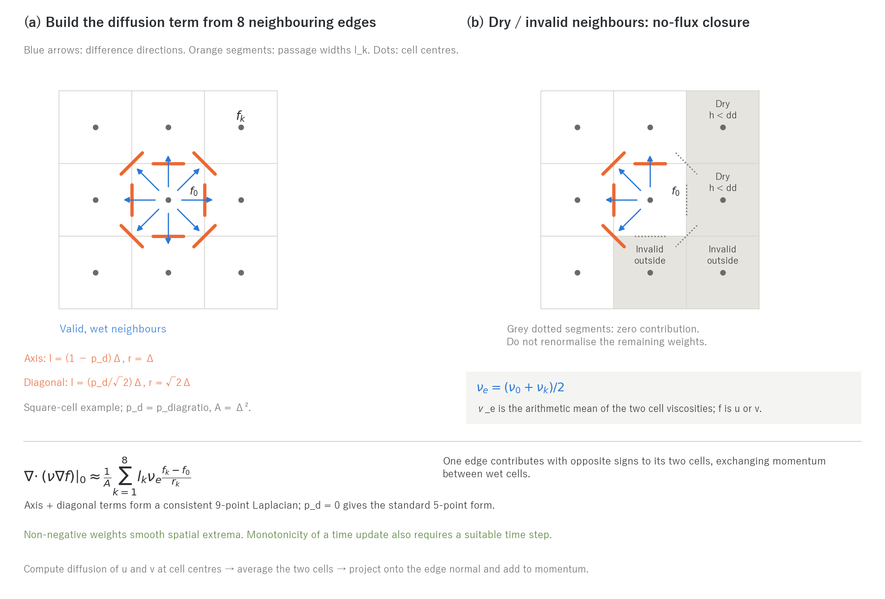

# The diffusion term of the momentum equation (supplement to the shallow water chapter)

> English mirror of docs/users_guide/diffusion.md. The Japanese file is the master copy.

[Back to the shallow water chapter](swflow.md) / [Back to the user's guide index](../users_guide.md)

This page explains the diffusion term that can be added to the momentum
equation of the shallow water computation (horizontal diffusion of momentum
by an eddy viscosity). It gives the equations, the eddy-viscosity models,
the discretisation and the stability condition behind `f_diffusion_term`,
`p_diffusion_nu` and `p_diffusion_alpha` of the
[shallow water chapter](swflow.md), in enough detail to understand what the
settings mean. The design history and the verification record (for
developers) are in docs/developer.md §20 (in Japanese).

Equations are written in the LaTeX notation that GitHub Markdown renders.
The figures are generated by `python3 docs/figs/make_guide_figs.py diffusion`
(`docs/figs/guide/fig_diffusion.py`), as PNG and SVG in Japanese and English.

## 1. Equations and the role of the diffusion term

A diffusion term representing the horizontal exchange of momentum by
turbulence is added to the depth-averaged momentum equation
($`\mathbf{u} = (u, v)`$: depth-averaged velocity, $`\nu`$: eddy viscosity
in m²/s).

```math
\frac{\partial \mathbf{u}}{\partial t}
+ (\mathbf{u}\cdot\nabla)\,\mathbf{u}
= -\,g\,\nabla(z + h)
\;-\;\frac{g\,n^2\,|\mathbf{u}|}{h^{4/3}}\,\mathbf{u}
\;+\;\underbrace{\nabla\cdot\bigl(\nu\,\nabla\mathbf{u}\bigr)}_{\text{diffusion}}
```

The term represents the momentum carried by eddies the grid cannot resolve
(turbulence) as a "viscosity" proportional to the second derivative of the
velocity. It only acts to even out spatial differences in velocity
(dissipating energy); it never drives the flow. It matters where the
velocity gradients are large:

- the transverse velocity distribution in a channel (the smooth transition
  between the slow water near the banks and the fast core),
- circulation in bays and reservoirs, momentum seeping into dead zones,
- separation zones behind sudden contractions, expansions and structures.

In rainfall runoff, flood inundation and tsunami propagation the friction
and pressure terms dominate, the contribution of diffusion is small, and
the term is off by default (when off no array is allocated and nothing is
computed, so the results are bitwise identical to before).

ENCflow's policy limits the horizontal processes to "the shallow water
equations plus one-equation diffusion" (developer.md §0). This term is an
additive option superposed independently of the advection and pressure
terms; `f_diffusion_term` alone enables it.

**It is not needed for numerical stability.** The advection term of the
ENC grid (the default momentum-conservative scheme with MUSCL;
[Advection schemes](advection.md)) is stabilised by the upwinding of its
limiter, so there is no need to add diffusion to suppress oscillations.
If oscillations or a blow-up occur, look first at the time step, the
advection scheme and the wet/dry protections.

## 2. Eddy-viscosity models (`f_diffusion_term`)



**Figure: eddy viscosity and explicit stability bound.** (a) Zero-equation model examples with background viscosity ν₀ = 0 and gravity g = 9.81 m/s². (b) The bound for square cells and the default p_diagratio, using the approximate coefficient 2.83, on logarithmic axes. The pale-blue band marks 0.01–10 m²/s. Model 1 warns when the bound is exceeded; model 2 clamps. See §5 for the treatment when breaking viscosity is added.

[SVG](../../figs/diffusion_nu_en.svg)

**Model 1: constant viscosity.** $`\nu = \nu_0`$ (`p_diffusion_nu`; a
positive value must be given explicitly, otherwise the initialisation
stops with an error). It depends on the grid spacing and the scale of the
flow, has no universal recommended value, and is treated as a calibration
quantity.

**Model 2: zero-equation model (Elder type).** The turbulence intensity is
derived from the bed friction. From the Manning bed shear stress
$`\tau_b/\rho = g\,n^2\,|\mathbf{u}|^2 / h^{1/3}`$ the friction velocity
$`u_* = \sqrt{\tau_b/\rho}`$ is formed, and the depth-averaged eddy
viscosity is taken proportional to $`u_* h`$.

```math
\nu = \nu_0 + \alpha\,u_*\,h,
\qquad
u_* = \sqrt{g}\;n\;|\mathbf{u}|\;h^{-1/6}
\;\;\Longrightarrow\;\;
\nu = \nu_0 + \alpha\sqrt{g}\;n\;|\mathbf{u}|\;h^{5/6}
```

$`n`$ is the Manning roughness of each cell (`fn_rn` or `rn0`;
[Geographic information](geoinfo.md)), $`|\mathbf{u}|`$ the magnitude of
the cell velocity and $`h`$ the depth. The default of the coefficient
$`\alpha`$ (`p_diffusion_alpha`), $`\kappa/6 = 0.41/6 \approx 0.068`$, is
the value of Elder (1959) obtained by depth-averaging the logarithmic
velocity profile with a parabolic eddy-viscosity distribution, the same
convention as the zero-equation models of iRIC Nays2DH and others. To
represent transverse mixing more strongly, calibrate within the measured
range from $`0.15\,u_* h`$ in straight flumes to $`0.4`$–$`0.8\,u_* h`$ in
natural rivers (Fischer et al. 1979). $`\nu_0`$ (`p_diffusion_nu`) is an
additive background viscosity, default 0 (a pure zero-equation model); use
it where $`\nu`$ should not vanish in quiescent regions, such as bay
circulation. With roughness $`n = 0`$ the $`\alpha`$ term is identically 0.

Figure (a) shows typical values. With $`n = 0.03`$ and
$`|\mathbf{u}| = 1`$ m/s, $`\nu \approx 0.006`$ m²/s at $`h = 1`$ m and
$`0.025`$ m²/s at $`h = 5`$ m; even with 3 m/s and $`\alpha = 0.3`$ it stays
below 1 m²/s. To "just try the diffusion term", model 2 is recommended: it
scales with the flow without any coefficient being specified.

## 3. Discretisation: a nine-point Laplacian in edge-flux divergence form



**Figure: eight-neighbour diffusion stencil and no-flux closure.** Square-cell examples: blue arrows indicate difference directions and orange segments passage widths. Grey dotted segments in (b) contribute zero for dry or invalid neighbours; the remaining weights are not renormalised. Edge viscosity is the arithmetic mean of the two cell values. Subscript 0 in this figure denotes the central cell. Non-negative spatial weights and the stability condition for a time update (§4) are separate requirements.

[SVG](../../figs/diffusion_stencil_en.svg)

The diffusion term of cell $`0`$ is evaluated in finite-volume form as the
divergence over the cell area $`A = \Delta x\,\Delta y`$ of the diffusive
fluxes (two-point gradient × passage width) across the edges to the eight
neighbours $`k`$ (figure (a)).

```math
\left.\nabla\cdot(\nu\nabla f)\right|_0
\approx \frac{1}{A}\sum_{k=1}^{8} l_k\;\nu_e\;\frac{f_k - f_0}{r_k},
\qquad
\nu_e = \frac{\nu_0 + \nu_k}{2}
```

$`l_k`$ is the passage width of edge $`k`$ (the same share as the mass flux
of the continuity equation: $`(1 - p_d)\Delta`$ on the axes,
$`(p_d/\sqrt 2)\,\Delta`$ on the diagonals, with $`p_d`$ = `p_diagratio`,
for square cells) and $`r_k`$ the distance between cell centres
($`\Delta`$ on the axes, $`\sqrt 2\,\Delta`$ on the diagonals). This set of
weights has the following properties.

- **A consistent nine-point Laplacian.** Using
  $`f_k + f_{9-k} - 2f_0 = r_k^2\,\partial^2 f/\partial s_k^2 + O(r^4)`$ for
  each pair of opposite neighbours $`(k, 9-k)`$, the two axis pairs
  contribute $`(1 - p_d)`$ to $`f_{xx}`$ and $`f_{yy}`$ each, the two
  diagonal pairs contribute $`p_d`$ (the cross term $`f_{xy}`$ cancels
  between the two diagonals), and **the sum of the coefficients is exactly
  1 whatever $`p_d`$ is**. The same holds for $`\Delta x \ne \Delta y`$
  (proof in developer.md §20). For constant $`\nu`$ it reduces exactly to
  $`\nu\nabla^2 f`$, and $`p_d = 0`$ gives the ordinary five-point
  Laplacian.
- **Conservative.** The flux across one edge has opposite signs in the two
  cells, so diffusion never changes the total momentum (also with variable
  coefficients).
- **Monotone.** Non-negative spatial weights act to lower maxima and raise
  minima. Avoiding new extrema in an explicit time update also requires a
  suitable time step (§4).

The same weights $`l_k/(A\,r_k)`$ are used for the discrete Laplacian of the
potential equation of the [non-hydrostatic correction](nonhydrostatic.md).

**Dry and invalid neighbours (figure (b)).** If a neighbouring cell is
invalid (outside the domain or the mask) or below the moving threshold
($`h < dd`$), that edge is dropped from the sum and **the remaining weights
are not renormalised**. In finite-volume form a dropped edge is a zero
diffusive flux (no-flux closure), which is physically correct and
conservative (in contrast to the cell-centre gradient $`\nabla u`$, which
is normalised with the remaining weights). The cell-centre diffusion term
is not computed in sea-mask cells (`sw > 0`). The zero-equation model
(model 2) sets their $`\nu = 0`$; the constant model (model 1) retains its
uniform viscosity field.

**Insertion into the momentum equation.** At the start of the step
$`\mathbf{T}^d_0 = \bigl(\nabla\cdot(\nu\nabla u),\;\nabla\cdot(\nu\nabla v)\bigr)_0`$
is precomputed at the cell centres; on each edge the mean of the two cells
is projected onto the normal and added to the advection term (the same
projection as scheme 1 of the [advection schemes](advection.md)).

```math
D_e = \tfrac{1}{2}\bigl(\mathbf{T}^d_c + \mathbf{T}^d_n\bigr)\cdot\mathbf{n}_k,
\qquad
u_e^{\,n+1} = \frac{u_e^{\,n} + \left(A_e + D_e + G_e\right)\Delta t}{1 - F_e\,\Delta t}
```

Being a viscous force, the diffusion term is not multiplied by the
effective inertia coefficient $`\ell_m`$ derived from the building porosity
(the advection term is, as a transport term); like the gravity term it is
subject to the damping by the added mass. In parallel runs
$`\mathbf{T}^d`$ is recomputed on the halo rows and the $`\nu`$ field of
model 2 is built out to a halo width of 2, so nothing is added to the halo
exchange at the start of the step.

## 4. Stability condition

The diffusion term is advanced explicitly, so the time step has an upper
bound. From a Gershgorin estimate

```math
\nu \;\le\; \nu_{\max} = \frac{1}{\Delta t\,\displaystyle\sum_{k=1}^{8}\frac{l_k}{A\,r_k}}
= \frac{\Delta x^2}{(4 - 2p_d)\,\Delta t}
\;\approx\;\frac{\Delta x^2}{2.83\,\Delta t}
\quad(\text{square cells, default } p_d)
```

For the five-point Laplacian ($`p_d = 0`$) it is $`\Delta x^2/(4\Delta t)`$.
As panel (b) of the eddy-viscosity and stability-bound figure shows, on inundation grids ($`\Delta x`$ = 10–100 m,
$`\Delta t`$ = 0.1–1 s) $`\nu_{\max}`$ is large, $`10^2`$–$`10^4`$ m²/s, and
for practical $`\nu`$ (0.01–10 m²/s) the gravity-wave CFL condition binds
first. On fine grids (for example $`\Delta x`$ = 0.25 m, $`\Delta t`$ = 0.02 s,
$`\nu_{\max} \approx 1.1`$ m²/s) the breaking eddy viscosity (§5) can reach
the bound.

- Model 1 prints a warning at initialisation if $`\nu_0 > \nu_{\max}`$ (it
  does not stop; a blow-up is caught by the velocity limit check of the
  momentum equation).
- Model 2, whose $`\nu`$ varies in space and time, clamps $`\nu`$ at
  $`\nu_{\max}`$ cell by cell and prints a warning the first time only.

## 5. Shared use with the breaking eddy viscosity

The eddy viscosity `nh_break_visc` used with the breaking switch of the
[non-hydrostatic correction](nonhydrostatic.md) adds $`\nu_b`$ of the cells
detected as breaking to the $`\nu`$ of this diffusion term
($`\nu = \nu_{\rm model} + \nu_b`$) and dissipates through the same path.
Even with `f_diffusion_term = 0` the diffusion term is computed when
`nh_break_visc > 0`. The clamp and warning are those of §4.

## 6. Where to use it, and cautions

| Purpose | Setting | Notes |
|---|---|---|
| smooth the transverse velocity distribution of low or gentle river flow | `f_diffusion_term = 2` (no coefficient) | recommendation by pattern in the [shallow water chapter](swflow.md); the roughness $`n`$ sets the size of $`\nu`$ |
| circulation in bays and reservoirs | `f_diffusion_term = 2` + `p_diffusion_nu` (a small $`\nu_0`$) | keeps $`\nu`$ from vanishing in quiescent regions |
| match a constant viscosity of another model for comparison | `f_diffusion_term = 1` + `p_diffusion_nu` | a grid-dependent calibration quantity; check the bound of §4 |
| run-up of breaking waves | `nh_break_visc` (§5) | non-hydrostatic chapter |

- Mass is conserved bitwise with or without the diffusion term (it acts on
  the momentum equation only). The symmetry of symmetric problems is also
  preserved.
- The diffusion term flattens velocity peaks and delays arrival. It is
  distinct from the numerical smearing of advection scheme 1 (the former
  default); combined, they smear twice.
- With a finer grid more eddies are resolved and the effective mixing for
  the same $`\nu`$ changes. It is safer to recalibrate $`\alpha`$ of model 2
  for each grid spacing.
- Where a channel is 1–2 cells wide the transverse gradient is set by the
  cell width, so the effect of the term is grid dependent. Use at least about
  10 cells across the channel when the transverse velocity distribution is
  the subject.

## 7. Verification and related cases

- [test/diffusion](../../../test/diffusion/README.md) -- **the analytical
  benchmark of the diffusion term**. A Gaussian jet uniform in $`x`$,
  $`u(y) = U_0\exp(-(y - y_c)^2/2\sigma^2)`$, in a flat frictionless channel
  diffuses for 12.5 s with constant $`\nu`$ = 4 m²/s and is compared with
  the analytical solution $`u = U_0\,\sigma/\sqrt{\sigma^2 + 2\nu t}\,\exp(-r^2/2(\sigma^2 + 2\nu t))`$.
  The maximum error is 0.14% of $`U_0`$ ($`\Delta x`$ = 1 m) and 0.05%
  (0.5 m), in both cases the size of the smoothing $`(p_d/4)\Delta^2 u''`$
  of the cell-velocity reconstruction (the discretisation error of the
  diffusion term itself is smaller). Bitwise identical with 2 and 4 MPI
  ranks.
- The verification record of the implementation (developer.md §20):
  bitwise identity with every reference when off; bitwise identity across
  rank and thread counts for model 1 ($`\nu_0`$ = 0.1 m²/s) and model 2
  ($`n`$ = 0.02, default $`\alpha`$) in [test/wave](../../../test/wave/README.md)
  and for model 2 in [test/chichibu](../../../test/chichibu/README.md);
  exact mass conservation; preservation of the four-fold symmetry of the
  circular initial surface; smoothing of the velocity and depth peaks.
- [test/creep](../../../test/creep/README.md) -- the hillslope creep of the
  morphological module (isotropic linear diffusion
  $`\partial z/\partial t = D\nabla^2 z`$) checked against the analytical
  solution of a Gaussian hill. An example of the explicit time-step
  condition of a diffusion equation and of diffusion creating no extremum
  (five-point Laplacian; the nine-point weights of this page with the
  diagonal shares set to 0).
- [test/nhbreak](../../../test/nhbreak/README.md) -- shows the breaking eddy
  viscosity `nh_break_visc` lowering the run-up through this diffusion term
  (§5).
- `param_ls_bd.txt` of [test/nhbottom](../../../test/nhbottom/README.md) --
  a trial adding a constant viscosity $`\nu`$ = 0.3 m²/s to a submarine
  landslide tsunami (confirms that the self-excited oscillation at the foot
  of the slope is not damped by momentum diffusion).
- [examples/List_samples/list_enc.txt](../../../examples/List_samples/en/list_enc.txt) --
  annotated list of every `&list_enc` parameter with its default.

The READMEs of the test cases are in Japanese.

## References

- Elder, J. W. (1959): The dispersion of marked fluid in turbulent shear
  flow. *J. Fluid Mech.*, 5, 544–560 (depth-averaged eddy viscosity
  $`\kappa u_* h/6`$).
- Fischer, H. B., List, E. J., Koh, R. C. Y., Imberger, J. and Brooks, N. H.
  (1979): *Mixing in Inland and Coastal Waters*. Academic Press (measured
  range of transverse mixing coefficients).
- Rodi, W. (1993): *Turbulence Models and Their Application in Hydraulics*,
  3rd ed. IAHR Monograph, Balkema (zero-equation and $`k`$–$`\varepsilon`$
  models in depth-averaged computations).
- Kennedy, A. B., Chen, Q., Kirby, J. T. and Dalrymple, R. A. (2000):
  Boussinesq modeling of wave transformation, breaking, and runup. I: 1D.
  *J. Waterw. Port Coast. Ocean Eng.*, 126, 39–47 (breaking eddy viscosity;
  §5).
