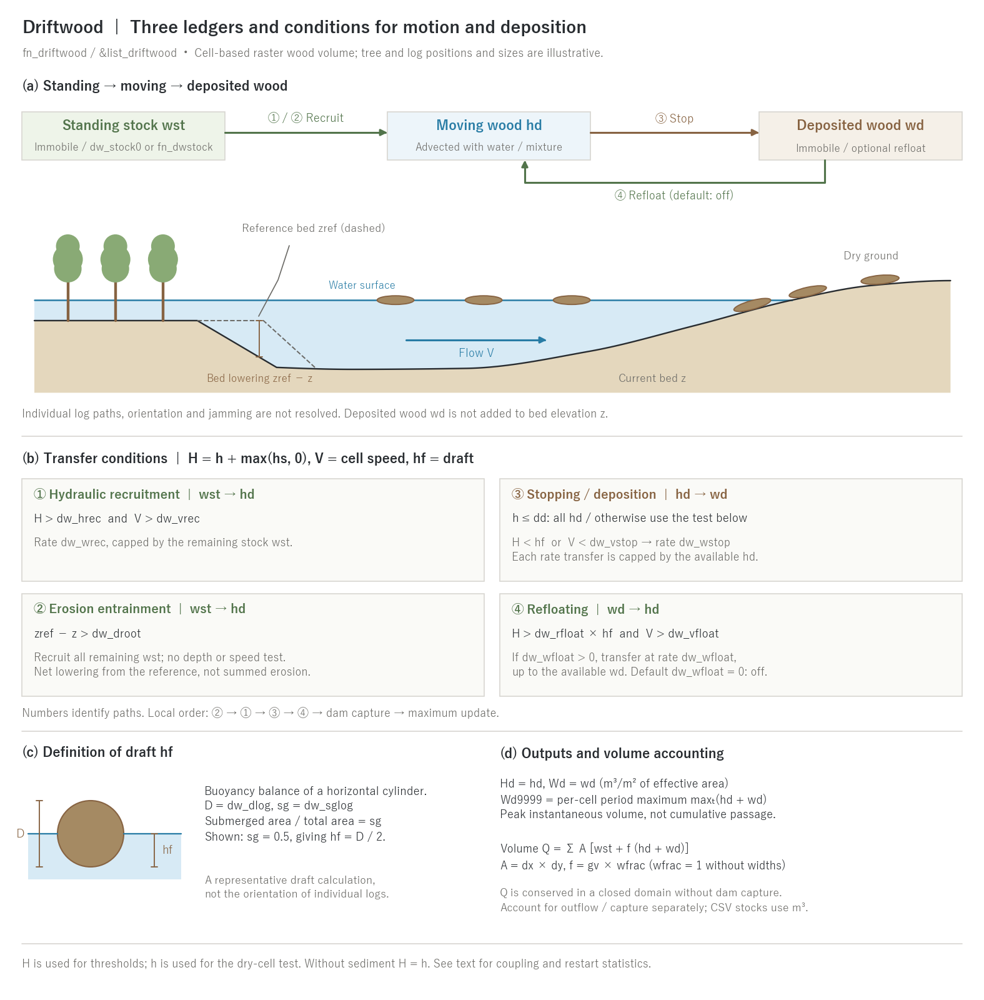

# Driftwood (fn_driftwood)

> English mirror of docs/users_guide/driftwood.md. The Japanese file is the master copy.

[Back to the user's guide index](../users_guide.md)

Estimates the generation, transport and deposition of **driftwood**
carried by floods, inundation and debris flows, as a **raster field**
of wood volume per unit area (m³/m²) in each cell. It is not an
individual-log tracking model (discrete element type); the purpose is a
map-scale potential assessment of "which standing trees become
driftwood, and where and how much of it arrives and deposits".

Wood is represented by three ledgers: **standing stock `wst`, moving wood
`hd`, and deposited wood `wd`**. Only `hd` is advected conservatively with
water (or the water–sediment mixture in debris flow); `wst` and `wd` are
immobile. Deposited volume `wd` is not added to bed elevation `z`.

- **① Hydraulic recruitment (`wst → hd`)**: recruit at rate `dw_wrec`
  when `H > dw_hrec` and `V > dw_vrec`.
- **② Erosion entrainment (`wst → hd`)**: recruit all remaining stock
  when `zref − z > dw_droot`. `zref` is the reference elevation at
  initialization (the saved value on restart); `z` is the current elevation.
  This tests **net lowering from the reference**, not the accumulated sum
  of erosion increments. It has no depth or speed test and does not
  distinguish which process lowered `z`.
- **③ Stopping / deposition (`hd → wd`)**: transfer all `hd` in dry cells
  (`h ≤ dd`). Otherwise, deposit at rate `dw_wstop` when `H < hf` or
  `V < dw_vstop`, where `hf` is the representative log draft.
- **④ Refloating (`wd → hd`)**: only if `dw_wfloat > 0`, transfer at rate
  `dw_wfloat` when `H > dw_rfloat × hf` and `V > dw_vfloat`.
  The default rate of zero disables refloating.

Here `H = h + max(hs, 0)` and `V` is the cell speed (`H = h` without
sediment). Each rate transfer in one step is capped by the remaining
amount of the source ledger, and the draft `hf` of the representative log
is derived automatically from the buoyancy balance of a cylinder of
diameter `dw_dlog` and specific gravity `dw_sglog` (half submerged for
sg = 0.5). Numbers identify paths in the figure; the local execution order
is **② → ① → ③ → ④ → dam capture → period-maximum update**. The transfer
rules, the draft, the area conversion and the basis of the defaults are in
[Driftwood models explained](driftwood_models.md).



(a) Immobile standing and deposited ledgers and the moving ledger carried
by the flow. The dashed bank is the reference bed; the solid line is the
current bed. Their elevation difference controls ②. (b) Conditions for
the four paths. (c) Draft `hf` is derived from `dw_dlog` and `dw_sglog` by
equating the submerged cross-sectional area fraction of a horizontal
cylinder to its specific gravity `sg`. The drawing shows half submergence
for `sg = 0.5`; in general, `hf` is not `sg × diameter`.
(d) Outputs and volume accounting with area conversion. The section, trees
and logs are illustrative, not computed results or individual trajectories.

How to read the results (fields, ledgers, measurement columns, restart) is summarized in [Output and monitoring](#output-and-monitoring) on this page.

## Enabling and configuration

Specify `fn_driftwood` in `&list_sysparam`.

**The minimum input to "just try moving driftwood" is an empty
`&list_driftwood`** (every item takes its default). A uniform standing
stock of 0.001 m³/m² is placed on land cells (the observed envelope of
generated driftwood in conifer torrents), and the log properties,
recruitment (both hydraulic washout and erosion entrainment) and
stopping run with their defaults. Adopted defaults are printed at
start-up as `driftwood: dw_hrec = 0.5000 m (default)`, so they cannot
go unnoticed; review them for your case (type-specific starting values
are in "Recommended values by pattern" at the end of this chapter; the
basis of the defaults is in [the explanation](driftwood_models.md) §5).

```
&list_driftwood
/
```

In practice give the stock map and the recruitment and stopping
parameters:

```
&list_driftwood
  dw_stock0 = 0.01          ! standing stock (m3/m2, uniform)
  dw_dlog = 0.3             ! representative log diameter (m)
  dw_sglog = 0.5            ! wood specific gravity (0-1; the draft is derived
                            !   automatically from the buoyancy balance)
  dw_wrec = 1.0e-5          ! hydraulic recruitment rate (m/s)
  dw_hrec = 0.5             ! depth threshold of recruitment (m)
  dw_vrec = 1.0             ! velocity threshold of recruitment (m/s)
  dw_droot = 0.5            ! rooting depth (m; erosion-entrainment threshold)
  dw_wstop = 0.01           ! grounding deposition rate (m/s)
/
```

## Parameters

| Parameter | Default | Meaning |
|---|---|---|
| f_dw | 1 | 0 disables temporarily while keeping the file |
| dw_stock0 | (0.001 on land cells) | uniform standing stock (m³/m²). Exclusive with fn_dwstock. **With neither given, 0.001 m³/m² is placed uniformly on land (non-sea) cells** |
| fn_dwstock | — | standing stock map (m³/m², same matrix format as the terrain) |
| dw_dlog | 0.3 | representative log diameter (m); the guide is the mean DBH of the standing trees upstream |
| dw_sglog | 0.5 | wood specific gravity ρwood/ρwater (0 < sg < 1). The draft is derived automatically from the cylinder buoyancy balance (sg=0.5 gives exactly half submergence = 0.5×dw_dlog) |
| dw_wrec | 1e-5 | hydraulic recruitment rate (m/s = m³/m²/s). Specifying it enables hydraulic recruitment. Thresholds and rate are calibration values (sensitivity analysis recommended) |
| dw_hrec | 0.5 | depth threshold of recruitment (m; tested with H = h + max(hs, 0)) |
| dw_vrec | 1.0 | velocity threshold of recruitment (m/s) |
| dw_droot | 0.5 | rooting depth (m). Specifying it enables erosion entrainment (all remaining stock when reference-to-current lowering zref − z > dw_droot) |
| dw_wstop | 0.01 | grounding deposition rate (m/s) |
| dw_vstop | 0 | velocity threshold of slow-flow deposition (m/s; 0 = depth (draft) criterion only) |
| dw_wfloat | 0 | refloat rate (m/s; 0 = deposited wood never moves again (conservative)) |
| dw_rfloat | 1.5 | refloat buoyancy margin (refloat when H > rfloat×draft and V > dw_vfloat; must be > 1) |
| dw_vfloat | — | velocity threshold of refloat (m/s; required with dw_wfloat > 0; must be >= dw_vstop) |

For the two recruitment paths (dw_wrec / dw_droot), **both take their
defaults when neither is given (erosion entrainment never fires unless
the terrain moves, so it is harmless), and giving only one disables the
other** (explicit intent is respected). Giving dw_wrec without
dw_hrec / dw_vrec takes the default thresholds.

## Recommended values by pattern

The defaults are a middle ground that "runs". When the type of event is
known, start from the following (calibration quantities; the sources of
the practical values are in [the explanation](driftwood_models.md) §4):

| Type | Recruitment | Stock and properties | Thresholds and rates | Stopping | Notes |
|---|---|---|---|---|---|
| Torrent debris flow with driftwood (sabo planning) | erosion entrainment (dw_droot 0.3-1.0 m) + hydraulic | conifer 1e-3, broadleaf 1e-4 m³/m² (observed envelopes); dw_dlog = mean DBH (0.2-0.4 m), sg 0.5 | dw_hrec 0.3-0.5 m, dw_vrec 1-2 m/s, dw_wrec 1e-5 | dw_wstop 0.01, dw_vstop 0.02-0.05 (stop at the slope break) | enable with f_debris; check with an outflow ratio of 0.8-0.9 |
| River flood through riparian forest / floodplain | hydraulic only | fn_dwstock on riparian strips (1e-3 to 1e-2); dlog 0.3, sg 0.5 | dw_hrec 1.0 m, dw_vrec 1.0-1.5 m/s, dw_wrec 1e-5 to 1e-4 | dw_wstop 0.01, dw_vstop 0.02 | add f_fluvial for root undercutting via erosion entrainment |
| Storm-surge log yard (Isewan-typhoon type) | hydraulic as "mooring loss" | 0.5 m³/m² on yard cells; dlog 0.6 (logs), sg 0.5 | dw_hrec = normal depth + 1 m, dw_vrec 0, dw_wrec 2e-4 (full release within the surge) | dw_wstop 0.005, dw_vstop 0.02 | example timberyard |
| Tsunami through coastal forest / log yard | as above | coastal forest 1e-3 to 1e-2, log yard 0.5-1.0 m³/m² | dw_hrec = normal depth + 1-2 m, dw_vrec 0, dw_wrec 5e-4 (within the surge) | dw_wstop 0.005, dw_vstop 0.05 | example tsunami_town (chain with house destruction) |
| Upper-bound reach (hazard map) | per case | as above | as above | dw_vstop 0, dw_wfloat 0 | use Wd9999; the remaining amount is sensitive to dw_vstop and dw_wfloat (timberyard README) |
| Trapping by works (two-case comparison) | per case | as above | as above | as above | difference of Wd9999 with and without dams, sand basins or culverts |

**Practical guidance** (from the Japanese sabo planning manual; sources
and conversion formulas in [the explanation](driftwood_models.md) §4):

- **dw_dlog**: the mean driftwood diameter is roughly the mean DBH of the
  standing trees upstream; survey DBH values can be used directly.
- **Standing stock**: single-tree volume × tree density, converted to
  m³/m² in preprocessing. Observed envelopes of generated driftwood in
  torrents are 0.001 m³/m² for conifer and 0.0001 m³/m² for broadleaf
  forests.
- **Validation metric**: without countermeasure works, 80–90 % of the
  generated driftwood reached the valley outlet (outflow ratio 0.8–0.9).
- Thresholds and rates of hydraulic recruitment (dw_wrec/hrec/vrec) are
  calibration parameters without a practical standard (sensitivity
  analysis recommended).

## Output and monitoring

The three ways a field gets written (automatic / flag / riding on a flag) and the area basis of column quantities are explained in [Input and output formats](io.md#how-state-variables-are-written); a reverse lookup from the quantity you want to the output is at the end of that section.

**Fields** (rasters in `result/`, every `dt_file`)

| File | How | Contents |
|---|---|---|
| Hd0001... | f_out_hd = 1 | moving driftwood `hd` (m³/m² per effective area) |
| Wd0001... | f_out_wd = 1 | deposited driftwood `wd` (m³/m² per effective area) |
| Wd9999 | f_out_wd = 1 | per-cell run maximum `maxₜ(hd + wd)` (the driftwood hazard map) |

`Wd9999` is the maximum of `hd + wd` after the local processes and the dam
capture of each step. It is neither the cumulative passing volume nor the
sum of the maxima of `hd` and `wd` taken at different times. The standing
stock `wst` is not written as a field.

**Ledgers and log** (budget checks)

- `result/driftwood.csv` records every `dt_recrd` the cumulative
  `rec_hyd_m3` (hydraulic recruitment), `rec_ero_m3` (erosion entrainment),
  `deposit_m3`, `refloat_m3` and `to_dam_m3` (dam capture), and the
  current stores `vol_stock_m3` (standing), `vol_float_m3` (moving) and
  `vol_deposit_m3` (deposited), all in m³ after the area conversion.
- Log.txt has no driftwood column.

**Measurements** (probe and transect columns)

- No driftwood column. Read point or section volumes from the same cell
  of `Hd0001...` or from the cumulative columns of `driftwood.csv`.

**Restart**

- Handled automatically by the private file `driftwood.dat` (fn_driftwood
  must have been enabled at save time).

**How to read and check**

- `wst` is per **geometric** cell area, `hd` and `wd` per the same
  **effective** area as the water. A plain sum `wst + hd + wd` closes only
  when the area factor is 1 (conversion in [the explanation](driftwood_models.md) §3).
- In a closed domain without dam capture the sum of the current stores
  `vol_stock + vol_float + vol_deposit` conserves the initial volume (up to
  numerical error). Driftwood that leaves into the sea cells of the sea
  mask (fn_sw) or through an edge boundary disappears outside the system
  and has no column in `driftwood.csv`, so obtain it as the residual
  initial volume − sum of the current stores − `to_dam_m3` (in the
  storm-surge timber-yard example the timber carried offshore leaves the
  system by this route). Recruitment, deposition and refloat are internal
  transfers; adding their cumulative values to the current stores
  double-counts.

## Combinations and restrictions

- ENC grid only. Cannot be combined with morphological acceleration
  (morfac ≠ 1) — driftwood is an event-scale quantity.
- Free to combine with [sediment and landform change](geomorph.md)
  (enable together with f_debris for mixed debris-flow-and-driftwood
  surges). Hydraulic recruitment also works without geomorph. Erosion
  entrainment does not trigger unless z falls below the reference level
  by more than the rooting threshold.
- Floating wood entering a **dam capture zone** is trapped by the dam
  (releases carry no wood). **Culverts and pumps** transfer water only,
  so wood accumulates upstream of such works (= upper-bound estimate of
  trapping; usable for with/without two-case comparisons in the same
  manner as [representing sabo facilities](geomorph.md)).
- Save/restore preserves `hd`, `wd`, `wst` and `zref` in
  `driftwood.dat`. **The `Wd9999` maximum and cumulative process volumes
  in the CSV are not restored**. Combine the separate run segments when
  evaluating statistics and budgets over the complete period.

## Verification cases

[test/driftwood](../../../test/driftwood/) checks volume conservation, transport and
deposition for both erosion entrainment and hydraulic recruitment, and compares
saved states from split and uninterrupted runs.

## Worked example: timber influx from a coastal log yard by storm surge

An idealized experiment of the Isewan-typhoon type — timber floating in
a coastal log storage yard is released by the storm-surge water-level
rise and carried into an urban area by the overtopping flow — is
included in [examples/timberyard](../../../examples/timberyard/)
(`python3 make_terrain.py && ./encflow param.txt`; about one minute).
Its [README](../../../examples/timberyard/README.md) (Japanese) explains
the key points of the setup (no sea mask for the log yard and harbor,
timber stock only in the yard cells via `fn_dwstock`, hydraulic
recruitment used as "mooring loss by the surge" with `dw_hrec` above
the normal yard depth, seawall and opening as terrain, buildings as
`fn_gv`), the results with figures and tables, how to use Wd9999 (the
per-cell period maximum of hd+wd) versus the final frame Wd9998, sensitivity
cases on the deposition parameters (`dw_vstop`, `dw_wfloat`), and the
postprocessing recipe for timber impact forces.

## What is not modeled

Trajectories, orientation and rotation of individual logs, geometric
jamming at bridge piers and slit dams (log length vs. opening width),
and impact forces are out of scope (an explicit limit of the raster
representation policy). To examine the **effect** of blockage, give it
as a scenario (narrowed openings or culverts) and compare two cases.
**Impact forces** are evaluated in postprocessing: feeding the maximum
velocity V9999 (or velocity frames) and the representative log properties
into the practical impact formula gives a standard-consistent impact-force
map (the source of the formula and the recipe are in
[the explanation](driftwood_models.md) §4 and the example README). Use
F9999 (= u²h) for the fluid force of the water itself. Implementation
details: developer.md §50 (Japanese).
