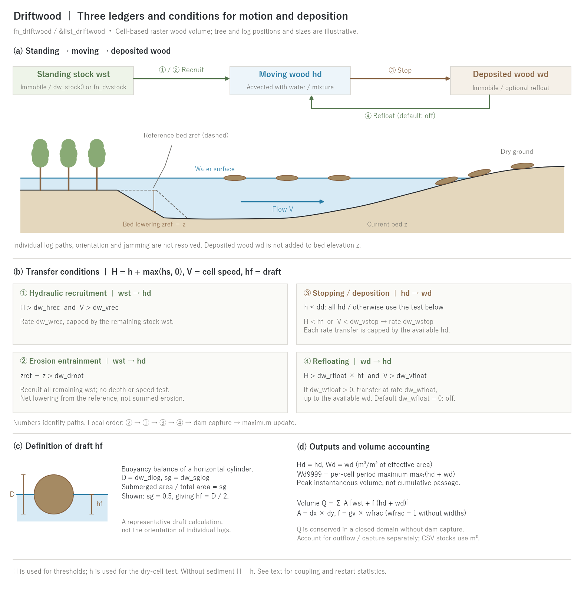

# Driftwood (fn_driftwood)

> English mirror of docs/users_guide/driftwood.md. The Japanese file is the master copy.

[Back to the user's guide index](../users_guide.md)

Estimates the generation, transport and deposition of **driftwood**
carried by floods, inundation and debris flows, as a **raster field**
of wood volume per unit area (m³/m²) in each cell. It is not an
individual-log tracking model (discrete element type); the purpose is a
map-scale potential assessment of "which standing trees become
driftwood, and where and how much of it arrives and deposits".

Wood is represented by three ledgers: **standing stock `wst`, moving wood
`hd`, and deposited wood `wd`**. Only `hd` is advected conservatively with
water (or the water–sediment mixture in debris flow); `wst` and `wd` are
immobile. Deposited volume `wd` is not added to bed elevation `z`.

- **① Hydraulic recruitment (`wst → hd`)**: recruit at rate `dw_wrec`
  when `H > dw_hrec` and `V > dw_vrec`.
- **② Erosion entrainment (`wst → hd`)**: recruit all remaining stock
  when `zref − z > dw_droot`. `zref` is the reference elevation at
  initialization (the saved value on restart); `z` is the current elevation.
  This tests **net lowering from the reference**, not the accumulated sum
  of erosion increments. It has no depth or speed test and does not
  distinguish which process lowered `z`.
- **③ Stopping / deposition (`hd → wd`)**: transfer all `hd` in dry cells
  (`h ≤ dd`). Otherwise, deposit at rate `dw_wstop` when `H < hf` or
  `V < dw_vstop`, where `hf` is the representative log draft.
- **④ Refloating (`wd → hd`)**: only if `dw_wfloat > 0`, transfer at rate
  `dw_wfloat` when `H > dw_rfloat × hf` and `V > dw_vfloat`.
  The default rate of zero disables refloating.

Here `H = h + max(hs, 0)` and `V` is the cell speed (`H = h` without
sediment). Each rate transfer in one step is capped by the remaining
amount of the source ledger, and the draft `hf` of the representative log
is derived automatically from the buoyancy balance of a cylinder of
diameter `dw_dlog` and specific gravity `dw_sglog` (half submerged for
sg = 0.5). Numbers identify paths in the figure; the local execution order
is **② → ① → ③ → ④ → dam capture → period-maximum update**. The transfer
rules, the draft, the area conversion and the basis of the defaults are in
[Driftwood models explained](driftwood_models.md).

Driftwood caught and piled up at structures such as bridges and open-type check dams, which
raises the water upstream, is handled by a fourth ledger, the **jammed wood `wj`**, which
works only when the map of the capture ratio `fn_dwtrap` is given (or when a
[culvert](structure.md) has `culv_jam = 1`)
([Capture and jamming at structures](#capture-and-jamming-at-structures-fn_dwtrap)). Without
either, driftwood does not act on the flow.



(a) Immobile standing and deposited ledgers and the moving ledger carried
by the flow. The dashed bank is the reference bed; the solid line is the
current bed. Their elevation difference controls ②. (b) Conditions for
the four paths. (c) Draft `hf` is derived from `dw_dlog` and `dw_sglog` by
equating the submerged cross-sectional area fraction of a horizontal
cylinder to its specific gravity `sg`. The drawing shows half submergence
for `sg = 0.5`; in general, `hf` is not `sg × diameter`.
(d) Outputs and volume accounting with area conversion. The section, trees
and logs are illustrative, not computed results or individual trajectories.

How to read the results (fields, ledgers, measurement columns, restart) is summarized in [Output and monitoring](#output-and-monitoring) on this page.

## Enabling and configuration

Specify `fn_driftwood` in `&list_sysparam`.

**The minimum input to "just try moving driftwood" is an empty
`&list_driftwood`** (every item takes its default). A uniform standing
stock of 0.001 m³/m² is placed on land cells (the observed envelope of
generated driftwood in conifer torrents), and the log properties,
recruitment (both hydraulic washout and erosion entrainment) and
stopping run with their defaults. Adopted defaults are printed at
start-up as `driftwood: dw_hrec = 0.5000 m (default)`, so they cannot
go unnoticed; review them for your case (type-specific starting values
are in "Recommended values by pattern" at the end of this chapter; the
basis of the defaults is in [the explanation](driftwood_models.md) §5).

```
&list_driftwood
/
```

In practice give the stock map and the recruitment and stopping
parameters:

```
&list_driftwood
  dw_stock0 = 0.01          ! standing stock (m3/m2, uniform)
  dw_dlog = 0.3             ! representative log diameter (m)
  dw_sglog = 0.5            ! wood specific gravity (0-1; the draft is derived
                            !   automatically from the buoyancy balance)
  dw_wrec = 1.0e-5          ! hydraulic recruitment rate (m/s)
  dw_hrec = 0.5             ! depth threshold of recruitment (m)
  dw_vrec = 1.0             ! velocity threshold of recruitment (m/s)
  dw_droot = 0.5            ! rooting depth (m; erosion-entrainment threshold)
  dw_wstop = 0.01           ! grounding deposition rate (m/s)
/
```

## Parameters

| Parameter | Default | Meaning |
|---|---|---|
| f_dw | 1 | 0 disables temporarily while keeping the file |
| dw_stock0 | (0.001 on land cells) | uniform standing stock (m³/m²). Exclusive with fn_dwstock. **With neither given, 0.001 m³/m² is placed uniformly on land (non-sea) cells** |
| fn_dwstock | — | standing stock map (m³/m², same matrix format as the terrain) |
| dw_dlog | 0.3 | representative log diameter (m); the guide is the mean DBH of the standing trees upstream |
| dw_sglog | 0.5 | wood specific gravity ρwood/ρwater (0 < sg < 1). The draft is derived automatically from the cylinder buoyancy balance (sg=0.5 gives exactly half submergence = 0.5×dw_dlog) |
| dw_wrec | 1e-5 | hydraulic recruitment rate (m/s = m³/m²/s). Specifying it enables hydraulic recruitment. Thresholds and rate are calibration values (sensitivity analysis recommended) |
| dw_hrec | 0.5 | depth threshold of recruitment (m; tested with H = h + max(hs, 0)) |
| dw_vrec | 1.0 | velocity threshold of recruitment (m/s) |
| dw_droot | 0.5 | rooting depth (m). Specifying it enables erosion entrainment (all remaining stock when reference-to-current lowering zref − z > dw_droot) |
| dw_wstop | 0.01 | grounding deposition rate (m/s) |
| dw_vstop | 0 | velocity threshold of slow-flow deposition (m/s; 0 = depth (draft) criterion only) |
| dw_wfloat | 0 | refloat rate (m/s; 0 = deposited wood never moves again (conservative)) |
| dw_rfloat | 1.5 | refloat buoyancy margin (refloat when H > rfloat×draft and V > dw_vfloat; must be > 1) |
| dw_vfloat | — | velocity threshold of refloat (m/s; required with dw_wfloat > 0; must be >= dw_vstop) |
| fn_dwtrap | — | map of the capture ratio E (0–1; same matrix format as the terrain; 0 = no capture). Giving it enables [capture and jamming at structures](#capture-and-jamming-at-structures-fn_dwtrap) |
| f_dwjam | 1 | effect of the jam on the flow. 0: ledger only (no effect on the flow), 1: drag in the cells holding the jam |
| dw_jamcd | 1.0 | drag coefficient C_D of the jam (calibration value) |
| dw_jamphi | 0.3 | packing ratio φ of the jam (solid volume / bulk volume; 0 < φ < 1; calibration value) |
| dw_jamgrow | — | cells whose jammed amount (m³/m²) reaches this capture all the wood; until then the capture ratio rises from E to 1 in proportion to the jammed amount (not given = the capture ratio stays constant) |

The jam at a culvert inlet is enabled per culvert by the selector `culv_jam`
(`&list_struct_culvert`; [Internal hydraulic structures](structure.md#culverts-list_struct_culvert)).

For the two recruitment paths (dw_wrec / dw_droot), **both take their
defaults when neither is given (erosion entrainment never fires unless
the terrain moves, so it is harmless), and giving only one disables the
other** (explicit intent is respected). Giving dw_wrec without
dw_hrec / dw_vrec takes the default thresholds.

## Capture and jamming at structures (fn_dwtrap)

Driftwood that is caught and piles up at bridges, open-type check dams and driftwood
catchers, obstructs the flow and raises the water upstream is estimated with **capture
cells** and the **ledger of jammed wood `wj`**. Whether a log gets caught is not judged;
the capture ratio is given by the user. Structures whose opening is narrower than a cell (the
outlet of a slit dam, a buried conduit or a sluice pipe represented by a culvert) are handled
not by capture cells but by `culv_jam = 1` of the culvert ("Jam at a culvert inlet" below).

- **⑤ Capture (`hd → wj`)**: in a cell with a capture ratio E (0–1), the share E of the
  moving driftwood passing through the cell is transferred to the jammed wood `wj`. `wj` does
  not move (it only grows).
- **Drag of the jam**: with `f_dwjam = 1` (default), the jam is treated as a porous
  obstruction and a drag is added on the edges of the cells that hold it. The more wood jams,
  the slower the flow and the higher the water upstream. With `f_dwjam = 0` the jam is a ledger
  only, and the flow equals that of a run without driftwood.

```
&list_driftwood
  fn_dwstock = 'stock.txt'
  dw_dlog = 0.3
  fn_dwtrap = 'trap.txt'    ! map of the capture ratio E (0.3 on the row of bridge cells, 0 elsewhere)
  dw_jamgrow = 0.09         ! the capture ratio rises as the jam grows; all arriving wood is stopped at 0.09 m3/m2 (one layer of logs) (optional)
/
```

**Where to put capture cells**

| Structure | Terrain and structures | Capture cells | Guide for the capture ratio |
|---|---|---|---|
| Bridge (channel resolved by cells, or with the channel width `fn_width`) | abutments, approach embankments and levees as terrain and levees; no deck | the row of cells crossing the channel at the bridge | given by the user (note below) |
| Grid-type (steel) open check dam, driftwood catcher | wings as terrain | the row of cells of the open part | close to 1, as these works are meant to stop driftwood (a given) |
| Slit dam (slit resolved by cells) | dam body as terrain, the slit as a gap of 1–2 cells | the slit cells | given by the user |
| Slit dam, culvert, sluice pipe (opening narrower than a cell) | dam body as terrain, the opening as a [culvert](structure.md) | not needed; the cell group on the side a culvert with `culv_jam = 1` is drawing from ("Jam at a culvert inlet" below) | all of it (fixed) |

- Connect the row of capture cells by four-neighbour links so that no diagonal path is left
  open (the same caution as for the capture zone of a dam). Capture ratios given on cells of
  the sea mask (`fn_sw`) and on cells outside the domain are not used.
- **The capture ratio E is a given.** E is "the share of the driftwood passing a capture cell
  once that is caught"; in reality it depends on the ratio of the log length to the opening
  width (bridge span, clear spacing of the dam members), the clearance below the deck and the
  flow speed. The module carries no log length, so E cannot be computed. Give it from
  observations or experimental knowledge, or show a range with several cases of E (for
  example 0.1, 0.3 and 1).
- `dw_jamgrow` approximates "once wood starts to pile up, the following logs get caught one
  after another". When it is given, the capture ratio rises in proportion to the jammed amount
  $`w_j`$ of the cell,

  ```math
  E_{\text{eff}} = E + (1 - E)\,\min\!\left(\frac{w_j}{w_{\text{full}}},\ 1\right),
  \qquad w_{\text{full}} = \texttt{dw\_jamgrow}
  ```

  and cells whose jammed amount has reached `dw_jamgrow` stop all arriving wood. The packing
  ratio times the representative diameter (`dw_jamphi` × `dw_dlog`; 0.09 m³/m² with the
  defaults) is a guide for the amount with which the jam covers the water surface with one
  layer of logs. How many layers it takes to stop everything is a given. Up to a few layers
  the result is close to "everything at once"; with ten layers or more it lies between that and
  a constant capture ratio (the comparison in
  [the example](../../../examples/bridge_wood_jam/en/README.md)). The functional form is
  ENCflow's own simplification; the log length and the remaining width of the opening are not
  considered.
- The resistance of the structure itself (piers, dam members) is given by the roughness
  `fn_rn`, the terrain and the channel width.

**Drag formula and coefficients**

On the edges of the cells holding the jam, a drag in the same semi-implicit form as the
friction is added:

```math
F_{\text{jam}} = -\,\kappa_0 \min\!\left(\frac{w_e}{h_f},\ \varphi\right)|\mathbf{V}|_e,
\qquad \kappa_0 = \frac{2\,C_D}{\pi\,d\,(1-\varphi)^3}
```

$`w_e`$ is the mean jammed wood of the two cells of the edge, $`h_f`$ the depth on the edge,
$`d`$ the representative diameter `dw_dlog`, $`\varphi`$ the packing ratio `dw_jamphi` and
$`C_D`$ the drag coefficient `dw_jamcd`. The $`\min`$ expresses that wood that does not fit in
the water column (piled above the surface) adds no drag. The derivation and the sources are in
[Driftwood models explained](driftwood_models.md) §6.

- The drag is set by the solid volume of the jam. For the same solid volume per unit channel
  width, the backwater is almost the same whether the wood sits in one cell or is split over
  two, and whatever the grid spacing.
- **The coefficients are calibration values.** φ acts through (1 − φ)³, so the sensitivity is
  large: φ = 0.2, 0.3, 0.4, 0.5 give κ₀ = 4.1, 6.2, 9.8, 17 m⁻¹ (d = 0.3 m, C_D = 1). Branches,
  leaves and fine organic matter filling the jam are reported to raise the loss greatly
  ([the explanation](driftwood_models.md) §6). Treat C_D and φ together as one calibration
  value. The defaults 1.0 and 0.3 are provisional, and the model has not yet been compared with
  measured backwater.
- Comparing three cases with the same settings — no driftwood, wood carried without acting on
  the flow (`f_dwjam = 0`) and a growing blockage (`f_dwjam = 1`) — isolates the effect of the
  blockage. The start time of the blockage, the water level upstream of the bridge and the
  discharge bypassing the bridge can be read from `driftwood.csv`, probes and transects.

**Jam at a culvert inlet (culv_jam)**

The opening of a [culvert](structure.md#culverts-list_struct_culvert) is narrower than a cell,
and the cell flow converging on the inlet is far slower than the flow inside the opening (in a
trial with a 10 m grid and a 1 m × 1 m opening, about 0.1 m/s on the cell edges against several
m/s inside the opening), so the cell drag above cannot express the blockage of the opening.
Setting `culv_jam = 1` on a culvert puts the loss of the wood piled up at its inlet into the
discharge law of the culvert.

```
&list_struct_culvert
  culv_in_cell(:,1,1)  = 150, 60
  culv_out_cell(:,1,1) = 152, 60
  culv_width(1)  = 1.0
  culv_height(1) = 1.0
  culv_zin(1)  = 12.50
  culv_zout(1) = 12.30
  culv_jam(1) = 1          ! put the loss of the wood jammed at the inlet into the discharge law (needs the driftwood module)
/
```

- **Capture**: a culvert passes no driftwood. The moving driftwood that reaches the cell group
  on the side a culvert with `culv_jam = 1` is drawing from (`culv_in_cell` in forward flow,
  `culv_out_cell` in reverse flow) is all transferred to the jammed wood `wj`. Nothing is
  captured while the culvert discharge is zero. `fn_dwtrap` is not needed (the two can be
  combined).
- **Loss**: from the solid volume $`V_j`$ (m³) of the jam in the cell group on the
  higher-water side, a loss coefficient on the velocity in the opening is formed,

  ```math
  C_A = 2\,\kappa_0\,\frac{V_j}{B\,D}
  ```

  ($`\kappa_0`$ as in the formula above, $`B`$ and $`D`$ the width and height of the section).
  The free-surface (weir) discharge is multiplied by $`(1 + C_A/3)^{-3/2}`$, and the full-pipe
  discharge follows the pipe formula with $`C_A`$ added to the sum of losses
  $`1 + c_e + f_L`$ (derivation in [the explanation](driftwood_models.md) §6; the formulation
  is ENCflow's own).
- **Order of magnitude** (default coefficients d = 0.3 m, φ = 0.3, C_D = 1; entrance loss
  c_e = 0.5; conduit length 0):

  | Opening B × D | Solid volume of the jam V_j | C_A | Weir discharge | Full-pipe discharge |
  |---|---:|---:|---:|---:|
  | 1 m × 1 m | 0.06 m³ | 0.74 | × 0.72 | × 0.82 |
  | 1 m × 1 m | 0.5 m³ | 6.2 | × 0.19 | × 0.44 |
  | 2 m × 2 m | 0.5 m³ | 1.5 | × 0.54 | × 0.70 |

  The loss is set by $`V_j/(B D)`$, so the smaller the opening, the less wood it takes to
  block it.
- With `f_dwjam = 0` the jam at the inlet is also a ledger only and does not enter the
  discharge law.
- The cell drag above also acts in the inlet cells, but the flow converging on the inlet is
  slow, so it has almost no effect.
- **Choose intake cells from which all the flow heads for the culvert** (just upstream of the
  outlet of a slit dam, the mouth of a conduit crossing a road embankment, and the like). All
  the wood that enters the intake cell group jams at the inlet, whatever share of the flow
  heads for the culvert. On a sluice pipe or an intake whose intake cells are cells of the
  main river channel, even the wood that only passes along the channel piles up at the inlet,
  and the blockage is overestimated.

**What it cannot do**

- Judging whether a log gets caught. The capture ratio is a given.
- The shape of the jam (growing upstream, floating at the surface, diving under the deck).
  The ledger is only the volume in the capture cells, and wood that does not fit in the water
  column adds no drag.
- Collapse and re-release of the jam, and the loss of the bridge. The jam does not move.
- Pressure flow under the deck and overflow over the deck. The bridge has no deck.
- The displacement of water by the wood.
- Blockage of openings narrower than a cell (slits and sluice pipes represented by culverts)
  is handled only by culverts with `culv_jam = 1`. The drag of the capture cells acts on the
  flow across cell edges and does not enter the discharge law of a culvert. Wood piled up in
  front of the inlet of a culvert without `culv_jam` does not act on the flow.
- The loss at a culvert inlet is set only by the solid volume of the jam and the section area
  of the opening. The ratio of the log length to the size of the opening, the shape of the jam
  and the position of the jam relative to the water level are not considered. The jam never
  shrinks, so the loss only grows. The discharge does not fall to zero (a complete blockage is
  not expressed). The multiplier of the weir regime rests on ENCflow's own assumption
  (the loss is estimated with the velocity at the critical-flow section), and no measurement
  to compare it with is available yet. When the flow reverses, only the jam in the cell group
  on the higher-water side is read (wood jammed on the other side being flushed away by the
  reverse flow is not expressed).
- Wood that stops in the slack water upstream of the jam (`dw_vstop`) goes to the deposit
  `wd` and is not counted in the drag.
- The drag of the jam is not included in the bed shear (sediment transport). Sediment tends
  to deposit upstream of the jam only because the flow slows down.

## Recommended values by pattern

The defaults are a middle ground that "runs". When the type of event is
known, start from the following (calibration quantities; the sources of
the practical values are in [the explanation](driftwood_models.md) §4):

| Type | Recruitment | Stock and properties | Thresholds and rates | Stopping | Notes |
|---|---|---|---|---|---|
| Torrent debris flow with driftwood (sabo planning) | erosion entrainment (dw_droot 0.3-1.0 m) + hydraulic | conifer 1e-3, broadleaf 1e-4 m³/m² (observed envelopes); dw_dlog = mean DBH (0.2-0.4 m), sg 0.5 | dw_hrec 0.3-0.5 m, dw_vrec 1-2 m/s, dw_wrec 1e-5 | dw_wstop 0.01, dw_vstop 0.02-0.05 (stop at the slope break) | enable with f_debris; check with an outflow ratio of 0.8-0.9 |
| River flood through riparian forest / floodplain | hydraulic only | fn_dwstock on riparian strips (1e-3 to 1e-2); dlog 0.3, sg 0.5 | dw_hrec 1.0 m, dw_vrec 1.0-1.5 m/s, dw_wrec 1e-5 to 1e-4 | dw_wstop 0.01, dw_vstop 0.02 | add f_fluvial for root undercutting via erosion entrainment |
| Storm-surge log yard (Isewan-typhoon type) | hydraulic as "mooring loss" | 0.5 m³/m² on yard cells; dlog 0.6 (logs), sg 0.5 | dw_hrec = normal depth + 1 m, dw_vrec 0, dw_wrec 2e-4 (full release within the surge) | dw_wstop 0.005, dw_vstop 0.02 | example timberyard |
| Tsunami through coastal forest / log yard | as above | coastal forest 1e-3 to 1e-2, log yard 0.5-1.0 m³/m² | dw_hrec = normal depth + 1-2 m, dw_vrec 0, dw_wrec 5e-4 (within the surge) | dw_wstop 0.005, dw_vstop 0.05 | example tsunami_town (chain with house destruction) |
| Upper-bound reach (hazard map) | per case | as above | as above | dw_vstop 0, dw_wfloat 0 | use Wd9999; the remaining amount is sensitive to dw_vstop and dw_wfloat (timberyard README) |
| Trapping by works (two-case comparison) | per case | as above | as above | as above | difference of Wd9999 with and without dams, sand basins or culverts |
| Blockage and backwater at bridges and open check dams | per case | as above | as above | dw_vstop 0 (no stopping in the slack water upstream of the jam) or the value of the case | capture ratio (a given) in `fn_dwtrap`; compare three cases, `f_dwjam` 0 and 1 and no driftwood; look at Wj and the water level upstream |
| Blockage of the outlet of a slit dam or the mouth of a buried conduit | per case | as above | as above | as above | the opening as a [culvert](structure.md) with `culv_jam = 1`; compare `f_dwjam` 0 and 1; look at `vol_jam_m3` and the water level upstream |

**Practical guidance** (from the Japanese sabo planning manual; sources
and conversion formulas in [the explanation](driftwood_models.md) §4):

- **dw_dlog**: the mean driftwood diameter is roughly the mean DBH of the
  standing trees upstream; survey DBH values can be used directly.
- **Standing stock**: single-tree volume × tree density, converted to
  m³/m² in preprocessing. Observed envelopes of generated driftwood in
  torrents are 0.001 m³/m² for conifer and 0.0001 m³/m² for broadleaf
  forests.
- **Validation metric**: without countermeasure works, 80–90 % of the
  generated driftwood reached the valley outlet (outflow ratio 0.8–0.9).
- Thresholds and rates of hydraulic recruitment (dw_wrec/hrec/vrec) are
  calibration parameters without a practical standard (sensitivity
  analysis recommended).

## Output and monitoring

The three ways a field gets written (automatic / flag / riding on a flag) and the area basis of column quantities are explained in [Input and output formats](io.md#how-state-variables-are-written); a reverse lookup from the quantity you want to the output is at the end of that section.

**Fields** (rasters in `result/`, every `dt_file`)

| File | How | Contents |
|---|---|---|
| Hd0001... | f_out_hd = 1 | moving driftwood `hd` (m³/m² per effective area) |
| Wd0001... | f_out_wd = 1 | deposited driftwood `wd` (m³/m² per effective area) |
| Wd9999 | f_out_wd = 1 | per-cell run maximum `maxₜ(hd + wd)` (the driftwood hazard map) |
| Wj0001... | f_out_wj = 1 | jammed wood `wj` (m³/m² per effective area; needs `fn_dwtrap` or a culvert with `culv_jam = 1`) |

`Wd9999` is the maximum of `hd + wd` after the local processes and the dam
capture of each step. It is neither the cumulative passing volume nor the
sum of the maxima of `hd` and `wd` taken at different times. The jammed wood `wj` is not
included in `Wd9999` (it has its own field). The standing stock `wst` is not written as a
field.

**Ledgers and log** (budget checks)

- `result/driftwood.csv` records every `dt_recrd` the cumulative
  `rec_hyd_m3` (hydraulic recruitment), `rec_ero_m3` (erosion entrainment),
  `deposit_m3`, `refloat_m3` and `to_dam_m3` (dam capture), and the
  current stores `vol_stock_m3` (standing), `vol_float_m3` (moving) and
  `vol_deposit_m3` (deposited), all in m³ after the area conversion.
  Only when `fn_dwtrap` is given (or a culvert has `culv_jam = 1`), two columns are added at
  the end: the cumulative `trap_m3` (capture at structures) and the current store `vol_jam_m3`
  (jam). There is no breakdown per culvert (read it from the inlet cells of `Wj0001...`).
- Log.txt has no driftwood column.

**Measurements** (probe and transect columns)

- No driftwood column. Read point or section volumes from the same cell
  of `Hd0001...` or from the cumulative columns of `driftwood.csv`.

**Restart**

- Handled automatically by the private file `driftwood.dat` (fn_driftwood
  must have been enabled at save time). The jammed wood `wj` is in the save only when the
  run that saved had `fn_dwtrap` (or a culvert with `culv_jam = 1`). Restarting with either of
  them added from a state saved with neither starts the jam from zero.

**How to read and check**

- `wst` is per **geometric** cell area, `hd` and `wd` per the same
  **effective** area as the water. A plain sum `wst + hd + wd` closes only
  when the area factor is 1 (conversion in [the explanation](driftwood_models.md) §3).
- In a closed domain without dam capture the sum of the current stores
  `vol_stock + vol_float + vol_deposit` (`+ vol_jam` when the jam columns exist) conserves the
  initial volume (up to numerical error). Driftwood that leaves into the sea cells of the sea
  mask (fn_sw) or through an edge boundary disappears outside the system
  and has no column in `driftwood.csv`, so obtain it as the residual
  initial volume − sum of the current stores − `to_dam_m3` (in the
  storm-surge timber-yard example the timber carried offshore leaves the
  system by this route). Recruitment, deposition and refloat are internal
  transfers; adding their cumulative values to the current stores
  double-counts.

## Combinations and restrictions

- ENC grid only. Cannot be combined with morphological acceleration
  (morfac ≠ 1) — driftwood is an event-scale quantity.
- Free to combine with [sediment and landform change](geomorph.md)
  (enable together with f_debris for mixed debris-flow-and-driftwood
  surges). Hydraulic recruitment also works without geomorph. Erosion
  entrainment does not trigger unless z falls below the reference level
  by more than the rooting threshold.
- Floating wood entering a **dam capture zone** is trapped by the dam
  (releases carry no wood). **Culverts and pumps** transfer water only,
  so wood accumulates upstream of such works (= upper-bound estimate of
  trapping; usable for with/without two-case comparisons in the same
  manner as [representing sabo facilities](geomorph_applications.md#6-sabo-facilities-sediment-retarding-basins-check-dams)).
  By default the accumulated wood does not obstruct the flow through the culvert. On a culvert
  with `culv_jam = 1`, the wood piled up at the inlet reduces the discharge
  ([jam at a culvert inlet](#capture-and-jamming-at-structures-fn_dwtrap)). `culv_jam = 1`
  cannot be used unless the driftwood module is enabled (the run stops at initialisation with
  an error).
- Driftwood acts on the flow only through the jammed wood of
  [capture and jamming at structures](#capture-and-jamming-at-structures-fn_dwtrap)
  (with `f_dwjam = 1`: the drag in the capture cells of `fn_dwtrap`, and the inlet loss of
  culverts with `culv_jam = 1`). The moving driftwood `hd` and the deposited driftwood `wd`
  do not act on the flow.
- Save/restore preserves `hd`, `wd`, `wst` and `zref` (and `wj` when there is jammed wood) in
  `driftwood.dat`. **The `Wd9999` maximum and cumulative process volumes
  in the CSV are not restored**. Do not read whole-period statistics or
  budgets from the post-restart output alone; keep the results before and
  after the split apart and aggregate them yourself.

## Verification cases

[test/driftwood](../../../test/driftwood/en/README.md) checks volume conservation, transport and
deposition for both erosion entrainment and hydraulic recruitment, and compares
saved states from split and uninterrupted runs. Capture and jamming at structures are checked
in a straight channel: volume conservation, the backwater from the drag of the jam (agreement
with the solution of the gradually-varied-flow equation), the capture ratio, and byte identity
of the flow with `f_dwjam = 0` with a run without driftwood. The jam at a culvert inlet is
checked in a set-up that drains an upstream pool through a single culvert: agreement of the
discharge with the discharge law including the loss of the jam (both the weir and the
full-pipe regimes), and byte identity of the flow with `culv_jam = 0` and with `f_dwjam = 0`
with a run without driftwood.

## Worked example: backwater and bypass flooding from driftwood jammed at a bridge

[examples/bridge_wood_jam](../../../examples/bridge_wood_jam/en/README.md) is a schematic experiment
in which driftwood carried by a flood jams at a bridge (a row of capture cells), the water backs up,
leaves the channel onto the floodplain and flows around the bridge (`make && make run` for the three
base cases; about 6 minutes in total). The README explains the comparison of three cases (no
driftwood, a jam that does not act on the flow with `f_dwjam = 0`, and a jam with drag), the spread
of the results when the capture assumption (a constant capture ratio, or `dw_jamgrow`) and the
packing ratio are changed, the relation between the jam volume and the backwater (the
gradually-varied-flow formula and the simulation), the outputs to read (`vol_jam_m3` of
`driftwood.csv`, probes and transects) and the limits of accuracy.

## Worked example: timber influx from a coastal log yard by storm surge

An idealized experiment of the Isewan-typhoon type — timber floating in
a coastal log storage yard is released by the storm-surge water-level
rise and carried into an urban area by the overtopping flow — is
included in [examples/timberyard](../../../examples/timberyard/)
(`make && make run` for the four cases; about one minute each). It
compares the Isewan-typhoon layout with three countermeasures: delaying
the release of the timber, moving the log yard away from the town, and
raising the seawall (with its gate left open).
Its [README](../../../examples/timberyard/en/README.md) explains
the key points of the setup (no sea mask for the log yard and harbor,
timber stock only in the yard cells via `fn_dwstock`, hydraulic
recruitment used as "mooring loss by the surge" with `dw_hrec` above
the normal yard depth, seawall and opening as terrain, buildings as
`fn_gv`), how to use Wd9999 (the per-cell period maximum of hd+wd)
versus the final frame Wd9998, a comparison of the deposition parameters
(`dw_vstop`, `dw_wfloat`; supplement), and the postprocessing recipe for
timber impact forces.

## What is not modeled

Trajectories, orientation and rotation of individual logs, geometric
jamming at bridge piers and slit dams (whether a log of a given length is caught
by an opening of a given width), and impact forces are out of scope (an explicit
limit of the raster representation policy). The **effect** of blockage is estimated,
with the capture ratio as a given, by
[capture and jamming at structures](#capture-and-jamming-at-structures-fn_dwtrap) (its limits
are under "What it cannot do" in that section). The blockage of openings narrower than a cell
(culverts) is estimated by `culv_jam = 1` of the culvert.
**Impact forces** are evaluated in postprocessing: feeding the maximum
velocity V9999 (or velocity frames) and the representative log properties
into the practical impact formula gives a standard-consistent impact-force
map (the source of the formula and the recipe are in
[the explanation](driftwood_models.md) §4 and the example README). Use
F9999 (= u²h) for the fluid force of the water itself. Implementation
details: developer.md §50 (Japanese).

## References

The sources of the models, formulas and default values used in this chapter are collected in the references of [Driftwood models explained](driftwood_models.md#references).
