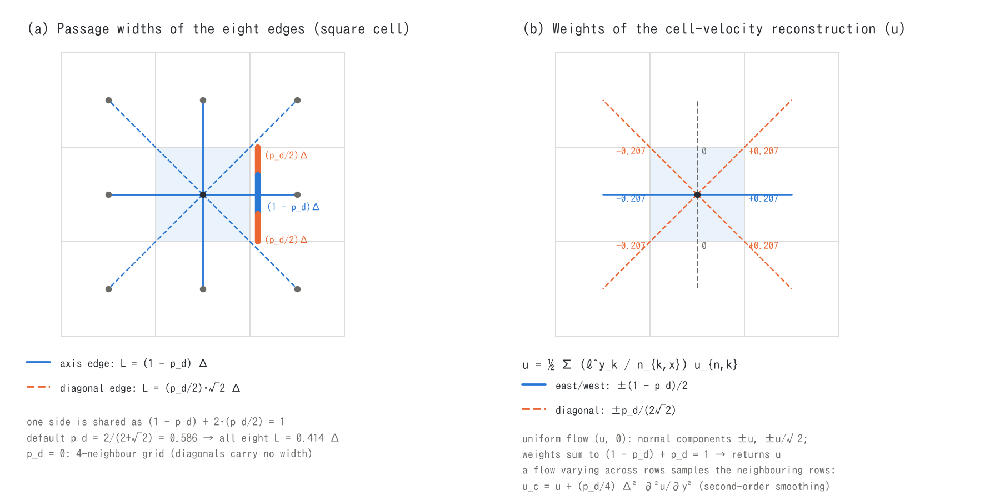

# ENC grid and time integration (supplement to the shallow water chapter)

> English mirror of docs/users_guide/encgrid.md. The Japanese file is the master copy.

[Back to the shallow water chapter](swflow.md) | [Back to the user's guide index](../users_guide.md)

This page explains the parts of the shallow water chapter
([swflow.md](swflow.md)) other than the advection term, the diffusion term
and the non-hydrostatic correction: the geometry of the ENC grid, the
continuity equation, the reconstruction of the cell velocity, the pressure,
friction and drag terms of the momentum equation, the adaptive Runge-Kutta
scheme, the Courant number and the numerical constants, with equations and
the basis of the default values. The advection term is in
[Advection schemes](advection.md), the diffusion term in
[Diffusion term](diffusion.md) and the non-hydrostatic correction in
[Non-hydrostatic correction](nonhydrostatic.md). The implementation is in
`src/m_swflow_enc.f90` (`init_weights`, `calc_kth_momentum`,
`calc_kth_flux`, `continuous`) and `src/m_ffactor.f90`.

## 1. Equations

The shallow water equations for the depth $`h`$, the bed elevation $`z`$ and
the water level $`\eta = z + h`$ are solved with $`h`$ at the cell centres
and the normal velocity $`u_n`$ on the lines (edges) joining the cells.

```math
\frac{\partial h}{\partial t} + \nabla\cdot(h\mathbf{u}) = 0,
\qquad
\frac{\partial u_n}{\partial t}
 = -g\frac{\partial \eta}{\partial s}
   - \frac{g n^2 |\mathbf{V}|}{h^{4/3}}u_n
   + A_n + D_n
```

$`s`$ is the coordinate along the edge, $`n`$ the Manning roughness,
$`|\mathbf{V}|`$ the speed, and $`A_n`$, $`D_n`$ the advection and
diffusion terms in the edge-normal direction. Keeping the momentum equation
**only for the edge-normal components** and building the cell velocity
vector by the reconstruction of §4 is what characterises the ENC
(Eight-Neighbour Connected) grid[^tada26]. It extends to eight directions the
"cell-centred depth, face flux" arrangement of the finite-difference flood
models that are standard in Japan[^iwasa80], and it belongs to the same
family as the conservative staggered schemes[^sd03].

## 2. Geometry of the ENC grid



Cell $`(i, j)`$ is joined by edges to its four axis neighbours and four
diagonal neighbours $`k = 1\ldots 8`$. The edge length $`\Delta s_k`$ is
$`\Delta x`$ or $`\Delta y`$ on the axes and
$`\Delta r = \sqrt{\Delta x^2 + \Delta y^2}`$ on the diagonals. Each edge
carries a **passage width** $`L_k`$ for its flux, and one side of the cell is
shared between one normal edge and two diagonal edges (panel (a))[^tada26].

```math
L_{\text{axis}} = (1 - p_d)\,\Delta,
\qquad
L_{\text{diag}} = \frac{p_d}{2}\sqrt{2}\,\Delta,
\qquad
(1 - p_d) + 2\cdot\frac{p_d}{2} = 1
```

$`p_d`$ is `p_diagratio`: on a square cell a share $`p_d`$ of each side
goes to the two diagonal edges and the rest to the normal edge. **The
default $`p_d = 2/(2+\sqrt 2) \approx 0.586`$ is the value that makes the
eight passage widths equal** (the normal width $`(1 - p_d)\Delta`$ and the
diagonal width $`p_d\Delta/\sqrt 2`$ are both
$`\Delta/(1+\sqrt 2) \approx 0.414\Delta`$). The widths add up to
$`8 \times 0.414\Delta = 3.31\Delta`$ rather than the perimeter
$`4\Delta`$, but the reconstruction of §4 returns the velocity exactly for
an isotropic flow (its weights sum to 1), so the conveyance is neither
short nor in excess. $`p_d = 0`$ gives a four-neighbour grid (the diagonal
edges have zero width and are left out of the momentum equation) and
$`p_d = 1`$ a grid with diagonals only. For $`\Delta x \ne \Delta y`$ the
share $`p_d`$ is applied on the shorter side and scaled by
$`(\Delta_{\min}/\Delta_{\max})^2`$ on the longer side (`init_weights`).

The passage widths are narrowed afterwards by sub-grid channel widths,
levee walls and building occupancy ([channels](channel.md),
[geographic information](geoinfo.md)). The weights $`L_k/\Delta s_k`$ of
the nine-point Laplacian of the diffusion term come from the same widths,
and [Diffusion term](diffusion.md) §3 shows that they give a consistent
Laplacian for any $`p_d`$.

## 3. Continuity equation

The depth of a cell is updated with the fluxes per unit width $`q_k`$
(positive outward) through the eight edges; $`g_v`$ is the plan porosity
after removing buildings (default 1).

```math
h^{n+1}_{i,j} = h^n_{i,j}
 - \frac{\Delta t}{g_v\,\Delta x\,\Delta y}\sum_{k=1}^{8} L_k\,q_k,
\qquad
q_k = u_{n,k}\,h_{e,k}
```

$`h_{e,k}`$ is the edge depth: the mean of the two cells, capped by the
upwind depth (`f_hcap_upwind`) and by the energy head towards a dry cell
(`f_dry_head_cap`); the rules are in [Advection schemes](advection.md) §5.
An edge whose two cells are both below the threshold depth $`d_d`$ (`dd`)
carries no flux. Mass is conserved exactly in this form: each flux
$`q_k`$ is computed once per edge and used with opposite signs by its two
cells.

## 4. Reconstruction of the cell velocity

The cell-centre velocity $`(u, v)`$ is the average over the left/right
(bottom/top) sides of the edge-normal velocities weighted by the passage
widths.

```math
u_{i,j} = \frac{1}{2}\sum_{k:\,n_{k,x}\ne 0}\frac{\ell^{y}_k}{n_{k,x}}\,u_{n,k},
\qquad
v_{i,j} = \frac{1}{2}\sum_{k:\,n_{k,y}\ne 0}\frac{\ell^{x}_k}{n_{k,y}}\,u_{n,k}
```

$`(n_{k,x}, n_{k,y})`$ is the unit normal of edge $`k`$ and $`\ell^{y}_k`$
the share of the side length projected on the $`y`$ axis ($`1 - p_d`$ for a
normal edge, $`p_d/2`$ for a diagonal). For a uniform flow $`(u, 0)`$ the
normal components are $`\pm u`$ on the east/west edges and
$`\pm u/\sqrt 2`$ on the diagonals, and the weights sum to exactly 1, so
$`u_{i,j} = u`$. When the velocity varies across the rows, the diagonal
edges sample the neighbouring rows and the reconstruction contains a
second-order smoothing
$`u_c = u + (p_d/4)\Delta^2\,\partial^2 u/\partial y^2 + \cdots`$. This
quantity appears in the output and the probes; in the Gaussian jet of
[test/diffusion](../../../test/diffusion/README.md) the centre velocity
reads 0.14% low at $`\Delta x = 1`$ m (this is not an error of the
diffusion term). The speed $`|\mathbf{V}| = \sqrt{u^2 + v^2}`$ is used by
the friction and drag terms and by the upwind decisions of the advection.

## 5. Terms of the momentum equation

The normal velocity of edge $`k`$ (joining the centre cell $`c`$ and the
neighbour $`n`$) is updated with each term evaluated on the edge (the
advection and diffusion terms are frozen at their time-level-$`n`$ values):

```math
u^{\,l} = \frac{u^n + \left(A_n + D_n + G^{\,l}\right)\Delta t_l}
               {1 - F^{\,l}\,\Delta t_l},
\qquad
\Delta t_l = \frac{\Delta t}{a_l\,\lambda_m}
```

$`l`$ is the Runge-Kutta stage of §6 (explicit Euler is the single stage
$`l = 4`$) and $`\lambda_m = g_v + (1 - g_v)\,c_m`$ the effective inertia
coefficient including the added mass of buildings (1 without buildings).

**Pressure and bed-slope term $`G`$, and the gravity correction.** The
water-level difference divided by the distance is multiplied by an
effective gravity $`g_e`$.

```math
G = -\,g_e\,g_v\,\frac{\eta_n - \eta_c}{\Delta s_k},
\qquad
g_e = g\,\frac{\Delta s_k^2}{\Delta s_k^2 + (z_n - z_c)^2} = g\cos^2\theta
```

The $`\cos^2\theta`$ correction (`f_gravity_correction = 1`, default) is
the formulation of Ni et al.[^ni19] that removes the over-estimate of the
driving force by the horizontally projected shallow water equations on
steep slopes: it reduces the driving force by 3% at a slope angle
$`\theta`$ of 10° and by 25% at 30°. On gentle slopes $`g_e \approx g`$
and nothing changes.

**Friction term $`F`$.** The Manning law is treated semi-implicitly.

```math
F = -\,g_e\,g_v\,\frac{n_e^2\,|\mathbf{V}|_e}{h_f^{4/3}},
\qquad
h_f = \max(h_e,\,d_v),\quad
|\mathbf{V}|_e = \max\!\left(\tfrac{|\mathbf{V}|_c + |\mathbf{V}|_n}{2},\,v_v\right)
```

Putting the friction in the denominator (the semi-implicit treatment of
the classical flood models[^iwasa80]) keeps the velocity from changing sign
and oscillating in shallow water with strong friction, whatever the time
step. $`d_v`$ (`dv`) is the lower bound of the depth used by the friction
and $`v_v`$ (`vv`) the lower bound of the speed; the latter prevents the
friction from vanishing, and the flow from over-accelerating, at the
instant the water starts moving from rest (§8).

**Drag of buildings.** In cells with a building occupancy $`1 - g_v`$ and a
mean building size $`B`$ (`gv` and `bb` of the geographic information) a
drag is added in the same semi-implicit form as the friction.

```math
F_{\text{bldg}} = -\,\frac{k\,C_D}{2}\,\frac{h_f}{B}\,(1 - g_v)\,|\mathbf{V}|_e
```

$`C_D`$ (`cd`, default 1.0) is a typical drag coefficient of a square
column, $`k`$ (`kk`, default 0.5) a reduction factor for the shielding
within a building cluster and $`c_m`$ (`cm`, default 2.0) the added-mass
coefficient. These are **empirical defaults** within the range of
published values; calibrate them together with the roughness when
reproducing urban inundation ([geographic information](geoinfo.md)).

**Flux and wet/dry rules.** The updated velocity is multiplied by the edge
depth, $`q = u_n h_e`$. Towards a dry cell $`h_e`$ is capped by the energy
head $`\eta_c + u_n^2/2g - z_n`$ (`f_dry_head_cap`), and an edge whose
sender is completely dry gets $`u_n = q = 0`$. When the outflow of one step
would use up the water of the cell (`f_exflux_reduction = 1`, default) the
flux of that edge is scaled by $`(h_c - d_d)/\Delta h_c`$ (the **ex_flux
column** on the screen counts these events). The edges are checked one
after another, so negative depths are not excluded completely and $`h`$
can become slightly negative under strong drying.

## 6. Time integration and the adaptive Runge-Kutta scheme

The default time integration is explicit Euler per edge (semi-implicit for
the friction). Four stages on every edge would cost four times as much,
so **only the edges whose flux changed abruptly** are recomputed with four
stages (`f_adaptive_runge = 1`, default). The stages are the low-storage
Runge-Kutta scheme of Jameson, Schmidt and Turkel[^jst81]: stage $`l`$
advances the time-level-$`n`$ velocity by $`\Delta t_l = \Delta t/a_l`$
with $`a = (4, 3, 2, 1)`$, and at each stage the provisional depths of the
two cells (the inflow and outflow during $`\Delta t_l`$: the new flux on
the edge itself, the previous-step fluxes on the other edges) and
$`|\mathbf{V}|`$ are updated and used by the pressure and friction terms.
The advection term is not updated inside the stages (proportional and
affine updates were evaluated and rejected; developer.md §68.19, §68.23).

**Decision rule.** The explicit candidate $`q_{\text{new}}`$ is compared
with the previous-step $`q_{\text{old}}`$ using the threshold $`\theta`$
(`p_adprunge_thresh`):

```math
\text{recompute} \iff
\begin{cases}
 q_{\text{new}}/q_{\text{old}} < 1/\theta \ \text{or}\ > \theta
   & (q_{\text{old}} \ne 0)\\
 q_{\text{new}} \ne 0 & (q_{\text{old}} = 0)
\end{cases}
```

(a sign reversal gives a negative ratio and is included). Levee-wall edges
are not tested because their flux is replaced by the weir flux later. The
**Runge column** on the screen is the maximum over the display interval of
$`100 \times`$ (recomputed edges) / (valid cells × 4). In runs that start
with a velocity, the initialisation builds $`q = u_n h_e`$ together with
the edge velocity so that the decision of the first step is consistent
(fix of 2026-10-12, developer.md §7).

**Basis of the threshold.** The default $`\theta = 1.5`$ is an empirical
value from [tutorial Step 2](../../../tutorials/wave/en/README.md#step-2-setting-enc-parameters):
in the wave tank, $`\theta = 1.1`$ does not bring the wave form closer to
the result with half the time step, it only raises the recomputation
rate. Reducing dt is the reliable way to gain accuracy, and a Runge column
of tens of percent means that dt is too large. Specify 1.1 or more; below
that the band is so narrow that almost every edge is recomputed.

## 7. Courant number and time step

The **Cn column** on the screen is the maximum over the cells of

```math
C_n = \frac{|\mathbf{V}| + \sqrt{g h}}{\min(\Delta x, \Delta y)}\,\Delta t
```

(with `f_check_cfl = 2` the advective Courant number without the wave
speed $`\sqrt{gh}`$). The stability condition $`C_n \le 1`$ of explicit
schemes[^cfl] is a necessary condition; in computations with wet/dry
fronts, bores and steep slopes choose dt so that $`C_n \le 0.5`$ (the
default `f_check_cfl = 1` stops the run at $`C_n > 1`$). The diagonal
distance $`\Delta r`$ is longer than the axis distance, so the axes decide
the stability. With the diffusion term there is the separate condition
$`\nu \le \Delta x^2/(2.83\,\Delta t)`$ ([Diffusion term](diffusion.md) §4).
For the basics of the Courant number and the procedure for estimating dt see
[Courant number and how to choose the time step](courant.md); for the design
decisions behind the fixed step and the mainly explicit method see the
[time-step design policy](timestep_policy.md).

## 8. Parameters and the basis of their defaults

The labels in the Basis column are explained in [How to read the basis of a default](../users_guide.md#how-to-read-the-basis-of-a-default). The entries here are the numerical constants of
&list_sysparam; the basis of the method flags of &list_enc (advection,
diffusion, non-hydrostatic) is on the pages [Advection](advection.md),
[Diffusion](diffusion.md) and [Non-hydrostatic correction](nonhydrostatic.md).

| Parameter | Default | Meaning | Basis |
|---|---:|---|---|
| dd | 0.001 m | threshold depth of movement; an edge with both cells below it carries no flux; depth left by the ex_flux reduction | **numerical** 1 mm is empirical. Larger values stop thin fronts and increase the outflow reduction; smaller values compute more thin tongues, raising the cost and the sensitivity to friction |
| dv | 0.001 m | lower bound of the depth $`h_f`$ in the friction term | **numerical** bounds the divergence of $`h^{-4/3}`$. Keep it comparable to dd |
| vv | 0.01 m/s | lower bound of the velocity in the friction term | **numerical** limits the one-step acceleration when the friction vanishes at the start of motion from rest. Being semi-implicit, a smaller value means less friction right after the start |
| gg | 9.8 m/s² | gravitational acceleration | **customary value** rounded standard gravity 9.80665 |
| cm / cd / kk | 2.0 / 1.0 / 0.5 | added mass, drag and shielding coefficients of buildings (§5) | **empirical** placeholders within published ranges; calibrate with the roughness for urban inundation |
| f_friction_fastmath | 0 | level of the table approximation of $`h^{-4/3}`$ in the friction term | **numerical** exact by default; the regression references use level 0 (below) |

**Where to look when revising the defaults**

- Revisit dd, dv and vv against the grid spacing and the depth scale of
  the problem. For thin hillslope sheet flow (millimetres) keep dd at
  1 mm; for coastal inundation of metres, raising it to a few mm–1 cm
  changes little and makes the run cheaper. After a change, check the
  sensitivity on a simple case such as [test/wave](../../../test/wave/).
- For the building coefficients cm, cd and kk, experimental and numerical
  studies of building-cluster resistance report added mass 1–2 and drag
  1–2. Move them together with the roughness while comparing with
  observed urban inundation.

**Fast friction (`f_friction_fastmath`).** The evaluation of $`h^{-4/3}`$
is replaced by a table equally spaced in $`\log h`$ between $`d_d`$ and 30 m
(256, 128, 64, 32 and 16 points for levels 1 to 5), piecewise linear in
each interval (split at its midpoint). Level 0 (default) is the exact
power; the maximum relative error of the table in $`h^{-4/3}`$ is
$`2\times10^{-4}`$, $`3\times10^{-3}`$ and 6% for levels 1, 3 and 5. The
references of the regression tests are made with level 0, so compare with
the same level.

## 9. STG grid (legacy)

`f_gridsystem = 1` is a four-neighbour staggered grid with the depth at
the cell centres and the $`x`$ and $`y`$ fluxes per unit width on the
east/west and north/south faces, the classical finite-difference
arrangement[^iwasa80]. It is kept for comparison with the ENC grid and does
not support restart, sub-grid channels, internal structures, the
non-hydrostatic correction or the newer advection schemes.

## 10. Parameters

| Parameter | Default | Meaning | Basis |
|---|---:|---|---|
| p_diagratio | 2/(2+√2) | share $`p_d`$ of the passage width given to the diagonal edges (§2) | **derived** the value that makes the eight widths equal; 0 gives a four-neighbour grid |
| f_gravity_correction | 1 | effective gravity $`g\cos^2\theta`$ on steep slopes (§5) | **literature value** Ni et al.[^ni19]; no effect on gentle slopes |
| f_exflux_reduction | 1 | suppression of excessive outflow (§5) | **method** prevents negative depths at dry-bed fronts; keep on with dry beds |
| f_hcap_upwind | 1 | upwind cap of the edge depth (§3) | **method** 1: mean capped by the upwind depth. 2: the upwind depth itself = continuity of the conservative scheme[^sd03]; use 2 with bores and breaking |
| f_friction_fastmath | 0 | table approximation of the friction (§8) | **numerical** 0: exact; the regression tests use 0 |
| f_adaptive_runge | 1 | adaptive Runge-Kutta (§6) | **method** four-stage RK[^jst81] on the edges with abrupt changes only |
| p_adprunge_thresh | 1.5 | threshold $`\theta`$ of the recomputation (§6) | **empirical** checked in tutorials/wave Step 2; 1.1 or more |
| f_check_cfl | 1 | monitoring of the Courant number (§7) | **method** 1: stop at $`C_n > 1`$; 2: advective Courant number |
| dd, dv, vv, gg, cm, cd, kk | §8 | numerical constants (&list_sysparam) | **numerical** table of §8 |

The parameters of the advection term, the diffusion term and the
non-hydrostatic correction are in the tables of their own pages.

## 11. Verification cases

| Case | Content | Point |
|---|---|---|
| [tutorials/wave](../../../tutorials/wave/en/README.md) | waves in a tank (Steps 1-2) | effect of dt and of the threshold $`\theta`$; reading the Runge and Cn columns |
| [test/wave](../../../test/wave/README.md) | basic regression case | bit reproduction of the default settings (np = 1, 2, 4) |
| [test/dambreak](../../../test/dambreak/README.md) | Stoker's dam-break solution | bore speed and intermediate depth correct independently of dt |
| [test/chichibu](../../../test/chichibu/README.md) | flood on real terrain | grid convergence and MPI agreement of the default settings |
| [test/diffusion](../../../test/diffusion/README.md) | Gaussian jet | size of the smoothing $`(p_d/4)\Delta^2 u''`$ of the velocity reconstruction (§4) and the consistency of the initial flux (§6) |
| [test/nhwave](../../../test/nhwave/README.md) | standing waves in a closed tank | numerical dispersion of the hydrostatic ENC below 1% |

## References

[^tada26]: Tada, T. (2026): An eight-neighborhood connected collocated grid scheme for overland flow simulation. *Hydrological Research Letters*, 20(2), 113–118. doi:10.3178/hrl.25-00052. (the original paper of the ENC grid: the eight-neighborhood connected collocated grid and the passage-width allocation)
[^iwasa80]: Iwasa, Y., Inoue, K. and Mizutori, M. (1980): A study on the numerical analysis of the hydraulics of inundation flows (title translated; in Japanese). *Annuals of the Disaster Prevention Research Institute, Kyoto University*, 23 B-2, 305–317. (cell-centred depth / face-flux arrangement and the semi-implicit friction)
[^sd03]: Stelling, G. S. and Duinmeijer, S. P. A. (2003): A staggered conservative scheme for every Froude number in rapidly varied shallow water flows. *Int. J. Numer. Meth. Fluids*, 43, 1329–1354. (conservative staggered scheme; upwind depth in the continuity equation)
[^ni19]: Ni, Y., Cao, Z. and Liu, Q. (2019): Mathematical modeling of shallow-water flows on steep slopes. *J. Hydrol. Hydromech.*, 67(3), 252–259. doi:10.2478/johh-2019-0012. (effective gravity $`g\cos^2\theta`$ on steep slopes)
[^jst81]: Jameson, A., Schmidt, W. and Turkel, E. (1981): Numerical solution of the Euler equations by finite volume methods using Runge–Kutta time stepping schemes. AIAA Paper 81-1259. (four-stage low-storage Runge–Kutta with coefficients 1/4, 1/3, 1/2, 1)
[^cfl]: Courant, R., Friedrichs, K. and Lewy, H. (1928): Über die partiellen Differenzengleichungen der mathematischen Physik. *Math. Ann.*, 100, 32–74.
