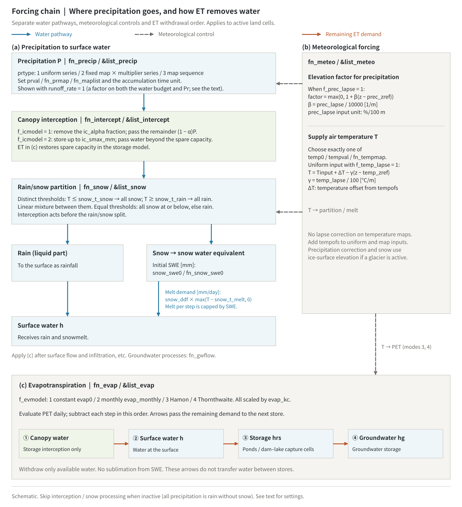

# Rainfall and Meteorology (&list_precip / intercept / meteo / evap / snow)

> English mirror of docs/users_guide/forcing.md. The Japanese file is the master copy.

[Back to the User's Guide index](../users_guide.md)

This chapter covers five features that drive the hydrologic computation.
Enable the needed features with `fn_*` and satisfy their temperature,
calendar and other dependencies when combining them.

**Precipitation (`fn_precip`) supplies mass to the water budget**;
**meteorological forcing (`fn_meteo`) supplies temperature and elevation
corrections**. Rain alone does not require `fn_meteo` unless elevation
corrections or temperature-dependent processes are enabled.



(a) Precipitation passes through canopy interception and is partitioned
into rain and snow. Rain reaches the surface as rainfall; snow is stored
as snow water equivalent (SWE) and released by melting. (b) Meteorological
forcing controls the elevation correction of precipitation, rain/snow
partition and melt, and temperature-based potential evapotranspiration
(PET). (c) After surface flow, infiltration and related processes, ET
withdraws water in this order: canopy water, surface water, pond and
dam/lake capture-cell storage, then groundwater. Blue solid arrows carry
water, grey dashed arrows carry information/corrections, and orange solid
arrows pass remaining ET demand. Orange arrows do not transfer water
between stores. This is a schematic for active land cells, not a complete
water-budget diagram. It assumes `runoff_rate=1`. Each file named by
`fn_*` contains the corresponding `&list_*` group.

Without interception, precipitation passes through unchanged. Without
snow processing, all precipitation is treated as rain. ET acts only when
enabled. The [SVG version](../../figs/forcing_chain_en.svg) uses the same
generator. Regenerate with `python docs/figs/make_guide_figs.py forcing`.

## Putting all meteorological input in one file (recommended layout)

Each fn_\* may point to the same file name, so the meteorological
inputs can be kept in a single file.

```
&list_sysparam
  ...
  fn_precip = "forcing.txt"
  fn_meteo  = "forcing.txt"
  fn_snow   = "forcing.txt"
/
```

```
! ---- forcing.txt ----
&list_precip
  prtype = 1
  prval(:,1) = 0, 10        ! (time (min), rainfall intensity (mm/h))
  prval(:,2) = 1440, 10
/
&list_meteo
  temp0 = 2.0               ! uniform air temperature (deg C)
/
&list_snow
  snow_ddf = 3.0            ! degree-day factor (mm/degC/day)
/
```

## Precipitation (&list_precip)

Select how rainfall is given with `prtype`.

| prtype | How rainfall is given | Parameters used |
|---|---|---|
| 0 (default) | No precipitation (temporarily disabled) | - |
| 1 | Uniform time series | prval |
| 2 | Fixed distribution x time-series multiplier | fn_prmap, prval (multiplier) |
| 3 | Series of distribution files (e.g. radar rainfall) | fn_maplist, dt_maplist |

| Parameter | Default | Meaning |
|---|---|---|
| prval | - | Time-series pairs `(time (min), value)`. The value is rainfall intensity (mm/h) for prtype=1 and a multiplier for prtype=2. After the last time, the last value persists |
| dt_prupdate | 1 | Rainfall update interval (min) (prtype=1, 2) |
| fn_prmap | "" | Precipitation distribution file (prtype=2) |
| fn_maplist | "" | List of distribution file names (one file per line; prtype=3). **Paths inside the list are also relative to dir_data** (not relative to the list file) |
| dt_maplist(_c) | 60 | Time interval of the distribution files (min) (prtype=3) |
| dt_mapunit(_c) | 0 | Specifies over how many minutes the values in the distribution files are accumulated rainfall (mm). With 0 (default), prtype=2 assumes one day (= mm/day) and prtype=3 assumes the file interval (accumulated mm between dt_maplist frames; with a 1-hour interval this equals mm/h) |
| runoff_rate | 1.0 | Runoff coefficient. Its target differs between prtype modes in the current implementation; see below. Use 1.0 with groundwater computation |

**Current `runoff_rate` behaviour**: with `prtype=1,2`, it scales the
output rainfall field `prh`, but not the precipitation intensity `pre`
passed to the water budget. With `prtype=3`, it scales `pre` when the map
values are converted using `dt_mapunit`. It therefore cannot be treated
as an identical reduction of actual precipitation in every mode. For
the coupled chain shown here, keep the default `1.0` and adjust the input
values when a change in precipitation itself is intended.

```
&list_precip                ! example: uniform 15 mm/h from minute 10 for 24 hours
  prtype = 1
  prval(:,1) =    0,  0
  prval(:,2) =   10, 15
  prval(:,3) = 1440, 15
  prval(:,4) = 1450,  0
/
```

Worked examples of the format for all four types are in
[examples/List_samples/list_precip.txt](../../../examples/List_samples/en/list_precip.txt).
The rainfall intensity distribution can be output as `Pr0001` with
`f_out_pre = 1`.

**Rainfall type guides** (rainfall is given data; as a starting point.
Values vary by about a factor of 2 with region and return period)

| Type | Intensity (mm/h) | Duration | Total (mm) | How to give it |
|---|---|---|---|---|
| Prolonged frontal rain (Baiu) | 10-30 | 6-24 h | 100-300 | prtype=1 trapezoid |
| Typhoon | 20-50 (peak 50-80) | 12-24 h | 200-600 | prtype=1 hump, or prtype=3 analyzed rainfall |
| Stationary rain band | 50-100 | 3-6 h | 200-400 | prtype=1 rectangle |
| Urban design storm (5-10 yr, 60 min) | 50-80 | 1 h | 50-80 | prtype=1 rectangle (pluvial flooding, sewers) |
| Inundation mapping (maximum assumed scale) | 100+ (peak) | several hours | 300-1000 | prtype=1 hyetograph |
| Snowmelt runoff | 0 (no rain) to 10 | daily | - | air temperature 5-10 degC via fn_meteo + fn_snow |

## Rainfall interception (&list_intercept)

Applies canopy interception to precipitation before the rain/snow
partition. When snow is enabled, the same interception model acts before
rain and snow are distinguished.

| Parameter | Default | Meaning |
|---|---|---|
| f_icmodel | 0 | 0: none (temporarily disabled), 1: fixed interception ratio, 2: initial loss (storage type) |

Model-specific settings go in dedicated groups within the same file.

**Fixed interception ratio (f_icmodel = 1, &list_intercept_fixed)** -
removes a constant fraction alpha as a loss and passes the remainder
(1-alpha)P to the rain/snow partition, or directly to surface rainfall if
snow is inactive. It has no canopy storage. Use `ic_alpha` (uniform
value; default 0.15) or `fn_icalpha` (distribution; ic_alpha is ignored
when given).

```math
P_{out} = (1 - \alpha)\,P
```

**Initial loss (f_icmodel = 2, &list_intercept_initloss)** - stores
the first part of the rainfall up to a maximum storage, then passes
everything through once the storage is full. Use `ic_smax_mm` (uniform
value, mm; default 1.5) or `fn_icsmax` (distribution). Each step stores
water up to the spare capacity and passes the excess. ET through `fn_evap`
reduces canopy storage, restoring capacity for later interception. Without
ET, the spare capacity does not recover.

```math
\Delta S = \min\!\left(P\,\Delta t,\ S_{\max} - S\right),
\qquad
P_{out} = P - \frac{\Delta S}{\Delta t}
```

This is the simplest form of the storage-type interception models of the
Rutter and Gash family[^crockford00] with a canopy storage $`S_{\max}`$
(drainage and evaporation in time are left to the evapotranspiration
module).

When the uniform value is unspecified the default is adopted and
printed with "(default)" (the minimal input is f_icmodel and an empty
model group). The defaults $`\alpha`$ = 0.15 and $`S_{\max}`$ = 1.5 mm are
the broadleaf/mixed-forest values of the review of Crockford &
Richardson[^crockford00] (interception loss 20–40% for conifers, 10–25% for
broadleaf forests, 5–10% for grassland; canopy storage 0.3–3 mm), and are
also comparable with the depression storage of impervious urban surfaces
(SWMM customary values 1.3–2.5 mm[^rossman15]). Guide values by
vegetation (calibration quantities):

| Type | ic_alpha (interception ratio) | ic_smax_mm (canopy storage, mm) |
|---|---|---|
| Dense conifer forest | 0.25-0.4 | 1.5-3 |
| Broadleaf / mixed forest (default) | 0.1-0.2 | 0.8-1.5 |
| Leafless deciduous forest | 0.05-0.1 | 0.3-0.8 |
| Grassland / cropland | 0.05-0.1 | 0.3-0.5 |
| Urban (initial loss as depression storage) | - | 1-2.5 (depression storage of impervious surfaces; SWMM convention) |

## Meteorological forcing field (&list_meteo)

Manages air temperature in one place and provides it to
evapotranspiration, snowmelt, water quality, and so on. The input is
**exactly one of three forms**.

| Parameter | Default | Meaning |
|---|---|---|
| temp0 | - | Uniform constant (deg C) |
| tempval | - | Uniform time series `(elapsed days, deg C)`. Times are elapsed **days** from t=0 |
| fn_tempmap | "" | List of temperature distribution files (one file per line, applied sequentially at dt_tempmap_c intervals; the last frame persists) |
| dt_tempmap_c | "1 day" | Time interval of the distribution files |
| f_temp_lapse | 0 | 1: enable the temperature lapse rate with elevation (uniform inputs only) |
| temp_lapse | 0.65 | Lapse rate (degC/100 m) |
| temp_zref | lowest elevation in the domain | Reference elevation for the temperature lapse rate (m); see the unit-corrected formula below |

For uniform input with `f_temp_lapse=1`, use elevation in metres:

```math
T = T_{\mathrm{input}} + \Delta T - \gamma (z - z_{T,\mathrm{ref}}),
\qquad \gamma = \frac{\mathtt{temp\_lapse}}{100}.
```

Here `z_T,ref` is `temp_zref` and `ΔT` is the `tempofs` value (zero if
omitted). For example, `0.65 °C/100 m` over `1000 m` lowers temperature by
`6.5 °C`. Combining lapse correction with temperature maps (`fn_tempmap`)
is rejected at initialization. The offset `tempofs` also applies to maps.
With snow enabled, the lapse rate produces elevation-dependent rain/snow
partitioning and melt.

Two further options target long-term runs
([glaciers](glacier.md), long-term landform change).

| Parameter | Default | Meaning |
|---|---|---|
| tempofs | - | Long-period air temperature offset series `(elapsed days, dT degC)`, added to the temperature input (uniform and distributed alike). It is interpolated on the real time axis, which is not folded by the cyclic forcing t_cycle, so **a cooling/warming trend or a glacial cycle can be superimposed on a repeated representative year** |
| f_prec_lapse | 0 | 1: enable the precipitation elevation gradient. See the non-negative, unit-corrected factor below (a simple representation of orographic precipitation and glacier accumulation; prefer distributed input when available) |
| prec_lapse | 0.0 | Precipitation increase rate (%/100 m) |
| prec_zref | lowest elevation in the domain | Reference elevation of the precipitation gradient (m) |

Convert `prec_lapse` from `%/100 m` to `1/m` and apply this factor when
precipitation is updated, before interception:

```math
F_P = \max\left(0,\,1 + \beta (z-z_{P,\mathrm{ref}})\right),
\qquad \beta = \frac{\mathtt{prec\_lapse}}{10000}.
```

Here `z_P,ref` is `prec_zref`. A gradient of `10 %/100 m` over `500 m`
gives a factor of `1.5`; negative factors are clamped to `0`. Precipitation
correction and snow temperature evaluation use ice-surface elevation
`z + hi` when a glacier is active. ET evaluates temperature at ground
elevation `z`.

## Evapotranspiration (&list_evap)

Select how potential evapotranspiration (PET) is given with `f_evmodel`.

| f_evmodel | Method | Requirements |
|---|---|---|
| 0 (default) | None (temporarily disabled) | - |
| 1 | Constant rate evap0 (mm/day) | - |
| 2 | Monthly climatology evap_monthly (mm/day x 12) | Calendar (date0_c) |
| 3 | Hamon formula (estimated from temperature and daylight hours) | Calendar, temperature (fn_meteo), latitude lat |
| 4 | Thornthwaite formula | As 3, plus monthly normal temperatures temp_normal (x 12) |

| Parameter | Default | Meaning |
|---|---|---|
| evap0 | 3.0 | Mode 1: PET (mm/day). When unspecified the default is adopted and printed with "(default)" |
| evap_monthly | - | Mode 2: monthly PET (mm/day). 12 months |
| evap_kc | 1.0 | Conversion coefficient (pan coefficient / calibration; common to all modes) |
| lat | - | Representative latitude (deg). Required for modes 3, 4 |
| temp_normal | - | Monthly normal mean temperatures (deg C). Required for mode 4 |

PET is evaluated daily, scaled by `evap_kc`, and converted from mm/day
to m/s internally. Each step withdraws the depth `PET × dt` in this order: **canopy water (storage
interception only), surface water `h`, storage `hrs` (ponds and dam/lake
capture cells), then groundwater `hg`**. Each withdrawal is capped by
available water, passing only the remaining demand to the next store.
There is no dry-soil suppression beyond this supply limit, and no
sublimation from SWE. ET acts after surface-flow and groundwater updates.

The formulas of modes 3 and 4 use the daylight hours $`N`$ (hours; solar
declination by Cooper's approximation) and the daily mean temperature
$`T`$ (°C):

```math
PET_{\text{Hamon}} = 0.1651\,\frac{N}{12}\,\frac{216.7\,e_s}{T + 273.3},
\qquad
e_s = 6.108\,\exp\!\left(\frac{17.27\,T}{T + 237.3}\right)\ [\mathrm{hPa}]
```

```math
PET_{\text{Thornthwaite}} = \frac{16}{30}\left(\frac{10\,\max(T, 0)}{I}\right)^{a}\frac{N}{12},
\qquad
I = \sum_{m=1}^{12}\left(\frac{\max(T_m, 0)}{5}\right)^{1.514},
\quad
a = 6.75\times10^{-7}I^3 - 7.71\times10^{-5}I^2 + 1.792\times10^{-2}I + 0.49239
```

(mm/day). The Hamon formula[^hamon61] is a temperature method using only
the saturation vapour density (Tetens formula) and the daylight hours; the
Thornthwaite formula[^thornthwaite48] is a climatological one whose heat
index $`I`$ comes from the monthly normal temperatures, the monthly value
being divided by 30 for a daily rate. Neither uses radiation, wind or
humidity; calibrate with `evap_kc`.

Modes 3 and 4 use temperature at the start of the calendar day to evaluate
PET, which remains constant within that day (a daily-mean temperature
series is recommended). Cumulative evaporation volumes for canopy,
surface, storage and groundwater, plus their total, are written to
`evap.csv` in the result directory. These accumulate from the start of
the run and reset on restart. Missing requirements (e.g. mode 2 without
a calendar) stop initialization.

The mode-1 default of 3 mm/day is the lower side of the
warm-season reference evapotranspiration of a humid temperate climate
(FAO-56[^allen98] ET0 of 3-5 mm/day): larger than the annual mean of Japan
(2-2.5 mm/day) and smaller than summer (4-5). Use modes 2-4 for runs
spanning seasons (monthly values, latitude and normal temperatures are
given data and have no default).

## Snowpack and snowmelt (&list_snow)

Degree-day snowpack and snowmelt. **Air temperature (fn_meteo) is
required.**

| Parameter | Default | Meaning |
|---|---|---|
| f_snow | 1 | 0 temporarily disables while keeping the file |
| snow_t_snow | 0.0 | Temperature threshold below which all precipitation is snow (deg C) |
| snow_t_rain | 2.0 | Temperature threshold above which all precipitation is rain (deg C). In between, rain and snow mix linearly |
| snow_t_melt | 0.0 | Temperature threshold for snowmelt (deg C) |
| snow_ddf | 4.0 | Degree-day factor (mm/degC/day). When unspecified the default is adopted and printed with "(default)" (rationale in developer.md §65) |
| snow_swe0 / fn_snow_swe0 | - / "" | Initial snow water equivalent (mm) (uniform value / distribution; mutually exclusive; omit both to start without snow) |

Post-interception precipitation is partitioned into rain and snow;
snow accumulates as snow water equivalent (SWE). At `T ≤ snow_t_snow`
it is all snow; at `T ≥ snow_t_rain` it is all rain, with a linear mixture
between. Require `snow_t_rain ≥ snow_t_snow`. If they are equal, that
temperature and below give all snow; higher temperatures give all rain.
Only the liquid part reaches the surface as rainfall.

After adding snowfall, melt is capped by the available SWE. With SWE and
melt expressed in mm and the time step `Δt` in seconds:

```math
\Delta W_{\mathrm{melt}} = \min\left(\mathrm{SWE},\,
\mathtt{snow\_ddf}\,\max(T-\mathtt{snow\_t\_melt},0)\,
\frac{\Delta t}{86400}\right).
```

The degree-day method[^hock03] estimates melt from air temperature alone,
folding radiation, wind and rain melt into the degree-day factor.
Internally, melt is converted to metres and added directly to surface
water `h`, with area conversion for void fraction and active channel
width. It is not included in rainfall intensity `pre`. For example,
`snow_ddf=4`, a temperature `3 °C` above the melt threshold and
`Δt=3600 s` give a melt demand of `0.5 mm`; if only `0.2 mm` SWE is
available, only `0.2 mm` melts. Refreezing, rain retention within snow
and sublimation are not represented. Initial SWE can melt without
new precipitation.

The minimal input to "just try it" is **an empty &list_snow in
fn_snow** (plus the air temperature of fn_meteo). The default
`snow_ddf` = 4 mm/°C/day is the middle of Hock's compilation[^hock03]
(mostly 2.5–6 for snow; smaller under forest, larger in the open) and of
the customary 3–5 of snowmelt floods in Japanese mountain basins. The
rain/snow thresholds 0–2 °C are customary values after the observation
that the transition occurs around a wet-bulb temperature of 1 °C, and the
lapse rate 0.65 °C/100 m is that of the standard atmosphere. Guide values
of the degree-day factor (a calibration quantity):

| Type | snow_ddf (mm/degC/day) | Notes |
|---|---|---|
| Forest (under a conifer canopy) | 2-3 | Small because radiation is shaded |
| Open land / sparse forest (default) | 3.5-5 | The observed range of snowmelt floods in Japanese mountain basins |
| Late melt season, open high elevation | 5-7 | Larger with dirty snow and stronger radiation (no seasonal variation is implemented, so give a period average) |
| Snow on a glacier | 3-5 | The ice surface uses gl_ddfi ([Glaciers](glacier.md)) |

## Summary of combination requirements

| Feature | Other features required |
|---|---|
| Precipitation | None (works on its own) |
| Interception | Acts when precipitation is present; no mandatory dependency for enabling it |
| Meteorological forcing field | None (used together with a consuming feature) |
| Evapotranspiration (mode 1) | None |
| Evapotranspiration (modes 2-4) | Calendar date0_c; 3 and 4 also need meteorological forcing and latitude; 4 also needs temp_normal |
| Snowpack / snowmelt | Meteorological forcing; precipitation supplies new snow but is not required to enable the module |
| Glaciers ([dedicated chapter](glacier.md)) | Meteorological forcing + active snowpack/snowmelt; precipitation supplies accumulation but is not required to enable the module |

For worked examples of the settings, see list_precip / list_intercept /
list_meteo / list_evap / list_snow in
[examples/List_samples/](../../../examples/List_samples/en/).

## Tests and examples

- [test/chichibu](../../../test/chichibu/): uniform rainfall on a real-terrain catchment, with regression checks for runoff collection and flood-wave propagation.
- [test/icevap](../../../test/icevap/): equivalence of minimal input and explicitly specified defaults for fixed-rate interception, initial loss and constant evapotranspiration.
- [test/frost](../../../test/frost/): comparison with analytical values for the freezing index and infiltration suppression under constant air temperature.

## References

[^crockford00]: Crockford, R. H. and Richardson, D. P. (2000): Partitioning of rainfall into throughfall, stemflow and interception: effect of forest type, ground cover and climate. *Hydrol. Process.*, 14, 2903–2920.
[^rossman15]: Rossman, L. A. (2015): Storm Water Management Model User's Manual Version 5.1. US EPA, EPA/600/R-14/413b. (customary depression storage)
[^hamon61]: Hamon, W. R. (1961): Estimating potential evapotranspiration. *J. Hydraul. Div. ASCE*, 87(HY3), 107–120.
[^thornthwaite48]: Thornthwaite, C. W. (1948): An approach toward a rational classification of climate. *Geogr. Rev.*, 38, 55–94.
[^allen98]: Allen, R. G., Pereira, L. S., Raes, D. and Smith, M. (1998): Crop Evapotranspiration: Guidelines for Computing Crop Water Requirements. *FAO Irrigation and Drainage Paper*, 56.
[^hock03]: Hock, R. (2003): Temperature index melt modelling in mountain areas. *J. Hydrol.*, 282, 104–115.
