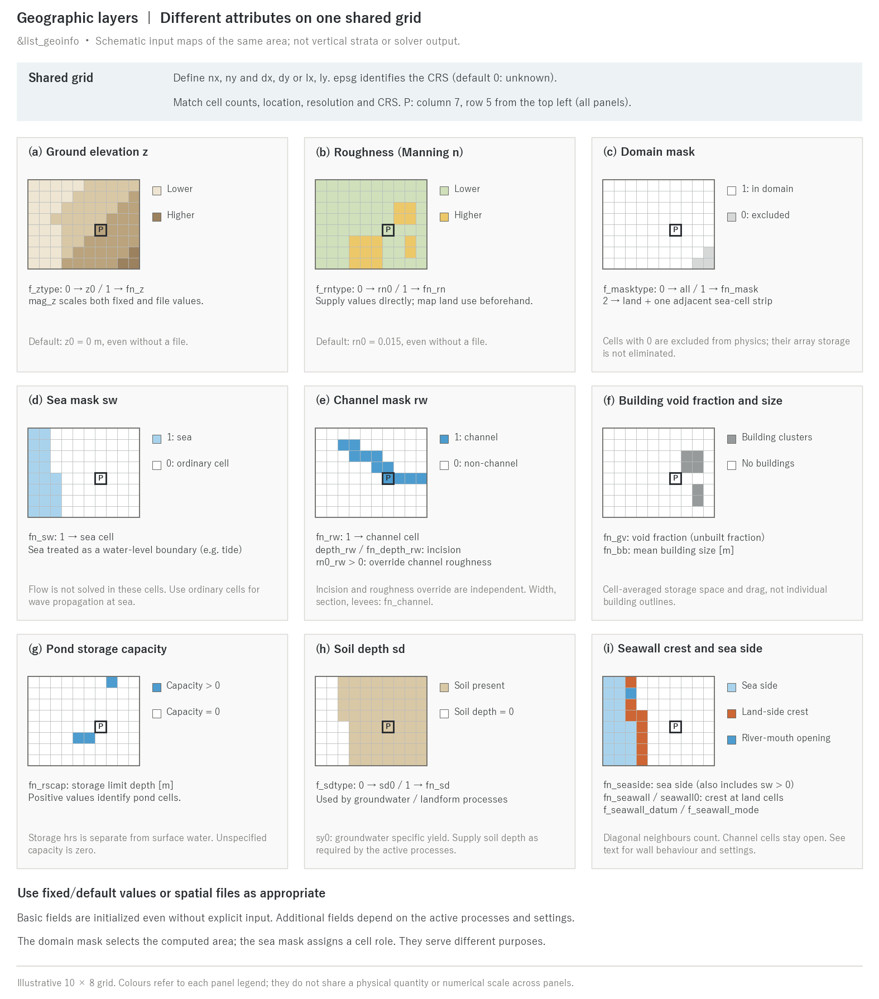

# Geographic information (&list_geoinfo)

> English mirror of docs/users_guide/geoinfo.md. The Japanese file is the master copy.

[Back to the user's guide index](../users_guide.md)

Settings for the grid, topography, roughness, and the various masks that
form the foundation of a computation. This is the only **mandatory
feature**; it is read via `fn_geoinfo` (default `"-"` = inside the
parameter file).

The minimal configuration is just the grid definition (tutorial wave
takes this form).

```
&list_geoinfo
  lx = 100.0, ly = 100.0    ! size of the computational domain (m)
  nx = 300, ny = 300        ! number of grid cells
/
```

For real-terrain computations, topography files, roughness, and masks
are added on top of this.



The figure compares attributes on the same illustrative 10 × 8 grid. Box P
marks column 7, row 5 from the top left in every panel. Panels (a)(b) show
ground elevation and roughness; (c) selects the computational domain;
(d)(e) assign sea and channel roles; (f)–(h) show buildings, ponds and soil;
and (i) shows the seawall sea-side mask and land-side crest-holder cells.
Colours refer to each panel's legend and do not share a numerical scale.
These are input locations, not vertical strata or simulation results.

**Basic fields are initialized with defaults even without spatial files.**
For example, ground elevation defaults to `z0 = 0 m`, roughness to
`rn0 = 0.015`, the domain mask to the whole grid, sea/channel masks to zero,
and pond capacity to zero. Additional fields depend on the processes and
input settings; omission does not mean that every field is absent or uses
no memory. See the [soil section](#soil-layer-for-groundwater-and-landform-change)
for its usage conditions.

Align spatial files to the same cell counts, extent, location, resolution
and CRS in preprocessing. Equal matrix dimensions alone do not ensure
matching cells when origins or cell sizes differ. Rows run north to south,
columns west to east ([input/output](io.md), [coordinates](coordinates.md)).
Regenerate only the Japanese/English PNG and SVG files with
`python docs/figs/make_guide_figs.py geoinfo`.

## Grid definition

| Parameter | Default | Meaning |
|---|---|---|
| nx, ny | -- | number of grid cells (mandatory) |
| dx, dy | -- | grid spacing (m) |
| lx, ly | -- | domain size (m) |
| epsg | 0 | EPSG code of the grid's coordinate system ([coordinates chapter](coordinates.md)) |

Without metadata-based completion, specify **nx and either dx or lx** for
x, and **ny and either dy or ly** for y. If both spacing and extent are
given, the code checks `lx = nx × dx` and `ly = ny × dy` and stops on a conflict.
With `f_ztype = 1`, a ground-elevation file's bil `.hdr` or GeoTIFF metadata
can fill missing cell counts. Metre-based georeferencing can also fill
`dx, dy`; for a geographic raster, supply the computational `dx, dy` in
metres separately. `epsg` is optional, defaulting to 0 (unknown). A CRS
stored in GeoTIFF is adopted or checked against an explicitly supplied `epsg`.

## Topography (ground elevation)

| Parameter | Default | Meaning |
|---|---|---|
| f_ztype | 0 | 0: fixed value z0, 1: file fn_z |
| z0 | 0 | fixed ground elevation (m) |
| fn_z | "" | ground elevation distribution file |
| mag_z | 1 | multiplier applied to the ground elevation (for sensitivity experiments and unit conversion) |
| f_user_routine | "" | identifier of a user routine that modifies the topography (for idealized experiments; see [Writing user routines](user_routines.md)) |

## Roughness (Manning coefficient)

| Parameter | Default | Meaning |
|---|---|---|
| f_rntype | 0 | 0: fixed value rn0, 1: file fn_rn |
| rn0 | 0.015 | fixed roughness value |
| fn_rn | "" | roughness distribution file |

Roughness is given directly (a fixed value or a distribution file). To
change the roughness on channel cells only, you do not need to build an
fn_rn distribution -- `rn0_rw` (below) can override it. To derive a
roughness distribution from land-use codes, map the values in
preprocessing (GIS etc.) to create the file and supply it with
`f_rntype = 1` (the in-model conversion f_rntype=2 has been removed --
developer.md Sec. 41). When ENCflow is driven through BMI, the roughness
field can be overridden during the run (parameter searches, updates from
cumulative discharge or terrain change; bmi/README.en.md "Overriding
roughness").

**Roughness guides** (Manning n by land use; customary values of the
Japanese inundation-mapping manuals and Chow's tables[^chow59]; calibration
quantities)

| Land use | rn0 | Notes |
|---|---|---|
| Roads, pavement, concrete | 0.015-0.02 | The default 0.015 is a paved surface |
| Channel (sand bed / gravel bed) | 0.025-0.035 / 0.035-0.05 | Via rn0_rw or fn_rn |
| Residential (buildings handled by fn_gv/fn_bb) | 0.02-0.03 | Building drag is expressed through the void ratio |
| Residential (equivalent roughness including buildings) | 0.04-0.07 | About 0.067 at a building occupancy of 30-50 % |
| Paddy fields | 0.06 | Including the effect of levees between fields |
| Upland fields | 0.05 | |
| Grassland, parks | 0.03-0.05 | |
| Forest | 0.1-0.15 | Understory and fallen trees |

## Domain mask (restricting the computed area)

| Parameter | Default | Meaning |
|---|---|---|
| f_masktype | 0 | 0: compute the whole domain, 1: file fn_mask, 2: auto-generate from the sea mask |
| fn_mask | "" | domain mask file (1: computed, 0: excluded) |

Cells with a domain-mask value of zero are excluded from physical updates
and skipped in many calculation loops. Arrays still cover rectangular
grids or assigned bands, however, so storage for those positions and work
such as mask checks remain. The displayed `number of valid cells` counts
cells with a positive domain mask and a sea-mask value of zero.

`f_masktype = 2` requires `fn_sw`. It includes all land and a one-cell-wide
sea strip adjacent to land in the eight-neighbour sense (including
diagonals), excluding the offshore sea. With `f_masktype = 1` and `fn_sw`
together, the input domain mask may be extended one cell into the sea
to provide an outflow destination. The domain mask selects the computed
area; it does not assign the water-level-boundary role of the sea mask below.

## Sea mask and channel mask

| Parameter | Default | Meaning |
|---|---|---|
| fn_sw | "" | sea mask (1: sea). Identifies sea cells treated as a water-level boundary, e.g. prescribed tide ([tide chapter](tide.md)) |
| fn_rw | "" | channel mask (1: channel cell) |
| depth_rw / fn_depth_rw | 0 / "" | incision depth of channel cells (uniform value / distribution; dug down from the topography) |
| rn0_rw | -1 | fixed roughness of channel cells. A positive value **overrides the roughness of channel cells** regardless of how roughness is given (rn0 / file), independently of whether incision is specified |

**Flow is not solved in sea-mask cells.** This mask assigns a hydraulic
role, rather than merely identifying the geographical sea. To propagate
waves such as tsunamis inside the domain, represent that sea with ordinary
`sw = 0` cells and set initial water levels and [boundary conditions](boundary.md).
Use `fn_seaside` to identify the sea side of seawalls there. `fn_seaside`
does not itself convert flow-solving cells into sea-mask cells.

The channel mask is a shortcut for representing channels that are not
resolved at the resolution of the topography data, by incising the
terrain and replacing the roughness. More refined subgrid channels
(cross-section shape, channel width, levees) can be introduced step by
step via fn_channel ([channel chapter](channel.md)).

Masks are created in preprocessing. If land-use data is available, the
bundled `utils/lu2mask` can generate a 0/1 raster in which "cells of the
specified land-use codes are 1" (intended for the sea mask and the
seaside mask; see the source header for usage). After generation,
inspect the result visually in GIS etc. and edit it where needed (e.g.
treat a lake without an outflowing river as sea so that it acts as a
drainage target). For the channel mask, generation from land-use codes
that include lakes and floodplains does not give sufficient quality, so
rasterizing river centerlines in GIS is recommended (background:
developer.md Sec. 40).

## Drag of building clusters (urban inundation)

| Parameter | Default | Meaning |
|---|---|---|
| fn_gv | "" | distribution of the building void fraction (fraction not covered by buildings) |
| fn_bb | "" | distribution of the mean building size (m) |
| min_gv / min_bb | 0.001 | lower limit of each (to avoid division by zero) |

Represents the storage reduction and the drag caused by building
clusters in urban areas (numerical constants such as the drag
coefficient are on the &list_sysparam side -- [shallow water flow
chapter](swflow.md)).

## Ponds

| Parameter | Default | Meaning |
|---|---|---|
| fn_rscap | "" | distribution of the pond storage limit depth (m); positive values identify ponds, unspecified capacity is zero |

Gives cells a storage separate from the surface water, used e.g. as an
intake source for pumps ([structures chapter](structure.md)). The pond
water depth can be output as `Hrs0001` with `f_out_hrs = 1`.
When [water quality](wq.md) is enabled, the mass of the absorbed water
accumulates in a per-cell pond pool (the overflow after the pond is
full is never absorbed).

## Soil layer (for groundwater and landform change)

| Parameter | Default | Meaning |
|---|---|---|
| f_sdtype | 0 | 0: fixed value sd0, 1: file fn_sd |
| sd0 / fn_sd | 0 / "" | soil depth (m) (uniform value / distribution). When [groundwater](gwflow.md) needs it and sd0 is unspecified, 1 m is adopted as the default and printed (when geomorphology f_wthr etc. needs it, it remains required) |
| sy0 | 0.2 | specific yield (effective porosity) |

Soil depth is used by Green-Ampt infiltration, lateral groundwater flow
and the second aquifer, as well as landform processes such as bedload,
suspended sediment, hillslope erosion, debris flow, moving bed layers and
weathering ([groundwater](gwflow.md), [landform change](geomorph.md)). `sy0`
is groundwater specific yield, distinct from sediment porosity `fluv_porosity`.

A distribution with `f_sdtype = 1` is read when either `fn_gwflow` or
`fn_geomorph` is specified. With neither, it is skipped and a message is
printed. Fixed `sd0` is allocated when a process requests soil depth;
a groundwater request fills an unspecified zero with 1 m. A landform
process that requires soil instead needs positive `sd0` or a soil-depth
distribution. Landform initialization precedes groundwater initialization,
so supply it explicitly in coupled runs as well. Allocation of the evolving
soil state depends on module configuration; array allocation and soil-input
requirements are not identical conditions.

## Seawall

| Parameter | Default | Meaning |
|---|---|---|
| fn_seaside | "" | seaside mask (1: treated as the sea side; the sea of fn_sw is always seaside) |
| fn_seawall / seawall0 | "" / -9999 | crest height distribution (at landside cell positions) / uniform value (mutually exclusive; automatically assigned to adjacent land cells, except channel openings) |
| f_seawall_datum | 2 | crest height datum (1: height above the cell's own ground, 2: absolute elevation) |
| f_seawall_mode | 0 | hydraulic mode (0: overtopping only, 1: flap gate (gates), 2: forced drainage) |

Represents seawalls as line-shaped virtual walls without widening cells
(the coastal application of the river-levee mechanism, fn_bank). The sea
side is the union of `fn_seaside` and `sw > 0`. For tide cases, `fn_seaside`
can be omitted if `fn_sw` supplies that classification. Where the sea is
solved as ordinary cells, as in tsunami propagation, define the seawall's
sea side with `fn_seaside`. Orange cells in panel (i) hold land-side crests,
and blue cells show river-mouth openings; they do not depict physical wall widths.

Channel cells (`rw > 0`) remain river-mouth openings even when a seawall
crest is supplied. This also applies to uniform `seawall0`.

Notes when giving the crest with a distribution file `fn_seawall`:

- The crest is given at **land-side (protected-side) cell** positions.
  This is the opposite of river levees, fn_bank (held by the channel =
  water-side cells): in cases like tsunamis where the sea is solved as
  ordinary cells, the "water side" cannot be determined by a static
  mask (the design record is developer.md §17.1).
- Wall edges are erected on all edges (**including diagonals**) between
  a crest-holding land cell and a seaside cell. **Also give a crest to
  land cells that touch seaside cells only at a corner (diagonally)** —
  edges of cells without a value get no wall and water leaks inland
  through the diagonal links. The uniform value `seawall0` is assigned
  automatically to land cells adjacent (including diagonally) to
  the seaside, except channel openings, so this is not a concern.
- Conversely, **giving extra values is harmless**. Crests on land cells
  not adjacent to the seaside become no wall (the number of such cells
  is merely reported at startup and does not affect the computation).
  Painting a **generous buffer along the coast** is therefore the safe
  side, and it automatically prevents the corner-contact leaks above.

## Tests and examples

- [test/chichibu](../../../test/chichibu/): a real-terrain regression case combining elevation, catchment/channel masks and roughness.
- [test/gtif](../../../test/gtif/): GeoTIFF input test assets covering data types, compression, layout and coordinate systems.
- Annotated list of all parameters: [examples/List_samples/list_geoinfo.txt](../../../examples/List_samples/en/list_geoinfo.txt)
- Minimal configuration: [tutorials/wave](../../../tutorials/wave/en/README.md) (grid only + a user routine)
- Real terrain: [tutorials/chichibu](../../../tutorials/chichibu/en/README.md)
- For the format and coordinate system of distribution files, see the [input/output](io.md) and [coordinates](coordinates.md) chapters.
- Subgrid channel elements such as channel width and levees are configured on the fn_channel side ([channel chapter](channel.md)).

## References

[^chow59]: Chow, V. T. (1959): *Open-Channel Hydraulics*. McGraw-Hill, New York. (tables of Manning's n by land cover)
