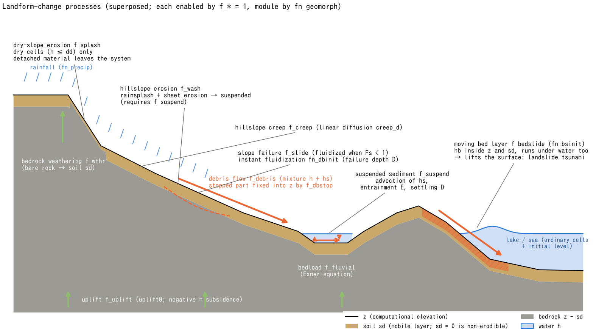
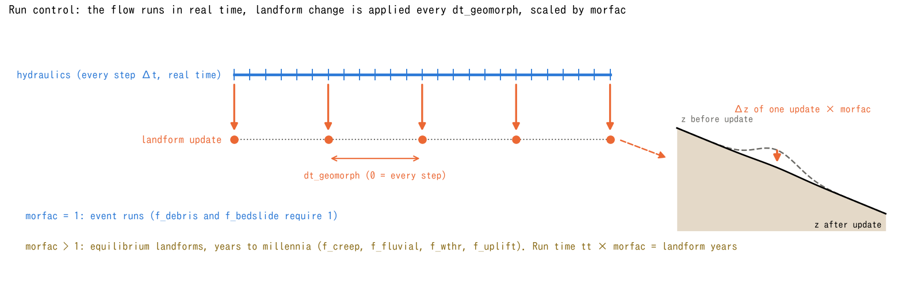

# Sediment and Landform Change (&list_geomorph)

> English mirror of docs/users_guide/geomorph.md. The Japanese file is the master copy.

[Back to the User's Guide index](../users_guide.md)

Handles sediment transport and terrain evolution. Enable it with `fn_geomorph`
and select processes in `&list_geomorph`. **Compatible processes can be
superposed**, but suspended sediment (`f_suspend`) and debris flow (`f_debris`)
cannot be combined. Terrain and soil updates feed back into the flow; different
processes change different state variables.
The equations, the basis of the defaults and the references are in two
supplements: [Sediment transport, hillslope and long-term processes](sediment.md)
(creep, bedload, suspended load, hillslope erosion, dry-slope erosion,
weathering/uplift, MORFAC) and
[Debris flow, slope failure and moving bed layer](massflow.md) (resistance
laws, erosion/deposition laws, triggering, bed layer).

| Process | Flag | Content |
|---|---|---|
| Hillslope creep | f_creep | Linear diffusion of elevation z; soil depth sd is not updated |
| Bedload | f_fluvial | Erosion and deposition from sediment-flux balance (Exner equation) |
| Suspended sediment | f_suspend | Advection of sediment column hs and bed exchange (entrainment / settling) |
| Hillslope erosion | f_wash | Rain / sheet erosion in wet, non-channel cells (requires f_suspend) |
| Dry-slope erosion | f_splash | Rain / subgrid-rill erosion in dry, non-channel cells; sediment leaves the system |
| Debris flow / landslide | f_debris / f_slide | Water-sediment mixture; selectable exchange and resistance laws, slope stability test |
| Moving bed layer | f_bedslide | Layer hb moves within the terrain and soil, displacing the water surface |
| Bedrock weathering / uplift | f_wthr / f_uplift | Weathering increases sd; uplift / subsidence shifts z |
| Limestone dissolution | f_dissol | Lowers z in proportion to the recharge (no sediment is produced); a sink-inflow term for dolines |
| Rockfall and talus | f_rockfall | Collapse of free faces (cliffs) that exceed a critical height, and the talus (thickness ht) of the fallen debris. The talus spreads at its repose angle and suppresses dry-slope erosion |

The figure places the processes on a conceptual hillslope-to-channel-to-water
cross-section: 1 dry-slope erosion, 2 wet-slope erosion, 3 creep, 4 bedload,
5 suspended sediment, 6 debris flow / slope failure, 7 moving bed layer,
8 weathering, and 9 uplift / subsidence. The numbers are not execution order.
Positions, shapes and thicknesses are illustrative, not computed results or an
all-process configuration. E denotes entrainment and D settling. The water body
represents ordinary cells with bathymetry and an initial water level, not the
sea mask. Bedload and suspended-sediment computation are not restricted to
channel cells.

| Quantity in the figure | Meaning |
|---|---|
| z | Computational elevation of the ground / bed |
| sd / z − sd | Erodible soil depth / elevation of the soil base (bedrock top) |
| h / dd | Water depth / wet-dry depth threshold; h ≤ dd defines a dry cell |
| hs | Solid sediment volume expressed as a column depth. A dilute scalar in suspended-sediment mode; h + hs is the flow depth in debris-flow mode |
| hb | Bulk depth of the moving layer, pores included. Part of sd with its top at z, not extra thickness above z |

`f_wash` requires `f_suspend`. Both `f_slide = 1` (judge + mobilize) and
`f_slide = 2` (judge only), as well as the prescribed collapse-depth map
`fn_dbinit`, require `f_debris`. Judge-only mode does not automatically disable
other debris-flow processes. Debris flow and the moving bed layer require
`morfac = 1`. `sd = 0` limits soil erosion / mobilization; it does not freeze
`z` against creep or uplift, and weathering can continue to produce soil.
Sea-mask cells (`sw > 0`) receive no landform updates.

How to read the results (fields, ledgers, measurement columns, restart) is summarized in [Output and monitoring](#output-and-monitoring) on this page. Each feature section also ends with a short note on just the outputs that concern it.

## Run control (common to all processes)

| Parameter | Default | Meaning |
|---|---|---|
| dt_geomorph | 0 | Requested landform-update interval (s). A positive value is rounded to `n = NINT(dt_geomorph / dt)` steps; the actual interval is `dtw = n × dt`. 0: every step (`n = 1`) |
| morfac | 1.0 | Positive morphological acceleration factor. Landform processes use the effective time step `dts = dtw × morfac`. Hydraulic and forcing clocks are unchanged. See below for process-specific use and coupling restrictions |

Panel (a) illustrates a fresh run. With `dt = 10 s` and `dt_geomorph = 26 s`,
`n = NINT(2.6) = 3`, so landform updates occur every 30 seconds. `NINT` rounds
to the nearest integer, with positive half-ties rounded up. A rounded `n` of
zero or less is rejected. Updates occur at step numbers divisible by `n`;
there is no update at the initial state. Restarted runs retain this cadence
based on the saved step number.

With `morfac = 4`, panel (b) uses an effective time step `dts = 120 s` per
update. Bedload `f_fluvial`, creep `f_creep`, dry-slope erosion `f_splash`,
weathering `f_wthr` and uplift `f_uplift` evaluate their processes using `dts`.
Uniform uplift alone gives `Δz = U × dts`, where `U` is the uplift rate
converted to m/s. Weathering increases soil depth `sd` without changing
elevation `z`. Sediment supply, erosion limits and nonlinear updates mean
that this is not a universal multiplication of the final computed `Δz` by `morfac`.

Suspended sediment `f_suspend` and hillslope erosion `f_wash` also run at
these landform-update times, but evaluate exchange with water-column `hs`
using unscaled `dtw` and multiply the corresponding bed change by `morfac`.
The available-soil constraint also accounts for `morfac`. Advection of `hs`
advances on hydraulic time steps, so `morfac > 1` approximates water-column
and bed evolution on different time scales.

In panel (c), the hydraulic duration from `t0 = 3600 s` to `tt = 3720 s` is
120 seconds; four landform updates represent `4 × 120 = 480 s` (8 minutes).
`tt` is the end time, not the run duration. For `Nupdate` landform updates,
the accumulated landform time is `Nupdate × dts` seconds, or
`Nupdate × dts / (365.25 × 86400)` years. For a fresh run with complete update
intervals, `Nupdate × dts = (tt − t0) × morfac`. If a partial interval remains
at the end, count the actual updates instead of using this equality.

`morfac > 1` approximates long-term landform change using a shorter hydraulic
run. Rainfall and boundary-condition clocks are not rescaled, so their
history over the accelerated period is not reproduced. The update interval
and acceleration factor must also satisfy process stability limits.
For example, explicit creep requires
`creep_d × dts × (1/dx² + 1/dy²) ≤ 0.5`.

Event processes and coupled modules have the following restrictions.

- Debris flow `f_debris` and the moving bed layer `f_bedslide` require `morfac = 1`.
- Combining landform change with driftwood or building debris also requires `morfac = 1`.
- Lava flow rejects a landform `morfac > 1`.
- When glacier and landform modules are combined, glacier `gl_morfac` must equal landform `morfac`.

The figure values illustrate the update procedure; they are neither recommended
settings nor solver output.

**Policy on parameter defaults** - the material and calibration values of
every process have safe defaults that make it "just run", so **the
minimal input is the process switch (f_xxx = 1) alone**. Values adopted
while unspecified (0) are printed at startup with a **(default)** mark,
such as `geomorph: db_phi = 35.0000 deg (default)`, so they cannot go
unnoticed. Always review them against your case (guides by type of
phenomenon are in "[Recommended values by pattern](#recommended-values-by-pattern)"
at the end of this chapter). The rationale is in developer.md §62.

The evolving terrain can be output as `Z0001...` with `f_out_z = 1`
([the input/output chapter](io.md)). The probe CSV has columns for
suspended sediment hs and soil depth sd
([the measurement chapter](record.md)).

## Hillslope creep (f_creep)

Equations and basis of the defaults: [supplement](sediment.md#2-hillslope-creep-f_creep).

| Parameter | Default | Meaning |
|---|---|---|
| creep_d | 1.6e-10 (= 0.005 m²/yr) | Creep diffusion coefficient (m²/s). Literature range 0.001-0.05 m²/yr. A geomorphic-time quantity, so interpret it together with morfac |

The minimal input to "just smooth the slopes" is `f_creep = 1` alone (no
soil depth needed; add morfac to see changes over years to millennia).

The implementation updates only `z`, leaving `sd` unchanged. Creep therefore
acts even at `sd = 0` and shifts the soil base `z − sd`. This is a terrain
diffusion approximation, not transport of a finite soil layer.

**Outputs for this section**: landform change in `Z0001...` (`f_out_z=1`) and `Sd0001...`. The process is slow, so match the morphological acceleration morfac with `dt_file` ([Output and monitoring](#output-and-monitoring)).

## Bedload (f_fluvial)

Transport formulas, Exner equation and clamps: [supplement](sediment.md#3-bedload-f_fluvial).

Riverbed erosion and deposition by a bedload transport formula.

| Parameter | Default | Meaning |
|---|---|---|
| f_qbform | 1 | Bedload formula. 1: Ashida-Michiue, 2: MPM |
| fluv_d50 | 0.01 | Representative grain size (m). The default is a middle value for sand-gravel beds (sand bed 0.0005 to mountain gravel bed 0.05) |
| fluv_tausc | 0.05 | Critical dimensionless shear stress tau*c |
| fluv_porosity | 0.4 | Riverbed porosity |
| fluv_sgrav | 1.65 | Submerged specific gravity of sediment grains |
| fluv_dzmax | 0.05 | Upper limit of bed change per update (m) (stabilization) |
| fluv_bcfeed | 0 | Sediment feed at open boundaries (inflow-segment faces included). 0: no feed at inflow, 1: capacity feed = the supply through the inflow face equals the net outflow of the inflow cell times fluv_bcfeed_fac (factor 1 fixes the bed of the inlet; outflow is always at transport capacity) |
| fluv_bcfeed_fac | 1.0 | Factor of the capacity feed. 0 = no feed, 1 = fixed inlet. Values between reduce the inlet degradation but not proportionally (give a partial supply with inflow_qb) |
| fluv_diagratio | 2/(2+sqrt(2)) | Diagonal partitioning (normally no need to change) |
| fluv_taufac | 1.0 | Effective shear-stress ratio f_τ (the τ* passed to the transport formula = f_τ × τ* of the total resistance; a simple separation of form drag by dunes or vegetation. 1 = no separation) |
| fluv_slope | 0 | Bed-slope correction of the bed-load direction. 1: Hasegawa type (q⃗ = q_b(t̂ − γ∇z), γ = √(τ*c/(μs μk τ*))) |
| fluv_mus / fluv_muk | 1.0 / 0.45 | Static and kinetic friction coefficients μs, μk. **Literature values** (Asahi et al. 2013 eq. (22), after Hasegawa 1984; Hasegawa 1989 uses μk = 0.7 as an estimate). See the note below |
| f_secflow | 0 | Secondary-flow correction of the bed-load direction. 1: equilibrium type (near-bed transverse velocity ratio r = N* h κ, κ = streamline curvature of the velocity field) |
| sec_nstar | 7.0 | N*. **Literature value** (Engelund 1974; Asahi et al. 2013 eq. (18). The de Vriend coefficient 2/κ²(1 − √g/(κC)) is about 10 for C = 50). See the note below |
| sec_rmax | 1.0 | Upper bound of |r| (cuts the h/R proportionality in sharp bends; 1 = 45°) |
| sec_vmin | 0.01 | Minimum velocity (m/s) for evaluating the curvature |
| f_berode | 0 | Bank erosion. 1: a neighbouring cell whose ground is above the water surface of a wet cell (a bank face) retreats under the shear stress of the toe cell, and the eroded volume is moved to the toe (requires f_fluvial = 1) |
| berode_kb | (required) | Bank erodibility K_b (m/s). E_b = K_b (τ*/τ*c,b − 1)^m. A calibration value without default |
| berode_tausc | 0.05 | Critical dimensionless shear stress of the bank τ*c,b |
| berode_m | 1.0 | Exponent m of the excess shear stress |
| berode_hcover | 0 (none) | Shielding by slump blocks (§84.17): the talus ht at the toe (bank mode of f_rockfall) that shields the bank face completely (m); the toe τ* is multiplied by (1 − ht/h_cover)⁺ (the K of the slump blocks in Asahi et al. 2013). Requires rf_bank = 1 |
| f_repose | 0 | Angle-of-repose avalanching. 1: the part of the slope between neighbouring cells above tanφ_r is moved from the higher to the lower cell (wet or dry; usable without bed load) |
| repose_phi | 30 | Angle of repose φ_r (deg) |
| repose_relax | 0.5 | Fraction of the excess slope relaxed per update (0 to 1) |
| f_fixation | 0 | Fixation. 1: a fixation degree a grows on dry cells and raises the critical shear stress of the bed load supplied by that cell and of the bank erosion of that cell to τ*c (1 + c_τ a) (requires f_fluvial = 1) |
| fix_tfix | (required) | Fixation time scale T_fix (h, morphological time including morfac). While dry, a → 1 − exp(−t/T_fix). No standard value in the literature; choose it relative to the return time of floods T_return (Asahi et al. 2013: meandering develops for T_Land/T_return = 0.025 to 0.5 and not for 1) |
| fix_ctau | (required) | Increase ratio c_τ of the critical shear stress at full fixation. No standard value in the literature (Asahi et al. 2013 remove accreted cells from the domain, i.e. c_τ → ∞; large values approach that) |
| fix_dzreset | 0.1 | Cumulative erosion below the fixation surface that resets a to 0 (m) |
| fix_cn | 0 | Roughness increase ratio c_n at full fixation: the Manning n of the flow friction becomes n (1 + c_n a) (the τ* of the sediment is unchanged). 0 = no roughness effect |
| fix_tdec | 0 | Decay time T_dec (h, morphological time) of the fixation while submerged: while h > dd, a <- a exp(-t/T_dec). 0 = no decay (an exposed bar loses its fixation only by erosion) |
| fix_ctau_bank | -1 | Fixation coefficient c_tau,b applied to the bank cell of bank erosion (f_berode). Negative = same as fix_ctau, 0 = banks unaffected |

The minimal input to "just move the bed" is `f_fluvial = 1` plus the
thickness of the erodible soil `sd0` (&list_geoinfo). The grain size is
the default 1 cm (the adopted value is printed at run time; guides for
sand and gravel beds are in the recommendations at the end).

Combined with the subgrid channel width (fn_width), bedload
concentrates in the channel width and changes the riverbed there
([the channel chapter](channel.md)).

**Cross-sectional bed shape in bends (direction correction).** By default
the bed load follows the depth-averaged flow direction, so bends do not
scour the outer bank and deposit on the inner bank. With `fluv_slope = 1`
(bed-slope term: transport down the transverse slope) and `f_secflow = 1`
(equilibrium secondary-flow term: the near-bed flow points to the inside
of the bend) a cross section with a deep outer side and a shallow inner
side forms in bends (use the two together; one alone does not reach an
equilibrium transverse slope). The equations are in the
[explanation](sediment.md#3-bedload-f_fluvial). The coefficients
`fluv_mus`, `fluv_muk` and `sec_nstar` default to μs = 1.0, μk = 0.45
(the values Asahi et al. 2013, eq. (22), take from Hasegawa 1984; Hasegawa
1989 uses μk = 0.7 as an estimate, which makes γ 1.2 times smaller) and
N* = 7.0 (Engelund 1974; Asahi et al. 2013, eq. (18)); the adopted values
are printed at start-up (literature check in developer.md §84.12).
[test/bendsed](../../../test/bendsed/en/README.md) verifies with these values. Bed load
is never carried onto a neighbouring
cell whose ground is above the water surface (a bank face), and a dry cell
never supplies bed load (§84.2).

**Bank retreat and collapse (bank erosion, angle of repose).** A bank face
(a neighbouring cell above the water surface) retreats with
`f_berode = 1`: the ground of the bank cell is lowered at the rate
E_b = K_b (τ*/τ*c,b − 1)^m, proportional to the excess shear stress of the
toe cell, and the same volume is deposited on the toe cell (the bed load
carries it on; sediment is conserved). `berode_kb` is a calibration value
without default (the erodibility of a cohesive bank, i.e. the retreat
speed for a given flow at the toe). Levee edges (walls at the channel-mask
boundary) do not erode, so revetted or embanked reaches are expressed by
the walls of `fn_rw`. `f_repose = 1` is a conservative relaxation that
collapses slopes steeper than the angle of repose `repose_phi` (default
30°) from the higher to the lower cell; it handles the collapsed material
at the toe, excavation faces and the flanks of bars (local non-cohesive
collapse; it works on dry cells and without bed load). On non-cohesive
banks toe scour plus collapse already gives the retreat, so do not add the
same retreat again through `berode_kb`. Verification:
[test/berode](../../../test/berode/en/README.md), [test/repose](../../../test/repose/en/README.md).

**Self-protection of the bank by slump blocks.** A cohesive bank fails in
blocks once pool scour makes the bank face higher than a critical height, and
the fallen blocks cover the toe and stop bank erosion until the flow has
carried them away (Asahi et al. 2013; Parker et al. 2011). This is represented
by the **bank mode** `rf_bank = 1` of [cliff collapse and talus](#cliff-collapse-and-talus-f_rockfall)
`f_rockfall` together with `berode_hcover` (developer.md §84.17): the part of a
bank face (a step above the water surface of the receiving cell; submerged steps,
i.e. pool walls, are excluded) that exceeds the critical height `rf_hc` collapses
into talus ht at the toe, the talus is removed by the outflow of bed load, bank
erosion and avalanching, and at a toe with talus ht the shear stress reaching the
bank face is reduced by (1 − ht/h_cover)⁺. With fixation (`f_fixation`) the
critical height rises to H_c (1 + c_τ,b a) with the fixation degree of the source
cell. H_c is a structural quantity for the bank material (a guide: the initial bank
height plus the pool scour at which failure should start), h_cover the block size
(tens of centimetres to a metre). Verification: slump / slump0 in
[test/berode](../../../test/berode/en/README.md); example: param_cohesive_slump.txt in
[examples/meander](../../../examples/meander/en/README.md).

**Fixation of inner-bank bars.** Bed load deposits only up to the water
surface of the supplying cell, so under a constant discharge the inner-bank
bar stays submerged and the channel only widens instead of migrating.
`f_fixation = 1` represents the establishment of vegetation and the like on
cells exposed at low flow (h ≤ dd) by a fixation degree a ∈ [0, 1] (output
`Fx0001...`): while dry, a approaches 1 as 1 − exp(−t/T_fix) (`fix_tfix`,
morphological time including morfac), and the critical shear stress of the
bed load supplied by that cell and of the bank erosion of that cell rises to
τ*c (1 + c_τ a) (`fix_ctau`). With suspended sediment (`f_suspend`) only the
entrainment term (equilibrium concentration) of a fixed cell is reduced, by the
same c_τ, while settling is unchanged, so fines supplied during floods settle
on the fixed bars (the path that raises a bar to floodplain level). With
`fix_cn` > 0 the flow roughness of fixed cells rises to n (1 + c_n a), the
flow slows down and more fines are trapped (the form drag of vegetation; the
τ* of the sediment is not changed. Typical Manning n: grass 0.03 to 0.035,
floodplains with brush or trees 0.05 to 0.15, i.e. c_n = 1 to 3; the default
is 0 pending a literature check). Deposition onto a fixed surface is not
hindered and elevations and volumes are untouched. When a submerged cell is
eroded by more than `fix_dzreset` (default 0.1 m) below the fixation surface,
a returns to 0 (nothing becomes permanently unerodible). It does not act on
the angle-of-repose avalanching. If a fixed bar stays submerged without being
eroded (with a strong fixation the erosion never reaches the threshold, and an
exposed bar becomes permanent in practice), add a decay while submerged with
`fix_tdec` (while wet, a <- a exp(-t/T_dec): die-back of vegetation, softening
of the surface layer; a T_dec longer than the duration of a flood keeps the
fixation through short floods). The effect on bank erosion can be separated
from the bed with `fix_ctau_bank` (roots stiffen the surface layer but hardly
the bank toe, so a value below the bed c_tau, e.g. 0.5-1). Use it with an inflow series that alternates
floods and low flows ([examples/meander](../../../examples/meander/en/README.md),
param_fix.txt; with suspended sediment param_fixsusp.txt). Restart in
`geomorph_fixation.dat` (the dynamic roughness is rebuilt from a and not
saved). Verification: [test/fixation](../../../test/fixation/en/README.md).

**Outputs for this section**: bed change in `Z0001...` (`f_out_z=1`; Z − Z0000 is the scour/deposition thickness). How often the cap fluv_dzmax acted is in the end warning "fluvial dzmax clip fired", the number of cells where the soil-depth supply limiter acted in "fluvial supply limiter", and the volume lost at the bedrock floor (normally zero) in "bedrock floor clip" ([Output and monitoring](#output-and-monitoring)).

## Suspended sediment (f_suspend)

Entrainment, settling, equilibrium formulas and Rubey's formula: [supplement](sediment.md#4-suspended-sediment-f_suspend).

Advects the concentration field (columnar equivalent hs) with the flow
and exchanges with the riverbed through entrainment (E) and settling
(D). The concentration is per volume of water (hs divided by the
rectangular-equivalent depth), and in cells that use the cross-section
shape σ of [channels](channel.md) the sediment is carried at the same
velocity as the water. In σ cells the exchange E, D is multiplied by the
wetted-width ratio σ(h), so in a narrow low-water channel at low flow the
exchange with the bed is reduced in proportion to the width.

| Parameter | Default | Meaning |
|---|---|---|
| f_esform | 1 | Equilibrium concentration formula. 1: linear excess shear (simple), 2: Itakura-Kishi |
| susp_d50 | 0.0002 | Representative grain size (m). The default is fine sand (representative of suspended load) |
| susp_wf | 0 | Settling velocity (m/s). If 0, derived from d50 by the Rubey formula |
| susp_tausc | 0.05 | Critical dimensionless shear stress for suspension |
| susp_beta | 1.0 | Near-bed concentration coefficient for settling |
| susp_esa | 1e-4 | Equilibrium concentration coefficient (used by f_esform=1; a calibration parameter; not used by Itakura-Kishi) |

The minimal input to "just carry some turbidity" is `f_suspend = 1` and
`sd0` (grain size defaults to fine sand 0.2 mm; the settling velocity is
derived automatically by the Rubey formula).

### Ledger of fines in the bed (f_bedfines)

By default the entrainment of suspended load treats the whole soil layer
sd as fines. When bed load (fluv_d50) and suspended load (susp_d50) are
combined, a coarse bed is then eroded at the rate of the fines. With
`f_bedfines = 1` the model keeps a ledger of "the thickness of the bed
that moves as suspended load", sf (output Sf, 0 <= sf <= sd).
Entrainment is limited to the stock sf (availability min(1, sf/L_a)),
settling adds to sf, and soil moved by bed load, bank erosion or
avalanching carries its fines along with it (equal mobility; the
exchange with the suspended load is only through entrainment and
settling). The number of size classes is not increased and there is no
hiding/exposure function (a two-component ledger).

| Parameter | Default | Meaning |
|---|---|---|
| f_bedfines | 0 | 1 enables it (requires f_suspend = 1) |
| fines_la | (required) | Exchange layer thickness L_a (m). The mixing thickness that sets the availability min(1, sf/L_a); a few cm to 0.1 m |
| fines_frac0 | 0 | Initial fraction of fines (sf = fines_frac0 x sd). 0 = a purely coarse bed, 1 = the whole layer is fines, as before |

Hillslope erosion f_wash also draws on the stock sf (set fines_frac0 = 1
when the hillslope soil is fines that can be washed off). The capacity
feed at open boundaries (fluv_bcfeed = 1) enters with the composition of
the inflow cell (both the bed level and the stock at the inlet stay
fixed). Dry hillslope erosion, the moving bottom layer, weathering and
the bed-load source inflow_qb are treated as coarse. There is no vertical stratigraphy, so
fines buried under a thick coarse deposit remain available.

Sediment inflow from the boundaries (time series of concentration and
bedload discharge) is given by the segment inflows (inflow_cs /
inflow_qs) of [Boundary conditions](boundary.md).
Suspended sediment also serves as the partner of the Kd two-phase
partitioning (wq_kd) in [water quality](wq.md) (the particulate
fraction of sorbing substances such as heavy metals is allocated
according to the sediment concentration).

**Tsunami / storm-surge resuspension and deposition in the run-up zone
(tsunami deposits)** - resuspension of bay-bottom mud or sand and its
deposition in the run-up zone can be represented with f_suspend. One
important condition: **sea-mask (fn_sw) cells do not solve the flow,
and none of the landform-change processes act on sea cells**. Represent
the water body to be resuspended not as a sea mask but as ordinary
cells with real bathymetry z plus an initial water level (f_htype=2 in
[Initial conditions](initial.md)), and let the tsunami enter through
the long-wave radiation edge boundary (type 2) or
water-level-prescribed cells ([Boundary conditions](boundary.md)).
Give the thickness and extent of the erodible layer as the soil depth
sd (sd=0 means non-erodible).

- **Sand**: the model's native regime. f_esform=2 (Itakura-Kishi) with
  susp_wf=0 (Rubey-derived) works without calibration parameters.
  Where the bedload contribution matters (run-up front, shallow
  high-velocity return flow), superpose f_fluvial.
- **Mud (cohesive)**: handled by reinterpretation. Give the effective
  floc settling velocity directly as susp_wf (on the order of
  1e-4 to 1e-3 m/s; the Rubey derivation is unrealistic at clay grain
  sizes), regard the f_esform=1 law E = wf*esa*(tau*/tau*c - 1) as
  identical in form to the Partheniades law E = M(tau/tau_ce - 1), and
  calibrate susp_esa and susp_tausc to the mud's erosion rate constant
  and critical shear stress. Flocculation and consolidation are not
  represented explicitly.

In the run-up zone settling dominates as the flow decelerates, and in
cells that dry out the entire suspended load is fixed to the bed. The
deposit thickness is obtained as the before/after difference of z
(f_out_z; the probe CSV also has hs and sd columns). Being single
grain size, the scope is deposit thickness and extent - the spatial
grain-size distribution (inland fining) is not represented. hs is a
passive scalar under the dilute assumption; high-concentration mud
flows (density currents) are out of scope.

**The sea mask (fn_sw) and the fate of sediment** - sea cells behave
as the following boundary for sediment: **suspended sediment leaving
into a sea cell is treated as lost from the system** (a perfect sink;
inflow from the sea to the land is always clear water), and **bedload
does not cross an edge bordering a sea cell** (a wall; sand piles up
artificially along the seaward front). The solid fraction (hs) of debris
flows, driftwood and building debris are carried by the same scalar
transport as suspended sediment, so they too are treated as outside the
system once they leave into a sea cell. Where the plunge into the sea and
the response of the water surface must be solved, represent the sea as
ordinary cells + an initial water level, as described in the
[moving bed layer](#moving-bed-layer--landslide-tsunami-f_bedslide)
section. Wherever you want deposition on
the sea bottom or seaward landform change to be solved (formation of a
river-mouth terrace, the tsunami deposits above), represent that area
as ordinary cells + an initial water level, and if you use a sea mask,
place it offshore of the area of interest.

**River-mouth deltas** - the process in which a river entering still water
builds a mouth bar, bifurcates, grows lobes and switches channels can be
computed with settings alone, representing the sea as ordinary cells + an
initial water level as above and supplying both sand and mud (the record of
the trials and the expected results are in [docs/delta_plan.md](../../delta_plan.md),
Japanese). Minimal set-up: a flat basin of ordinary cells 1.5-2 m deep
(f_htype=2, e0 = sea level), the far edge as a long-wave radiation boundary
(f_bc=2), a dug channel between dry non-erodible land (sd=0) with a section
inflow Q and a mud concentration inflow_cs (volume concentration
0.0002-0.001). Sand: f_fluvial + capacity feed fluv_bcfeed=1 (the upstream
reach delivers the equilibrium load); mud: f_suspend with an effective settling
velocity given directly (susp_wf about 1 mm/s, the cohesive-mud reading) +
f_bedfines=1 (only deposited mud is resuspended). fluv_slope=1 (spreads sand
over the bar flanks) and f_repose=1 are essential; f_secflow is not used.
morfac 100-200 for 1000-4000 h of morphological time (a 1000 m wide delta from
a 30 m wide channel needs about 4000 h and 1e6 m3 of supply; the domain should
extend 1500 m seaward and +-1300 m sideways). Expected behaviour: the more mud,
the fewer and longer the distributaries (bird-foot); the less mud, the more
distributaries in a fan. The shape differs between realisations (the
instability of the bifurcation amplifies round-off) while the integrated
quantities do not, so argue with the statistics of several realisations with
a few cm of noise on the bed. To look at the persistence of distributaries,
combine alternating floods and low flows with `f_fixation=1`, set `fix_tdec`
(decay while submerged) to about the duration of a flood and `fix_ctau_bank`
below the bed c_tau (without the decay an exposed bar becomes permanent and the
distributaries collapse to grid-width channels). Resolve the distributaries
with at least width/5 cells.

**Outputs for this section**: sediment in transport in `Hs0001...` (`f_out_hs=1`), volume concentration Hs / (H + Hs), deposition in `Z0001...`. Point time series in the probe column `hs`; maximum flow depth and fluid force in `D9999` and `F9999` ([Output and monitoring](#output-and-monitoring)).

## Hillslope erosion (f_wash)

Erosion law: [supplement](sediment.md#5-hillslope-erosion-f_wash).

Detaches sediment from hillslopes by raindrop erosion and sheet
erosion and carries it as suspended sediment (**f_suspend is
required**). It acts in wet cells (`h > dd`) outside channels (`rw = 0`).
Detachment supplies `hs` and lowers `z` and `sd` by the same amount.

| Parameter | Default | Meaning |
|---|---|---|
| wash_kr | 0.01 | Raindrop erosion coefficient (dimensionless; E = kr x rainfall intensity) |
| wash_kf | 1e-5 | Sheet erosion coefficient (m/s) |
| wash_tausc | 0.05 | Critical dimensionless shear stress for sheet erosion |
| wet_lw | 0 | Correlation length ℓ_w (m) that spreads the detachment depth laterally (0 = off). Acts on both the detachment of f_wash and the entrainment of f_suspend (works with f_suspend alone too) |

kr and kf are empirical coefficients (calibration assumed). When both
are unspecified both get their defaults; when only one is given, the 0
of the other is read as "no such term".

The minimal input to "just erode the slopes" is `f_wash = 1` +
`f_suspend = 1` (the carrier of the detached sediment) + `sd0`, with water
sufficient to meet the wet-cell condition. The raindrop term needs rainfall
reaching the ground; the sheet-erosion term can act without rain if flow-induced
shear exceeds its threshold.

**Lateral spreading of the detachment, `wet_lw`.** When the flow gathers
into a one-cell-wide channel, the positive feedback in which only that
cell erodes and collects still more water has no length scale, so the
width and spacing of gullies are set by the grid spacing (refining the
grid makes the valleys denser; there is no convergence). With
`wet_lw = ℓ_w` the detachment depth evaluated in each cell (the detachment
of f_wash and the entrainment of f_suspend; settling is excluded) is
distributed to the neighbouring cells with a Gaussian kernel of standard
deviation ℓ_w before it is subtracted from `z` and `sd` (the suspended
sediment `hs` enters the source cell). This expresses "the flow in the
channel erodes a band of width ℓ_w (the rill width) and the banks slump
into the channel", and the total solid volume is conserved. Where the
receiving soil `sd` is insufficient, the shortfall is discarded as bedrock
exposure and reported at the end as "wet_lw spreading: solid volume lost
to bedrock floor" (0 means strict conservation). On grids with
Δx ≤ ℓ_w/2 the valley spacing no longer depends on the grid
(developer.md §84.16, result 5 of
[examples/badland_storm](../../../examples/badland_storm/en/README.md)).

**Outputs for this section**: detached sediment rides in the surface `Hs0001...`; the loss of soil appears in `Sd0001...` and `Z0001...` ([Output and monitoring](#output-and-monitoring)).

## Dry-slope erosion (f_splash)

Erosion law and valley-spacing selection: [supplement](sediment.md#6-dry-slope-erosion-f_splash).

Erosion and valley formation on **slopes without overland flow**. On
highly permeable slopes where all rainfall infiltrates (badlands,
pyroclastic cliffs), the terrain is carved by raindrop impact and by
subgrid-scale rills and grain rolling that the grid cannot resolve.
The erosion efficiency increases in hollows (incipient valleys) — a
positive feedback that lets **valleys grow from cliff margins without
any surface runoff**.

The erosion rate is (P: rainfall intensity reaching the ground, S:
slope, kappa: curvature, positive in hollows):

E = P [ spl_kr (1 + spl_ca kappa) + spl_kt (1 + spl_cb kappa) S^spl_h ]

It acts on **dry, non-channel cells only** (h <= dd, rw = 0) and is complementary to f_wash
(wet cells); combining them does not double-count. Detached sediment
is not transported but **exported out of the system** (an
approximation of open systems where steep cliffs shed to the sea; the
total exported volume is reported at the end). Detachment lowers `z` and `sd`
by the same amount and stops at sd = 0 (bedrock exposure). Weathering (`f_wthr`)
can replenish soil, but sediment export still leaves the system.
Whether valleys form at all
depends on cliff cohesion (slopes that cannot stand steeper than the
angle of repose do not preserve hollows) — combine with f_slide to
represent this.

| Parameter | Default | Meaning |
|---|---|---|
| spl_kr | 0.0005 | Rainsplash coefficient (dimensionless); additive term that acts even on flat plateaus (S = 0). When both kr and kt are unspecified both get defaults; when only one is given the other stays 0 |
| spl_ca | 0 | Hollow-amplification length of the splash term (m) |
| spl_kt | 0.05 | Subgrid-rill coefficient (dimensionless); multiplies S^h |
| spl_cb | 0 | Hollow-amplification length of the rill term (m); strength of the valley-deepening feedback |
| spl_h | 1.0 | Slope exponent h of the rill term |
| spl_dzmax | 0 | Erosion cap per cell per update (m) (0: off); safety valve against runaway feedback |
| spl_lc | 0 | Correlation length l (m) at which the curvature kappa is evaluated (0: 5-point Laplacian on the grid). If positive, z is smoothed with a Gaussian of standard deviation l before kappa is taken (the collection scale of the sub-grid rills). The valley spacing is then selected at about 4.4 l (linear stage; valleys merge later) and converges under grid refinement (l/dx >= 2); with 0 the spacing sticks to 2-3 grid cells. The growth rate of the deep-valley stage still depends on the grid (examples/badland) |
| spl_zbase | -9999 | Elevation of the erosion base level (m) (<= -9000: none). Give the sea level when the cliff foot is the sea (z never drops below it; independent of bedrock exposure through sd) |
| spl_sgrad | 1 | Evaluation of the slope S. 1: steepest descent (maximum downhill gradient to the 8 neighbours; default), 0: central difference (behaviour before 2026-10-19). The central difference cancels at a ridge crest (S ~ 0), so one-cell-wide ridges never erode; with steepest descent the crest cell erodes with the gradient of its faces and grid-scale checkerboards decay (developer.md sec. 48.4) |
| spl_ksat | 0 | Saturation curvature kappa_s (1/m) of the hollow amplification. If positive, the kappa in the amplification 1 + c kappa is replaced by the effective curvature kappa~ = kappa/(1 + kappa/kappa_s) (unchanged for kappa << kappa_s, saturating at 1 + c kappa_s for kappa >> kappa_s). It bounds the amplification at strong hollows such as the foot of a cliff (the top of a hard bed), where it otherwise exceeds 100 and erases benches (examples/mesa). The spacing selection (linear stage, small kappa) is unchanged. 0 = no saturation (behaviour before 2026-10-22) |
| spl_strata(1:2,k) | none | Table of horizontal strata (hard/soft contrast). Column k gives (bottom elevation z_k [m], erodibility factor f_k) in increasing elevation (up to 64 layers). A cell whose surface elevation z lies in the layer z_k <= z < z_{k+1} has its E multiplied by f_k (0 = a layer that does not erode = cap rock). Below the lowest layer the factor is 1. The layers are horizontal; as erosion lowers z the layer below is exposed. Not applied to creep. Example: [examples/badland_round](../../../examples/badland_round/en/README.md) (banded alternation of hard and soft beds) |

The minimal input to "just carve valleys into a cliff" is `f_splash = 1`
+ `sd0` + rainfall (fn_precip) (kr and kt at their defaults; if the
positive valley feedback is wanted, set spl_cb to a few to a few tens of
meters). To give the valley **spacing** a meaning, set `spl_lc` (the
collection scale of the rills, about 1/4.4 of the spacing); with spl_lc = 0
the spacing is set by the grid and refining the grid adds valleys. Creep or
other diffusion terms are not mechanical models and are not combined with it
(they are not needed to select the spacing).

Working example: [examples/badland](../../../examples/badland/en/README.md)
(long-duration rain on a plateau-and-cliff terrain grows valleys from the
cliff margin with zero surface runoff: self-formation of valleys from
white noise, the valley-spacing selection rule, grid convergence, and the
long-term development of deep valleys and sharp ridges). The cohesion
contrast (whether valleys form at all) is in
[test/splashslide](../../../test/splashslide/en/README.md).

**Outputs for this section**: landform in `Z0001...` and `Sd0001...`; the volume exported from the domain is printed at the end as "splash exported sediment volume" ([Output and monitoring](#output-and-monitoring)).

## Debris flow / landslide (f_debris / fn_dbinit / f_slide)

Mixture equations, resistance laws, erosion/deposition laws, safety factor and basis of the defaults: [supplement](massflow.md).

Handles debris flows as a single-layer mixture of surface water and
sediment (flow depth = h + hs). The erosion-deposition (E-D) closure
and the resistance law are each selectable. **Mutually exclusive with
f_suspend** (to avoid double-counting the same concentration field),
and **morfac=1 is required** (event runs). For steep terrain we
recommend `f_gravity_correction = 1` in &list_enc.

| Parameter | Default | Meaning |
|---|---|---|
| f_dbed | 1 | E-D closure. 0: no exchange (equivalent fluid; see volcanic flows below), 1: relaxation to the equilibrium concentration (simplified), 2: Egashira-Ashida 1992, 3: Takahashi-Nakagawa 1991 (requires db_d50), 4: velocity-proportional entrainment E = δe·|V| (path entrainment for avalanches and debris avalanches; entrainment only — deposition via f_dbstop; see the snow-avalanche paragraph below) |
| db_phi | 35 | Internal friction angle of the sediment (deg). Used by f_dbed=1-3 or f_dbres=1,2. The default is representative of gravelly debris (tan phi ≈ 0.7) |
| db_delte / db_deltd | 0.0007 / 0.05 | Rate coefficients for erosion / deposition (calibration parameters of f_dbed=1,3) |
| f_dbres | 1 | Resistance law. 0: Manning only, 1: Coulomb + Manning combined, 2: Egashira constitutive law (db_d50, db_erest), 3: Takahashi-Nakagawa 1991 stony type (db_d50), 4: Voellmy (db_mu, db_xi), 5: constant retarding stress (db_tauy) |
| f_dbcurv | 0 | Curvature term. 1 adds the centrifugal acceleration from the terrain curvature to the normal stress and scales the yield friction by (1 + a_c/g_n) (deceleration in hollows, reduced friction on convexities). Usable with f_dbres=1-4 (not 5). The same treatment as RAMMS; set it to 1 when importing mu and xi calibrated with RAMMS |
| f_dbstop / db_vstop / db_wstop | 0 / 0.05 / 0.05 | Stopping condition by low-speed consolidation (stopped sediment is fixed to the bed elevation z; natural dam formation) |
| db_d50 | 0.05 | Representative grain size (m). Used by f_dbed=3 and f_dbres=2,3. The default is the stony-type d_L (a few cm to dm) |
| db_erest | 0.85 | Particle restitution coefficient e. Used by f_dbres=2. The customary Egashira value |
| db_cmin | 0.02 | Lower concentration limit for applying the Egashira laminar law (f_dbres=2); below it the Manning law is used (a numerical switch, since the laminar law diverges as C->0; 0 < db_cmin < C*). The default 2% matches the mud-flow criterion of Takahashi and Nakagawa (1991) |
| db_mu / db_xi | 0.2 / 1000 | Voellmy mu and xi (m/s²). Used by f_dbres=4. The defaults are mid-range RAMMS values (snow avalanches). Debris avalanches are smaller, mu 0.1 and xi 200-500 (recommendations below) |
| db_tauy | 10000 | Constant retarding stress tau_y (Pa). Used by f_dbres=5. The lower side of the 5-50 kPa pyroclastic-flow applications |
| f_dbwet / db_satbed | 0 / 1.0 | Pore-water entrainment (exchange of bed pore water with surface water on erosion/deposition; a first-order bulking effect where erosion dominates. Mutually exclusive with the groundwater computation) |

The minimal input to "just run a debris flow" is `f_debris = 1` + `sd0`
(the movable layer = erodible soil) + a source. The source is one of:
a collapse-depth distribution `fn_dbinit` (instantaneous mobilization),
a sediment-laden segment inflow at the upstream end
([Boundary conditions](boundary.md)), or the slope stability test
`f_slide = 1` (together with the groundwater computation). The
resistance law and E-D closure run as the simple debris flow of the
defaults (f_dbed=1, f_dbres=1, phi=35 deg). When the type is known, go
to the recommendations at the end of the chapter.

**Volcanic flows (debris avalanches, dense pyroclastic flows,
lahars)** - density flows without bed erosion can be approximated with
the "equivalent fluid" setup `f_dbed = 0` (no exchange) plus
`f_dbres = 4` (Voellmy) or `5` (constant retarding stress) - the same
formulation level as dedicated volcanic-flow models. Initiate them with the
instantaneous mobilization below (fn_dbinit) or with a
sediment-laden inflow boundary (eruption supply rate), and fix stopped
material to the terrain with f_dbstop=1. Deposition, natural dam
formation, dam-break flooding, and rainfall-triggered secondary lahars
are all chained within a single run. If **entrainment of path
deposits** is needed (a debris avalanche growing by incorporating
colluvium or pyroclastic deposits along its path), use
`f_dbed = 4` (velocity-proportional entrainment E = δe·|V|) and give
the entrainable layer thickness as the soil depth sd (the mechanism
and setup are the same as in the snow-avalanche paragraph below —
only the reinterpretation of the entrainable layer differs). Dilute
phenomena (pyroclastic surges, plumes, atmospheric ash transport) are
out of scope by design (see debris_plan.md §5).

**Lahars (volcanic mudflows)** - generated by eruption-driven snow and
glacier melt or by the breach of a crater lake, they descend the valley
taking up deposits and water (bulking), then dilute downstream and
grade into a flood. They are treated not as an equivalent fluid but as a
**mixture whose concentration changes** (this is where using ENCflow
pays off).

- **Typical setup**: `f_debris = 1`; for the E-D use `f_dbed = 1`
  (Takahashi-type relaxation; delta_d sets how fast it deposits) or
  `f_dbed = 2` (Egashira-Ashida); for the resistance law use
  **`f_dbres = 4` (Voellmy, mu 0.05-0.1, xi 500) for fine ash slurries**
  or `f_dbres = 1` (Coulomb + Manning, phi 30-35 deg). The laminar
  resistance of the Egashira law (`f_dbres = 2`) scales with (h/d)^-2, so
  **with d50 of a millimetre or less the resistance vanishes and the
  velocity blows up** (it suits stony flows with d50 of centimetres or
  more). For boulder-dominated flows (sector-collapse origin, stony type
  descending a torrent) use `f_dbed = 3` + `f_dbres = 3`
  (Takahashi-Nakagawa). `f_dbwet = 1` (uptake of path pore water) is
  recommended as the first-order bulking effect. Working example:
  [examples/ashfall_lahar](../../../examples/ashfall_lahar/en/README.md) (ash-thickness
  distribution → rainfall → mudflow → fan deposition).
- **How to initiate**: an **erosion-triggered** start, in which the ash
  layer is given as an erodible soil layer sd and the rain runoff raises the
  concentration by erosion (no source needs to be specified;
  examples/ashfall_lahar), a **sediment-laden segment inflow** at the
  upstream end (the supply hydrograph; inflow_cs of
  [Boundary conditions](boundary.md)), or a **chain** in which deposits
  from an earlier stage form a natural dam and breach (deposits fixed by
  f_dbstop=1 → overtopping breach → entrainment of downstream deposits).
  The collapse-depth distribution fn_dbinit is for sector-collapse
  origins.
- **Limits**: the thermal interaction of hot pyroclasts with snow and
  ice (the melt volume) is out of scope; give the meltwater as an inflow
  hydrograph. Dilute systems (pyroclastic surges) are out of scope
  (debris_plan.md §5).

**Curvature term (f_dbcurv)** - at bends, valley exits and knickpoints
the centrifugal acceleration from terrain curvature raises or lowers the
normal stress, changing the Coulomb friction (mu N). `f_dbcurv = 1` puts
this effect into the yield term (deceleration in hollows, reduced
friction on convexities; friction is cut to zero where the flow would
leave the ground). RAMMS calibrates mu and xi with this term included,
so set it to 1 in comparison runs that use those values. Curvature picks
up fine DEM roughness, so match the grid resolution to the model you
compare with. There is no effect on straight slopes ([test/curvature](../../../test/curvature/en/README.md)).

**Snow avalanches (dense flow)** - the same equivalent-fluid setup is
also the standard formulation for dense-flow snow avalanches. The
Voellmy law (μ + gV²/ξ) was originally developed for avalanches, and
the workflow is the same as operational avalanche models: give the
release area and fracture depth, and compute runout and deposition.
Voellmy dynamics are density-independent (both driving and resistance
are in acceleration form, so density cancels), which is why snow being
much lighter than water does not affect the runout computation.
Avalanches **borrow** the sediment-flow model, reinterpreting its
reservoirs in snow terms (the parameter names keep their sediment
vocabulary):

| Model quantity (sediment name) | Reinterpretation for avalanches |
|---|---|
| sd (soil depth = movable layer) | entrainable snow depth along the path |
| hs (sediment column) | (net) volume of flowing snow |
| z (elevation) | snow-surface elevation (z − sd is the ground) |
| fluv_porosity λ | snow-porosity interpretation (keep it small so hs ≈ snow depth) |
| collapse depth D of fn_dbinit | fracture depth of the release area |
| bed fixing of f_dbstop | deposition of the stopped snow (debris) |

Through this reuse, the verified conservation machinery (solid budget
and the co-update identity) applies to snow as well. Dense-flow snow
avalanches and sediment density flows are the same "granular
shallow-water flow", so the reuse rests on an identity of
formulation, not on appearances.

- **Typical setup**: `f_debris = 1`, `f_dbed = 4`
  (**velocity-proportional entrainment** of path snow, E = δe·|V|; use
  0 if entrainment is not needed), `f_dbres = 4`
  (μ = db_mu ≈ 0.15-0.3 and ξ = db_xi ≈ 1000-3000 m/s² are the
  customary avalanche ranges), `f_dbstop = 1` (fix stopped material to
  the terrain). Give the release area and fracture depth (snow
  thickness) with `fn_dbinit`, and the release time with
  `db_reltime`. The **entrainable snow depth along the path is given
  as the soil depth sd** (sd0 / fn_sd; z is the snow-surface
  elevation and z−sd the ground; the entrainment coefficient
  `db_delte` is a calibration parameter, typically 0.01-0.05).
  A small `fluv_porosity` (e.g., 0.1) makes hs read
  approximately as snow thickness. Keep `db_relsat` small (e.g.,
  0.1-0.15) - the mixture model carries a small amount of water as the
  carrier fluid, and that water remains and drains after the avalanche
  stops (a minor artifact if the amount is small). Steep terrain, so
  `f_gravity_correction = 1` is recommended.
- **What it cannot do (honest limits)**: (1) powder-snow
  avalanches are out of scope (an air suspension - outside the
  shallow-water approximation), (2) release is not predicted (the
  release area and fracture depth are inputs - the same as dedicated
  avalanche models, where release is given as a scenario), (3) impact
  pressures need conversion (F9999 is normalized by the freshwater
  density; use the flowing-snow density of 200-400 kg/m³ for avalanche
  impact pressures), (4) no automatic coupling with the snow (SWE)
  module (to chain from a winter snowpack run, convert SWE to sd in
  preprocessing).
- A verified example is [test/avalanche](../../../test/avalanche/en/README.md)
  (release → growth to 1.5x by entrainment → stopping on the flat;
  solid ledger at machine precision). The Voellmy steady uniform-flow
  analytic benchmark (0.04% agreement) is continuously tested in
  [test/volcano](../../../test/volcano/en/README.md) configuration 1 (the same
  resistance law). Comparison with observed avalanche runouts has not
  been done. The "avalanche redistribution" in the glacier module is a
  slow slope redistribution of snow for accumulation - a different
  thing from the dynamic avalanche flow described here.

**There are two ways to trigger a debris flow** (they can be combined):

- **Instantaneous mobilization (fn_dbinit)** - give a distribution
  file of collapse depths; the soil layer is mobilized at
  `db_reltime` (s). `db_relsat` is the saturation of the collapsed
  mass (if the groundwater computation is enabled, its water is used
  instead).
- **Slope stability test (f_slide=1)** - evaluates the infinite-slope
  safety factor Fs at every update and automatically mobilizes the
  soil layer of cells with Fs < 1. Strength is given by `slide_c`
  (effective cohesion, Pa; default 0), `slide_phi` (shear resistance
  angle, deg; default 30) and `slide_gamma` (saturated unit weight,
  N/m^3; default 18000); the pore water pressure
  is taken from the saturated thickness of the groundwater computation
  (rainfall -> groundwater rise -> slope failure -> debris flow are
  linked in a single time evolution). `f_slide = 2` is a
  **judge-only** diagnostic mode (no mobilization) for producing a
  hazard map without disturbance by collapse mobilization. Both modes require
  `f_debris = 1`; other enabled terrain processes can still change the state.

**Hazard outputs** - output switches in &list_sysparam provide
statistical fields representing sediment-hazard intensity (see also
the table in [Input and output](io.md)): `f_out_fs` (safety factor Fs
distribution and its period minimum Fs9999 = slope failure hazard
map; **requires f_slide = 1 or 2**), `f_out_dmax` (maximum flow depth
h+hs, D9999 = debris flow inundation depth), `f_out_fmax` (maximum
fluid force (ρm/ρw)·(h+hs)·V², F9999 = a standard indicator for
building damage; includes the mixture density, and for water-only
runs it equals the conventional u²h), and `f_out_hs` (sediment column frames). If the hazard map
is all you need, the recommended pair is **f_slide = 2 (judge only)
with f_out_fs = 1** - with f_slide = 1 the failures alter the terrain
and groundwater, so the subsequent Fs field reflects the disturbed
state (Fs9999 still keeps the pre-failure hazard). The saturation
ratio - a precursor indicator for shallow slope failure - can be
derived in post-processing as hg/(sy0·sd) from the Hg (`f_out_hg`)
and Sd outputs. The operational warning indicator itself - the JMA
Soil Water Index - can be computed in a dedicated run
([Soil Water Index](swi.md)).

**Representing sabo facilities (sediment-retarding basins, check
dams)** - the effect of a countermeasure facility is studied as a
two-case comparison (with / without). The difference is only in the
inputs (terrain and settings), and results are bit-reproducible
regardless of rank or thread count, so the difference between the two
cases is exactly the facility's effect, cleanly separated from
numerical noise.

- **Sediment-retarding basin (yusachi)**: just carve the excavation
  and widening into the terrain z in preprocessing. Deposition by
  slope reduction and deceleration (fixed to the terrain with
  f_dbstop=1) acts automatically, and the trap efficiency (deposit
  volume inside the facility / sediment inflow) and the sediment load
  passed downstream can be quantified from the time evolution of Hs
  and z and from D9999/F9999.
- **Closed-type check dam**: add the dam body to the terrain z and set
  the soil depth there to sd=0 (non-erodible). The time evolution of
  sedimentation -> filling -> crest overflow emerges automatically
  (the same framework as landslide-dam formation and overtopping). To
  represent the body as a wall thinner than a cell, the channel levee
  (bank; [Channels](channel.md)) can be used - on overtopping the
  sediment (hs) crosses together with the water as a real flux.
- **Open-type (slit / grid) check dam**: being single grain size, the
  size selectivity ("trap coarse boulders and driftwood, pass fines
  and water") cannot be represented. Giving the dam body
  (non-erodible terrain) an outlet with a culvert
  ([Structures](structure.md); it transfers clear water only and
  carries no sediment) yields the approximation "passes water, traps
  all sediment" = an **upper-bound estimate of trapping**. After
  filling, sediment passes downstream by crest overflow. The map-scale
  generation, transport and deposition of driftwood is handled by
  [Driftwood](driftwood.md) (culverts carry no wood either, so the
  trapping is likewise an upper-bound estimate; geometric size-selective
  trapping by member spacing vs. log length is out of scope of the
  driftwood module as well).

**Outputs for this section**: the sediment of the mixture in `Hs0001...`, the run maximum of the flow depth h + hs in `D9999`, the fluid force in `F9999`, the safety factor in `Fs0001...` and its run minimum `Fs9999` (`f_out_fs=1`, f_slide=1 or 2). The post-failure landform in `Z0001...`, the run minimum safety factor in the end line "slide min Fs". Build hazard maps with f_slide=2 ([Output and monitoring](#output-and-monitoring)).

## Rockfall and talus (f_rockfall)

The cliffs of cap-rock mesas and buttes retreat with a vertical free face
because the undercut cap collapses and the fallen debris forms a talus that
protects the weak layer at the foot. A raster (one z per cell) cannot hold an
overhang, so three rules approximate the process (developer.md sec. 48.7):

1. **Collapse**: the part of the height difference between neighbouring cells
   (the free-face height) that exceeds the critical height `rf_hc` is moved from
   the high to the low cell with the same numerical form as the angle-of-repose
   avalanching (relax x excess / 2 / 8 per update; conservative). With a window
   radius `rf_rc` the free-face height is measured as the drop to the lowest point
   within r_c (a square window of nint(r_c/dx) cells), and the excess over H_c
   (capped by the excess of that edge over the talus repose angle) is moved on
   edges steeper than the talus angle. The whole face then takes part even on a
   fine grid where the cliff spans several cells, and the critical height no
   longer depends on dx.
2. **Talus**: the volume arriving at the low cell is booked as talus thickness
   `ht` (output `Ht0001...`). Edges whose donor cell is talus-covered also move the
   excess over the talus repose angle `rf_phi` (only the talus itself).
3. **Protection**: the dry-slope erosion `f_splash` of a talus-covered cell
   (ht > 0) is multiplied by `rf_ftalus` (> 0), and the detached depth is taken from
   the talus first (the material below is exposed once the talus is gone). Fallen
   debris is taken to cover the cell it lands on. Talus spreads at its repose angle
   only where it is at least `rf_hmin` thick.

The removal rate of the talus (`rf_ftalus` x dry erosion) controls the cliff
retreat rate (talus-limited retreat).

4. **Supported-face mode (`rf_fface` >= 0; requires the window `rf_rc` > 0)**: under
   rule 1 the whole face only sheds the excess of H_w over H_c and relaxes to the
   repose angle, so even strong protection turns the plateau into a talus cone and
   no vertical cliff survives. The supported-face mode changes two things.
   (a) A cell whose foot (the cell beyond a drop steeper than the talus angle) is
   covered by talus (ht >= `rf_hmin`, or a collapsing column) is a "talus-supported
   face": its dry erosion E is multiplied by `rf_fface` (0 = it does not erode; the
   flag is from the previous update; it replaces the strata factor). (b) The collapse
   becomes a **column collapse**: a column starts at the top of the face (a cell with
   no step higher than H_c above it) when H_w > H_c and falls until it is level with
   its lower neighbours (the full drop; at most tan(phi_t) x dist / 32 per edge and
   update, the amount the receiving talus can pass on). A column whose foot is a
   collapsing column waits, so the face retreats one column at a time and stays
   vertical, and the bedrock of a fallen column is buried as a shelf at the level of
   the talus top. Collapse stops once the talus is thick enough that H_w <= H_c and
   resumes when dry erosion (`rf_ftalus`) removes the talus: the talus removal rate
   controls the retreat rate, and in steady state retreat rate x cliff height ~
   talus removal rate x talus width. The collapsing-column flags are part of the
   private file `geomorph_rockfall.dat` (restored automatically).
5. **Undercut collapse (`rf_uc` > 0; requires the supported-face mode)**: a real cap
   falls because the weak layer beneath it is cut back (undercut), not because of the
   face height. A foot cell (a land cell with a step steeper than the talus angle
   above it) remembers the bedrock depth u removed by dry erosion since it was last
   buried by rockfall debris (talus loss is not counted; u is reset when the cell is no
   longer a foot), and a column at the top of the face also falls when its foot has
   u >= u_c (in addition to H_w > H_c), but only when the foot is weaker than the
   column (its `spl_strata` erodibility factor is larger); a slope of one material is
   not affected (`spl_strata` is required). While the debris covers the foot the edge is
   protected; once the talus is removed and the bedrock is cut back by u_c the next
   column falls, so the cycle is talus-limited without tuning H_c to the face height.
   u is also part of the private file.

| Parameter | Default | Meaning |
|---|---|---|
| rf_hc | none (required) | Critical free-face height H_c (m); a structural quantity (rock-mass strength) |
| rf_phi | 35 | Repose angle of the talus (deg) (rock-debris talus 30-40 deg) |
| rf_relax | 0.5 | Fraction of the excess height relaxed per update (0-1) |
| rf_ftalus | 0.3 | Dry-erosion factor of talus-covered cells (> 0; the talus removal rate controls the cliff retreat rate. 0 is not allowed: a cell with a trace of talus would never erode again) |
| rf_hmin | 0.01 | Minimum talus thickness h_min (m) that spreads at the repose angle; thinner talus stays in place (prevents traces of talus from scattering over the slope) |
| rf_rc | 0 | Radius r_c (m) of the window over which the free-face height is measured. 0 = step between neighbouring cells (depends on dx). Positive: drop to the lowest point within the window (independent of dx; about half to one cliff height) |
| rf_fface | -1 (off) | Supported-face mode (rule 4). >= 0 enables it (requires rf_rc > 0): dry-erosion factor of a face whose foot is covered by talus (0 = no erosion). The collapse becomes a column collapse |
| rf_uc | 0 (off) | Critical undercut u_c (m) (rule 5; requires rf_fface >= 0 and spl_strata): a column at the top of the face falls once the bedrock of a weaker foot has been cut back by this depth since the last burial. The overhang width a cap can carry (tens of cm to a few m); keep it below dx |
| rf_bedrock | 0 | Bedrock collapse. With 1, cells whose soil sd <= 0 (bedrock) can be sources too, and the supply limit (cap by sd) is not applied: the source loses z (soil and talus go first), the receiver gains the same amount in z, sd and talus ht. For bedrock below the soil that fails, such as limestone walls undercut by dissolution (examples/tower_karst) |
| rf_bank | 0 | Bank mode (§84.17; slump blocks of meandering channels): with 1, (a) submerged steps (source ground below the receiver's water surface = pool walls) do not collapse, (b) the talus ht is also reduced by the outflow of bed load, bank erosion and avalanching (removal of the blocks; inflow does not become talus), (c) fixation f_fixation raises the critical height to H_c (1 + c_τ,b a). Shielding of bank erosion is berode_hcover |

**Bedrock and soil convention.** By default (rf_bedrock = 0) a cell with sd <= 0 is
non-erodible bedrock, as for dry erosion, bed load and angle-of-repose avalanching,
and the rock that may fall is given as a column of soil sd (examples/mesa gives the
whole plateau sd = 100 m and sets the hardness with spl_strata). Where the bedrock
z - sd itself changes, as with limestone dissolution `f_dissol`, set `rf_bedrock = 1`
so that bedrock collapses too. The fallen material is added to both the receiver's sd
and its talus ht, and can then move by the talus repose angle, dry erosion or bed
load. Verification: the bedrock configuration of test/rockfall (param_bed.txt: a
plateau without soil collapses to the same z as the plateau with sd = 20 m).

The change per edge and update is capped by `fluv_dzmax` (at the flux stage, so
conservation holds; give `fluv_dzmax` even without f_fluvial). The talus thickness
is restored automatically from the private file `geomorph_rockfall.dat`. A cliff
facing sea cells (`fn_sw`) collapses into them and the fallen volume leaves the
system (the sea cell's z does not change; the limit of a sea cliff whose talus is
removed by waves; see "rockfall exported to sea cells" at the end of the run). The
windowed minimum includes the z of sea cells, but the z of a sea cell cannot be set by
the user (it is forced to 0 when read and, with `fn_tide`, reset every step to the tide
level minus `hsea0`; see [tide](tide.md)). Without `fn_tide`, put the elevation datum at
sea level = 0 if the free face should end at the water surface; with `fn_tide` the bottom
of the window lies `hsea0` (default 1 m) below the tide level.
Verification: [test/rockfall](../../../test/rockfall/en/README.md) (collapse of a vertical
plateau: conservation, final height differences <= H_c, talus budget; also the
windowed, supported-face and sea-cell variants). Example:
[examples/mesa](../../../examples/mesa/en/README.md) (retreat of cap-rock cliffs with talus;
a vertical cliff plus benches in the supported-face mode, talus-limited
retreat with the undercut collapse).

**Outputs of this section**: talus thickness `Ht0001...`, terrain `Z0001...`; the
final "rockfall moved ..." line gives the moved volume and the number of active edges,
and "rockfall exported to sea cells ..." the volume that fell into the sea.

**Debris flows reaching the sea mask** - the solid fraction hs and the
water that leave into a sea cell (fn_sw) disappear outside the system
([the sea mask and the fate of sediment](#suspended-sediment-f_suspend)).
The bed-slope computation treats the seaward neighbourhood as slope 0, so
a debris flow does not accelerate by plunging into the sea at the coast.
To solve the plunge into the sea and the response of the water surface
(tsunami), represent the sea as ordinary cells + an initial water level
and hand over to the moving bed layer in the standing water (bs_hplunge;
next section).

## Moving bed layer / landslide tsunami (f_bedslide)

Driving head, buoyancy, Voellmy speed and flux distribution: [supplement](massflow.md#5-moving-bed-layer-f_bedslide).

Represents the failed mass as "a bed layer hb that moves as part of the
terrain z (and the soil sd)" and runs it as an inertia-free,
friction-dominated flow (Voellmy law) from land into water. When the
layer is transported, `hb`, `z` and `sd` change by the same amount while water
depth `h` is kept. The displacement of the water surface `z + h` feeds into
the hydraulic computation (the moving-seabed approach; design in
docs/landslide_tsunami_plan.md). Configure the water domain, boundaries and
initial level for wave propagation and run-up in the case being studied.
The difference from the debris-flow
model above (a mixture bound to the water column) is that **it runs
underwater even where the water surface is flat** (driving head
Phi = z + (rho_w/rho_s) h; buoyancy reduces driving and friction
together). Use it for debris avalanches and sector collapses plunging
into lakes or the sea, and for prescribed submarine landslides.
Represent the water body as a "solved sea" (no sea mask: real bathymetry
plus an initial water level f_htype=2, long-wave radiation f_bc_*=2 on
the edges).

| Parameter | Default | Meaning |
|---|---|---|
| f_bedslide | 0 | 1 enables it (morfac=1 required) |
| fn_bsinit | - | Collapse-depth distribution D (m). May be omitted when release is solely by handover with bs_hplunge > 0. Release sets hb = min(D, sd) without changing z, sd or h |
| bs_reltime | 0 | Release time (s) |
| bs_rho | 2000 | Bulk density of the mass (kg/m³, pores included; buoyancy ratio r = 1000/rho_s). The default is representative of saturated soil and rock debris (r = 0.5). 0 uses the default and init prints the adopted value with "(default)" |
| f_bsres | 1 | Resistance law. 1: Voellmy (inertia-free; V = sqrt(xi hb (S - mu b))). 2 (Bingham) is reserved |
| bs_mu / bs_xi | 0.15 / 500 | Voellmy mu and xi (m/s²). The defaults are the calibrated values of the inertia-free bed layer (as in [examples/landslide_tsunami](../../../examples/landslide_tsunami/en/README.md)). Named separately from the mixture's db_mu/db_xi (calibration differs with and without inertia) |
| bs_vstop | 0.05 | Velocity threshold for stopping (m/s; hb of cells below it is fixed to the terrain; irreversible) |
| bs_tstop | 0 | Duration of slow motion required before fixing (s). 0 = immediate. To avoid false fixing during the ten-odd seconds in which the shoreline zone dewaters and the layer stalls on plunging, 10-15 s (longer than the dewatering) is recommended for plunging cases |
| bs_eps_s | 0.02 | Linearization width near yield (dimensionless slope; smaller means more subcycles) |
| bs_diagratio | 0.5858 | Diagonal share of the 8-direction partitioning (0 for 4 neighbors; for analytic comparisons) |
| bs_cfl / bs_nsubmax | 0.4 / 10000 | Safety factor and cap of the subcycling |
| bs_hplunge | 0 | Ponded-depth threshold (m) for the **handover** from the mixture (hs of the debris-flow model) to the bed layer. 0 = none. Needs f_debris=1. When given, fn_bsinit may be omitted (the trigger is the handover only) |
| f_bsvplunge | 0 | Velocity condition of the handover. 1 hands over only after the mixture has slowed to the terminal velocity of the bed layer after handover (the momentum of a fast plunge is passed to the water column while still a mixture; recommended for fast plunges from land) |
| f_bsplunge | 0 | Ponded depth used for the handover test. 0: the current depth h, 1: the still-water depth (initial surface minus the current bed z; only cells initially wet). Use 1 to hand over even when the shoreline zone dewaters temporarily on plunging |

The minimal input to "just give a collapse-depth map and run" is
`f_bedslide = 1` and `fn_bsinit` (material and calibration values at
the defaults above; the adopted values are printed at run time, so
always review them against your case. Make the soil depth sd0 at least
the collapse depth).

Working example: [examples/landslide_tsunami](../../../examples/landslide_tsunami/en/README.md)
(a debris avalanche, debris flow → handover, mixture only, and a
submarine landslide on the same terrain, with figures and the reasons
for the settings).

Release marks part of the existing soil as movable; it does not add a mass
above the terrain. When the stopping condition is met, `hb` is set to zero
while `z` and `sd` stay unchanged, so the stopped mass remains in the terrain.
Handover from the mixture (`bs_hplunge`) is a separate operation; the rule that
`h` is kept applies to layer transport.

Outputs Hb (layer thickness) and Vb (layer velocity; diagnostic) are
added automatically. Restart uses the private file
`geomorph_bedslide.dat`.

**Run time**: the layer advances in small steps (subcycles) within the
water time step to satisfy its stability conditions (advection and a
diffusion-type condition near yield), so while the mass is moving the
**total run time is about 1.5-2.5 times** (2.7 s → 4-6 s in
[examples/landslide_tsunami](../../../examples/landslide_tsunami/en/README.md)). This is not an anomaly. At the end,
"bedslide subcycles total = ... (max ... per update)" reports the count.
If the count is extreme or the run stops on exceeding bs_nsubmax, the
first remedy is a larger bs_eps_s (0.02 → 0.05) (mechanism and order of
remedies in developer.md §61.10).

**How to give the failure surface**: give fn_bsinit as a "planar slip
surface that daylights at the slope foot" (depth going to 0 toward the
foot). A box of constant depth becomes a pit with a wall on the
downstream side and the mass cannot leave it (a surface-slope-driven
inertia-free flow cannot climb a step - the same holds for the
debris-flow model).

**Properties to be aware of (deliberate simplifications)**:
- Inertia-free: it moves at terminal velocity right from release (the
  10-20 s acceleration phase is omitted). **The direction of the bias
  flips with the case**: for a submarine landslide released underwater
  the near-field wave is on the high side; for a fast plunge from land
  the layer drops at once to its underwater terminal velocity, so the
  near-field wave is on the low side. For the latter, use the handover
  route "on land = debris-flow model (mixture, with inertia), underwater
  = bed layer" together with f_bsvplunge=1, and check the size of the
  bias with the "plunge speeds" in the Log (mixture and layer velocities
  at handover). Stopping is immediate on yield (bs_tstop can require a
  duration).
- The surface of a layer that has not stopped spreads until its slope
  falls below mu (it also flows back into the scar under its own
  weight). A small mu spreads thin.
- No water drag or added mass (fold them into xi). No non-hydrostatic
  or dispersive effects (SWE).
- Along walls, the 8-direction partitioning produces a boundary layer of
  reduced throughput (closed within the row for grid-aligned walls,
  spreading inward for 45-degree walls). Harmless at the edges of real
  terrain, but mind the section location in narrow idealized flumes.
- **Combination with the debris-flow model (handover)**: run the flow on
  land with the debris-flow model (mixture hs) and, in cells with
  ponded depth h >= bs_hplunge, convert hs to bulk volume hs/(1-lambda)
  and move it to the bed layer hb (the surface height conserves the
  solids; the pore fraction is buried from the water column with
  f_dbwet=1, or raises the surface with 0). The mixture's momentum is
  lost (the layer has no inertia). Right after plunging, the water of
  the shoreline zone is pushed offshore and dewaters temporarily, and
  the layer stalls. With bs_tstop=0 it is fixed there and a lobe is left
  on the shoreline, so combine with bs_tstop (10-15 s). The part of the
  mixture arriving during dewatering that is left behind because it is
  below bs_hplunge can be reduced with f_bsplunge=1 (test with the
  still-water depth). A dry large-scale collapse is more naturally given
  as a bed layer from the start with fn_bsinit. In [test/bedslide](../../../test/bedslide/en/README.md)
  configuration 4, without handover (mixture only) the material piles up
  near the shoreline and never reaches the lake bottom, whereas with
  handover it runs to the flat lake bottom and deposits there.

**Outputs for this section**: the layer thickness `Hb0001...` and speed `Vb0001...` are automatic. At the end "bedslide plunge speeds" (mixture and layer speeds at hand-over) and "subcycles total" are printed. Restart in `geomorph_bedslide.dat` ([Output and monitoring](#output-and-monitoring)).

## Wave-driven longshore transport (fn_wave)

With river sediment alone a delta is either bird-foot (a single realisation)
or a fan (the ensemble mean). Arcuate and cuspate deltas and the smoothing of
the shoreline come from the **longshore transport** that waves drive in the
surf zone (the shape is set by the ratio R = Q_r/Q_w of the river supply to
the transport the waves can carry; design: [docs/wave_plan.md](../../wave_plan.md),
Japanese; decision: developer.md §84.15). This simple mode does not solve the
waves (solving the waves for process-based transport is `f_wfsed` in the next
section). Give the offshore wave (significant height H0, period T, direction of travel
phi0) in `fn_wave` (&list_wave) and every landform update does the following.

1. The breaking depth h_b/gamma (H_b = 0.39 g^{1/5} (T H0^2)^{2/5}, gamma = 0.78)
   defines the surf zone: wet cells with depth h <= h_b/gamma.
2. The shoreline orientation of each surf-zone cell is the gradient of the
   smoothed depth (radius `wave_smooth` cells); no shoreline vector is kept.
   Cells where the waves travel away from the shore, and flat cells with a bed
   slope below `wave_smin`, are excluded.
3. Exposure: starting from the wet cells deeper than the surf zone, the
   exposure propagates one cell per update up-wave (it stops at dry cells), so
   no waves act in the lee of the delta, in bays or inside channels (no
   diffraction; after a change of direction the field re-converges within tens
   to a hundred updates).
4. The deep-water CERC formula Q_s = K2 H0^{12/5} T^{1/5} cos^{6/5}(alpha)
   sin(alpha) (alpha = angle between the wave direction and the onshore normal;
   Ashton & Murray 2006, K2 = 0.34) is divided by the surf-zone width to give a
   shore-parallel flux, applied to the bed as edge fluxes exactly like bed load
   (supply limiter, dzmax and conservation are shared; nothing is carried onto
   dry cells, so the retreat of a dry beach is the task of `f_repose`).

| parameter | default | meaning |
|---|---|---|
| f_wave_longshore | 1 | longshore transport in the surf-zone band; 0 = inactive even with fn_wave |
| f_wave_shadow | 0 | partial shadowing by submerged bars: the exposure becomes a transmission factor and the flux in the lee of a bar is reduced by (h_crest/h_trough)^{5/2} (the lee rests, sand piles at its updrift edge, erosion downdrift). Identical to off on a monotonically shoaling beach |
| wave_h0, wave_t, wave_dir | (required) | offshore significant height (m), period (s), direction of travel (deg counter-clockwise from +x (east), north = 90); a time series takes precedence |
| wave_val(1:4,k) | - | time series (time (min), H0, T, direction); linear interpolation, end values held; H0 = 0 means calm |
| wave_clock | 1 | clock of the series: 1 = morphological time (hydraulic time x morfac: a wave climate), 0 = hydraulic time (a storm whose duration is hydraulic and acts morfac times longer on the bed) |
| wave_k2 | 0.34 | coefficient K2 of the deep-water CERC formula (m^{3/5} s^{-6/5}); K = 0.39, gamma = 0.78 |
| wave_gamma | 0.78 | breaker index gamma |
| wave_smooth | 2 | smoothing radius of the depth for the shoreline orientation (cells, 1 or 2; when wave_lsm = 0) |
| wave_lsm | 0 (cell-radius kernel) | smoothing length σ (m) of the depth for the shoreline orientation; > 0 switches to a multi-pass kernel normalized over wet cells. 2Δx or more, up to about a quarter of the surf-zone width. **Recommended** |
| wave_bslp | 5 | with wave_lsm > 0: coefficient β of the local slope term (smooths irregularities shorter than σ) |
| wave_smin | 1e-3 | lower bound of the bed slope that defines a shoreline orientation |
| wave_vmax | −1 (off) | river-mouth rule: cells with \|V\| above this (m/s) are neither a wave source nor surf zone (shadow). Required at river mouths with a mobile bed |

**Usage**: bed load `f_fluvial = 1` is required (longshore transport rides the
bed-load path). Represent the sea as ordinary cells + an initial water level
("River-mouth deltas" above). Low-angle waves (|alpha| < 45 deg) smooth the
shoreline (diffusion), high-angle waves grow the bulges (spits, asymmetric
cusps). For a delta the shape follows the ratio of the river supply to Q_s;
R = Q_r/Q_w < 1 tends to a cuspate delta (Nienhuis et al. 2015). Storms go in
`wave_val`, a wave climate in the constants.

**Limits**: shadowing is the simple exposure field (no diffraction);
cross-shore transport (beach face, barriers, dunes), wave set-up and rip
currents, the cross-shore distribution inside the surf zone and directional
spectra are not represented. Any water deeper than the surf zone is a wave
source (a lake gets waves too), so mask water bodies that are not meant to or
put them in the lee. The cells of the sea mask (fn_sw) are neither a wave
source nor part of the surf zone, and the depth smoothing that takes the
shoreline orientation treats them as land (depth 0). If you use a sea mask,
place it well offshore of the breaking depth h_b/γ so that its edge does not
fall inside the smoothing radius wave_smooth of the surf zone (the edge would
be read as a shoreline).
**Give the smoothing length `wave_lsm`** (the default 0 keeps the cell-radius-2
kernel for compatibility). Under high-angle waves (incidence above 45°) the
shoreline roughness grows, which is physical, but the only length that selects
the growing wavelength is the smoothing cut-off, so the cell-radius kernel lines
up bars at the grid spacing. With σ given as a length of 2Δx or more the cut-off
no longer depends on the grid and the straight-shoreline linear theory is
reproduced (test/wave_shore: with σ = 2Δx the low-angle decay rate is 1.05 and
the high-angle growth rate 0.86 of theory, grid-scale power 30 % → 6 %). Use
2Δx up to about a quarter of the surf-zone width W_b. Irregularities shorter than
σ are smoothed by the local slope term β (`wave_bslp`, default 5).

**Shadowing by submerged bars (`f_wave_shadow`)** reduces longshore transport
on the beach in the lee of a bar (mouth bar, lobe, breakwater). A wave that has
crossed a bar with crest depth h_c keeps at most γh_c, so the flux of the whole
lee column (inner beach included) is reduced by (h_c/h_trough)^{5/2}
(shallow-water energy flux ∝ H^{5/2}; the transmission treatment of a
breakwater in one-line models). Diffraction is not represented, so sand piles at
the updrift edge of the lee rather than at its centre, and the downdrift side
erodes. In the submerged breakwater case of test/wave_shore the bed change at
the lee centre drops to 1/5, the deposition at the updrift edge rises 4× and the
downdrift erosion 2.6×. The test uses the depth steps of the grid, so bars and
holes shorter than σ also shadow weakly (developer.md §84.15).

**`wave_vmax` is required at river mouths with a mobile bed**: once the
river's flow depth exceeds h_b the channel itself becomes a wave source,
longshore transport acts on bars and riffles inside the channel and the run
diverges (examples/delta/README.md, "waves"). With `wave_vmax` set, cells
whose speed exceeds it are neither a source nor surf zone, so waves do not
enter the channel. Put the value between the river's flow speed and the speed
on the shoreline band (check the V output; e.g. 0.5 for 0.8 m/s in the channel
and 0.3 m/s on the delta front). During a flood the speed rises in front of
the mouth too, so waves pause there and resume at low flow. Verification:
[test/wave_river](../../../test/wave_river/en/README.md).

**Output of this section**: landform change in `Z0001...` (`f_out_z=1`); the
final warning reports the solid volume carried through edges by longshore
transport and the number of surf-zone cell-updates. Verification:
[test/wave_shore](../../../test/wave_shore/en/README.md) (decay rate of a shoreline
perturbation matches the linear theory of Ashton & Murray, growth for
high-angle waves, bit-identical when disabled).

## Stirring and transport by the coastal wave field (f_wfsed)

With the [coastal wave field](wavefield.md) (`fn_wavefield`) enabled, `f_wfsed = 1`
lets the wave field move bed load and suspended load. The orbital velocity of the
waves stirs the sand (the dimensionless shear stress becomes the maximum
wave–current shear stress of Soulsby 1997), and the sand is carried by the
Eulerian mean velocity of the wave-driven flow (longshore current, undertow) and
by the onshore velocity of wave skewness and asymmetry. Because the waves are
solved, the shoreline orientation, exposure and river-mouth rule (the
simplifications of fn_wave above) are not needed; refraction, breakwater shadows
and blocking by river-mouth flow come from the wave field. For the formulas,
coefficients, output and verification see
[action on sediment](wavefield.md#action-on-sediment-f_wfsed-stages-w4-and-w5) in
the coastal wave field chapter.

| Parameter | Default | Meaning |
|---|---|---|
| f_wfsed | 0 | 1: stirring and transport by the wave field (requires `fn_wavefield`, and `f_fluvial` or `f_suspend`) |
| wfsed_facsk | 0.1 | Coefficient f_Sk of the onshore transport velocity of wave skewness (calibration; 0 removes the skewness term) |
| wfsed_facas | 0.1 | Coefficient f_As of asymmetry (calibration; 0 removes the asymmetry term) |

It cannot be used together with the longshore transport of fn_wave
(`f_wave_longshore = 1`; the run stops at the start so that the same transport is
not counted twice), nor with debris flow (`f_debris`).

## Long-term landform evolution (f_wthr / f_uplift)

Soil production function and uplift: [supplement](sediment.md#7-bedrock-weathering-and-uplift-f_wthr--f_uplift).

Processes for millennial-scale landform evolution experiments (used in
combination with morfac and restart chains).

Weathering keeps `z` fixed and increases `sd`, lowering the soil base `z − sd`.
The production rate decays exponentially with soil thickness; weathering is
not limited to bare rock. Uplift / subsidence shifts `z` while keeping `sd`,
so the soil base shifts by the same amount.

| Parameter | Default | Meaning |
|---|---|---|
| wthr_p0 | 50 | Soil production rate on bare bedrock (mm/kyr). The middle of the literature range 0.01-0.1 mm/yr |
| wthr_sdstar | 0.5 | Decay depth of production (m) (an exponential law: the thicker the soil, the slower the weathering) |
| uplift0 | 1.0 | Uplift rate (mm/yr). Negative for subsidence. The lower end of representative orogenic values |

The minimal input to "just let the landscape evolve" is `f_wthr = 1`
(+ `sd0`) and `f_uplift = 1`, with `f_creep = 1` for the slopes,
`f_fluvial = 1` for the rivers, and `morfac` (acceleration of geomorphic
time). The defaults are quantities on year-to-millennium scales, so first
choose the landform duration to represent. For a fresh run with complete update
intervals, it is `(tt − t0) × morfac / (365.25 × 86400)` years. See
"[Run control](#run-control-common-to-all-processes)" for conversion using the actual update count.

**Outputs for this section**: soil thickness `Sd0001...` (grows by weathering) and ground `Z0001...` (rises by uplift). Read them in morphological time: time of FILENUMBER.csv × morfac is the elapsed years ([Output and monitoring](#output-and-monitoring)).

## Limestone dissolution (f_dissol)

Formula and typical rates: [supplement](sediment.md#limestone-dissolution-f_dissol).
The design record is docs/karst_plan.md (developer.md §86).

**Chemical denudation**: limestone dissolves in water and disappears. Unlike
the other geomorphic processes it produces no sediment: `z` is lowered and
`sd` is kept (the counterpart of weathering `f_wthr`). The dissolved
thickness is proportional to the amount of water entering the rock: per
metre of water the ground is lowered by `dissol_ceq / dissol_rho` (default
100 mg/L ÷ 2500 kg/m³ = 4×10⁻⁵ m). With a recharge of 1 m/yr this is
40 mm/kyr, inside the published range of karst denudation rates
(20 to 100 mm/kyr).

The water amount is one of three sources. `dissol_src = 1` (default) is the
**infiltration** of the groundwater module (vertical exchange of the bucket
or Green-Ampt model) and needs `fn_gwflow`. `dissol_src = 2` is the
**rainfall on the ground** (after interception), a maximum-denudation model
that works without groundwater (evapotranspiration is not subtracted).
`dissol_src = 3` is **infiltration plus the runoff generated on bare rock**:
in cells whose soil is thinner than `dissol_sdsurf`, the runoff (rain minus
infiltration) also spends `dissol_fsurf` of its capacity on that rock face
(dissolution of bare slopes and tower faces; water arriving from upstream
is taken as saturated and not counted).

Dolines (sinkhole depressions) are represented with `dissol_sink = 1`: the
water that enters the inlets (sinks) of the
[conduit continuum layer](gwflow.md#conduit-continuum-layer-f_gwconduit1-list_gwflow_conduit)
multiplied by `dissol_fsink` is added to the dissolution of that cell. As
the depression deepens, the ponding grows, the weir-type inflow grows and
dissolution accelerates: the positive feedback closes with the existing
exchange law alone. The sink distribution is given by `fn_gwc_inlet`; a
small uniform density over the whole limestone area means "a doline may
form anywhere".

| Parameter | Default | Meaning |
|---|---|---|
| dissol_ceq | 100 | Effective dissolution capacity (mg/L as CaCO3): the mass of rock (g) dissolved by 1 m³ of water. Decide it in preprocessing as the equilibrium solubility minus the concentration of the inflowing water |
| dissol_rho | 2500 | Rock density (kg/m³) |
| dissol_src | 1 | Water amount of the diffuse term (1: infiltration, 2: rainfall on the ground, 3: infiltration + runoff generated on bare rock × dissol_fsurf) |
| dissol_fsurf | 0.3 | Surface source (dissol_src = 3): share of the runoff's capacity spent on its own rock face. Ratio of the capacity of rain on bare rock (50 to 80 mg/L) to that of recharge under soil (100 to 300) |
| dissol_sdsurf | 0.1 | Soil thickness (m) below which the surface source applies; cells thinner than this count as bare rock with the factor (1 − sd/limit) |
| dissol_sink | 0 | Sink-inflow term (1 = on; requires the inlets of f_gwconduit) |
| dissol_fsink | 1.0 | Ratio of the dissolution capacity of the sink inflow (calibration value; surface runoff that bypasses the soil is below 1) |
| dissol_fres | 0 | Volume fraction of insoluble residue, 0 to 1. Dissolved rock × fraction stays in the soil sd (terra rossa). 0 leaves sd untouched |
| dissol_lat | 0 | Lateral dissolution: the share (0 to 1) of a ponded cell's dissolution capacity given to the neighbouring cells whose floor is above its water surface (rock walls), in proportion to the contact width; the rest goes to the floor. 0 = floor only. **−1 = automatic per cell from the wetted-area ratio hΣL/(hΣL + Δx²) (recommended)**. A fixed value should follow the ratio of ponding depth to cell size (about 0.8 for h = 5 m, Δx = 10 m) |
| fn_dissol | "" | Distribution of the soluble fraction 0 to 1 (limestone mask). Unspecified = 1 in every cell |
| dissol_dzmax | 0 | Cap on the dissolution per cell and update (m). 0 = off. The excess capacity is discarded (saturation). A safety valve against the runaway of the positive feedback at sinks within one storm, used to raise morfac (examples/karst). The number of clips is printed at the end |

**Lateral dissolution** (`dissol_lat` = p > 0, or −1 for automatic) spends
part of the ponded water's capacity on the rock walls of the neighbouring
cells that stand above its water surface. The automatic mode splits by the
wetted-area ratio (walls h·ΣL against the floor Δx²), so deeper ponding
gives the walls a larger share. Wall retreat is represented by lowering the wall
cell (the raster convention of bank erosion `f_berode`). With p = 0 a cell
with a sink becomes a one-cell-wide deep hole (examples/karst); with p > 0
the depressions with the largest catchments grow both wider and deeper,
giving the first-order forms of funnel-shaped dolines, merging depressions
(cockpits) and the basal retreat of towers facing a plain (tower karst).
Rock-wall collapse (rock to debris) is added with rockfall and talus `f_rockfall` (examples/tower_karst).

The chemistry (carbonate equilibrium, CO₂ partial pressure, temperature)
is not solved; its result is given as `dissol_ceq`. Saturation along the
flow path (strong at valley heads, weak downstream) is not represented
either (a candidate for a later coupling with the dissolved species of the
water-quality module in the form c_eq − c). Collapse dolines and cave
geometry are out of scope. Morphological time is gained as in
[long-term landform evolution](#long-term-landform-evolution-f_wthr--f_uplift)
(morfac × restart chains); a doline 10 m deep needs morphological time of
the order of 100 kyr.

The minimal input is `f_dissol = 1` with `fn_gwflow` (infiltration), or
`f_dissol = 1` with `dissol_src = 2` (rainfall). The hydrology of karst
itself (dry valleys, internal drainage, springs) is available without
dissolution through the inlets and outfalls of the conduit continuum layer.

**Outputs for this section**: ground `Z0001...` (lowered by dissolution; nothing appears in `Hs`) and, with a residue fraction > 0, soil thickness `Sd0001...` (grows). At the end the dissolved rock volume (m³) is printed as "dissolution removed ... m3 of rock". Restart in `geomorph_dissol.dat` (the water accumulated within an update interval) ([Output and monitoring](#output-and-monitoring)).

## Output and monitoring

The three ways a field gets written (automatic / flag / riding on a flag) and the area basis of column quantities are explained in [Input and output formats](io.md#how-state-variables-are-written); a reverse lookup from the quantity you want to the output is at the end of that section.

**Fields** (rasters in `result/`, every `dt_file`)

| File | How | Contents |
|---|---|---|
| Z0001... | f_out_z = 1 | evolving ground elevation (m); erosion/deposition thickness = Z − Z0000 (negative = erosion) |
| Sd0001... | automatic | soil thickness (m); reduced by erosion, increased by weathering (f_wthr) |
| Hs0001... | f_out_hs = 1 | sediment column (m, pore-area basis): sediment in transport by suspension, washoff and debris flow |
| D9999 / Dt9999 | f_out_dmax / f_out_dmaxt | maximum flow depth h + hs and its time (the "inundation depth" of a debris flow) |
| F9999 | f_out_fmax | maximum fluid force (ρm/ρw)(h + hs)V² (building damage index) |
| Fs0001... / Fs9999 | f_out_fs = 1 (f_slide = 1 or 2) | slope safety factor and its run minimum (−1 = not evaluated) |
| Hb0001... / Vb0001... | automatic (f_bedslide) | thickness (m) and speed (m/s, diagnostic) of the moving bed layer |
| Fx0001... | automatic (f_fixation) | fixation degree a (0 to 1) |

**Ledgers and log** (budget checks)

- The S column of Log.txt is water only; sediment columns are not included.
- Budget anomalies appear as warnings at the end: "fluvial dzmax clip fired
  on ..." (how often the bed-change cap acted), "fluvial supply limiter
  (soil depth) fired in ..." (number of cells where the outflow was scaled
  to the soil depth; conservation holds), "bedrock floor clip caused a
  sediment budget imbalance of ..." (volume lost at the bedrock floor; only
  round-off since the supply limiter was introduced),
  "slide min Fs = ..." (run minimum safety factor), "splash exported
  sediment volume = ..." (volume exported by dry erosion), "bedslide plunge
  speeds ... / subcycles total ...".
- There is no cumulative sediment CSV; derive the budget from the fields
  as below.

**Measurements** (probe and transect columns)

- The probe CSV has the sediment column `hs` (m) and the soil thickness
  `sd` (m). Transects carry no sediment discharge (water Q only).

**Restart**

- z, hs and sd are part of the core state save. The moving bed layer uses
  the private file `geomorph_bedslide.dat` and the bed-fines inventory sf
  (f_bedfines) `geomorph_fines.dat` automatically (the model must have been
  enabled at save time). The update cycle
  continues from the saved step number.

**How to read and check**

- Sediment budget: what stays on the bed and slopes is
  Σ(Z − Z0000) × f_w × A (f_w the channel area fraction: on channel-width
  cells the bed change is concentrated on the channel bed f_w × A; 1
  without width), what is in transport is Σ(Hs × gv × f_w × A) (gv × f_w
  is written as A0000). In a closed domain without export their sum is
  constant (export through open boundaries and capture by check dams are
  extra). Z and Sd on channel-width cells are channel-bed values.
- With accelerated morphological time (morfac), read `Z0001...` in
  morphological time (time of FILENUMBER.csv × morfac).
- Saturation Hg / (sy0 × Sd) (post-processed from the groundwater Hg and
  Sd) is the failure precursor, Fs9999 the landslide hazard map, D9999 and
  F9999 the reach and damage indices of debris flows. With f_slide = 1 the
  Fs changes after failures, so build hazard maps with f_slide = 2
  (judgement only).

## Recommended values by pattern

The defaults are middle-of-the-road values that make the model "run".
When the type of phenomenon is known, start from the following
(calibration quantities; sources in developer.md §28 and §62).

| Type | Resistance / E-D | mu | xi (m/s²) | tau_y (kPa) | d50 (m) | phi (deg) | Notes |
|---|---|---|---|---|---|---|---|
| Dense-flow snow avalanche | f_dbed=4 + f_dbres=4 | 0.15-0.3 | 1000-3000 | - | - | - | Larger events: smaller mu, larger xi (Swiss guideline tables) |
| Debris avalanche (sector collapse) | f_dbed=0 or 4 + f_dbres=4 | 0.05-0.15 | 200-500 | - | - | - | The apparent friction H/L falls with volume → give it directly through mu |
| Dense pyroclastic flow | f_dbed=0 + f_dbres=5 | - | - | 5-50 | - | - | VolcFlow-type applications |
| Stony debris flow (Japanese type) | f_dbed=3 + f_dbres=3 | - | - | - | 0.05-0.3 | 35 | Takahashi-Nakagawa 1991. Grain size = representative boulders of the front |
| Mudflow, fine sediment flow | f_dbed=2 + f_dbres=2 | - | - | - | 0.001-0.01 | 30-35 | Egashira constitutive law. e ≈ 0.85 |
| Lahar (volcanic mudflow) | f_dbed=1 or 2 + f_dbres=4 (fine) / 1; 3+3 when boulder-dominated | 0.05-0.1 | 500-1000 | - | 0.001-0.01 | 30-35 | Initiated by erosion of the ash layer (sd), a sediment-laden segment inflow or a breach chain. f_dbwet=1 recommended. The Egashira laminar law is not usable for fine material. See the "Lahars" paragraph above and [examples/ashfall_lahar](../../../examples/ashfall_lahar/en/README.md) |
| Simple debris flow (calibration-driven) | f_dbed=1 + f_dbres=1 | - | - | - | - | 30-35 | Calibrate the runout with delta_e and delta_d |
| Bed change of a sand-bed river | f_fluvial (+ f_suspend) | - | - | - | 0.0003-0.001 | - | Large contribution of suspended load |
| River-mouth delta | f_fluvial (capacity feed) + f_suspend (inflow concentration) + f_bedfines + fluv_slope + f_repose (+ f_fixation) | - | - | - | sand 0.0005; mud via susp_wf = 1e-3 m/s | 30 | Sea as ordinary cells + initial water level. A mud concentration of 0.0002-0.001 separates fan and bird-foot. morfac 100-200. docs/delta_plan.md |
| Bed change of a gravel-bed river | f_fluvial | - | - | - | 0.02-0.1 | - | Bedload dominates |
| Long-term landform evolution | f_creep + f_wthr + f_uplift | - | - | - | - | - | creep_d 0.001-0.05 m²/yr, p0 10-100 mm/kyr, uplift 0.1-5 mm/yr. Together with morfac |
| Karst landforms (dissolution, dolines) | f_dissol (+ dissol_sink + the inlets of f_gwconduit, dissol_lat = −1, f_rockfall) | - | - | - | - | - | c_eq 50-300 mg/L (low for rain on bare rock, high under soil), rho_r 2500-2700. Limit to limestone with fn_dissol. Rock walls phi_rock 50-70°. Together with morfac |
| Landslide tsunami (bed layer) | f_bedslide | 0.1-0.2 | 300-1000 | - | - | - | mu and xi of the inertia-free bed layer (bs_mu/bs_xi). Calibrated separately from the mixture values |

## Tests and examples

Annotated list of all parameters:
[examples/List_samples/list_geomorph.txt](../../../examples/List_samples/en/list_geomorph.txt).
Verified test cases exist per process:
[test/creep](../../../test/creep/en/README.md) (analytical-solution benchmark),
[test/fluvial](../../../test/fluvial/en/README.md), [test/bankface](../../../test/bankface/en/README.md) (bank-face blocking and supply limiter), [test/bendsed](../../../test/bendsed/en/README.md) (bed-load direction correction in a bend), [test/berode](../../../test/berode/en/README.md) (bank erosion), [test/repose](../../../test/repose/en/README.md) (angle-of-repose avalanching), the examples [examples/meander](../../../examples/meander/en/README.md) and [examples/meander_cutoff](../../../examples/meander_cutoff/en/README.md) (deformation of a meandering channel and a neck cutoff), [test/suspend](../../../test/suspend/en/README.md),
[test/wash](../../../test/wash/en/README.md), [test/debris](../../../test/debris/en/README.md),
[test/slide](../../../test/slide/en/README.md), [test/avalanche](../../../test/avalanche/en/README.md),
[test/sedinflow](../../../test/sedinflow/en/README.md) (boundary sediment supply),
[test/bedslide](../../../test/bedslide/en/README.md) (moving bed layer: analytic
velocity, grid-dependence detection on a 45-degree slope, plunge into a
lake and wave generation),
[test/dissol](../../../test/dissol/en/README.md) (limestone dissolution: analytic
solutions for the infiltration, sink and rainfall sources and for the
lateral-dissolution partition, and a restart round trip).
