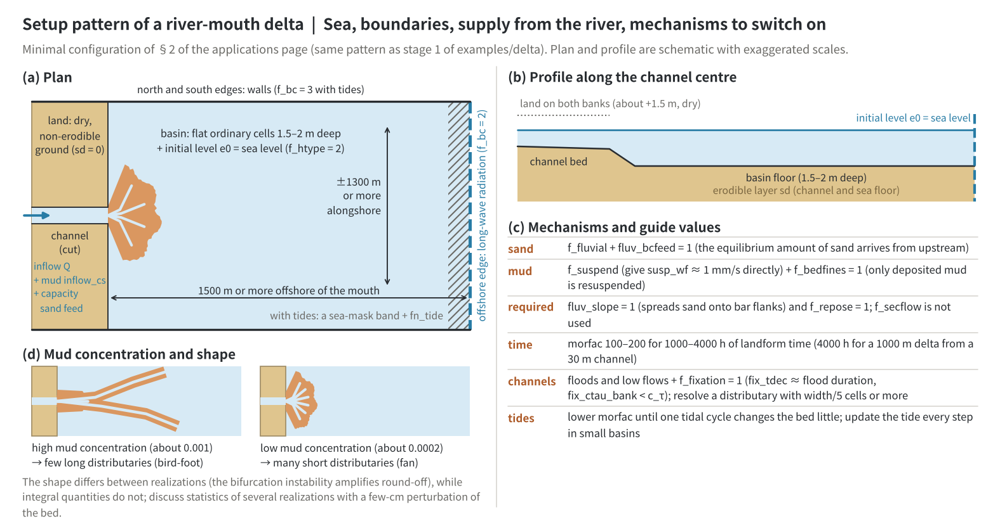
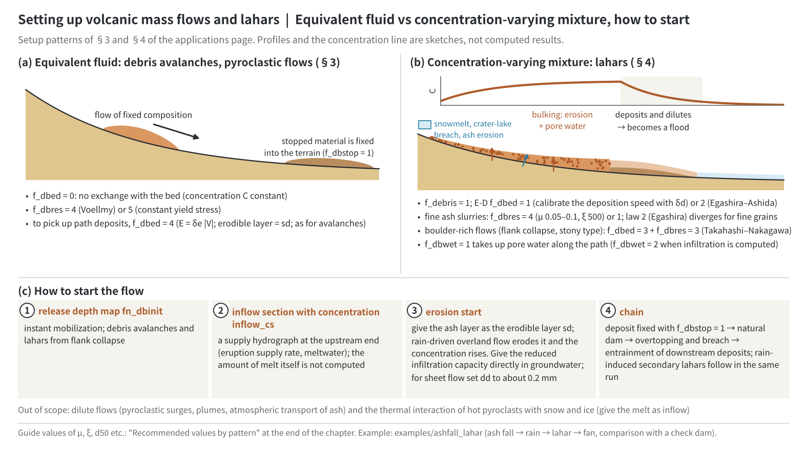
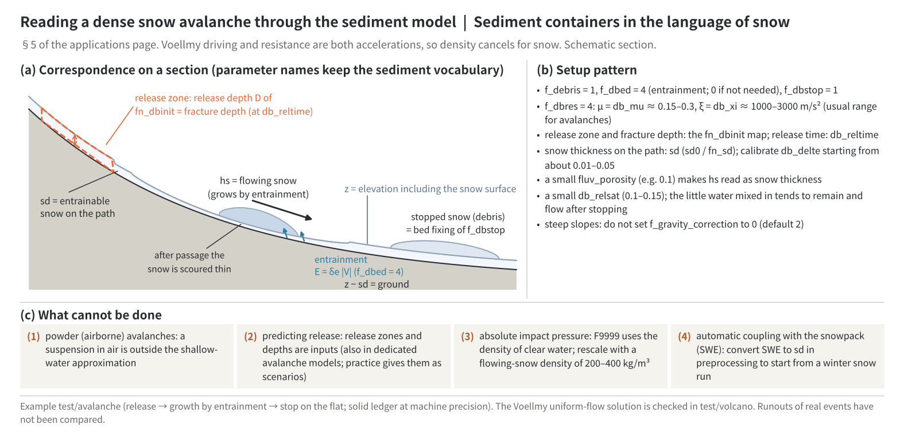
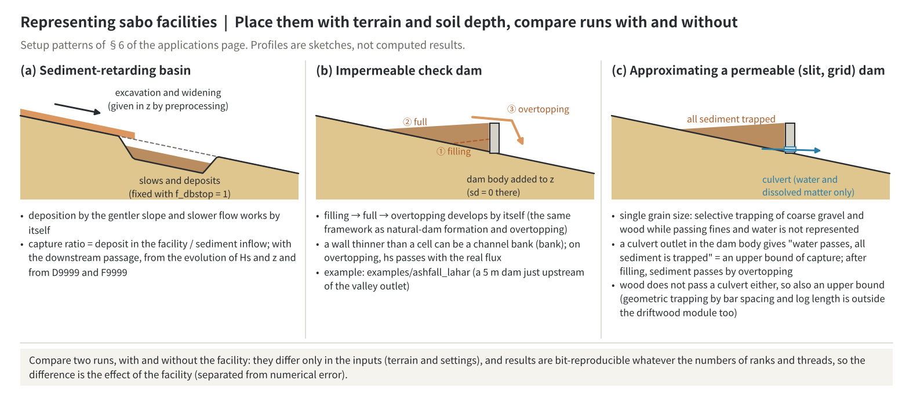

# Applications of sediment and landform change (setups by phenomenon)

> English mirror of docs/users_guide/geomorph_applications.md. The Japanese file is the master copy.

[Back to the sediment chapter](geomorph.md) | [Back to the user's guide index](../users_guide.md)

This page collects setups that combine the processes of the [sediment and landform change chapter](geomorph.md)
to compute particular phenomena. The meaning and default of each parameter are in the tables of the
chapter; the equations and the basis of the defaults are in
[Sediment transport, hillslope and long-term processes](sediment.md) and
[Debris flow, slope failure and moving bed layer](massflow.md). Rough values by type of phenomenon are in
[Recommended values by pattern](geomorph.md#recommended-values-by-pattern) at the end of the chapter,
and the list from phenomena to chapters is the [use-case index](usecases.md).

## 1. Tsunami deposits (resuspension by tsunamis and storm surges and deposition in the run-up zone)

Resuspension of bay-bottom mud or sand and its
deposition in the run-up zone can be represented with f_suspend. One
important condition: **sea-mask (fn_sw) cells do not solve the flow,
and none of the landform-change processes act on sea cells**. Represent
the water body to be resuspended not as a sea mask but as ordinary
cells with real bathymetry z plus an initial water level (f_htype=2 in
[Initial conditions](initial.md)), and let the tsunami enter through
the long-wave radiation edge boundary (type 2) or
water-level-prescribed cells ([Boundary conditions](boundary.md)).
Give the thickness and extent of the erodible layer as the soil depth
sd (sd=0 means non-erodible).
The two ways of representing the sea and where the sediment goes in each are shown in the figure of
[the sea mask and the fate of sediment](geomorph.md#suspended-sediment-f_suspend) in the chapter.

- **Sand**: the model's native regime. f_esform=2 (Itakura-Kishi) with
  susp_wf=0 (Rubey-derived) works without calibration parameters.
  Where the bedload contribution matters (run-up front, shallow
  high-velocity return flow), superpose f_fluvial.
- **Mud (cohesive)**: handled by reinterpretation. Give the effective
  floc settling velocity directly as susp_wf (on the order of
  1e-4 to 1e-3 m/s; the Rubey derivation is unrealistic at clay grain
  sizes), regard the f_esform=1 law E = wf*esa*(tau*/tau*c - 1) as
  identical in form to the Partheniades law E = M(tau/tau_ce - 1), and
  calibrate susp_esa and susp_tausc to the mud's erosion rate constant
  and critical shear stress. Flocculation and consolidation are not
  represented explicitly.

In the run-up zone settling dominates as the flow decelerates, and in
cells that dry out the entire suspended load is fixed to the bed. The
deposit thickness is obtained as the before/after difference of z
(f_out_z; the probe CSV also has hs and sd columns). Being single
grain size, the scope is deposit thickness and extent - the spatial
grain-size distribution (inland fining) is not represented. hs is a
passive scalar under the dilute assumption; high-concentration mud
flows (density currents) are out of scope.

## 2. River-mouth deltas

The process in which a river entering still water
builds a mouth bar, bifurcates, grows lobes and switches channels can be
computed with settings alone, representing the sea as ordinary cells + an
initial water level as in [the sea mask and the fate of sediment](geomorph.md#suspended-sediment-f_suspend) in the chapter and supplying both sand and mud (see the example
[examples/delta](../../../examples/delta/en/README.md), which also explains which mechanisms each
type of delta needs and gives the expected results). Minimal set-up: a flat
basin of ordinary cells 1.5-2 m deep
(f_htype=2, e0 = sea level), the far edge as a long-wave radiation boundary
(f_bc=2), a dug channel between dry non-erodible land (sd=0) with a section
inflow Q and a mud concentration inflow_cs (volume concentration
0.0002-0.001). Sand: f_fluvial + capacity feed fluv_bcfeed=1 (the upstream
reach delivers the equilibrium load); mud: f_suspend with an effective settling
velocity given directly (susp_wf about 1 mm/s, the cohesive-mud reading) +
f_bedfines=1 (only deposited mud is resuspended). fluv_slope=1 (spreads sand
over the bar flanks) and f_repose=1 are essential; f_secflow is not used.
morfac 100-200 for 1000-4000 h of morphological time (a 1000 m wide delta from
a 30 m wide channel needs about 4000 h and 1e6 m3 of supply; the domain should
extend 1500 m seaward and +-1300 m sideways). Expected behaviour: the more mud,
the fewer and longer the distributaries (bird-foot); the less mud, the more
distributaries in a fan. The shape differs between realisations (the
instability of the bifurcation amplifies round-off) while the integrated
quantities do not, so argue with the statistics of several realisations with
a few cm of noise on the bed. To look at the persistence of distributaries,
combine alternating floods and low flows with `f_fixation=1`, set `fix_tdec`
(decay while submerged) to about the duration of a flood and `fix_ctau_bank`
below the bed c_tau (without the decay an exposed bar becomes permanent and the
distributaries collapse to grid-width channels). Resolve the distributaries
with at least width/5 cells. To add a tide, place a strip of sea mask along the offshore side and give
the [tide level](tide.md) (fn_tide), and lower morfac so that the landform
change in one tidal cycle stays small (as a compromise with the computing
time, stages 6 and 7 of the example stop at 5 tidal cycles with morfac 24 and
240 and do not meet this condition; lowering the morfac of stage 7 to 120 and
60 changed the streaks stretching offshore and the amount of sand leaving
through the north and south sides considerably). Make the sides crossing the
coast lateral Neumann (f_bc = 3; when a low-tide channel reaches a side, sand
leaves together with the river water). In a small basin, update the
tide level every step (`dt_tiupdate` at or below the time step; the default update every minute can
excite a natural oscillation; "Water bodies with short natural periods" in
[tide level](tide.md#parameters-and-the-basis-of-their-defaults)).

Panels (a) and (b) are the plan and profile of the minimal configuration above: the sea is ordinary cells with
an initial level, the offshore edge radiates long waves, and the channel is cut between dry non-erodible land.
With tides, put a sea-mask band on the offshore edge and set the north and south edges to f_bc = 3. Panel (c)
lists the mechanisms and guide values, and (d) the shapes for high and low mud concentration. The sketch has
exaggerated scales and is not a computed result (computed results are in examples/delta).

## 3. Volcanic flows (debris avalanches, dense pyroclastic flows, lahars)

Density flows without bed erosion can be approximated with
the "equivalent fluid" setup `f_dbed = 0` (no exchange) plus
`f_dbres = 4` (Voellmy) or `5` (constant retarding stress) - the same
formulation level as dedicated volcanic-flow models. Initiate them with the
instantaneous mobilization (fn_dbinit; see the [ways to trigger](geomorph.md#debris-flow--landslide-f_debris--fn_dbinit--f_slide) in the chapter) or with a
sediment-laden inflow boundary (eruption supply rate), and fix stopped
material to the terrain with f_dbstop=1. Deposition, natural dam
formation, dam-break flooding, and rainfall-triggered secondary lahars
are all chained within a single run. If **entrainment of path
deposits** is needed (a debris avalanche growing by incorporating
colluvium or pyroclastic deposits along its path), use
`f_dbed = 4` (velocity-proportional entrainment E = δe·|V|) and give
the entrainable layer thickness as the soil depth sd (the mechanism
and setup are the same as in [§5 (snow avalanches)](#5-snow-avalanches-dense-flow) —
only the reinterpretation of the entrainable layer differs). Dilute
phenomena (pyroclastic surges, plumes, atmospheric ash transport) are
out of scope by design (see debris_plan.md §5). The equivalent fluid and the concentration-varying
mixture of §4 are compared in the figure at the end of §4.

## 4. Lahars (volcanic mudflows)

Lahars are generated by eruption-driven snow and
glacier melt or by the breach of a crater lake; they descend the valley
taking up deposits and water (bulking), then dilute downstream and
grade into a flood. They are treated not as an equivalent fluid but as a
**mixture whose concentration changes** (this is where using ENCflow
pays off).

- **Typical setup**: `f_debris = 1`; for the E-D use `f_dbed = 1`
  (Takahashi-type relaxation; delta_d sets how fast it deposits) or
  `f_dbed = 2` (Egashira-Ashida); for the resistance law use
  **`f_dbres = 4` (Voellmy, mu 0.05-0.1, xi 500) for fine ash slurries**
  or `f_dbres = 1` (Coulomb + Manning, phi 30-35 deg). The laminar
  resistance of the Egashira law (`f_dbres = 2`) scales with (h/d)^-2, so
  **with d50 of a millimetre or less the resistance vanishes and the
  velocity blows up** (it suits stony flows with d50 of centimetres or
  more). For boulder-dominated flows (sector-collapse origin, stony type
  descending a torrent) use `f_dbed = 3` + `f_dbres = 3`
  (Takahashi-Nakagawa). `f_dbwet = 1` (uptake of path pore water) is
  recommended as the first-order bulking effect. With infiltration
  (`fn_gwflow`) use `f_dbwet = 2` (the water that had soaked into the eroded
  layer returns to the surface, and the capacity added by deposition is filled
  from the local surface water). Working
  example: [examples/ashfall_lahar](../../../examples/ashfall_lahar/en/README.md)
  (infiltration lowered by the ash → rainfall → mudflow → fan deposition, compared
  with before the eruption and with a check dam).
- **How to initiate**: an **erosion-triggered** start, in which the ash
  layer is given as an erodible soil layer sd and the rain runoff raises the
  concentration by erosion (no source needs to be specified; give the drop in
  infiltration caused by the ash directly as the infiltration capacity of
  [Groundwater](gwflow.md); examples/ashfall_lahar), a **sediment-laden segment inflow** at the
  upstream end (the supply hydrograph; inflow_cs of
  [Boundary conditions](boundary.md)), or a **chain** in which deposits
  from an earlier stage form a natural dam and breach (deposits fixed by
  f_dbstop=1 → overtopping breach → entrainment of downstream deposits).
  The collapse-depth distribution fn_dbinit is for sector-collapse
  origins. When an erosion-triggered start works on sheet flow on slopes
  (about 1 mm deep), make the movement threshold depth `dd`
  ([Shallow water flow computation](swflow.md)) well below the flow depth (about 0.2 mm).
  When it is comparable with the flow depth (the default 1 mm), cells switch
  between flowing and stopped, and grid-scale stripes of erosion and deposit
  grow.
- **Limits**: the thermal interaction of hot pyroclasts with snow and
  ice (the melt volume) is out of scope; give the meltwater as an inflow
  hydrograph. Dilute systems (pyroclastic surges) are out of scope
  (debris_plan.md §5).

Panel (a) is the equivalent fluid of §3: a flow that exchanges nothing with the bed (its concentration does not
change) stops and is fixed into the terrain. Panel (b) is a lahar: erosion and pore water along the path raise
the concentration (bulking), and downstream it deposits, dilutes and turns into a flood; the concentration line
sketches this sequence and is not a computed result. Panel (c) shows the four ways to start the flow.

## 5. Snow avalanches (dense flow)

The equivalent-fluid setup of [§3](#3-volcanic-flows-debris-avalanches-dense-pyroclastic-flows-lahars) is
also the standard formulation for dense-flow snow avalanches. The
Voellmy law (μ + gV²/ξ) was originally developed for avalanches, and
the workflow is the same as operational avalanche models: give the
release area and fracture depth, and compute runout and deposition.
Voellmy dynamics are density-independent (both driving and resistance
are in acceleration form, so density cancels), which is why snow being
much lighter than water does not affect the runout computation.
Avalanches **borrow** the sediment-flow model, reinterpreting its
reservoirs in snow terms (the parameter names keep their sediment
vocabulary):

| Model quantity (sediment name) | Reinterpretation for avalanches |
|---|---|
| sd (soil depth = movable layer) | entrainable snow depth along the path |
| hs (sediment column) | (net) volume of flowing snow |
| z (elevation) | snow-surface elevation (z − sd is the ground) |
| fluv_porosity λ | snow-porosity interpretation (keep it small so hs ≈ snow depth) |
| collapse depth D of fn_dbinit | fracture depth of the release area |
| bed fixing of f_dbstop | deposition of the stopped snow (debris) |

Through this reuse, the verified conservation machinery (solid budget
and the co-update identity) applies to snow as well. Dense-flow snow
avalanches and sediment density flows are the same "granular
shallow-water flow", so the reuse rests on an identity of
formulation, not on appearances.

Panel (a) places the reinterpretation of the table above on a slope section: z is the elevation including the
snow surface, sd the entrainable snow on the path, z − sd the ground, and the fracture depth of the release zone
is the release depth D of fn_dbinit. The flowing snow hs grows by entraining the snow on the path, and stopped
snow is fixed into the terrain by f_dbstop. Panel (b) summarizes the setup below and (c) what cannot be done.

- **Typical setup**: `f_debris = 1`, `f_dbed = 4`
  (**velocity-proportional entrainment** of path snow, E = δe·|V|; use
  0 if entrainment is not needed), `f_dbres = 4`
  (μ = db_mu ≈ 0.15-0.3 and ξ = db_xi ≈ 1000-3000 m/s² are the
  customary avalanche ranges), `f_dbstop = 1` (fix stopped material to
  the terrain). Give the release area and fracture depth (snow
  thickness) with `fn_dbinit`, and the release time with
  `db_reltime`. The **entrainable snow depth along the path is given
  as the soil depth sd** (sd0 / fn_sd; z is the snow-surface
  elevation and z−sd the ground; the entrainment coefficient
  `db_delte` is a calibration parameter, typically 0.01-0.05).
  A small `fluv_porosity` (e.g., 0.1) makes hs read
  approximately as snow thickness. Keep `db_relsat` small (e.g.,
  0.1-0.15) - the mixture model carries a small amount of water as the
  carrier fluid, and that water remains and drains after the avalanche
  stops (a minor artifact if the amount is small). Steep terrain, so
  keeping `f_gravity_correction` above 0 is recommended (the default is 2).
- **What it cannot do (honest limits)**: (1) powder-snow
  avalanches are out of scope (an air suspension - outside the
  shallow-water approximation), (2) release is not predicted (the
  release area and fracture depth are inputs - the same as dedicated
  avalanche models, where release is given as a scenario), (3) impact
  pressures need conversion (F9999 is normalized by the freshwater
  density; use the flowing-snow density of 200-400 kg/m³ for avalanche
  impact pressures), (4) no automatic coupling with the snow (SWE)
  module (to chain from a winter snowpack run, convert SWE to sd in
  preprocessing).
- A verified example is [test/avalanche](../../../test/avalanche/en/README.md)
  (release → growth to 1.5x by entrainment → stopping on the flat;
  solid ledger at machine precision). The Voellmy steady uniform-flow
  analytic benchmark (0.04% agreement) is continuously tested in
  [test/volcano](../../../test/volcano/en/README.md) configuration 1 (the same
  resistance law). Comparison with observed avalanche runouts has not
  been done. The "avalanche redistribution" in the glacier module is a
  slow slope redistribution of snow for accumulation - a different
  thing from the dynamic avalanche flow described here.

## 6. Sabo facilities (sediment-retarding basins, check dams)

The effect of a countermeasure facility is studied as a
two-case comparison (with / without). The difference is only in the
inputs (terrain and settings), and results are bit-reproducible
regardless of rank or thread count, so the difference between the two
cases is exactly the facility's effect, cleanly separated from
numerical noise.

Panel (a) is a sediment-retarding basin (an excavation in the terrain), (b) an impermeable check dam (dam body
added to the terrain with sd = 0; filling → full → overtopping), and (c) the approximation of a permeable dam
(a culvert passes only water and all sediment is trapped = the upper bound of capture). The profiles are
sketches, not computed results.

- **Sediment-retarding basin (yusachi)**: just carve the excavation
  and widening into the terrain z in preprocessing. Deposition by
  slope reduction and deceleration (fixed to the terrain with
  f_dbstop=1) acts automatically, and the trap efficiency (deposit
  volume inside the facility / sediment inflow) and the sediment load
  passed downstream can be quantified from the time evolution of Hs
  and z and from D9999/F9999.
- **Closed-type check dam**: add the dam body to the terrain z and set
  the soil depth there to sd=0 (non-erodible). The time evolution of
  sedimentation -> filling -> crest overflow emerges automatically
  (the same framework as landslide-dam formation and overtopping). Example:
  [examples/ashfall_lahar](../../../examples/ashfall_lahar/en/README.md) (a 5 m dam just
  upstream of the valley outlet; with terrain in which the slope water reaches the
  valley floor upstream of the dam, all the upstream flow passes the dam). To
  represent the body as a wall thinner than a cell, the channel levee
  (bank; [Channels](channel.md)) can be used - on overtopping the
  sediment (hs) crosses together with the water as a real flux.
- **Open-type (slit / grid) check dam**: being single grain size, the
  size selectivity ("trap coarse boulders and driftwood, pass fines
  and water") cannot be represented. Giving the dam body
  (non-erodible terrain) an outlet with a culvert
  ([Structures](structure.md); it transfers only the water and the
  dissolved water-quality substance and carries no sediment) yields the approximation "passes water, traps
  all sediment" = an **upper-bound estimate of trapping**. After
  filling, sediment passes downstream by crest overflow. The map-scale
  generation, transport and deposition of driftwood is handled by
  [Driftwood](driftwood.md) (culverts carry no wood either, so the
  trapping is likewise an upper-bound estimate; geometric size-selective
  trapping by member spacing vs. log length is out of scope of the
  driftwood module as well). For a dam whose open part can be represented
  by cells (grid type and the like), making the cells of the open part capture
  cells for driftwood lets the jam of captured wood raise the water, slow the
  flow upstream and so retain sediment as well
  ([capture and jamming at structures](driftwood.md#capture-and-jamming-at-structures-fn_dwtrap)
  in the driftwood chapter; the capture ratio is a given, and with a single grain
  size blockage by boulders cannot be represented).
