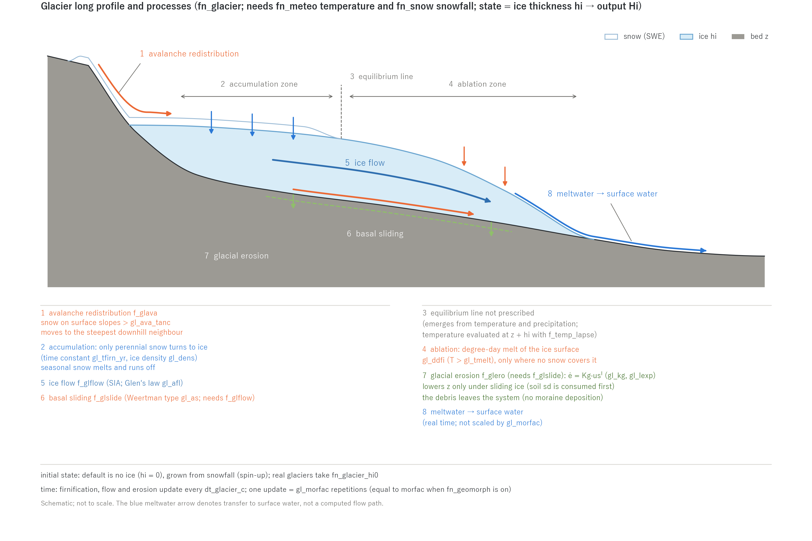

# Glaciers (&list_glacier)

> English mirror of docs/users_guide/glacier.md. The Japanese file is the master copy.

[Back to the User's Guide index](../users_guide.md)

Handles accumulation, ablation, and ice flow of land glaciers, and the
glacial erosion of landforms (cirques, U-shaped valleys) that flowing
ice produces. Enabled with `fn_glacier`. **Air temperature (fn_meteo)
and snow accumulation/snowmelt (fn_snow) are required** (snowfall is
the accumulation source). Like landform change, the processes are
**stackable**: enable only what you need.

The minimal input to "just try it" is **an empty &list_glacier in
fn_glacier** (plus fn_meteo and fn_snow, both of which may be empty
groups). The degree-day, sliding and erosion coefficients have
defaults (the "Default" column; rationale in developer.md §65); when
unspecified the default is adopted and printed with "(default)". The
default configuration is "grow from no ice by snowfall, SIA flow on,
no sliding or erosion". Set gl_morfac and t_cycle, which buy
geomorphic time, to suit the problem (see the
[configuration example](#configuration-example) below).

| Process | Flag | Description |
|---|---|---|
| Mass balance | (always on) | Firnification of perennial snow (accumulation) and degree-day melt of the ice surface (ablation) |
| Ice flow | f_glflow | Ice deformation flow by the shallow ice approximation (SIA) |
| Basal sliding | f_glslide | Weertman-type basal sliding (requires f_glflow) |
| Glacial erosion | f_glero | Bed erosion proportional to sliding speed (requires f_glslide) |
| Avalanche redistribution | f_glava | Gravitational transport of snow off steep slopes |



Along the long profile, perennial snow in the accumulation zone turns into ice
with the time constant gl_tfirn_yr, while in the ablation zone the snow-free ice
surface melts with the degree-day factor gl_ddfi and the meltwater enters the
surface water (the equilibrium line emerges from temperature and precipitation).
The ice flows downhill by SIA deformation (f_glflow) and basal sliding
(f_glslide), f_glero lowers the bed z only under sliding ice, and f_glava moves
snow off steep walls. The figure is generated by docs/figs/make_guide_figs.py.

The state is the per-cell ice thickness (m), written as the
distributed field `Hi0001...` at every output time. The conserved
storage column S_total on screen and in the Log includes the water
equivalent of the ice, and restarts
([Suspend and restart](restart.md)) continue from the private file
glacier.dat in the state directory (fn_glacier must have been enabled
when saving).

The design background (the SIA formulation, the time-acceleration
concept, and the documented simplifications) is in the developer
document [docs/glacier_plan.md](../../glacier_plan.md) (Japanese).

## Execution control and the notion of time

Glaciers evolve far more slowly (years to millennia) than the
hydraulics (seconds to days), so ENCflow uses **intermittent updates
and time acceleration** to cover geomorphic time.

| Parameter | Default | Meaning |
|---|---|---|
| f_glacier | 1 | 0 temporarily disables while keeping the file |
| dt_glacier_c | "1 day" | Update interval for firnification, flow, and erosion (a duration string such as "6 hour") |
| gl_morfac | 1.0 | Glacier-time acceleration factor. One update = gl_morfac repetitions of the same event for the ice and the landform |

- **Meltwater is not accelerated**: water produced by ice melt enters
  the surface water at the real-time rate every step (driving the
  flood computation), while only the ice loss is multiplied by
  gl_morfac (the same concept as morfac in landform change).
- **When combined with sediment/landform change (fn_geomorph),
  gl_morfac must equal morfac in &list_geomorph** (a single
  "geomorphic time" is an ENCflow contract; a mismatch stops the run
  at initialization).
- Millennial-scale experiments are composed of a repeated
  representative year (t_cycle_c in &list_sysparam) × gl_morfac ×
  restart chaining (the same recipe as long-term landform change; see
  the [sediment and landform change chapter](geomorph.md)).

## Mass balance (accumulation and ablation)

| Parameter | Default | Meaning |
|---|---|---|
| gl_dens | 900.0 | Ice density $`\rho_i`$ (kg/m³), used for the SWE ⇄ ice-thickness conversion (standard glacier ice 900–917) |
| gl_tfirn_yr | 10.0 | Time constant of snow-to-ice conversion (firnification) in years; a few to ~10 years for temperate glaciers |
| gl_ddfi | 8.0 | Degree-day factor of the ice surface $`d_i`$ (mm/°C/day). Larger than the snow value (snow_ddf; lower albedo); the low end of the 5.5–20 of Hock's compilation for ice[^hock03] |
| gl_tmelt | 0.0 | Air-temperature threshold for ice melt (°C) |

```math
\Delta h_i = \frac{\rho_w}{\rho_i}\,\mathrm{SWE}\left(1 - e^{-\Delta t_w/\tau_{firn}}\right),
\qquad
\Delta h_{i,melt} = -\frac{\rho_w}{\rho_i}\,\min\!\left(h_i\frac{\rho_i}{\rho_w},\ d_i\max(T - T_{melt}, 0)\frac{\Delta t}{86400}\right)
```

- Snowfall accumulates as SWE through the snow feature, and **only
  snow that survives the year** is slowly converted to ice with time
  constant $`\tau_{firn}`$ (gl_tfirn_yr); seasonal snow simply melts and
  runs off. The exponential relaxation is evaluated with the hydraulic
  time $`\Delta t_w`$, so seasonal snow is hardly converted.
- Ice melts **only where it is not covered by snow** (snow melts
  first).
- Air temperature is evaluated at the **ice-surface elevation**
  (ground + ice thickness), so combined with the temperature lapse
  rate (f_temp_lapse in &list_meteo) a thicker glacier has a colder
  surface — a realistic feedback. The snow line and equilibrium line
  are not prescribed; they **emerge** from temperature and
  precipitation.

## Ice flow (f_glflow)

With the shallow ice approximation (SIA)[^hutter83], ice deforms under its
own weight and flows toward lower ice-surface elevations. It is solved as
a nonlinear diffusion of the ice surface $`s = z + h_i`$:

```math
\frac{\partial h_i}{\partial t} = \nabla\cdot\left(D\,\nabla s\right),
\qquad
D = \underbrace{\frac{2A}{5}(\rho_i g)^3\,h_i^{5}\,|\nabla s|^2}_{\text{deformation (Glen } n = 3)}
  + \underbrace{A_s(\rho_i g)^3\,h_i^{4}\,|\nabla s|^2}_{\text{sliding (}\texttt{f\_glslide})}
```

The first term is the SIA ice flux from the vertical integration of
Glen's flow law[^glen55] $`\dot\varepsilon = A\tau^3`$; the second puts the
Weertman sliding of the next section into the same diffusive form. The
default $`A`$ = 1e-16 Pa⁻³ yr⁻¹ is the recommended value for temperate ice
(0 °C)[^cuffey10].

| Parameter | Default | Meaning |
|---|---|---|
| gl_afl | 1.0e-16 | Glen flow-law coefficient A (Pa⁻³ yr⁻¹); ~1e-16 for temperate ice |
| gl_cfl | 0.4 | Numerical stability safety factor (normally leave unchanged) |
| gl_nsubmax | 10000 | Upper bound on internal iterations per update (guards against runaway parameters) |

You do not need to worry about the time step: the model checks the
stability condition from the current ice thickness and slope at every
update and subdivides internally as needed (ice volume is conserved
exactly).

## Basal sliding and glacial erosion (f_glslide / f_glero)

| Parameter | Default | Meaning |
|---|---|---|
| gl_as | 1e-13 | Weertman sliding coefficient As (m yr⁻¹ Pa⁻³). Read when f_glslide=1. The default gives 100 m/yr at a basal shear stress of 100 kPa (the fast side of mountain glaciers) |
| gl_kg | 1e-4 | Erosion coefficient Kg. Read when f_glero=1. Coefficient of the erosion law ė = Kg·usˡ with sliding speed us measured in m/yr (dimensionless for l=1; the measured 1e-4 of Humphrey & Raymond 1994) |
| gl_lexp | 1.0 | Power-law exponent l of the erosion law (1–2) |

```math
u_s = A_s\,\tau_b^3,
\qquad
\tau_b = \rho_i g\,h_i\,|\nabla s|,
\qquad
\dot e = K_g\,u_s^{\,l}\ (u_s\ \text{in m/yr})
```

A Weertman-type sliding law[^weertman57] ($`m`$ = 3 fixed) and a glacial
erosion law proportional to a power of the sliding speed[^humphrey94]. The
default $`A_s`$ = 1e-13 m yr⁻¹ Pa⁻³ gives 100 m/yr at a basal shear stress
of 100 kPa (typical 50–150 kPa[^cuffey10]), the fast side of mountain
glaciers (10–100 m/yr). The default $`K_g`$ = 1e-4 ($`l`$ = 1) is the
measurement at Variegated Glacier (erosion rate ≈ 1e-4 × sliding
speed)[^humphrey94]; with $`l`$ = 2[^herman15] a separate calibration gives
1e-7 to 1e-6.

- Erosion occurs **only under sliding ice** (f_glero requires
  f_glslide); thin ice erodes almost nothing.
- Erosion lowers the computed elevation z and, if a soil layer sd
  exists, reduces it in step (once the soil is exhausted the bedrock
  erodes). Terrain evolution can be output with `f_out_z = 1` as
  `Z0001...`.
- Eroded debris is treated as evacuated from the system by ice and
  meltwater (depositional moraines are not yet represented; the total
  is reported at the end of the run).

## Avalanche redistribution (f_glava)

| Parameter | Default | Meaning |
|---|---|---|
| gl_ava_tanc | 0.6 | Critical avalanche slope tan θc (0.6 ≈ 31°) |

On cells whose steepest ice-surface slope $`\tan\theta`$ exceeds the
threshold, the fraction $`\min(1, (\tan\theta - \tan\theta_c)/\tan\theta_c)`$ of
the snow is moved to the steepest-descent neighbour. The threshold 0.6
(≈ 31°) is a customary value near the angle of repose of dry snow. This is a simple
representation of cliffs shedding snow so that accumulation
concentrates into cirques. Recommended for cirque-formation
experiments.

## Initial conditions

| Parameter | Default | Meaning |
|---|---|---|
| fn_glacier_hi0 | "" | Distributed initial ice thickness file (m) |

- **The default is ice-free** (hi = 0): the glacier is grown from
  snowfall (spin-up). This is the standard approach for glacial
  landform experiments. Save the spun-up steady state and branch
  climate scenarios from it via restart.
- For meltwater/runoff analyses of real glaciers, clip an ice
  thickness product (e.g. the Farinotti et al. consensus estimate) in
  GIS and supply it as fn_glacier_hi0. On restart, the saved ice
  thickness takes precedence.

## Configuration example

```
&list_meteo
  tempval(:,1) = 0.0, -5.0      ! representative-year temperature (elapsed days, degC)
  tempval(:,2) = 182.5, 10.0
  tempval(:,3) = 365.0, -5.0
  f_temp_lapse = 1              ! lapse rate (elevation-dependent snow line)
  f_prec_lapse = 1              ! precipitation gradient (more accumulation higher up)
  prec_lapse = 5.0              ! +5%/100m
/
&list_snow
  snow_ddf = 4.0                ! same as the default (may be omitted)
/
&list_glacier
  dt_glacier_c = "1 day"
  gl_morfac = 100.0             ! 1 computed year = 100 glacier/landform years
  gl_ddfi = 8.0                 ! same as the default (may be omitted)
  f_glflow = 1
  f_glslide = 1
  gl_as = 1.0e-13               ! same as the default (may be omitted)
  f_glero = 1
  gl_kg = 1.0e-4                ! same as the default (may be omitted)
  f_glava = 1
/
```

**Recommended values by pattern** (calibration quantities; sources in
developer.md §65)

| Type | gl_ddfi | gl_afl (Pa⁻³ yr⁻¹) | gl_as (m yr⁻¹ Pa⁻³) | gl_kg | Notes |
|---|---|---|---|---|---|
| Temperate glacier (Alps; perennial snow patches to small glaciers in Japan) | 6-10 | 1e-16 | 1e-13 to 1e-12 | 1e-4 | Bed at the melting point, fast sliding. Erosion experiments: f_glslide + f_glero |
| Cold / polar type (high latitude or altitude) | 4-7 | 1e-17 to 1e-16 | 0 (no sliding = f_glslide=0) | - | Frozen bed; deformation flow only |
| Glacier hydrology (meltwater runoff) only | 6-10 | - | - | - | f_glflow=0 (a glacier that does not flow) + ice thickness from fn_glacier_hi0 |
| Cirque / U-shaped valley formation experiments | 8 | 1e-16 | 1e-13 | 1e-4 (l=1) / 1e-7 to 1e-6 (l=2) | Millennia via gl_morfac x t_cycle. f_glava=1 |

Long-period climate change (glacial cycles, warming trends) can be
superimposed on the representative year with `tempofs` (an air
temperature offset series) in &list_meteo
([rainfall and weather chapter](forcing.md)).

## Combination requirements

| Use | Required other features |
|---|---|
| Glacier mass balance and meltwater | Precipitation + weather forcing + snow |
| Ice flow (f_glflow) | Same as above |
| Glacial erosion (f_glero) | f_glslide (+ t_cycle and restart chaining for long experiments) |
| Combined with landform change | fn_geomorph (with matching morfac) |

Idealized verification experiments (an analytic SIA benchmark and a
cirque-formation test) are in [test/glacier/](../../../test/glacier/),
and an annotated configuration sample is in
[examples/List_samples/en/list_glacier.txt](../../../examples/List_samples/en/list_glacier.txt).

## References

[^hock03]: Hock, R. (2003): Temperature index melt modelling in mountain areas. *J. Hydrol.*, 282, 104–115.
[^hutter83]: Hutter, K. (1983): *Theoretical Glaciology*. Reidel, Dordrecht. (shallow ice approximation)
[^glen55]: Glen, J. W. (1955): The creep of polycrystalline ice. *Proc. R. Soc. Lond. A*, 228, 519–538.
[^cuffey10]: Cuffey, K. M. and Paterson, W. S. B. (2010): *The Physics of Glaciers*, 4th ed. Elsevier. (recommended A, typical basal shear stress)
[^weertman57]: Weertman, J. (1957): On the sliding of glaciers. *J. Glaciol.*, 3, 33–38.
[^humphrey94]: Humphrey, N. F. and Raymond, C. F. (1994): Hydrology, erosion and sediment production in a surging glacier: Variegated Glacier, Alaska, 1982–83. *J. Glaciol.*, 40, 539–552.
[^herman15]: Herman, F., Beyssac, O., Brughelli, M., Lane, S. N., Leprince, S., Adatte, T., Lin, J. Y. Y., Avouac, J.-P. and Cox, S. C. (2015): Erosion by an Alpine glacier. *Science*, 350, 193–195.
