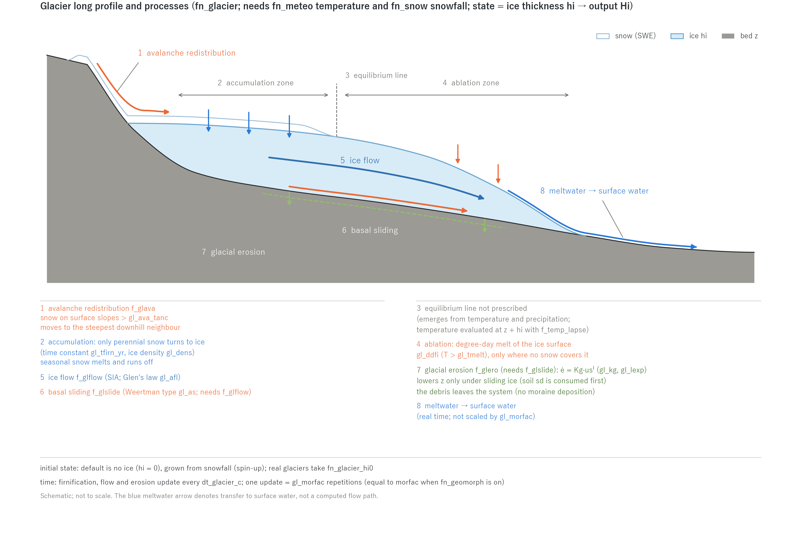

# Glaciers (&list_glacier)

> English mirror of docs/users_guide/glacier.md. The Japanese file is the master copy.

[Back to the User's Guide index](../users_guide.md)

Handles accumulation, ablation, and ice flow of land glaciers, and the
glacial erosion of landforms (cirques, U-shaped valleys) that flowing
ice produces. Enabled with `fn_glacier`. **Air temperature (fn_meteo)
and snow accumulation/snowmelt (fn_snow) are required** (snowfall is
the accumulation source). Like landform change, the processes are
**stackable**: enable only what you need.

| Process | Flag | Description |
|---|---|---|
| Mass balance | (always on) | Firnification of perennial snow (accumulation) and degree-day melt of the ice surface (ablation) |
| Ice flow | f_glflow | Ice deformation flow by the shallow ice approximation (SIA) |
| Basal sliding | f_glslide | Weertman-type basal sliding (requires f_glflow) |
| Glacial erosion | f_glero | Bed erosion proportional to sliding speed (requires f_glslide) |
| Avalanche redistribution | f_glava | Gravitational transport of snow off steep slopes |



Along the long profile, perennial snow in the accumulation zone turns into ice
with the time constant gl_tfirn_yr, while in the ablation zone the snow-free ice
surface melts with the degree-day factor gl_ddfi and the meltwater enters the
surface water (the equilibrium line emerges from temperature and precipitation).
The ice flows downhill by SIA deformation (f_glflow) and basal sliding
(f_glslide), f_glero lowers the bed z only under sliding ice, and f_glava moves
snow off steep walls.

The state is the per-cell ice thickness (m), written as the
distributed field `Hi0001...` at every output time. The conserved
storage column S_total on screen and in the Log includes the water
equivalent of the ice, and restarts
([Suspend and restart](restart.md)) continue from the private file
glacier.dat in the state directory (fn_glacier must have been enabled
when saving).

The design background (the SIA formulation, the time-acceleration
concept, and the documented simplifications) is in the developer
document [docs/glacier_plan.md](../../glacier_plan.md) (Japanese).

The minimal input to "just try it" is **an empty &list_glacier in
fn_glacier** (plus fn_meteo and fn_snow, both of which may be empty
groups). The degree-day, sliding and erosion coefficients and the
erosion coupling length have defaults (the "Default" column; basis in [Parameters and the basis of their defaults](#parameters-and-the-basis-of-their-defaults) below); when
unspecified the default is adopted and printed with "(default)". The
default configuration is "grow from no ice by snowfall, SIA flow on,
no sliding or erosion". Set gl_morfac and t_cycle, which buy
geomorphic time, to suit the problem (see the
[configuration example](#configuration-example) below).

How to read the results (fields, ledgers, measurement columns, restart) is summarized in [Output and monitoring](#output-and-monitoring) on this page. Each feature section also ends with a short note on just the outputs that concern it.

## Execution control and the notion of time

Glaciers evolve far more slowly (years to millennia) than the
hydraulics (seconds to days), so ENCflow uses **intermittent updates
and time acceleration** to cover geomorphic time.

| Parameter | Default | Meaning |
|---|---|---|
| f_glacier | 1 | 0 temporarily disables while keeping the file |
| dt_glacier_c | "1 day" | Update interval for firnification, flow, and erosion (a duration string such as "6 hour") |
| gl_morfac | 1.0 | Glacier-time acceleration factor. One update = gl_morfac repetitions of the same event for the ice and the landform |

- **Meltwater is not accelerated**: water produced by ice melt enters
  the surface water at the real-time rate every step (driving the
  flood computation), while only the ice loss is multiplied by
  gl_morfac (the same concept as morfac in landform change).
- **When combined with sediment/landform change (fn_geomorph),
  gl_morfac must equal morfac in &list_geomorph** (a single
  "geomorphic time" is an ENCflow contract; a mismatch stops the run
  at initialization).
- Millennial-scale experiments are composed of a repeated
  representative year (t_cycle_c in &list_sysparam) × gl_morfac ×
  restart chaining (the same recipe as long-term landform change; see
  the [sediment and landform change chapter](geomorph.md)).

## Mass balance (accumulation and ablation)

| Parameter | Default | Meaning |
|---|---|---|
| gl_dens | 900.0 | Ice density $`\rho_i`$ (kg/m³), used for the SWE ⇄ ice-thickness conversion (standard glacier ice 900–917) |
| gl_tfirn_yr | 10.0 | Time constant of snow-to-ice conversion (firnification) in years; a few to ~10 years for temperate glaciers |
| gl_ddfi | 8.0 | Degree-day factor of the ice surface $`d_i`$ (mm/°C/day). Larger than the snow value (snow_ddf; lower albedo); the low end of the 5.5–20 of Hock's compilation for ice[^hock03] |
| gl_tmelt | 0.0 | Air-temperature threshold for ice melt (°C) |

```math
\Delta h_i = \frac{\rho_w}{\rho_i}\,\mathrm{SWE}\left(1 - e^{-\Delta t_w/\tau_{firn}}\right),
\qquad
\Delta h_{i,melt} = -\frac{\rho_w}{\rho_i}\,\min\!\left(h_i\frac{\rho_i}{\rho_w},\ d_i\max(T - T_{melt}, 0)\frac{\Delta t}{86400}\right)
```

- Snowfall accumulates as SWE through the snow feature, and **only
  snow that survives the year** is slowly converted to ice with time
  constant $`\tau_{firn}`$ (gl_tfirn_yr); seasonal snow simply melts and
  runs off. The exponential relaxation is evaluated with the hydraulic
  time $`\Delta t_w`$, so seasonal snow is hardly converted.
- Ice melts **only where it is not covered by snow** (snow melts
  first).
- Air temperature is evaluated at the **ice-surface elevation**
  (ground + ice thickness), so combined with the temperature lapse
  rate (f_temp_lapse in &list_meteo) a thicker glacier has a colder
  surface — a realistic feedback. The snow line and equilibrium line
  are not prescribed; they **emerge** from temperature and
  precipitation.

**Outputs for this section**: the ice thickness `Hi0001...` (automatic), the snow `Sw0001...`, and S_total in the log (with the ice water equivalent). There is no ledger of accumulation and melt; read them from the annual change of Hi and from Sw ([Output and monitoring](#output-and-monitoring)).

## Ice flow (f_glflow)

With the shallow ice approximation (SIA)[^hutter83], ice deforms under its
own weight and flows toward lower ice-surface elevations. It is solved as
a nonlinear diffusion of the ice surface $`s = z + h_i`$:

```math
\frac{\partial h_i}{\partial t} = \nabla\cdot\left(D\,\nabla s\right),
\qquad
D = \underbrace{\frac{2A}{5}(\rho_i g)^3\,h_i^{5}\,|\nabla s|^2}_{\text{deformation (Glen } n = 3)}
  + \underbrace{A_s(\rho_i g)^3\,h_i^{4}\,|\nabla s|^2}_{\text{sliding (}\texttt{f\_glslide})}
```

The first term is the SIA ice flux from the vertical integration of
Glen's flow law[^glen55] $`\dot\varepsilon = A\tau^3`$; the second puts the
Weertman sliding of the next section into the same diffusive form. The
default $`A`$ = 1e-16 Pa⁻³ yr⁻¹ is the recommended value for temperate ice
(0 °C)[^cuffey10].

| Parameter | Default | Meaning |
|---|---|---|
| gl_afl | 1.0e-16 | Glen flow-law coefficient A (Pa⁻³ yr⁻¹); ~1e-16 for temperate ice |
| gl_cfl | 0.4 | Numerical stability safety factor (normally leave unchanged) |
| gl_nsubmax | 10000 | Upper bound on internal iterations per update (guards against runaway parameters) |

You do not need to worry about the time step: the model checks the
stability condition from the current ice thickness and slope at every
update and subdivides internally as needed (ice volume is conserved
exactly).

The computation uses the 4-neighbour grid. The $`|\nabla s|`$ of the
diffusivity is found from the gradients both across and along the boundary
with the neighbouring cell, so an ice cap on a flat bed spreads to a shape that
does not depend on the grid orientation (in the Halfar dome of test/glacier,
the ratio of the ice volumes in the sectors along the grid axes and the
diagonals agrees with the analytic ratio to 0.6%). Only cells with ice are
used for the gradient along the boundary (so that the slope of valley walls
does not enter the diffusivity). Before the change of 2026-11-03 only the
gradient across the boundary was used, so ice flowed less readily along the
diagonals and was biased toward the grid axes (−5.5% in the same check;
developer.md Sec. 45.1).

No ice is placed on the cells of the sea mask (fn_sw): the sea area of the
initial ice thickness fn_glacier_hi0 is zeroed, and neither the flow nor
the avalanche redistribution sends ice to sea cells. Tidewater glaciers
that flow into the sea and calve are out of scope; where a glacier reaches
the coast, its terminus stops at the shoreline and the ice thickens until
melt balances the inflow ([Tide](tide.md)).

**Outputs for this section**: the effect of flow is the spreading of `Hi0001...` (extending down the valley). "SIA subcycles total" is printed at the end; an extreme count is a hint to revisit gl_afl and gl_morfac ([Output and monitoring](#output-and-monitoring)).

## Basal sliding and glacial erosion (f_glslide / f_glero)

| Parameter | Default | Meaning |
|---|---|---|
| gl_as | 1e-13 | Weertman sliding coefficient As (m yr⁻¹ Pa⁻³). Read when f_glslide=1. The default gives 100 m/yr at a basal shear stress of 100 kPa (the fast side of mountain glaciers) |
| gl_kg | 1e-4 | Erosion coefficient Kg. Read when f_glero=1. Coefficient of the erosion law ė = Kg·usˡ with sliding speed us measured in m/yr (dimensionless for l=1; the measured 1e-4 of Humphrey & Raymond 1994) |
| gl_lexp | 1.0 | Power-law exponent l of the erosion law (1–2) |
| gl_lc | max(500 m, 2Δx) | Erosion coupling length (m). Read when f_glero=1. The driving stress used for erosion is averaged within the ice-covered cells with a Gaussian kernel of standard deviation gl_lc (see [Erosion coupling length](#erosion-coupling-length-gl_lc) below). The default is 500 m (or twice the grid spacing when that is longer), meant for valley glaciers about 200–300 m thick. Lower it to about twice the ice thickness for thin glaciers such as cirque glaciers. 0 is the local τb |

```math
u_s = A_s\,\tau_b^3,
\qquad
\tau_b = \rho_i g\,h_i\,|\nabla s|,
\qquad
\dot e = K_g\,u_s^{\,l}\ (u_s\ \text{in m/yr})
```

A Weertman-type sliding law[^weertman57] ($`m`$ = 3 fixed) and a glacial
erosion law proportional to a power of the sliding speed[^humphrey94]. The
default $`A_s`$ = 1e-13 m yr⁻¹ Pa⁻³ gives 100 m/yr at a basal shear stress
of 100 kPa (typical 50–150 kPa[^cuffey10]), the fast side of mountain
glaciers (10–100 m/yr). The default $`K_g`$ = 1e-4 ($`l`$ = 1) is the
measurement at Variegated Glacier (erosion rate ≈ 1e-4 × sliding
speed)[^humphrey94]; with $`l`$ = 2[^herman15] a separate calibration gives
1e-7 to 1e-6.

- Erosion occurs **only under sliding ice** (f_glero requires
  f_glslide); thin ice erodes almost nothing.
- Erosion lowers the computed elevation z and, if a soil layer sd
  exists, reduces it in step (once the soil is exhausted the bedrock
  erodes). Terrain evolution can be output with `f_out_z = 1` as
  `Z0001...`.
- Eroded debris is treated as evacuated from the system by ice and
  meltwater (depositional moraines are not yet represented; the total
  is reported at the end of the run).

**Outputs for this section**: erosion appears as the drop of `Z0001...` (`f_out_z=1`) and `Sd0001...`, and in the end line "eroded volume exported from the system" (per rank under MPI) ([Output and monitoring](#output-and-monitoring)).

### Erosion coupling length (gl_lc)

With the local τb (gl_lc = 0), erosion is proportional to the cube of the ice
thickness ($`l`$ = 1), so thicker ice erodes faster and the eroded place gets
thicker ice. The shallow ice approximation has no transfer of force between
ice columns (the resistance from the valley walls, or pushing and pulling
along the flow), so nothing stops this positive feedback, and the
concentration shrinks to the scale of the grid spacing. In trial runs longer
than a millennium, only the floor cells of a V-shaped valley were dug out as a
slot, cell-sized pits deepened under a ridge glacier, and the computation
stopped after 1500–4000 years when the internal iterations exceeded their
limit (developer.md §45.3). The shape also changes with the grid spacing.

With gl_lc > 0, the driving-stress vector of the ice-covered cells,
$`\boldsymbol\tau = \rho_i g\,h_i\,\nabla s`$ (the gradient taken from
ice-covered cells only), is averaged within the ice-covered cells only with a
Gaussian kernel of standard deviation gl_lc, and its magnitude is used as the
$`\tau_b`$ of erosion.

```math
\bar\tau_b = \frac{\left|\,G_{\ell} * (\boldsymbol\tau\,m)\,\right|}{G_{\ell} * m},
\qquad u_s = A_s\,\bar\tau_b^{\,3},
\qquad \dot e = K_g\,u_s^{\,l}
```

($`m`$ is 1 in ice-covered cells and 0 elsewhere; $`G_\ell`$ is the Gaussian
kernel of standard deviation $`\ell`$ = gl_lc.) Because vectors are averaged,
the opposite stresses on the two sides of an ice divide cancel. It is used
only for erosion, not for the flow (the SIA diffusivity).

- **Basis**: Kamb & Echelmeyer[^kamb86] showed that glacier flow follows a
  weighted average of the ice thickness and the surface slope along the flow,
  and gave its length (the coupling length) as 1–3 times the ice thickness for
  valley glaciers, about twice in fits to measurements. Applying the same
  length across the valley as well, using a Gaussian kernel, and averaging the
  driving-stress vector are simplifications of this model.
- **Effect**: in configuration 5 of test/glacier (ice filling a V-shaped
  valley erodes for 10 years), the erosion across the valley differs by only
  0.3% (relative) between grids of 200 m and 100 m and spreads over the whole
  ice width (with gl_lc = 0 it differs by 20% and concentrates on the axis).
  Trial runs longer than a millennium also completed without slots or pits
  (developer.md §45.3).
- **Default**: 500 m (or twice the grid spacing when that is longer). It lies
  between the coupling lengths of valley glaciers that Kamb & Echelmeyer fitted
  to measurements (450 m for Blue Glacier and 625 m for Variegated Glacier; the
  averaging lengths of 1.8 km and 2.5 km in the paper are four times the
  coupling length), and pairs with the default erosion coefficient gl_kg
  (measured at Variegated Glacier). gl_kg was determined from measured sliding
  speeds, and the speeds of a real glacier are smoothed by the transfer of
  stress, so pairing it with a smoothed τb is more consistent with its source.
  The floor of twice the grid spacing stops the grid-scale concentration on
  coarse grids.
- **It changes the amount of erosion**: gl_lc is not a length for numerical
  stability only but part of the erosion law. In trial runs (200 m grid), the
  total erosion relative to gl_lc = 0 was 0.83 for 200 m, 0.68 for 400 m, 0.56
  for 600 m and 0.42 for 1000 m in a V-shaped valley (ice about 250 m thick,
  1500 years), and 0.54 for 100 m, 0.39 for 200 m and 0.21 for 400 m under a
  ridge glacier (ice 30–60 m thick, 3500 years) (developer.md §45.4).
- **Choosing the value**: 1–3 times the typical ice thickness of the glacier
  (twice as a guide), and at least twice the grid spacing. The default 500 m is
  meant for valley glaciers about 200–300 m thick; for cirque and ridge
  glaciers (ice 100 m thick or less) it is too long and underestimates the
  erosion by a factor of several. In that case lower gl_lc to about twice the
  ice thickness and make the grid spacing half of it or less. Make it longer
  for ice caps (Kamb & Echelmeyer give 4–10 times the thickness for ice
  sheets). Shorter than twice the grid spacing, it cannot fully stop the
  grid-scale concentration, so a warning is printed at run time (in the trial
  runs, a length equal to the grid spacing removed most of the cell-scale
  roughness, while half the grid spacing left roughness of 40% of the erosion). When the ice is
  thin and the grid coarse (twice the ice thickness is shorter than twice the
  grid spacing), gl_lc means a length for numerical stability rather than the
  physical coupling length.
- **Cost**: each erosion update repeats the smoothing 4(gl_lc/Δx)² times (with
  the default 500 m: 25 times on a 200 m grid, 100 times on a 100 m grid, 400
  times on a 50 m grid).
- **What it cannot do**: it does not represent the resistance of the valley
  walls itself. The largest erosion stays at the valley axis, and it does not
  guarantee that the cross-section becomes U-shaped. Erosion also reaches
  under the thin ice at margins and termini with the stress averaged from the
  ice inside (the erosion at margins may be overestimated). In a trial run of a
  valley glacier over a millennium, refining the grid from 200 m to 100 m left
  the glacier and the shape of the erosion nearly unchanged but made the
  erosion at the valley axis about 20% larger (erosion is proportional to the
  cube of the stress and amplifies small differences; the difference does not
  grow with time).
- **Caution for gl_lc = 0**: it uses the local τb (the default behaviour before
  the default was changed on 2026-11-04). Erosion experiments longer than a
  millennium grow grid-scale slots and pits. Also, the gradient of a margin
  cell includes the bed elevation of the ice-free neighbour (an ice cliff), so
  the margin cell is eroded more deeply than the next cell inside, forming a
  step (in configuration 5, −0.47 m at the margin and −0.37 m inside).

## Avalanche redistribution (f_glava)

| Parameter | Default | Meaning |
|---|---|---|
| gl_ava_tanc | 0.6 | Critical avalanche slope tan θc (0.6 ≈ 31°) |

On cells whose steepest ice-surface slope $`\tan\theta`$ exceeds the
threshold, the fraction $`\min(1, (\tan\theta - \tan\theta_c)/\tan\theta_c)`$ of
the snow is moved to the two neighbours on either side of the steepest
downslope direction, split by the ratio of the angles (D∞[^tarboton97]). The threshold 0.6
(≈ 31°) is a customary value near the angle of repose of dry snow. This is a simple
representation of cliffs shedding snow so that accumulation
concentrates into cirques. Recommended for cirque-formation
experiments.

The direction and the slope are found from the triangles formed by the cell
and two of its neighbours, so on a plane they do not depend on the grid
orientation. In configuration 4 of test/glacier (snow placed uniformly on a
cone and moved by avalanches only for one day), the coefficient of variation
of the snow amount on a circle around the summit is 0.02–0.04. Before the
change of 2026-11-03 the snow went to the single steepest of the 8
neighbours, so it gathered into streaks along the 8 directions of the grid
axes and diagonals (0.23–0.35 in the same check), and radial streaks
appeared in the ice thickness and the erosion (developer.md Sec. 45.2). One
redistribution moves snow only to the neighbouring cells; the run-out
distance and speed of avalanches are not represented.

**Outputs for this section**: the redistribution shows in `Sw0001...` (0 on steep cliffs, concentrated in cirques) and later in where `Hi0001...` grows ([Output and monitoring](#output-and-monitoring)).

## Initial conditions

| Parameter | Default | Meaning |
|---|---|---|
| fn_glacier_hi0 | "" | Distributed initial ice thickness file (m) |

- **The default is ice-free** (hi = 0): the glacier is grown from
  snowfall (spin-up). This is the standard approach for glacial
  landform experiments. Save the spun-up steady state and branch
  climate scenarios from it via restart.
- For meltwater/runoff analyses of real glaciers, clip an ice
  thickness product (e.g. the Farinotti et al. consensus estimate) in
  GIS and supply it as fn_glacier_hi0. On restart, the saved ice
  thickness takes precedence.

## Configuration example

```
&list_meteo
  tempval(:,1) = 0.0, -5.0      ! representative-year temperature (elapsed days, degC)
  tempval(:,2) = 182.5, 10.0
  tempval(:,3) = 365.0, -5.0
  f_temp_lapse = 1              ! lapse rate (elevation-dependent snow line)
  f_prec_lapse = 1              ! precipitation gradient (more accumulation higher up)
  prec_lapse = 5.0              ! +5%/100m
/
&list_snow
  snow_ddf = 4.0                ! same as the default (may be omitted)
/
&list_glacier
  dt_glacier_c = "1 day"
  gl_morfac = 100.0             ! 1 computed year = 100 glacier/landform years
  gl_ddfi = 8.0                 ! same as the default (may be omitted)
  f_glflow = 1
  f_glslide = 1
  gl_as = 1.0e-13               ! same as the default (may be omitted)
  f_glero = 1
  gl_kg = 1.0e-4                ! same as the default (may be omitted)
  f_glava = 1
/
```

**Recommended values by pattern** (calibration quantities; sources in
[Parameters and the basis of their defaults](#parameters-and-the-basis-of-their-defaults) below)

| Type | gl_ddfi | gl_afl (Pa⁻³ yr⁻¹) | gl_as (m yr⁻¹ Pa⁻³) | gl_kg | Notes |
|---|---|---|---|---|---|
| Temperate glacier (Alps; perennial snow patches to small glaciers in Japan) | 6-10 | 1e-16 | 1e-13 to 1e-12 | 1e-4 | Bed at the melting point, fast sliding. Erosion experiments: f_glslide + f_glero |
| Cold / polar type (high latitude or altitude) | 4-7 | 1e-17 to 1e-16 | 0 (no sliding = f_glslide=0) | - | Frozen bed; deformation flow only |
| Glacier hydrology (meltwater runoff) only | 6-10 | - | - | - | f_glflow=0 (a glacier that does not flow) + ice thickness from fn_glacier_hi0 |
| Cirque / U-shaped valley formation experiments | 8 | 1e-16 | 1e-13 | 1e-4 (l=1) / 1e-7 to 1e-6 (l=2) | Millennia to tens of millennia via gl_morfac × t_cycle. f_glava=1. gl_lc = about twice the ice thickness (at least twice the grid spacing) |

Long-period climate change (glacial cycles, warming trends) can be
superimposed on the representative year with `tempofs` (an air
temperature offset series) in &list_meteo
([rainfall and weather chapter](forcing.md)).

## Output and monitoring

The three ways a field gets written (automatic / flag / riding on a flag) and the area basis of column quantities are explained in [Input and output formats](io.md#how-state-variables-are-written); a reverse lookup from the quantity you want to the output is at the end of that section.

**Fields** (rasters in `result/`, every `dt_file`)

| File | How | Contents |
|---|---|---|
| Hi0001... | automatic | ice thickness (m of ice; geometric area basis); water equivalent = × ρi/ρw |
| Sw0001... | automatic (fn_snow) | snow water equivalent on the ice (mm); the part that survives the year becomes ice |
| Z0001... / Sd0001... | f_out_z = 1 / automatic | ground lowered and soil thinned by glacial erosion |

**Ledgers and log** (budget checks)

- The S column of Log.txt splits into S_surf / S_grnd / S_total, and
  S_total includes the water equivalent of the ice (domain mean of
  Hi × ρi/ρw).
- At the end "glacier: eroded volume exported from the system = ... m3
  (this rank)" (rock volume removed by erosion; **per rank** under MPI)
  and "SIA subcycles total = ... over ... updates" are printed.
- Meltwater appears as surface water in `S_surf` and in transect Q (note
  that only the loss of ice is multiplied by gl_morfac).

**Measurements** (probe and transect columns)

- No ice column. For a point time series pick the same cell of
  `Hi0001...` at each output time; meltwater runoff is measured by a
  transect Q.

**Restart**

- Handled automatically by the private file `glacier.dat` (fn_glacier
  must have been enabled at save time; the saved thickness takes
  precedence over fn_glacier_hi0).

**How to read and check**

- Ice budget (closed domain): the change of Σ(Hi × A × ρi/ρw) =
  accumulation (firnification of perennial snow) − melt. Judge a steady
  state by the difference of `Hi` between successive years becoming small
  (morphological time = time of FILENUMBER.csv × gl_morfac).
- The equilibrium line is not the lower edge of `Hi > 0` but the
  elevation where the annual change of Hi is zero. With accelerated time,
  choosing `dt_file` as a multiple of the representative year makes the
  comparison easy.
- Erosion is `Z0001... − Z0000` (negative); the exported volume at the
  end corresponds to Σ(ΔZ × A) (apart from the part taken from the soil).

## Combination requirements

| Use | Required other features |
|---|---|
| Glacier mass balance and meltwater | Precipitation + weather forcing + snow |
| Ice flow (f_glflow) | Same as above |
| Glacial erosion (f_glero) | f_glslide (+ t_cycle and restart chaining for long experiments) |
| Combined with landform change | fn_geomorph (with matching morfac) |

## Parameters and the basis of their defaults

The labels in the Basis column are explained in [How to read the basis of a default](../users_guide.md#how-to-read-the-basis-of-a-default).

| Parameter | Default | Meaning | Basis |
|---|---:|---|---|
| dt_glacier_c / gl_morfac | "1 day" / 1 | update interval / glacier-time acceleration | **method** intermittent execution and time acceleration (the same idea as morfac of [Sediment and landform change](geomorph.md)); no acceleration by default |
| gl_dens | 900 kg/m³ | ice density $`\rho_i`$ | **customary value** low end of glacier ice 900–917[^cuffey10] |
| gl_tfirn_yr | 10 yr | time constant of firnification | **literature value** firn–ice transition of temperate glaciers, a few to 10 years[^cuffey10] |
| gl_ddfi | 8 mm/°C/day | degree-day factor of the ice surface $`d_i`$ | **literature value** low end of the 5.5–20 for ice in Hock's compilation[^hock03]; twice the snow value (snow_ddf 4) |
| gl_tmelt | 0 °C | temperature threshold of ice melt | **customary value** standard of the degree-day method |
| gl_afl | 1e-16 Pa⁻³ yr⁻¹ | Glen flow-law coefficient $`A`$ | **literature value** recommended value for temperate ice (0 °C)[^cuffey10]; Glen's $`n`$ = 3 fixed[^glen55] |
| gl_cfl / gl_nsubmax | 0.4 / 10000 | sub-cycle safety factor and cap | **numerical** |
| gl_as | 1e-13 m yr⁻¹ Pa⁻³ | Weertman sliding coefficient $`A_s`$ ($`m`$ = 3 fixed[^weertman57]) | **derived** 100 m/yr at a basal shear stress of 100 kPa (typical 50–150 kPa[^cuffey10]) = the fast side of mountain glaciers |
| gl_kg / gl_lexp | 1e-4 / 1 | erosion coefficient $`K_g`$ and exponent $`l`$ | **literature value** Variegated Glacier measurement, erosion rate ≈ 1e-4 × sliding speed[^humphrey94]; 1e-7–1e-6 for $`l`$ = 2[^herman15] |
| gl_lc | max(500 m, 2Δx) | erosion coupling length | **literature value** between the measured coupling lengths of valley glaciers, 450–625 m (Blue and Variegated Glaciers)[^kamb86]; Variegated Glacier is also the source of gl_kg. 2Δx when twice the grid spacing is longer (**numerical setting**: the floor that stops the grid-scale concentration). 0 is the local τb |
| gl_ava_tanc | 0.6 | critical avalanche slope | **customary value** near the angle of repose of dry snow (≈ 31°) |
| fn_glacier_hi0 | "" | initial ice thickness | **given** grown from no ice by default |

**Where to look when revising the defaults**

- The degree-day factor follows directly from ablation-stake measurements
  and air temperature in the ablation zone of the target glacier; Hock's
  review[^hock03] compiles values by region.
- The flow-law $`A`$ changes by orders of magnitude with ice temperature
  (about 1e-17 at −10 °C); for cold glaciers read it from the temperature
  table of Cuffey & Paterson[^cuffey10].
- Back-calculate the sliding coefficient from the observed surface
  velocity minus the deformation part
  ($`2A(\rho_i g)^3 h^4 \lvert\nabla s\rvert^3/5`$) against the basal shear
  stress.
- The erosion coefficient follows from the basin-average erosion rate
  (suspended-sediment yield of the proglacial meltwater) divided by the
  area-average sliding speed[^humphrey94].

## Tests and examples

- [test/glacier/](../../../test/glacier/en/README.md): benchmark against the SIA analytical solution (including a check that the result does not depend on the grid orientation), the cirque-formation test, a check of the isotropy of the avalanche redistribution, and a check of the erosion coupling length (idealised verification experiments).
- [examples/glacier_valley/](../../../examples/glacier_valley/en/README.md): an example that grows a glacier in a fluvial V-shaped valley and looks at where 6000 years of erosion concentrate and how fast they proceed. A supplement with ten times the erosion coefficient (60,000 years of erosion) and a lake stage shows closed basins with lakes, the step of a hanging valley and the shortening of the glacier by erosion, and the limit that no U-shaped cross-section forms.
- Worked example of the format: [examples/List_samples/en/list_glacier.txt](../../../examples/List_samples/en/list_glacier.txt).

## References

[^hock03]: Hock, R. (2003): Temperature index melt modelling in mountain areas. *J. Hydrol.*, 282, 104–115.
[^hutter83]: Hutter, K. (1983): *Theoretical Glaciology*. Reidel, Dordrecht. (shallow ice approximation)
[^glen55]: Glen, J. W. (1955): The creep of polycrystalline ice. *Proc. R. Soc. Lond. A*, 228, 519–538.
[^cuffey10]: Cuffey, K. M. and Paterson, W. S. B. (2010): *The Physics of Glaciers*, 4th ed. Elsevier. (recommended A, typical basal shear stress)
[^weertman57]: Weertman, J. (1957): On the sliding of glaciers. *J. Glaciol.*, 3, 33–38.
[^humphrey94]: Humphrey, N. F. and Raymond, C. F. (1994): Hydrology, erosion and sediment production in a surging glacier: Variegated Glacier, Alaska, 1982–83. *J. Glaciol.*, 40, 539–552.
[^herman15]: Herman, F., Beyssac, O., Brughelli, M., Lane, S. N., Leprince, S., Adatte, T., Lin, J. Y. Y., Avouac, J.-P. and Cox, S. C. (2015): Erosion by an Alpine glacier. *Science*, 350, 193–195.
[^tarboton97]: Tarboton, D. G. (1997): A new method for the determination of flow directions and upslope areas in grid digital elevation models. *Water Resour. Res.*, 33, 309–319. (D∞; destinations of the avalanche redistribution)
[^kamb86]: Kamb, B. and Echelmeyer, K. A. (1986): Stress-gradient coupling in glacier flow: I. Longitudinal averaging of the influence of ice thickness and surface slope. *J. Glaciol.*, 32, 267–284. (coupling length; guide for the erosion coupling length gl_lc)
