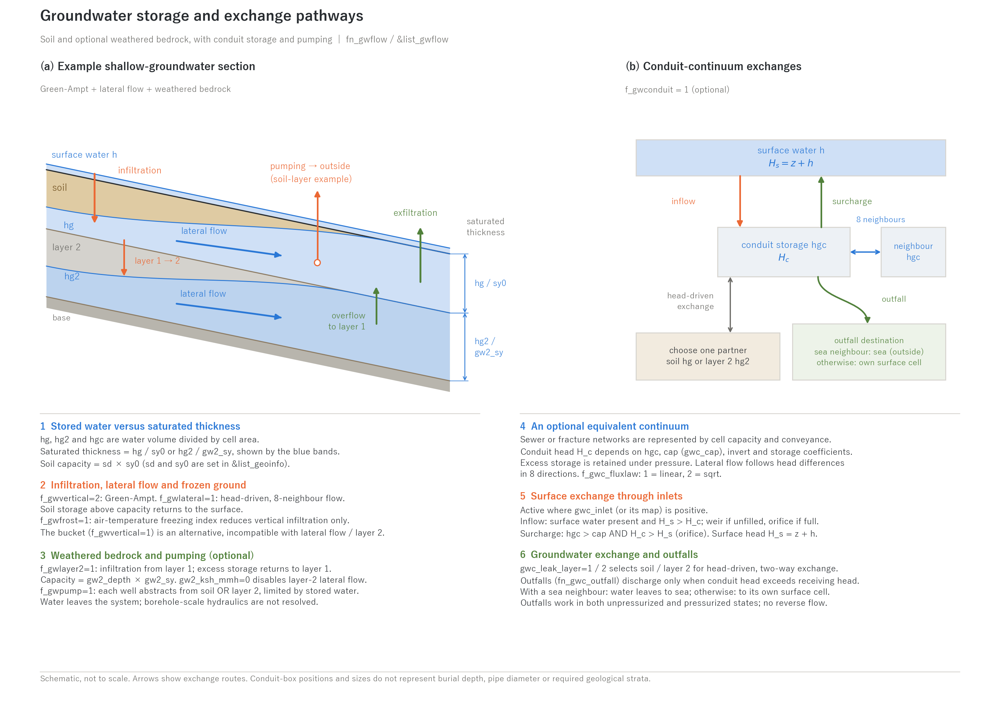

# Groundwater (&list_gwflow and model-specific settings)

> English mirror of docs/users_guide/gwflow.md. The Japanese file is the master copy.

[Back to the User's Guide index](../users_guide.md)

Handles infiltration, storage, lateral flow, and exfiltration by
shallow groundwater. Enable it with `fn_gwflow`, choose the models in
the common settings `&list_gwflow`, and write the chosen models'
specific setting groups in the same file (groups for unused models may
remain in the file and are ignored - A/B comparisons only require
switching the selectors).
The equations, the basis of the defaults and the references of every model
are in [Groundwater models](gwflow_models.md).

Groundwater in ENCflow is a **shallow-groundwater model** for runoff
analysis, with a soil layer and an optional weathered bedrock layer
(layer 2; natural confined aquifers and borehole-scale hydraulics are out of
scope). On top of these you can stack a **conduit continuum layer** (f_gwconduit) that
represents subgrid conduit networks - sewer networks, fractured
bedrock, and the like - as an equivalent continuum, and **well pumping
/ groundwater abstraction sinks** (f_gwpump).



**(a) Example shallow-groundwater section.** This configuration combines
Green-Ampt infiltration, lateral flow and the optional weathered bedrock layer.
The arrows show infiltration into soil, head-driven lateral flow in each layer,
infiltration from layer 1 to layer 2, and capacity overflow returning to layer 1
or exfiltrating to the surface. Pumping is illustrated for the soil layer;
each well selects either soil or layer 2. Frozen ground reduces vertical
infiltration capacity; the thickness of a frozen layer is not resolved.

**(b) Exchanges of the optional conduit continuum.** The connection diagram
links storage hgc to surface water, one selected groundwater layer, neighbouring
cells and an outfall. Box positions and sizes do not represent burial depth or
pipe diameter. Surface exchange requires positive inlet density, and surcharge
requires both hgc > cap and conduit head above surface head. Outfalls discharge
only when conduit head exceeds receiving head: to the sea (outside the system)
if a sea neighbour exists, or otherwise to the conduit cell's own surface water.

The storage variables hg, hg2 and hgc represent **water volume divided by
cell area** (equivalent water depth). The blue groundwater bands depict **saturated
thickness**, hg / sy0 in soil and hg2 / gw2_sy in layer 2, rather than storage
depth itself. The respective capacities are sd × sy0 and gw2_depth × gw2_sy.
The bucket model is a separate configuration, incompatible with the lateral
flow and second layer shown in panel (a).

How to read the results (fields, ledgers, measurement columns, restart) is summarized in [Output and monitoring](#output-and-monitoring) on this page. Each feature section also ends with a short note on just the outputs that concern it.

## Overall configuration (&list_gwflow)

Choose the vertical part (surface <-> subsurface exchange) and the
lateral part (horizontal subsurface movement) independently, and stack
a second layer, a conduit continuum layer, and pumping sinks if needed.

| Parameter | Default | Meaning |
|---|---|---|
| f_gwvertical | 0 | Vertical model. 0: none (temporarily disabled), 1: bucket, 2: Green-Ampt |
| f_gwlateral | 0 | Lateral model. 0: none, 1: nonlinear Boussinesq |
| f_gwlayer2 | 0 | 1: enable the weathered bedrock layer (second layer) |
| f_gwconduit | 0 | 1: enable the conduit continuum layer (sewer networks, fractured bedrock, etc.) |
| f_gwpump | 0 | 1: enable well pumping / groundwater abstraction (sink) |
| f_gwfrost | 0 | 1: enable infiltration suppression by frozen ground (requires air temperature, fn_meteo) |
| dt_gwflow | 0 | Update interval of the groundwater computation (s). 0: every step. If specified, must be at least dt (consistency is maintained through the effective time step) |

**Soil depth sd and specific yield sy0 belong to the geographic
information side** (f_sdtype/sd0/fn_sd, sy0 in &list_geoinfo; see
[the geographic information chapter](geoinfo.md)). They are read only
when a model that needs soil depth (Green-Ampt or lateral) is selected.

**Typical configurations**

| Purpose | Configuration |
|---|---|
| Infiltration losses in an event flood | f_gwvertical=2 (Green-Ampt) only |
| Catchment hydrology (up to interflow) | f_gwvertical=2 + f_gwlateral=1 |
| Down to baseflow / low-flow recession | The above + f_gwlayer2=1 |
| Urban pluvial flooding (sewer drainage and surcharge) | f_gwconduit=1 (alone where imperviousness dominates; add f_gwvertical=2 to include infiltration) |
| Simplest loss model | f_gwvertical=1 (bucket) |

## Just try it (minimal input)

The material and calibration values have defaults (the "Default"
column of the tables; the rationale is in developer.md §64). When a
value is unspecified, the default is adopted and the adopted value is
printed on screen with "(default)". The minimal input is **just the
model selectors of &list_gwflow in fn_gwflow** (the model-specific
groups may be empty; the soil depth sd0 defaults to 1 m when
unspecified):

```
&list_gwflow
  f_gwvertical = 2          ! Green-Ampt
  f_gwlateral = 1           ! lateral flow (to include interflow)
/
&list_gwflow_greenampt
/
&list_gwflow_lateral
/
```

The defaults are middle-of-the-road values that make the model "run"
(infiltration capacity of a sandy loam, soil depth of a forested
hillslope). When the type of problem is known, start from
[Recommended values by pattern](#recommended-values-by-pattern) and
calibrate against observations. Values for which 0 has a meaning
(gw_psif=0 constant infiltration capacity, gw2_ksh_mmh=0 no lateral
flow, gwc_inlet=0 no surface exchange, and so on) have no default.
Only the conduit continuum layer needs the inlet density gwc_inlet
(or fn_gwc_inlet).

## Bucket model (f_gwvertical=1, &list_gwflow_bucket)

Equations and basis of the defaults: [supplement](gwflow_models.md#2-bucket-model-f_gwvertical--1).

The simplest model: moves surface water into per-cell subsurface
storage at a constant infiltration capacity.

| Parameter | Default | Meaning |
|---|---|---|
| gw_infil_mmh | 10 | Infiltration capacity (mm/h). Representative saturated conductivity of a sandy loam |
| gw_capacity | 0.2 | Subsurface storage capacity (columnar water depth, m). Equivalent to 1 m of soil x specific yield 0.2 |

The infiltration in each step is the minimum of "infiltration capacity
x time", the surface water depth, and the remaining capacity.
**Cannot be combined with the lateral model** (it stops because the
capacity would be doubly defined; if you need a constant infiltration
capacity with soil depth as the capacity, use Green-Ampt with
gw_psif=0).

**Outputs for this section**: storage in `Hg0001...` (`f_out_hg=1`; read it as the capacity ratio Hg / gw_capacity), the domain mean in the `S_grnd` column of the log, point time series in the probe column `hg` ([Output and monitoring](#output-and-monitoring)).

## Green-Ampt (f_gwvertical=2, &list_gwflow_greenampt)

Infiltration formula, regularisation and basis of the defaults: [supplement](gwflow_models.md#3-green-ampt-f_gwvertical--2).

Moves surface water into the soil layer at the infiltration capacity
of the Green-Ampt formula (piston approximation)
f_v = K_sv (1 + psi_f n_e / F). The storage capacity is soil depth x
specific yield. Saturated cells stop infiltrating, and the excess is
handled by the shallow-water side as surface water.

| Parameter | Default | Meaning |
|---|---|---|
| gw_ksv_mmh | 10 | Vertical saturated hydraulic conductivity K_sv (mm/h). Representative of a sandy loam (values by soil texture in the recommendation table below) |
| gw_psif | 0 | Capillary pressure head at the wetting front psi_f (m). 0 degenerates to a constant infiltration capacity K_sv (the default = degenerate) |
| fn_gw_ksv | "" | Distribution map of K_sv (mm/h; if omitted, the uniform value gw_ksv_mmh is used) |
| fn_gw_psif | "" | Distribution map of psi_f (m; if omitted, the uniform value gw_psif is used) |

K_sv and psi_f can be given as areal distributions by maps, following
the land use (permeable pavement, infiltration facilities,
bare/paved-surface distinctions, and so on). The map K_sv may be 0;
cells with 0 are impervious (fully paved). The uniform specification
(gw_ksv_mmh) requires a positive value (default 10 mm/h when
unspecified). The soil depth sd0 (&list_geoinfo) defaults to 1 m when
unspecified.

**Outputs for this section**: storage in `Hg0001...` (saturated thickness = Hg / sy0); the total infiltration is the increase of `S_grnd`. The infiltration capacity itself is not written, so compare how `S_surf` and `S_grnd` grow under the same rainfall ([Output and monitoring](#output-and-monitoring)).

## Lateral flow (f_gwlateral=1, &list_gwflow_lateral)

Total head, Darcy flux and stability condition: [supplement](gwflow_models.md#4-lateral-flow-f_gwlateral--1).

Lateral Darcy flow in the saturated zone (2D, 8-neighbor; the same
diagonal partitioning as the ENC core). Groundwater moves in response to
head differences computed from the soil-base elevation and saturated
thickness (surface-water depth adds to the head when soil is saturated).
Storage above saturation capacity exfiltrates to the surface
(return flow = generation of saturation-excess overland flow).

| Parameter | Default | Meaning |
|---|---|---|
| gw_ksh_mmh | 360 | Lateral saturated hydraulic conductivity (mm/h). 1e-4 m/s = 10 x the matrix value (effective value with macropore / pipe flow) |
| gw_eps | 1e-3 | Regularization thickness for the dry test and suppression of excessive outflow (m) |
| gw_diagratio | 2/(2+sqrt(2)) | Diagonal partitioning (normally no need to change; 0 is equivalent to 4 neighbors) |

The stability condition of the explicit scheme is checked at
initialization; if dt exceeds the limit, the limit value is printed
and the run stops (lower dt or thin the updates with dt_gwflow).

When [water quality](wq.md) (fn_wq; f_wq_infil=1 is the default) is
enabled, dissolved substances in the groundwater move with the lateral
flow and return to the surface water where seepage occurs, at the
effective concentration set by wq_rg (at the groundwater concentration
when R=1; the retardation factor R of sorption is given on the
water-quality side). Only the lateral flow and the saturation-excess
seepage of layer 1 carry mass; water that leaves layer 1 by the other
pathways (percolation into layer 2, pumping, infiltration water into the
conduits) carries no mass (see the sections below and "Transport through
groundwater" in [Water quality](wq.md)).

**Outputs for this section**: the shape of the water table from the gradient of `Hg0001...`; seepage (return flow) from wet cells of `H0001...` during rainless periods. There is no seepage column; read it as the decrease of `S_grnd` matched by the increase of `S_surf` ([Output and monitoring](#output-and-monitoring)).

## Weathered bedrock layer (f_gwlayer2=1, &list_gwflow_layer2)

Equations and basis of the defaults: [supplement](gwflow_models.md#5-weathered-bedrock-layer-f_gwlayer2--1).

Inserts a second layer directly below the soil layer to hold a
slow-recession component (baseflow) with a long residence time. Water
percolates down from layer 1, moves laterally within layer 2, the
saturation excess returns to layer 1, and the excess of layer 1
exfiltrates to the surface.

| Parameter | Default | Meaning |
|---|---|---|
| gw2_depth | 3 | Layer thickness (m). Representative weathered zone of a granitic headwater |
| gw2_sy | 0.05 | Specific yield (effective porosity). A few percent in weathered rock |
| gw2_infil_mmh | 1 | Infiltration capacity from layer 1 to layer 2 (mm/h). Upper side of the saturated conductivity of weathered rock |
| gw2_ksh_mmh | - | Lateral saturated hydraulic conductivity of layer 2 (mm/h). 0 disables lateral flow (a capacity buffer) |
| gw2_sat0 | 0 | Initial saturation [0,1]. In event runs, a calibration parameter that sets the baseflow discharge |

- **Cannot be combined with the bucket vertical model.**
- For long runs, instead of specifying the initial saturation, we
  recommend **spin-up -> save -> reuse as the initial condition**
  (f_state_restore=2 in [Suspend and restart](restart.md)).
- Evapotranspiration does not touch layer 2.
- The subsurface mass of [water quality](wq.md) stays in layer 1. It is
  not carried by the percolation from layer 1 to 2 or by the lateral flow
  inside layer 2, and the water that returns from layer 2 to layer 1 is
  clean water (the layer-1 concentration Cg/Hg is pushed apparently
  higher).

**Outputs for this section**: the layer-2 storage in `Hg2` (rides on `f_out_hg`), restart in `gwflow_layer2.dat`. `S_grnd` is the sum of layers 1 and 2 ([Output and monitoring](#output-and-monitoring)).

## Conduit continuum layer (f_gwconduit=1, &list_gwflow_conduit)

Piecewise head, flux law, surface exchange, stability and conversion from pipe data: [supplement](gwflow_models.md#6-conduit-continuum-layer-f_gwconduit--1).

Represents **subgrid conduit networks** - sewer networks, fractured
bedrock, karst, farmland tile drains - as an "artificial confined
aquifer" with a per-cell storage capacity and 8-direction conveyances
(equivalent continuum approximation). When a cell exceeds its capacity
(pipe-full), it switches to a pressurized state in which the head rises
steeply (a pseudo slot), representing pressurized flow (surcharge).
Applications are expressed by parameter combinations:

| Application | Typical settings |
|---|---|
| Urban sewer network | Inlet density given (fn_gwc_inlet); no interlayer exchange (use gwc_leak_layer=1 for infiltration/inflow) |
| Bedrock / karst | No inlet density (specify it for sinkholes); gwc_leak_layer=2 (exchange with the weathered bedrock layer) |

| Parameter | Default | Meaning |
|---|---|---|
| f_gwc_fluxlaw | 2 | Lateral flux law. 1: linear, 2: sqrt (turbulent conduit flow, q proportional to the square root of the gradient) |
| gwc_cnd_m2s / fn_gwc_cnd | 0 / - | Conveyance density (m2/s; pipe-full discharge per unit width at unit hydraulic gradient). Uniform value or a map. 0 disables lateral flow |
| gwc_cap / fn_gwc_cap | 0.01 / - | Storage capacity (columnar m; total pipe volume / cell area). Cells with 0 have no conduits. The default is about an urban branch-sewer network |
| gwc_depth / fn_gwc_bot | 3 / - | Head datum (invert) elevation. Uniform burial depth (z - gwc_depth) or an elevation map |
| gwc_sy | 0.05 | Storage coefficient while unconfined (in-pipe filling; (0,1]). cap / pipe height |
| gwc_slot_sy | gwc_sy/50 | Pseudo-slot storage coefficient while confined (<= gwc_sy; smaller = stiffer pressure response). Also 1/50 per cell for a mapped sy |
| fn_gwc_sy / fn_gwc_slot_sy | "" | Maps of the storage coefficients (take precedence over the scalars). Give them per cell when trunk and branch pipes of different section height coexist (sy = cap / pipe height) |
| gwc_sat0 | 0 | Initial filling ratio [0,1] |
| gwc_inlet / fn_gwc_inlet | 0 / - | Density of stormwater inlets / manholes / sinkholes (1/m2). Specifying it enables surface exchange |
| gwc_cw | 2.66 | Weir coefficient for inflow (per inlet, q = cw h^1.5 m3/s) |
| gwc_co | 0.15 | Orifice coefficient Cd A (m2). Used for pipe-full inflow and pressurized eruption |
| gwc_leak_layer | 0 | Interlayer exchange partner. 0: none, 1: soil layer, 2: weathered bedrock layer |
| gwc_leak_mmh | 10 | Interlayer exchange capacity (mm/h). From the higher head to the lower. Read only when gwc_leak_layer > 0 |
| fn_gwc_leak | "" | Map of the interlayer exchange capacity (mm/h). Takes precedence over the scalar. Cells with 0 do not exchange (lined reaches, sound pipes) |
| fn_gwc_outfall | "" | Map of the orifice coefficient Cd A (m2) of outfalls. Cells with a value are outfalls (conduits required). Discharges to the sea when adjacent to a sea cell, otherwise free outflow onto the surface of the cell itself |
| gwc_nsubmax | 100 | Cap on the number of lateral-conveyance subcycles (runaway guard of the automatic subdivision) |
| gwc_eps | 1e-3 | Regularization amount for the dry test (m) |
| gwc_eps_h | 1e-2 | Linearization width of the sqrt law (head difference, m) |
| gwc_diagratio | 2/(2+sqrt(2)) | Diagonal partitioning (normally no need to change) |

- Surface exchange switches automatically with the head difference: if
  the surface water level is higher, water flows in (weir type while
  unconfined, orifice type when pipe-full); if the conduit head exceeds
  the surface level while pressurized, water **erupts** (manhole
  surcharge to the surface).
- The stability condition of the explicit scheme is checked at
  initialization. The limit is governed by the pseudo slot gwc_slot_sy,
  so with fine grids and a small slot_sy, reduce dt_gwflow or relax
  slot_sy / gwc_eps_h.
- gwc_leak_layer=1 requires the soil-layer system (Green-Ampt or
  lateral) to be enabled; =2 requires f_gwlayer2=1.
- See [test/conduit](../../../test/conduit/) for schematic experiments (with an analytic
  equilibrium check).

**What it can and cannot do (range of the continuum approximation)**

- Can do: the **areal drainage capacity** of dense street-level
  networks, pressure propagation after pipe-full and the **spatial
  pattern of surcharge**, and the **two-way exchange** between the
  sewer system and surface inundation (dual drainage) - on the same
  grid and in the same time evolution as the surface water.
- Cannot do (limits in principle; see gwconduit_plan.md sec. 2):
  - **Tracking individual pipes and manholes.** It shows roughly where
    surcharge occurs, but cannot identify *which* manhole erupts.
  - **Control structures driven by operating rules** (pumps, weirs,
    outfalls, CSOs). They sit outside conservation laws plus
    gradient-driven flow, so a continuum cannot represent them
    (standalone structures are covered by
    [internal hydraulic structures](structure.md); networks dominated
    by them belong to dedicated 1-D pipe-network models).
  - **Systems dominated by a single trunk main** (catchments where one
    pipe larger than the cell size controls the behavior). The
    homogenization premise breaks down.
- Other constraints:
  - **Multiple conduit layers cannot be combined in one run** (e.g.
    sewers plus bedrock; single instance).
  - The invert elevation is fixed at the start of the run and does not
    follow terrain evolution (fn_geomorph). Evapotranspiration does not
    touch the conduit layer, and in-conduit solute transport is not resolved.
    There is no exchange with sea cells except discharge through
    outfalls (fn_gwc_outfall).
  - [Water quality](wq.md) (wq_gwc_conc) can be coupled in the form of
    "a fixed concentration carried by the surcharge water and the water of
    land-side outfalls" (sanitary-risk assessment of sewer surcharge; a
    supply-side fixed-concentration approximation that does not solve the
    mass budget or advection inside the pipes; sea-side outfalls are
    removal to outside the system and are not covered). Inlet capture
    removes the load of the flood water to the conduit side at the same
    rate with f_wq_gwc_in=1 (the default; `to_gwc_g` in wq.csv; 0 leaves
    it on the surface). Infiltration water (gwc_leak_layer=1) moves only
    the water of layer 1 into the conduits; the subsurface mass of water
    quality is not carried with it.

**Outputs for this section**: the conduit storage in `Hgc` (rides on `f_out_hg`) and the total outfall discharge printed at the end ("outfall discharge total"). Surcharge appears in the surface `H0001...`, discharge from sea outfalls as a decrease of `S_total`. Restart in `gwflow_conduit.dat` ([Output and monitoring](#output-and-monitoring)).

## Well pumping / groundwater abstraction (f_gwpump=1, &list_gwflow_pump)

Equation: [supplement](gwflow_models.md#7-well-pumping-f_gwpump--1).

A sink that withdraws the specified pumping rate from subsurface
storage at a set of cells and removes it from the system (the
subsurface counterpart of the internal source &list_bound_source; for
water-supply / agricultural abstraction, pumping-induced drawdown, and
pumping-induced seawater intrusion). Up to 50 wells, numbered
consecutively from 1.

| Parameter | Default | Meaning |
|---|---|---|
| gwp_cell(1:2,k,n) | - | Abstraction cells (i, j) of well n (multiple cells = well field / gallery) |
| fn_gwp_cell(n) | - | Cell list file (each line "i j"; takes precedence over inline) |
| gwp_q0(n) | - | Constant pumping rate (m3/s; positive = abstraction) |
| gwp_val(1:2,k,n) | - | Pumping rate time series (min, m3/s) (takes precedence over gwp_q0) |
| fn_gwp_val(n) | - | Time series file (each line "min m3/s"; highest precedence) |
| gwp_layer(n) | 1 | Abstraction layer. 1: soil layer, 2: weathered bedrock layer (requires f_gwlayer2=1) |

- The demand is **divided equally** over the cell set, and the
  withdrawal at each cell is capped by that cell's storage (a dry well
  = supply-limited; no redistribution to other cells). A per-well
  summary of demand vs. actual withdrawal is printed at the end of the
  run so you can check for dry wells.
- Combined with the [fresh and salt water layers](salt.md)
  (f_salt_gw=1), pumping takes **fresh water first** (shallow well
  screen approximation). Whatever the fresh thickness cannot supply is
  taken from the salt layer (= salt contamination of the well);
  pumping-induced seawater intrusion and upconing emerge automatically
  from the lateral flow and the salt-layer dynamics.
- Injection (negative rates) is not supported (return flow /
  irrigation to the surface is given with &list_bound_source in
  [Boundary conditions](boundary.md)).
- A well is a cell-scale sink (borehole-scale hydraulics - well
  radius, skin, partial penetration - are not represented).
- The subsurface mass of [water quality](wq.md) is not carried by the
  abstraction (only water leaves to outside the system and the mass stays
  in layer 1, so the layer-1 concentration Cg/Hg is pushed apparently
  higher).

**Outputs for this section**: the drawdown of `Hg0001...` around the well cells (cone of influence) and, at the end, the per-well "demand / pumped / %" line for the achieved abstraction ([Output and monitoring](#output-and-monitoring)).

## Infiltration suppression by frozen ground (f_gwfrost=1, &list_gwflow_frost)

Freezing index, reduction factor and basis of the defaults: [supplement](gwflow_models.md#8-infiltration-suppression-by-frozen-ground-f_gwfrost--1).

To represent meltwater and rain running over frozen ground (snowmelt
floods, enhanced early-spring runoff), a **freezing index** FI
(degC.day) is accumulated per cell from the air temperature (fn_meteo
in [Rainfall and meteorology](forcing.md); lapse rate included), and a
reduction factor is applied to the vertical infiltration capacity
(Green-Ampt and bucket).

- Freezing index: freezing degree-days accumulate while the air
  temperature is below the threshold fro_tf, and thawing degree-days
  (times fro_ct) reduce it above the threshold (FI >= 0).
- Reduction factor (linear): fac = max(fro_fmin, 1 - FI/fro_fifull).
  The factor reaches its minimum (impervious if fro_fmin=0) at
  FI = fro_fifull.
- Snow insulation (optional): with fro_swe0 > 0 and snow enabled
  (fn_snow in [Rainfall and meteorology](forcing.md)), both freezing
  and thawing are attenuated by exp(-swe/fro_swe0) (under snow the
  ground cools - and thaws - more slowly).

| Parameter | Default | Meaning |
|---|---|---|
| fro_fifull | 20 | Freezing index at which the reduction factor reaches its minimum (degC.day). The practical calibration point. The default corresponds to freezing of the top 20-30 cm |
| fro_fmin | 0 | Lower bound of the reduction factor [0,1). 0 = fully frozen ground is impervious |
| fro_tf | 0 | Freeze/thaw threshold air temperature (degC) |
| fro_ct | 1 | Thawing efficiency (multiplier on thawing degree-days). Smaller values delay the spring thaw |
| fro_swe0 | 0 | e-folding snow water equivalent of the snow insulation (m). 0 = no insulation |
| fro_fimax | 0 | Cap on the freezing index (degC.day). 0 = no cap. To keep the thaw from being unrealistically delayed after a long severe winter, about 1-2 x fro_fifull is recommended |
| fro_fi0 | 0 | Initial freezing index (degC.day). Set it to start an event run of the melt season "already frozen" |

- This is the simplest degree-day model (same philosophy as the
  degree-day snow model); soil temperature, frost depth, and unfrozen
  water are not solved. Fitting fro_fifull to observed runoff is the
  practical approach.
- The distribution of the reduction factor is output as `Ff0001`
  (1 = unfrozen, fro_fmin = fully frozen).
- The freezing index is a persistent state; across
  [Suspend and restart](restart.md) it is carried automatically by the
  private file gwflow_frost.dat (f_gwfrost must have been enabled at
  save time).

**Outputs for this section**: the freezing index is not written as a raster (its state is saved in `gwflow_frost.dat`). Check the effect as `Hg0001...` ceasing to grow and `H0001...` responding more strongly to the same rain or snowmelt ([Output and monitoring](#output-and-monitoring)).

## Recommended values by pattern

The defaults are middle-of-the-road values that make the model run.
When the target is known, start from the following (these are
calibration quantities; sources in developer.md §64).

**Green-Ampt parameters by soil texture** (Rawls, Brakensiek & Miller
1983; guides for gw_ksv_mmh, gw_psif and sy0. Tillage, compaction and
vegetation shift them by an order of magnitude)

| Texture | K_s (mm/h) | psi_f (m) | Effective porosity |
|---|---|---|---|
| Sand | 118 | 0.05 | 0.42 |
| Loamy sand | 30 | 0.06 | 0.40 |
| Sandy loam (default) | 11 | 0.11 | 0.41 |
| Loam | 3.4 | 0.09 | 0.43 |
| Silt loam | 6.5 | 0.17 | 0.49 |
| Clay loam | 1.0 | 0.21 | 0.31 |
| Clay | 0.3 | 0.32 | 0.39 |

(sy0 corresponds to the moisture deficit at the wetting front =
effective porosity minus the initial water content, so in a moist soil
it is smaller than the table, about 0.1-0.2)

**Configuration and values by target**

| Type | Configuration | sd0 (m) | K_sv (mm/h) | K_sh (mm/h) | Layer 2 | Notes |
|---|---|---|---|---|---|---|
| Event flood in a forested catchment | Green-Ampt + lateral | 0.5-1.5 | 50-300 | 1000-10000 | - | Forest soils infiltrate strongly; runoff is mainly lateral (interflow). K_sh is 1-2 orders above the matrix because of pipe flow |
| Forested catchment down to low flow / baseflow | The above + layer 2 | as above | as above | as above | thickness 2-10 m, sy 0.02-0.1, infiltration 0.1-1 mm/h, lateral 10-100 mm/h | Lateral flow of layer 2 defaults to 0 (capacity only). For baseflow set gw2_ksh_mmh > 0 and gw2_sat0 (or spin up) |
| Infiltration loss on farmland / grassland | Green-Ampt only | 0.5-1 | texture table | - | - | psi_f also from the texture table. Compacted fields: 1/3-1/10 |
| Urban pluvial flooding (sewers) | Conduit layer (+ Green-Ampt) | 0.5-1 | 10 on green space only (0 on pavement via fn_gw_ksv) | - | - | gwc_inlet 0.005-0.02 /m2; cnd and cap converted from pipe data in preprocessing (see "Converting pipe data to parameters" above) |
| Sewer infiltration / inflow | Conduit layer + Green-Ampt + gwc_leak_layer=1 | as above | as above | - | - | leak 1-10 mm/h (larger for aged pipes) |
| Bedrock / karst | Conduit layer + layer 2 + gwc_leak_layer=2 | 0.5-1 | 10-50 | - | thickness 10-50 m, sy 0.01-0.05 | gwc_inlet only at sinkholes; cnd is the conveyance of the fracture network |
| Snowmelt runoff over frozen ground | Green-Ampt + frost + fn_snow | 0.5-1 | 10-50 | - | - | fifull 10-40 degC.day (smaller for moist soils), fro_swe0 0.05-0.2 m |
| Coastal aquifer saltwater wedge | Lateral + [fresh/salt two-layer](salt.md) | 5-20 | - | 3600-36000 | - | Sandy aquifer K 1e-3-1e-2 m/s, sy0 0.2-0.3 |
| Simplest loss (calibration-driven) | Bucket | - | 5-50 (infil) | - | - | capacity 0.05-0.3 m. The SCS S (0.06-0.17 m for CN 60-80) is a guide |

## Output and monitoring

The three ways a field gets written (automatic / flag / riding on a flag) and the area basis of column quantities are explained in [Input and output formats](io.md#how-state-variables-are-written); a reverse lookup from the quantity you want to the output is at the end of that section.

**Fields** (rasters in `result/`, every `dt_file`)

| File | How | Contents |
|---|---|---|
| Hg0001... | f_out_hg = 1 | subsurface storage depth of the soil layer (m; water volume divided by cell area) |
| Hg2 | rides on f_out_hg (f_gwlayer2=1) | storage depth of the weathered bedrock layer (m) |
| Hgc | rides on f_out_hg (f_gwconduit=1) | storage of the conduit continuum layer (m per cell area) |
| Hgs / Cg | rides on f_out_hg | subsurface salt storage of [Fresh and salt water](salt.md) / subsurface mass pool of [Water quality](wq.md) |
| Sd0001... | automatic (when a model uses the soil thickness) | soil thickness (m) |

**Ledgers and log** (budget checks)

- With groundwater enabled the S column of the screen and Log.txt splits
  into **S_surf / S_grnd / S_total** (domain-mean storage depth in m;
  S_total also includes the water equivalent of snow and ice). Read the
  change of S_grnd as infiltration − seepage − evaporation from the
  subsurface − pumping − leakage to conduits.
- The conduit layer prints the total outfall discharge at the end,
  "gwflow_conduit: outfall discharge total = ... m3" (discharge to the sea
  leaves the system = S_total decreases).
- Well pumping prints per well at the end "demand ... m3, pumped ... m3
  (... %)" (requested, actually pumped, achievement).
- With evapotranspiration ([Rainfall and weather](forcing.md)) the column
  `ev_gw_m3` of `evap.csv` is the cumulative evaporation from the subsurface.

**Measurements** (probe and transect columns)

- The probe CSV has the subsurface storage depth `hg` (m) and the soil
  thickness `sd` (m) (always present; 0 without groundwater). Subsurface
  flow does not cross a transect.

**Restart**

- The soil-layer hg is part of the core state save. The bedrock layer,
  the conduit layer and frozen ground use the private files
  `gwflow_layer2.dat`, `gwflow_conduit.dat` and `gwflow_frost.dat`
  automatically (a model enabled at restart must also have been enabled at
  save; disabling at restart a model that was enabled at save silently drops
  that layer's storage).

**How to read and check**

- Hg is a column-equivalent depth, not a water table. Saturated thickness
  = Hg / sy0; water table ≈ ground − soil thickness + Hg / sy0 (lateral
  flow and Green-Ampt configurations; read the bucket model as the
  capacity ratio Hg / gw_capacity). The saturation Hg / (sy0 × Sd) is a
  precursor of slope failure ([Sediment and landform change](geomorph.md)).
- Seepage (return flow) appears as an increase of the surface depth H.
  Cells with H > 0 along valley floors of high Hg during rainless periods
  are seepage.
- In a closed domain without boundary outflow, S_total changes only by
  precipitation − evapotranspiration. When S_total does not match the
  precipitation (sum of Pr × dt), look for routes out of the system: edge
  boundaries, sea cells, outfalls, pumping.

## Worked examples of the format

Annotated examples of all groups:
[examples/List_samples/list_gwflow.txt](../../../examples/List_samples/en/list_gwflow.txt).
For the overall picture of runoff computations combined with rainfall,
see [the rainfall and meteorology chapter](forcing.md).

## Tests and examples

- [test/gwdefault](../../../test/gwdefault/): equivalence of minimal and explicit-default inputs for the bucket, Green-Ampt/layer 2, frost and conduit configurations.
- [test/pump](../../../test/pump/) and [test/frost](../../../test/frost/): analytical checks of storage loss by well pumping and infiltration suppression by the freezing index.
- [test/gwseep](../../../test/gwseep/): infiltration, lateral groundwater transport and exfiltration, checked together with water-quality mass balances.
- [examples/sewer_hybrid](../../../examples/sewer_hybrid/): configuration and input generation for a trunk and branch network in one conduit layer. The conversion from pipe specifications to cell parameters is demonstrated in [gen_data.py](../../../examples/sewer_hybrid/gen_data.py).
- [examples/qanat](../../../examples/qanat/): a conduit/layer-2 example of groundwater collection, conveyance and outlet discharge through an underground gallery.
