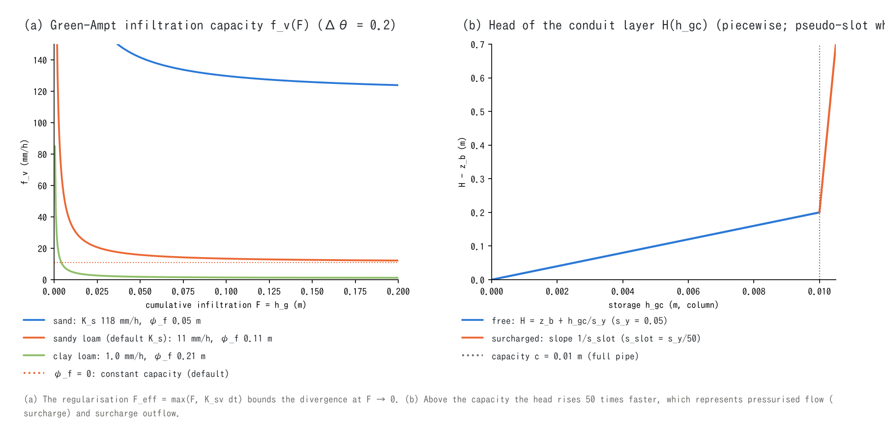

# Groundwater models (supplement to the groundwater chapter)

> English mirror of docs/users_guide/gwflow_models.md. The Japanese file is the master copy.

[Back to the groundwater chapter](gwflow.md) | [Back to the user's guide index](../users_guide.md)

This page gives the equations, the basis of the default values and the
models referred to for each model of the [groundwater chapter](gwflow.md):
bucket, Green-Ampt, lateral flow, weathered bedrock layer, conduit
continuum layer, well pumping and frozen ground. The implementation is in
`src/m_gwflow*.f90` (one submodule per model); the design history is in
docs/handoff_gwflow_tani.md, docs/gwconduit_plan.md and developer.md §16,
§46 and §64.

## 1. Common framework

**State variables.** The storages $`h_g`$ (soil layer), $`h_{g2}`$
(weathered bedrock layer) and $`h_{gc}`$ (conduit layer) are all **column
depths**, the water volume divided by the cell area. The saturated
thickness of the soil layer is $`h_g/s_y`$ and its capacity $`s_d\,s_y`$
($`s_d`$ = soil thickness `sd`, $`s_y`$ = specific yield `sy0`, both owned
by the [geographic information](geoinfo.md)); the excess over the capacity
exfiltrates to the surface water $`h`$.

**Update interval.** With `dt_gwflow` the models are evaluated every
$`n = \mathrm{NINT}(\texttt{dt\_gwflow}/\Delta t)`$ steps with the effective
time step $`\Delta t_s = n\Delta t`$ (the rates are consistent with the
thinning). The order of execution is frost → vertical → lateral of layer 1
→ layer 2 → conduit layer → pumping, and this order is the coupling
specification.

**Position.** It is a shallow-groundwater model for runoff analysis. The
design lets Tani's mechanism[^tani97] emerge from "a generic vertical
model plus a generic lateral model": the distribution of the soil
thickness $`s_d(x)`$ sets the vertical arrival time $`T_v = s_d\,n_e/K_s`$,
and places with a thin soil saturate first and govern the timing of the
runoff response. A uniform thickness gives lateral-flow control
(TOPMODEL-like), a sharply thinning one gives vertical-infiltration control
(Tani type).

## 2. Bucket model (f_gwvertical = 1)

```math
\Delta h_g = \min\!\left(K\,\Delta t_s,\ h,\ c - h_g\right)
```

The simplest model: a constant capacity $`K`$ (`gw_infil_mmh`) moves surface
water into a storage of capacity $`c`$ (`gw_capacity`). The default
$`K`$ = 10 mm/h is the saturated conductivity of sandy loam (soil table of
§3) and $`c`$ = 0.2 m equals a 1 m soil times a specific yield of 0.2, the
default capacity of the Green-Ampt model (switching models does not change
the storage). Because the capacity is given directly by `gw_capacity`, the
bucket cannot be combined with the lateral flow or the second layer, which
use the soil thickness.

## 3. Green-Ampt (f_gwvertical = 2)

Piston infiltration after Green & Ampt[^green11]; the suction of the
capillary pressure head $`\psi_f`$ at the wetting front and the moisture
deficit $`\Delta\theta`$ raise the infiltration capacity.

```math
f_v = K_{sv}\left(1 + \frac{\psi_f\,\Delta\theta}{F_{\text{eff}}}\right),
\qquad
F_{\text{eff}} = \max(F,\ K_{sv}\Delta t_s),
\qquad
\Delta h_g = \min\!\left(f_v\Delta t_s,\ h,\ s_d\Delta\theta - h_g\right)
```

$`\Delta\theta = s_y`$, and the cumulative infiltration $`F`$ is identified
with the **current storage** $`h_g`$ (a Green-Ampt variant whose capacity
recovers when the lateral flow drains the layer; a design choice that
needs no private state, so a restart closes with $`h_g`$ alone). The
divergence at $`F \to 0`$ is regularised by $`F_{\text{eff}}`$. `gw_psif` = 0
(default) degenerates to the constant capacity $`K_{sv}`$. $`K_{sv}`$ and
$`\psi_f`$ can be given as maps by land use; cells with $`K_{sv} = 0`$ are
impervious (pavement).



**Basis of the defaults.** $`K_{sv}`$ = 10 mm/h rounds the sandy-loam value
(10.9 mm/h) of the Green-Ampt parameters by soil texture of Rawls et
al.[^rawls83]; it is smaller than the infiltration capacity of Japanese
forest soils (commonly above 100 mm/h), on the side that does not
over-estimate the infiltration loss of floods. The $`K_s`$, $`\psi_f`$ and
effective porosity by texture are in the
[recommended values of the chapter](gwflow.md#recommended-values-by-pattern).
The default soil thickness of 1 m is the thin soil of forested slopes
(0.5–1 m)[^tani97] and the customary value of distributed models.

## 4. Lateral flow (f_gwlateral = 1)

Darcy flow of the saturated zone, solved with eight-neighbour differences
of the total head $`H`$ (conservative form of the nonlinear Boussinesq
equation[^boussinesq04]).

```math
h_{gw} = \frac{h_g}{s_y},
\qquad
H = (z - s_d) + h_{gw}\ [+\,h\ \text{(saturated cells only)}],
\qquad
q_k = K_{sh}\,h_e\,\frac{H_c - H_n}{\Delta s_k}\,L_k
```

$`h_e`$ is the saturated thickness at the interface, the two-cell mean
capped by the thickness of the upstream (higher-head) cell. The
state-dependent diffusivity $`K_{sh}h_{gw}`$ has the same functional form as
the lateral flow of RRI[^sayama12], and the saturated thickness cannot
exceed the soil thickness $`s_d`$ by the structure of the split model. The
ponded water $`h`$ of an unsaturated cell drives the vertical infiltration,
not the lateral flow, so it is added to the head only in saturated cells.
The passage widths $`L_k`$ and distances $`\Delta s_k`$ are the same
eight-direction shares as the ENC core ([ENC grid](encgrid.md) §2;
`gw_diagratio`), which lets converging flow along diagonal valleys be
represented. There is no exchange with the sea cells of the sea mask
(fn_sw): sea cells are a no-flux boundary of the lateral flow. The
exchange driven by the head difference between the aquifer and the sea is
the job of f_salt_gw=1 of the [sharp-interface two-layer salt model](salt.md);
lateral flow alone produces no groundwater discharge to the sea.

**Stability.** Being explicit, the structural bound $`h_{gw} \le s_d`$ gives

```math
\Delta t_s \le \frac{s_y\,\Delta x\,\Delta y}{2\,K_{sh}\,\max(s_d)\sum_k L_k/\Delta s_k}
```

which is checked at initialisation; the run stops with the limit printed
when it is exceeded. The dry test and the excess-outflow reduction are the
same mechanisms as in the shallow water solver (regularisation thickness
`gw_eps`).

**Conductance along walls.** In the interior the eight-direction shares
add up to isotropic diffusion (diffusivity $`K_{sh}h_{gw}/s_y`$) whatever
the value of `gw_diagratio` ([test/gwlateral](../../../test/gwlateral/en/README.md)
checks this with the spreading of a Gaussian mound). A cell next to the
domain edge, an outside cell or a sea cell has no outward diagonal links,
so its conductance along the wall is $`1 - d/2`$ times the interior value
(0.71 times with the default $`d`$ = `gw_diagratio` = 2/(2+√2)), and a strip
one cell wide with walls on both sides gets $`1 - d`$ times (0.41 times).
The shallow water solver moves the blocked diagonal shares to the axis
directions (`f_opening_dynamic`). The lateral flow makes the same transfer
with `f_gw_opening = 1` (default 0 = no transfer): the passage width of the
blocked diagonals crossing the same interface is added to the axis edge (at
each end cell of the edge, count how many of the two diagonals crossing the
interface are blocked, and add the mean number of diagonals). The
conductance along walls then equals the interior value, and in a strip one
cell wide the axis edges get the full cell width. Only outside and sea
cells block (a dry cell does not cause a transfer), and the flux of the
subsurface saltwater zone of the sharp-interface two-layer model uses the
same widths. Without the transfer, in a valley aquifer cut to one or two
cells wide by an outside mask along the ridges, the groundwater flow down
the valley comes out smaller (whether to make 1 the default is under
discussion; developer.md §16.6).

**Basis of the default.** $`K_{sh}`$ = 360 mm/h (1e-4 m/s) is ten times the
matrix $`K_s`$ (sandy loam 1e-5 m/s), after the observations that the
effective lateral conductivity of hillslopes through macropores and pipe
flow is one to two orders larger than the matrix[^beven82][^mosley79].

## 5. Weathered bedrock layer (f_gwlayer2 = 1)

A second layer of thickness $`d_2`$ and specific yield $`s_{y2}`$ under the
soil provides the slowly receding baseflow and the long residence time.

```math
\Delta h_{g2} = \min\!\left(K_{v2}\Delta t_s,\ h_g,\ d_2 s_{y2} - h_{g2}\right),
\qquad
H_2 = (z - s_d - d_2) + \frac{h_{g2}}{s_{y2}}
```

The infiltration from layer 1 to 2 has the constant capacity $`K_{v2}`$
(`gw2_infil_mmh`); the lateral flow in layer 2 calls the kernel of §4 with
the layer-2 coefficients (`gw2_ksh_mmh`; 0 means capacity only), without
the coupling to the ponded water. The excess of layer 2 returns to layer 1
and the excess of layer 1 exfiltrates, in a chain within one step.
**Basis of the defaults.** Observations of the weathered zone of granitic
headwaters[^kosugi06][^katsura08]: a few metres thick, an effective
porosity of a few percent, a saturated conductivity of 1e-8 to 1e-6 m/s.
The defaults $`d_2`$ = 3 m, $`s_{y2}`$ = 0.05 and $`K_{v2}`$ = 1 mm/h
(2.8e-7 m/s) are at the upper end of that range (the side that produces
baseflow). The initial saturation `gw2_sat0` is a calibration parameter
that sets the baseflow in event runs; long runs use spin-up → save →
restart as the initial state.

## 6. Conduit continuum layer (f_gwconduit = 1)

A sub-grid pipe network (sewers, fractured bedrock) is represented as an
**equivalent confined aquifer** with a cell-wise capacity $`c`$ (`gwc_cap`)
and eight-direction conductances. In the classification of karst and
bedrock hydraulics[^yoshimoto19] it merges the EPM (equivalent porous
medium) and the pipe-flow description (MODFLOW-CFP[^shoemaker08]), and the
pressurised flow after the pipe is full is the continuum version of the
Preissmann slot[^cunge64].

**Head (piecewise).**

```math
H = z_b + \frac{h_{gc}}{s_y}\ (h_{gc} \le c),
\qquad
H = z_b + \frac{c}{s_y} + \frac{h_{gc} - c}{s_{slot}}\ (h_{gc} > c)
```

$`z_b`$ is the invert elevation (`gwc_depth` or `fn_gwc_bot`), $`s_y`$ =
`gwc_sy` the storage coefficient when free (= capacity / pipe height) and
$`s_{slot}`$ = `gwc_slot_sy` the pseudo-slot storage coefficient when
surcharged; the smaller it is, the stiffer the pressure response.

**Lateral flux.**

```math
q_k = C_k\,f_e\,\sqrt{\frac{\lvert H_c - H_n\rvert}{\Delta s_k}}\ \mathrm{sign}(H_c - H_n)
\quad(\texttt{f\_gwc\_fluxlaw} = 2),
\qquad
C_k = \min(c_{nd,c},\,c_{nd,n})\,L_k
```

$`f_e`$ is the mean filling ratio $`\min(h_{gc}/c, 1)`$ capped by the upstream
value and $`c_{nd}`$ the conductance density (`gwc_cnd_m2s`: discharge per
unit width of a full pipe at unit hydraulic gradient). The square-root law
is the form of turbulent pipe flow (Manning / Darcy–Weisbach); it is the
continuum version of Mode 2 of MODFLOW-CFP, which switches from Darcy to
Darcy–Weisbach above a head-difference threshold. $`|\Delta H| <`$ `gwc_eps_h`
is linearised. The linear law (`f_gwc_fluxlaw` = 1) is a Darcy-type option
for comparison.

**Surface exchange and outfalls.** The density $`N`$ (`gwc_inlet`, per m²)
of inlets, manholes or sinkholes is multiplied by the single-opening
formulas:

```math
q_{in} = N\,c_w\,h^{3/2}\ (\text{free}),
\qquad
q_{in} = N\,c_o\sqrt{2g\,\Delta H}\ (\text{full}),
\qquad
q_{out} = N\,c_o\sqrt{2g\,\Delta H}\ (\text{surcharged and } H > z + h)
```

Inflow and surcharge outflow are both limited to the amount that
equalises the heads, which prevents oscillation of the exchange term.
$`c_w`$ (`gwc_cw`, default 2.66 m^{1/2}/s) corresponds to a rectangular-weir
coefficient ≈ 1.7 times an inlet perimeter ≈ 1.5 m and $`c_o`$ (`gwc_co`,
default 0.15 m²) to a discharge coefficient 0.6 times an opening of
0.25 m²; both are **empirical**. Outfalls (`fn_gwc_outfall`) are open pipe
ends with the orifice formula and a flap against backflow. An outfall
placed on a sea cell has the tide level (the water level of the sea cell)
as its receiving head and its discharge is removed to outside the system;
one placed on land has the surface water level as its receiving head and
discharges onto the surface. In both cases the discharge is capped at the
equalising amount, the storage that brings the conduit head down to the
receiving head. The exchange with another layer goes from the higher to the lower head with the
constant capacity `gwc_leak_mmh`; its default 10 mm/h is the vertical
conductivity of the soil around the pipe (= the Green-Ampt default).

**Stability and sub-cycling.** The largest gradient of the square-root law
is its linearised branch $`C_k\sqrt{1/(\Delta s_k\,\varepsilon_h)}`$, so

```math
\Delta t_s \le \frac{\Delta x\,\Delta y}{2\,\max(1/s_y, 1/s_{slot})\,\max_{cell}\sum_k C_k\sqrt{1/(\Delta s_k\varepsilon_h)}}
```

is evaluated at initialisation and the lateral transfer is sub-cycled
automatically ($`N = \lceil \Delta t_s/\Delta t_{\lim}\rceil`$, limit
`gwc_nsubmax`). The bound is governed by the pseudo-slot $`s_{slot}`$ (the
speed of the pressure wave when surcharged).

**Conversion from pipe data.** Capacity, conductance and storage
coefficient are converted in pre-processing (never inside the run). For a
circular pipe (diameter $`D`$, roughness $`n`$):

```math
C = \frac{1}{n}A R^{2/3},\quad A = \frac{\pi D^2}{4},\quad R = \frac{D}{4};
\qquad
c_{nd} = C \times \frac{\text{pipes}}{\text{cell width}},
\quad
c = \frac{A \times \text{pipe length in the cell}}{\Delta x\,\Delta y},
\quad
s_y = \frac{c}{D}
```

The defaults $`c`$ = 0.01 m, $`z_b = z - 3`$ m, $`s_y`$ = 0.05 and
$`s_{slot} = s_y/50`$ are those of an urban branch network (D = 0.4 m, cover
2–2.5 m), from the conversion script of
[examples/sewer_hybrid](../../../examples/sewer_hybrid/en/README.md) and
[test/conduit](../../../test/conduit/en/README.md) (analytical equilibrium
reproduced to all printed digits).

## 7. Well pumping (f_gwpump = 1)

The demand $`Q_n(t)`$ of well $`n`$ is shared equally among its $`N_n`$ cells
and capped by the storage of each cell (no redistribution: a dry well is
supply-limited).

```math
\Delta h_g = -\min\!\left(\frac{Q_n\,\Delta t_s}{N_n\,\Delta x\,\Delta y},\ h_g\right)
```

With the [fresh/salt two-layer model](salt.md) fresh water is pumped first
(shallow-screen approximation) and the shortfall comes from the salt
layer. Verification: [test/pump](../../../test/pump/en/README.md) (total
storage within 13 digits of the analytical value, demand = abstraction).

## 8. Infiltration suppression by frozen ground (f_gwfrost = 1)

A freezing index $`FI`$ (°C·day) is accumulated per cell from the air
temperature $`T_a`$ and multiplies the vertical infiltration capacity by
a reduction factor.

```math
\frac{dFI}{dt} = \begin{cases}(T_f - T_a)\,e^{-w/w_0} & (T_a < T_f)\\ -c_t\,(T_a - T_f)\,e^{-w/w_0} & (T_a \ge T_f)\end{cases},
\quad FI \ge 0,
\qquad
f_{ac} = \max\!\left(f_{\min},\ 1 - \frac{FI}{FI_{full}}\right)
```

$`T_f`$ = `fro_tf`, $`c_t`$ = `fro_ct` (thaw efficiency), $`w`$ is the snow
water equivalent with $`w_0`$ = `fro_swe0` the e-folding of the snow
insulation (0: none) and `fro_fimax` the cap. It is the simplest degree-day
model: ground temperature, frost depth and unfrozen water are not solved.
**Basis of the default $`FI_{full}`$ = 20 °C·day**: the Stefan
equation[^andersland04] gives a frost depth ≈ $`0.06\sqrt{FI}`$ m for a soil
with a water content of about 0.3, i.e. 0.25 m at $`FI`$ = 20, and
infiltration nearly stops in a wet soil whose top 20–30 cm are
frozen[^zhao99]. Verification: [test/frost](../../../test/frost/en/README.md)
(all 14 digits of the analytical value of the linear reduction).

## 9. Streambed exchange limit (f_gwbed = 1)

The standard representation of river-aquifer exchange is Darcy flow through
a streambed conductance set by the conductivity $`K_b`$ and thickness $`M`$
of the bed layer. The RIV package of MODFLOW[^harbaugh05] uses
$`Q = C\,(h_{riv} - h_{aq})`$ with $`C = K_b W L / M`$, and caps it at
$`Q = C\,(h_{riv} - z_{bot})`$ once the aquifer head drops below the bed
bottom. Since every quantity in ENCflow is a column quantity, an exchange
limit per unit area $`k_{bed}`$ (m/s) is given on the channel-mask cells in
place of $`C`$, in the same form as the interlayer exchange of the conduit
layer (§6): the direction follows the head difference and the discharge is
capped (**an original simplification**: a Darcy form proportional to
$`\Delta h / M`$ is not adopted, because it needs the extra input $`M`$ and
a guard against $`M \to 0`$; multiplying $`k_{bed}`$ by $`\Delta h / M`$
would migrate to it later).

```math
\text{vertical (channel cells)}:\quad f_v = \min\!\left(k_{bed}\,\Delta t_s,\ h,\ c - h_g\right),
\qquad
\text{lateral (channel / non-channel edges)}:\quad |q_k| \le k_{bed}\, L_k\, h_e
```

The vertical part replaces the infiltration capacity $`K`$ / $`K_{sv}`$ of
§2 and §3 by $`k_{bed}`$ on channel cells; the lateral part limits the edge
discharge $`q_k`$ of §4 in both directions by the product of the
channel-side $`k_{bed}`$ and the interface area (passage width $`L_k`$ x
interface saturated thickness $`h_e`$). While the groundwater head is below
the capacity the exchange is one-way vertical infiltration (the RIV cap, a
river perched above the aquifer); when the surrounding groundwater is high,
lateral inflow saturates the channel cell and exfiltrates to the surface
(gaining river) at a rate throttled by $`k_{bed}`$. Edges between channel
cells are aquifer continuity and are not capped. Only fluxes are reduced,
so the stability condition of §4 is unchanged.

**Typical values.** Pooled riverbed permeabilities[^calver01] scatter over
1e-7 to 1e-3 m/s (0.36 to 3600 mm/h) and are often one to three orders of
magnitude below the surrounding aquifer because of fine-sediment clogging
(colmation)[^brunke99], recovering after scouring floods. Gravel beds of
alluvial-fan rivers exceed the soil; concrete channels are 0. $`k_{bed}`$
has no default (0 means impervious; given). A variable $`k_{bed}`$ coupled
with the fines ledger (f_bedfines in [Sediment and morphology](geomorph.md))
is a future extension. Verification:
[test/gwbed](../../../test/gwbed/en/README.md) (linear growth of the
throttled gaining flow, the $`k_{bed} = 0`$ cut-off and the replacement of
the vertical infiltration capacity, compared with analytical values).


## 10. Parameters and the basis of their defaults

The labels in the Basis column are explained in [How to read the basis of a default](../users_guide.md#how-to-read-the-basis-of-a-default).

| Parameter | Default | Meaning | Basis |
|---|---:|---|---|
| gw_infil_mmh / gw_capacity | 10 mm/h / 0.2 m | bucket capacity rate and storage (§2) | **literature value** sandy-loam $`K_s`$[^rawls83] / **derived** 1 m soil × $`s_y`$ 0.2 |
| gw_ksv_mmh | 10 mm/h | vertical saturated conductivity $`K_{sv}`$ (§3) | **literature value** sandy loam 10.9 mm/h[^rawls83]; below forest soils |
| gw_psif | 0 m | capillary pressure head $`\psi_f`$ at the wetting front | **compatibility** 0 = constant capacity; texture values in the recommended table[^rawls83] |
| sd0 / sy0 (geographic information) | 1 m / 0.2 | soil thickness / specific yield | **literature value** thin soil of forested slopes[^tani97]; $`s_y`$ = effective porosity − initial water content |
| gw_ksh_mmh | 360 mm/h | lateral saturated conductivity $`K_{sh}`$ (§4) | **literature value** ten times the matrix = macropores and pipe flow[^beven82][^mosley79] |
| gw_eps | 1e-3 m | regularisation thickness of the dry test | **numerical** like dd of the shallow water solver |
| gw_diagratio / gwc_diagratio | 2/(2+√2) | eight-direction share | **derived** same as the ENC core ([ENC grid](encgrid.md) §2) |
| f_gw_opening | 0 | transfer of blocked diagonal shares (§4) | **compatibility** 0 = no transfer (as before); 1 follows the same rule as the opening correction of the ENC core (an original numerical correction) |
| gw2_depth / gw2_sy / gw2_infil_mmh | 3 m / 0.05 / 1 mm/h | thickness, specific yield and infiltration capacity of the bedrock layer (§5) | **literature value** upper end of the granitic weathered-zone observations[^kosugi06][^katsura08] |
| gw2_ksh_mmh / gw2_sat0 | 0 / 0 | lateral $`K`$ / initial saturation of layer 2 | **given** 0 = capacity only / **calibration** spin-up for long runs |
| f_gwc_fluxlaw | 2 | flux law of the conduit layer (§6) | **method** 2: square-root law of turbulent pipe flow (continuum of CFP Mode 2[^shoemaker08]) |
| gwc_cap / gwc_depth / gwc_sy / gwc_slot_sy | 0.01 m / 3 m / 0.05 / sy/50 | capacity, invert depth, storage coefficient, pseudo-slot | **empirical** dimensions of an urban branch network (examples/sewer_hybrid, [test/conduit](../../../test/conduit/en/README.md)) |
| gwc_cnd_m2s | 0 | conductance density | **given** converted from pipe data; 0 = no lateral flow |
| gwc_inlet / gwc_cw / gwc_co | 0 / 2.66 / 0.15 | inlet density, weir and orifice coefficients | **given** / **derived** weir 1.7 × perimeter 1.5 m / $`C_d`$ 0.6 × 0.25 m² |
| gwc_leak_layer / gwc_leak_mmh | 0 / 10 mm/h | partner layer and capacity of the leakage | **derived** same as the $`K_{sv}`$ of the surrounding soil |
| gwc_eps_h / gwc_nsubmax | 1e-2 m / 100 | linearisation width of the square-root law / sub-cycle limit | **numerical** |
| fro_fifull / fro_fmin / fro_tf / fro_ct | 20 °C·day / 0 / 0 °C / 1 | reduction factor of frozen ground (§8) | **literature value** corresponds to a Stefan frost depth of 0.25 m[^andersland04][^zhao99] |
| fro_swe0 / fro_fimax / fro_fi0 | 0 / 0 / 0 | snow insulation, cap, initial value | **given** 0 = none; calibration entry for snowmelt events |
| gwbed_k_mmh / fn_gwbed_k | - | streambed exchange limit $`k_{bed}`$ (§9) | **given** 0 = impervious. Pooled riverbed K[^calver01] spans 0.36-3600 mm/h. No default |

**Where to look when revising the defaults**

- Conductivity, capillary head and effective porosity start from the
  **soil texture** (the recommended table of the chapter = the 11 texture
  classes of Rawls et al.[^rawls83]). Read the texture from soil maps and
  allow for $`K`$ an order of magnitude larger in forest soils because of
  macropores[^beven82].
- For the soil thickness use landslide surveys (portable penetrometer) or
  borehole logs when available; otherwise 0.5–1.5 m on forested
  slopes[^tani97] is a guide.
- The lateral $`K_{sh}`$ is in practice calibrated on the recession curve of
  baseflow in dry periods (faster recession → larger value).
- Outside granitic mountains[^kosugi06][^katsura08] the bedrock-layer
  parameters vary strongly with geology; back-calculate capacity and
  infiltration rate from the annual baseflow (precipitation − direct
  runoff − evapotranspiration).

## 11. Verification cases

| Case | Content | Point |
|---|---|---|
| [test/gwdefault](../../../test/gwdefault/en/README.md) | equivalence of the defaults | minimal and explicit inputs give byte-identical logs and private files |
| [test/conduit](../../../test/conduit/en/README.md) | analytical equilibrium and full coupling of the conduit layer | equilibrium level and storage to all printed digits; eight-direction symmetry |
| [test/gwseep](../../../test/gwseep/en/README.md) | water-quality ledger of infiltration → lateral flow → exfiltration | to_gw − seep = mass_gw closes |
| [test/pump](../../../test/pump/en/README.md) | mass balance of pumping | 13 digits of the analytical value |
| [test/frost](../../../test/frost/en/README.md) | infiltration suppression by frost | all 14 digits of the analytical value |
| [test/gwbed](../../../test/gwbed/en/README.md) | throttling, cut-off and replacement by the streambed exchange limit | the per-step loss of the floodplain cells matches S_grnd to all 14 digits; gaining increments match the analytical rate |
| [examples/sewer_hybrid](../../../examples/sewer_hybrid/en/README.md) | trunk + branch network conversion | cell-wise sy map |
| [examples/qanat](../../../examples/qanat/en/README.md) | conduit layer + layer 2 + well pumping | collection, conveyance and outlet of a gallery; reduction of its flow by a pumping well |

## References

[^tani97]: Tani, M. (1997): Runoff generation processes estimated from hydrological observations on a steep forested hillslope with a thin soil layer. *J. Hydrol.*, 200, 84–109.
[^green11]: Green, W. H. and Ampt, G. A. (1911): Studies on soil physics, 1. The flow of air and water through soils. *J. Agric. Sci.*, 4, 1–24.
[^rawls83]: Rawls, W. J., Brakensiek, D. L. and Miller, N. (1983): Green-Ampt infiltration parameters from soils data. *J. Hydraul. Eng. ASCE*, 109, 62–70.
[^boussinesq04]: Boussinesq, J. (1904): Recherches théoriques sur l'écoulement des nappes d'eau infiltrées dans le sol et sur le débit des sources. *J. Math. Pures Appl.*, 10, 5–78.
[^sayama12]: Sayama, T., Ozawa, G., Kawakami, T., Nabesaka, S. and Fukami, K. (2012): Rainfall–runoff–inundation analysis of the 2010 Pakistan flood in the Kabul River basin. *Hydrol. Sci. J.*, 57, 298–312. (the RRI model)
[^beven82]: Beven, K. and Germann, P. (1982): Macropores and water flow in soils. *Water Resour. Res.*, 18, 1311–1325.
[^mosley79]: Mosley, M. P. (1979): Streamflow generation in a forested watershed, New Zealand. *Water Resour. Res.*, 15, 795–806.
[^kosugi06]: Kosugi, K., Katsura, S., Katsuyama, M. and Mizuyama, T. (2006): Water flow processes in weathered granitic bedrock and their effects on runoff generation in a small headwater catchment. *Water Resour. Res.*, 42, W02414.
[^katsura08]: Katsura, S., Kosugi, K., Mizutani, T., Okunaka, S. and Mizuyama, T. (2008): Effects of bedrock groundwater on spatial and temporal variations in soil mantle groundwater in a steep granitic headwater catchment. *Water Resour. Res.*, 44, W09430.
[^yoshimoto19]: Yoshimoto et al. (2019): *Bull. NARO, Rural Engineering*, 3, 13–27 (in Japanese). (classification of karst aquifer models)
[^shoemaker08]: Shoemaker, W. B., Kuniansky, E. L., Birk, S., Bauer, S. and Swain, E. D. (2008): Documentation of a Conduit Flow Process (CFP) for MODFLOW-2005. *USGS Techniques and Methods*, 6-A24.
[^cunge64]: Cunge, J. A. and Wegner, M. (1964): Intégration numérique des équations d'écoulement de Barré de Saint-Venant par un schéma implicite de différences finies. *La Houille Blanche*, 1, 33–39. (Preissmann slot)
[^andersland04]: Andersland, O. B. and Ladanyi, B. (2004): *Frozen Ground Engineering*, 2nd ed. Wiley. (Stefan equation)
[^zhao99]: Zhao, L. and Gray, D. M. (1999): Estimating snowmelt infiltration into frozen soils. *Hydrol. Process.*, 13, 1827–1842.
[^harbaugh05]: Harbaugh, A. W. (2005): MODFLOW-2005, the U.S. Geological Survey modular ground-water model — the Ground-Water Flow Process. *USGS Techniques and Methods*, 6-A16. (RIV package)
[^calver01]: Calver, A. (2001): Riverbed permeabilities: information from pooled data. *Ground Water*, 39, 546–553.
[^brunke99]: Brunke, M. (1999): Colmation and depth filtration within streambeds: retention of particles in hyporheic interstices. *Int. Rev. Hydrobiol.*, 84, 99–117.
