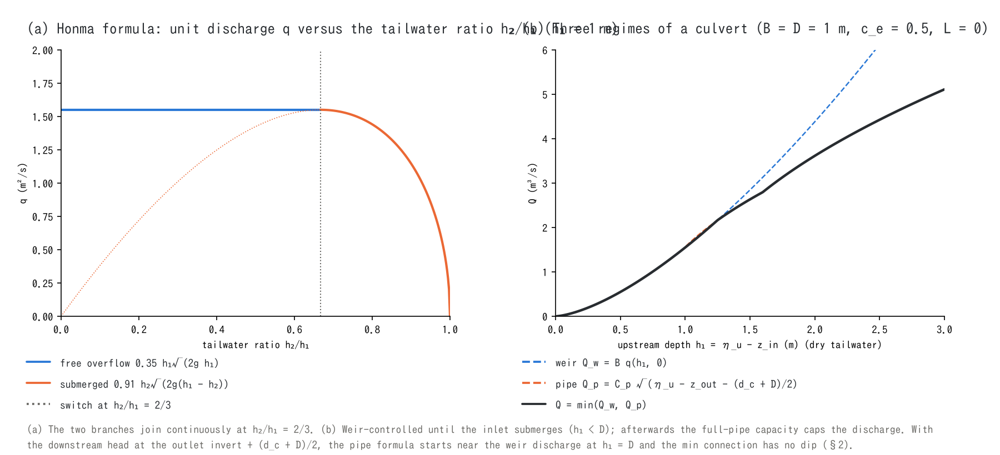

# Hydraulics of structures and boundaries (supplement to the structures, boundary and channel chapters)

> English mirror of docs/users_guide/hydraulics.md. The Japanese file is the master copy.

[Back to the structures chapter](structure.md) | [Back to the boundary chapter](boundary.md) | [Back to the channel chapter](channel.md) | [Back to the user's guide index](../users_guide.md)

This page gives the discharge formulas and the basis of their coefficients
for the [internal hydraulic structures](structure.md) (pumps, culverts,
diversions, dams), the [boundary conditions](boundary.md) (free outflow,
long-wave radiation, segment inflow) and the levee overtopping of the
[channel chapter](channel.md). The implementation is in
`src/m_boundary_structure.f90` (structures), `src/m_swflow_enc_bc.f90`
(edge boundaries and inflow) and `src/m_swflow_enc_channel.f90` (levee
overtopping); the design history is in developer.md §17, §22, §68.30 and
§69.9.

## 1. Weir formula (Honma)

Levee overtopping, the free-surface regime of culverts and the drop at a
river mouth all use Honma's weir formula[^honma40]. With the upstream
overflow depth $`h_1`$ and the downstream one $`h_2`$ (both above the crest
or invert):

```math
q = 0.35\,h_1\sqrt{2g\,h_1}\quad\left(\frac{h_2}{h_1} < \frac{2}{3},\ \text{free}\right),
\qquad
q = 0.91\,h_2\sqrt{2g\,(h_1 - h_2)}\quad\left(\frac{h_2}{h_1} \ge \frac{2}{3},\ \text{submerged}\right)
```

$`q`$ is the discharge per unit width and the two branches are continuous at
the switch $`h_2/h_1 = 2/3`$. The coefficients 0.35 and 0.91 are Honma's
experimental values for broad weirs and are the standard of Japanese river
planning for levee overtopping and breach discharge. When both water
levels exceed the crest with a small difference, a critical-flow drop
formula gives too much discharge and oscillates, which is why the
submerged branch is needed for levee overtopping ([channels](channel.md)).
The flow goes from the higher to the lower level.



## 2. Culverts (sluices)

A box culvert $`B \times D`$ with inverts $`z_{in}`$, $`z_{out}`$ and length
$`L`$ is evaluated with the higher side as upstream, and three regimes are
joined continuously with $`\min`$:

```math
Q_w = B\,q(h_1, h_2)\ (\text{weir of §1}),
\qquad
Q_p = C_p\sqrt{\eta_u - \max\!\left(\eta_d,\ z_{out} + \tfrac{d_c + D}{2}\right)},
\qquad
C_p = BD\sqrt{\frac{2g}{1 + c_e + f_L}},
\quad
f_L = \frac{2g\,n^2 L}{R^{4/3}},\ R = \frac{BD}{2(B + D)}
```

```math
Q = \begin{cases}
0 & (h_1 \le 0\ \text{or}\ \eta_u \le z_{out})\\
Q_w & (h_1 < D:\ \text{inlet not submerged, weir-controlled})\\
\min(Q_w,\ Q_p) & (h_1 \ge D:\ \text{the full-pipe capacity caps the flow})
\end{cases}
```

$`h_1 = \eta_u - z_{in}`$ and $`h_2 = \max(\eta_d - z_{in}, 0)`$. The pipe
formula is the energy equation combining an orifice (entrance loss
$`c_e`$) with Manning pipe friction $`f_L`$, the same construction as the
standard culvert design of the FHWA[^fhwa12]. The defaults $`c_e`$ = 0.5
(square-edged entrance) and $`n`$ = 0.02 (upper practical value of concrete
pipes with joints and deposits) are **empirical**. When the outlet is not
submerged, the downstream head is taken at the outlet invert +
$`(d_c + D)/2`$ as in the FHWA outlet control. $`d_c`$ is the critical depth
of the rectangular barrel for the weir discharge $`Q_w`$,
$`d_c = \min\!\left(D, (Q_w^2/gB^2)^{1/3}\right)`$, obtained explicitly
without iteration. As the barrel approaches capacity $`d_c \to D`$ and the
reference returns to the crown, and right after the inlet submerges
(h₁ = D) $`Q_p \approx Q_w`$, so the three regimes join smoothly through
$`\min`$ (panel (b); [test/culvert](../../../test/culvert/en/README.md) checks that the
recovered discharge is monotonic). Before 2026-10-12 the crown was used
as the reference regardless of inlet submergence, so $`Q_p \to 0`$ right
after the upstream level passed the crown and the discharge dipped
temporarily (developer.md §22, Japanese). The gate opening (`culv_gate_rule`) is a linear multiplier of
the discharge and the flap (`culv_flap`) blocks reverse flow; the order of
evaluation is three regimes → opening → flap. In addition the transfer per
step is capped at the volume that fills half of the representative level
difference, $`|Q| \le 0.5\,A_h\,|\eta_u - \eta_d|/\Delta t`$ ($`A_h`$ is the
harmonic mean of the effective plan areas Σgv·Δx·Δy of the two cell groups;
the channel width fn_width is not included). The cap prevents back-and-forth
oscillation at coarse Δt (developer.md §22, Japanese).

## 3. Pumps and diversions

Pumps and diversions have no hydraulic law: they are given as a
piecewise-linear $`Q(\text{reference})`$ of a reference value (water level
$`\eta`$ or depth $`h`$; linear interpolation, end values held outside) or as
a constant. Every step caps the transfer by the water actually present on
the intake side, so nothing is taken that is not there. A diversion is
passive and stops when the receiving level is at or above the intake
level (gravity cannot climb). A pump transfers forcibly to outside the
domain or to outlet cells; with intake from the conduit layer
(`f_pump_src = 1`) it draws from the storage of the conduit continuum. An
outlet cannot be placed on a sea-mask (fn_sw) cell; discharge into the sea
is expressed as drainage outside the system with the outlet omitted
([structures](structure.md)). The
specific capacity of urban pumping stations, 1–3 m³/s/km², corresponds to
10–20% of a 50 mm/h rainfall and is a **practical rule of thumb**.

## 4. Operation of dams and lakes

The capture set of the lake surface absorbs all arriving water into the
storage $`V`$ and releases it by the operation rule (a bucket model that
does not solve the flow on the water surface). Level and storage are
related by the HV curve (`dam_hv`) or the linear HV $`V = A(H - H_{\min})`$
($`A`$ = number of captured cells × cell area).

```math
Q = Q_0\ (\text{mode 1}),
\qquad
Q = r\,Q_{in}\ (\text{mode 2}),
\qquad
Q = Q(H)\ (\text{mode 3: piecewise, orifice or square-root law})
```

```math
Q_{ori} = BD\sqrt{\frac{2g}{1 + c_e}}\sqrt{H - z_b},
\qquad
Q_{\sqrt{}} = Q_{\max}\sqrt{\frac{H - z_b}{H_{sur} - z_b}}
```

Modes 1 and 2 carry the **emergency ramp** (above $`H_{tad}`$ the release
grows linearly to the inflow up to the surcharge level $`H_{sur}`$); the
excess over the surcharge is spilled and the storage below the minimum
level is dead storage. This is a **practical approximation** of the flood
operation of Japanese dam rules (emergency operation during exceptional
floods) as a linear ramp in storage. The default $`H_{tad}`$ =
minimum + 0.9 × (surcharge − minimum) is a placeholder when no rule value
is known. The flood response of a storage lake appears as the storage
attenuation $`A\,dH/dt = Q_{in} - Q(H)`$, so the pass-through setting
(r = 1) is inappropriate for large lakes. The completely mixed water
quality is in [Water-quality models](wq_models.md) §6.

## 5. Edge boundaries

Edge boundaries act only on edges where valid non-sea cells touch the grid
frame. They do not act on sea-mask (fn_sw) cells (the sea level is forced
by the [tide](tide.md)).

**Free outflow (type 1).** Advancing flow passes with the normal component
of the cell velocity, and standing water drains by a critical-depth drop:

```math
u_n = \max\!\left(\mathbf{u}\cdot\mathbf{n},\ u_c\,\max(\hat{\mathbf{d}}\cdot\mathbf{n}, 0)\right),
\qquad
u_c = \left(\frac{2}{3}\right)^{3/2}\sqrt{g\,h},
\qquad
q = u_n h
```

$`u_c h = (2/3)^{3/2}\sqrt{g}\,h^{3/2}`$ is the unit discharge of broad
critical flow (free overfall)[^chow59]; the drop velocity is projected as a
vector along the flow direction $`\hat{\mathbf{d}}`$ onto the three open
faces (the ENC shares $`\sum L_k \mathbf{n}_k = \Delta x`$ make the total
equal to the natural width). The $`\max`$ excludes inflow.

**Long-wave radiation (type 2).** Only the deviation from the reference
level $`\eta_{ref}`$ is transmitted:

```math
u_n = \sqrt{\frac{g}{h}}\,(\eta - \eta_{ref}),
\qquad
u_n = u_{n,e} + \sqrt{\frac{g}{h}}\,(\eta - \eta_e)\ (\text{Flather: child grid of a nest})
```

The first is a Sommerfeld-type radiation condition passing the outgoing
characteristic $`\eta \pm u\sqrt{h/g}`$ of long waves; the second is the
Flather condition[^flather76] with external level and velocity, used by
`nest_bc = 3` of [nesting](nest.md). Still water gives zero flux and the
inflow of a drawdown is allowed.

**Segment inflow (type D).** The total discharge $`Q`$ of the segment is
distributed over the open faces:

```math
q_m = \alpha\,\frac{Q\,w(h_m)}{\sum_k w(h_k)L_k} + (1 - \alpha)\frac{Q}{\sum_k L_k},
\qquad
w = 1,\ h,\ h^{5/3}\ (\texttt{inflow\_dist} = 0, 1, 2),
\qquad
\alpha = \mathrm{clamp}\!\left(2(1 - Fr_{\max}),\ 0,\ 1\right)
```

The weight $`h^{5/3}`$ is the conveyance distribution of a uniform-slope
cross-section under the Manning law[^chow59], a river-like distribution in
which deeper cells also flow faster. $`Fr_{\max}`$ is the Froude number of
the deepest cell under the weighted distribution: weighted for
$`Fr \le 0.5`$, uniform for $`Fr \ge 1`$, continuous in between (since
$`\alpha Fr \le 1/2`$ the deepest cell never receives more than half the
critical discharge, which stabilises dry cross-sections). Being a
continuous function of $`h`$, the distribution has no switching
oscillation and no memory, and restarts are exact. Faces of cells that
touch a wall corner or nodata and lack the interior edge that would pass
the inflow are closed automatically (developer.md §69.9).

The velocity of an inflow face is the face discharge $`q_m`$ divided by the
edge depth (the mass is set by $`q_m`$ alone; the velocity is used by the
advection and by the reconstruction of the cell velocity). The edge depth
is the depth of the inflow cell, with a floor at the depth of the incoming
flow so that the velocity does not diverge when water enters a dry bed or
a thin layer:

```math
h_e = \max\!\left(h,\ \min(h_c,\ h_n),\ d_v\right),\qquad
h_c = \left(\frac{q_m^2}{g}\right)^{1/3},\qquad
h_n = \left(\frac{q_c\, n}{\sqrt{S}}\right)^{3/5}
```

$`h_n`$ is the Manning uniform-flow depth on the bed slope $`S`$ from the
inflow cell to its inner neighbour, and $`q_c`$ is the discharge per cell
width ($`q_m`$ is per passage width of the face; for the normal face of a
square cell $`q_c = 0.41\,q_m`$). On gentle slopes the floor is $`h_c`$, on
steeper slopes the uniform-flow depth, so the floor never exceeds the depth
of the flow. With $`S \le 0`$ it is $`h_c`$. The floor $`h_c`$ alone exceeded
the depth of the flow when the Froude number of the uniform inflow was above
the passage ratio (0.41 for square cells); the inflow cell then flowed slower
than the uniform flow, floods left it uneroded, and it seeded steps
(developer.md §88.23 and §88.25, in Japanese; the form of this floor is our
own simplification).

## 6. Parameters and the basis of their defaults

The labels in the Basis column are explained in [How to read the basis of a default](../users_guide.md#how-to-read-the-basis-of-a-default).

| Parameter | Default | Meaning | Basis |
|---|---:|---|---|
| culv_width / culv_height / culv_zin / culv_zout | required | section and inverts (§2) | **given** dimensions from the structure register |
| culv_length | 0 | pipe length $`L`$ | **given** 0 = no friction loss |
| culv_manning | 0.02 | pipe roughness $`n`$ | **customary value** upper practical value of concrete pipes |
| culv_ce | 0.5 | entrance loss coefficient $`c_e`$ | **literature value** square-edged entrance[^fhwa12] |
| culv_flap / culv_gate_rule / culv_gate_ref | 0 / none / 1 | flap, opening rule, reference side | **given** the opening is a linear multiplier (approximation) |
| pump_q0 / pump_rule / f_pump_ref | — | constant discharge / operation rule / reference (§3) | **given** operation rule |
| div_q0 / div_rule | — | constant discharge / rating (§3) | **given** |
| dam_hv / dam_hmin / dam_hsur | — | HV curve / linear HV floor and surcharge (§4) | **given** project data; a lake of unknown depth: normal level − 5 m (empirical) |
| f_dam_mode / dam_q0 / dam_rate | — | operation mode and values | **given** |
| dam_hq_rule / dam_ori_* / dam_qmax | — | natural-regulation rating / orifice / square-root law | **given** the orifice $`c_e`$ default 0.5 is the culvert value |
| dam_tadashigaki | min + 0.9(surcharge − min) | start level of the emergency ramp | **customary value** practical placeholder |
| f_bc_w/e/n/s | 0 | type of the edge boundary (§5) | **method** 0: wall, 1: free outflow (critical drop), 2: radiation |
| bc_eta_* | derived from the initial state | reference level of the radiation | **derived** explicit value > e0 of f_htype=2 > initial level of each boundary cell; the last gives exactly zero radiation flux at t = 0 cell by cell. On restart it is derived again from the restored state ([Suspend and restart](restart.md)) |
| inflow_dist | 0 | distribution of the segment inflow (§5) | **method** 2 = Manning conveyance[^chow59]; use 2 for river cross-sections |

**Where to look when revising the defaults**

- The culvert entrance loss coefficient ranges 0.2–0.9 with the inlet
  shape; pick it from the tables of the FHWA design manual[^fhwa12]. Pipe
  roughness: concrete 0.012–0.015 (new) to 0.02 (aged, with deposits),
  corrugated steel 0.024.
- Pump and dam operation rules come straight from the operator's rules
  (release rules, emergency operation). The HV curve can be replaced by a
  linear approximation (dam_hmin, dam_hsur) from the bathymetry or from the
  gross and effective storage of the dam specifications.

The coefficients 0.35 and 0.91 of levee overtopping ([channels](channel.md))
are the Honma values of §1 and are not user parameters.

## 7. Verification cases

| Case | Content | Point |
|---|---|---|
| [test/damwq](../../../test/damwq/en/README.md) | constant release of a dam and a pond | storage and release ledger agree with the analytical solution |
| [test/coastal_drain](../../../test/coastal_drain/en/README.md) | pumping station from the conduit layer with a sea outfall | transfer of the pumping station |
| [test/nhcurrent](../../../test/nhcurrent/en/README.md) | uniform flow and sine wave from prescribed levels | use of prescribed-level boundaries |
| [test/sedinflow](../../../test/sedinflow/en/README.md) | total segment inflow with sediment | ledger closure of the inflow |
| [test/nest_identity](../../../test/nest_identity/en/README.md) | Flather versus radiation boundary | both agree for a still parent grid |
| [tutorials/wave](../../../tutorials/wave/en/README.md) Step 3 | radiation boundary | transmission and reflection of waves |

## References

[^honma40]: Honma, M. (1940): Coefficient of discharge of low overflow weirs. *J. Jpn. Soc. Civil Eng.*, 26(6), 635–645; 26(9), 849–862 (in Japanese). (Honma formula; coefficients 0.35 and 0.91)
[^fhwa12]: Schall, J. D., Thompson, P. L., Zerges, S. M., Kilgore, R. T. and Morris, J. L. (2012): Hydraulic Design of Highway Culverts, 3rd ed. *FHWA Hydraulic Design Series*, 5 (HDS-5), FHWA-HIF-12-026. (entrance loss coefficients and pipe friction of culverts)
[^chow59]: Chow, V. T. (1959): *Open-Channel Hydraulics*. McGraw-Hill. (critical-depth drop, Manning conveyance)
[^flather76]: Flather, R. A. (1976): A tidal model of the north-west European continental shelf. *Mém. Soc. R. Sci. Liège*, Ser. 6, 10, 141–164. (Flather radiation condition)
