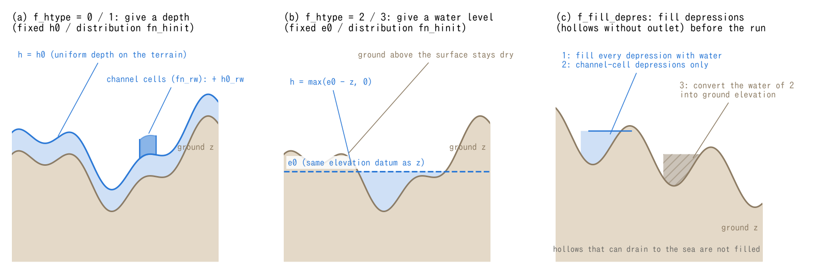

# Initial conditions (&list_initial)

> English mirror of docs/users_guide/initial.md. The Japanese file is the master copy.

[Back to the user's guide index](../users_guide.md)

Gives the water depth, water level, and velocity at the start of the
computation (t = t0). Enabled via `fn_initial`. If not specified, the
whole domain starts dry (h = 0) -- for computations where water enters
through rainfall runoff or river inflow, that is often sufficient.

```
&list_initial
  h0 = 1.0                       ! uniform initial depth of 1 m
/
```

## How depth / water level is given (f_htype)

| f_htype | How it is given | Parameters used |
|---|---|---|
| 0 (default) | fixed water depth | h0 |
| 1 | water depth distribution file | fn_hinit |
| 2 | fixed water level (h = max(e0 - z, 0)) | e0 |
| 3 | water level distribution file | fn_hinit |

| Parameter | Default | Meaning |
|---|---|---|
| h0 | 0 | initial water depth (m) |
| e0 | 0 | initial water level (m; same elevation datum as z) |
| fn_hinit | "" | distribution file of the initial depth/water level (f_htype=1, 3) |
| h0_rw | 0 | additional initial depth on channel mask cells (m); positive values are added after depth initialization and depression filling |
| u0 / v0 | 0 | initial velocity (m/s) (f_uvtype=0: uniform value only) |
| f_fill_depres | 0 | depression filling. 0: none, 1: water filling on land excluding sea, 2: water filling on channel cells only, 3: convert the fill water of 2 into bed elevation |
| f_user_routine | "" | user routine that modifies the initial field (for idealized experiments; see [Writing user routines](user_routines.md)) |

`f_htype=0` assigns the uniform depth `h0` to valid cells. On uneven
terrain the surface follows the ground, so this does not define a
horizontal still-water surface. `f_htype=1` reads each cell's value H
from `fn_hinit` as a depth and sets `h = max(H, 0)`. The distribution
need not be uniform.

The water-level options use the same elevation datum as ground z.
`f_htype=2` computes `h = max(e0 − z, 0)` from the constant level `e0`,
which can define a horizontal surface in a lake or reservoir.
`f_htype=3` reads each cell's level E from `fn_hinit` and computes
`h = max(E − z, 0)`. E may vary spatially and need not describe a
horizontal surface. Both options give zero depth where ground is at
or above the specified level. Types 1 and 3 require `fn_hinit`.
For a long-wave radiation edge boundary (type 2), if the reference level
is not explicitly set, `f_htype=2` uses `e0` as that reference
([boundary conditions](boundary.md)).

## Depression filling and initial channel depth

`f_fill_depres` fills hollows that retain water below the surrounding
terrain before the run. Type 1 computes fill depths on valid land cells,
excluding sea; type 2 restricts this to channel cells (`fn_rw`). Type 2
can fill spurious pits in a channel long-profile derived from coarse
terrain data. Type 3 performs the same filling as type 2, then converts
the retained depth h to bed elevation: `z ← z + h`, `h ← 0`. This raises
the channel bed without retaining the fill water as initial water volume.
Types 2 and 3 require the channel mask `fn_rw`.

Filling compares bed elevations and water levels over eight neighbours,
lowering levels to obtain the retained depths. Cells adjacent to the sea
act as drainage outlets with zero depth. For types 2 and 3, neighbour
comparisons are restricted to channel cells, apart from the sea-adjacency
drainage rule. A path towards the sea does not prevent water retention
below an intervening rise in the ground. Panel (c) illustrates a hollow
with such a spill point.

The order is **depth initialization by `f_htype` → filling by
`f_fill_depres` → addition of `h0_rw` on channel cells**. When filling
is enabled, it replaces the existing initial depths on target cells.
A positive `h0_rw` is added for every `f_htype`, including after
`f_fill_depres=3` has raised the bed. Thus channel cells can be wetted with `h0_rw` even
after bed filling. The addition is intended to pre-wet incised channels
whose bed is already lower in the input terrain; `h0_rw` itself does not
excavate the bed. This order describes normal parameter initialization;
a subsequent saved-state restore or user routine can supersede the field.



(a) Example of uniform depth with `f_htype=0` and `h0_rw` added in an
incised channel. The bed is low enough that the final channel water level
remains slightly below the adjacent non-channel water levels. The dashed
line marks the surface before addition; darker blue marks the added depth.
The bed steps represent the incision in the input terrain.
(b) Example of constant level with `f_htype=2`. The surface is drawn only
over wet ground, with zero depth at the shoreline contacts. The formulas
below cover the distributed inputs of types 1 and 3, which are not limited
to uniform depth or a horizontal surface. (c) The same channel hollow
filled with water (1 or 2) or with bed material (3). Hatching marks the
converted fill and the dashed curve the original bed. Type 1 applies
throughout land; types 2 and 3 apply only to channel cells. Panels (a) and
(b) omit depression filling, while (c) shows the state before adding
`h0_rw`. These are schematics, not simulation results. Generate both
languages as PNG and SVG with `python docs/figs/make_guide_figs.py initial`.

## How to give it by pattern

| Type | Setting | Notes |
|---|---|---|
| Catchment rainfall runoff | nothing (dry); with coarse terrain, f_fill_depres=2-3 to fill channel pits | h0_rw 0.1-0.5 wets the channel at base flow for a natural rise |
| River flood inundation | h0_rw 0.3-1 m, or a warmed-up field run at base flow (below) | Inflow via segment inflow of [boundary conditions](boundary.md) |
| Lake, reservoir, tidal reach | f_htype=2, e0 = water level | Ground above the water surface stays dry |
| Tsunami (sea solved as ordinary cells) | f_htype=2, e0 = mean sea level | Incidence via prescribed levels on the seaward edge or an initial waveform in fn_hinit |
| Dam break, bore | fn_hinit (f_htype=1) or f_user_routine | The wave tutorial's user routine is the model for idealized experiments |

## Using a warmed-up field as the initial condition

When you want to start from a realistic "flowing field" beyond what the
parameters can express, a saved state from a warm-up run can be read as
the initial condition (`f_state_restore = 2`). A typical use is to run
normal flow through the channel first and then start the flood
scenario. See the [suspending and restarting chapter](restart.md).

## Tests and examples

- Annotated list of all parameters: [examples/List_samples/list_initial.txt](../../../examples/List_samples/en/list_initial.txt)
- Still water + a water-level mound from a user routine: [tutorials/wave](../../../tutorials/wave/en/README.md)
- Regression case with an initial water hump over still water: [test/wave](../../../test/wave/)
- Real-terrain case starting from dry ground with rainfall: [test/chichibu](../../../test/chichibu/)
- Example treating the sea as normal cells with an initial water level specified by `f_htype=2`: [examples/tsunami_fault](../../../examples/tsunami_fault/)
