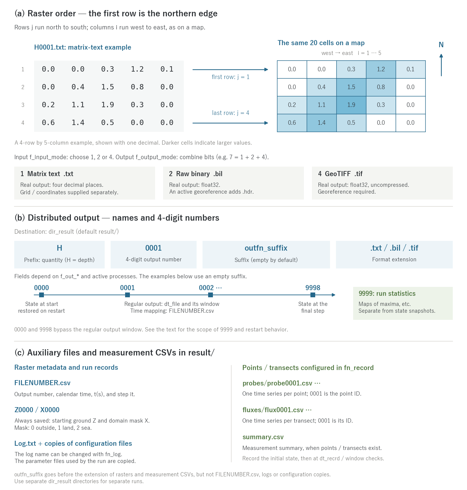

# Input and Output Formats

> English mirror of docs/users_guide/io.md. The Japanese file is the master copy.

[Back to the User's Guide index](../users_guide.md)

Input and output of distributed data (topography, roughness, results,
etc.) supports three formats. All of them are selected in
`&list_sysparam`.

## Common raster conventions

- The matrix order puts the **first row at the northern edge** (rows =
  y direction, north to south; columns = x direction, west to east).
  This is the same orientation as GIS rasters and paper maps.
- The mapping between cells and array entries is shared. Numerical
  storage precision and georeferencing differ between formats.

## Input format (f_input_mode)

| Value | Format |
|---|---|
| 1 (default) | matrix text (whitespace-separated) |
| 2 | bil (raw binary + ESRI hdr) |
| 4 | GeoTIFF |

- For bil, if a `.hdr` with the same base name exists, the pixel type
  (float32 / int8, int16, int32, signed or unsigned) is read from it
  (an integer bil can also be read into a real field with conversion).
  Without an hdr, real fields are read as float32 and integer fields
  as int32.
- Specifying the grid geometry: for txt and bil without hdr, `nx, ny`
  and `dx, dy` (or `lx, ly`) must be given in the namelist. For bil
  with hdr and GeoTIFF this is basically unnecessary (the values are
  filled in from the file), except that a geographic (lat/lon) grid
  requires `dx, dy` (m) — see
  [the coordinate systems chapter](coordinates.md).
- GeoTIFF supports uncompressed, LZW, and Deflate (including with
  predictor), in both strip and tile layouts, and has been verified
  against real outputs from QGIS / ArcGIS / GDAL. No external library
  is used (in-house implementation).
- The input format is a single choice (unlike output, it is not a
  bit sum).
- **For a small domain mask placed in a large full-extent raster, use
  bil or GeoTIFF.** Real-valued rasters (elevation, coefficients, initial
  fields) are kept in memory only over the window derived from the domain
  mask (the rows and columns containing valid cells, plus two cells), and
  only that window is read from the file. bil reads just the window's
  rows by position and GeoTIFF decodes only the strips/tiles overlapping
  the window, so reading time also scales with the window. Text input has
  to be parsed, every column, down to the last row of the window, so a
  nation-scale text raster takes long just to read (with GDAL:
  `gdal_translate -of EHdr -ot Float32 in.txt out.bil` or
  `gdal_translate -of GTiff in.txt out.tif`). The masks (domain, sea,
  channel) are read in full because the window is derived from them
  (integers).

## Output format (f_output_mode)

Multiple formats can be written at once as a **bit sum**.

| Value | Formats written |
|---|---|
| 1 (default) | text only |
| 2 | bil only |
| 3 | text + bil |
| 4 | GeoTIFF only |
| 5 | text + GeoTIFF |
| 6 | bil + GeoTIFF |
| 7 | text + bil + GeoTIFF |

Real fields are written as `f12.4` (four decimal places) in text and as
float32 in bil / GeoTIFF. Values in different formats, or the internal
real values, therefore need not agree bit for bit. Integer fields are
written as integers.

With an active georeference, bil gets a `.hdr` describing location,
resolution and pixel type. GeoTIFF output requires an active georeference
and embeds location and the configured CRS information. Text contains no georeference
(see [Coordinate Systems](coordinates.md)).

> **GeoTIFF output is uncompressed** (4 bytes per cell; unlike
> reading, compressed writing is not supported). If you output many
> time steps for an animation and the data volume matters, compress
> in post-processing (requires [GDAL](https://gdal.org/) — bundled
> with QGIS, or installable via apt / conda):
>
> ```bash
> for f in result/*.tif; do
>   gdal_translate -q -co COMPRESS=DEFLATE -co PREDICTOR=3 "$f" "${f%.tif}_c.tif"
> done
> ```
>
> Even floating-point fields typically shrink to 1/2–1/4. The
> compressed GeoTIFFs open in GIS as usual, and are **also directly
> usable as ENCflow input (f_input_mode=4) and by utils/out2vtk**
> (reading Deflate with predictor 3 is supported, and agreement with
> real GDAL outputs is checked in the regression tests — [test/gtif](../../../test/gtif/en/README.md)).
> Running out2vtk right after the compression is fine (it assembles
> exact file names, so the `_c` files are ignored and the originals
> are used). If you delete the originals to save space and keep only
> the `_c` files, set `outfn_suffix = "_c"` in the out2vtk namelist
> to convert directly from the compressed files.

## Output file scheme

Distributed outputs go to `dir_result` (default `result/`) with names of
the form **prefix + 4-digit number + outfn_suffix + extension**.
The suffix is empty by default. For example, `H0001.txt` is a regular
depth output; with `outfn_suffix="_A"`, it becomes `H0001_A.txt`.



(a) A 4-row by 5-column example is shown as matrix text and as
a grid in the same orientation. Example values are abbreviated to one
decimal place. The order is shared, but real-number precision differs
between text and binary output. (b) The 4-digit raster number distinguishes
starting state, regular output, final state and run statistics.
(c) Auxiliary files and measurement CSVs. Their 4-digit measurement IDs
identify points / transects, independently of raster output numbers.
File examples use an empty suffix.

**Meaning of the number**

| Number | Meaning |
|---|---|
| 0000 | state at the start of this run (in a restart run, the restored state) |
| 0001- | sequential outputs determined by `dt_file` and the raster output window (time mapping in `FILENUMBER.csv`) |
| 9998 | state at the final time step |
| 9999 | statistics such as maxima within this run |

`0000`, `9998` and the end-of-run `9999` are written independently of
the regular output window. See [Time and Output Intervals](time.md) for
intervals and windows. Restart mode 1 continues the saved regular output
number; mode 2 resets the counter to zero. Both write the restart run's
starting state as `0000`. Maximum statistics are not saved in restart
files: `9999` covers this run, including the restored starting state
([Suspend and Restart](restart.md)).

**Prefixes and output flags** (enabled with `f_out_XXX = 1`). Basic defaults
are H and H9999, plus the always-written starting ground Z0000 and mask
X0000. Active physical processes can add automatic outputs. The table
lists the main outputs.

| Flag | Default | File | Contents |
|---|---|---|---|
| f_out_h | 1 | H | depth (m) (with the fresh/salt layers enabled, the surface salt-layer thickness Hss is also written) |
| f_out_e | 0 | E | water level (relative to datum) (m) |
| f_out_z | 0 | Z | ground elevation (m) (even when off, Z0000 is always written; for the time evolution of landform-change runs) |
| f_out_u / f_out_v | 0 | u / v | velocity in the x / y direction (m/s) |
| f_out_vv | 0 | V | velocity magnitude (m/s) |
| f_out_m / f_out_n | 0 | m / n | unit-width discharge in the x / y direction (m2/s) |
| f_out_qq | 0 | Q | discharge magnitude (m2/s) |
| f_out_qc | 0 | Qc | cumulative discharge |
| f_out_qd | 0 | Qd | flow direction (needed by utils/rerecord) |
| f_out_ddd / f_out_dda | 0 | Ddd / Dda | dominant / all downstream directions (needed by utils/rmdepress_river) |
| f_out_pre | 0 | Pr | rainfall intensity (mm/h) |
| f_out_fr / f_out_cn | 0 | Fr / Cn | Froude number / Courant number |
| f_out_hg | 0 | Hg | subsurface storage depth (m) (when fn_gwflow is enabled; also Hg2 with the weathered bedrock layer, Hgc with the conduit continuum layer, Hgs with the fresh/salt layers, and the subsurface mass pool Cg (g/m²) of water quality with f_wq_infil=1) |
| f_out_hrs | 0 | Hrs | pond depth (m) (when fn_reservoir is enabled) |
| f_out_hs | 0 | Hs | sediment column (m) (requires an active sediment process; for visualizing the concentration C = hs/(h+hs)) |
| f_out_hd | 0 | Hd | floating driftwood volume (m³/m²) (requires [Driftwood](driftwood.md)) |
| f_out_wd | 0 | Wd / Wd9999 | deposited driftwood (m³/m²) and the maximum arrival max(floating+deposited) over the run (the driftwood hazard map) |
| f_out_hbd | 0 | Bf | floating building-debris volume (m³/m²) (requires [Building destruction and debris](bldgdebris.md)) |
| f_out_wbd | 0 | Bd / Bd9999 | deposited debris (m³/m²) and the maximum arrival max(floating+deposited) over the run (the debris hazard map) |
| f_out_bds | 0 | Bs | destroyed fraction of buildings 1 − remaining/initial stock (0-1; the final frame is the damage-ratio map) |
| — (with f_bedslide) | — | Hb / Vb | moving basal-layer thickness (m) and diagnostic speed (m/s); automatic ([Sediment and landform change](geomorph.md)) |
| f_out_fs | 0 | Fs / Fs9999 | slope safety factor Fs distribution and its period minimum (requires f_slide = 1 or 2; -1 = not evaluated; see [Sediment and landform change](geomorph.md)) |
| f_out_hmax | 1 | H9999 | maximum depth |
| f_out_hmaxt | 0 | Ht9999 | time of maximum depth |
| f_out_vvmax | 0 | V9999 | maximum velocity |
| f_out_qqmax / f_out_qqmaxt / f_out_qqmaxd | 0 | Q9999 / Qt9999 / Qd9999 | maximum discharge and its time / direction |
| f_out_dmax / f_out_dmaxt | 0 | D9999 / Dt9999 | maximum flow depth h+hs and its time (requires an active sediment process; for debris and volcanic flows the true "inundation depth" is the mixture depth) |
| f_out_fmax | 0 | F9999 | maximum fluid force (ρm/ρw)·(h+hs)·V² (m³/s²; normalized by the freshwater density, so for water-only runs it equals the conventional u²h; for mixtures the density ratio 1+sC is included; multiply by ρw (1000) for the force per unit width in N/m) (a standard indicator for building damage) |
| f_out_fdmax | 0 | Fd9999 | maximum fluid force including driftwood and debris (h+(1+s)hs+sg_log·hd+sg_deb·hbd)·V² (m³/s²; requires [Building destruction and debris](bldgdebris.md); F9999 keeps its definition) |
| — (with fn_wq) | — | C / B | concentration of the transported substance (mg/L) and, with the buildup pool enabled, the surface buildup pool (kg/ha) ([Water Quality](wq.md); automatic; the subsurface mass pool Cg rides on f_out_hg) |
| — (with fn_snow) | — | Sw | snow water equivalent SWE (mm) (automatic) |
| — (with fn_swi) | — | Swi / Swi9999 / Swit9999 | Soil Water Index (mm) distribution, period maximum, and its time ([Soil Water Index](swi.md); automatic) |
| — (always) | — | X0000 | domain mask (0: outside, 1: land, 2: sea); for visualization and checking the active domain in GIS |
| — (when the void ratio fn_gv or a channel width is active) | — | A0000 | effective area factor = void ratio gv × channel area fraction f_w (0–1); the factor that converts column quantities to cell averages, volumes and wet area (see "Reading cells with channel width or buildings" below) |

`FILENUMBER.csv` maps raster output numbers to calendar time, `t(s)`
and step `it`. Its `9999` row records the final time when statistics were
written, not the time of each cell's maximum. No separate row is added
for X0000.

Points / transects configured in `fn_record` create time series such as
`probes/probe0001.csv` / `fluxes/flux0001.csv`. Their 4-digit numbers are
point / transect IDs. After recording the initial state, records are
appended at `dt_recrd` / measurement-window checks. If any points or
transects exist, `summary.csv` stores their measurement summary at the end
([Flux Transects and Probes](record.md)).

The state log named by `fn_log` (default `Log.txt`) and copies of all
configuration files used are also saved. Input rasters are not copied
as part of this configuration record.

Georeferenced bil / GeoTIFF outputs can be opened in GIS (QGIS / ArcGIS), and
**utils/out2vtk** converts them to VTK files for ParaView — 3D terrain
views, time-animated water surfaces, and draping of satellite imagery
(see the [out2vtk guide and workflow diagram](../../../utils/out2vtk/README.en.md)).
If outputting many GeoTIFFs for an animation makes the data volume a
concern, see the post-processing compression note in
[the output format section](#output-format-f_output_mode).

## How state variables are written

Fields that can be written as rasters are of two kinds: **state variables
that the model integrates in time** (depth h, sediment column hs,
subsurface storage hg, substance column cq, ...) and **diagnostics derived
from them every step** (water level E, speed V, Froude number Fr,
concentration C, ...). The flags in the table above select which fields
are written and when, but the table mixes three ways of enabling a field,
so read it with the following grouping in mind.

1. **Basic fields are selected by flags** (H, E, u/v, Hg, Hs, ...). Only H
   and H9999 are on by default. Turning on just the fields you need keeps
   the number of files and the data volume down.
2. **Fields written automatically once a process is enabled** (C, B, Sw,
   Swi, Hi, Hl, Hb/Vb, Sd). As soon as the corresponding fn_* is given
   they are written at every `dt_file` without any flag. There is no
   "off" setting: running a process without looking at its state is not a
   supported workflow.
3. **Fields that ride on a basic flag**. State variables of the same
   family share one flag so that no new keys are added.
   - `f_out_h` → H plus the surface salt-layer thickness Hss of the
     fresh/salt layers
   - `f_out_hg` → Hg plus the weathered bedrock layer Hg2, the conduit
     continuum layer Hgc, the subsurface salt storage Hgs and the
     subsurface mass pool Cg of water quality
   - `f_out_wd` / `f_out_wbd` → deposits plus the run maxima Wd9999 / Bd9999

   In short: "everything about the subsurface comes out with
   `f_out_hg = 1`". When the process is disabled the field is simply not
   written (no error).

**Reading column quantities (area basis)**. Most state variables are held
as "amount per cell area" (column quantities). There are two area bases,
and the multiplication that recovers the total in a cell differs.

| Basis | Fields | Total in the cell |
|---|---|---|
| Pore area (the part of the cell water can occupy) | H, Hs, Hrs, Hss, Hd, Wd, Bf, Bd, cq (probe column) | value × gv × wfrac × A |
| Geometric area (the cell itself) | Sw, Hi, Hl, Hb, B, Cg, Hg (subsurface family) | value × A |

A is the geometric cell area, gv the effective area fraction of
[Geographic Information](geoinfo.md) and wfrac the
[channel width](channel.md) factor (1 without the width feature). Without
building occupancy or channel width the two bases coincide. To check a
basin-wide total quickly, the S columns of `Log.txt` and the budget CSV
of each process (`wq.csv`, ...) are more reliable than summing rasters.

**Reading cells with channel width or buildings**. On cells with a
subgrid channel width (f_w = min(W/Δ, 1) < 1) or a building void ratio
(gv < 1), column quantities such as H, Hs and cq are **the values of the
part of the cell that water can occupy** (inside the channel, outside the
buildings), and only part of the cell is wet. The following conversions
are then needed (gv and f_w are written together as A0000; the f_w in
A0000 is the area fraction the model actually uses,
min(W × L_ch / (Δx Δy), 1): W/Δ on straight-channel cells, and dependent
on the in-cell channel length L_ch on diagonal and end cells;
[Channel models](channel_models.md) §2).

| Quantity wanted | Conversion |
|---|---|
| cell-average depth (to smooth an inundation map) | H × A0000 |
| water volume of the cell | H × A0000 × A (on σ-section cells the rectangular-equivalent depth vh × gv × f_w × A, as in the S column of the log) |
| wet area / inundated area | Σ A0000 × A over the cells with H > threshold |
| eroded / deposited bed volume | (Z − Z0000) × f_w × A (bed changes by bedload and suspended sediment are concentrated on the channel bed f_w × A) |
| Z and Sd on channel cells | elevation and soil thickness of the channel bed (not cell averages) |

The run statistics (H9999, D9999, F9999) are likewise in-channel /
outside-building values painted over the whole cell. To exclude channel
cells narrower than the cell from an inundation hazard map, separate them
with the channel mask (fn_rw). Concentrations (C, Hs/(H+Hs)) are per
volume and need no conversion.

**Concentrations are derived**. The water-quality C (mg/L) and sediment
concentrations are column quantities divided by depth, meaningful only in
wet cells. The model does this conversion internally with the σ grid and
channel width taken into account, so use the written concentration as it
is rather than redoing the division from the written column and depth.
Dry cells are written as concentration 0, which does not mean zero
residual mass (check the column quantity or the budget CSV).

**State not written as rasters**. Some internal states (the mass pool of
retention ponds, the fully mixed pool of dams/lakes, the conduit ledger,
...) are not written per cell; they appear as domain totals in the budget
CSV of the process. Quantities needed as time series at a point (cq, ...)
have columns in the [probes](record.md). Raster outputs are for
visualization and analysis; a run cannot be restarted from them. Use the
save files of [Suspend and Restart](restart.md) for that.

**Relation to numbers 0000 / 9998 / 9999**. State fields are written in
three series, `0000` (start), `0001-` (regular) and `9998` (final state);
`9999` exists only for fields that have their own statistics flag such as
H9999. Automatic and riding fields have no run statistics except where
stated (Wd9999, Swi9999, ...). If you need the run maximum of such a
field, refine `dt_file` and compute it in post-processing.
Cells of the sea mask (fn_sw) are excluded from the period statistics,
and the sea area of the 9999 series is 0. In the state fields (H, E, Z)
the sea area holds the boundary representation of the tide (H = hsea0,
E = tide level, Z = tide level − hsea0), not the sea depth or the seabed
([Tide](tide.md)). Restrict aggregates such as the inundated area to the
land, X0000 = 1 (as in the inundated-area row of the quick reference).

### Quick reference: what you want to see and how to get it

A reverse lookup from "I want to see this quantity". Three ways:
**automatic** = written once the process is enabled, **flag** = set
`f_out_*` to 1, **computed** = derived in post-processing from the raster
files. Formulas operate cell by cell on rasters of the same time; times
come from `FILENUMBER.csv`.

| Quantity | How | File (flag) | Computation / notes |
|---|---|---|---|
| Inundation depth | flag (default on) | H (f_out_h) | depth on the pore-area basis (m); on channel-width and building cells the in-channel / outside-building value (cell average = H × A0000) |
| Maximum depth and its time | flag (H9999 default on) | H9999 (f_out_hmax), Ht9999 (f_out_hmaxt) | Ht9999 in minutes from the start |
| Water level (elevation) | flag or computed | E (f_out_e) | E = Z + H, with Z from Z0000 (or the Z of the same time under morphodynamics) |
| Flow speed | flag or computed | V (f_out_vv), components u / v (f_out_u / v) | V = √(u² + v²) |
| Unit-width discharge | flag or computed | Q (f_out_qq), components m / n (f_out_m / n) | Q = √(m² + n²); Q ≈ H × V |
| Flow direction | flag or computed | Qd (f_out_qd) | angle from the x axis (rad, −π to π); atan2(v, u) from u, v gives the same |
| Maximum speed / discharge with time and direction | flag | V9999 (f_out_vvmax), Q9999 / Qt9999 / Qd9999 (f_out_qqmax family) | — |
| Fluid force (building damage index) | flag or computed | F9999 (f_out_fmax), Fd9999 (f_out_fdmax) | run maximum is F9999; the instantaneous value is H × V² (clear water only; see the definitions of F9999 / Fd9999 for mixtures, driftwood and debris). × 1000 for force per unit width (N/m) |
| Inundation duration / arrival time | computed | — (the H series) | duration = number of frames above a threshold (e.g. 0.01 m) × dt_file; arrival = time of the first frame above it. Use a fine dt_file |
| Inundated area / extent | computed | — (H, X0000, A0000) | Σ A0000 × cell area over cells with X0000 = 1 and H > threshold (cell count × cell area without A0000). Maximum extent: the same test on H9999 |
| Froude / Courant number | flag | Fr (f_out_fr), Cn (f_out_cn) | sub/supercritical regime, time-step check |
| Rainfall intensity | flag | Pr (f_out_pre) | given precipitation × runoff_rate (mm/h), before interception and snow processing |
| Ground elevation / morphological change | flag (Z0000 always) | Z (f_out_z) | erosion/deposition thickness = Z(time) − Z0000 (negative = erosion); volume = × f_w × A (on channel-width cells the change of the channel bed), with [Sediment and Morphodynamics](geomorph.md) enabled |
| Subsurface storage / water table | flag | Hg (f_out_hg; also Hg2 / Hgc / Hgs / Cg) | Hg is a column-equivalent depth (m). Saturated thickness = Hg / sy0; water table ≈ ground − soil thickness + Hg / sy0 (lateral / Green-Ampt configurations; see the figure in [Groundwater](gwflow.md)) |
| Soil thickness | automatic | Sd | only when a model that uses sd is enabled |
| Fixation degree | automatic | Fx | 0 to 1; only with f_fixation ([Sediment and landform change](geomorph.md)) |
| Cumulative bedrock incision | automatic | Ri | total plucked thickness by flowing water (m); only with f_rockinc. The bedrock surface is Z − Sd ([Sediment and landform change](geomorph.md)) |
| Snow water equivalent | automatic | Sw | mm of water ([Snow](forcing.md)) |
| Soil Water Index | automatic | Swi / Swi9999 / Swit9999 | mm ([Soil Water Index](swi.md)) |
| Sediment column / concentration / flow depth | flag or computed | Hs (f_out_hs), D9999 / Dt9999 (f_out_dmax family) | volume concentration = Hs / (H + Hs); instantaneous flow depth = H + Hs, run maximum D9999 |
| Slope safety factor | flag | Fs / Fs9999 (f_out_fs) | −1 = not evaluated |
| Driftwood / debris distribution and reach | flag | Hd / Wd / Wd9999 (f_out_hd, wd), Bf / Bd / Bd9999 / Bs (f_out_hbd, wbd, bds) | reach = Wd9999 / Bd9999 (run maximum of moving + deposited) |
| Water-quality concentration / pools | automatic (Cg by flag) | C, B, Cg (f_out_hg) | run-maximum concentration from the C series in post-processing; total mass from `wq.csv`, point time series from probes ([Water Quality](wq.md)) |
| Surface / subsurface salt water | flag | Hss (f_out_h), Hgs (f_out_hg) | with [Salt Water](salt.md) enabled |
| Retention-pond depth | flag | Hrs (f_out_hrs) | — |
| Glacier / lava thickness | automatic | Hi, Hl | [Glacier](glacier.md), [Lava Flow](lavaflow.md) |
| Totals (storage, mass) | ledger rather than computed | S columns of `Log.txt`, the CSV of each process | more reliable than summing rasters (the area-basis differences are already handled) |

## Screen and log display columns (f_disp_\*)

The time, the conserved quantity S, Runge, and ex_flux are always
displayed; the columns of field maxima are selectable: `f_disp_h`
(h_max, default on), `f_disp_vv` (V_max, default on), `f_disp_cn`
(Cn_max, default on), `f_disp_qq` (Q_max, default off).
`f_disp_debug = 1` displays the S column with all significant digits
(for balance debugging and regression tests). For how to read the
columns, see [Tutorial Step 1](../../../tutorials/wave/en/README.md#running).

## Adjusting directories and file names

| Parameter | Default | Meaning |
|---|---|---|
| dir_data | "." | base directory of input data files |
| dir_result | "result" | result output directory |
| dir_save | "save" | directory for state files ([Suspend and Restart](restart.md)) |
| fn_log | "Log.txt" | log file name |
| outfn_suffix | "" | string inserted just before the extension of rasters and measurement CSVs |
| out_fill | 0.0 | value written in rasters outside the computational window (bounding box of the region mask) |

`out_fill` is the value written outside the computational window when a
small region mask is placed on a large grid. ENCflow keeps only the
bounding box of the region mask (plus halo) in memory and writes rasters
in the full shape of the input. Cells outside the window are not computed,
so they are filled with this value (default 0; use e.g. `-9999` to tell
them apart in a GIS). Masked-out cells inside the window keep their
internal values (zero depth, input elevation). X0000 (the region mask) is
always written with its actual full-domain values.

`outfn_suffix` also applies to Z0000 / X0000, bil `.hdr` files, CSVs in
probes/ and fluxes/, and summary.csv. It does not apply to
`FILENUMBER.csv`, logs or configuration copies. Use separate `dir_result`
directories to preserve results from separate runs.
