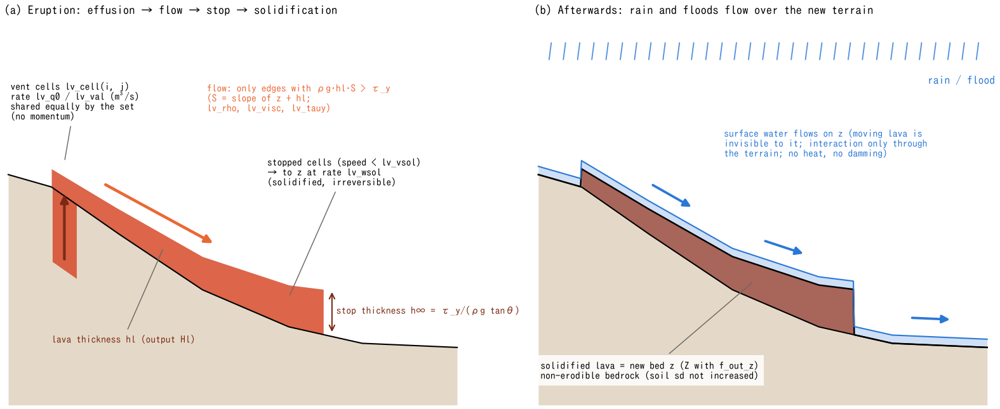

# Lava flows (&list_lavaflow)

> English mirror of docs/users_guide/lavaflow.md. The Japanese file is the master copy.

[Back to the User's Guide index](../users_guide.md)

Computes lava effusion from a set of vent cells, its downslope
spreading, stopping, and solidification into lava fields and new
topography. The dynamics are a depth-averaged Bingham viscous gravity
current (lubrication approximation); the viscosity η and yield stress
τ_y are given directly. Stopped lava is converted into the bed
elevation z at a fixed rate (solidification), and **rainfall, flooding,
and sediment transport over the new topography continue in the same
run** (eruption → lava field → secondary hydrologic response as one
chain). With `f_lvtemp = 1` the lava temperature is computed, and the flow
stops as it cools (the viscosity and yield stress rise) and solidifies at the
solidification temperature ([Temperature mode](#temperature-mode-f_lvtemp--1)).
The full design is in [docs/lava_plan.md](../../lava_plan.md) (in Japanese);
the implementation record is developer.md Sec. 51.

How to read the results (fields, ledgers, measurement columns, restart) is summarized in [Output and monitoring](#output-and-monitoring) on this page.

## What is computed

- The state is the per-cell lava thickness `s%hl` (m), written as the
  distributed field `Hl0001...` at every output time.
- Flow occurs across edges where the basal shear stress $`\rho g h_e S`$
  exceeds the yield stress $`\tau_y`$: $`h_e`$ is the mean lava thickness
  of the two cells and $`S`$ the magnitude of the gradient of the lava
  surface $`s = z + h_l`$ (the flow law below; $`\tau_y = 0`$ gives Newtonian
  viscous flow). $`S`$ is made from the gradients both across and along the
  edge, so the shape of stopped lava does not depend on the grid orientation
  (see [Constraints](#constraints-and-interactions) below).
- When `lv_wsol > 0`, lava in "stopped" cells — where the maximum
  depth-averaged speed over the surrounding edges is below `lv_vsol` —
  is converted to z at the rate `lv_wsol` (m/s; irreversible). Only edges
  across which lava can move are counted: an edge whose higher-surface side
  carries no lava (an edge toward dry ground higher than the lava) is not.
  The solidified surface does not add to the soil layer sd: it behaves as
  non-erodible bedrock. The soil layer that was in a cell where lava
  solidifies (the sd used by morphodynamics and groundwater) is buried
  under the lava, and sd becomes 0.
- By default the model is isothermal (constant viscosity and yield
  stress). `f_lvtemp = 1` switches to the temperature mode, which computes
  a depth-averaged temperature: the viscosity and yield stress change with
  temperature and solidification is judged on temperature
  ([Temperature mode](#temperature-mode-f_lvtemp--1) below). One rheology set
  (in the temperature mode, the values at the reference temperature) per
  run; there is no per-vent viscosity (viscosity differences are really
  temperature/composition differences; the temperature mode represents them
  by per-vent eruption temperatures).

**Flow law.** The flux per unit width across an edge is the lubrication
approximation of a Bingham fluid[^liu89] (the same form as the
visco-plastic lava-dome models[^balmforth00]).

```math
q = \frac{\rho g S}{6\eta}\,(h_e - h_0)^2\,(2h_e + h_0),
\qquad
h_0 = \frac{\tau_y}{\rho g S}
```

The flow across an edge is this $`q`$ times the fraction $`S_n/S`$ of the
gradient across the edge (the yield is judged on the gradient magnitude; the
direction is used only to project the flow onto the edge).
Edges with $`h_e \le h_0`$ do not flow. For $`\tau_y = 0`$ it reduces to
the Newtonian $`q = \rho g S h_e^3 / 3\eta`$, and a constant supply on a
flat bed follows the similarity solution of viscous gravity
currents[^huppert82] (checked in [test/lava](../../../test/lava/en/README.md)). For
$`\tau_y > 0`$ with a lava surface parallel to a uniform slope of
gradient $`\tan\theta`$, the stopping thickness is
$`h_\infty = \tau_y/(\rho g \tan\theta)`$.



(a) Supply to vent cells, flow down the lava-surface gradient, and stopping
with finite thickness. The h∞ formula is a uniform-slope reference, not a
computed front thickness on this curved terrain. (b) An example in which the
same lava thickness has fully solidified: hl decreases by the amount that z
increases, and surface water follows the updated z. The figure shows the
isothermal mode: solidification uses a speed threshold and a prescribed rate, and
cooling is not computed (the temperature mode judges solidification on the
solidification temperature). Shapes, water depths and arrows are schematic, not
simulation results.

## Enabling (minimal namelist)

Set `fn_lavaflow = "-"` (read from the same file) or a separate file
name in the main parameters, and write `&list_lavaflow`:

```
&list_lavaflow
  lv_cell(1:2,1,1) = 55, 40 ! cells (i, j) of vent 1
  lv_cell(1:2,2,1) = 55, 41
  lv_q0(1) = 10.0           ! constant effusion rate (m3/s)
/
```

The vent location and effusion rate are given data; the rheology has
defaults (density 2600 kg/m³, viscosity 1e4 Pa s, yield stress 0 =
Newtonian; printed with "(default)" when unspecified). The default
viscosity is the upper end of the 10³–10⁴ Pa s measured on flowing
basaltic aa lava at Etna[^pinkerton95], a middle value meant for
calibration ([Parameters and the basis of their defaults](#parameters-and-the-basis-of-their-defaults) below). When the lava type is known, start from the
following (calibration quantities):

| Type | lv_visc (Pa s) | lv_tauy (Pa) | Notes |
|---|---|---|---|
| Basaltic, hot pahoehoe (Hawaiian type) | 1e2-1e3 | 0-500 | Smaller eta means more subcycles |
| Basaltic aa lava (Etna / Izu-Oshima type; default) | 1e3-1e4 | 1e3-5e3 | Crystallization during flow raises eta by an order of magnitude |
| Andesitic (Fuji / Asama type) | 1e5-1e7 | 1e4-1e5 | Thick flows; stopping thickness tau_y/(rho g tan) of several m to 10 m |
| Dacite to rhyolite lava domes | >=1e9 | >=1e5 | Up to an estimate of the shape at rest held by the yield stress (plastic dome). Talus, growth from inside and collapse are out of scope ([Constraints](#constraints-and-interactions) below) |

## Parameters

| Parameter | Default | Meaning |
|---|---|---|
| f_lavaflow | 1 | 0 disables temporarily while keeping the file |
| dt_lavaflow_c | "" (every step) | update interval (duration string like "10 s") |
| lv_rho | 2600 | lava density ρ (kg/m³) |
| lv_visc | 1e4 | viscosity η (Pa s); basaltic 10²–10⁴, andesitic and up ≥10⁵ |
| lv_tauy | 0 | yield stress τ_y (Pa); 0 = Newtonian |
| lv_wsol | 0 | solidification rate of stopped cells (m/s); 0 = none |
| lv_vsol | 5e-4 | stop-detection velocity threshold (m/s); typically 10⁻⁴–10⁻³; read only when lv_wsol>0 |
| lv_cfl | 0.4 | safety factor of the explicit subcycling (0–1) |
| lv_nsubmax | 10000 | cap on subcycles per update (runaway guard) |
| lv_cell(1:2,k,n) | — | cell k (i, j) of vent n; vent numbers n are consecutive from 1 |
| lv_q0(n) | — | constant effusion rate of vent n (m³/s) |
| lv_val(1:2,k,n) | — | effusion time series (time (min), m³/s); overrides lv_q0 |
| fn_lv_cell(n) | "" | cell-set file (rows of "i j"; overrides inline cells) |
| fn_lv_val(n) | "" | effusion time-series file (min, m³/s; highest priority) |

- The effusion rate is the **total over the cell set**, distributed
  equally to its cells (same convention as the internal source
  &list_bound_source). It carries no momentum.
- Represent fissure eruptions by listing cells; multiple vents with
  different timing use the third index n (up to 20 vents).
- Time series are linearly interpolated. Writing the same time twice
  makes a step change (`(5,0.5),(5,0.0)` = shut off exactly at 5 min).

## Temperature mode (f_lvtemp = 1)

With `f_lvtemp = 1` the depth-averaged lava temperature $`T_l`$ is computed. The
lava cools by radiation and convection from its surface; as it cools its
viscosity and yield stress rise and it stops, and cells that have cooled to the
solidification temperature solidify (a flow that stops by cooling). The tendency
of lava flows to run further at a higher effusion rate for the same
volume[^walker73] does not appear in the isothermal mode (the length is set by
the volume and the yield stress) and does appear in the temperature mode
([test/lava](../../../test/lava/en/README.md) configuration 9). The design is
lava_plan.md Sec. 8 and the implementation record developer.md Sec. 51.7.

**What is computed**

- The heat content $`h_l T_l`$ is carried with the lava flow (the edge flux times
  the face temperature). By default the face temperature is the temperature of
  the donor (first-order upwind); with `f_lvtemp_scheme = 3` it is reconstructed
  from the three cells in line along the edge (MUSCL; see "Numerical diffusion of
  the heat advection" below). Lava injected at a vent mixes with the lava
  already there by heat content. The new temperature stays between the
  temperatures of the cell and of the lava flowing into it (with MUSCL the range
  also includes the neighbour on the far side of each edge the lava leaves
  through).
- Cooling is the heat flux from the surface

  ```math
  F = \varepsilon \sigma \left(T_{l,K}^4 - T_{a,K}^4\right) + h_c \left(T_l - T_a\right)
  ```

  and a lava column cools as $`\rho c_p h_l \, dT_l/dt = -F`$ ($`\varepsilon`$ is the
  effective emissivity, $`\sigma`$ the Stefan–Boltzmann constant, $`h_c`$ the
  convective heat transfer coefficient, $`T_a`$ the air temperature, subscript K
  the absolute temperature). Thinner lava cools faster. It is solved by backward
  Euler at every update interval `dt_lavaflow_c`, so there is no step-size
  restriction and the lava does not cool below the air temperature.
- The viscosity and the yield stress are exponential functions of temperature.

  ```math
  \eta(T) = \eta_r \, e^{-\beta_\eta (T - T_r)}, \qquad
  \tau_y(T) = \tau_r \, e^{-\beta_\tau (T - T_r)}
  ```

  $`\eta_r`$ and $`\tau_r`$ are `lv_visc` and `lv_tauy` (the values at the
  reference temperature `lv_tref`), and $`\beta`$ is the temperature
  sensitivity. Making the viscosity an exponential function of temperature is
  the same form as a depth-averaged lava flow model[^costa05] (using the same
  form for the yield stress is a simplification of this model). Each edge is
  evaluated at the mean temperature of the lava on its two sides, weighted by
  heat content.
- Solidification is judged on temperature alone. The lava of a cell with
  $`T_l \le`$ `lv_tsol` moves to z as a whole column (once the depth-averaged
  temperature is below the solidification temperature, the whole column is
  taken as solid). Lava that has stopped does not solidify while it is still
  hot. Solidification by a speed threshold (`lv_wsol`, `lv_vsol`) is not used
  (combining it with `lv_wsol > 0` stops the run). The burial of the soil layer
  in cells where lava solidifies is the same as in the isothermal mode.
- The air temperature is the cell's air temperature of fn_meteo when given
  (the lapse rate with elevation also applies), and otherwise the constant
  `lv_tair`.

**Minimal namelist** (the values are an example, the same set as
[test/lava](../../../test/lava/en/README.md) configuration 9; they are neither
defaults nor recommendations)

```
&list_lavaflow
  lv_visc = 1.0e3           ! viscosity at the reference temperature (Pa s)
  lv_tauy = 100.0           ! yield stress at the reference temperature (Pa)
  lv_cell(1:2,1,1) = 55, 40 ! cells (i, j) of vent 1
  lv_q0(1) = 10.0           ! constant effusion rate (m3/s)
  f_lvtemp = 1              ! compute the temperature
  lv_temp0(1) = 1150.0      ! eruption temperature (deg C)
  lv_tref = 1150.0          ! reference temperature (deg C)
  lv_bvisc = 0.04           ! temperature sensitivity of the viscosity (1/K)
  lv_btau = 0.04            ! temperature sensitivity of the yield stress (1/K)
  lv_tsol = 1000.0          ! solidification temperature (deg C)
  lv_emis = 0.95            ! effective emissivity
  lv_hconv = 70.0           ! convective heat transfer coefficient (W/m2/K)
  lv_cp = 1150.0            ! specific heat (J/kg/K)
  lv_tair = 20.0            ! air temperature (deg C); omit when fn_meteo is given
/
```

**Parameters** (the temperature-mode values have no defaults; give all of them
explicitly. A missing one stops the run)

| Parameter | Default | Meaning |
|---|---|---|
| f_lvtemp | 0 | 1: compute the temperature (0 = isothermal) |
| f_lvtemp_scheme | 1 | face temperature of the heat advection. 1: the temperature of the donor (first-order upwind), 3: MUSCL + van Leer (see "Numerical diffusion of the heat advection" below). 3 can be given only with `f_lvtemp = 1` |
| lv_temp0(n) | none (required) | eruption temperature of vent n (°C); must be above `lv_tsol` |
| lv_tref | none (required) | reference temperature $`T_r`$ of the rheology (°C); `lv_visc` and `lv_tauy` are the values at this temperature |
| lv_bvisc | none (required) | temperature sensitivity of the viscosity $`\beta_\eta`$ (1/K); 0 or more |
| lv_btau | none (required) | temperature sensitivity of the yield stress $`\beta_\tau`$ (1/K); 0 or more |
| lv_tsol | none (required) | solidification temperature $`T_{sol}`$ (°C) |
| lv_emis | none (required) | effective emissivity $`\varepsilon`$ (0–1); an effective value that includes the insulation by the surface crust |
| lv_hconv | none (required) | convective heat transfer coefficient $`h_c`$ (W/m²/K); 0 or more |
| lv_cp | none (required) | specific heat of the lava $`c_p`$ (J/kg/K); may be an effective value that includes the latent heat of crystallization |
| lv_tair | none | air temperature (°C); required when fn_meteo is not given, and not to be written when it is (writing both stops the run) |

- Values that change by orders of magnitude with the lava type (eruption
  temperature, reference temperature, temperature sensitivities,
  solidification temperature) are given for the lava of interest from
  observations or the literature. The emissivity, convective coefficient and
  specific heat have no defaults either (the original sources of values to use
  as defaults have not been checked).
- A temperature sensitivity can be set from "how many times larger after
  cooling by how many degrees": if cooling by $`\Delta T`$ makes it $`k`$ times
  larger, $`\beta = \ln k / \Delta T`$ (for example 10 times over 100 K gives
  0.023 1/K).
- The latent heat of crystallization $`L`$ is not computed, but giving `lv_cp`
  the effective specific heat $`c_p + L/\Delta T_c`$ (the latent heat divided by
  the temperature range $`\Delta T_c`$ over which crystallization proceeds, added
  to the specific heat) makes the lava cool more slowly by that amount (the
  approximation that the latent heat is released evenly over that range).
- The effective emissivity is a quantity to calibrate so that the flow length
  (the reach) matches past lava flows. It represents the heat shielding by the
  surface crust by lowering the emissivity.

**Output, ledger and restart**

- The field `Tl0001...` (°C; 0 in cells without lava) is written automatically.
- At the end the heat ledger "lavaflow: heat erupted ... J, radiated ... J,
  convected ... J", "heat in solidified lava ... J, in molten lava ... J" and
  its residual "heat balance residual ... J" are printed (the sensible heat
  $`\rho c_p h_l T_l`$ above 0 °C; a restarted run also prints the heat of the
  lava at the start and includes it in the residual). The residual is of
  rounding size (about 1e-15 of the erupted heat).
- Restart: the temperature is saved in the private file `lavaflow_temp.dat`
  (only when saved with `f_lvtemp = 1`). Restarting in the temperature mode
  without this file stops the run.

**Numerical diffusion of the heat advection**

- Carrying heat by first-order upwind smears the temperature in proportion to
  the cell size (numerical diffusion). The lava flow uses 4 neighbours, so in a
  flow oblique to the grid the heat entering through both the x and the y edges
  averages the temperatures of the donors, and the temperature also smears
  across the flow. The crosswind diffusivity of the modified equation is
  $`D_\perp = (\Delta x/2)(|u_x| \sin^2\theta + |u_y| \cos^2\theta)`$ ($`u`$ is the
  depth-averaged speed and $`\theta`$ the flow direction): 0 for a flow along a
  grid axis and $`0.354\,u\,\Delta x`$ at 45° (the formula is this guide's own
  derivation from the modified equation; the phenomenon is the long-known false
  diffusion of first-order upwind in a flow oblique to the grid[^dvdm76]).
  [test/lava](../../../test/lava/en/README.md) configuration 10 measures
  $`0.357\,u\,\Delta x`$ (+1 % from the theory) in a sheet flow at 45°
  ($`\Delta x`$ = 5 m, $`u`$ = 0.075 m/s) and 0 at 0°. This is 10⁵ times the
  thermal diffusivity of lava (about 10⁻⁶ m²/s), and the temperature difference
  between a hot core and cooled margins comes out differently with the flow
  direction (in this example the width σ of the temperature boundary of the 45°
  flow is 19 m at 106 m downstream of the vent).
- The numerical diffusion along the flow, $`(\Delta x/2)|u|`$ (largest for a flow
  along a grid axis), makes the length of a flow that stops as it cools, and
  the shape of its deposit, depend on the cell size. Computing the same flow as
  configuration 9 (along a grid axis) with different cell sizes (developer.md
  Sec. 94), first-order upwind gives a largest deposit thickness of 3.34, 3.41
  and 3.46 m and a length of 55, 52.5 and 51.2 m (the length is quantized by the
  cell size) for cells of 5, 2.5 and 1.25 m: the coarser the grid, the thinner
  and longer the flow.
- `f_lvtemp_scheme = 3` reconstructs the face temperature from three points in
  line along the edge: the donor, the receiver and the cell further upwind of
  the donor (the same van Leer limiter as the MUSCL of the surface scalars; see
  [Numerical diffusion by diagonal-edge fluxes](diagonal_diffusion.md)).
  Where the temperature varies linearly the leading term of the diffusion
  vanishes, and the crosswind diffusivity at 45° becomes $`0.034\,u\,\Delta x`$
  (0.09 times first order). For the same flow as configuration 9 the largest
  deposit thickness hardly changes with the cell size (3.54, 3.53 and 3.55 m
  for 5, 2.5 and 1.25 m) and the length is 50, 50 and 48.8 m (first-order
  upwind approaches these values as the grid is refined). The heat content is
  carried in the same conservative form, so conservation is unchanged, and the
  new temperature is kept within the range of the neighbouring temperatures (no
  new extremes). At a front where the receiver has no lava, and on edges where
  the cell further upwind is outside the domain, a wall, sea or without lava,
  the face temperature stays first-order upwind.
- The default is 1 (results as before). With 3, the length of a flow that stops
  as it cools and the shape of its deposit change.

**Computing time**

- Cooling proceeds in real time, so the time cannot be shortened by raising
  the viscosity as in the isothermal examples. Compute with real viscosities.
  The number of subcycles is roughly inversely proportional to the viscosity of
  the hottest (least viscous) lava. The mode is meant for the reach of a single
  eruption; for experiments on topography built by many eruptions, use the
  isothermal mode.

**What it cannot do, and the limits of accuracy**

- One effective emissivity represents both moving lava (cracked crust, hot
  surface) and thick stopped lava (thick, insulating crust). One of them is
  off, and thick lava ponds cool faster than in reality. The time of
  solidification is not reliable. The quantity to calibrate is the flow length
  (the reach).
- There is only one, depth-averaged temperature. The distinction between the
  surface crust and the interior, and lava that keeps flowing under its crust
  (lava tubes), do not appear.
- The latent heat of crystallization (which can be approximated by an
  effective specific heat), heat conduction into the ground and viscous
  heating are not computed. There is no thermal interaction between lava and
  water either.
- The numerical diffusion of the heat advection is not zero even with MUSCL
  (the limiter falls back to first order near temperature extremes).
  Temperature structures a few cells wide (such as a hot core a few cells
  across) are blunted.
- Backward Euler is first-order accurate, so when the update interval is long
  compared with the cooling time constant $`\rho c_p h_l / (dF/dT)`$ the cooling
  comes out somewhat too slow (test/lava configuration 7 has a time constant of
  about 80 minutes at 1 m thickness, and with 10 s steps the error of the
  temperature drop is 0.09%). Thin lava has a short time constant, but the
  implicit scheme does not become unstable.

## Output and monitoring

The three ways a field gets written (automatic / flag / riding on a flag) and the area basis of column quantities are explained in [Input and output formats](io.md#how-state-variables-are-written); a reverse lookup from the quantity you want to the output is at the end of that section.

**Fields** (rasters in `result/`, every `dt_file`)

| File | How | Contents |
|---|---|---|
| Hl0001... | automatic | lava thickness (m of lava; geometric area basis); flowing and stopped lava |
| Tl0001... | automatic (temperature mode) | depth-averaged lava temperature (°C); 0 in cells without lava |
| Z0001... | f_out_z = 1 | ground raised by solidification; solidified thickness = Z − Z0000 |

**Ledgers and log** (budget checks)

- At the end "lavaflow: erupted ... m3, solidified ... m3, molten ... m3"
  (the volume ledger) and "subcycles total = ... over ... updates" are
  printed. When a soil layer exists, "soil buried under solidified lava
  ... m3, groundwater moved to the surface ... m3" (the soil buried under
  the lava and the groundwater moved from it to the surface) is also
  printed.
- In the temperature mode the heat ledger (erupted, radiated, convected,
  solidified, molten and the residual) is also printed
  ([Temperature mode](#temperature-mode-f_lvtemp--1)).
- Lava is not included in the S column of the screen and Log.txt (it is
  not a water column).

**Measurements** (probe and transect columns)

- No lava column. For a point time series pick the same cell of
  `Hl0001...` at each output time; water flowing over the solidified
  terrain is measured by the usual columns.

**Restart**

- Handled automatically by the private file `lavaflow.dat` (fn_lavaflow
  must have been enabled at save time). The temperature of the temperature
  mode is in `lavaflow_temp.dat`.

**How to read and check**

- Budget: erupted = solidified + molten closes (molten = Σ Hl × A). With
  an effusion time series, check the input by comparing erupted with
  Σ(q × Δt).
- The reach is the last frame (9998) of `Hl > 0`; there is no run-maximum
  field, so refine `dt_file` if the maximum reach during the run matters.
  Check the stop thickness by whether the front Hl is close to
  τ_y/(ρg tanθ).
- molten (lava left unsolidified) is lava still moving at the end of the
  run, or lava slowing down that has not yet reached the stop criterion
  (`lv_vsol`). Where it remains can be seen in Hl9998. Before the change of
  2026-11-03, cells touching dry ground higher than the lava (a valley wall,
  the edge of earlier solidified lava) did not solidify even when at rest
  (developer.md Sec. 51.5).

## Parameters and the basis of their defaults

The labels in the Basis column are explained in [How to read the basis of a default](../users_guide.md#how-to-read-the-basis-of-a-default).

| Parameter | Default | Meaning | Basis |
|---|---:|---|---|
| dt_lavaflow_c | "" (every step) | update interval of the lava | **method** same step as the water by default; viscous, slow flows can be run intermittently to save cost |
| lv_rho | 2600 kg/m³ | lava density $`\rho`$ | **customary value** representative of basaltic lava with vesicles, 2500–2700 |
| lv_visc | 1e4 Pa s | viscosity $`\eta`$ | **literature value** upper end of the field measurements 10³–10⁴ Pa s of flowing basaltic aa lava at Etna[^pinkerton95]; to be calibrated |
| lv_tauy | 0 | yield stress $`\tau_y`$ | **compatibility** 0 = Newtonian (the form verifiable against the similarity solution[^huppert82]); real lavas take the values of the type table above |
| lv_wsol / lv_vsol | 0 / 5e-4 m/s | solidification rate / stop-detection velocity | **given** 0 = no solidification / **empirical** stop criterion 10⁻⁴–10⁻³ m/s (advance below 10–100 m per day) |
| lv_cfl / lv_nsubmax | 0.4 / 10000 | sub-cycle safety factor and cap | **numerical** |
| lv_cell / lv_q0 / lv_val | — | vent cells and effusion rate | **given** eruption scenario (from total volume and duration) |
| f_lvtemp | 0 | whether to compute the temperature | **method** 0 = isothermal (as before); 1 for flows that stop by cooling |
| f_lvtemp_scheme | 1 | face temperature of the heat advection | **method** 1 = first-order upwind as before (results unchanged). 3 cuts the crosswind numerical diffusion of a flow oblique to the grid to about 1/10 (configuration 10) and makes a flow that stops as it cools depend less on the cell size (the comparison of configuration 9 with different cells; developer.md Sec. 94). Whether to make 3 the default is under consideration |
| lv_temp0 / lv_tref / lv_tsol | none | eruption, reference and solidification temperatures | **given** set by the lava type and observations (no default) |
| lv_bvisc / lv_btau | none | temperature sensitivities of the viscosity and yield stress | **given** differ widely between lava types; $`\ln k/\Delta T`$ if cooling by $`\Delta T`$ makes it $`k`$ times larger |
| lv_emis | none | effective emissivity | **calibrated** an effective value that includes crust insulation; calibrate on the flow length (a default will be set after checking the original sources) |
| lv_hconv / lv_cp | none | convective heat transfer coefficient and specific heat | **given** defaults will be set after checking the original sources; the specific heat may be an effective value that includes the latent heat |
| lv_tair | none | air temperature | **given** fn_meteo is used when given |

**Where to look when revising the defaults**

- Viscosity and yield stress are set by composition (SiO₂), temperature
  and crystal content; the type table of the chapter is the starting
  point. Calibrating on the runout, width and front thickness of past
  flows (aerial photographs, DEM differences) gives $`\tau_y`$ from the stop
  thickness $`h_\infty = \tau_y/(\rho g \tan\theta)`$ and $`\eta`$ from the advance
  speed. Because cooling is not computed, a $`\tau_y`$ found this way is an
  effective value that includes stopping by cooling (in examples/shield_volcano,
  2×10³ Pa, within the measured range for basaltic lava, makes the shield volcano
  flatter than real ones, and 2×10⁴ Pa gives slopes of the same order as real ones).
- The stop-detection threshold lv_vsol makes the stopped thickness larger
  than $`h_\infty`$. The excess is roughly the fraction
  $`\sqrt{2\,v_{sol}\,\eta\,\rho g S}/\tau_y`$ (S is the slope; the formula of
  lava_plan.md Sec. 5 divided by $`h_\infty`$). A smaller threshold reduces the
  excess but takes longer to judge the lava stopped. With the same threshold the
  excess grows with the viscosity, so revisit the threshold when changing the
  viscosity.
- The effusion rate is best given as a time series from eruption
  observations (volume growth of the lava field, thermal radiance); when
  only the total is known, give a rectangular pulse and check the
  sensitivity to its duration.

## Tests and examples

- Verification case: [test/lava](../../../test/lava/en/README.md) — the Huppert
  similarity solution (axisymmetric spreading in the Newtonian limit)
  and the Bingham stopping thickness h∞ against analytic solutions, and
  the shape at rest of lava erupted from one vent on a flat bed until it
  stops, compared with the analytic plastic dome[^blake90] (a check that
  the shape is the same along the grid axes and the diagonals), a check
  that lava ponded against a 10 m step solidifies completely, up to the
  cells touching the wall, and a check that the soil layer under
  solidified lava is buried and the total water is conserved when the
  water in it moves to the surface. In the temperature mode: the cooling of
  a layer of lava at rest compared with the backward-Euler recursion and with
  the exact solution of the cooling equation (with the time of solidification
  by temperature and the heat ledger), the advection of heat from two vents
  with different eruption temperatures (conservation of heat, the range of the
  temperature, agreement with the isothermal run), the flow length increasing
  with the effusion rate for the same volume (unchanged in the isothermal
  control), a restart round trip, and the crosswind numerical diffusion of the
  heat (none for a flow along a grid axis; at 45°, the value of the modified
  equation with first-order upwind and less than 1/4 of it with MUSCL).
- Example: [examples/shield_volcano](../../../examples/shield_volcano/en/README.md) — a
  shield volcano growing as the lava flows of 20 eruptions with shifting vents and volumes
  pile up (with a comparison at a ten times larger yield stress), and the shape at rest of a
  lava dome of viscous lava compared with the analytic solution. It also shows that, because
  cooling is not computed, the yield stress has to be given as an effective value that
  includes stopping by cooling to approach the slopes of real shield volcanoes.
- Example: [examples/stratovolcano](../../../examples/stratovolcano/en/README.md) — a
  stratovolcano built by repeating lava flow → ashfall → storm erosion (a driver chaining one
  computation per stage). An example of using the burial of the ash under solidified lava (when
  there is a soil layer) together with ashfall and erosion. In its final stage, one lava flow of the
  temperature mode is run over the uneven terrain of the grown volcano, showing that the valley the lava
  follows changes with the vent position, that the lava stops by cooling once the effusion ends, and
  that at a higher effusion rate the same volume flows further and wider.

## Constraints and interactions

- **Interaction with water is through the topography only**: surface
  water does not see flowing lava and flows over the bed z (the same
  simplification as glaciers). Because solidification raises z, rain
  and floods after solidification automatically follow the new
  topography. There is no thermal lava–water interaction (steam
  explosions, quench fragmentation), and flowing lava does not dam
  water.
- Roughness on the solidified surface keeps its existing distribution.
  **The soil layer under the lava is buried** (sd = 0), so with
  groundwater models that use the soil layer as their layer (Green-Ampt,
  lateral flow), rain does not infiltrate in cells where lava has
  solidified, and the groundwater stored there moves to the surface at
  solidification (the total water is conserved). Real young lava
  (especially basaltic) is often fractured and permeable, so infiltration
  on lava fields is underestimated. Once ash or other deposits form a soil
  layer, water infiltrates up to its thickness. Because there is a single
  soil layer, buried soil is treated as bedrock even if erosion later
  exposes it.
- No lava enters sea cells (submarine flow is out of scope).
- **Lava domes**: lava erupted from one vent until it stops takes the shape
  at rest held by the yield stress (the plastic dome
  $`h(r)^2 = (2\tau_y/\rho g)(R - r)`$[^blake90]; it agrees with the
  analytic solution to 1–2% in test/lava configuration 4). The height to
  diameter ratio is proportional to the yield stress to the power 0.6 and
  inversely proportional to the volume to the power 0.2. The steep sides
  of real domes are often slopes of broken blocks fallen from the cracked
  surface (talus), and neither growth from inside nor collapse into
  pyroclastic flows is computed, so what can be computed is an estimate of
  the shape at rest (a collapse can be given separately with f_release of
  the debris flow model). The shape at rest does not depend on the
  viscosity, so to look only at the shape you can lower the viscosity to
  shorten the run (shorten the eruption by the same ratio and, when using
  solidification, raise lv_vsol and lv_wsol by the same ratio).
- **Grid orientation**: the computation uses the 4-neighbour grid. Yield
  and stopping are judged on the gradient magnitude, so the shape at rest
  of a dome on a flat bed is the same along the grid axes and the
  diagonals (in test/lava configuration 4 the area-equivalent radii of the
  sectors differ by 1.4% and the centre thickness by 1.2% from the
  analytic solution). Where neither neighbour along an edge carries lava,
  as at the margin of a narrow flow, only the gradient across the edge is
  used. Before the change of 2026-11-03 only the gradient across the edge
  was used, and lava fields became diamonds elongated along the grid axes
  (developer.md Sec. 51.4).
- Not supported with STG (f_gridsystem=1), nor together with geomorph
  morfac > 1 (lava is an event-time process).
- **Temperature mode**: cannot be combined with solidification by a speed
  threshold (`lv_wsol > 0`; solidification is judged on temperature). Give the
  air temperature either by fn_meteo or by `lv_tair`, not both. For the limits
  of the temperature mode see "What it cannot do, and the limits of accuracy"
  in [Temperature mode](#temperature-mode-f_lvtemp--1).
- **Time-step note**: the explicit diffusion (~ρg hl³/3η) is stabilized
  by subcycling. Very fluid basalt (η ≤ 10² Pa s) makes the subcycle
  count — and cost — large (if the run stops on lv_nsubmax, shorten
  dt_lavaflow_c or reconsider η; lava_plan.md Sec. 6).

## References

[^liu89]: Liu, K. F. and Mei, C. C. (1989): Slow spreading of a sheet of Bingham fluid on an inclined plane. *J. Fluid Mech.*, 207, 505–529. (lubrication approximation of a Bingham fluid)
[^balmforth00]: Balmforth, N. J., Burbidge, A. S., Craster, R. V., Salzig, J. and Shen, A. (2000): Visco-plastic models of isothermal lava domes. *J. Fluid Mech.*, 403, 37–65. (isothermal visco-plastic lava models)
[^blake90]: Blake, S. (1990): Viscoplastic models of lava domes. In: Fink, J. H. (ed.), *Lava Flows and Domes: Emplacement Mechanisms and Hazard Implications*, IAVCEI Proceedings in Volcanology 2, Springer, Berlin. (shape at rest of a lava dome held by its yield stress; the analytic solution of test/lava configuration 4)
[^huppert82]: Huppert, H. E. (1982): The propagation of two-dimensional and axisymmetric viscous gravity currents over a rigid horizontal surface. *J. Fluid Mech.*, 121, 43–58. (similarity solution of the Newtonian limit; the check of test/lava)
[^costa05]: Costa, A. and Macedonio, G. (2005): Numerical simulation of lava flows based on depth-averaged equations. *Geophys. Res. Lett.*, 32, L05304. (a depth-averaged lava flow model with the viscosity an exponential function of temperature)
[^walker73]: Walker, G. P. L. (1973): Lengths of lava flows. *Phil. Trans. R. Soc. Lond. A*, 274, 107–118. (the relation between the length of lava flows and the effusion rate)
[^dvdm76]: de Vahl Davis, G. and Mallinson, G. D. (1976): An evaluation of upwind and central difference approximations by a study of recirculating flow. *Computers & Fluids*, 4, 29–43. doi:10.1016/0045-7930(76)90010-4 (the false diffusion of first-order upwind in a flow oblique to the grid)
[^pinkerton95]: Pinkerton, H. and Norton, G. (1995): Rheological properties of basaltic lavas at sub-liquidus temperatures: laboratory and field measurements on lavas from Mount Etna. *J. Volcanol. Geotherm. Res.*, 68, 307–323. (measured viscosities of basaltic lava)
