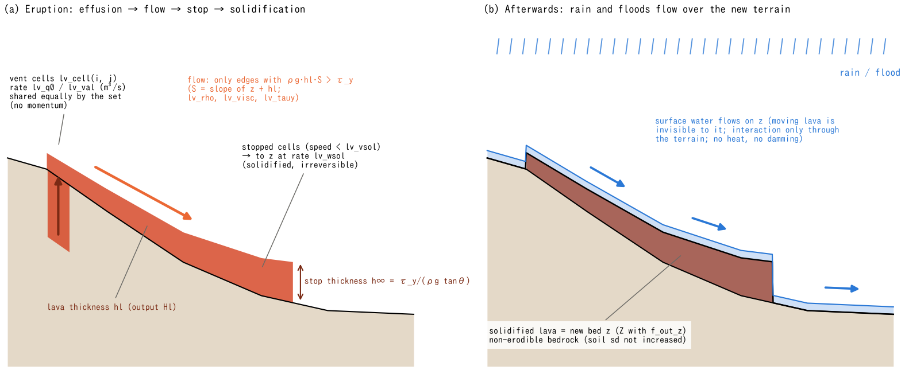

# Lava flows (&list_lavaflow)

> English mirror of docs/users_guide/lavaflow.md. The Japanese file is the master copy.

[Back to the User's Guide index](../users_guide.md)

Computes lava effusion from a set of vent cells, its downslope
spreading, stopping, and solidification into lava fields and new
topography. The dynamics are a depth-averaged Bingham viscous gravity
current (lubrication approximation); the viscosity η and yield stress
τ_y are given directly. Stopped lava is converted into the bed
elevation z at a fixed rate (solidification), and **rainfall, flooding,
and sediment transport over the new topography continue in the same
run** (eruption → lava field → secondary hydrologic response as one
chain). The full design is in [docs/lava_plan.md](../../lava_plan.md);
the implementation record is developer.md Sec. 51.

## What is computed

- The state is the per-cell lava thickness `s%hl` (m), written as the
  distributed field `Hl0001...` at every output time.
- Flow occurs across edges where the basal shear stress $`\rho g h_e S`$
  exceeds the yield stress $`\tau_y`$: $`h_e`$ is the mean lava thickness
  of the two cells and $`S`$ the edge gradient of the lava surface
  $`s = z + h_l`$ (the flow law below; $`\tau_y = 0`$ gives Newtonian
  viscous flow).
- When `lv_wsol > 0`, lava in "stopped" cells — where the maximum
  depth-averaged speed over the surrounding edges is below `lv_vsol` —
  is converted to z at the rate `lv_wsol` (m/s; irreversible). The solidified
  surface does not add to the soil layer sd: it behaves as non-erodible bedrock.
- The model is isothermal (cooling and temperature-dependent viscosity
  are a future extension; lava_plan.md Sec. 8). One rheology set per
  run; there is no per-vent viscosity (viscosity differences are really
  temperature/composition differences, to be handled by the temperature
  extension).

**Flow law.** The flux per unit width across an edge is the lubrication
approximation of a Bingham fluid[^liu89] (the same form as the
visco-plastic lava-dome models[^balmforth00]).

```math
q = \frac{\rho g S}{6\eta}\,(h_e - h_0)^2\,(2h_e + h_0),
\qquad
h_0 = \frac{\tau_y}{\rho g S}
```

Edges with $`h_e \le h_0`$ do not flow. For $`\tau_y = 0`$ it reduces to
the Newtonian $`q = \rho g S h_e^3 / 3\eta`$, and a constant supply on a
flat bed follows the similarity solution of viscous gravity
currents[^huppert82] (checked in [test/lava](../../../test/lava/)). For
$`\tau_y > 0`$ with a lava surface parallel to a uniform slope of
gradient $`\tan\theta`$, the stopping thickness is
$`h_\infty = \tau_y/(\rho g \tan\theta)`$.



(a) Supply to vent cells, flow down the lava-surface gradient, and stopping
with finite thickness. The h∞ formula is a uniform-slope reference, not a
computed front thickness on this curved terrain. (b) An example in which the
same lava thickness has fully solidified: hl decreases by the amount that z
increases, and surface water follows the updated z. Solidification uses a speed
threshold and a prescribed rate; cooling is not computed. Shapes, water depths
and arrows are schematic, not simulation results.

## Enabling (minimal namelist)

Set `fn_lavaflow = "-"` (read from the same file) or a separate file
name in the main parameters, and write `&list_lavaflow`:

```
&list_lavaflow
  lv_cell(1:2,1,1) = 55, 40 ! cells (i, j) of vent 1
  lv_cell(1:2,2,1) = 55, 41
  lv_q0(1) = 10.0           ! constant effusion rate (m3/s)
/
```

The vent location and effusion rate are given data; the rheology has
defaults (density 2600 kg/m³, viscosity 1e4 Pa s, yield stress 0 =
Newtonian; printed with "(default)" when unspecified). The default
viscosity is the upper end of the 10³–10⁴ Pa s measured on flowing
basaltic aa lava at Etna[^pinkerton95], a middle value meant for
calibration ([Parameters and the basis of their defaults](#parameters-and-the-basis-of-their-defaults) below). When the lava type is known, start from the
following (calibration quantities):

| Type | lv_visc (Pa s) | lv_tauy (Pa) | Notes |
|---|---|---|---|
| Basaltic, hot pahoehoe (Hawaiian type) | 1e2-1e3 | 0-500 | Smaller eta means more subcycles |
| Basaltic aa lava (Etna / Izu-Oshima type; default) | 1e3-1e4 | 1e3-5e3 | Crystallization during flow raises eta by an order of magnitude |
| Andesitic (Fuji / Asama type) | 1e5-1e7 | 1e4-1e5 | Thick flows; stopping thickness tau_y/(rho g tan) of several m to 10 m |
| Dacite to rhyolite lava domes | >=1e9 | >=1e5 | Flow nearly stops; outside the scope of this module (lava_plan.md Sec. 2) |

## Parameters

| Parameter | Default | Meaning |
|---|---|---|
| f_lavaflow | 1 | 0 disables temporarily while keeping the file |
| dt_lavaflow_c | "" (every step) | update interval (duration string like "10 s") |
| lv_rho | 2600 | lava density ρ (kg/m³) |
| lv_visc | 1e4 | viscosity η (Pa s); basaltic 10²–10⁴, andesitic and up ≥10⁵ |
| lv_tauy | 0 | yield stress τ_y (Pa); 0 = Newtonian |
| lv_wsol | 0 | solidification rate of stopped cells (m/s); 0 = none |
| lv_vsol | 5e-4 | stop-detection velocity threshold (m/s); typically 10⁻⁴–10⁻³; read only when lv_wsol>0 |
| lv_cfl | 0.4 | safety factor of the explicit subcycling (0–1) |
| lv_nsubmax | 10000 | cap on subcycles per update (runaway guard) |
| lv_cell(1:2,k,n) | — | cell k (i, j) of vent n; vent numbers n are consecutive from 1 |
| lv_q0(n) | — | constant effusion rate of vent n (m³/s) |
| lv_val(1:2,k,n) | — | effusion time series (time (min), m³/s); overrides lv_q0 |
| fn_lv_cell(n) | "" | cell-set file (rows of "i j"; overrides inline cells) |
| fn_lv_val(n) | "" | effusion time-series file (min, m³/s; highest priority) |

- The effusion rate is the **total over the cell set**, distributed
  equally to its cells (same convention as the internal source
  &list_bound_source). It carries no momentum.
- Represent fissure eruptions by listing cells; multiple vents with
  different timing use the third index n (up to 20 vents).
- Time series are linearly interpolated. Writing the same time twice
  makes a step change (`(5,0.5),(5,0.0)` = shut off exactly at 5 min).

## Effect on outputs

- The distributed output gains `Hl` (lava thickness, m; always written
  while enabled, no flag).
- Solidified lava appears as an increase of the bed elevation `Z`
  (set `f_out_z = 1` to write it at every output time).
- It is not counted in the conserved-volume column S_total on the
  screen/Log (it is not a water column). A volume ledger (erupted,
  solidified, molten) is reported at the end of the run.
- Restart uses the private file save/lavaflow.dat (automatic).

## Parameters and the basis of their defaults

The labels in the Basis column are explained in [How to read the basis of a default](../users_guide.md#how-to-read-the-basis-of-a-default).

| Parameter | Default | Meaning | Basis |
|---|---:|---|---|
| dt_lavaflow_c | "" (every step) | update interval of the lava | **method** same step as the water by default; viscous, slow flows can be run intermittently to save cost |
| lv_rho | 2600 kg/m³ | lava density $`\rho`$ | **customary value** representative of basaltic lava with vesicles, 2500–2700 |
| lv_visc | 1e4 Pa s | viscosity $`\eta`$ | **literature value** upper end of the field measurements 10³–10⁴ Pa s of flowing basaltic aa lava at Etna[^pinkerton95]; to be calibrated |
| lv_tauy | 0 | yield stress $`\tau_y`$ | **compatibility** 0 = Newtonian (the form verifiable against the similarity solution[^huppert82]); real lavas take the values of the type table above |
| lv_wsol / lv_vsol | 0 / 5e-4 m/s | solidification rate / stop-detection velocity | **given** 0 = no solidification / **empirical** stop criterion 10⁻⁴–10⁻³ m/s (advance below 10–100 m per day) |
| lv_cfl / lv_nsubmax | 0.4 / 10000 | sub-cycle safety factor and cap | **numerical** |
| lv_cell / lv_q0 / lv_val | — | vent cells and effusion rate | **given** eruption scenario (from total volume and duration) |

**Where to look when revising the defaults**

- Viscosity and yield stress are set by composition (SiO₂), temperature
  and crystal content; the type table of the chapter is the starting
  point. Calibrating on the runout, width and front thickness of past
  flows (aerial photographs, DEM differences) gives $`\tau_y`$ from the stop
  thickness $`h_\infty = \tau_y/(\rho g \tan\theta)`$ and $`\eta`$ from the advance
  speed.
- The effusion rate is best given as a time series from eruption
  observations (volume growth of the lava field, thermal radiance); when
  only the total is known, give a rectangular pulse and check the
  sensitivity to its duration.

## Tests and examples

- Verification case: [test/lava](../../../test/lava/) — the Huppert
  similarity solution (axisymmetric spreading in the Newtonian limit)
  and the Bingham stopping thickness h∞ against analytic solutions.

## Constraints and interactions

- **Interaction with water is through the topography only**: surface
  water does not see flowing lava and flows over the bed z (the same
  simplification as glaciers). Because solidification raises z, rain
  and floods after solidification automatically follow the new
  topography. There is no thermal lava–water interaction (steam
  explosions, quench fragmentation), and flowing lava does not dam
  water.
- Roughness and infiltration on the solidified surface keep their
  existing distributions (consider giving maps such as fn_gw_ksv in
  preprocessing if needed).
- No lava enters sea cells (submarine flow is out of scope).
- Not supported with STG (f_gridsystem=1), nor together with geomorph
  morfac > 1 (lava is an event-time process).
- **Time-step note**: the explicit diffusion (~ρg hl³/3η) is stabilized
  by subcycling. Very fluid basalt (η ≤ 10² Pa s) makes the subcycle
  count — and cost — large (if the run stops on lv_nsubmax, shorten
  dt_lavaflow_c or reconsider η; lava_plan.md Sec. 6).

## References

[^liu89]: Liu, K. F. and Mei, C. C. (1989): Slow spreading of a sheet of Bingham fluid on an inclined plane. *J. Fluid Mech.*, 207, 505–529. (lubrication approximation of a Bingham fluid)
[^balmforth00]: Balmforth, N. J., Burbidge, A. S., Craster, R. V., Salzig, J. and Shen, A. (2000): Visco-plastic models of isothermal lava domes. *J. Fluid Mech.*, 403, 37–65. (isothermal visco-plastic lava models)
[^huppert82]: Huppert, H. E. (1982): The propagation of two-dimensional and axisymmetric viscous gravity currents over a rigid horizontal surface. *J. Fluid Mech.*, 121, 43–58. (similarity solution of the Newtonian limit; the check of test/lava)
[^pinkerton95]: Pinkerton, H. and Norton, G. (1995): Rheological properties of basaltic lavas at sub-liquidus temperatures: laboratory and field measurements on lavas from Mount Etna. *J. Volcanol. Geotherm. Res.*, 68, 307–323. (measured viscosities of basaltic lava)
