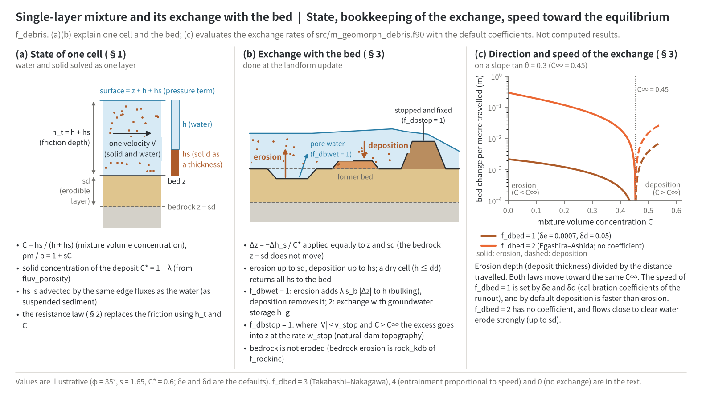
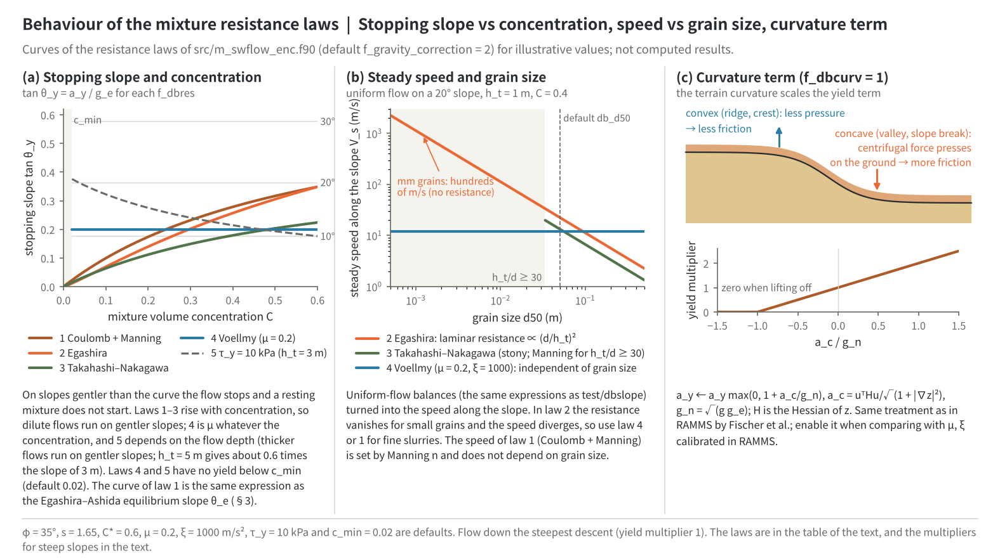
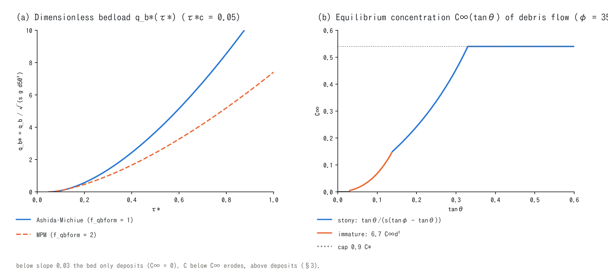

# Debris flow, slope failure and moving bed layer (supplement to the sediment chapter)

> English mirror of docs/users_guide/massflow.md. The Japanese file is the master copy.

[Back to the sediment chapter](geomorph.md) | [Back to the user's guide index](../users_guide.md)

This page gives the equations, the resistance and erosion/deposition laws,
the triggering conditions, the basis of the defaults and the models
referred to for the debris flow (`f_debris`), the instantaneous
fluidisation (`fn_dbinit`), the slope-stability test (`f_slide`) and the
moving bed layer (`f_bedslide`) of the
[sediment and landform chapter](geomorph.md). Bedload, suspended load,
hillslope erosion and long-term processes are in
[Sediment transport, hillslope and long-term processes](sediment.md). The
implementation is in `src/m_geomorph_debris.f90`,
`src/m_geomorph_bedslide.f90` and, for the resistance laws merged into
the momentum equation, `src/m_swflow_enc.f90` (`calc_kth_flux`). The design
history and the literature checks are in docs/debris_plan.md and
docs/landslide_tsunami_plan.md. The graphs of the Voellmy steady speed and the infinite-slope safety
factor and the figure of the moving bed layer are in the sections of the chapter; this page has the figures of
the single-layer mixture and its exchange and of the behaviour of the resistance laws.

## 1. Single-layer mixture model

A debris flow is a **single-layer mixture** of the surface water $`h`$ and
the sediment column $`h_s`$ (solid volume expressed as a thickness), with
the solid and the water moving at the same velocity.

```math
h_t = h + h_s,
\qquad
C = \frac{h_s}{h + h_s},
\qquad
C_* = 1 - \lambda,
\qquad
\frac{\rho_m}{\rho} = 1 + sC
```

$`h_t`$ is the flow depth, $`C`$ the volumetric concentration of the
mixture, $`C_*`$ the solid concentration of the deposit (from the bed
porosity $`\lambda`$ = `fluv_porosity`) and $`s`$ the submerged specific
gravity of the grains (`fluv_sgrav`). In the momentum equation
([ENC grid](encgrid.md) §5) the water surface becomes $`z + h + h_s`$, the
depth used by the friction becomes $`h_t`$, and the resistance law (§2)
replaces or augments the friction term. The advection of $`h_s`$ is the
same in-step transport as for suspended sediment, and the exchange with
the bed (§3) enters at the landform update. This is the level of
Kanako[^nakatani08] and Morpho2DH[^morpho2dh]: shallow water equations
plus a granular resistance law plus an erosion/deposition law, without a
separate sediment layer (within the scope of the [project policy](../policy.md)).



Panel (a) shows the state of one cell: the water $`h`$ and the solid column $`h_s`$ (solid volume as a
thickness) move with one velocity, the friction depth is $`h_t`$ and the surface is $`z + h + h_s`$. Panel (b)
is the exchange with the bed at the landform update (§3): $`\Delta z = -\Delta h_s/C_*`$ is applied equally to
$`z`$ and $`s_d`$, so the bedrock surface does not move; pore-water entrainment (`f_dbwet`) and stopping
(`f_dbstop`) also act here. Panel (c) plots, for the two erosion/deposition laws of §3, the bed change per metre
travelled against the concentration; both move toward the same equilibrium concentration $`C_\infty`$. The speed
of f_dbed = 1 is set by $`\delta_e`$ and $`\delta_d`$ (by default deposition is faster than erosion), while
f_dbed = 2 has no coefficient and flows close to clear water erode strongly. The curves evaluate the expressions
with the default coefficients; they are not computed results.

## 2. Resistance laws (f_dbres)

All resistances are merged semi-implicitly as decelerations (a yield term
independent of the velocity enters the denominator as $`a_y/|\mathbf{V}|`$,
and a slow edge whose driving force has a magnitude of $`a_y`$ or less is
held at rest explicitly, so that starting and stopping follow the same
equation; see "Rest and onset of motion" below).
$`g_e`$ is the effective gravity $`g\cos^2\theta`$ on steep slopes
([ENC grid](encgrid.md) §5).
The expressions in the table are in the form of the horizontal velocity
$`|\mathbf{V}|`$ and the vertical depth $`h_t`$, and are used as they are with
`f_gravity_correction` = 0 and 1. With the default 2, factors that re-evaluate the
resistance with the slope-parallel speed $`|\mathbf{V}_s| = r|\mathbf{V}|`$ and the
bed-normal thickness $`h_t\cos\theta`$ are applied: $`1/(r\cos\theta)`$ for the yield
(1 for flow in the direction of steepest descent), $`r/\cos^3\theta`$ for the terms
proportional to the square of the velocity (the turbulent term of Voellmy, the
laminar law of Egashira, the stony type of Takahashi–Nakagawa) and
$`r/\cos^2\theta`$ for the bedload-like collective flow. Uniform flow with Voellmy
then follows $`V_s^2 = \xi\,h_t\cos\theta\,(\sin\theta - \mu\cos\theta)`$ as in RAMMS,
so μ and ξ calibrated with RAMMS can be used as they are
([steep-slope gravity correction](steep_slope.md) §2.3, developer.md §101 (in
Japanese), verified by [test/dbslope](../../../test/dbslope/en/README.md)).

| f_dbres | Name | Yield deceleration $`a_y`$ and velocity-dependent term | Extra parameters |
|---:|---|---|---|
| 0 | Manning only | — | — |
| 1 | Coulomb + Manning | $`a_y = g_e\tan\phi\,\dfrac{sC}{1+sC}`$ (basal friction of the submerged solid weight; Manning kept) | db_phi |
| 2 | Egashira constitutive law[^egashira93] | $`a_y = g_e\tan\phi\,\dfrac{sC}{1+sC}\left(\dfrac{C}{C_*}\right)^{1/5}`$, velocity term $`\dfrac{f_b\,\lvert\mathbf{V}\rvert^2}{(1+sC)\,h_t}`$ | db_d50, db_erest |
| 3 | Takahashi–Nakagawa stony type[^tn91] | $`a_y = g_e\cdot 0.45\,\dfrac{sC}{1+sC}`$, dilatant term $`4\left(\dfrac{1-C}{C}\right)^{2/3}\left(\dfrac{d_L}{h_t}\right)^2\dfrac{\lvert\mathbf{V}\rvert^2}{(1+sC)h_t}`$ | db_d50 |
| 4 | Voellmy[^voellmy55] | $`a_y = g_e\,\mu + \dfrac{g_e\,\lvert\mathbf{V}\rvert^2}{\xi\,h_t}`$ | db_mu, db_xi |
| 5 | constant yield stress | $`a_y = \dfrac{\tau_y}{\rho_m h_t}`$ + Manning | db_tauy |

The resistance coefficient of the Egashira law is

```math
f_b = \frac{25}{4}\left\{k_f\frac{(1-C)^{5/3}}{C^{2/3}} + k_d\frac{\sigma}{\rho}(1-e^2)\,C^{1/3}\right\}\left(\frac{h_t}{d}\right)^{-2},
\qquad k_f = 0.16,\quad k_d = 0.0828
```

($`e`$ = restitution coefficient `db_erest`, $`d`$ = `db_d50`); because the
laminar resistance scales with $`(h_t/d)^{-2}`$, **grain sizes below a
millimetre make the resistance vanish and the flow diverge** (use 4 or 1
for fine slurries). The Takahashi–Nakagawa law switches to the
bedload-like collective flow $`(\rho_T/0.49)(d_L/h_t)|\mathbf{V}|^2`$ for
$`C \le 0.4C_*`$ and to the Manning law for $`C < c_{\min}`$ (`db_cmin`,
default 2%) or $`h_t/d \ge 30`$ (the mud-flow rule of the original paper).
In laws 2, 3 and 4 the velocity-squared resistance degrades to the Manning law on the dilute side
$`C < c_{\min}`$ (a numerical closure; law 5 is combined with the Manning law from the start). Laws 4
and 5 apply no yield on the dilute side. The yield of laws 1, 2 and 3 is proportional to the
concentration, so it vanishes in clear water ($`C \to 0`$).

**Exponent of the resistance of the bedload-like collective flow (db_immexp).** By default the
resistance of the bedload-like collective flow of the Takahashi–Nakagawa law is
$`(\rho_T/0.49)(d_L/h_t)^{1}|\mathbf{V}|^2`$, as printed in eqs. (24) and (25) of the original
paper[^tn91]. Putting the uniform-flow law of the collective flow in the same paper (eqs. (1) and (3):
for a wide channel the unit-width discharge is
$`q_T = 0.7\sqrt{g}\,h^{5/2}\sin^{1/2}\theta/d_L`$) into the balance of uniform flow
$`\tau_b = \rho_T g h \sin\theta`$ gives $`(\rho_T/0.49)(d_L/h_t)^{2}|\mathbf{V}|^2`$. Another paper by the
same authors[^tny91] writes the stony-type resistance in the form derived this way as well (its
eqs. (29) and (30)), and for the collective flow its eq. (31) for the x direction has the square
(eq. (32) for the y direction is printed with the first power). From these, the first power in
eqs. (24) and (25) appears to be a dropped exponent. `db_immexp = 2` selects the squared form (the
default stays 1). The difference is small
where the flow depth is close to the grain size and grows with the flow depth. For a depth of 1 m
and a grain size of 0.1 m, the deceleration of the first-power form is $`0.20\,|\mathbf{V}|^2/h`$,
13 times that of the Manning law ($`n = 0.04`$), and that of the squared form is
$`0.020\,|\mathbf{V}|^2/h`$, 1.3 times. It affects the speed and depth of flows with concentrations
from $`c_{\min}`$ to $`0.4C_*`$ (the trailing flow of a debris flow, or the outburst flood of a
natural dam). Verified by [test/dbslope](../../../test/dbslope/en/README.md) (the uniform flow on a
30° slope agrees with the analytical solution within 0.01% for both forms).

The Voellmy law was made for snow avalanches and is used in the same μ–ξ
form by the avalanche model RAMMS[^christen10] and the volcanic-flow
models Titan2D[^pitman03] and VolcFlow[^kelfoun05]. Driving and resistance
are both accelerations, so the density cancels and the same law serves
snow, rock debris and pyroclastic material. The defaults μ = 0.2 and
ξ = 1000 m/s² are the middle of the RAMMS avalanche range (0.15–0.3 /
1000–3000); rock avalanches use smaller values, μ 0.05–0.15 and ξ 200–500,
and the default yield stress 10 kPa is at the low end of the VolcFlow
pyroclastic-flow applications 5–50 kPa (values by type are in the
[recommended values](geomorph.md#recommended-values-by-pattern)).

**Rest and onset of motion.** On a slow edge (the mean speed of the two
cells is below `db_vstop`) the magnitude of the drive is compared with
$`a_y`$, and the edge is held at rest if it is $`a_y`$ or less. The
magnitude combines the drive in the normal direction of the edge
(advection and gravity) with the gradient of the flow surface (the
average of the two cells) projected onto the tangent of the edge, so the
slope at which the flow starts stays $`a_y/g_e`$ even when the slope is
oblique to the grid (the yield factor of the default 2 is determined by the
direction of the drive and is 1 on a uniform slope). It is verified by
[test/dbonset](../../../test/dbonset/en/README.md) (on a uniform slope
the threshold and the speed and direction of sliding agree with the
analytical solution of a rigid sliding block within 0.4%, regardless of
the slope direction 0°, 22.5° or 45° and of eight or four neighbours).
Because the yield term is put in semi-implicitly, the onset of motion from
rest is delayed in proportion to the time step (on a slope 1.1 times the
yield slope, the speed after 2 seconds is 0.8 times the analytical value
with dt = 0.01 s and 0.96 times with 0.002 s). Before 2026-11-04 only the
drive in the normal direction was compared, so edges oblique to the slope
were held at rest, the onset was delayed or did not happen (in some
combinations the flow did not move even on a slope 1.3 times the yield
slope), and how much depended on the slope direction and the number of
neighbours (developer.md §28.16).

**Curvature term (f_dbcurv).** The centrifugal acceleration due to the
terrain curvature is added to the normal stress and scales the yield
term:

```math
a_y \leftarrow a_y\,\max\!\left(0,\ 1 + \frac{a_c}{g_n}\right),
\qquad
a_c = \frac{\mathbf{u}^{\mathsf T}\mathbf{H}\mathbf{u}}{\sqrt{1 + |\nabla z|^2}},
\qquad g_n = \sqrt{g\,g_e}
```

$`\mathbf{H}`$ is the Hessian of $`z`$ (3×3 central differences) and $`a_c`$
the product of the normal curvature of the surface along the flow and the
surface speed. Concave terrain decelerates, convex terrain reduces the
friction, and a flow that would lift off gets zero friction. It is the
curvature term that Fischer et al. put into RAMMS[^fischer12]; turn it on
when comparing with μ–ξ values calibrated in RAMMS. Verification:
[test/curvature](../../../test/curvature/en/README.md) (comparison with the
steady one-dimensional ODE; the thickening on the arc, on minus off, is
1.03 times the ODE value).



Panel (a) plots the slope at which the flow stops (and a resting mixture does not start),
$`\tan\theta_y = a_y/g_e`$ from the yield decelerations of the table, against the concentration. Laws 1–3 rise
with the concentration, so dilute flows run on gentler slopes; law 4 is μ whatever the concentration, and law 5
depends on the flow depth. The curve of law 1 is the same expression as the Egashira–Ashida equilibrium slope
$`\theta_e`$ of §3. Panel (b) plots the uniform-flow speed on a 20° slope (the same balances as test/dbslope)
against the grain size: in the Egashira law the resistance vanishes for small grains and the speed diverges, and
the Takahashi–Nakagawa law switches to Manning for $`h_t/d \ge 30`$. Panel (c) is the multiplier of the
curvature term. The curves evaluate the expressions for illustrative values; they are not computed results.

## 3. Erosion and deposition laws (f_dbed)

The exchange with the bed is an increment of the solid column
$`\Delta h_s`$, applied as $`\Delta z = -\Delta h_s/C_*`$ to $`z`$ and $`s_d`$
co-movingly. It is clamped by the erodible layer (erosion $`\le s_d`$) and
by the suspended amount (deposition $`\le h_s`$); dry cells return
everything to the bed. This exchange does not erode the rock exposed after the
mobile layer is stripped; rock erosion is handled by the debris-flow term of
`f_rockinc` (`rock_kdb`; [landform change chapter](geomorph.md#rock-erosion-by-debris-flows-rock_kdb)).



Panel (b) is the equilibrium concentration $`C_\infty(\tan\theta)`$ of this
section (φ = 35°, s = 1.65, C* = 0.6); panel (a) belongs to
[the sediment-transport page](sediment.md) §3.

**f_dbed = 1: relaxation to the equilibrium concentration (Takahashi
type).** Erosion and deposition proceed at a rate proportional to the
speed towards the equilibrium concentration of the slope $`\theta`$
(the steepest slope of the topography; see "Steepest slope" below)[^takahashi07].

```math
C_\infty = \frac{\tan\theta}{s(\tan\phi - \tan\theta)}\ (\tan\theta > 0.138),
\quad
6.7\,C_\infty^{\,2}\ (0.03 < \tan\theta \le 0.138),
\quad
0\ (\tan\theta \le 0.03),
\qquad C_\infty \le 0.9\,C_*
```

```math
\Delta h_s = C_*\,i\,\Delta t,
\qquad
i = \delta_e\,\frac{C_\infty - C}{C_* - C_\infty}\,|\mathbf{V}|\ (C < C_\infty),
\qquad
i = \delta_d\,\frac{C_\infty - C}{C_*}\,|\mathbf{V}|\ (C > C_\infty)
```

The stony-type $`C_\infty`$ is derived from a force balance; the immature
coefficient 6.7, the slope thresholds 0.138 and 0.03 and the cap
$`0.9C_*`$ are the customary values of Takahashi's theory (checking them
against the originals is a remaining item of debris_plan.md §1).
$`\delta_e`$ (`db_delte`, default 0.0007) is Takahashi's general value and
$`\delta_d`$ (`db_deltd`, default 0.05) the customary value of the Kanako
family; both are **calibration coefficients of the run-out distance**.
Configuration 7 of [test/debris](../../../test/debris/en/README.md) checks that the
concentration of uniform flow on a slope converges to $`C_\infty`$ in all four
regimes, including the row on the free-outflow edge.

**Steepest slope.** The $`C_\infty`$ of f_dbed = 1, the $`C_\infty`$ of the
stopping test of cells at rest under f_dbed = 2 and 3, and the $`\theta`$ of
the slope-stability test (f_slide) use the steepest slope of the topography
($`z`$ at the start of the time step), which does not depend on the flow
direction and is defined even at zero speed. For each of the eight
triangular facets formed by the cell, one axial neighbour and the adjacent
diagonal neighbour, the maximum downhill slope within the facet is computed,
and the largest of them is taken (D∞[^tarboton97]). On a plane this is exact
whatever the direction of the steepest slope (fixed on 2026-11-04; the
maximum of the slopes in the eight directions used before came out smaller
by up to cos 22.5° = 0.92 when the steepest direction lay between two of the
eight directions, so the safety factor came out 8 % too large and
$`C_\infty`$ at $`\tan\theta`$ = 0.3 13 % too small; developer.md §92;
[test/dbonset](../../../test/dbonset/en/README.md) checks the safety factor on
slopes at 0°, 22.5° and 45°). On curved slopes and at breaks such as the edge
between a valley floor and its walls, the value is a facet-wise planar
approximation and does not resolve topography finer than the grid. The
elevation of a neighbour outside an open edge (free outflow, long-wave
radiation, section inflow, etc.) is supplied by linear extrapolation from the
two inner cells along the normal of the edge, so the edge row gets the same
slope as the interior (fixed on 2026-10-30; before that the neighbours
outside were left out, the slope in the edge row became 0 and an artificial
deposit formed as if $`C_\infty = 0`$; developer.md §28.15). Neighbours
across a closed edge, outside the domain or in the sea are left out (when
only one neighbour of a facet is left out, the slope towards the remaining
one is used).

**f_dbed = 2: Egashira–Ashida.** Erosion and deposition are one continuous
formula (eqs. (5)–(7) of Morpho2DH[^morpho2dh]) with no extra parameter:

```math
\frac{E}{|\mathbf{V}|} = C_*\tan(\theta - \theta_e),
\qquad
\tan\theta_e = \frac{sC}{sC + 1}\tan\phi
```

$`\theta`$ is the bed slope along the flow and $`\theta_e`$ the equilibrium
slope of the concentration $`C`$ (its inverse is the stony-type
$`C_\infty`$; the direction and speed of the exchange of f_dbed = 1 and 2 are compared in the figure of §1). In each cell $`\theta`$ is a one-sided difference to the
downstream neighbour in the flow direction (a central difference cannot see a
two-cell undulation; developer.md §89.24, in Japanese).

**f_dbed = 3: Takahashi–Nakagawa (1991).** Single grain size, saturated
bed: erosion $`\delta_e\,\dfrac{C_\infty - C}{C_* - C_\infty}\,\dfrac{q_T}{d_L}`$,
deposition with an inertia factor
$`\delta_d\left(1 - \dfrac{|\mathbf{V}|}{p\,v_c}\right)^4\dfrac{C_\infty - C}{C_*}\dfrac{q_T}{d_L}`$
($`q_T = |\mathbf{V}| h_t`$, $`p = 1/3`$, critical speed $`v_c`$ from eq. (15)
of the paper)[^tn91]. While the speed exceeds $`p\,v_c`$ the flow does not
deposit and runs on by inertia, then deposits as a fan at the slope break.
`db_d50` ($`d_L`$) is required. $`\theta`$ is the slope of the flow surface in the direction of the
velocity vector, and the equilibrium concentration $`C_\infty`$ uses the stony-type formula at all
slopes (f_dbimm = 1 below changes this).

**Erosion of an unsaturated bed (f_dbunsat = 1).** The erosion formula above is for a deposit layer
saturated with water (in a saturated layer, the thickness made unstable by the shear of the surface
flow is entrained as a whole). The original paper[^tn91] gives a different formula (eq. (10)) for an
unsaturated layer, in which only the grains exposed at the surface are entrained by the shear stress
of the interstitial fluid of the flow (derived in eqs. (8) to (11) of [^tny91]).

```math
\frac{i}{\sqrt{g h_t}} = K \sin^{3/2}\theta
\left\{1 - sC\left(\frac{\tan\phi}{\tan\theta} - 1\right)\right\}^{1/2}
\left(\frac{\tan\phi}{\tan\theta} - 1\right)(C_\infty - C)\,\frac{h_t}{d_L}
```

For a single grain size $`\tan\phi/\tan\theta - 1 = 1/(s\,c_\infty)`$ ($`c_\infty`$ is the stony-type
equilibrium concentration), so the code evaluates the same formula as
$`i = (K/s)\sqrt{g h_t}\,\sin^{3/2}\theta\,(1 - C/c_\infty)^{1/2}\,(C_\infty - C)/c_\infty\cdot h_t/d_L`$.
With `f_dbunsat = 1` this formula is used for the erosion of cells whose bed is unsaturated, and
saturated cells keep the saturated-bed formula.

- **Saturation test**: with the groundwater computation (`fn_gwflow`), a cell whose subsurface storage
  has reached its capacity ($`h_g \ge s_y s_d`$; the saturated zone reaches the ground surface) is
  saturated. A storage within 0.1 % of the capacity counts as having reached it (the lateral
  groundwater flow takes about a millionth of the capacity out of a cell with flow in every step;
  the width keeps that deficit from turning a saturated bed into an unsaturated one, and its value is
  our own). Without the groundwater computation, the whole domain is unsaturated if `db_satbed`
  (saturation of the deposit layer $`s_b`$) is below 1 and saturated if it is 1 (in its computation of
  Horadani the original paper sets the saturation to $`s_b = 0.8`$ on reaches steeper than 21° and to
  1.0 on the reaches below).
- **Constant**: $`K`$ is `db_kunsat` (default 0.01, the value applied to Horadani in the original
  paper).
- **Steep slopes at the concentration cap**: on slopes where $`C_\infty`$ is capped at $`0.9C_*`$, the
  capped $`c_\infty`$ is used in the form above as it is (the original paper does not give the erosion
  rate in this range; our own closure).
- **Size relative to the saturated-bed formula**: with the Manning law for the speed, for clear water
  on a gentle slope the ratio is $`K\sqrt{g}\,\tan\phi\,C_*\,n/(\delta_e h^{1/6})`$. With
  $`n = 0.04`$ it is $`5/h^{1/6}`$ for $`\delta_e = 0.0001`$ and $`0.75/h^{1/6}`$ for
  $`\delta_e = 0.0007`$. An unsaturated bed is not necessarily harder to erode; it depends on the pair
  of calibration values. Eroding an unsaturated bed also releases less pore water (`f_dbwet`; the flow
  becomes denser than over a saturated bed).
- Verified by configuration 9 of [test/debris](../../../test/debris/en/README.md) (the eroded amount
  agrees with the value of the formula within round-off; the relative difference is 2e-8 or less).

**Bedload-like collective flow on gentle slopes (f_dbimm = 1).** On slopes too gentle to sustain a
debris flow, the flow becomes a bedload-like collective flow (immature debris flow) in which the
grains gather near the bed, and its equilibrium concentration is
$`c_{LS\infty} = 6.7\,c_\infty^{\,2}`$, smaller than the stony-type $`c_\infty`$ (eq. (12) of [^tny91];
used on slopes with $`c_\infty < 1/6.7`$, where $`c_{LS\infty} < c_\infty`$; for $`\phi = 35^\circ`$ and
$`s = 1.65`$ this is $`\tan\theta < 0.138`$, about 8° or less). The default (`f_dbimm = 0`) uses the
stony-type $`c_\infty`$ at all slopes, so it overestimates the equilibrium concentration on gentle
slopes by a factor of 3.2 at a slope of 0.05 and 8.4 at 0.02 (erosion comes out faster and
deposition slower). With `f_dbimm = 1`,

- the equilibrium concentration becomes $`C_\infty = 6.7\,c_\infty^{\,2}`$ in this slope range (common to
  the erosion formulas, the deposition formulas and the stopping test);
- the deposition of flows with a concentration of $`0.4C_*`$ or less (bedload-like collective flow; the
  same concentration as the switch of the resistance law) uses
  $`i = \delta'_d\,(C_\infty - C)/C_*\cdot q_T/d_L`$ without the inertia factor (eq. (28) of the original
  paper[^tn91]). $`\delta'_d`$ is `db_deltdi` (default 0.1, the value applied to Horadani in the
  original paper). The deposition of stony-type flows with concentrations above $`0.4C_*`$ keeps the
  formula with the inertia factor even on gentle slopes (they run over the fan by inertia).

Reference [^tny91] states that, on slopes where a bedload-like collective flow occurs, $`c_\infty`$ of
the unsaturated-bed erosion formula is replaced by $`c_{LS\infty}`$ (below its eq. (12)). Applying the
same replacement to $`C_\infty`$ of the saturated-bed erosion formula and of the stony-type deposition
formula is our own interpretation, made so that there is a single equilibrium concentration. Verified
by configuration 10 of
[test/debris](../../../test/debris/en/README.md) (the concentration of a uniform flow agrees with the
equilibrium concentration to 9 digits).

**Combination with bed load (gentle reaches).** `f_debris = 1` can be combined with bed load,
`f_fluvial = 1`. The sediment concentration that the erosion–deposition law of Takahashi & Nakagawa can
keep in the flow decreases with the slope (the equilibrium concentration of `f_dbimm = 1` is 0.002 at a
slope of 0.02), and the movement of sediment after a debris flow has reached a gentle river, or the
downstream transport of the sediment that the overflow of a natural dam has eroded, belongs to the
bed-load regime. When the two are combined, bed load (the transport formula and the Exner equation of §3
of the [explanation of sediment transport](sediment.md)) carries the bed material in the direction of the
flow. The two processes act without knowing each other, and the amounts they carry are added (our own
composition).

- On slopes of roughly 0.03 to 0.14, the formula for bedload-like collective flow and the bed-load
  formula both carry amounts of the same order, so the total is larger by what is counted twice. If
  the bed-load formula receives the full shear stress (`fluv_taufac = 1`), a uniform-flow estimate gives a
  total transport capacity of 2.2 times that of the Takahashi & Nakagawa law alone (`f_dbimm = 1`) at a
  slope of 0.12, and 6 to 8 times at 0.02 (grain size 3 cm, roughness 0.04, unit discharge 1–5 m²/s;
  Ashida–Michiue formula).
- When the roughness of the channel (Manning's n) is larger than the grain roughness, reduce the bed load
  by setting the effective-shear ratio `fluv_taufac` to the ratio of the grain roughness to the channel
  roughness raised to the power 1.5. A guide for the grain roughness is $`n_0 = D^{1/6}/20.4`$ (the
  baseline resistance of Rickenmann & Recking; "stress partition for steep gravel beds" in §3 of the
  [explanation of sediment transport](sediment.md)), which gives about 0.6 for grain sizes of 3–7 cm and
  n = 0.04. The total then becomes 1.4 to 1.5 times at slopes of 0.12–0.25 and 2 to 4 times at 0.02.
- Set the bed-load grain size `fluv_d50` equal to `db_d50`.

The transport capacity of gentle reaches changes several-fold depending on which formula is used down to
which slope, and the speed of the breach of a natural dam changes accordingly.
[examples/debris_dam](../../../examples/debris_dam/en/README.md) compares computations with and without
bed load and with different effective-shear ratios. A formula that connects the two regimes (a
composition without double counting) is not implemented.

**f_dbed = 4: velocity-proportional entrainment.** $`E = \delta_e|\mathbf{V}|`$
(entrainment only; stopping is left to `f_dbstop`). A simple law for the
growth of avalanches and rock avalanches that pick up the snow or the
colluvium of their path; the entrainable layer is given by the soil
thickness $`s_d`$. Only dense cells with $`C \ge c_{\min}`$ entrain (no
runaway of dilute fringes). It has the form of the entrainment law of the operational avalanche model RAMMS
(an entrainment rate proportional to the avalanche speed[^christen08]); the erosion depth does not depend on
the flow depth and is proportional to the distance the flow has passed.

**f_dbed = 5: Hungr's entrainment law.** $`E = E_r\,h_t\,|\mathbf{V}|`$ ($`h_t = h + h_s`$). An empirical law
widely used in debris-flow and landslide practice[^hungr95] (DAN3D and others); $`E_r`$ (`db_er`, 1/m) is the
relative volume increase per metre travelled. It is estimated from the volume $`V_0`$ entering and $`V_f`$
leaving the entrainment zone and its length $`L`$ as $`E_r = \ln(V_f/V_0)/L`$[^qiao23], so it can be calibrated
from pre- and post-event surveys or deposit volumes, and published calibrations ($`E_r \approx 0.001`$ /m for
the Cancia 2015 debris flow[^qiao23]) can be used as they are. The erosion depth is proportional to the flow
depth, so thicker flow erodes deeper and the flow volume grows exponentially with the distance travelled.
Entrainment only with deposition left to `f_dbstop`, the entrainable layer $`s_d`$, and entrainment by dense
cells ($`C \ge c_{\min}`$) only are the same as for f_dbed = 4. In Hungr's definition the entrained material
joins the flow with its pore water (as bulk volume), so combine it with pore-water entrainment
(`f_dbwet = 1`, saturation 1) to match the volume growth. To give a similar entrained amount with f_dbed = 4,
$`\delta_e \approx E_r \times`$ (a representative flow depth) is a guide. For a sheet released at once on a
uniform slope, the flow depth grows as $`e^{E_r x}`$ with the distance travelled $`x`$ (configuration 4 of
[test/avalanche](../../../test/avalanche/en/README.md); within 0.4 % of the solution of the ordinary
differential equation).
**f_dbed = 0** is no exchange (equivalent fluid).

**Entrainment by thin flow, and the minimum flow depth for entrainment (db_hent).** The velocity-proportional
law f_dbed = 4 has no threshold on the flow depth or on the strength of the entrainable layer. The
concentration condition $`C \ge c_{\min}`$ does not act on the thin flow at the margins (thin flow has the same
concentration as the body). All of the layer that the flow touches is taken, so if the entrainable layer is
placed over the whole slope, thin flow that leaves the margin for a neighbouring cell takes up the layer there
and becomes thick flow, and the area that is entrained spreads sideways. The spreading stops at the threshold
depth `dd` ([shallow-water flow](swflow.md): the sediment in a cell whose surface water falls below `dd` is
fixed on the spot), so the entrained amount ends up being set by `dd` (in the example
[examples/snow_avalanche](../../../examples/snow_avalanche/en/README.md), the avalanche with snow placed
everywhere is 2.5 times the release for `dd` = 1 mm, 2.9 times for 0.1 mm and 14.6 times for 0.01 mm).
Operational models know this behaviour: the developers of RAMMS write that too much mass is entrained if the
avalanche spreads too widely[^christen08], and RAMMS::Extended has a yield-stress threshold for entrainment
(default 300 Pa) that is raised when shallow flow arms entrain too much snow[^rammsext]. There are three
remedies.

1. Give the entrainable layer over a chosen area, such as a band of the width the flow covers.
2. Give `db_hent` (m). Cells whose flow depth $`h_t`$ is below it do not entrain (f_dbed = 4 and 5; default
   0 = no minimum). A guide is the yield stress of the snow $`\tau_c`$ converted to a flow depth,
   $`\tau_c/(\rho g \mu\cos\theta)`$: about 0.4 m for $`\tau_c`$ = 300 Pa, a density of 300 kg/m³ and
   μ = 0.25. This is our own simplification that cuts by flow depth alone; the stress itself is not compared.
3. Use f_dbed = 5. The entrainment rate is proportional to the flow depth, so thin flow takes up almost
   nothing.

In the same computation the avalanche is 2.7, 2.7 and 2.7 times the release with `db_hent` = 0.3 m, and
2.3, 2.5 and 2.5 times with f_dbed = 5 ($`E_r`$ = 0.01 /m), for `dd` = 1, 0.1 and 0.01 mm; it no longer
depends on `dd`.

**Momentum of the entrained mass (f_dbmom).** By default (`f_dbmom = 0`) what is taken up joins the flow at
the local flow velocity. The momentum equation is solved for the velocity and erosion and entrainment only add
$`h_s`$, so the momentum needed to accelerate the mass from rest to the flow velocity is not counted.
`f_dbmom = 1` takes this from the flow. The relative rate of increase $`\dot m/m`$ of the mass added by erosion
and entrainment (the solids and the pore water released with them), averaged over the two cells of an edge, is
added to the semi-implicit resistance of the momentum equation of the next step (in one step
$`\mathbf{V} \leftarrow \mathbf{V}\,m/(m + \Delta m)`$, with $`m = h + (1 + s)h_s`$). This is a deceleration
$`-\mathbf{V}E/h_t`$, with $`E`$ the rate at which the flow depth grows; for the velocity-proportional law it is
$`-\delta_e|\mathbf{V}|\mathbf{V}/h_t`$, the same form as the turbulent term of Voellmy
$`g|\mathbf{V}|\mathbf{V}/(\xi h_t)`$ ($`\delta_e`$ = 0.05 is as strong as ξ ≈ 200 m/s² and acts only while the
flow entrains). Deposition does not change the velocity (the mass leaves with its momentum). The switch is
common to f_dbed = 1 to 5, and the value is carried across a restart (geomorph_debris.dat in the save
directory). Accelerating the entrained mass from rest is the treatment of DAN3D[^qiao23],
SamosAT[^sailer08][^fischer15] and AvaFrame com1DFA[^avaframe]; the 2008 formulation of RAMMS does not include
momentum losses[^christen08]. For a 0.5 m layer released at once on a uniform slope of 0.5 and taking up the
layer below with $`\delta_e = 0.02`$ (μ = 0.2, ξ = 1500 m/s²), the velocity after 8 s is 14.26 m/s with
`f_dbmom = 0` (14.30 m/s for the ordinary differential equation without the term that accelerates the mass)
and 9.31 m/s with `f_dbmom = 1` (9.33 m/s for the momentum-conserving solution; configurations 2 and 3 of
test/avalanche). For erosion with f_dbed = 1 to 3 the difference is small because the erosion rate is small
compared with the flow depth. It does not act on the mass set in motion by slope failure (`f_slide`) or by
instantaneous release (`fn_dbinit`).

**Stopping (f_dbstop = 1).** In cells with $`|\mathbf{V}| < v_{stop}`$ and
$`C > C_\infty`$ the excess concentration is transferred to the bed at the
rate $`w_{stop}`$ (m/s of bed depth). The stopped material stays in $`z`$ and
forms the topography of a natural dam (a numerical closure, not a
published formula).

**Entrainment of pore water (f_dbwet = 1).** Erosion ($`\Delta z < 0`$) adds
$`h \mathrel{+}= \lambda\,s_b|\Delta z|`$ and deposition removes
$`h \mathrel{-}= \lambda\,s_b\Delta z`$ ($`s_b`$ = `db_satbed`, saturation of
the deposit). This corresponds to the source term of the total-volume
continuity equation of Takahashi–Nakagawa[^tn91] and is the first-order
effect that gives a net bulking in erosion-dominated channels. It is
exclusive with the groundwater computation.

**Pore water with the groundwater computation (f_dbwet = 2).** With the
groundwater computation (`fn_gwflow`) the pore water of the bed is held as
subsurface storage $`h_g`$ (capacity $`s_d\,s_y`$). `f_dbwet = 2` moves water
between the surface water and the subsurface storage with the bed change. On
deposition ($`\Delta z > 0`$) the added capacity is filled immediately from the
local surface water ($`\Delta h = \min(s_y\,\Delta z,\ s_d s_y - h_g,\ h)`$ moves
from $`h`$ to $`h_g`$; sediment deposited under a flow is saturated), and on
erosion ($`\Delta z < 0`$) the pore water of the eroded layer
$`\min(s_y|\Delta z|,\ h_g)`$ returns from $`h_g`$ to $`h`$ (the subsurface storage
fills from the top, so erosion removes the wet upper part first). Both are our
own simplifications; the total amount of water is conserved, and alternating
deposition and erosion does not shift water in one direction. With
`f_dbwet = 0` and the groundwater computation the pores of the deposit stay
empty while the ground rises, so deposition in a pond pushes out water equal to
those pores.

**Exchange of retained pore water (f_dbwet = 3).** `f_dbwet = 2` exchanges only the water of the
drainable pore space (specific yield $`s_y`$). When $`s_y`$ is smaller than the porosity $`\lambda`$,
a deposit takes the water of only part of its pores and the rest, $`(\lambda - s_y)\Delta z`$, is left on
the surface. `f_dbwet = 3` adds, to the exchange of 2, the exchange of the **retained water**
$`w_r = \lambda - s_y`$ that moves with the soil.

- Deposition ($`\Delta z > 0`$): $`w_r\,\Delta z`$ is taken from the local surface water, and then, as
  with 2, the added capacity is filled from the remaining surface water. If the surface water is not
  enough the rest is taken from the subsurface storage, and what still cannot be taken is counted as a
  shortfall and reported at the end of the run as `retained pore water shortfall`.
- Erosion ($`\Delta z < 0`$), slope failure and instantaneous release: $`w_r|\Delta z|`$ returns to the
  surface water. When a saturated soil layer fails, $`\lambda D`$ of water comes out together with the
  $`s_y D`$ released from the subsurface storage, giving a mixture at concentration $`C_*`$ (with 2 only
  $`s_y D`$ comes out, denser than $`C_*`$).

The retained water is an implicit water without a state variable (the Green-Ampt moisture deficit
$`s_y`$ implies an initial water content of $`\lambda - s_y`$). The total amount of water is conserved in
the form $`\sum h + \sum h_g + w_r\sum(z - z_0)`$ (it grows by the shortfall, if any).
$`s_y \le \lambda`$ is required, and with $`s_y = \lambda`$ it is the same as 2. This is our own
simplification, verified by configuration 8 of [test/debris](../../../test/debris/en/README.md) and
configuration 4 of [test/slide](../../../test/slide/en/README.md). In a trial in which a tributary debris
flow dams the main river (10 m grid, $`s_y = 0.2`$, $`\lambda = 0.4`$), leaving it at 2 let the water that
did not enter the deposit spill, and the discharge downstream right after the debris flow was 2.6 times
that with $`s_y = \lambda`$ (developer.md §28.17).

### Coupling with mixed grain sizes (f_bedmix)

`f_debris = 1` can be combined with mixed grain sizes, `f_bedmix = 1`. The solids of the flow $`h_s`$ are
carried as one column per size class, and the composition of what is exchanged with the bed is tracked (the
formulas are under "Coupling with debris flow" in
[the sediment-transport page](sediment.md#mixed-grain-sizes-f_bedmix)). This section summarises the
properties as seen from the debris-flow side.

- **The exchange does not select grain sizes**: erosion and fluidisation take the composition of the bed as
  it is (removed from the top of the column, exchange layer first and then the substrate), and deposition
  takes the composition of the flow as it is. This follows the view that the erosion of a steep sediment
  bed, of the kind that generates a debris flow, does not pick up particles selectively by size but strips
  all the particles over some depth[^tnh90] (the source term of the continuity equation of the coarse
  particles has the same form[^tny91]). The ground elevation, the soil thickness and the total solids of the
  flow agree with the single-size computation when all the classes are given the same grain size.
- **The debris-flow formulas stay single-size**: the grain size used in the equilibrium concentration, the
  resistance law and the rates of erosion and deposition is the single value `db_d50`, and it does not
  change when the composition of the flow changes. Three roles that the original model[^tny91] gives to the
  grain size are not included: (1) the mean grain size over the whole flow depth $`d_L`$ used in the
  resistance and in the exchange rates (eqs. (16) to (18) and (29)); (2) fine particles suspended in the
  interstitial fluid, which raise its density and thereby the equilibrium concentration[^tnh90]; (3) the
  flow depth divided into layers to resolve the accumulation of large stones at the front.
- **Where the width of the grain-size distribution matters and where it does not**: it matters for the bed
  load that moves the same bed (hiding and armouring) and for where the sediment ends up (the composition
  of the deposit). The way the debris flow moves, the rate of erosion and the reach do not change when a
  width is given. For the dam body of the example
  [debris_dam](../../../examples/debris_dam/en/README.md) (13 m high, grain size 3 cm, 10 m grid; trial
  computations, developer.md §139):

  | What was changed | Peak discharge of the breach (m³/s) | Ratio to the base |
  |---|---|---|
  | base (single size, 3 cm) | 396 | 1 |
  | mixed sizes, all classes 3 cm | 397 | 1.00 |
  | mixed sizes, 0.5, 2 and 8 cm (mean 3 cm) | 393 | 0.99 |
  | `db_d50` alone set to 10 cm | 237 | 0.60 |
  | `fluv_d50` alone set to 10 cm | 344 | 0.87 |

  During the breach the shear stress is far above the threshold of every class, and the bed load carries
  all the classes almost in proportion to the composition (the transport rate of the Ashida–Michiue formula
  becomes independent of the grain size far above the threshold). The grain-size input that controls the
  speed of the breach is `db_d50`, not the width of the distribution. Mixed grain sizes matter at the stage
  where the flow weakens and the shear stress approaches the threshold: the coarsening, by the flow of water
  that follows, of what remains of the dam body, of the deposit downstream and of the channels on a fan.
- **Sediment rich in fines**: the effect of fines becoming part of the interstitial fluid and raising the
  concentration is not represented. In a rough surrogate computation in which the submerged specific
  gravity `fluv_sgrav` was set to 1.41 and 1.21, corresponding to an interstitial-fluid density of 1.1 and
  1.2, the peak for the same dam body was 1.33 and 1.52 times the base. For the breach of a dam body rich in
  fines this model errs on the low side.
- **Looking at the erosion after a debris flow**: while the debris-flow model is on, the erosion by the
  debris-flow laws is not restrained by a surface that has become coarse (it takes the top of the column
  without selecting grain sizes, and the grain size in the laws stays `db_d50`). The same holds on gentle
  slopes for the erosion towards the equilibrium concentration (the law of the bedload-like collective
  flow). To look at the coarsening by the flow of water after a debris flow, restore the state into a
  mixed-size configuration without debris flow (alternating runs; [Restart](restart.md)) and compute with
  bed load alone. In the example compared with a flume experiment,
  [debris_fan_flume](../../../examples/debris_fan_flume/en/README.md), running clear water with the
  debris-flow laws left on cuts the channel down to the base (the same for mixed sizes and for a single
  size), while with bed load alone the erosion is weak and the surface coarsens. The erosion of the
  experiment lies between the two.
- **Usage**: sediment entering through a boundary needs its class composition (`inflow_csfrac`,
  `fn_inflow_csfrac`; [Boundary conditions](boundary.md)). When alternating with long-term flood runs
  (`morfac > 1`), set `f_bedmix = 1` in both configurations (restoring into a configuration without debris
  flow puts the solids left in the flow onto the bed with their composition). It cannot be combined with
  nesting, bedrock incision (`f_rockinc`) or the moving bed layer (`f_bedslide`). The computing time of the
  dam-body run above (three classes) was 1.4 times that of the single-size run (the per-class bed-load
  computation and the advection of one solid column per class).

Verified in [test/dbmix](../../../test/dbmix/en/README.md) (the equal-size limit, conservation per class,
the composition of fluidised and inflowing sediment, alternating runs).

## 4. Triggering

**Instantaneous fluidisation (fn_dbinit).** Given a distribution of the
failure depth $`D`$, at `db_reltime` the soil is converted as

```math
h_s \mathrel{+}= (1-\lambda)D,\qquad z \mathrel{-}= D,\qquad s_d \mathrel{-}= D,\qquad
h \mathrel{+}= \lambda\,r_{sat}\,D
```

($`r_{sat}`$ = `db_relsat`; with the groundwater computation active its
water is used instead). The solid ledger closes by construction.

**Slope-stability test (f_slide).** The infinite-slope safety factor is
evaluated at every update and cells with $`F_s < 1`$ are fluidised
(`f_slide = 2` only evaluates):

```math
F_s = \frac{c' + (\gamma_t s_d - \gamma_w h_w)\cos^2\theta\,\tan\phi_s}{\gamma_t s_d\sin\theta\cos\theta},
\qquad
h_w = \min\!\left(\frac{h_g}{s_y},\ s_d\right)
```

This is the classical effective-stress formula with slope-parallel seepage;
$`\theta`$ is the steepest slope of the topography (see "Steepest slope"
above) and the water table $`h_w`$ is taken from the saturated thickness
$`h_g`$ of the groundwater computation (rain → rising water table → failure → debris
flow in one time evolution). The approximations, cells independent of each
other (no lateral support) and shallow layers only, are at the level of
distributed stability analyses such as SHALSTAB[^montgomery94]. The
defaults $`\phi_s`$ = 30° and $`\gamma_t`$ = 18 kN/m³ are customary values of
shallow-landslide analyses and $`c'`$ = 0 is on the safe side.

**Options of the slope-stability test.** The formula above assumes slope-parallel seepage and the
failure of the whole soil layer. For slopes under a lake, steps, the bed under a flowing mixture and
thick deposits, the following options change the treatment (all are off by default, which keeps the
formula above; developer.md §28.19).

- **Seepage force from the total-head gradient (`f_slide_seep = 1`).**

  ```math
  F_s = \frac{c' + (\gamma_t d - \gamma_w h_w)\cos^2\theta\,\tan\phi_s}
             {\cos^2\theta\,\{(\gamma_t d - \gamma_w h_w)\tan\theta + \gamma_w h_w J\}}
  ```

  $`J`$ is the steepest-descent gradient of the total head $`H = (z - s_d) + h_w + \kappa\,(h + h_s)`$
  (per horizontal distance; the same operation as the steepest slope of the topography).
  $`h + h_s`$ is the flow depth at the surface (water and moving sediment): in a cell covered by
  moving sediment, too, the surface of the water that fills the pores is taken to be the flow
  surface $`z + h + h_s`$. $`\kappa`$ is the connection between the water at the surface and the
  saturated zone: 1 in cells whose soil layer is saturated up to the ground surface (the flow depth
  is added as it is) and 0 in cells whose saturated zone does not reach the surface. Between 99.9 % and 100 % of the storage
  capacity it rises continuously from 0 to 1 (our own regularization: with a two-valued connection
  that only asks whether the capacity has been reached, the head of a cell under a lake drops by the
  water depth every time its storage falls marginally short, which creates a large $`J`$ towards
  its neighbours). $`d`$ is the thickness of the soil layer that is judged ($`s_d`$ unless
  `slide_dmax` below is given).
  The forces on the soil skeleton are written with the submerged weight and the seepage force
  ($`\gamma_w`$ × hydraulic gradient, taken to act along the slope); this is our own arrangement of
  the standard balance of effective stress and seepage force on an infinite slope.
  - On a slope with uniform soil depth and saturated thickness, $`J = \tan\theta`$ and the formula
    equals the one above.
  - Under still water $`J = 0`$ and $`F_s = \tan\phi_s/\tan\theta`$ ($`c' = 0`$). The formula above
    estimates the safety factor of a saturated slope under a lake at $`(\gamma_t - \gamma_w)/\gamma_t`$
    times this (about half), so use 1 in computations that include the ponded area of a natural dam
    or the slopes of a reservoir.
  - At the seepage face on the downstream side of an embankment $`J > \tan\theta`$, and the
    instability due to seepage appears earlier than with the formula above.
  - The groundwater computation (`fn_gwflow`) is required. The seepage force is taken to act in the
    direction of the steepest slope, and its component normal to the slope is not included.
- **Only failures caused by pore pressure (`f_slide_wet = 1`).** Cells in which $`F_s < 1`$ even
  without pore pressure ($`h_w = 0`$) are not fluidised. Places that are geometrically unstable, such
  as steps and steep faces, are left to the angle-of-repose avalanching (`f_repose`). With the default
  (0), a cell next to the step made by a whole-layer failure fails even when dry, and failures can
  cascade. The output of $`F_s`$ does not change.
- **No test under a dense mixture (`f_slide_noflow`; the default is 1 when the stability test is
  used).** With 1, a cell is not judged when the concentration of the mixture $`h_s/(h + h_s)`$ is
  `db_cmin` or more and the sediment lying on it, expressed as the thickness of the deposit it would
  make, $`h_s/C_*`$, is at least half the judged depth $`d`$ (the ratio 0.5 is our own constant; the
  amount that fails hardly changes between 0.25 and 0.75). The exchange between a flowing mixture and
  the bed under it is left to the erosion–deposition law. A cell on which only a thin film is left
  behind by the flow is judged, so the film does not keep the unstable layer under it from being
  judged. Right after `slide_dmax` has fluidised the upper layer, that sediment lies on the cell in
  the same amount as $`d`$, so the cell is not judged; once it has flowed away to less than half, the
  remaining layer is judged. 0 judges every cell. With 0, a dense mixture that cannot move may return
  to the bed, become saturated and be fluidised again, back and forth.
  - With 1, a cell covered by a dense mixture flowing down from upslope is not judged, and the soil
    layer under it is cut only by the erosion–deposition law. On a slope that saturates uniformly, the
    failure therefore spreads less than with 0 (in configuration 2 of
    [test/slide](../../../test/slide/en/README.md), a uniform slope under rain, 474 cells fail down to the
    bedrock with 0 and 40 with 1). In computations that count the area of failures, this option
    governs the result.
  - On 2026-11-26 the former test of 2 replaced 1 and became the default when the stability test is
    used (the default had been 0). The former 1 skipped cells by the concentration alone, so a film a
    few centimetres thick kept the unstable layer under it from being judged (on the failure slope of
    the [natural-dam example](../../../examples/debris_dam/en/README.md), 13,000 m³ of the 150,000 m³
    of colluvium stayed under the film). 2 is not accepted (use 1).
- **Upper limit of the judged and fluidised depth (`slide_dmax`).** With a value above 0, only the
  top $`d = \min(s_d, d_{\max})`$ is judged and fluidised. The saturated thickness within it is
  $`\max(0,\ h_w - (s_d - d))`$ (the saturated zone is read as building up from the bottom of the
  soil layer). The default (0) is the whole layer. This avoids a thick deposit failing down to the
  bedrock at once. The remaining layer is judged again at the next update, so it fails from the top
  in turn while it stays saturated (see the second note below).
  - **Do not make it large relative to the grid spacing.** Fluidising one cell to a depth
    $`d_{\max}`$ leaves a step of gradient $`d_{\max}/\Delta x`$ towards its neighbours. A saturated
    neighbouring cell fails when this step and the gradient of the total head $`J`$ give
    $`\gamma'\,(d_{\max}/\Delta x + \tan\theta) + \gamma_w J > \gamma'\tan\phi_s`$
    ($`\gamma' = \gamma_t - \gamma_w`$), and the fluidisation then propagates as a chain. In a
    computation of a saturated dam 13 m high being cut by overtopping (the
    [natural-dam example](../../../examples/debris_dam/en/README.md); $`\phi_s = 35^\circ`$),
    $`d_{\max}/\Delta x = 0.6`$ propagated across the whole downstream face about 10 minutes after
    overtopping started; the fluidised sediment blocked the breach, the flow stopped for a little over
    10 minutes and was then released at once (a peak 1.8 times that with 0.3). In a dam built by
    deposited sediment, 0.6 also made the deposit fluidise again and again and lowered the dam. 0.3 did
    not propagate. About 0.3 times the grid spacing is a practical upper limit. Even at 0.3, however, the
    breach on the 5 m grid took a different form from the 10 m grid (the breach split into two channels
    along the valley walls, and the peak was 0.78 times that of the 10 m grid). For a dam whose overflow
    concentrates in a notch 10 m wide, the floor and walls of the breach on the 5 m grid were fluidised and
    blocked the breach; the blockage lasted a total of 7–30 minutes depending on slight differences in the
    inflow, and the peaks scattered over 1.1–1.4 times that of the 10 m grid. Read breach values against
    computations with a different grid spacing and slightly different conditions.
  - **Do not make it shallower than the slip surface of the layer that is to fail.** A $`d_{\max}`$
    smaller than the soil depth reduces the saturated thickness that enters the test and delays the
    failure (a slope whose 3 m soil layer fails at a saturation of 0.85 does not fail until 0.93 with
    $`d_{\max}`$ = 1.5 m). The failure also takes place in two stages, the lower layer failing after
    the upper one has flowed away, and less sediment reaches the main river. With $`d_{\max}`$ = 1.5 m
    on the failure slope of the natural-dam example, the dam is 7.8 m high instead of 13.4 m (more
    sediment stays at the foot of the slope and in the tributary valley). When a soil layer on a slope
    is to fail under heavy rain, make $`d_{\max}`$ at least the soil depth.
  - **When it has to be shallower than the layer, keep `f_slide_noflow` at its default 1.** For a
    thick layer that saturates from its base on a fine grid (where the condition above forces
    $`d_{\max}`$ below the soil depth), 1 judges the cells once the fluidised sediment has flowed away
    and left only a thin film, so the lower layer fails as well (the 18,000 m³ that stay on the slope
    in the example are sediment redeposited at the foot of the slope). With `f_slide_noflow = 0` the
    whole layer also fails, but the deposited sediment is fluidised again and again (in `noflow0` of the
    example, with $`d_{\max}`$ equal to the soil depth, 116,000 m³ is still moving 17 minutes after the
    failure and no dam forms). On the 5 m grid of the example, the lower layer fails and the dam is
    6.5 m high (7.8 m with the same settings on the 10 m grid; with $`d_{\max}`$ equal to the soil depth
    of 3 m, 13.4 m on the 10 m grid, while on the 5 m grid $`d_{\max}/\Delta x`$ becomes 0.6 and the
    deposited sediment is fluidised again and again, giving 9.0 m).

**Matching the failure condition and the flow condition.** A saturated soil layer ($`h_w = s_d`$,
$`c' = 0`$) fails when $`\tan\theta > (\gamma'/\gamma_t)\tan\phi_s`$ ($`\gamma' = \gamma_t - \gamma_w`$).
With $`\gamma_t = \rho_w g\,(1 + sC_*)`$, $`\gamma'/\gamma_t = sC_*/(1 + sC_*)`$, which is the coefficient
of the Coulomb yield (`f_dbres = 1`) of a mixture at the concentration $`C_*`$. Setting `slide_phi` =
`db_phi` and `slide_gamma` = $`\rho_w g\,(1 + sC_*)`$ (19,500 N/m³ for $`\lambda = 0.4`$ and
$`s = 1.65`$), and choosing settings in which the failed mass has the concentration $`C_*`$
(`f_dbwet = 3` when combined with the groundwater computation), makes "saturated and $`F_s < 1`$" and
"the mixture yields and starts to move" the same condition, so that a failed mass no longer stays in
place and is fluidised repeatedly (our own arrangement). With `f_dbres = 3` the yield coefficient is
$`\tan\alpha' = 0.45`$, so a failed saturated mass can move when `slide_phi` is 24.2° or more. Verified
by configurations 5 to 8 of [test/slide](../../../test/slide/en/README.md) (the safety factor agrees
with the formula within the precision of the single-precision output, and equals
$`\tan\phi_s/\tan\theta`$ under still water).

## 5. Moving bed layer (f_bedslide)

The failed mass is represented as a bed layer $`h_b`$ moving **within** the
topography $`z`$ and the soil $`s_d`$, running from land into water as an
inertialess Voellmy flow. When the layer moves, $`z`$ rises or falls while
the depth $`h`$ is kept, so the water surface $`z + h`$ is displaced (the
**moving-seabed** tsunami source[^tinti06][^harbitz06]). The water body is
a "solved sea" that does not use the sea mask (fn_sw): ordinary cells + an
initial water level (f_htype=2), with long-wave radiation boundaries
(type 2) on the edges. The
bed layer never enters the sea cells of the sea mask and does not cross the
edges against them.

```math
\Phi = z + r\,h,\quad r = \frac{\rho_w}{\rho_s},
\qquad
b = 1 - r\,w,\quad w = \min\!\left(1, \frac{h}{h_b}\right),
\qquad
s_y = S_c - \mu\,b,
\qquad
V = \sqrt{\xi\,h_b\,s_y}\ (s_y > 0)
```

$`\Phi`$ is the driving head ($`z`$ when dry; under a flat water surface
its gradient is $`(1-r)\nabla z`$), $`S_c`$ its steepest-descent slope over
the eight neighbours and $`b`$ the buoyancy factor through the submergence
ratio $`w`$ (buoyancy reduces the driving force and the friction at the
same time). The speed is the inertialess Voellmy uniform-flow solution
(the same $`\tan`$ form as law 4 of §2); $`0 < s_y < \varepsilon_S`$
(`bs_eps_s`) is linearised and $`s_y \le 0`$ means rest. The flux is
distributed to the edges as

```math
q_k = h_b\,V\,\frac{\Delta\Phi_k/\Delta s_k}{S_c}\,L_k
```

(the same "projected speed × passage width" form as the ENC core;
`bs_diagratio` = 0 gives four neighbours). Deciding the speed once from the
cell slope avoids the distortion in which the lower slope of the diagonal
edges acts on the yield. The layer advances in sub-cycles inside the
hydraulic time step according to its stability condition (`bs_cfl`), and a
cell whose $`V < v_{stop}`$ persists for `bs_tstop` seconds has its $`h_b`$
set to zero and is fixed in the topography (irreversible, since the mass is
already in $`z`$).

**Hand-over from the mixture (bs_hplunge).** The $`h_s`$ that has run down
the land as a debris flow is transferred to the bed layer as bulk volume
$`h_s/(1-\lambda)`$ in cells whose standing depth is $`h \ge`$ `bs_hplunge`
(its momentum is lost). `f_bsvplunge = 1` waits until the mixture speed
has dropped to the terminal speed of the layer; `f_bsplunge = 1` uses the
still-water depth for the test.

**Defaults.** $`\rho_s`$ = 2000 kg/m³ (saturated soil mass and rock
debris; $`r = 0.5`$), μ = 0.15, ξ = 500 m/s² (calibration values of the
inertialess layer used by every configuration of
[examples/landslide_tsunami](../../../examples/landslide_tsunami/en/README.md) and
[test/bedslide](../../../test/bedslide/en/README.md)), $`v_{stop}`$ = 0.05 m/s.
They are named separately from the μ, ξ of the mixture because the
calibration differs with and without inertia. Without inertia the layer
moves at its terminal speed from the start, so the near-field wave is
biased high for a submarine release and low for a fast entry from land
(mitigated by the hand-over path with `f_bsvplunge = 1`).

## 6. Parameters and the basis of their defaults

The labels in the Basis column are explained in [How to read the basis of a default](../users_guide.md#how-to-read-the-basis-of-a-default).

| Parameter | Default | Meaning | Basis |
|---|---:|---|---|
| f_dbres | 1 | resistance law (§2) | **method** 1: Coulomb + Manning (no empirical constant) |
| db_phi | 35° | internal friction angle $`\phi`$ | **literature value** representative of gravelly debris (tanφ ≈ 0.7)[^takahashi07] |
| db_d50 | 0.05 m | grain size (laws 2, 3; E-D 3) | **customary value** representative $`d_L`$ of stony flows (cm to dm) |
| db_erest | 0.85 | restitution coefficient $`e`$ (law 2) | **literature value** customary value of the Egashira family[^egashira93] |
| db_cmin | 0.02 | lower concentration of the granular laws | **literature value** mud-flow rule of Takahashi–Nakagawa[^tn91] |
| db_mu / db_xi | 0.2 / 1000 m/s² | Voellmy μ, ξ (law 4) | **literature value** middle of the RAMMS avalanche range[^christen10]; smaller for rock debris |
| db_tauy | 10 kPa | constant yield stress (law 5) | **literature value** low end of the VolcFlow pyroclastic applications[^kelfoun05] |
| f_dbcurv | 0 | curvature term (§2) | **method** Fischer et al.[^fischer12]; 1 when comparing with RAMMS calibrations |
| f_dbed | 1 | erosion/deposition law (§3) | **method** 1: Takahashi relaxation, 2: Egashira–Ashida, 3: Takahashi–Nakagawa, 4: velocity-proportional, 5: Hungr's law, 0: none |
| db_delte / db_deltd | 0.0007 / 0.05 | erosion / deposition rate coefficients | **calibration** Takahashi's general value / Kanako customary value |
| db_er | 0 | growth rate $`E_r`$ of Hungr's law (1/m; §3) | **given** always supply it for f_dbed = 5; estimate it from the volumes before and after the entrainment zone and its length, and calibrate it case by case[^hungr95][^qiao23] |
| db_hent | 0 m | minimum flow depth for entrainment (f_dbed = 4 and 5; §3) | **compatibility** 0 = no minimum (the earlier behaviour); when given, a yield-stress threshold[^rammsext] converted to a flow depth is a guide (our own simplification) |
| f_dbmom | 0 | momentum of the entrained mass (§3) | **compatibility** 0 is the earlier behaviour (the mass joins at the flow velocity); use 1 for flows that grow much by entrainment (the acceleration from rest is counted[^sailer08][^fischer15][^avaframe]) |
| f_dbstop / db_vstop / db_wstop | 0 / 0.05 m/s / 0.05 m/s | low-speed stopping | **numerical** vstop also serves the yield test |
| db_immexp | 1 | exponent of (d_L/h) in the resistance of the bedload-like collective flow of the Takahashi–Nakagawa law (§2) | **method** 1: as printed in eqs. (24)(25) of the original paper[^tn91], 2: the form derived from the uniform-flow law, eq. (3), of the same paper (eq. (31) of [^tny91]) |
| f_dbunsat / db_kunsat | 0 / 0.01 | erosion formula for an unsaturated bed / its constant K (§3; f_dbed = 3) | **method** eq. (10) of the original paper[^tn91]. **literature** K is the value applied to Horadani |
| f_dbimm / db_deltdi | 0 / 0.1 | equilibrium concentration 6.7 c∞² and deposition formula of the bedload-like collective flow on gentle slopes / deposition coefficient δ'd (§3; f_dbed = 3) | **method** eq. (12) of [^tny91] and eq. (28) of [^tn91]. **literature** δ'd is the value applied to Horadani |
| f_dbwet / db_satbed | 0 / 1.0 | pore-water entrainment / deposit saturation (1: entrainment, 2: with the groundwater computation, 3: 2 + retained water) | **method** total-volume continuity of Takahashi–Nakagawa[^tn91] (1). 2 exchanges pore water between the surface water and subsurface storage, and 3 adds the exchange of the retained water λ − sy0 (both own) |
| db_reltime / db_relsat | 0 / 1.0 | release time / saturation of the failed mass (§4) | **given** |
| slide_c / slide_phi / slide_gamma | 0 / 30° / 18 kN/m³ | strength constants of the stability test (§4) | **customary value** shallow-landslide values; c' = 0 is on the safe side |
| f_slide_seep / f_slide_wet / f_slide_noflow / slide_dmax | 0 / 0 / 1 / 0 | options of the stability test (§4): seepage force from the total-head gradient / only failures caused by pore pressure / no test under a dense mixture (1; the cells whose mixture is thin are still judged; the default is the value when the stability test is used) / upper limit of the judged and fluidised depth (m) | **method** our own arrangement of the balance of effective stress and seepage force on an infinite slope (the default is the conventional formula) |
| bs_rho | 2000 kg/m³ | bulk density of the mass (§5) | **customary value** representative of saturated soil and rock debris |
| bs_mu / bs_xi | 0.15 / 500 m/s² | Voellmy μ, ξ of the layer | **verification case** calibration of the inertialess layer ([test/bedslide](../../../test/bedslide/en/README.md)) |
| bs_vstop / bs_tstop | 0.05 m/s / 0 s | stopping speed and its duration | **numerical** 10–15 s when entering water (longer than the temporary drawdown) |
| bs_eps_s / bs_cfl / bs_nsubmax | 0.02 / 0.4 / 10000 | linearisation width / sub-cycle safety factor and limit | **numerical** raise eps_s when sub-cycles are excessive |
| bs_hplunge / f_bsvplunge / f_bsplunge | 0 / 0 / 0 | hand-over depth and conditions | **method** vplunge = 1 for fast entries from land |

**Where to look when revising the defaults**

- Take the friction angle and grain size from grain-size tests and the
  angle of repose of the deposits on site; the strength constants
  (c′, φ′, γ) from soil tests or back-analysis of nearby failures.
- Voellmy μ and ξ are usually calibrated against the runout and deposit
  shape of past events; the RAMMS calibration compilation[^christen10]
  tabulates them by terrain and size, and practical debris-flow values are
  collected in Takahashi[^takahashi07]. As a debris-flow calibration
  example, the back-analysis of the 2015 Cancia debris flow in the Italian
  Dolomites (4,400 m³ at the start grew to 28,850 m³ by entrainment along a
  2.2 km channel with slopes of 27° upstream and 13° downstream) found the
  same best μ = 0.11 and ξ = 450 m/s² for two models with entrainment (DAN3D
  and a finite-difference model; E_r ≈ 0.001 /m with Hungr's entrainment law.
  Without entrainment the whole volume had to be released at the top, and
  the models produced bank overflows that did not occur)[^qiao23].
- Move the erosion / deposition coefficients so that the traces of past
  debris flows (scour depth, deposit thickness) are reproduced, checking
  both runout and deposited volume.

## 7. Verification cases

| Case | Content | Point |
|---|---|---|
| [test/debris](../../../test/debris/en/README.md) | four constitutive configurations (simple, Egashira, Takahashi–Nakagawa, pore water); equilibrium concentration of uniform flow on a slope; pore water with the groundwater computation and retained water; erosion rate of an unsaturated bed; equilibrium concentration of the bedload-like collective flow on gentle slopes | total solid 1e-13, np = 1, 2, 4 agree; equilibrium concentration within 1e-11 of the Takahashi-type C∞; water ledger including the retained water within 1e-11; eroded amount of an unsaturated bed agrees with the formula within round-off (relative difference 2e-8 or less); equilibrium concentration of the Takahashi–Nakagawa law within 1e-9 of 6.7 c∞² |
| [test/slide](../../../test/slide/en/README.md) | fluidisation and stability test; fluidisation of a saturated soil layer and retained water; options of the stability test (seepage force, depth limit, pore-pressure failures only, no test under a dense mixture) | self-checks of conservation and water budget; the safety factor agrees with the formula within the precision of the single-precision output (relative 2e-6), and equals tanφs/tanθ under still water |
| [test/volcano](../../../test/volcano/en/README.md) | Voellmy uniform flow and τ_y run-out | uniform depth agrees to 0.0% with the analytical solution (the along-slope equation with the default 2; four neighbours) |
| [test/dbslope](../../../test/dbslope/en/README.md) | uniform flow on a 30° slope (Voellmy, Egashira, the stony type and the bedload-like collective flow of Takahashi–Nakagawa, the latter with the first and the second power of (d/h)), steep-slope gravity correction 1 and 2 | for all five, within 0.04% of the analytical solutions of the along-slope equations with 2 and of the horizontal equations with 1 (ratio of the depths of 2 and 1: 1.11–1.21) |
| [test/curvature](../../../test/curvature/en/README.md) | steady one-dimensional test of the curvature term | thickening on the arc 1.03 times the ODE |
| [test/dbonset](../../../test/dbonset/en/README.md) | rest and onset of motion under the yield (uniform slope 0.9, 1.1 and 1.3 times the yield slope; slope direction 0°, 22.5° and 45°; eight and four neighbours; without and with the steep-slope gravity correction) and the safety factor of the slope-stability test (same slopes; c' = 0, no groundwater) | threshold, speed and direction independent of the direction and the stencil, within 0.4% of the analytical solution of a rigid sliding block (g cos²θ with the gravity correction); safety factor independent of the direction, within 0.1% of tanφs/tanθ |
| [test/avalanche](../../../test/avalanche/en/README.md) | avalanche (Voellmy + velocity-proportional entrainment); a sheet released at once on a uniform slope (velocity-proportional law, Hungr's law, minimum flow depth, with and without the momentum switch) and a restart | entrained solids grow to 1.97 times the released solids and the flow stops; ledger to machine precision; velocity and flow depth on the uniform slope within 0.5 % of the solutions of the ordinary differential equations |
| [test/vchannel](../../../test/vchannel/en/README.md) | cross-channel distribution of a Voellmy-law flow in a uniform V-channel (flow 8 cells wide; flow directions 0°, 22.5° and 45°) against the exact solution in which the velocity of each column is set by its own flow depth alone | the acceleration without friction is within 1 % of g S. The discharge is 0.90 to 0.98 times the exact solution with the default and 0.89 to 0.93 times with `f_opening_dynamic = 0` (spread of 3 % over the directions) |
| [test/dbmix](../../../test/dbmix/en/README.md) | debris flow with mixed grain sizes (f_debris + f_bedmix): the equal-size limit, conservation per class, the composition of fluidised sediment and of sediment entering through a boundary, alternating runs | within 2e-15 m of the single-size run; balance of each class within 2e-13 m³; the fluidised composition agrees with the formula to 4e-15 |
| [test/bedslide](../../../test/bedslide/en/README.md) | analytical speed of the layer, 45° slope, entry into a lake | $`V`$ of interior cells within 0.5% of the analytical value |
| [examples/landslide_tsunami](../../../examples/landslide_tsunami/en/README.md) | rock avalanche, hand-over, submarine landslide | four patterns compared |
| [examples/ashfall_lahar](../../../examples/ashfall_lahar/en/README.md) | ash fall → rain → lahar, check dam | the lahar setting pattern (infiltration capacity, f_dbwet=2) |
| [examples/debris_fan_flume](../../../examples/debris_fan_flume/en/README.md) | a flume experiment (Takahashi, Nakagawa and Yamashiki 1991) in which a debris flow of mixed-size sediment builds a fan that clear water then erodes; debris flow combined with mixed grain sizes, restore into a configuration without debris flow | discharge and concentration at the flume outlet and the length of the fan within the range of the experiment, width and apex thickness too large; the erosion is too deep with the debris-flow laws left on and weak with bed load alone (the surface coarsens with mixed sizes) |
| [examples/debris_fan](../../../examples/debris_fan/en/README.md) | slope failure → valley → residential area on the fan (Takahashi–Nakagawa stony type); grid spacings 40-2.5 m, the valley at 0°, 22.5° and 45°, four-neighbour control | grid dependence: with eight neighbours the valley orientation changes the results by a few % at 5 m, and the sediment reaches the fan even at 40 m (coarser than the valley floor); with four neighbours sediment stays in oblique valleys at 20 m and above |
| [examples/snow_avalanche](../../../examples/snow_avalanche/en/README.md) | a dense snow avalanche down a gully (Voellmy + velocity-proportional entrainment + momentum of the entrained snow); track snow of 0, 1 and 2 m, a deflecting dam, friction coefficients, grid spacing, gully direction and time step, with and without the dynamic reassignment of openings, threshold depth, snow everywhere (minimum flow depth db_hent, the Hungr law), comparison with runs that do not count the momentum | the avalanche setting pattern (exchange of the carrier f_dbwet=1, threshold depth 0.1 mm, f_dbmom=1; f_opening_dynamic=0 because the gully is resolved by the grid). With the entrainable snow given as a band, the amount taken up is set by the amount placed and does not depend on the time step; placed everywhere, it is set by the threshold depth (2.5 to 14.6 times the release), but with a minimum flow depth of 0.3 m (2.5 times) or the Hungr law (2.3 to 2.4 times) it does not depend on the threshold depth. The tip of the deposit stays within ±5 m for the gully direction and the time step and within −18 to +14 m for the grid spacing; the flow depth in the gully and the area and width of the deposit change by about 10 % with the gully direction |

## References

[^nakatani08]: Nakatani, K., Wada, T., Satofuka, Y. and Mizuyama, T. (2008): Development of "Kanako 2D (Ver.2.00)", a user-friendly one- and two-dimensional debris flow simulator equipped with a graphical user interface. *Int. J. Erosion Control Eng.*, 1(2), 62–72.
[^morpho2dh]: Takebayashi, H.: Morpho2DH ver.2 Solver Manual. iRIC Project. (governing equations and defaults of the Egashira model)
[^takahashi07]: Takahashi, T. (2007): *Debris Flow: Mechanics, Prediction and Countermeasures*. Taylor & Francis, Leiden. (equilibrium concentration, erosion-rate coefficient)
[^tn91]: Takahashi, T. and Nakagawa, H. (1991): Prediction of stony debris flow induced by severe rainfall. *J. Jpn. Soc. Erosion Control Eng.*, 44(3), 12–19 (in Japanese). (Erosion formulas (10) and (12), deposition formulas (14), (27) and (28), resistance laws (22) to (25), and the values applied to Horadani: K = 0.01, δe = 0.0001, δd = 0.5, p = 1/3, δ'd = 0.1.)
[^tny91]: Takahashi, T., Nakagawa, H. and Yamashiki, Y. (1991): Formation and erosion of debris fan that is composed of sediment mixtures. *Annuals, Disaster Prevention Research Institute, Kyoto University*, 34 B-2, 355–372 (in Japanese). <https://repository.kulib.kyoto-u.ac.jp/dspace/handle/2433/72336> (Derivation of the unsaturated-bed erosion formula, eqs. (8) to (11); equilibrium concentration of the bedload-like collective flow, eq. (12); the cap 0.9c*; δe = 0.0007; resistance of the bedload-like collective flow, eq. (31); continuity equation of the coarse particles, eq. (6); erosion and deposition velocities and resistance with the mean grain size over the whole flow depth d_L, eqs. (16) to (18) and (29); grain-size sorting with the flow depth divided into layers, eqs. (23) to (26).)
[^tnh90]: Takahashi, T., Nakagawa, H. and Harada, T. (1990): Prediction of debris flow generated by erosion of steep well-graded sediment mixture bed. *Annuals, Disaster Prevention Research Institute, Kyoto University*, 33 B-2, 443–456 (in Japanese). <https://repository.kulib.kyoto-u.ac.jp/dspace/handle/2433/72271> (The erosion of a steep sediment bed does not select grain sizes, §1; fine particles raise the density of the interstitial fluid and thereby the equilibrium concentration, eq. (11); the division into fine and coarse particles, eqs. (12) to (18).)
[^egashira93]: Egashira, S. (1993): Mechanism of stopping and deposition of debris flow (2). *J. Jpn. Soc. Erosion Control Eng.*, 46(2) (in Japanese). (original form of the constitutive law and yield stress of Egashira et al. 1989)
[^voellmy55]: Voellmy, A. (1955): Über die Zerstörungskraft von Lawinen. *Schweizerische Bauzeitung*, 73, 159–165, 212–217, 246–249, 280–285.
[^christen08]: Christen, M., Bartelt, P., Kowalski, J. and Stoffel, L. (2008): Calculation of dense snow avalanches in three-dimensional terrain with the numerical simulation program RAMMS. *Proc. International Snow Science Workshop 2008, Whistler*, 709–716. <https://arc.lib.montana.edu/snow-science/objects/P__8140.pdf>
[^rammsext]: Bartelt, P. and Christen, M. (2026): *RAMMS::Extended User Manual*. RAMMS AG. <https://ramms.ch/manuals/RAMMS_EXT_Manual.pdf> (the section on the yield stress for entrainment)
[^sailer08]: Sailer, R. et al. (2008): *Ann. Glaciol.*, 48, 183–192. doi:10.3189/172756408784700707 (entrainment in SamosAT; eq. (14) is the term that accelerates the entrained mass)
[^fischer15]: Fischer, J.-T. et al. (2015): *J. Glaciol.*, 61(229), 875–888. doi:10.3189/2015JoG14J168 (the term −(u/h)q̇ of eq. (2))
[^avaframe]: The theory document (section Entrainment) and the algorithm document of AvaFrame com1DFA. <https://docs.avaframe.org/en/latest/theoryCom1DFA.html>, <https://docs.avaframe.org/en/latest/com1DFAAlgorithm.html> (read 2026-11-25; release 2.2.1)
[^hungr95]: Hungr, O. (1995): A model for the runout analysis of rapid flow slides, debris flows, and avalanches. *Can. Geotech. J.*, 32, 610–623. doi:10.1139/t95-063 (the form of the entrainment law from eqs. (14) and (15) of Qiao et al. 2023; the paper itself not read)
[^qiao23]: Qiao, Z., Li, T., Simoni, A., Gregoretti, C., Bernard, M., Wu, S., Shen, W. and Berti, M. (2023): Numerical modelling of an alpine debris flow by considering bed entrainment. *Front. Earth Sci.*, 10, 1059525. doi:10.3389/feart.2022.1059525 (the 2015 Cancia debris flow; calibrated Voellmy μ, ξ and entrainment rate in Tables 2 and 3)
[^christen10]: Christen, M., Kowalski, J. and Bartelt, P. (2010): RAMMS: Numerical simulation of dense snow avalanches in three-dimensional terrain. *Cold Reg. Sci. Technol.*, 63, 1–14.
[^fischer12]: Fischer, J.-T., Kowalski, J. and Pudasaini, S. P. (2012): Topographic curvature effects in applied avalanche modeling. *Cold Reg. Sci. Technol.*, 74–75, 21–30.
[^pitman03]: Pitman, E. B., Nichita, C. C., Patra, A., Bauer, A., Sheridan, M. and Bursik, M. (2003): Computing granular avalanches and landslides. *Phys. Fluids*, 15, 3638–3646. (Titan2D)
[^kelfoun05]: Kelfoun, K. and Druitt, T. H. (2005): Numerical modeling of the emplacement of Socompa rock avalanche, Chile. *J. Geophys. Res.*, 110, B12202. (VolcFlow)
[^tarboton97]: Tarboton, D. G. (1997): A new method for the determination of flow directions and upslope areas in grid digital elevation models. *Water Resour. Res.*, 33(2), 309–319. (D∞; the test of the facet direction is an equivalent comparison without atan2; developer.md §92)
[^montgomery94]: Montgomery, D. R. and Dietrich, W. E. (1994): A physically based model for the topographic control on shallow landsliding. *Water Resour. Res.*, 30, 1153–1171. (SHALSTAB)
[^tinti06]: Tinti, S., Pagnoni, G. and Zaniboni, F. (2006): The landslides and tsunamis of the 30th of December 2002 in Stromboli analysed through numerical simulations. *Bull. Volcanol.*, 68, 462–479.
[^harbitz06]: Harbitz, C. B., Løvholt, F., Pedersen, G. and Masson, D. G. (2006): Mechanisms of tsunami generation by submarine landslides: a short review. *Norw. J. Geol.*, 86, 255–264.
