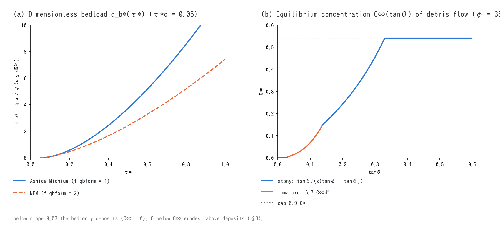

# Debris flow, slope failure and moving bed layer (supplement to the sediment chapter)

> English mirror of docs/users_guide/massflow.md. The Japanese file is the master copy.

[Back to the sediment chapter](geomorph.md) | [Back to the user's guide index](../users_guide.md)

This page gives the equations, the resistance and erosion/deposition laws,
the triggering conditions, the basis of the defaults and the models
referred to for the debris flow (`f_debris`), the instantaneous
fluidisation (`fn_dbinit`), the slope-stability test (`f_slide`) and the
moving bed layer (`f_bedslide`) of the
[sediment and landform chapter](geomorph.md). Bedload, suspended load,
hillslope erosion and long-term processes are in
[Sediment transport, hillslope and long-term processes](sediment.md). The
implementation is in `src/m_geomorph_debris.f90`,
`src/m_geomorph_bedslide.f90` and, for the resistance laws merged into
the momentum equation, `src/m_swflow_enc.f90` (`calc_kth_flux`). The design
history and the literature checks are in docs/debris_plan.md and
docs/landslide_tsunami_plan.md.

## 1. Single-layer mixture model

A debris flow is a **single-layer mixture** of the surface water $`h`$ and
the sediment column $`h_s`$ (solid volume expressed as a thickness), with
the solid and the water moving at the same velocity.

```math
h_t = h + h_s,
\qquad
C = \frac{h_s}{h + h_s},
\qquad
C_* = 1 - \lambda,
\qquad
\frac{\rho_m}{\rho} = 1 + sC
```

$`h_t`$ is the flow depth, $`C`$ the volumetric concentration of the
mixture, $`C_*`$ the solid concentration of the deposit (from the bed
porosity $`\lambda`$ = `fluv_porosity`) and $`s`$ the submerged specific
gravity of the grains (`fluv_sgrav`). In the momentum equation
([ENC grid](encgrid.md) §5) the water surface becomes $`z + h + h_s`$, the
depth used by the friction becomes $`h_t`$, and the resistance law (§2)
replaces or augments the friction term. The advection of $`h_s`$ is the
same in-step transport as for suspended sediment, and the exchange with
the bed (§3) enters at the landform update. This is the level of
Kanako[^nakatani08] and Morpho2DH[^morpho2dh]: shallow water equations
plus a granular resistance law plus an erosion/deposition law, without a
separate sediment layer (within the scope of developer.md §0).

## 2. Resistance laws (f_dbres)

All resistances are merged semi-implicitly as decelerations (a yield term
independent of the velocity enters the denominator as $`a_y/|\mathbf{V}|`$,
and a slow cell whose driving force is $`\le a_y`$ is held at rest
explicitly, so that starting and stopping follow the same equation).
$`g_e`$ is the effective gravity $`g\cos^2\theta`$ on steep slopes
([ENC grid](encgrid.md) §5).

| f_dbres | Name | Yield deceleration $`a_y`$ and velocity-dependent term | Extra parameters |
|---:|---|---|---|
| 0 | Manning only | — | — |
| 1 | Coulomb + Manning | $`a_y = g_e\tan\phi\,\dfrac{sC}{1+sC}`$ (basal friction of the submerged solid weight; Manning kept) | db_phi |
| 2 | Egashira constitutive law[^egashira93] | $`a_y = g_e\tan\phi\,\dfrac{sC}{1+sC}\left(\dfrac{C}{C_*}\right)^{1/5}`$, velocity term $`\dfrac{f_b\,\lvert\mathbf{V}\rvert^2}{(1+sC)\,h_t}`$ | db_d50, db_erest |
| 3 | Takahashi–Nakagawa stony type[^tn91] | $`a_y = g_e\cdot 0.45\,\dfrac{sC}{1+sC}`$, dilatant term $`4\left(\dfrac{1-C}{C}\right)^{2/3}\left(\dfrac{d_L}{h_t}\right)^2\dfrac{\lvert\mathbf{V}\rvert^2}{(1+sC)h_t}`$ | db_d50 |
| 4 | Voellmy[^voellmy55] | $`a_y = g_e\,\mu + \dfrac{g_e\,\lvert\mathbf{V}\rvert^2}{\xi\,h_t}`$ | db_mu, db_xi |
| 5 | constant yield stress | $`a_y = \dfrac{\tau_y}{\rho_m h_t}`$ + Manning | db_tauy |

The resistance coefficient of the Egashira law is

```math
f_b = \frac{25}{4}\left\{k_f\frac{(1-C)^{5/3}}{C^{2/3}} + k_d\frac{\sigma}{\rho}(1-e^2)\,C^{1/3}\right\}\left(\frac{h_t}{d}\right)^{-2},
\qquad k_f = 0.16,\quad k_d = 0.0828
```

($`e`$ = restitution coefficient `db_erest`, $`d`$ = `db_d50`); because the
laminar resistance scales with $`(h_t/d)^{-2}`$, **grain sizes below a
millimetre make the resistance vanish and the flow diverge** (use 4 or 1
for fine slurries). The Takahashi–Nakagawa law switches to the
bedload-like collective flow $`(\rho_T/0.49)(d_L/h_t)|\mathbf{V}|^2`$ for
$`C \le 0.4C_*`$ and to the Manning law for $`C < c_{\min}`$ (`db_cmin`,
default 2%) or $`h_t/d \ge 30`$ (the mud-flow rule of the original paper).
Laws 2 to 5 all degrade to the Manning law on the dilute side
$`C < c_{\min}`$, so no yield is applied to the clear water downstream (a
numerical closure).

The Voellmy law was made for snow avalanches and is used in the same μ–ξ
form by the avalanche model RAMMS[^christen10] and the volcanic-flow
models Titan2D[^pitman03] and VolcFlow[^kelfoun05]. Driving and resistance
are both accelerations, so the density cancels and the same law serves
snow, rock debris and pyroclastic material. The defaults μ = 0.2 and
ξ = 1000 m/s² are the middle of the RAMMS avalanche range (0.15–0.3 /
1000–3000); rock avalanches use smaller values, μ 0.05–0.15 and ξ 200–500,
and the default yield stress 10 kPa is at the low end of the VolcFlow
pyroclastic-flow applications 5–50 kPa (values by type are in the
[recommended values](geomorph.md#recommended-values-by-pattern)).

**Curvature term (f_dbcurv).** The centrifugal acceleration due to the
terrain curvature is added to the normal stress and scales the yield
term:

```math
a_y \leftarrow a_y\,\max\!\left(0,\ 1 + \frac{a_c}{g_n}\right),
\qquad
a_c = \frac{\mathbf{u}^{\mathsf T}\mathbf{H}\mathbf{u}}{\sqrt{1 + |\nabla z|^2}},
\qquad g_n = \sqrt{g\,g_e}
```

$`\mathbf{H}`$ is the Hessian of $`z`$ (3×3 central differences) and $`a_c`$
the product of the normal curvature of the surface along the flow and the
surface speed. Concave terrain decelerates, convex terrain reduces the
friction, and a flow that would lift off gets zero friction. It is the
curvature term that Fischer et al. put into RAMMS[^fischer12]; turn it on
when comparing with μ–ξ values calibrated in RAMMS. Verification:
[test/curvature](../../../test/curvature/en/README.md) (comparison with the
steady one-dimensional ODE; the thickening on the arc, on minus off, is
1.03 times the ODE value).

## 3. Erosion and deposition laws (f_dbed)

The exchange with the bed is an increment of the solid column
$`\Delta h_s`$, applied as $`\Delta z = -\Delta h_s/C_*`$ to $`z`$ and $`s_d`$
co-movingly. It is clamped by the erodible layer (erosion $`\le s_d`$) and
by the suspended amount (deposition $`\le h_s`$); dry cells return
everything to the bed. This exchange does not erode the rock exposed after the
mobile layer is stripped; rock erosion is handled by the debris-flow term of
`f_rockinc` (`rock_kdb`; [landform change chapter](geomorph.md#rock-erosion-by-debris-flows-rock_kdb)).



Panel (b) is the equilibrium concentration $`C_\infty(\tan\theta)`$ of this
section (φ = 35°, s = 1.65, C* = 0.6); panel (a) belongs to
[the sediment-transport page](sediment.md) §3.

**f_dbed = 1: relaxation to the equilibrium concentration (Takahashi
type).** Erosion and deposition proceed at a rate proportional to the
speed towards the equilibrium concentration of the slope $`\theta`$
(steepest descent over the eight neighbours)[^takahashi07].

```math
C_\infty = \frac{\tan\theta}{s(\tan\phi - \tan\theta)}\ (\tan\theta > 0.138),
\quad
6.7\,C_\infty^{\,2}\ (0.03 < \tan\theta \le 0.138),
\quad
0\ (\tan\theta \le 0.03),
\qquad C_\infty \le 0.9\,C_*
```

```math
\Delta h_s = C_*\,i\,\Delta t,
\qquad
i = \delta_e\,\frac{C_\infty - C}{C_* - C_\infty}\,|\mathbf{V}|\ (C < C_\infty),
\qquad
i = \delta_d\,\frac{C_\infty - C}{C_*}\,|\mathbf{V}|\ (C > C_\infty)
```

The stony-type $`C_\infty`$ is derived from a force balance; the immature
coefficient 6.7, the slope thresholds 0.138 and 0.03 and the cap
$`0.9C_*`$ are the customary values of Takahashi's theory (checking them
against the originals is a remaining item of debris_plan.md §1).
$`\delta_e`$ (`db_delte`, default 0.0007) is Takahashi's general value and
$`\delta_d`$ (`db_deltd`, default 0.05) the customary value of the Kanako
family; both are **calibration coefficients of the run-out distance**.

**f_dbed = 2: Egashira–Ashida.** Erosion and deposition are one continuous
formula (eqs. (5)–(7) of Morpho2DH[^morpho2dh]) with no extra parameter:

```math
\frac{E}{|\mathbf{V}|} = C_*\tan(\theta - \theta_e),
\qquad
\tan\theta_e = \frac{sC}{sC + 1}\tan\phi
```

$`\theta`$ is the bed slope along the flow and $`\theta_e`$ the equilibrium
slope of the concentration $`C`$ (its inverse is the stony-type
$`C_\infty`$). In each cell $`\theta`$ is a one-sided difference to the
downstream neighbour in the flow direction (a central difference cannot see a
two-cell undulation; developer.md §88.24, in Japanese).

**f_dbed = 3: Takahashi–Nakagawa (1991).** Single grain size, saturated
bed: erosion $`\delta_e\,\dfrac{C_\infty - C}{C_* - C_\infty}\,\dfrac{q_T}{d_L}`$,
deposition with an inertia factor
$`\delta_d\left(1 - \dfrac{|\mathbf{V}|}{p\,v_c}\right)^4\dfrac{C_\infty - C}{C_*}\dfrac{q_T}{d_L}`$
($`q_T = |\mathbf{V}| h_t`$, $`p = 1/3`$, critical speed $`v_c`$ from eq. (15)
of the paper)[^tn91]. While the speed exceeds $`p\,v_c`$ the flow does not
deposit and runs on by inertia, then deposits as a fan at the slope break.
`db_d50` ($`d_L`$) is required.

**f_dbed = 4: velocity-proportional entrainment.** $`E = \delta_e|\mathbf{V}|`$
(entrainment only; stopping is left to `f_dbstop`). A simple law for the
growth of avalanches and rock avalanches that pick up the snow or the
colluvium of their path; the entrainable layer is given by the soil
thickness $`s_d`$. Only dense cells with $`C \ge c_{\min}`$ entrain (no
runaway of dilute fringes). **f_dbed = 0** is no exchange (equivalent
fluid).

**Stopping (f_dbstop = 1).** In cells with $`|\mathbf{V}| < v_{stop}`$ and
$`C > C_\infty`$ the excess concentration is transferred to the bed at the
rate $`w_{stop}`$ (m/s of bed depth). The stopped material stays in $`z`$ and
forms the topography of a natural dam (a numerical closure, not a
published formula).

**Entrainment of pore water (f_dbwet = 1).** Erosion ($`\Delta z < 0`$) adds
$`h \mathrel{+}= \lambda\,s_b|\Delta z|`$ and deposition removes
$`h \mathrel{-}= \lambda\,s_b\Delta z`$ ($`s_b`$ = `db_satbed`, saturation of
the deposit). This corresponds to the source term of the total-volume
continuity equation of Takahashi–Nakagawa[^tn91] and is the first-order
effect that gives a net bulking in erosion-dominated channels. It is
exclusive with the groundwater computation.

## 4. Triggering

**Instantaneous fluidisation (fn_dbinit).** Given a distribution of the
failure depth $`D`$, at `db_reltime` the soil is converted as

```math
h_s \mathrel{+}= (1-\lambda)D,\qquad z \mathrel{-}= D,\qquad s_d \mathrel{-}= D,\qquad
h \mathrel{+}= \lambda\,r_{sat}\,D
```

($`r_{sat}`$ = `db_relsat`; with the groundwater computation active its
water is used instead). The solid ledger closes by construction.

**Slope-stability test (f_slide).** The infinite-slope safety factor is
evaluated at every update and cells with $`F_s < 1`$ are fluidised
(`f_slide = 2` only evaluates):

```math
F_s = \frac{c' + (\gamma_t s_d - \gamma_w h_w)\cos^2\theta\,\tan\phi_s}{\gamma_t s_d\sin\theta\cos\theta},
\qquad
h_w = \min\!\left(\frac{h_g}{s_y},\ s_d\right)
```

This is the classical effective-stress formula with slope-parallel seepage,
with the water table $`h_w`$ taken from the saturated thickness $`h_g`$ of
the groundwater computation (rain → rising water table → failure → debris
flow in one time evolution). The approximations, cells independent of each
other (no lateral support) and shallow layers only, are at the level of
distributed stability analyses such as SHALSTAB[^montgomery94]. The
defaults $`\phi_s`$ = 30° and $`\gamma_t`$ = 18 kN/m³ are customary values of
shallow-landslide analyses and $`c'`$ = 0 is on the safe side.

## 5. Moving bed layer (f_bedslide)

The failed mass is represented as a bed layer $`h_b`$ moving **within** the
topography $`z`$ and the soil $`s_d`$, running from land into water as an
inertialess Voellmy flow. When the layer moves, $`z`$ rises or falls while
the depth $`h`$ is kept, so the water surface $`z + h`$ is displaced (the
**moving-seabed** tsunami source[^tinti06][^harbitz06]). The water body is
a "solved sea" that does not use the sea mask (fn_sw): ordinary cells + an
initial water level (f_htype=2), with long-wave radiation boundaries
(type 2) on the edges. The
bed layer never enters the sea cells of the sea mask and does not cross the
edges against them.

```math
\Phi = z + r\,h,\quad r = \frac{\rho_w}{\rho_s},
\qquad
b = 1 - r\,w,\quad w = \min\!\left(1, \frac{h}{h_b}\right),
\qquad
s_y = S_c - \mu\,b,
\qquad
V = \sqrt{\xi\,h_b\,s_y}\ (s_y > 0)
```

$`\Phi`$ is the driving head ($`z`$ when dry; under a flat water surface
its gradient is $`(1-r)\nabla z`$), $`S_c`$ its steepest-descent slope over
the eight neighbours and $`b`$ the buoyancy factor through the submergence
ratio $`w`$ (buoyancy reduces the driving force and the friction at the
same time). The speed is the inertialess Voellmy uniform-flow solution
(the same $`\tan`$ form as law 4 of §2); $`0 < s_y < \varepsilon_S`$
(`bs_eps_s`) is linearised and $`s_y \le 0`$ means rest. The flux is
distributed to the edges as

```math
q_k = h_b\,V\,\frac{\Delta\Phi_k/\Delta s_k}{S_c}\,L_k
```

(the same "projected speed × passage width" form as the ENC core;
`bs_diagratio` = 0 gives four neighbours). Deciding the speed once from the
cell slope avoids the distortion in which the lower slope of the diagonal
edges acts on the yield. The layer advances in sub-cycles inside the
hydraulic time step according to its stability condition (`bs_cfl`), and a
cell whose $`V < v_{stop}`$ persists for `bs_tstop` seconds has its $`h_b`$
set to zero and is fixed in the topography (irreversible, since the mass is
already in $`z`$).

**Hand-over from the mixture (bs_hplunge).** The $`h_s`$ that has run down
the land as a debris flow is transferred to the bed layer as bulk volume
$`h_s/(1-\lambda)`$ in cells whose standing depth is $`h \ge`$ `bs_hplunge`
(its momentum is lost). `f_bsvplunge = 1` waits until the mixture speed
has dropped to the terminal speed of the layer; `f_bsplunge = 1` uses the
still-water depth for the test.

**Defaults.** $`\rho_s`$ = 2000 kg/m³ (saturated soil mass and rock
debris; $`r = 0.5`$), μ = 0.15, ξ = 500 m/s² (calibration values of the
inertialess layer used by every configuration of
[examples/landslide_tsunami](../../../examples/landslide_tsunami/en/README.md) and
[test/bedslide](../../../test/bedslide/en/README.md)), $`v_{stop}`$ = 0.05 m/s.
They are named separately from the μ, ξ of the mixture because the
calibration differs with and without inertia. Without inertia the layer
moves at its terminal speed from the start, so the near-field wave is
biased high for a submarine release and low for a fast entry from land
(mitigated by the hand-over path with `f_bsvplunge = 1`).

## 6. Parameters and the basis of their defaults

The labels in the Basis column are explained in [How to read the basis of a default](../users_guide.md#how-to-read-the-basis-of-a-default).

| Parameter | Default | Meaning | Basis |
|---|---:|---|---|
| f_dbres | 1 | resistance law (§2) | **method** 1: Coulomb + Manning (no empirical constant) |
| db_phi | 35° | internal friction angle $`\phi`$ | **literature value** representative of gravelly debris (tanφ ≈ 0.7)[^takahashi07] |
| db_d50 | 0.05 m | grain size (laws 2, 3; E-D 3) | **customary value** representative $`d_L`$ of stony flows (cm to dm) |
| db_erest | 0.85 | restitution coefficient $`e`$ (law 2) | **literature value** customary value of the Egashira family[^egashira93] |
| db_cmin | 0.02 | lower concentration of the granular laws | **literature value** mud-flow rule of Takahashi–Nakagawa[^tn91] |
| db_mu / db_xi | 0.2 / 1000 m/s² | Voellmy μ, ξ (law 4) | **literature value** middle of the RAMMS avalanche range[^christen10]; smaller for rock debris |
| db_tauy | 10 kPa | constant yield stress (law 5) | **literature value** low end of the VolcFlow pyroclastic applications[^kelfoun05] |
| f_dbcurv | 0 | curvature term (§2) | **method** Fischer et al.[^fischer12]; 1 when comparing with RAMMS calibrations |
| f_dbed | 1 | erosion/deposition law (§3) | **method** 1: Takahashi relaxation, 2: Egashira–Ashida, 3: Takahashi–Nakagawa, 4: velocity-proportional, 0: none |
| db_delte / db_deltd | 0.0007 / 0.05 | erosion / deposition rate coefficients | **calibration** Takahashi's general value / Kanako customary value |
| f_dbstop / db_vstop / db_wstop | 0 / 0.05 m/s / 0.05 m/s | low-speed stopping | **numerical** vstop also serves the yield test |
| f_dbwet / db_satbed | 0 / 1.0 | pore-water entrainment / deposit saturation | **method** total-volume continuity of Takahashi–Nakagawa[^tn91] |
| db_reltime / db_relsat | 0 / 1.0 | release time / saturation of the failed mass (§4) | **given** |
| slide_c / slide_phi / slide_gamma | 0 / 30° / 18 kN/m³ | strength constants of the stability test (§4) | **customary value** shallow-landslide values; c' = 0 is on the safe side |
| bs_rho | 2000 kg/m³ | bulk density of the mass (§5) | **customary value** representative of saturated soil and rock debris |
| bs_mu / bs_xi | 0.15 / 500 m/s² | Voellmy μ, ξ of the layer | **verification case** calibration of the inertialess layer ([test/bedslide](../../../test/bedslide/en/README.md)) |
| bs_vstop / bs_tstop | 0.05 m/s / 0 s | stopping speed and its duration | **numerical** 10–15 s when entering water (longer than the temporary drawdown) |
| bs_eps_s / bs_cfl / bs_nsubmax | 0.02 / 0.4 / 10000 | linearisation width / sub-cycle safety factor and limit | **numerical** raise eps_s when sub-cycles are excessive |
| bs_hplunge / f_bsvplunge / f_bsplunge | 0 / 0 / 0 | hand-over depth and conditions | **method** vplunge = 1 for fast entries from land |

**Where to look when revising the defaults**

- Take the friction angle and grain size from grain-size tests and the
  angle of repose of the deposits on site; the strength constants
  (c′, φ′, γ) from soil tests or back-analysis of nearby failures.
- Voellmy μ and ξ are usually calibrated against the runout and deposit
  shape of past events; the RAMMS calibration compilation[^christen10]
  tabulates them by terrain and size, and practical debris-flow values are
  collected in Takahashi[^takahashi07].
- Move the erosion / deposition coefficients so that the traces of past
  debris flows (scour depth, deposit thickness) are reproduced, checking
  both runout and deposited volume.

## 7. Verification cases

| Case | Content | Point |
|---|---|---|
| [test/debris](../../../test/debris/en/README.md) | four constitutive configurations (simple, Egashira, Takahashi–Nakagawa, pore water) | total solid 1e-13, np = 1, 2, 4 agree |
| [test/slide](../../../test/slide/en/README.md) | fluidisation and stability test | self-checks of conservation and water budget |
| [test/volcano](../../../test/volcano/en/README.md) | Voellmy uniform flow and τ_y run-out | uniform depth within 0.04% of the analytical solution (four neighbours) |
| [test/curvature](../../../test/curvature/en/README.md) | steady one-dimensional test of the curvature term | thickening on the arc 1.03 times the ODE |
| [test/avalanche](../../../test/avalanche/en/README.md) | avalanche (Voellmy + velocity-proportional entrainment) | grows 1.5 times by entrainment and stops; ledger to machine precision |
| [test/bedslide](../../../test/bedslide/en/README.md) | analytical speed of the layer, 45° slope, entry into a lake | $`V`$ of interior cells within 0.5% of the analytical value |
| [examples/landslide_tsunami](../../../examples/landslide_tsunami/en/README.md) | rock avalanche, hand-over, submarine landslide | four patterns compared |
| [examples/ashfall_lahar](../../../examples/ashfall_lahar/en/README.md) | ash fall → rain → lahar | the lahar setting pattern |

## References

[^nakatani08]: Nakatani, K., Wada, T., Satofuka, Y. and Mizuyama, T. (2008): Development of "Kanako 2D (Ver.2.00)", a user-friendly one- and two-dimensional debris flow simulator equipped with a graphical user interface. *Int. J. Erosion Control Eng.*, 1(2), 62–72.
[^morpho2dh]: Takebayashi, H.: Morpho2DH ver.2 Solver Manual. iRIC Project. (governing equations and defaults of the Egashira model)
[^takahashi07]: Takahashi, T. (2007): *Debris Flow: Mechanics, Prediction and Countermeasures*. Taylor & Francis, Leiden. (equilibrium concentration, erosion-rate coefficient)
[^tn91]: Takahashi, T. and Nakagawa, H. (1991): Prediction of stony debris flow induced by severe rainfall. *J. Jpn. Soc. Erosion Control Eng.*, 44(3), 12–19 (in Japanese).
[^egashira93]: Egashira, S. (1993): Mechanism of stopping and deposition of debris flow (2). *J. Jpn. Soc. Erosion Control Eng.*, 46(2) (in Japanese). (original form of the constitutive law and yield stress of Egashira et al. 1989)
[^voellmy55]: Voellmy, A. (1955): Über die Zerstörungskraft von Lawinen. *Schweizerische Bauzeitung*, 73, 159–165, 212–217, 246–249, 280–285.
[^christen10]: Christen, M., Kowalski, J. and Bartelt, P. (2010): RAMMS: Numerical simulation of dense snow avalanches in three-dimensional terrain. *Cold Reg. Sci. Technol.*, 63, 1–14.
[^fischer12]: Fischer, J.-T., Kowalski, J. and Pudasaini, S. P. (2012): Topographic curvature effects in applied avalanche modeling. *Cold Reg. Sci. Technol.*, 74–75, 21–30.
[^pitman03]: Pitman, E. B., Nichita, C. C., Patra, A., Bauer, A., Sheridan, M. and Bursik, M. (2003): Computing granular avalanches and landslides. *Phys. Fluids*, 15, 3638–3646. (Titan2D)
[^kelfoun05]: Kelfoun, K. and Druitt, T. H. (2005): Numerical modeling of the emplacement of Socompa rock avalanche, Chile. *J. Geophys. Res.*, 110, B12202. (VolcFlow)
[^montgomery94]: Montgomery, D. R. and Dietrich, W. E. (1994): A physically based model for the topographic control on shallow landsliding. *Water Resour. Res.*, 30, 1153–1171. (SHALSTAB)
[^tinti06]: Tinti, S., Pagnoni, G. and Zaniboni, F. (2006): The landslides and tsunamis of the 30th of December 2002 in Stromboli analysed through numerical simulations. *Bull. Volcanol.*, 68, 462–479.
[^harbitz06]: Harbitz, C. B., Løvholt, F., Pedersen, G. and Masson, D. G. (2006): Mechanisms of tsunami generation by submarine landslides: a short review. *Norw. J. Geol.*, 86, 255–264.
