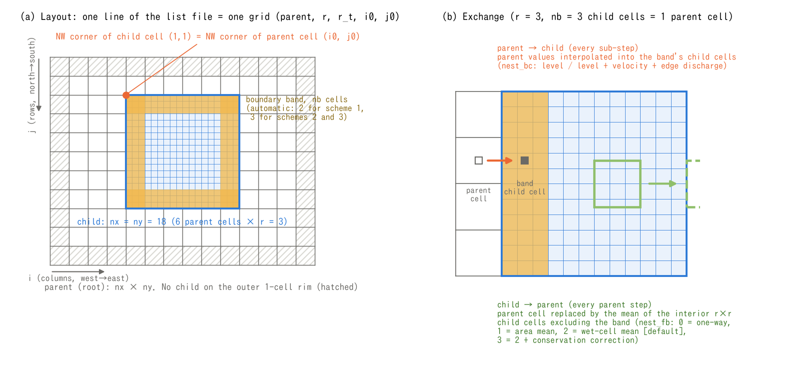

# Nesting (multi-level grids)

> English mirror of docs/users_guide/nest.md. The Japanese file is the master copy.

[Back to the User's Guide index](../users_guide.md)

Places finer child grids inside a coarse parent grid and solves them in the
same run (deep-sea tsunami propagation and coastal run-up, a wide-area
flood and the details of a town, and so on). Children can be nested to any
depth, and one parent can hold several children. The design background is
in docs/nesting_plan.md (Japanese).

**Current coverage**: parent → child is the water level only in the boundary
band (nest_bc = 1), level + velocity + edge discharge (2, default), Flather
radiation on open edges (3, no band), or 2 + an inner sponge (4). Child →
parent is one-way (nest_fb = 0) / area average (1) / wet-cell average (2,
default) / 2 + conservation correction (3). The time ratio r_t is any
integer, and the levels can be nested to any depth. The water-column amounts
of suspended sediment, water quality, driftwood, debris and salt water and
the groundwater storages (hg, hg2, hgc) are exchanged automatically when the
process is enabled on both parent and child. On a non-hydrostatic child
(f_nonhydrostatic = 1) the band cells become known (Dirichlet) cells of the
parent's non-hydrostatic potential φ (nest_nh, default). The formulation
of each method, the time interpolation and the basis of the defaults are in
[Nesting explained](nest_models.md).



(a) Align the north-west corner of child cell (1,1) with that of parent
cell `(i0, j0)` specified in the grid list. i increases eastward and j
southward. The example has a 14×11 parent, an 18×18 child,
`(i0, j0) = (5, 3)` and spatial ratio `r = 3`. The child covers 6×6
parent cells, i = 5…10 and j = 3…8, leaving at least one parent cell
between its footprint and every parent edge.

Yellow marks the child's outer **boundary band**. The example uses
`nest_bc=2`, width `nb=3` child cells (one parent-cell width), and no
sponge. For `nest_bc=1, 2, 4`, the parent supplies the band values while
the child advances its interior. With `nest_nb=0`, the automatic width
is nb=2 for advection scheme 1 and nb=3 for schemes 2 and 3. Flather
(`nest_bc=3`) has no band and ignores `nest_nb`.

(b) The upper view shows interpolation from surrounding parent-cell
centres to the centre of child band cell (1,4). The spatial interpolation
shown is for cell-centred quantities with all four parent cells wet.
At each child sub-step start, values are interpolated in time between
two parent states. `nest_bc=2` also transfers edge discharge as well as
level and velocity; edge quantities use different spatial interpolation
locations from cell-centred quantities.

The lower view returns values from child cells i = 10…12, j = 10…12
to parent cell (8,6), which covers exactly the same area. It illustrates
the area average for `nest_fb=1` with effective area fraction equal to 1;
the destination parent cell is drawn separately on the right. In this
layout the replaced parent cells are i = 6…9, j = 4…7. Parent cells
containing the boundary band are excluded; `nest_bc=4` also excludes
those containing the sponge. A parent cell is replaced only when its
**entire r×r child block** lies inside the child interior beyond both
band and sponge. `nest_fb=0` disables child-to-parent replacement. See
[the explanation](nest_models.md) §6 for the averaging options.

Generate both languages as PNG and SVG with
`python docs/figs/make_nest_figs.py layout`.

## How to use

1. Name the list file in the parameter file of the root (the coarsest grid).

```
&list_sysparam
  ...
  fn_nest = "nest.txt"      ! list of nested grids (empty = no nesting)
/
```

2. The list file (one grid per line; `#` lines are comments):

```
# id  parent  param_file           r  r_t  i0  j0
1     0       param_root.txt
2     1       bay/param_bay.txt    1  1    133 133
3     2       town/param_town.txt  1  1    40  25
```

| Column | Meaning |
|---|---|
| id | grid number; equal to the line number (1 = root) |
| parent | the parent's grid number (smaller than its own; 0 for the root) |
| param_file | the parameter file of that grid (terrain, properties, initial conditions and output directory are per grid) |
| r | spatial ratio = parent dx / child dx (positive integer; 1 if omitted) |
| r_t | time ratio = parent dt / child dt (positive integer; 1 if omitted; r_t = r is the usual choice) |
| i0, j0 | the parent cell at which the corner of child cell (1,1) is aligned (required for children). j increases in file row order (north to south) |

The parent takes one step, then the child takes r_t steps; the child's
boundary values are interpolated in time between two parent states (details
of the time stepping and interpolation in [the explanation](nest_models.md) §1).

3. Write `&list_nest` in the child's parameter file (defaults apply if omitted):

```
&list_nest
  nest_bc = 2        ! parent -> child: 1 = water level only (TUNAMI type), 2 = level + velocity + edge discharge (default; best interface consistency),
                     !        3 = Flather radiation on open edges (f_bc_* = 2; no band; one-way, lets the child's disturbances out),
                     !        4 = 2 + a sponge relaxing the nest_ns cells inside the band towards the parent's values
  nest_fb = 2        ! child -> parent: 0 = none (one-way), 1 = area average of h/m/n (volume exact), 2 = wet-cell average (default; for coastlines),
                     !        3 = 2 + conservation correction (adjusts the parent outside the interface to the child's fluxes; conserves volume)
  nest_ns = 4        ! sponge width (cells; the relaxation zone inside the band for nest_bc = 4)
  nest_nb = 0        ! boundary band width (cells). 0 = automatic (2 for advection scheme 1, 3 for schemes 2 and 3)
  nest_nh = 1        ! non-hydrostatic child: 1 = the band holds the parent's phi as Dirichlet cells (default), 0 = band + margin hydrostatic
/
```

Guide to choosing the methods:

| Purpose | nest_bc | nest_fb | Notes |
|---|---|---|---|
| normal use (return the detail of a tsunami or flood to the parent) | 2 (default) | 2 (default) | for regions straddling a coastline; 1 is volume-exact when everything is wet |
| strict volume conservation of the whole system | 2 | 3 | conservation correction returning the interface-flux difference to the parent |
| one-way, letting the child's disturbances out | 3 (Flather) | 0 | open edges set to `f_bc_* = 2`; no band |
| weaker reflection at the band | 4 (2 + sponge) | 0–3 | relaxation zone of width nest_ns |
| non-hydrostatic child | 1, 2, 4 | — | nest_nh = 1 (default) makes the band known cells of the parent's φ |

The equations and properties of each method (band interpolation, the
Flather condition, the sponge weights, the child-to-parent averages and
the conservation correction, the non-hydrostatic band) are in
[the explanation](nest_models.md) §2–§6.

## Conditions on a child grid (checked at initialization; the run stops if violated)

- child dx × r = parent dx, child dt × r_t = parent dt, and the same t0 and
  duration as the parent. Each grid's dt follows its own CFL condition and
  r_t = r is the usual choice (with r_t = 1 the parent's dt is also set by
  the child's CFL).
- The child's nx and ny are multiples of r. The whole child lies inside the
  parent, at least one parent cell away from the parent's outer edge (the
  cell outside the footprint is used for interpolation).
- The child's outer edges are walls (`&list_bound_edge` f_bc_* = 0, the
  default) with no inflow segments. The band (the outer nb cells) is given by
  the parent, so no boundary condition is set on the child. **nest_bc = 3 is
  the opposite**: the edges that receive the parent's values are set to
  `f_bc_* = 2` (long-wave radiation; see below).
- The child is large enough compared with the band (nx, ny > 2·nb + 2).
- The scheme is ENC (f_gridsystem = 0).

## Output and restart

- Every grid writes to its own `dir_result` as usual (distributions, probes,
  transects, Log.txt). Give each grid a different directory.
- State save / restore (f_state_save / f_state_restore) also works per grid.
  Give each grid its own `dir_save`. Restarting the root restarts all grids.
- The screen output alternates between grids (each root step is followed by
  its children).

## Using it from BMI

A nest system is one BMI model as it is (bmi/README.md). Passing the root's
parameter file to `initialize` initializes all grids; `update` is one root
step (the children advance inside it) and the time is the root's. Grids are
distinguished by grid id: 0 = root, k = line k+1 of the list. Variables of
non-root grids carry `~grid<k>` in the object part of the name
(`surface_water~grid1__depth` = the depth of grid 1). In Python
`var_on_grid(VAR_DEPTH, 1)` builds the name, and `model.grids`,
`model.shape_of(k)` and `model.origin_of(k)` return the grid information. If
there is no georeferencing, a child's origin is derived from the parent's
origin and the alignment position, so all grids are expressed in the root's
coordinate system. set (depth, terrain, precipitation) works per grid under
the same conditions. The acceptance test is [test/bmi_nest](../../../test/bmi_nest/).

## Notes

- In one-way mode (nest_fb = 0) the child's reflections and run-up do not
  return to the parent. The parent's coarse coastal reflection enters the
  child through the band, and the child's disturbances reflect at the band
  (resolved by two-way mode, or by nest_bc = 3 which radiates them out).
- Run-up on land near the child's band (about nb × r cells) is coarsely
  approximated; keep it away from the points of interest. Place the landward
  boundary above the maximum run-up so that water never reaches it.
- In a 1:1 self-nest (child = a subregion of the parent) the child's interior
  is bit-identical to the same region of the parent, and in two-way mode the
  whole root is bit-identical to a stand-alone run ([test/nest_identity](../../../test/nest_identity/); its
  README lists the identity cases; useful for verifying the band and
  replacement design).
- Verification of waves crossing the interface of two-way nests at ratios 3
  and 5 (comparison with a uniform fine grid; figures of the levels, errors,
  one-way band vs Flather and the non-hydrostatic band) is in
  [examples/nest_reflect](../../../examples/nest_reflect/).

## Tests and examples

- [test/nest_identity](../../../test/nest_identity/): identity tests of 1:1 self-nesting (band replacement, two-way, Flather and non-hydrostatic configurations).
- [test/bmi_nest](../../../test/bmi_nest/): acceptance test of a nested system driven through BMI.
- [examples/nest_reflect](../../../examples/nest_reflect/): waves crossing the interface of two-way nests with ratios 3 and 5, compared with a uniform fine grid (figures in the README).
