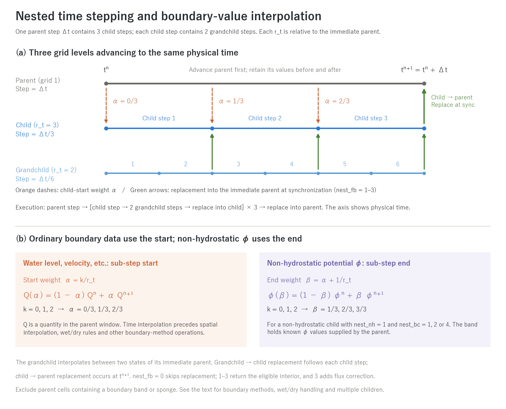
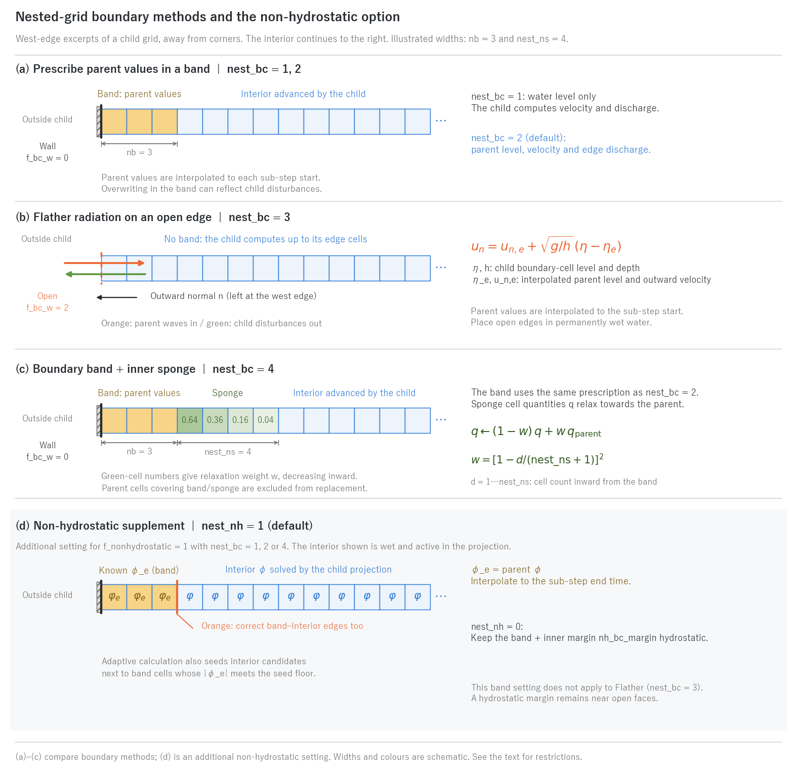

# Nesting explained (supplement to the nesting chapter)

> English mirror of docs/users_guide/nest_models.md. The Japanese file is the master copy.

[Back to the nesting chapter](nest.md) | [Back to the user's guide index](../users_guide.md)

This page gives the formulation and properties, the basis of the defaults
and the models referred to for the methods of the [nesting chapter](nest.md):
the parent–child time stepping and the time interpolation of boundary
values, the boundary-band methods (nest_bc), the non-hydrostatic band
(nest_nh), Flather radiation, the sponge and the child-to-parent replacement
(nest_fb). The implementation is in `src/m_nest.f90` and `src/list_nest.f90`;
the design history is in docs/nesting_plan.md and developer.md (in Japanese).

## 1. Time stepping and the time interpolation of boundary values



(a) One parent step Δt contains three child steps with `r_t=3`; each child
step contains two grandchild steps with `r_t=2`, giving six in total.
Each `r_t` is relative to the immediate parent and is independent of the
spatial ratio `r`. The horizontal axis shows physical simulation time,
not a schedule in which all grids advance concurrently. The parent takes
its step first and retains the parent-window values needed for the child
boundary at `tⁿ` and `tⁿ⁺¹`, before and after that step. The child then
takes `r_t` sub-steps.

(b) Number the child sub-steps `k=0…r_t−1`. The start time is
`tⁿ + k Δt/r_t`, with interpolation weight `α=k/r_t`. A quantity Q
stored in the parent window is interpolated as
`Q(α)=(1−α)Qⁿ+αQⁿ⁺¹`, followed by spatial interpolation, wet/dry rules
and other operations appropriate to the boundary method. This **start-time**
interpolation supplies water level, velocity and related data. Flather
(`nest_bc=3`) also uses the start time, supplying external level and
velocity on open edges instead of overwriting a band. The illustrated
weights are `0/3, 1/3, 2/3`.

For a non-hydrostatic child with `nest_nh=1` and `nest_bc=1, 2, 4`, the
known band values of φ are interpolated to the sub-step **end time**.
The figure denotes this weight by `β=α+1/r_t`, giving `1/3, 2/3, 3/3`.
Both ordinary boundary data and φ are prepared before advancing the child
step, but they refer to different times. Even with `r_t=1`, ordinary
boundary data use the parent at `tⁿ`, while φ uses `tⁿ⁺¹`. A parent
without non-hydrostatic calculation supplies zero φ.

A grandchild repeats the same procedure recursively inside each child
step, interpolating between two states of its immediate parent. Green
arrows mark replacement at synchronization for `nest_fb=1–3`. The example
executes: parent step → [child step → two grandchild steps → replace into
child]×3 → replace into parent. The end-time window used for interpolation
is captured immediately after that grid's step, before replacement from
its descendants. If one parent has several children, each child completes
all its sub-steps and replacement into the parent before the next child
is advanced.

`nest_fb=0` skips child-to-parent replacement. Methods 1–3 average the
eligible interior back into the parent; method 3 also applies interface
flux conservation correction. Parent cells containing a boundary band or
sponge are excluded. See "Child-to-parent replacement" below for averaging
and wet/dry handling. The figure is an algorithm schematic, not a computed
time series.

## 2. Boundary-band methods (nest_bc)



The figure shows a west-edge row excerpt of the child; the interior continues
to the right. Panels (a)–(c) compare boundary methods selected by `nest_bc`.
Panel (d) shows the additional `nest_nh` setting for a non-hydrostatic child
with a band. The illustrated widths are nb=3 and nest_ns=4 child cells.

- (a) `nest_bc=1` prescribes water level in the band; the child computes
  velocity and discharge. `nest_bc=2` (default) transfers parent level,
  velocity and edge discharge. The solid black line is the child's outer
  wall (`f_bc_w=0` at the west edge).
- (b) `nest_bc=3` uses Flather radiation with no band. The orange dashed line
  is an open edge (`f_bc_w=2` at the west edge). The arrows show incoming
  parent waves and outgoing child disturbances. Normal velocity in the
  equation is **positive outward from the child**, to the left at this edge.
- (c) `nest_bc=4` adds a sponge inside the same band as method 2. The numbers
  in green cells are relaxation weights w, decreasing inward. Parent cells
  containing the band or sponge are excluded from child-to-parent replacement.
- (d) `nest_nh=1` (default) prescribes the parent's φ as known band values.
  The example interior is wet and active in the projection. The orange
  band–interior edges are corrected too. Ordinary boundary values are
  interpolated to the sub-step **start**, while φ uses the sub-step **end**.
  `nest_nh` is separate from `nest_bc` and does not apply to band-free method 3.

For comparisons against a uniform
fine grid, see the illustrated README in [examples/nest_reflect](../../../examples/nest_reflect/).

## 3. Non-hydrostatic child grids (nest_nh)

When a child with a band is non-hydrostatic (f_nonhydrostatic = 1), the band
cells are removed from the unknowns of the child's projection (the elliptic equation
for φ) and become known (Dirichlet) cells of φ. By default (nest_nh = 1) the
parent's φ (interpolated to the end of the sub-step) is placed there, so the
non-hydrostatic pressure of a dispersive wave coming from the parent is
continuous at the interface, and in a 1:1 self-nest the child's interior
matches the parent (to the CG tolerance; maximum difference 2e-13 m in the
nh case of [test/nest_identity](../../../test/nest_identity/)). nest_nh = 0 makes the band and the
nh_bc_margin cells inside it hydrostatic (the same margin as the other forced
boundaries), which shifts the phase of dispersive waves at the interface
(maximum difference 1.4e-2 m in the same case). If the parent is not
non-hydrostatic, φ = 0 is placed even with the default.

- Children with nest_bc = 1, 2 and 4 (with a band) are supported. It does
  not apply to Flather (nest_bc = 3), where the vicinity of the open faces
  keeps the hydrostatic margin nh_bc_margin.
- The active set (f_nh_adaptive = 1) can be used as is. Interior candidates
  adjacent in the eight-cell neighbourhood to band cells whose |φ_e| meets
  the seed floor are also seeded. No extra setting is needed for nesting.
- The auxiliary solve of the moving-bottom smoothing (f_nh_bottom) is done
  with φ = 0 in the band (an approximation).

## 4. Flather radiation (nest_bc = 3)

Instead of a band, the long-wave characteristic condition[^flather76]

```math
u_n = u_{n,e} + \sqrt{\frac{g}{h}}\,(\eta - \eta_e)
```

is imposed on the boundary faces of the child's
open edges. η_e and u_{n,e} are the parent's water level and
outward normal velocity on the edge (interpolated to the centre of the
boundary cell, and in time to the start of the sub-step). It generalizes the
existing long-wave radiation boundary (`f_bc_* = 2`, where η_e = reference
level and u_e = 0): waves coming from the parent pass in, and disturbances
generated inside the child (reflections from the finer coast, the return
flow of run-up) radiate out. Both u_n and u_n,e are positive outward from the
child, and h is the child boundary-cell depth. The implementation uses
max(h, dv) in the denominator, then projects the resulting edge-normal
velocity onto the individual ENC boundary faces to compute discharge.

- Meant for **one-way** nests (nest_fb = 0), when you do not want the
  child's reflections trapped inside the child. With a Dirichlet band
  (nest_bc = 2) the child's disturbances are overwritten by the parent's
  values in the band, which can cause reflection. Two-way replacement
  (nest_fb ≥ 1) can reduce this effect. Use the default 2 normally and
  consider 3 for one-way nests.
- In the child's `&list_bound_edge`, set the edges that receive the parent's
  values to `f_bc_* = 2` (it can be written inside the parameter file with
  `fn_boundary = '-'`). Edges with 0 (wall) stay walls (place the landward
  boundary above the maximum run-up). 1 (free outflow) and inflow segments
  are not allowed. At least one edge must be 2.
- There is no band (nest_nb is ignored). No sponge. Combined with
  child → parent replacement (two-way), parent cells that contain boundary
  cells are not replaced. The additional fields (suspended sediment, water
  quality, groundwater, ...) are not exchanged (inflow through the faces is
  clear water).
- Put the open edges in **permanently wet water**. A face is closed during
  the sub-steps in which the parent's interpolation point is dry, and the
  flux is 0 if the child's boundary cell is dry (no re-wetting from the
  boundary).
- If the parent is at rest (constant η, u = 0) the result is bit-identical
  to the existing radiation boundary (the flather case of
  [test/nest_identity](../../../test/nest_identity/)). The comparison with a band on a one-way r3t3 interface
  crossing is in [examples/nest_reflect](../../../examples/nest_reflect/) (README).

## 5. Sponge (nest_bc = 4)

Inside the same boundary band as `nest_bc=2`, add a relaxation region
`nest_ns` child cells wide. At each sub-step start, blend a cell quantity q
towards its interpolated parent value q_parent. For the shortest inward cell
distance d = 1…nest_ns from the band,

```math
q \leftarrow (1-w)\,q + w\,q_{\mathrm{parent}},\qquad
w = \left(1 - \frac{d}{n_s+1}\right)^2
```

with n_s = nest_ns. With nest_ns=4
as illustrated, the weights from the band inward are 0.64, 0.36, 0.16 and 0.04.
The squared weight is the simplest relaxation that is close to 1 at the
boundary and falls smoothly to 0 inward (a Davies-type sponge
layer[^davies83]); the width nest_ns is not a calibration value but is chosen
as a fraction of the child's wavelength (empirical).

This applies to depth, velocity, cell discharge and enabled additional
fields exchanged between parent and child. Edge quantities are not relaxed
with these weights. The band is replaced by parent values; the sponge is
relaxed towards them before advancing the child. Only complete r×r child
blocks beyond both band and sponge contribute to child-to-parent replacement.

## 6. Child-to-parent replacement (nest_fb)

- Parent cells whose entire r×r child block lies inside the child interior,
  excluding the band and sponge, are replaced by child averages at the end
  of each parent step. Flather has no band, but the one-parent-cell rim
  corresponding to the child's outer edges is excluded from replacement.
  nest_fb = 2 averages the level and depth over the wet child cells
  only, and dries the parent cell if the parent's ground is above the mean
  level (for regions straddling the coastline; the water volume is not
  strictly conserved). nest_fb = 1 is a plain average of depth and discharge
  that conserves volume exactly (for fully wet regions).
- Parent cells whose effective area fraction is not 1 (subgrid channel width
  or porosity) receive the child's true water amount converted back to a
  rectangular depth with the parent's area fraction (consistency of channel
  levels).
- nest_fb = 3 returns the difference between the parent's and the child's
  interface fluxes around the replaced region to the parent's depth, so the
  whole system conserves volume (equivalent to the AMR reflux[^berger98]
  used by GeoClaw[^berger11]).
- A summary is printed at the end (water volume added to the child by the
  band replacement, the number of replacements and the cumulative change of
  the parent's water volume, the amount of the conservation correction). On
  land, rain falling in the band is overwritten by the parent's values, so
  the child's water balance is checked by adding this band replacement
  volume.

## 7. Parameters and the basis of their defaults

The labels in the Basis column are explained in [How to read the basis of a default](../users_guide.md#how-to-read-the-basis-of-a-default).

| Parameter | Default | Meaning | Basis |
|---|---:|---|---|
| nest_bc | 2 | parent → child boundary method | **verification case** passing level, velocity and edge discharge (2) gives the most consistent interface ([examples/nest_reflect](../../../examples/nest_reflect/); 1 is the TUNAMI-type level-only band) |
| nest_fb | 2 | child → parent replacement | **verification case** the wet-cell average keeps the parent's wet/dry state across a coastline (1:1 self-nesting is bit-identical in [test/nest_identity](../../../test/nest_identity/)) |
| nest_nb | 0 (automatic) | width of the boundary band | **derived** from the stencil of the advection term: 2 for scheme 1, 3 for schemes 2 and 3 (the band covers ±2 edges along the line; [Advection](advection.md) §4.5) |
| nest_ns | 4 | width of the sponge | **empirical** a fraction of the child's wavelength (§5) |
| nest_nh | 1 | treatment of the non-hydrostatic band | **verification case** with the parent's φ as known values the interior of the 1:1 self-nest of [test/nest_identity](../../../test/nest_identity/) matches within 2e-13 m, against 1.4e-2 m when hydrostatic (§3) |

**Where to look when revising the defaults**

- Set the sponge width to about 1/4–1/2 of the shortest wavelength you
  want resolved on the child (8–10 cells) and increase it until the
  reflection at the interface disappears; the reflection can be
  quantified with the procedure of
  [examples/nest_reflect](../../../examples/nest_reflect/).

## 8. Verification cases

- [test/nest_identity](../../../test/nest_identity/): identity tests of 1:1 self-nesting (band replacement, two-way, Flather and non-hydrostatic configurations).
- [test/bmi_nest](../../../test/bmi_nest/): acceptance test of a nested system driven through BMI.
- [examples/nest_reflect](../../../examples/nest_reflect/): waves crossing the interface of two-way nests with ratios 3 and 5, compared with a uniform fine grid (figures in the README).

## References

[^flather76]: Flather, R. A. (1976): A tidal model of the north-west European continental shelf. *Mém. Soc. R. Sci. Liège*, 6(10), 141–164.
[^davies83]: Davies, H. C. (1983): Limitations of some common lateral boundary schemes used in regional NWP models. *Mon. Wea. Rev.*, 111, 1002–1012.
[^berger98]: Berger, M. J. and LeVeque, R. J. (1998): Adaptive mesh refinement using wave-propagation algorithms for hyperbolic systems. *SIAM J. Numer. Anal.*, 35(6), 2298–2316.
[^berger11]: Berger, M. J., George, D. L., LeVeque, R. J. and Mandli, K. T. (2011): The GeoClaw software for depth-averaged flows with adaptive refinement. *Adv. Water Resour.*, 34, 1195–1206.
