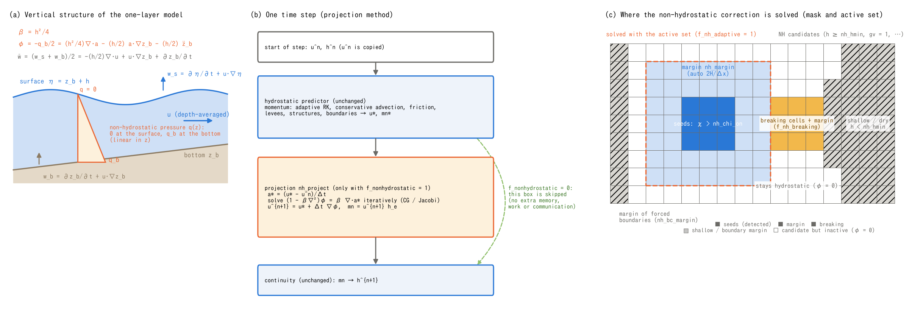
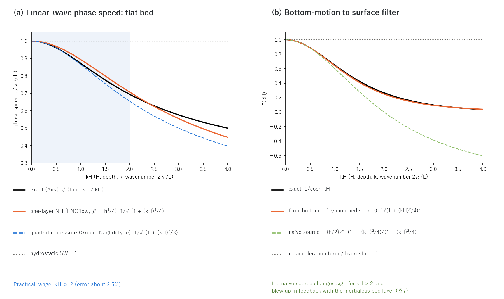

# Non-hydrostatic correction (one-layer model) (supplement to the shallow water chapter)

> English mirror of docs/users_guide/nonhydrostatic.md (based on commit ba7559a). The Japanese file is the master copy.

[Back to the shallow water chapter](swflow.md) / [Back to the user's guide index](../users_guide.md)

This page explains the equations, the algorithm and the range of validity of
the research option "one-layer non-hydrostatic correction"
(`f_nonhydrostatic = 1`) of the shallow water computation. It gives the
ideas behind the parameters (`nh_*`, `f_nh_*`) listed under
"Non-hydrostatic correction (research option)" in the
[shallow water chapter](swflow.md), in enough detail to understand what the
settings mean. The design history, the alternatives considered and the
numerical experiments (for developers) are in docs/nonhydrostatic_plan.md
and docs/developer.md §69 (in Japanese). The models and papers the
implementation drew on are listed in §9.

Equations are written in the LaTeX notation that GitHub Markdown renders.
The figures are generated by `python3 docs/figs/make_guide_figs.py nonhydro`
(`docs/figs/guide/fig_nonhydro.py`), in Japanese and English.

## 1. Why non-hydrostatic: frequency dispersion

The hydrostatic shallow water equations (SWE) assume that pressure is
proportional to the depth below the surface (vertical acceleration is
neglected), and on a flat bed the phase speed of small linear waves is
$`\sqrt{gH}`$ whatever the wavelength. The true dispersion relation of
surface waves is

```math
\omega^2 = g\,k\,\tanh(kH)
```

and, as its shallow-water expansion $`\omega^2 = gHk^2\,[1 - (kH)^2/3 + \cdots]`$
shows, **shorter waves travel more slowly** (frequency dispersion).
Phenomena in which this is essential cannot be reproduced by the SWE in
principle:

- soliton fission and undular bores of tsunamis running up rivers (the
  competition between nonlinear steepening and dispersion),
- generation and near-field propagation of landslide tsunamis (the horizontal
  scale of the source is not large compared with the depth),
- solitary waves and weak bores in reservoirs and ponds.

Rainfall runoff, river floods, inundation, storm surges and ordinary
long-wave tsunamis do not need it. The default is the hydrostatic ENC; when
the option is off no array is allocated and nothing is called, so the
results are bitwise identical to before.

**Numerical versus physical dispersion.** A finite-difference grid has
"numerical dispersion" of its own: on a one-dimensional C grid the long-wave
expansion is $`\omega^2 = gHk^2\,[1 - (k\Delta x)^2/12 + \cdots]`$. Compared
with the physical dispersion of the one-layer model,
$`[1 - (kH)^2/4 + \cdots]`$, **the two are equal at
$`\Delta x = \sqrt{3}\,H \approx 1.7H`$**.

| $`\Delta x / H`$ | numerical / physical dispersion |
|---:|---:|
| 2.0 | 1.33 |
| 1.0 | 0.33 |
| 0.5 | 0.083 |
| 0.25 | 0.021 |

On a grid with $`\Delta x > 1.7H`$ the correction is buried in numerical
dispersion and meaningless; **practical use assumes $`\Delta x \lesssim H/2`$**
(for a tsunami running up a 10 m deep river, $`\Delta x \approx`$ 2.5–5 m).
The cost is set by this resolution requirement rather than by the solver.
The measured numerical dispersion of the ENC grid ([test/nhwave](../../../test/nhwave/README.md)) is 0.3–0.8%
($`k\Delta x`$ = 0.13–0.18), clearly distinguishable from the target of the
one-layer model (12% at $`kH = 1`$).

## 2. Equations of the one-layer non-hydrostatic model



The variables are those of figure (a): $`h`$ depth, $`z_b`$ bottom,
$`\eta = z_b + h`$ surface, $`\mathbf{u}`$ depth-averaged horizontal velocity,
$`q(z)`$ the deviation from hydrostatic pressure (non-hydrostatic pressure).
The one-layer model assumes **$`q`$ linear in the vertical** (0 at the
surface, $`q_b`$ at the bottom) and represents the vertical velocity by the
mean of its surface value $`w_s`$ and bottom value $`w_b`$ (the same
approximation as the Keller-box one-layer model of Stelling & Zijlema 2003).

**Vertical momentum.** The layer-averaged vertical acceleration is driven by
the non-hydrostatic pressure at the bottom (density 1, advection omitted).

```math
h\,\frac{\partial \bar w}{\partial t} = q_b,
\qquad
\bar w = \frac{w_s + w_b}{2}
```

**Kinematic conditions and continuity within the layer.** From
$`w_s = \partial\eta/\partial t + \mathbf{u}\cdot\nabla\eta`$,
$`w_b = \partial z_b/\partial t + \mathbf{u}\cdot\nabla z_b`$ and
$`w_s - w_b = -h\,\nabla\cdot\mathbf{u}`$,

```math
\bar w = -\frac{h}{2}\,\nabla\cdot\mathbf{u}
+ \mathbf{u}\cdot\nabla z_b + \frac{\partial z_b}{\partial t}
```

**Horizontal momentum.** Averaging the horizontal gradient of the
non-hydrostatic pressure over the depth (Leibniz rule, $`q = 0`$ at the
surface) gives

```math
\frac{\partial \mathbf{u}}{\partial t} + \cdots
= \underbrace{-\,g\nabla\eta - \cdots}_{\text{hydrostatic part } \mathbf{a}^{*}}
\;-\;\frac{1}{2}\nabla q_b \;-\; \frac{q_b}{2h}\,\nabla\bigl(h + 2 z_b\bigr)
```

**The potential φ.** With $`\phi := -q_b/2`$, $`h`$ frozen within the step and
the vertical momentum written with the acceleration
$`\mathbf{a} = \partial\mathbf{u}/\partial t`$,

```math
\boxed{\;
\mathbf{a} = \mathbf{a}^{*} + \nabla\phi + \frac{\phi}{h}\nabla(h + 2z_b),
\qquad
\phi = \frac{h^2}{4}\,\nabla\cdot\mathbf{a}
\;-\;\frac{h}{2}\,\mathbf{a}\cdot\nabla z_b
\;-\;\frac{h}{2}\,\ddot z_b
\;}
```

The three terms on the right correspond to **Version 1 (flat bed; the
default)**, **the bottom-slope terms (`f_nh_slope = 1`)** and **the
moving-bottom acceleration term (`f_nh_bottom = 1`)** (§7). On a flat bed,
with $`\beta := h^2/4`$,

```math
\phi = \beta\,\nabla\cdot\mathbf{a},
\qquad
\mathbf{a} = \mathbf{a}^{*} + \nabla\phi
\;\;\Longrightarrow\;\;
\bigl(1 - \beta\nabla^2\bigr)\,\phi = \beta\,\nabla\cdot\mathbf{a}^{*}
```

That is, the non-hydrostatic correction applies an **implicit dispersive
filter** to the hydrostatic acceleration $`\mathbf{a}^{*}`$. For a Fourier
mode $`\hat a = \hat a^{*}/(1 + (kH)^2/4)`$: the filter damps (never
amplifies) the acceleration of short waves, so it creates no new fast waves
and the CFL condition is unchanged.

**Dispersion relation.** On a flat bed, linearised,
$`\partial u/\partial t = -g\,\partial\eta/\partial x + \partial\phi/\partial x`$,
$`\phi = (H^2/4)\,\partial^2 u/\partial x\partial t`$ and
$`\partial\eta/\partial t = -H\,\partial u/\partial x`$ give

```math
\omega^2 = \frac{gHk^2}{1 + (kH)^2/4}
```



Figure (a) compares this with the exact solution. The phase-speed error is
+0.9 / +2.5 / +1.8 / −3.7% at $`kH = 0.5 / 1 / 2 / 3`$. A quadratic pressure
profile (Green–Naghdi type, $`1/(1 + (kH)^2/3)`$; Jeschke et al. 2017) is
more accurate for $`kH \le 1`$ (−0.1%) but degrades to −5.7 / −13% at
$`kH = 2 / 3`$, and in a projection method its time derivative becomes
ambiguous. For the trailing waves of soliton fission ($`kH`$ = 1–2) the linear
profile is not worse, and it needs only one scalar, so **the linear profile
$`\beta = h^2/4`$ is used**. On a uniform current $`U_0`$ the relation becomes
$`(\omega - U_0 k)^2 = gHk^2/(1 + (kH)^2/4)`$, consistent with applying the
filter to the total acceleration including advection (confirmed numerically
in [test/nhcurrent](../../../test/nhcurrent/README.md)).

## 3. Algorithm: projection at the end of the step (fractional step)

As in figure (b), each step has three stages.

1. **Hydrostatic predictor (unchanged).** The momentum equation (adaptive
   Runge–Kutta, momentum-conservative advection, friction, levees,
   structures, boundary conditions) is solved as before, giving the edge
   velocities $`u^{*}_e`$ and fluxes.
2. **Projection (`nh_project`; only when enabled).** From the total
   hydrostatic acceleration of the step
   $`a^{*}_e = (u^{*}_e - u^{n}_e)/\Delta t`$ (which includes advection,
   friction and the RK stages), the cell potential $`\phi`$ is solved
   iteratively, the edge velocities are corrected and the fluxes rebuilt.
3. **Continuity (unchanged).** The depth is updated with the corrected
   fluxes. Both cells see the same flux, so mass conservation stays exact.

**Discrete form.** In the ENC weight convention, the edge-to-cell
divergence $`D`$ uses the same weights as the continuity equation ($`l_k`$:
passage width of edge $`k`$, $`A = \Delta x\Delta y`$) and the cell-to-edge
gradient $`G`$ the same difference as the pressure term (distance between cell
centres $`L_k`$).

```math
(D\,a)_i = \sum_{k=1}^{8} \pm\,a_k\,\frac{l_k}{A},
\qquad
(G\,\phi)_e = \frac{\phi_n - \phi_c}{L_k}
```

The equation to solve is a nine-point linear system per cell $`i`$
($`\beta_i = (h_i^n)^2/4`$ is frozen within the step; the sum runs over the
non-hydrostatic edges only).

```math
\phi_i - \beta_i \sum_{k} w_k\,(\phi_{n_k} - \phi_i) = \beta_i\,(D a^{*})_i,
\qquad
w_k = \frac{l_k}{A\,L_k}
```

Multiplied by $`A/\beta_i`$, the form
$`\phi_i/\beta_i + \sum_k w_k(\phi_i - \phi_{n_k}) = (Da^{*})_i`$ is symmetric
positive definite, so the conjugate gradient method (CG) applies. The
correction is

```math
u^{n+1}_e = u^{*}_e + \Delta t\,\frac{\phi_n - \phi_c}{L_k},
\qquad
mn_e = u^{n+1}_e\,h_e
```

where $`h_e`$ is exactly the edge depth the momentum equation used for its
face flux. In the one-dimensional flat-bed linear analysis the semi-discrete
dispersion relation is **exactly**
$`\omega^2 = gH\Lambda/(1 + \beta\Lambda)`$ ($`\Lambda`$: eigenvalue of the
discrete Laplacian); in [test/nhwave_nh](../../../test/nhwave_nh/README.md) the periods for $`kH`$ = 0.25–2 match
the theory within ±0.2%.

**Solver.** `nh_solver = 2` (CG, default) or 1 (Jacobi). Because of the
identity term the condition number $`\kappa \approx 1 + 2\varepsilon`$
($`\varepsilon = \beta\Lambda_{\max} \approx 2.83\,\beta/\Delta x^2`$) does
not depend on the number of cells, and CG converges in 10–80 iterations.
Jacobi converges slowly for $`\Delta x \ll H`$ (not converged after 500 sweeps
at $`\Delta x = H/8`$) and is kept for comparison. Inner products are
deterministic sums of row partial sums in a fixed order and the convergence
test uses order-independent maxima, so **the results are bitwise identical
for any number of threads or MPI ranks** ([Parallel execution](parallel.md)).
Communication inside the iteration is one halo exchange per matrix-vector
product plus the reduction of the inner products.

**Why once, at the end of the step.** (1) Inside the Runge–Kutta stages the
iterative solve would run once per stage and would require a two-pass
structure that completes the predictor on all edges first. (2) An "edge-local
implicit correction" (freezing the neighbours' contributions and solving a
scalar per edge) is nothing but the first sweep of a Jacobi iteration on the
elliptic equation and, at the required resolution $`\Delta x \lesssim H/2`$,
delivers only 1/3–1/9 of the target correction (linear analysis;
developer.md §69, plan §4). An elliptic correction acts on the neighbourhood
simultaneously, so it has to be iterated.

**Cost.** Solved on the whole domain, the standing-wave test ([test/nhwave_nh](../../../test/nhwave_nh/README.md);$`10^4`$ cells,
45 CG iterations per step) takes about three times the wall-clock time of
the hydrostatic run. With the active set (§5) the regions of long waves,
steady flow and inundation carry no cost.

## 4. Where the correction degrades to hydrostatic (mask)

As in figure (c), the non-hydrostatic correction is solved only on the
**candidate cells** that satisfy all of the following; elsewhere $`\phi = 0`$
(hydrostatic). Edges touching a cell outside the mask are not corrected (an
edge is as valid as the less valid of its two cells).

| Condition | Reason |
|---|---|
| valid cell ($`x > 0`$) and not in the sea mask (`sw`) | cells forced by the tide stay hydrostatic |
| $`h \ge`$ `nh_hmin` (default 0.1 m) | wet/dry fronts, very shallow water and bores after breaking are treated hydrostatically (dissipated as bores by the momentum-conservative advection) |
| no buildings (`gv = 1`), no sub-grid channel width or cross-section σ | Version 1 does not include them in the operator |
| not a breaking cell or its margin (§6) | the one-layer model cannot represent breaking, so it switches to hydrostatic |
| not within `nh_bc_margin` of a forced boundary (prescribed-stage cells, reach inflow, free outflow, radiation faces) | prescribed fluxes and stages interfere with the projection and blow up at the boundary |
| in a nested child grid, not in the band | the band holds the parent's $`\phi`$ as known (Dirichlet) values ([Nesting](nest.md), `nest_nh`) |
| edge: both cells are candidates, not a levee wall, non-zero passage width | walls carry no flux |

The intended spatial structure is "offshore and in-river = non-hydrostatic
→ shoaling, breaking, very shallow water = hydrostatic → run-up and
inundation".

## 5. Active set: solving only where needed (`f_nh_adaptive = 1`)

In the spirit of the adaptive Runge–Kutta, the iteration runs only on the
cells where dispersion matters. The Green function of the elliptic correction
$`(1 - \beta\nabla^2)\phi = s`$ is $`\exp(-r/\sqrt{\beta}) = \exp(-2r/H)`$, so
**the e-folding distance is $`H/2`$** and cells more than a few depths away
are effectively unaffected.

**Detector.** The ratio of the correction to the hydrostatic acceleration

```math
\chi_i = \frac{|\beta_i (D a^{*})_i|}{\bar a^{*}_i + |\beta_i (D a^{*})_i|}
\;\approx\; \frac{(kH)^2/4}{1 + (kH)^2/4}
```

($`\bar a^{*}_i`$ is the RMS of $`|a^{*}|`$ over the 8 edges). It does not
depend on the amplitude and vanishes for long waves and steady flow. Cells
with $`\chi >`$ `nh_chi_on` (default 0.06, the level of a 3% phase-speed
difference from hydrostatic) become **seeds**. Because a ratio also picks
up round-off-level short waves, an absolute floor `nh_amin` and a floor
`nh_arel` relative to the domain maximum of the correction are applied.
`nh_detector = 2` is the absolute form $`|\beta Da^{*}|/g`$ (for comparison).

**Margin.** The seeds are dilated `nh_margin` times over the 8
neighbours (0: automatic, $`2H/\Delta x`$ = four times the decay distance).

**Iteration.** The iteration runs on seeds plus margin only; outside, $`\phi = 0`$. No
state is kept between steps, so a restart round trip is bitwise identical.

The difference from the whole-domain solution decays exponentially with the
margin: in a hump-wave test (developer.md §69.2) it was 9.4e-4 / 4.0e-4 / 1.0e-4 m for margins of
4 / 8 / 16 cells (0.02–0.2% of the 0.47 m correction).

## 6. Wave breaking (`f_nh_breaking`, `nh_break_visc`)

The one-layer model does not break waves. Run without a switch, a breaking
solitary wave on a beach (Synolakis 1987, $`a/H = 0.28`$, [test/nhbreak](../../../test/nhbreak/README.md)) keeps
its shape to the shoreline, then runs up as a thin tongue, and the run-up
$`R/H`$ becomes 1.64 (close to the non-breaking run-up law; the experimental
law gives 0.42). As in hybrid Boussinesq models and SWASH, **cells detected
as breaking are therefore made hydrostatic, so the wave dissipates as a bore
through the momentum-conservative advection** ([Advection
schemes](advection.md)).

**Detection (`nh_break_type`).**

| Type | Criterion | Notes |
|---|---|---|
| 1 | surface rise rate $`\partial\eta/\partial t > \alpha\sqrt{gh}`$ ($`\alpha`$ = 0.6; neighbouring cells $`\beta`$ = 0.3; kept until the crest passes) | SWASH type (Smit et al. 2013). In the 2026-10-05 verification it did not fire in time for the onset of breaking on this grid ($`\Delta x = H/4`$); the current code does fire (note in test/nhbreak) |
| 2 | Froude number $`\lvert V\rvert/\sqrt{gh} >`$ `nh_break_fr` (0.6) | local, stateless |
| 3 | surface slope $`\lvert\nabla\eta\rvert >`$ `nh_break_slope` (0.3; maximum over the 8 neighbours) | **default**; local, Galilean invariant, stateless |

The `nh_break_margin` cells around a breaking cell (0: automatic,
$`2H/\Delta x`$) are also made hydrostatic, so that the non-hydrostatic
pressure does not keep pushing the breaking front: the whole wave up to the
crest is dropped, not only the face. The one-cell spike at a bore front (the
two-cell mean edge depth becomes small at the front; [Advection
schemes](advection.md) §5) turns into a blow-up at the switch, so
**non-hydrostatic cases with breaking or bores require `f_hcap_upwind = 2`**.

**Dissipation in the breaking zone (`nh_break_visc`).** The switch alone
provides only the dissipation of the bore jump condition and cannot
represent the energy lost by a plunging breaker (converged values are +50%
above the experimental law, +10–20% with friction $`n = 0.01`$). Breaking cells
(margin included) are given an eddy viscosity

```math
\nu_b = \texttt{nh\_break\_visc}\;B\;h\sqrt{gh}\;|\nabla\eta|,
\qquad
B = \mathrm{clip}\!\left(\frac{|\nabla\eta| - s}{s},\,0,\,1\right),
\quad s = \texttt{nh\_break\_slope}
```

which dissipates through the diffusion term $`\nabla\cdot(\nu\nabla\mathbf{u})`$
of the momentum equation ([Diffusion term](diffusion.md)). It is the $`\nu = B\,\delta_b^2\,h\,\partial\eta/\partial t`$
of Kennedy et al. (2000) made local and stateless with the kinematics of a
progressive wave, $`\partial\eta/\partial t \approx c\,|\partial\eta/\partial x|`$;
1.44, corresponding to the literature constant $`\delta_b = 1.2`$, is the
reference value (default 0 = off).

**Run-up heights reached** ([test/nhbreak](../../../test/nhbreak/README.md), $`R/H`$; experimental law 0.42):

| Configuration | $`\Delta x = H/4`$, dt 0.02 | $`\Delta x = H/8`$, Cr 0.07, $`n`$ = 0.01 |
|---|---:|---:|
| hydrostatic | 0.39 (early bore formation on the flat part) | 0.34 |
| non-hydrostatic, no switch | 0.82 | — |
| non-hydrostatic + switch | 0.63 | 0.51 (frictionless 0.63) |
| same + eddy viscosity 1.44 | — | **0.45** (+5%) |

The 0.63 of the test setting is a cancellation of the time-step error (+25%)
and the numerical dissipation on the flat part (−20%). **For a quantitative
evaluation of breaking and run-up, check convergence at Cr ≲ 0.1 and
$`\Delta x \lesssim H/8`$, and use friction $`n \approx 0.01`$ together with the
eddy viscosity 1.44.** Even then, run-up heights with breaking carry an
uncertainty of ±10–20%.

## 7. Bottom-slope terms (`f_nh_slope`) and moving bottom (`f_nh_bottom`)

**Bottom-slope terms (Version 2).** The terms
$`-(h/2)\,\mathbf{a}\cdot\nabla z_b`$ and $`(\phi/h)\nabla(h + 2z_b)`$ of §2 are
added. Using the identity of the 8-direction ENC weights,
$`\sum_k l_k d_k\,\mathbf{n}_k\mathbf{n}_k^{\mathsf T}/(2A) = I`$,
$`\mathbf{a}\cdot\nabla z_b`$ is discretised at the cell, and

```math
\phi_i = \frac{h_i}{4}\sum_k w^d_k\,(h_i - \Delta z_k)\,a_k^{\rm out},
\qquad
a_e = a^{*}_e + \frac{\phi_n - \phi_c}{L_k} + (\phi_c + \phi_n)\,\sigma_e,
\quad
\sigma_e = \frac{\Delta(h + 2z_b)}{2 h_e L_k}
```

(which reduces to $`\beta D a`$ on a flat bed). The operator becomes
non-symmetric, so CG solves the flat part and iterates the slope terms by
Picard, about doubling the iteration count. On a 1:20 slope and shelf
([test/nhshelf](../../../test/nhshelf/README.md)) the difference from Version 1 is a few percent (2% on the
leading soliton), so the default is 0; it is a research option for abrupt
bathymetry (shelf edges, submarine landslides).

**Moving-bottom acceleration term.** When the bottom moves (landslide
tsunami `f_bedslide`, [prescribed bed motion](bedmotion.md), morphological
change, updates of $`z`$ through the API), $`\partial z_b/\partial t`$ itself is
already handled by the hydrostatic part ("move $`z`$ without changing $`h`$, so
the surface rises with it"). What the non-hydrostatic correction adds is the
inertial reaction to accelerating the water column vertically, which gives
the attenuation of short waves when a bottom displacement is mapped to the
surface (the filter $`1/\cosh kH`$ of Kajiura 1963). With the naive source
$`-(h/2)\ddot z_b`$ the bottom-to-surface filter is

```math
F_{\rm naive}(k) = \frac{1 - \beta k^2}{1 + \beta k^2}
```

which changes sign for $`kH > 2`$ and is −1 at the grid scale. Coupled with an
inertialess bed layer (Voellmy type) this blew up through a one-step positive
feedback: grid-scale surface disturbance → bed-layer response → $`\ddot z_b`$
→ surface. Therefore half of the source is smoothed with the same Helmholtz
operator,

```math
S_i = -\frac{h_i}{4}\bigl(\ddot z_{b,i} + \ddot z_{s,i}\bigr),
\qquad
(1 + \beta L)\,\ddot z_s = \ddot z_b
\;\;\Longrightarrow\;\;
F(k) = \frac{1}{(1 + \beta k^2)^2}
```

(figure (b)). It matches $`1/\cosh kH`$ up to the $`k^4`$ coefficient, is
non-negative at all wavenumbers and vanishes at the grid scale. $`\ddot z_b`$
is a second difference against the previous step's $`z`$ kept privately by the
module (one-step lag; it responds to every process that moves $`z`$), and one
extra solve is done only in steps in which the bottom moved. For a
Hammack-type prescribed uplift ([test/nhbottom](../../../test/nhbottom/README.md), configuration 1)
the leading wave height is
within +3.9% of the exact (potential-flow) solution (hydrostatic +40%,
without the acceleration term +16%). Coupled with an inertialess bed layer
(configuration 2 of the same case; case C of [examples/landslide_tsunami](../../../examples/landslide_tsunami/README.md)) a
self-excited oscillation trapped at the cut-off frequency $`\sqrt{4g/H}`$ of
the one-layer model remains at the foot of the slope, so do not use the
water level directly above the deposit.

## 8. Range of validity and practical points

- **Resolution**: $`\Delta x \le H/2`$; the verification used $`H/4`$–$`H/8`$. On
  coarser grids the correction is buried in numerical dispersion (§1).
- **Default combination**: `f_nonhydrostatic = 1` alone gives Version 1, CG,
  whole domain. `f_nh_adaptive = 1` for the active set. With breaking or
  bores, `f_nh_breaking = 1` + `f_hcap_upwind = 2` (+ `nh_break_visc = 1.44`).
  `f_nh_slope = 1` for abrupt bathymetry, `f_nh_bottom = 1` for the near
  field of landslide tsunamis.
- **Restrictions**: cannot be combined with debris flow (`f_debris`). The
  private NH state is not saved (restart is a cold start; breaking criterion
  1 has no history for one step after restoring).
- **Nesting**: the band of a child grid receives the parent's $`\phi`$ as
  Dirichlet values ([Nesting](nest.md); the parent–child identity test is the
  nh configuration of [test/nest_identity](../../../test/nest_identity/README.md), and [examples/nest_reflect](../../../examples/nest_reflect/README.md)
  compares the treatments of the band).

**Verification cases** (figures, tables and the derived cases are in the
READMEs, which are in Japanese):

| Case | Content | Key result |
|---|---|---|
| [nhwave](../../../test/nhwave/README.md) / [nhwave_nh](../../../test/nhwave_nh/README.md) | standing waves in a closed basin | hydrostatic numerical dispersion < 1%; non-hydrostatic periods within ±0.2% of theory ($`kH`$ = 0.25–2) |
| [nhsolitary](../../../test/nhsolitary/README.md) | propagation of a solitary wave | after 60 s the shape RMS is 2.9%, speed −0.8%; hydrostatic turns into a bore |
| [nhbore](../../../test/nhbore/README.md) | undular bore splitting from a step | the leading wave approaches the KdV asymptote $`2a`$ monotonically (Gurevich & Pitaevskii 1974); exceeds 2 for $`a/H = 0.2`$ (consistent with El et al. 2006) |
| [nhshelf](../../../test/nhshelf/README.md) | solitary wave climbing onto a shelf | fission into a leading soliton plus a train of 6; hydrostatic gives a bore with 1 crest |
| [nhcurrent](../../../test/nhcurrent/README.md) | linear waves on a uniform current | dispersion relation of the form $`(\omega - U_0k)^2`$ confirmed with and against the current (+1.4–2.5%) |
| [nhbreak](../../../test/nhbreak/README.md) | run-up of a breaking solitary wave | table in §6 |
| [nhbottom](../../../test/nhbottom/README.md) | prescribed uplift and submarine landslide | leading wave height within +3.9% of the exact solution; the acceleration term matters in the near field of the landslide |
| [nest_identity](../../../test/nest_identity/README.md) | parent–child identity of nested grids | the interior of a non-hydrostatic child (band = parent's $`\phi`$ as known cells) matches the parent within 1e-10 |

**Related examples** (settings that use the correction on real and idealised terrain):

- [examples/landslide_tsunami](../../../examples/landslide_tsunami/README.md) -- slope failure (A) and submarine
  landslide (C) with `f_nh_slope = 1` and, in addition, `f_nh_bottom = 1`
  (param_*_nh0 / param_*_nh); near-field comparison with hydrostatic and
  indicative run times.
- [examples/tsunami_fault](../../../examples/tsunami_fault/README.md) -- fault tsunami (prescribed bed motion) with
  the correction and the acceleration term (param_nh.txt). Even for a 30 km
  wide uplift in 2000 m of water ($`kH`$ ≈ 0.4–0.8) dispersion during
  propagation lowers the leading wave by 13–24%, while the acceleration term
  contributes only −2% above the source.
- [examples/nest_reflect](../../../examples/nest_reflect/README.md) -- non-hydrostatic parent and child grids;
  the default of holding the parent's $`\phi`$ in the band (`nest_nh = 1`)
  against making the band hydrostatic.

## 9. Models and literature the implementation drew on

No conceptual novelty is claimed for this feature. The design follows the
practical line of existing one-layer non-hydrostatic models and of the prior
work on local adaptivity. What is specific to ENCflow is the combination
with the 8-direction ENC grid, the momentum-conservative advection and the
adaptive Runge–Kutta, the dispersion-based detector $`\chi`$ with a margin set
from the decay distance, the deterministic bitwise-reproducible solver, and
the zero-overhead integration when the option is off.

| Model / study | What this implementation took from it | Differences |
|---|---|---|
| **SWASH** (Stelling & Zijlema 2003; Zijlema, Stelling & Smit 2011) | the one-layer approximation with a linear pressure profile (Keller box) and its dispersion relation $`\omega^2 = gHk^2/(1 + (kH)^2/4)`$; the idea of switching locally to hydrostatic at breaking and the thresholds $`\alpha`$ = 0.6, $`\beta`$ = 0.3 of criterion 1 (Smit, Zijlema & Stelling 2013) | SWASH is multi-layer and semi-implicit. ENCflow is one layer only, with an explicit hydrostatic predictor and an 8-direction grid; the default breaking criterion is the surface slope |
| **NEOWAVE** (Yamazaki, Kowalik & Cheung 2009; Yamazaki, Cheung & Kowalik 2011) | the very architecture: one layer, staggered grid, conservative advection plus a pressure correction at the end of the step; treating the flow after breaking as a bore | NEOWAVE limits the non-hydrostatic region by grid nesting; ENCflow uses a single grid plus the active set |
| the semi-implicit hydrostatic-predictor / non-hydrostatic-corrector splitting (Casulli & Stelling 1998; Casulli 1999) | the archetype of the fractional step "keep the hydrostatic step as the predictor and project the velocities with a pressure-Poisson-type correction" | three-dimensional and semi-implicit; here depth-averaged one layer with an explicit predictor |
| **Firdaus & Behrens** (2026, IJNMF; arXiv 2606.27562) | the locally adaptive non-hydrostatic extension: solve the elliptic problem only in a detected region and switch to the SWE at breaking. The closest prior work to the active set of §5 | their detectors are the level ratio $`\lvert\eta/d\rvert`$ and the velocity (threshold 0.001, one-element extension), the discretisation is RK-DG and the vertical profile quadratic; ENCflow uses the dispersion ratio $`\chi`$ and a margin based on the Green-function decay distance |
| quadratic pressure profile (Jeschke, Pedersen, Vater & Behrens 2017; Firdaus et al. 2025) | comparison with the Green–Naghdi-type dispersion relation (§2) | **not adopted**: worse for $`kH`$ = 1–2, and the time derivative becomes ambiguous in a projection method |
| **GeoClaw-Bouss** (Berger & LeVeque 2024) | the idea of limiting the region where the dispersive terms are solved | per AMR refinement patch; ENCflow is single-grid |
| hybrid Boussinesq/NSWE models (Tonelli & Petti 2009; Tissier et al. 2012; Kazolea & Ricchiuto 2018), **FUNWAVE-TVD** (Shi et al. 2012) | the mechanism of dropping the dispersive terms in the breaking zone and dissipating through the shallow-water bore (§6); the knowledge that the stability and grid dependence of the switch are the main difficulties | — |
| breaking eddy viscosity (Kennedy, Chen, Kirby & Dalrymple 2000; Zelt 1991) | $`\nu = B\,\delta_b^2\,h\,\partial\eta/\partial t`$ and the constant $`\delta_b = 1.2`$ (§6) | $`\partial\eta/\partial t`$ replaced by $`\lvert\nabla\eta\rvert`$ through the kinematics of a progressive wave; stateless |
| hyperbolic relaxation (Escalante, Dumbser & Castro 2019; Muñoz-Moncayo & Ketcheson 2026) | considered as an alternative that avoids the elliptic solve | **not adopted**: the artificial pressure wave speed cuts dt by a factor 3–10, and in an integrated model every process would pay for it |

Bibliography (taken from the list in the design document
docs/nonhydrostatic_plan.md §13; check against the originals when citing):

- Stelling, G. S. and Zijlema, M. (2003): An accurate and efficient
  finite-difference algorithm for non-hydrostatic free-surface flow with
  application to wave propagation. *Int. J. Numer. Meth. Fluids*, 43, 1–23.
- Zijlema, M., Stelling, G. and Smit, P. (2011): SWASH: An operational public
  domain code for simulating wave fields and rapidly varied flows in coastal
  waters. *Coastal Eng.*, 58, 992–1012.
- Smit, P., Zijlema, M. and Stelling, G. (2013): Depth-induced wave breaking
  in a non-hydrostatic, near-shore wave model. *Coastal Eng.*, 76, 1–16.
- Yamazaki, Y., Kowalik, Z. and Cheung, K. F. (2009): Depth-integrated,
  non-hydrostatic model for wave breaking and run-up. *Int. J. Numer. Meth.
  Fluids*, 61, 473–497.
- Yamazaki, Y., Cheung, K. F. and Kowalik, Z. (2011): Depth-integrated,
  non-hydrostatic model with grid nesting for tsunami generation,
  propagation, and run-up. *Int. J. Numer. Meth. Fluids*, 67, 2081–2107.
- Casulli, V. and Stelling, G. S. (1998): Numerical simulation of 3D
  quasi-hydrostatic, free-surface flows. *J. Hydraul. Eng.*, 124, 678–686.
- Casulli, V. (1999): A semi-implicit finite difference method for
  non-hydrostatic, free-surface flows. *Int. J. Numer. Meth. Fluids*, 30,
  425–440.
- Firdaus, K. and Behrens, J. (2026): Locally adaptive non-hydrostatic shallow
  water extension for moving bottom-generated waves. *Int. J. Numer. Meth.
  Fluids*, doi:10.1002/fld.70021. Also: Two-dimensional locally adaptive
  non-hydrostatic extension of shallow water equations. arXiv:2606.27562.
- Firdaus, K. et al. (2025): Non-hydrostatic model for simulating moving
  bottom-generated waves: a shallow water extension with quadratic vertical
  pressure profile. *Int. J. Numer. Meth. Fluids*, doi:10.1002/fld.5393.
- Jeschke, A., Pedersen, G. K., Vater, S. and Behrens, J. (2017):
  Depth-averaged non-hydrostatic extension for shallow water equations with
  quadratic vertical pressure profile: equivalence to Boussinesq-type
  equations. *Int. J. Numer. Meth. Fluids*, 84, 569–583.
- Berger, M. J. and LeVeque, R. J. (2024): Implicit adaptive mesh refinement
  for dispersive tsunami propagation. *SIAM J. Sci. Comput.*, 46, B554–B578.
- Tonelli, M. and Petti, M. (2009): Hybrid finite volume – finite difference
  scheme for 2DH improved Boussinesq equations. *Coastal Eng.*, 56, 609–620.
- Tissier, M., Bonneton, P., Marche, F., Chazel, F. and Lannes, D. (2012):
  A new approach to handle wave breaking in fully non-linear Boussinesq
  models. *Coastal Eng.*, 67, 54–66.
- Kazolea, M. and Ricchiuto, M. (2018): On wave breaking for Boussinesq-type
  models. *Ocean Modelling*, 123, 16–39.
- Shi, F., Kirby, J. T., Harris, J. C., Geiman, J. D. and Grilli, S. T.
  (2012): A high-order adaptive time-stepping TVD solver for Boussinesq
  modeling of breaking waves and coastal inundation. *Ocean Modelling*,
  43–44, 36–51.
- Kennedy, A. B., Chen, Q., Kirby, J. T. and Dalrymple, R. A. (2000):
  Boussinesq modeling of wave transformation, breaking, and runup. I: 1D.
  *J. Waterw. Port Coast. Ocean Eng.*, 126, 39–47.
- Zelt, J. A. (1991): The run-up of nonbreaking and breaking solitary waves.
  *Coastal Eng.*, 15, 205–246.
- Escalante, C., Dumbser, M. and Castro, M. J. (2019): An efficient
  hyperbolic relaxation system for dispersive non-hydrostatic water waves
  and its solution with high order discontinuous Galerkin schemes.
  *J. Comput. Phys.*, 394, 385–416.
- Muñoz-Moncayo, C. and Ketcheson, D. I. (2026): Adaptive, efficient, and
  scalable water wave modeling with dispersive hyperbolic systems.
  arXiv:2606.12162.
- Kajiura, K. (1963): The leading wave of a tsunami. *Bull. Earthq. Res.
  Inst.*, 41, 535–571.
- Hammack, J. L. (1973): A note on tsunamis: their generation and propagation
  in an ocean of uniform depth. *J. Fluid Mech.*, 60, 769–799.
- Synolakis, C. E. (1987): The runup of solitary waves. *J. Fluid Mech.*,
  185, 523–545.
- Gurevich, A. V. and Pitaevskii, L. P. (1974): Nonstationary structure of a
  collisionless shock wave. *Sov. Phys. JETP*, 38, 291–297.
- El, G. A., Grimshaw, R. H. J. and Smyth, N. F. (2006): Unsteady undular
  bores in fully nonlinear shallow-water theory. *Phys. Fluids*, 18, 027104.
- Stelling, G. S. and Duinmeijer, S. P. A. (2003): A staggered conservative
  scheme for every Froude number in rapidly varied shallow water flows.
  *Int. J. Numer. Meth. Fluids*, 43, 1329–1354 (momentum-conservative
  advection; [Advection schemes](advection.md)).
