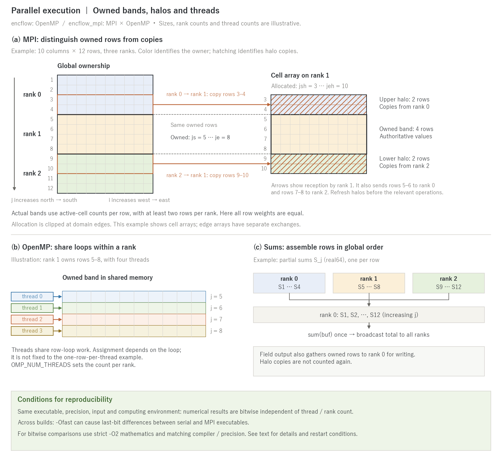

# Parallel Execution

> English mirror of docs/users_guide/parallel.md. The Japanese file is the master copy.

[Back to the User's Guide index](../users_guide.md)

ENCflow is designed to run from a laptop to a supercomputer from a
single source. Parallelization comes in two layers.

## OpenMP (threads within a rank)

Both the normally built `encflow` and the MPI executable `encflow_mpi`
have OpenMP thread parallelism enabled. Without an explicit thread count,
the OpenMP runtime defaults apply; available CPUs also depend on job
allocation and binding. Use the environment variable to specify the count.

```bash
OMP_NUM_THREADS=8 ./encflow param.txt
```

## MPI (multiple nodes, large-scale computation)

Switching one line in `src/make.inc` and building produces
`encflow_mpi` with OpenMP x MPI hybrid parallelism.

```
MODE	= mpi        # make.inc (default is serial)
```

```bash
cd src && make install
mpirun -np 4 ./encflow_mpi param.txt
```

- **The parameter file is exactly the same as for the serial
  version.** Domain decomposition (band decomposition in the j
  direction), communication, and output aggregation are all
  automatic.
- The basic layout is threads within a node and MPI across nodes (the
  assignment of ranks x threads follows the job scheduler and mpirun
  settings. For environment-specific notes, including the pitfall of
  Open MPI's default binding, see the
  [installation guide](../install.md)).
- `encflow` and `encflow_mpi` can coexist (both are placed in bin/,
  and each case's Makefile links to both).



**(a) MPI ownership and halos.** The example splits 10 columns × 12 rows across
three ranks. With the same active-cell count in each row, rank 0 owns rows 1–4,
rank 1 owns 5–8, and rank 2 owns 9–12. Actual band boundaries use the active-cell
count per row in the active window as the weight, retaining at least two rows
per rank. Child nests align band boundaries with row blocks corresponding to
parent cells. The row and rank counts in the figure are not recommendations.

The right view is the cell array on rank 1. Its owned rows `js..je = 5..8` have
two halo rows on each side, giving allocation bounds `jsh..jeh = 3..10`.
Rows 3–4 are copies from rank 0 and rows 9–10 from rank 2; their ownership does
not change. In the opposite direction rank 1 sends rows 5–6 to rank 0 and rows
7–8 to rank 2. Allocation is clipped to `1..ny` at domain edges. Cell halos are
refreshed at the beginning of a time step and before processes need updated
neighbor values. Edge arrays have separate exchange procedures; the figure
shows cell arrays only. `j` increases north to south and `i` west to east
([Coordinates](coordinates.md)).

**(b) OpenMP within a rank.** Threads share the rank's memory and divide loop
iterations, such as rows. One row per thread is illustrative, not permanent
ownership as in the MPI bands. Assignment follows each loop's scheduling.
`OMP_NUM_THREADS` specifies the thread count used by each MPI rank.

**(c) Deterministic sums and output.** Totals such as stored water volume first
form one partial sum `S_j` per owned row. `par_sum_rows` assembles these on
rank 0 in increasing `j` and evaluates `sum(buf)` once, then broadcasts the
total to all ranks. This preserves the same row array when rank counts change,
instead of adding per-rank totals in an arbitrary order. The partial sums and
aggregation buffer use `real64` regardless of `PREC`. Field-file output also
gathers owned rows to rank 0 for writing; halo copies are not included again.
Maximum values and integer counts use separate aggregation procedures.

## Reproducibility and build conditions

ENCflow's parallelization rule is **bitwise identical numerical results when
thread / MPI rank counts change, with the same executable, real precision,
input and computing environment**. Comparing one rank with multiple ranks of
the same `encflow_mpi` is an example. This does not mean that entire screen
logs are identical: execution information such as rank and thread counts
changes.

`encflow` and `encflow_mpi` are separate builds. Fast-math optimization under
`-Ofast` can cause last-bit (ULP-level) differences between them. For strict
bitwise comparisons across builds, match the compiler, real precision and
computing environment, and build with strict `-O2` mathematics (without
fast-math). Distinguish rank-count invariance within one `-Ofast` build from
these differences across builds. See `developer.md` §11 and §28.5 for the
rationale and validation history.

The build stamp does not detect `FFLAGS` changes. Run `make clean` when changing
optimization flags for a comparison. Bitwise agreement is not unconditional
across compilers, precisions or optimization settings. Agreement after a
[restart](restart.md) also requires the supported save / restore conditions.

## Real-number precision

The default is double precision. A single-precision build exists for
memory-constrained environments (`PREC = single` in `make.inc`).
Single precision changes the result values themselves, so do not mix
it with double precision in comparisons. The build system detects
mode and precision switches and prevents inconsistencies.

## Tests and examples

- [test/wave](../../../test/wave/): minimal serial and MPI regression case, with `Run.sh` and `Run_MPI.sh N` examples.
- [test/chichibu](../../../test/chichibu/): serial and MPI runs using real terrain, a catchment mask and a channel mask.
- [test/README.en.md](../../../test/README.en.md): common execution and comparison procedures. Consult each case's README and scripts for the quantities compared and tolerances.
