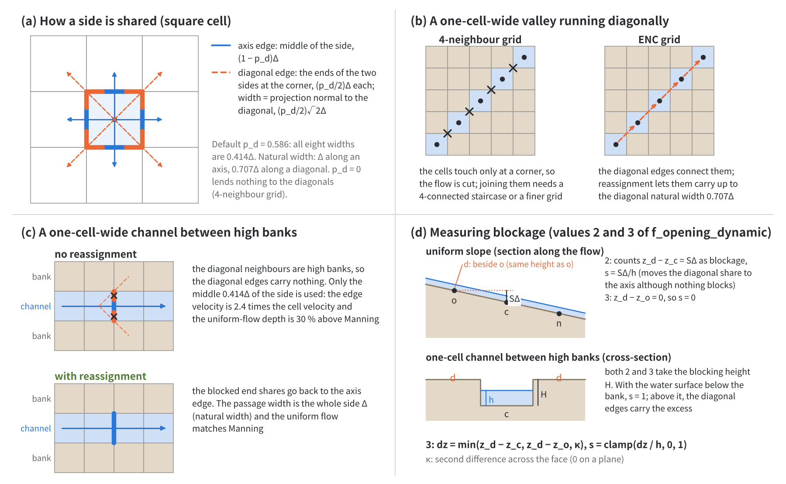

# Passage-width adjustment -- why the eight-direction passage widths are adapted to the situation, and what it buys (supplement to the shallow water chapter)

> English mirror of docs/users_guide/passage_width.md. The Japanese file is the master copy.

[Back to the shallow water chapter](swflow.md) | [Back to the user's guide index](../users_guide.md) | [ENC grid and time integration](encgrid.md)

The ENC grid sets virtual **passage widths** for four axis edges and four
diagonal edges on top of a rectangular raster. Where everything
around a cell is open, this split carries the flow correctly as it is; but
where some directions are blocked -- walls, high dry banks, the edge of the
computational domain, one-cell-wide channels -- the share of the blocked
directions has to be handed back to the open directions. This is the
**reassignment**. The rule that measures where, and how much, a direction is
blocked was revised several times before the default of `f_opening_dynamic`
settled on 3.

This matters particularly in ENCflow because the channels are not solved
separately with a one-dimensional channel model but are represented on the
raster as they are. A river narrower than a cell becomes a one-cell-wide
channel, and since the banks block its diagonal openings, its conveyance is
decided by how the passage widths are handled (§3.1). Representing channels
on the raster has advantages. Subgrid channels narrower than a cell
(`fn_width` in [channels](channel.md)) and resolved channels wider than a
cell are handled seamlessly by the same formulation, without switching
models. Geomorphic change in which the position and shape of the channels
themselves change -- the development of meandering rivers, the formation of
river deltas -- can also be computed directly, as an outcome of the raster
terrain and the flow ([examples/meander](../../../examples/meander/en/README.md),
[examples/delta](../../../examples/delta/en/README.md)). It also has costs. A
channel network finer than a cell (how confluences and bifurcations connect,
the separation of channels running close together), which a one-dimensional
channel model can specify explicitly, cannot be represented exactly (the
limits of accuracy in §2 of the [channel models page](channel_models.md)).
And carrying channels correctly on the raster needs situation-specific
corrections such as the reassignment of passage widths; as the history in
§5 shows, their rules have been revised each time a problem was found.

This page summarizes the discussion around the passage-width adjustment for
users -- why the adjustment is
needed, how blockage is measured, and what was learned. It then takes the
view that adjusting the passage width per direction is not "extra work that
a 4-neighbour grid does not need" but "a means of passing terrain smaller
than a cell on to the flow", and presents, with the verification numbers and
the limits, the view that **even a coarse grid can represent one-cell-wide
terrain with the correct conveyance; that is, the effective resolution is
higher**.

The equations are in [ENC grid and time integration](encgrid.md) §2 and §4,
the list of settings in the [shallow water chapter](swflow.md), and the
levee and channel-width side in the [channel models page](channel_models.md).
The master records of the design and verification are developer.md (§18,
§68.8 to §68.44, §84.7, §89.4) and [docs/opening_plan.md](../../opening_plan.md)
(both in Japanese). The page is for intermediate to advanced users and
developers; if you compute with the defaults, §1 and §8 are enough.

<a id="summary"></a>

## 1. Key points

- The ENC grid splits each side of a cell into three parts: the middle is
  the passage width of the normal (axis) edge, and the two ends belong to
  two diagonal edges. By default all eight widths are $`0.414\Delta`$ (§2).
- If all eight directions are open, this split carries a uniform flow in any
  direction correctly and no adjustment is needed. If a direction is
  blocked, the conveyance of its share is lost (64 % of Manning in a
  one-cell-wide channel; §3).
- Handing the blocked share back, up to the natural width, to the open edges
  that share the same side is the reassignment (§4). Levees are handled
  statically (`f_bank_opening`), terrain and water level dynamically at
  every step (`f_opening_dynamic`).
- The hard part was how to measure "blocked". A channel with high banks on
  both sides must be told apart from the upslope side of a uniform slope
  (part of a plane, blocking nothing). The default 3 measures the **rise of
  the blocking cell's ground above the local plane** (§5).
- With this adjustment, one-cell-wide channels, rows along walls, thin flows
  on steep slopes, breaches and the like are represented with the correct
  conveyance whatever their orientation. A 4-neighbour grid cannot represent
  them without a finer grid (a one-cell-wide channel running diagonally is
  not connected at all) (§6).
- The reassignment is a subgrid rule of ENCflow's own, with known biases
  such as the longshore current along a uniform beach (§7). How to choose
  the settings is in §8.

<a id="virtual-widths"></a>

## 2. Virtual passage widths in eight directions



*(a) How a side is split: the middle goes to the normal edge, the ends to the diagonal edges. (b) A one-cell-wide valley running diagonally: on a 4-neighbour grid the cells touch only at a corner and the flow is cut; on the ENC grid the diagonal edges connect them. (c) A one-cell-wide channel: with high banks the diagonal edges carry nothing and only the $`0.414\Delta`$ of the axis edge remains. The reassignment restores the whole side (natural width $`\Delta`$). (d) Measuring blockage: 2 counts how much the blocking cell is higher than the cell itself, so the upslope side of a uniform slope also counts as a wall. 3 measures the rise above the local plane: 0 on a slope, the same as 2 at a bank.*

### 2.1 Splitting a side into three

A raster cell touches its neighbours only through its four sides; it touches
a diagonal neighbour at a single corner point. The ENC grid splits each side
into three parts and assigns the middle $`(1 - p_d)`$ to the normal edge of
that side and the two ends, $`p_d/2`$ each, to the diagonal edges that go
around those corners (figure (a))[^tada26].

```math
L_{\text{axis}} = (1 - p_d)\,\Delta,
\qquad
L_{\text{diag}} = \frac{p_d}{2}\sqrt{2}\,\Delta
```

$`p_d`$ is `p_diagratio`; with the default $`2/(2+\sqrt2) \approx 0.586`$ all
eight widths are $`0.414\Delta`$. The passage width of a diagonal edge is the
length of the end parts of the two sides at the corner, projected onto the
direction normal to the diagonal. In other words, a diagonal passage width
is not a face that exists in the raster but **a virtual width made by lending
part of the sides to the diagonal flow**. $`p_d = 0`$ lends nothing to the
diagonals and corresponds to a 4-neighbour grid.

The original paper[^tada26] regards the cell as a virtual octagon with its
corners cut off and calls $`L_k`$ the length of its sides (side length). The
diagonal sides are the cut corners, and their projections onto the x and y
axes, $`L_{k,x}`$ and $`L_{k,y}`$, are the end parts $`(p_d/2)\Delta`$ above.
This guide calls the quantity the **passage width** and keeps it apart from
physical widths such as the channel width and the water-surface width, and
from the effective flow width of river engineering practice (the terms are
matched in [ENC grid and time integration](encgrid.md) §2).

The eight widths add up to $`3.31\Delta`$, which differs from the perimeter
$`4\Delta`$. Still, the weights of the cell-velocity reconstruction sum to 1,
so a uniform flow with everything open is carried correctly in any direction
([ENC grid and time integration](encgrid.md) §4). On flat open water with
everything open, the blockage ratio (§4.3) is 0, the reassignment does
nothing, and the result is bit-identical to a run without reassignment.

### 2.2 Natural width

On this page, the passage width that a flow in a given direction should have
through a cell is called its **natural width**: the area of the cell divided
by the length of the path across the cell in that direction.

| Direction | Natural width | Default passage width | Passage width / natural width |
|---|---|---|---|
| Axis (east-west, north-south) | $`\Delta`$ (side length) | $`0.414\Delta`$ | 0.41 |
| Diagonal | $`\Delta x\,\Delta y/\Delta r = 0.707\Delta`$ | $`0.414\Delta`$ | 0.59 |

Where everything is open, a flow in a given direction is carried jointly by
the edge in that direction and the edges of the neighbouring directions that
share the same side (for a diagonal, the same corner), and together they make
up the natural width (for a uniform flow along an axis, as fractions of the
side, $`0.414 + 2 \times 0.293 = 1`$). When a sharing partner is blocked, its
part becomes a shortfall of conveyance.

<a id="why-adjust"></a>

## 3. When a direction is blocked -- why the adjustment is needed

### 3.1 One-cell-wide channels

Take a one-cell-wide channel running along an axis, with high dry ground on
both banks. The diagonal neighbours are bank cells, so the diagonal edges
carry no flow and only the middle $`0.414\Delta`$ of the side can be used
(left of figure (c)). The same discharge passes through 0.414 times the
width, so the edge velocity becomes $`1/0.414 = 2.4`$ times the cell velocity
and the friction becomes excessive.

- The uniform-flow depth is 30 % deeper than the Manning value (1.789 m
  against 1.373 m) and the conveyance is 64 % of Manning
  ([test/bendloss](../../../test/bendloss/en/README.md),
  [test/uniflow](../../../test/uniflow/en/README.md)).
- In a one-cell channel running diagonally (8-connected), the axis
  neighbours are blocked, the passage width is 0.59 of the natural width, and
  the uniform-flow depth is 17 % deeper (test/bendloss).
- Momentum-conservative advection (the default scheme 3) transports momentum
  through differences of the edge velocity. The 2.4-fold velocity amplifies
  acceleration and deceleration: in a dam break in a one-cell-wide channel
  the bore lagged the Stoker analytical solution[^stoker57] by 36 % (with
  reassignment +1.1 %, about the same as in a wide channel;
  [test/dambreak](../../../test/dambreak/en/README.md)).

### 3.2 Rows along walls

Even in a channel several cells wide, the rows next to the banks lose the
diagonal edges on one side. In a channel five cells wide, the velocity in
the bank rows was 0.80 of the interior rows and the depth 1.04 times the
uniform-flow depth (test/uniflow). In the meandering-channel examples the
flow at the bank toe came out weak and the outer bank eroded only slowly
(developer.md §84.7).

### 3.3 Difference from a 4-neighbour grid

On a 4-neighbour grid each side of a cell belongs to exactly one neighbour.
If that neighbour is blocked the side is closed; if it is open the whole
side carries flow. Nothing is lent or borrowed, so this kind of adjustment
problem does not arise. In exchange, cells that touch only at a corner are
not connected: a one-cell-wide valley running diagonally is cut at the cell
corners (figure (b)). Connecting it requires redrawing the valley as a
4-connected staircase (a 90° turn at every cell, and a path $`\sqrt2`$ times
longer) or a finer grid.

The ENC grid connects eight directions by lending part of the sides to the
diagonals. In exchange, when the cell a share was lent to is blocked, it has
to decide where that share goes back. **The need for adjustment is the
other side of being connected in eight directions.**

<a id="reassignment"></a>

## 4. Reassignment -- handing blocked shares back to open directions

### 4.1 Rule

A blocked share is handed back, up to the natural width, to the open edges
that share the same side (right of figure (c)).

- **Axis edges**: with $`n_b`$ (0 to 2; the average seen from the two end
  cells of the edge) the blocked fraction of the diagonal shares at the two
  ends of the side, the passage width becomes
  $`L_{\text{axis}} + n_b\,(p_d/2)\,\Delta`$. In a one-cell channel blocked
  on both banks, $`n_b = 2`$ and the passage width is the whole side
  $`\Delta`$ (natural width).
- **Diagonal edges**: with $`m_b`$ (0 to 2) the blocked fraction of the two
  side cells shared by the two end cells, the passage width becomes
  $`L_{\text{diag}} + m_b\,(0.707\Delta - L_{\text{diag}})/2`$. In a diagonal
  one-cell channel blocked on both sides it is the diagonal natural width
  $`0.707\Delta`$.

Only the blocked part is handed back, and the natural width is never
exceeded. The weights still sum to 1, so the cell-velocity reconstruction
needs no extra correction. The rule is ENCflow's own (developer.md §18,
§68.11, §68.14).

### 4.2 Which mechanism handles what

| Mechanism | Target | How blockage is decided | Setting |
|---|---|---|---|
| Static opening correction | openings blocked by levees (virtual walls) | whether there is a wall (once, at initialization) | `f_bank_opening` (&list_channel; default 1) |
| Dynamic reassignment | openings blocked by terrain and water level (high dry banks, outside the domain, invalid cells) | blockage ratio $`s`$ (0 to 1) from the depth and ground at every step | `f_opening_dynamic` (&list_enc; default 3) |
| Subgrid channel width | channels narrower than a cell | conveyance cap and storage area fraction from the width $`W`$ | `fn_width` (&list_channel). On edges that involve a width cell, the dynamic reassignment is limited to channel-to-channel edges (to avoid a double correction) |
| Diagonal linkage of breaches | the diagonal openings at both ends of a breach | follows the lowering of the crest at the breach sites | `f_br_diag` (&list_channel_breach; default 0) |

Blockage by terrain is not put into a static table because, when the
landside floods, the diagonal flow comes back and would be counted twice
together with the statically reassigned share (developer.md §18). The
dynamic reassignment varies the blockage ratio continuously with the water
level.

### 4.3 Blockage ratio

Let $`d`$ be the cell that may block (for an axis edge, the diagonal
neighbours at the two ends of the side; for a diagonal edge, the side cells)
and $`c`$ the cell itself. The blockage ratio is the fraction of the cell's
water column that lies below the ground of $`d`$ (the definition of value 2).

```math
s = \mathrm{clamp}\!\left(\frac{z_d - z_c}{h_c},\ 0,\ 1\right)
```

If the water surface is below the ground of $`d`$, $`s = 1`$ (fully
blocked); if the water surface rises above that ground, the diagonal edge
carries the excess and the blockage is partial; if $`d`$ is lower, $`s = 0`$.
It is a continuous function of the water level, so there is no flicker at a
threshold, no history and no extra parameter. Outside the domain and invalid
cells give 1, sea cells 0. Openings already reassigned statically at a levee
are not counted, so as not to hand them back twice.

<a id="history"></a>

## 5. How to measure "blocked" -- the road to the default 3

### 5.1 History

| Period | Default | What was built or learned | Record |
|---|---|---|---|
| 2026-08 | (static only) | Opening correction that hands the diagonal openings blocked by a levee wall back to the axis edge; the remedy for the passage width of one-cell channels shrinking to $`0.414\Delta`$ | developer.md §18 |
| 2026-10-02 | 0 | A rule that also hands back symmetrically for channels running diagonally. One cause of the excessive attenuation of real-terrain flood waves with scheme 3 was found to be the 2.4-fold edge velocity of one-cell channels, and the dynamic reassignment was introduced for channels without levees (1: channel-mask edges only, 2: all edges) | §68.8 to §68.14 |
| 2026-10-03 | 1 | Together with making advection scheme 3 the default, the edges of the channel mask are reassigned by default | §68.19 |
| 2026-10-18 | 2 | 1 turned out to have no effect in incised channels without a channel mask and along walls (conveyance 64 % with one cell, 0.80 in the bank rows with five cells). With 2, channels 1 to 10 cells wide match Manning to 1e-3 | §84.7, §68.38 |
| 2026-10-27 | 2 | A test of steep uniform flow showed that 2 counts the upslope ground of a uniform slope as a partial wall (bed shear stress 29 % too large at slope 0.2, grid 1 m, depth 0.3 m) | §89.4, §89.10 |
| 2026-10-29 | 2 | 3, which measures the rise above the local plane, was added | §68.41, opening_plan.md |
| 2026-10-31 | **3** | After comparing all 86 tests and the examples, the default was switched to 3 | §68.41, opening_plan.md §8 |
| 2026-10-31 to 11-01 | 3 | Found after the switch: specify 2 for longshore currents along a uniform beach (§7). A run that stopped in a deep impoundment of a tutorial was caused not by the reassignment but by an inconsistent lateral-face flux of the advection term, which was fixed | §68.41 to §68.43 |

In retrospect, each step widened "the situations where the virtual passage
widths match the actual shape of the flow": levee walls → banks of the
channel mask → all banks and rows along walls → telling banks from slopes.

### 5.2 Why 2 stumbled on slopes

The blockage ratio of 2 counts how much higher the blocking cell's ground is
than the cell itself, $`z_d - z_c`$. On a uniform slope of gradient $`S`$ the
upslope diagonal neighbour is higher by $`S\Delta`$, so although nothing
blocks, it counts $`s = S\Delta/h`$ and hands the diagonal share to the axis.
The conveyance becomes too large, and the velocity and bed shear stress come
out too large. The rule of 2 had been designed with channels between high
banks in mind; its behaviour on slopes had not been considered.

Since $`s \approx S\Delta/h`$, the bias is stronger for steep slopes, shallow
flows and coarse grids ([docs/opening_plan.md](../../opening_plan.md) §1.3,
in Japanese).

| Setting | Typical values | $`S\Delta/h`$ |
|---|---|---|
| River with a gentle slope | $`S \approx 10^{-3}`$, $`\Delta \approx 10`$ m, $`h \approx 1`$ m | 0.01 (small effect) |
| Mountain stream | $`S \approx 0.02`$ to $`0.2`$, $`h \approx 0.1`$ to $`0.5`$ m, grid of a few m | 0.1 to 1 |
| Sheet flow on a hillslope during rain | $`h`$ of a few mm | saturates at 1 |

In sheet flow, $`s`$ stays saturated at 1 even on a finer grid, so the bias
of 2 does not decrease with grid refinement (the V-shaped catchment of §5.4).

### 5.3 How 3 measures

3 measures how much the blocking cell's ground rises above the local plane
(figure (d)). With $`o`$ the cell at the other end of the face, the minimum
of three quantities is taken as the blocking height.

```math
dz = \min\left(z_d - z_c,\ \ z_d - z_o,\ \ \kappa\right),
\qquad
s = \mathrm{clamp}\!\left(\frac{dz}{h_c},\ 0,\ 1\right)
```

- $`z_d - z_c`$: the same quantity as in 2. In a channel between high banks
  this is the minimum, and the value of 2 remains.
- $`z_d - z_o`$: the height seen from $`o`$, the other end of the face. $`d`$
  lies beside $`o`$, so a uniform longitudinal gradient gives 0 here.
- $`\kappa`$: the second difference across the face (for an axis edge
  $`z(o+b) + z(o-b) - 2z(o)`$ with $`b`$ the transverse neighbour; for a
  diagonal edge $`z_p + z_q - z_c - z_o`$ with $`p, q`$ the two side cells).
  It is 0 on a plane, so on planes tilted across the flow or oriented
  diagonally the blockage is also 0.

| Terrain | Blocking height in 2 | Blocking height in 3 |
|---|---|---|
| Flat | 0 | 0 |
| Uniform slope along the flow (upslope diagonal neighbour) | $`S\Delta`$ | 0 |
| Plane tilted across the flow (diagonal neighbour on the rising side) | $`S_y\Delta`$ | 0 |
| One-cell channel between banks of height $`H`$ | $`H`$ | $`H`$ |
| Bank of height $`H`$ on one side only (row along a wall) | $`H`$ | $`H`$ |
| Outside the domain, invalid cells | blockage ratio 1 | blockage ratio 1 |

When a cell used for $`\kappa`$ is outside the domain, invalid or sea,
$`\kappa`$ is not used and the decision falls back to that of 2. There is
no additional state, communication or parameter. This rule is also
ENCflow's own (developer.md §68.41, [docs/opening_plan.md](../../opening_plan.md) §3,
both in Japanese).

### 5.4 Comparison of 2 and 3

| Test | Quantity | 2 | 3 |
|---|---|---|---|
| Steep uniform flow (T9; five cells wide, grid 1 m, depth 0.3 m) | $`\tau_b/\rho g h S`$ at the channel centre (slope 0.01, 0.05, 0.1, 0.2) | 1.014, 1.070, 1.141, 1.291 | 1.0000 to 1.0001 |
| Same | $`\tau_b/\rho g h S`$ in the columns along the walls | 1.006 to 1.124 | 0.9999 |
| Sheet flow (T10; slope 0.05, rain 100 mm/h) | local balance $`\tau_b/\rho g h S`$ (0° along the grid / 45° diagonal) | 1.34 to 1.38 / 1.29 to 1.34 | 0.96 to 0.99 / 0.95 to 0.99 |
| Uniform flow in channels one and five cells wide ([test/uniflow](../../../test/uniflow/en/README.md)) | difference of depth and velocity from Manning | 1e-3 or less | 2e-4 or less |
| Rainfall-runoff of a V-shaped catchment (v-shaped in [examples/benchmark](../../../examples/benchmark/)) | error of the outlet discharge from the theoretical value (grid 20, 10, 5 m) | 0.018, 0.025, 0.028 | 0.024, 0.020, 0.016 |

T9 and T10 are configurations of [test/rockinc](../../../test/rockinc/en/README.md).
The error of the V-shaped catchment is the root-mean-square error divided by
the peak discharge.

- 3 matches uniform flow and the local balance regardless of the slope and
  the grid orientation.
- In the V-shaped catchment the error of 3 decreases as the grid is refined,
  and the rise time matches the theory (with 2 the hillslope flow is too fast
  and the rise comes 2 to 3 minutes early). On the coarsest grid, 20 m, 2 has
  the smaller error: 3 is not "always closer" but "gets closer with
  refinement".
- In channels between high banks, 3 is nearly the same as 2.

### 5.5 What changed with the switch

Of all 86 tests, 40 gave exactly the same output (flat terrain, deep flows,
tests that set the value explicitly). What changed were computations in
which shallow water flowing on slopes matters. Sediment running down steep
slopes now travels less far (maximum deposition outside the failure zone in
the landslide test test/slide 0.61 → 0.24 m, deposition below the slope
break in the debris-flow test test/debris 5.5 → 2.5 mm, and so on;
[docs/opening_plan.md](../../opening_plan.md) §8, in Japanese). Computation
takes 8 to 12 % longer. Roughness and sediment coefficients tuned with 2 need
to be revisited; runs calibrated with the default of 2026-10-18 to 31 are
reproduced by specifying 2.

<a id="effective-resolution"></a>

## 6. What the adjustment means -- the view of effective resolution

Compared with a 4-neighbour grid, adjusting the passage widths looks like
extra work that only the ENC grid has to carry. This page takes the opposite
view. The ENC grid can express, per direction and continuously with the
water level, where and how much of each cell's perimeter is open to the flow.
Whether a bank is above the water surface, where the levee crest is, whether
the channel is narrower than the cell, how far a breach has opened -- such
information about terrain smaller than a cell reaches the flow through the
passage widths. On a 4-neighbour grid the only way to pass the same
information to the flow is a finer grid. In that sense we regard **the
effective resolution of the ENC grid as higher than its cell size suggests**.

The following computations support this view.

1. **Connected in eight directions.** In the
   [supplement of the chichibu tutorial](../../../tutorials/chichibu/en/README.md#supplement-effect-of-resolution-and-the-character-of-the-enc-grid),
   the same catchment computed on the ENC grid and on a 4-neighbour grid
   (`p_diagratio = 0`) gives a peak discharge at the transect near the outlet
   of 5,425 m³/s with the ENC grid at 200 m, against 4 at 200 m, 30 at 100 m
   and 402 m³/s at 50 m with the 4-neighbour grid. Even a four times finer
   grid does not reconnect the channel network of the 4-neighbour grid,
   which is cut wherever it runs diagonally.
2. **One-cell-wide channels carried correctly in any orientation.** With the
   default reassignment, the uniform flow in a one-cell-wide channel between
   dry ground matches Manning to 2e-4 (test/uniflow). A one-cell channel
   running diagonally (the diagonal channel `param_diag.txt` of
   test/bendloss) also gets a uniform-flow depth of 0.9999 times the Manning
   value (1.17 times without reassignment; developer.md §68.44). The bore of a
   dam break in a one-cell-wide channel comes back from −36 % without
   reassignment to +1.1 % (about the same as in a wide channel;
   test/dambreak). The smallest channel the grid carries with the correct
   conveyance is one cell wide in all eight directions.
3. **Rows along walls carry their share.** In a channel five cells wide, the
   velocity of the bank rows goes from 0.80 to 1.00 of the interior rows
   (test/uniflow). In the meandering-channel examples, the velocity at the
   toe of the outer bank went from 0.56 to 0.82 of the channel centre, and
   the outer bank retreated several times faster (developer.md §84.7). On a
   grid where the channel is only a few cells wide, the processes at the
   bank toe appear.
4. **Undulations smaller than a cell are told apart.** With 3, the bed shear
   stress of flows a few mm to a few tens of cm deep on steep slopes matches
   uniform flow and the local balance within 5 %, even with a grid spacing
   hundreds of times the depth, and does not depend on the grid orientation
   (0°, 45°) (T9 and T10 in §5.4). With 2 it came out around 30 % too large
   in the same configurations.
5. **Levees, breaches and channel widths given finer than the grid.** With
   the diagonal linkage of breaches (`f_br_diag = 1`), the discharge through
   breaches 3 to 5 cells wide is 0.98 to 1.03 times that of a computation
   with the levee resolved in the DEM ([channel models page](channel_models.md)
   §4). The subgrid channel width reduces to the resolved channel when the
   width equals the cell width (peak difference within 0.001 % on the 50 m
   grid of chichibu), and brings the conveyance and storage of channels
   narrower than a cell into a coarse grid.

This does not mean that "any phenomenon can be solved on a coarse grid".

- What the reassignment adjusts is the conveyance per cell. The velocity
  distribution inside a cell (across the channel, secondary flow) and the
  shape of the bank itself are not resolved.
- Where the shape of the valley floor and the slopes controls the flow,
  differences remain when the grid is refined. In the chichibu supplement the
  upstream peaks changed by 9 to 12 % from 200 to 100 m, and the downstream
  peaks by 13 to 16 % from 100 to 50 m. Giving the coarse grids a channel
  width did not reach the result of the 50 m grid.
- The adjustment itself is a model of ENCflow's own, with the biases of §7.

In practice, as the chichibu supplement recommends, **first get the overall
picture on a coarse grid, then refine where and as the purpose requires**.
The passage-width adjustment is the mechanism that, at that coarse stage,
keeps one-cell-wide terrain connected and carries it with the correct
conveyance.

<a id="limits"></a>

## 7. Limits and known biases of the adjustment

- **Flow along a uniform slope**: on a uniform slope, 3 opens all diagonal
  openings. In flow along the slope (the longshore current on a beach), the
  open diagonal openings carry a friction bias of first order in
  $`\Delta z/h`$, which the upslope blockage of 2 happened to cancel. On a
  beach of slope 1/80, the momentum-balance ratio of the longshore current
  is 0.899, 0.953, 0.976 with 3 (grid 20, 10, 5 m; approaching 1 at first
  order in the grid spacing) and 0.993, 1.000, 0.999 with 2
  ([test/wfcurrent](../../../test/wfcurrent/en/README.md)). Identifying the
  cause and a remedy has not been started. Specify 2 for this configuration.
- **Bores in rows along walls**: in the row next to a wall, the reassignment
  changes the split between axis and diagonal from 0.414 : 0.586 to
  0.707 : 0.293. When the velocities of the axis and diagonal edges separate
  in an unsteady flow such as a bore, the bore in the row next to the wall
  lags by one cell and the velocity peak just behind the bore comes out up
  to 3.4 % lower in the rows near the wall (test/dambreak; developer.md
  §68.43). In a channel a few cells wide every row is such a "row along a
  wall": the bore is about 0.25 % slow and the velocity peak behind it a few
  % low. In a dam break in a two-cell-wide channel, the bore still lags by
  4 % after the reassignment (not yet analysed).
- **Shortcuts in staircase raster channels**: in channel cells arranged as a
  staircase, the two cells around a corner are connected diagonally and flow
  as a shortcut. If the real channel is smoother than the staircase, the
  shortcut acts close to the real course; but for a channel that really turns
  at right angles, the bend loss is underestimated and the conveyance
  overestimated. At bends the total passage width across the channel exceeds
  the channel width by about 25 % on one side (the limits of accuracy in §2
  of the [channel models page](channel_models.md);
  [docs/channel_model.md](../../channel_model.md) §1 and §3, in Japanese).
- **Sheet flow on coarse grids**: on the 20 m grid of the V-shaped catchment,
  the error of 3 (0.024) was larger than that of 2 (0.018) (§5.4). Also, in
  sheet flow running diagonally on a slope, the unit discharge obtained from
  depth and velocity remains 0.91 to 0.93 of the value from the rainfall,
  with both 2 and 3 (T10 of test/rockinc; not yet investigated).
- **Split of bedload**: bedload uses the reassignment table of the water as
  it is. If `fluv_diagratio` differs from `p_diagratio`, the splits disagree
  and the bedload capacity of a one-cell-wide channel becomes 2.41 times as
  large. Keep `fluv_diagratio` at its default (the same value as
  `p_diagratio`) (developer.md §89.4).
- **Carrying over calibrated values**: changing the reassignment setting
  changes velocities, bed shear stress and sediment run-out. Roughness and
  sediment coefficients calibrated with another setting cannot be used as
  they are (§5.5).
- **Comparison with observations**: the rules were checked against Manning
  uniform flow, the Stoker analytical solution, the theoretical values of the
  V-shaped catchment and the like; they have not yet been compared with
  observations of real rivers or hillslopes.

<a id="usage"></a>

## 8. Choosing and checking

### 8.1 Choosing the settings

| Situation | Setting | Reason |
|---|---|---|
| Most computations | the defaults (`f_opening_dynamic = 3`; `p_diagratio` and `f_bank_opening` also at their defaults) | §5.4 |
| Longshore current along a beach of uniform slope (driven by waves or wind) | `f_opening_dynamic = 2` | first item of §7 |
| Reproducing runs calibrated with the default of 2026-10-18 to 31 | `f_opening_dynamic = 2` | the rule of the default in that period |
| Reassigning only where there is a channel mask | `f_opening_dynamic = 1` | the default until 2026-10-18; has no effect without a channel mask (`fn_rw`) |
| Reproducing versions before 2026-10-03 | `f_opening_dynamic = 0` (together with `f_advection_scheme = 1` and `f_dry_head_cap = 0`) | the defaults of that time |
| Comparison with a 4-neighbour grid | `p_diagratio = 0` | closes the diagonal exchange (chichibu supplement) |
| Breaches 3 cells wide or more | `f_br_diag = 1` | 0.98 to 1.03 times the discharge of a resolved levee ([channel models page](channel_models.md) §4) |
| Channels narrower than a cell | `fn_width` (the wall-free width mode if there is no levee) + the default reassignment | the double correction between width cells and slopes is avoided automatically |

### 8.2 Estimating whether it matters in your case

- **Estimate $`S\Delta/h`$**: below about 0.01, 2 and 3 give nearly the same
  results. On steep slopes, with shallow flows or coarse grids where it
  exceeds 0.1, they differ.
- **Look at one-cell-wide channels and rows along walls**: in a straight
  reach where uniform flow can be expected, compare the depth and velocity
  with the Manning values. Also check that the velocity in the bank rows is
  in line with the interior rows.
- **Check the sensitivity**: run with 2 and 3 (and 0 if needed) and look at
  the differences in the quantities of interest (peak discharge, arrival
  time, maximum velocity, sediment run-out). If the differences are small
  for your purpose, the defaults are fine.
- **Computations with sediment**: the reassignment also applies to the
  passage widths of bedload. Calibrate the bed shear stress and sediment
  transport with the setting you will use.

<a id="parameters"></a>

## 9. Related parameters

The master tables of defaults and their basis are on the linked pages.

| Parameter | Default | Role on this page | Details |
|---|---|---|---|
| f_opening_dynamic | 3 | dynamic reassignment of openings blocked by terrain and water level (0: off, 1: channel-mask edges, 2: all edges, measured from the cell itself, 3: all edges, measured from the local plane) | [shallow water](swflow.md), [advection](advection.md) §5 |
| p_diagratio | 2/(2+√2) | split ratio $`p_d`$ of a side to the diagonals (0 gives a 4-neighbour grid) | [ENC grid and time integration](encgrid.md) §2 |
| f_bank_opening | 1 | static reassignment of openings blocked by levee walls | [channel models page](channel_models.md) §1 |
| f_br_diag | 0 | linkage of the diagonal openings at both ends of a breach | [channel models page](channel_models.md) §4 |
| fn_width | -- | subgrid channel width (conveyance cap and storage area fraction) | [channel models page](channel_models.md) §2 |
| f_dry_head_cap | 1 | caps the depth on edges towards high dry ground by the energy head (treats a dry bank like a wall) | [advection](advection.md) §5 |
| fluv_diagratio | 2/(2+√2) | diagonal split of bedload (keep it equal to `p_diagratio`) | [sediment and geomorphology](geomorph.md) |

<a id="verification"></a>

## 10. Verification cases

| Case | Content | Key point |
|---|---|---|
| [test/uniflow](../../../test/uniflow/en/README.md) | uniform flow in channels one and five cells wide between dry ground | without reassignment, conveyance 64 % and bank rows 0.80; with 2 and 3, Manning within 1 ± 0.5 % |
| [test/bendloss](../../../test/bendloss/en/README.md) | one-cell-wide straight, bent and diagonal channels, opening correction, channel width | axis and diagonal both match Manning, with no bend loss. With the default reassignment the diagonal channel's uniform-flow depth is 0.9999 times Manning (1.17 times without reassignment) |
| [test/dambreak](../../../test/dambreak/en/README.md) | dam break in channels one and two cells wide (`Make_incised.py`) | in the one-cell channel the bore error goes from −36 % to +1.1 % |
| [test/rockinc](../../../test/rockinc/en/README.md) | steep uniform flow (T9) and orientation of sheet flow (T10) | with 3 the bed shear stress matches uniform flow and the local balance |
| [test/hillslope](../../../test/hillslope/en/README.md) | rainfall-runoff of a planar slope, a stepped slope and a V-shaped catchment | compares the arrival time on the planar slope with the kinematic wave |
| [test/wfcurrent](../../../test/wfcurrent/en/README.md) | longshore current on a beach of uniform slope | the first-order friction bias of 3 (the beach configurations specify 2) |
| v-shaped in [examples/benchmark](../../../examples/benchmark/) | theoretical rainfall-runoff of a V-shaped catchment | the error of 3 decreases with grid refinement |
| [examples/levee_breach](../../../examples/levee_breach/en/README.md) | diagonal linkage of breaches | breaches 3 to 5 cells wide match the discharge of a resolved levee |
| supplement of [tutorials/chichibu](../../../tutorials/chichibu/en/README.md) | ENC and 4-neighbour grids, 200, 100 and 50 m | the 4-neighbour channel network stays cut even on a four times finer grid |

## References

[^tada26]: Tada, T. (2026): An eight-neighborhood connected collocated grid scheme for overland flow simulation. *Hydrological Research Letters*, 20(2), 113–118. doi:10.3178/hrl.25-00052. (The original paper of the ENC grid: eight-neighbourhood connected collocated grid and the split of passage widths.)
[^stoker57]: Stoker, J. J. (1957): *Water Waves*. Interscience, New York. (Analytical solution of the wet-bed dam break.)
