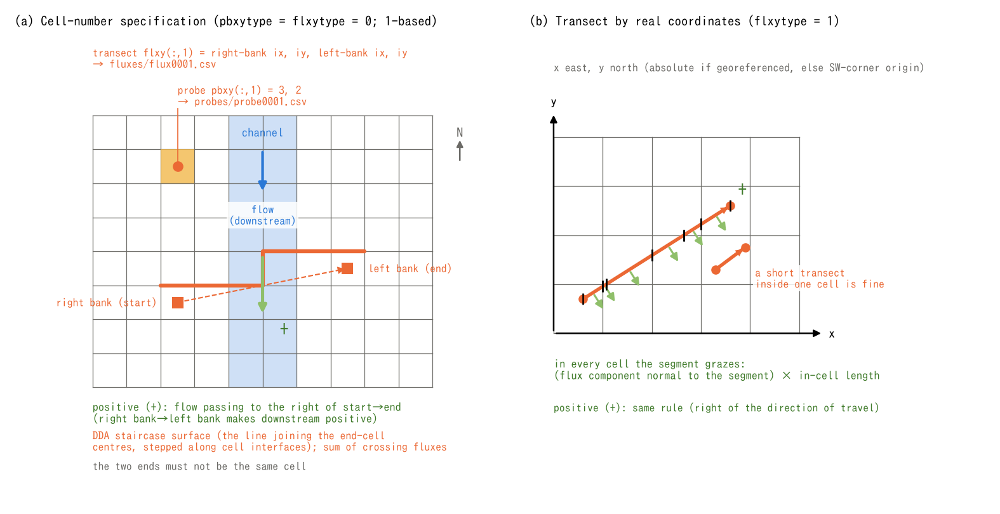

# Measurement (&list_record)

> English mirror of docs/users_guide/record.md. The Japanese file is the master copy.

[Back to the User's Guide index](../users_guide.md)

Sets up **probes** (point time series) and **flux transects** (time
series of discharge crossing a line) for comparison with gauging
stations and for obtaining discharge hydrographs. Enable it with
`fn_record`; the output interval is controlled by `dt_recrd` in
`&list_sysparam` (and the time window st_recrd/et_recrd;
[the time chapter](time.md)).

```
&list_record
  ! probes (by cell number)
  pbxy(:,1) = 150, 150           ! probe 1: (ix, iy)
  pbxy(:,2) = 200, 120           ! probe 2
  ! flux transect (by cell number): from right bank to left bank
  flxy(:,1) = 100, 50, 100, 60   ! transect 1: (right-bank ix, iy, left-bank ix, iy)
/
```

**Cell numbers are 1-based** (the westernmost column and the
northernmost row are 1). Rasters in GIS such as QGIS count from 0, so
add +1 to both row and column numbers picked in a GIS
([the coordinate systems chapter](coordinates.md)).

The minimal input is one probe (`pbxy(:,1) = ix, iy`). To compare with a
real gauging station give real coordinates with pbxytype=1, and for
discharge draw a transect crossing the channel from the right bank to
the left bank 2-3 cells longer than the channel width (so that flow
outside the channel during inundation is captured too).

## Probes (point time series)

| Parameter | Default | Meaning |
|---|---|---|
| pbxytype | 0 | 0: cell indices (ix, iy), 1: real coordinates, x east and y north. Use absolute coordinates in the georeferenced system if available; otherwise use metres from the southwest corner. See [coordinate systems](coordinates.md) |
| pbxy | - | Specify probe n as `pbxy(:,n) = x, y`. The number n is an array index, not a third input value |

Even with real coordinates, a probe records **the value of the cell containing
the point**. It does not interpolate a point value from surrounding cells.

Output is one file per point, e.g. `result/probes/probe0001.csv`. Columns are
time (hour/min), ground elevation z, depth h, velocities u, v, |V|,
**discharge per unit width q (m²/s)**, subsurface storage hg, suspended
sediment hs, and soil depth sd. Water quality adds concentration C (mg/L)
and surface load cq (g/m²). The cell value q differs from the total discharge
Q (m³/s) crossing a transect.
A probe may also be placed on a sea cell of the sea mask (fn_sw), but there
z is tide − hsea0 (changing with the tide), h is hsea0 (constant) and u, v
and q are 0; they are not the terrain or the sea depth (z + h is the tide
level; see [Tide](tide.md)).

## Flux transects (time series of crossing discharge)

| Parameter | Default | Meaning |
|---|---|---|
| flxytype | 0 | 0: specify end cells and select a cell sequence by DDA, 1: split the specified real-coordinate segment into its portions within crossed cells and integrate. Coordinates are interpreted as for probes |
| flxyfile | 0 | 0: specify directly with flxy, 1: read from the transect file fn_flxy |
| flxy | - | Specify transect n as `flxy(:,n) = xR, yR, xL, yL`. The number n is an array index, not a fifth input value |
| fn_flxy | - | One transect per line, with four comma- or space-separated values: "xR yR xL yL" |

Both modes count discharge as **positive for flow passing to the right of
the direction from start R to end L**. In a river, label the banks while
looking downstream: taking the right bank as R and the left bank as L
makes downstream flow positive.

### Cell indices (flxytype=0)

Follow the line between the end-cell centres one cell at a time along the
axis with the larger index difference (columns if tied), rounding the
other index to the nearest cell (DDA). Both end cells are included, so the
integration spans their outer edges along the major axis. **The two end
cells must differ.**

- **ENC:** Sum signed flows on the 8-neighbor edges crossing the positive
  short-axis boundary of the selected cell sequence. In panel (a), columns
  are the major axis and the short axis is row index j, so the integration
  follows the south cell faces. For a row-major sequence it follows the
  east faces. Only edges within the sequence's major-axis range are counted;
  edges leading outside that range are excluded.
- **STG:** Integrate cell values: the short-axis flux component times the
  cell width for each tread, plus the average long-axis flux of the two
  cells straddling each riser times its width, with the normal sign. This
  integration passes through cell centres, unlike the blue ENC cell
  boundary in panel (a).
- For a one-cell-wide diagonal channel, a diagonal STG transect normal to
  the flow can count the same cell's flow in both the tread and riser terms,
  yielding twice the discharge. Use a horizontal or vertical transect for
  this configuration. ENC cell-index integration avoids this duplication
  by counting each crossing edge once.

### Real coordinates (flxytype=1)

Split the specified segment at cell interfaces and sum the **normal flux
component times the in-cell segment length**, with its sign, using the
flux vector of each cell. Both ENC and STG use this method. It does not
directly sum intercell edge flows, so even in ENC its result need not
always equal the cell-index measurement.

Only the specified segment is measured; endpoints are not extended to cell
edges. **A short transect entirely inside one cell is valid**, but identical
start and end points cause an error. For a uniform flux vector, this gives
the exact integral across the segment at any position, angle, and length.

### Outputs and excluded transfers

Output is one file per transect, e.g. `result/fluxes/flux0001.csv`. Columns
are time (hour/min), Q (m³/s), Hmax (m) and Vmax (m/s) over the sampled
cells, and B (m). B is `abs(Q / Hmax / Vmax)`, or zero if the product of
Hmax and Vmax is zero; it is not a direct measurement of channel width.
Water quality adds load flux L (g/s) and cumulative load Lcum (kg).

Discharge transferred through structures such as culverts does not register
on transects ([structures](structure.md)). For a transect crossing the
coastline, **place the end points on land cells and do not include sea
cells of the sea mask (fn_sw)**. Q correctly integrates the edge flows
between land and sea (inundation and drainage), but if a sea cell enters
the sampled cells, its hsea0 contaminates Hmax, which drags B and the Hmax
of summary.csv with it (the velocity of sea cells is 0, so Vmax is not
affected). These filenames assume the
default result directory and no filename suffix.



(a) An illustrative 10-column, 8-row grid. P=(3,2) records that cell's time
series. The dashed orange line from R=(3,6) to L=(8,5) selects the six pale
orange cells. The solid blue line is the south boundary used for ENC
integration, distinct from the path through cell centres used by STG.
The channel occupies i=5,6 and flows south. (b) An illustrative 5-column,
4-row grid with a southwest origin and 1 m cells. The segment from
R=(0.6,0.7) to L=(3.6,2.6) m is split by crossed cell, with white circles
marking intersections. The small diagram below shows a one-cell transect
from (3.3,1.3) to (3.9,1.75) m. Cells have the same displayed size in both
panels; green arrows indicate the positive side. These are placement
examples, separate from the input example and from simulation results.

## Summary output

With measurement enabled, aggregate statistics (maxima etc.) of all
probes and all transects are written together to `result/summary.csv`.

## Worked examples of the format

Annotated list of all parameters:
[examples/List_samples/list_record.txt](../../../examples/List_samples/en/list_record.txt).

## Tests and examples

- [test/chichibu](../../../test/chichibu/en/README.md): discharge and depth records from multiple main-channel transects and probes; `record_reach.txt` provides a 12-transect longitudinal setup.
- [test/bendloss](../../../test/bendloss/en/README.md): transect records in straight, zigzag and diagonal channels, including flood-wave attenuation comparisons.

## Post-hoc measurement from distributed output (utils/rerecord)

`utils/rerecord` takes three arguments: the simulation parameter file,
a flow-direction distribution `QdXXXX.bil`, and the discharge distribution
`QXXXX.bil` to measure. It writes probe and transect measurements for that
one pair of distributions to CSV files with the suffix `_re`. Enable
flow-direction output `f_out_qd` and discharge output `f_out_qq` beforehand
([input/output](io.md)).

It reconstructs cell flux vectors from discharge and direction, not the ENC
edge flows used during a run. Cell-index transects therefore also use
cell-value integration, including its limitation for narrow diagonal
channels. The current utility records time as zero and does not reconstruct
depth, velocity, or other state variables, so it does not reproduce the
complete in-run measurement CSV. For a time series, measure each
distribution separately and associate the results with the original output
times.
