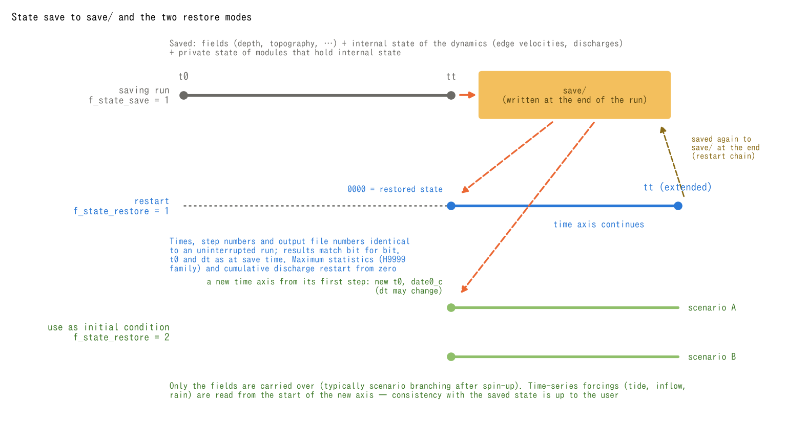

# Suspend and Restart

> English mirror of docs/users_guide/restart.md. The Japanese file is the master copy.

[Back to the User's Guide index](../users_guide.md)

State save and restore let you run a long computation in segments or start
several scenarios from a spun-up state. Set the directory and restore mode
in `&list_sysparam`.

| Parameter | Default | Meaning |
|---|---|---|
| f_state_save | 0 | 1: save the state to dir_save during finalization |
| f_state_restore | 0 | 0: no restore / 1: continue the same time axis / 2: use the saved state on a new time axis |
| dir_save | "save" | directory used for saving and restoring |

## Saved contents and the two restore modes

Both modes restore **the shared fields, the ENC dynamics, and the module
state included in the save**. Mode 2 is not limited to depth and terrain.

| File | Saved contents |
|---|---|
| `state.dat` | Six shared fields: `h, z, hrs, hg, sd, hs` (depth, terrain, storage, sediment, etc.) |
| `swflow_enc.dat` | Edge velocity `uv` and discharge `mn`; dynamic allocation and conveyance tables when active |
| Private files for individual features | State saved by groundwater, snow, driftwood, building debris, and other features |
| `save_info.txt` | Format version, grid counts, real precision, field count, saved time `t`, step `it`, output counter `ifn`, `t0`, and `dt` |

Derived quantities, including cell velocities and discharges, are recomputed
from the restored state. Arrays use zero-suppressing lossless compression.
Not every working array or history is saved; statistics and exceptions for
specific features are described below.



Figure: (a) The saving run writes its state to `dir_save` during finalization.
The saved files feed either (b) mode 1, continuing the time axis, or (c) mode 2,
branching into scenarios A and B. `t_s` is `t` in `save_info.txt`, the actual
saved time. These are schematic timelines, not numerical results. Mode 1
continues the saved step and output counters; mode 2 starts both counters at
zero on a new time axis. **In either mode, `0000` is this run’s initial state.**
Maxima and cumulative cell discharge are not saved; they are recomputed within
the run.

## Restarting (f_state_restore = 1)

Continue from the saved step on **the same time axis**, `t = t0 + dt × it`.
Set `f_state_restore = 1` in the original parameters and extend `tt` beyond
the saved time. The implementation requires `ceiling((tt - t0) / dt)` to
exceed the saved step `it`. `tt` remains the end time on that axis, not an
additional duration.

```
  f_state_save = 1          ! saving-side run: save to save/ at the end
```
```
  f_state_restore = 1       ! restarting-side run: continue from save/
  tt = 172800.0             ! (extend the end time if prolonging)
```

- Keep `t0` and `dt` as at save time; mismatches stop the run. Also retain
  `date0_c`, the inputs, physical settings, and output intervals.
- The saved `it` and `ifn` are retained. Regular distributed outputs continue
  the numbering and correspond to an uninterrupted run if output settings
  are unchanged. `0000` is a fixed initial-state slot; after restart it
  contains the state at the saved time.
- With `f_state_save = 1` in the restarted run, finalization saves again to
  the same `dir_save`. Advance `tt` for each save–restart–save cycle.
- The sea cells of the sea mask ([tide](tide.md)) restore `z` and `h` from
  `state.dat`, and the initial application of the tide is skipped (the
  saved state is authoritative). The tide update phase is based on the
  absolute step number, so after restart the tide is updated at the same
  steps as in an uninterrupted run and the round trip is bitwise identical.

### Agreement with an uninterrupted run

Mode 1 is designed for bitwise agreement with an uninterrupted run when using
the same executable, real precision, computing environment, grid, inputs, and
physical settings, in a configuration whose required state is saved and
restored. See [Parallel Execution](parallel.md) for comparisons between builds
with different compiler or optimization settings. This is not an unconditional
claim about statistics, entire logs, or every combination of features.

- Enabling dynamic allocation or dynamic conveyance only at restore time
  rebuilds the tables from the restored depth and may change the last digits
  of derived quantities.
- The nonhydrostatic bottom-acceleration term, `f_nh_bottom = 1`, does not
  save its finite-difference history. The first projection after restart
  uses zero bottom acceleration, so exact agreement with an uninterrupted
  run is not guaranteed when the bed moves.
- The nonhydrostatic breaking criterion `f_nh_breaking = 1` (type 1) does not
  save its breaking-flag history. The first restored step is judged without
  history, so the run does not agree with an uninterrupted run if any cell was
  breaking at the saved time ([nonhydrostatic](nonhydrostatic.md)).
- In a configuration where the reference level of the long-wave radiation
  boundary (type 2) is derived automatically from the initial level
  (`bc_eta_*` unspecified and f_htype 0, 1 or 3), the restarted run derives
  the reference again from the restored state (the level of the boundary
  cells at the saved time). If a wave was crossing the boundary at the
  saved time, the reference shifts and the radiation after restart does
  not agree with an uninterrupted run. When agreement is required, give
  `bc_eta_*` explicitly or use f_htype=2 (e0 as the reference)
  ([boundary conditions](boundary.md)).

The basis is [developer.md](../../developer.md) §7 and §69.10, together with
`m_state.f90`, `m_swflow_enc.f90`, and `m_swflow_enc_nh.f90`.

## Using as an initial condition (f_state_restore = 2)

Restore the same set of saved files and start with **`it = 0` and `ifn = 0`**
at a new `t0` and calendar `date0_c`. `dt` may also change. Unlike mode 1,
this mode does not check the new `t0`, `dt`, or end step against the saved
axis. A typical use is branching after spin-up:

1. Let the fields settle under normal river discharge, for example, and save.
2. Read those saved files as the initial state for each of scenarios A and B.
3. Run each scenario with its new time axis and forcing.

Time-series forcing, such as tide, boundary inflow, and rain, is **read again
using the new time axis**. Align the forcing at scenario start with the
restored state; large discrepancies can cause initial disturbances. The
sea cells of the sea mask are restored with `z` and `h` of the saved time
and are replaced at the first tide-update step of the new time axis (the
first step whose number is a multiple of dt_tiupdate/dt; the first step itself
only if dt_tiupdate ≤ dt) (the sea in the starting-state outputs `H0000` and `E0000`
still carries the tide of the saved time). Mode 2
provides initial conditions and does not promise exact agreement with an
uninterrupted run.

When using `bedmotion`, mode 2 also starts its applied-displacement history
from zero. Set the reference for the new displacement series so that it does
not reapply displacement already present in the saved terrain.

Use a separate `dir_result` for each scenario. If saving again, also give each
scenario its own copy of `dir_save`. The save destination is the load source,
so a new save must not overwrite the original branching state needed by the
other scenario.

## Statistics and restrictions shared by both modes

**Maximum statistics (such as the H9999 family) and cumulative cell discharge
`qcum` are not saved.** They are recomputed within the restored run; maxima
also include its initial restored state. `9999` describes that run, not the
whole computation from before the save. Post-process outputs from all intervals
when whole-run statistics are needed. If reusing `dir_result`, retain the
previous interval’s outputs: fixed slots such as `0000`, `9998`, and `9999`
are replaced by the new run’s outputs.

Restore checks the format version, grid counts, real precision, and field
count, and checks for the required private files. **These checks do not detect
every different case with the same grid counts, or establish that grid
locations and inputs match.** The user must keep the case and settings
consistent. The soil depth sd is taken from the saved state; changing the
geoinfo sd at restart has no effect. Restoring a save that has no soil layer
(made with groundwater disabled) into a run with groundwater or landform
change enabled stops.

State restore supports ENC. The legacy STG scheme stops when
`f_state_restore > 0`. Thread and MPI rank counts may change under the
reproducibility conditions above and in [Parallel Execution](parallel.md).

## Tests and examples

- [test/nest_identity](../../../test/nest_identity/en/README.md): the `restart` configuration saves and resumes parent/child grids, checking identity after restart and log agreement with an uninterrupted run.
- [test/driftwood](../../../test/driftwood/en/README.md) and [test/bldgdebris](../../../test/bldgdebris/en/README.md): byte comparison of saved states from a split run (`param_rt1.txt` → `param_rt2.txt`) and an uninterrupted run, including module-private state.
