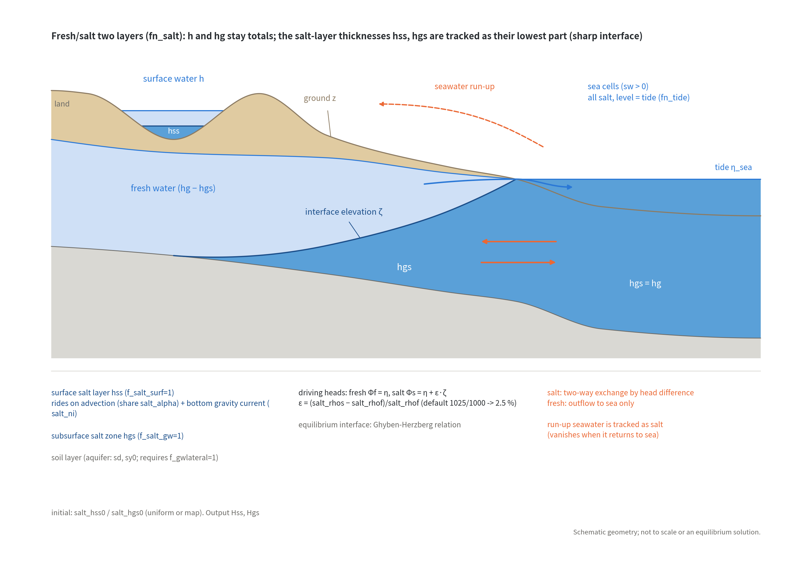

# Fresh and salt water layers (&list_salt)

> English mirror of docs/users_guide/salt.md. The Japanese file is the master copy.

[Back to the user's guide index](../users_guide.md)

Introduces a **salt-water layer** into the surface water and the shallow
groundwater (soil layer), approximately handling fresh/salt interactions
such as salt wedges, seawater intrusion, and freshwater lenses. Enable
it with `fn_salt`.

The model is a **quasi-static sharp-interface approximation** of the
same type as the sharp-interface (two-zone) methods established in
groundwater modeling (the idea of the SWI2 package of
MODFLOW[^bakker13]): the depth and subsurface storage
(h and Hg) remain the fresh+salt **totals**, and the "salt layer
thickness" (always the lowest part of the column) is tracked as part of
those totals. The density difference $`\varepsilon`$ appears only in the
driving head $`\Phi_s`$ of the salt layer; the momentum equation of the
shallow-water flow is unchanged ($`\eta`$: water level, $`\zeta`$:
interface elevation).

```math
\varepsilon = \frac{\rho_s - \rho_f}{\rho_f},
\qquad
\Phi_s = \eta + \varepsilon\,\zeta
```
Even with a horizontal water
surface, a tilted interface produces a hydrostatic pressure difference
at depth that moves the salt water (removing a partition in a pool ends
with a stably stratified state, which the model reproduces).



Coastal section. The salt layer hss sits at the bottom of the surface water h and the salt zone hgs at the bottom of the subsurface storage hg of the soil layer; the interface elevation ζ sets the driving head of the salt water, Φs = η + ε·ζ. Sea cells are an all-salt boundary at tide level: underground the salt water is exchanged in both directions while fresh water only discharges, and at the surface the run-up seawater is tracked as salt water.

How to read the results (fields, ledgers, measurement columns, restart) is summarized in [Output and monitoring](#output-and-monitoring) on this page.

## What it can do

- **Seawater intrusion**: with sea cells (with tide) as a prescribed
  salt-water head, intrusion into and retreat from the aquifer. The
  equilibrium interface follows the Ghyben–Herzberg relation[^bear79]
  $`z_s = h_f/\varepsilon`$ (the interface depth below sea level is
  $`1/\varepsilon`$ times the freshwater head above it, about 40 for
  seawater).
- **Freshwater lenses** (with recharge) and the quasi-steady position
  of **salt wedges**.
- **Storm-surge / tsunami run-up and where the seawater goes**: the
  run-up seawater flows over land as salt water (riding on the
  shallow-water advection).
- **Salt water entering the aquifer from rivers and the land surface, and
  seeping back out**: when both the surface and subsurface salt layers are
  enabled (the default of f_salt_exch), infiltration through the river bed or
  ground takes the bottom salt water first and seepage from the aquifer
  releases the upper fresh water first, so the exchange is split into fresh
  and salt water. This represents a salt wedge that has travelled up a tidal
  river entering the aquifer through the bed, and run-up seawater infiltrating
  farmland (salt damage) ([Exchange of salt water between the surface and the
  aquifer](#exchange-of-salt-water-between-the-surface-and-the-aquifer-f_salt_exch)).
- **Pumping-induced seawater intrusion**: well pumping (f_gwpump in
  [Groundwater](gwflow.md)) takes fresh water first and draws whatever
  the fresh thickness cannot supply from the saltwater zone (salt
  contamination of the well). The rise of the salt-water surface caused
  by pumping (an approximation of upconing) emerges automatically from
  the lateral flow and the dynamics of the saltwater zone.
- Mixing and entrainment (brackish water generation), the inertia of
  internal waves, and continuous concentration fields are **not
  handled** (the interface stays sharp).

## Just try it (minimal input)

Every parameter has a default, so **an empty &list_salt in fn_salt** is
enough to run (seawater 1025 and freshwater 1000 kg/m³ = 2.5 % density
difference). What it needs alongside: the sea mask fn_sw and the tide
fn_tide that make the sea the prescribed salt-water head
([the tide chapter](tide.md)), and f_gwlateral=1 when the subsurface
salt zone (f_salt_gw=1) is used ([the groundwater chapter](gwflow.md);
the lateral K and specific yield are shared).

```
&list_salt
/
```

## Overall configuration (&list_salt)

| Parameter | Default | Meaning |
|---|---|---|
| f_salt_surf | 1 | 1: surface salt layer (advection + bottom gravity current) |
| f_salt_gw | 1 | 1: subsurface (soil layer) salt zone. **Requires f_gwlateral=1** |
| f_salt_exch | 1 if both are enabled | 1: split the surface–subsurface exchange (infiltration, saturation-excess seepage) into fresh and salt water. Requires f_salt_surf=1 and f_salt_gw=1. 0 disables the split (infiltration and seepage implicitly fresh = behaviour before 2026-10-29) |
| salt_rhof / salt_rhos | 1000 / 1025 | Fresh / salt densities (kg/m3); they set eps |
| salt_alpha | 1.0 | Barotropic advection share of the salt layer, alpha (the bottom layer carries less of the flow; 1 = concentration-proportional) |
| salt_ni | 0.025 | Interfacial Manning roughness of the bottom gravity current |
| salt_hss0 / fn_salt_hss0 | 0 / - | Initial surface salt-layer thickness (specified as part of the existing h; uniform value or a map) |
| salt_hgs0 / fn_salt_hgs0 | 0 / - | Initial subsurface salt storage (**added salt water** - also added to Hg; uniform value or a map) |
| salt_eps | 1e-3 | Regularization amount for the dry test (m) |
| salt_eps_h | 1e-2 | Linearization width of the gravity-current sqrt law (head difference, m) |
| salt_diagratio | 2/(2+sqrt(2)) | Diagonal partitioning (normally no need to change) |
| salt_nsubmax | 200 | Upper bound of the adaptive subcycling of the surface gravity current |

## Recommended values by pattern

The defaults are middle-of-the-road values that make the two layers
"run". When the target is known, start from the following (calibration
quantities).

| Type | f_salt_surf / f_salt_gw | salt_rhos (kg/m³) | Initial salt water | Used together with | Notes |
|---|---|---|---|---|---|
| Coastal aquifer salt wedge (Ghyben-Herzberg) | 0 / 1 | 1025 | fn_salt_hgs0 with the existing salt-water surface along the coast, or start fresh and wait for intrusion | f_gwlateral=1, K_sh 3600-36000 mm/h (sandy aquifer 1e-3 to 1e-2 m/s), sy0 0.2-0.3, sd0 = aquifer thickness 5-20 m | With recharge (rainfall + Green-Ampt) a freshwater lens appears |
| Estuary / tidal-river salt wedge | 1 / 0 | 1025 (brackish inner bay 1005-1015) | 0 | fn_tide + segment inflow (river discharge) | Calibrate the wedge position with salt_ni 0.02-0.03 and salt_alpha 0.5-1 |
| Estuary barrage and salinization of the surrounding ground | 1 / 1 (f_salt_exch at its default 1) | 1025 | fn_salt_hgs0 for the aquifer under the sea | fn_tide + segment inflow + Green-Ampt + f_gwlateral=1. The barrage is a step in the terrain (crest above high water) | Example [examples/estuary_barrage](../../../examples/estuary_barrage/en/README.md). The land aquifer starts empty, so put a preliminary stage that fills it with fresh water from a flood and rainfall |
| Where storm-surge / tsunami seawater goes | 1 / 0 | 1025 | 0 | Tide (surge) or boundary incidence (tsunami) + seawalls | Mixing is not solved = extent of the salt-water run-up and where it drains |
| Salinization of reclaimed lowland (intrusion and drainage) | 1 / 1 | 1025 | fn_salt_hgs0 with the existing salt-water surface | Drainage pumps ([structures](structure.md)) | Run-up or ponded seawater enters the aquifer by infiltration, and groundwater containing salt water returns to the surface by seepage (f_salt_exch; section below). Concentration by evaporation is not represented |
| Stratified brackish lake / reservoir (halocline position) | 1 / 0 | 1010-1020 | salt_hss0 = lower-layer thickness | - | Sharp interface: no mixed layer or entrainment |

## Connection to the sea

Sea cells (the sea mask of [Tide and sea surface](tide.md)) automatically
become an "all salt, water level = tide level" boundary:

- **Subsurface**: salt water is exchanged in both directions between
  the aquifer and the sea according to the head difference; fresh water
  only discharges to the sea (there is no fresh water in the sea).
  Tidal variations are reflected directly in the boundary head.
- **Surface**: seawater that runs up over land at high tide or in a
  storm surge is tracked as salt water (and salt water that returns to
  the sea disappears). The salt layer of the sea cells is aligned from the
  initial state with the water column hsea0 after the tide is applied, and
  is always entirely salt water.

## Exchange of salt water between the surface and the aquifer (f_salt_exch)

For the water exchanged between the surface (river channels, ponded water)
and the aquifer of the soil layer — vertical infiltration (Green-Ampt and
bucket in [Groundwater](gwflow.md), including the replacement by the river-bed
exchange capacity f_gwbed) and saturation-excess seepage — the groundwater
calculation moves the total amount and this module splits it into fresh and
salt water following the sharp-interface picture (own simplification;
developer.md sec. 47.5).

- **Infiltration takes the bottom salt water first**: the surface salt layer
  is always at the bottom and it is the salt water that touches the river bed
  or the ground, so infiltrating water is taken from the salt layer first
  (fresh water follows only when more infiltrates than the salt layer holds).
  Salt water that enters the ground is placed at the bottom of the aquifer
  (immediate overturn).
- **Seepage releases the upper fresh water first**: water overflowing from the
  aquifer comes from the upper fresh water, and only what the fresh water cannot
  supply leaves as salt water into the bottom of the surface layer. If the
  aquifer is entirely salt, the seeping water is salt water.

This represents the path by which a salt wedge in a tidal river enters the
aquifer through the bed and spreads into the banks, and the salt-damage path
by which run-up seawater infiltrates farmland. It is enabled by default
(f_salt_exch=1) when both the surface and subsurface salt layers are used.
Setting 0 treats the exchange as implicitly fresh (the behaviour before
2026-10-29: the infiltrated share of salt water disappears at the surface
through the consistency clamp, and seeping salt water disappears too), which
allows a comparison with the river pathway of salinization "switched off".

Notes for reading the results (numerical properties):

- **Salinization right below the river bed is on the high side**: combined
  with the immediate overturn, the exchange becomes one-directional — salt
  water enters from the bed at high tide and the upper fresh water of the
  aquifer leaves at low tide (in reality part of the infiltrated salt water
  returns before it sinks). The aquifer under a bed covered by the wedge can
  become entirely salt within days to tens of days.
- **Salt water decreases at seepage faces**: at the boundary between a cell
  with surface water (saturated) and a neighbouring unsaturated cell, the
  head of layer 1 switches by the surface water depth, so in the scheme that
  solves the total and the salt zone in turn there are steps where the
  salt-zone flux is evaluated in the opposite direction and the consistency
  clamp removes salt water (reducing dt hardly reduces it; in model
  experiment C2 of [test/salt](../../../test/salt/en/README.md) about 16 % of the
  salt-water volume over a 2-hour run). To that extent the magnitude of
  salinization leans to the low side.
- Evapotranspiration, percolation into layer 2 (f_gwlayer2) and exchange with
  the conduit layer are outside the scope and remain implicitly fresh.

## Output and monitoring

The three ways a field gets written (automatic / flag / riding on a flag) and the area basis of column quantities are explained in [Input and output formats](io.md#how-state-variables-are-written); a reverse lookup from the quantity you want to the output is at the end of that section.

**Fields** (rasters in `result/`, every `dt_file`)

| File | How | Contents |
|---|---|---|
| Hss0001... | rides on f_out_h (f_salt_surf=1) | surface salt-layer thickness (m); part of the depth H (bottom layer) |
| Hgs0001... | rides on f_out_hg (f_salt_gw=1) | subsurface salt storage (m, column equivalent); part of Hg |

**Ledgers and log** (budget checks)

- Salt water is water, so the S columns of Log.txt (S_surf / S_grnd /
  S_total) show the fresh + salt total. There is no salt-only ledger.

**Measurements** (probe and transect columns)

- No salt-specific column. For a point time series pick the same cell of
  `Hss0001...` at each output time.

**Restart**

- Handled automatically through the private file `saltwater.dat` (fn_salt
  must have been enabled at save time).

**How to read and check**

- Fresh-layer thickness = H − Hss; subsurface fresh water = Hg − Hgs. The
  subsurface interface elevation is ground − soil thickness + Hgs / sy0.
- Check the quasi-steady intrusion against the Ghyben–Herzberg relation
  $`z_s = h_f/\varepsilon`$ (about 40 times the fresh head) as a function of
  distance from the coast (procedure of [test/salt](../../../test/salt/en/README.md)).
- Where the run-up sea water ended up is read from the last frame of
  `Hss0001...` (salt water left after drainage).

## Constraints and notes

- f_salt_gw=1 requires the lateral flow of the soil layer
  (f_gwlateral=1 in [Groundwater](gwflow.md)); K_sh and the specific
  yield are shared.
- The saltwater zone follows the lateral flow of layer 1, the sea-side
  boundary, pumping, and — with f_salt_exch=1 — infiltration and
  saturation-excess seepage (section above). Evapotranspiration, percolation
  into layer 2 (f_gwlayer2) and infiltration water into the conduit layer
  (gwc_leak_layer=1) are implicitly treated as fresh (and so are infiltration
  and seepage with f_salt_exch=0). When the fresh water is exhausted and
  Hg < Hgs, the consistency clamp (Hgs ≤ Hg) reduces the salt water, so the
  salt-water volume is not a conserved quantity.
- The cap of the [river-bed exchange capacity](gwflow.md) (f_gwbed) also
  applies to the salt-zone flux at the boundary between river and non-river
  cells, in the same form (capacity × passage width × saturated salt
  thickness) (since 2026-10-29; before that the salt zone was not capped).
- The gravity current of the surface salt layer (salt water spreading along
  the bottom) does not recognise the virtual walls of [channel](channel.md)
  levees (fn_bank / bank0) or seawalls (fn_seawall) (the shallow-water
  advection respects the walls, so salt carried by overtopping at high tide and
  the like is correct). If there is salt water on both sides of a virtual wall
  separating a river from the protected land, the salt water alone spreads
  across the wall. For calculations where an estuary barrage, sluice or levee
  stops salt water, give the wall as terrain (a step in ground elevation)
  ([examples/estuary_barrage](../../../examples/estuary_barrage/en/README.md)).
- At rapidly advancing intrusion fronts, a small partition error
  between the total and the salt (proportional to dt) can arise from
  time splitting; reducing dt reduces it (see developer.md sec. 47.2).

## Parameters and the basis of their defaults

The labels in the Basis column are explained in [How to read the basis of a default](../users_guide.md#how-to-read-the-basis-of-a-default).

| Parameter | Default | Meaning | Basis |
|---|---:|---|---|
| f_salt_surf / f_salt_gw | 1 / 1 | enable the surface and subsurface salt layers | **method** both by default; combinations by use are in "Recommended values by pattern" |
| f_salt_exch | 1 if both are enabled | fresh/salt split of the surface–subsurface exchange | **method** in the sharp-interface picture the bottom salt water touches the river bed and the upper aquifer is fresh (own simplification; developer.md sec. 47.5). With both layers enabled the physically consistent side is the default; 0 is for comparison |
| salt_rhof / salt_rhos | 1000 / 1025 kg/m³ | fresh and sea water densities (density difference $`\varepsilon`$ = 2.5 %) | **customary value** standard seawater (salinity 35); Ghyben–Herzberg 1/ε ≈ 40[^bear79] |
| salt_alpha | 1.0 | barotropic advection share of the salt layer | **empirical** 1 = proportional to the layer thickness; calibrate within 0.5–1 for the bottom layer carrying less of the flow |
| salt_ni | 0.025 | interfacial Manning roughness of the gravity current | **empirical** placeholder of the order of a bed roughness; calibrate on observed salt-wedge positions |
| salt_hss0 / salt_hgs0 | 0 / 0 | initial salt-layer thickness and subsurface salt storage | **given** supply the existing salt-water surface (geoelectric surveys, well salinity) when known |
| salt_eps / salt_eps_h | 1e-3 / 1e-2 m | regularisation of the dry test / linearisation width of the square-root law | **numerical** like dd of the shallow water solver and gwc_eps_h of the conduit layer |
| salt_diagratio | 2/(2+√2) | diagonal share | **derived** same as the ENC core ([ENC grid](encgrid.md) §2) |
| salt_nsubmax | 200 | sub-cycle cap of the gravity current | **numerical** |

**Where to look when revising the defaults**

- Salt-water density follows from salinity and temperature through the
  equation of state of seawater (1026 at salinity 35 and 15 °C; 1005–1015
  for brackish water at the head of a bay). The sharp-interface basis and
  the Ghyben–Herzberg relation are in Bear[^bear79]; a practical
  implementation of the same kind is MODFLOW SWI2[^bakker13].
- Initialise the subsurface salt surface from well salinity profiles or
  geoelectric sections interpolated in GIS into fn_salt_hgs0; without
  them, start fresh and let the intrusion reach a quasi-steady state
  (spin-up).

## Tests and examples

- [test/salt](../../../test/salt/en/README.md): the pool-partition experiment (approach to a stable stratification) and seawater intrusion with analytic checks,
  and the fresh/salt split of the surface–subsurface exchange (model experiment C1: analytical end state of infiltration; C2: seepage from an entirely salt aquifer).
- [examples/estuary_barrage](../../../examples/estuary_barrage/en/README.md): how the presence of an estuary barrage affects the salt wedge travelling up a river and
  the intrusion of salt water into the surrounding aquifer (four cases: with/without barrage × with/without the exchange split).
- Worked example of the format: [examples/List_samples/en/list_salt.txt](../../../examples/List_samples/en/list_salt.txt).

## References

[^bear79]: Bear, J. (1979): *Hydraulics of Groundwater*. McGraw-Hill, New York. (sharp-interface approximation and the Ghyben–Herzberg relation)
[^bakker13]: Bakker, M., Schaars, F., Hughes, J. D., Langevin, C. D. and Dausman, A. M. (2013): Documentation of the Seawater Intrusion (SWI2) Package for MODFLOW. *U.S. Geological Survey Techniques and Methods*, 6-A46. (a practical implementation of the two-zone sharp-interface method)
