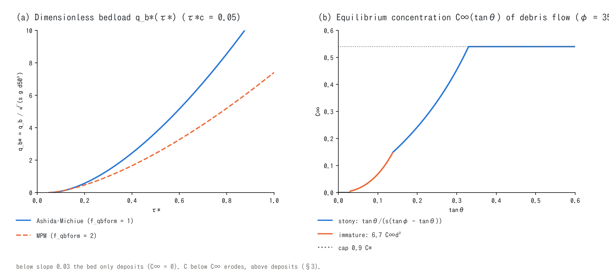
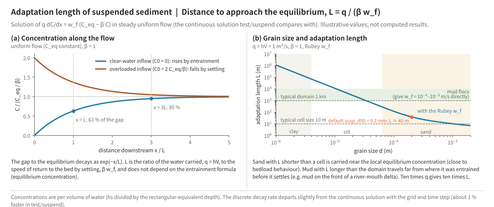

# Sediment transport, hillslope and long-term processes (supplement to the sediment chapter)

> English mirror of docs/users_guide/sediment.md. The Japanese file is the master copy.

[Back to the sediment chapter](geomorph.md) | [Back to the user's guide index](../users_guide.md)

This page gives the equations and the basis of the default values for the
processes of the [sediment and landform chapter](geomorph.md) that move
sediment with the flow or shape hillslopes over long times: hillslope
creep, bedload (including wave-driven longshore transport), suspended sediment, hillslope
erosion, dry-slope erosion (including rockfall and talus), bedrock weathering and uplift, and the
acceleration of morphological time.
Debris flows, slope failure and the moving bed layer are in
[Debris flow, slope failure and moving bed layer](massflow.md). The
implementation is in `src/m_geomorph*.f90` (one submodule per process).
Explanatory figures and graphs of the equations are mostly in the sections of the chapter; this page has the
figures of the transport formulas and equilibrium concentration and of the adaptation length of suspended sediment.

## 1. Common framework

**State variables.** The bed elevation $`z`$, the thickness of the erodible
soil layer $`s_d`$ (`sd`; the base $`z - s_d`$ is the bedrock surface) and
the sediment in the water column expressed as a column thickness of solid
volume, $`h_s`$ (`hs`). When the bed moves by $`\Delta z`$, $`s_d`$ moves by
the same $`\Delta z`$ (**co-moving update**), so the bedrock surface never
moves by erosion or deposition. The total solid
$`\sum h_s + (1-\lambda)\sum(z - z_0)`$ is conserved to machine precision
($`\lambda`$ is the bed porosity `fluv_porosity`).

**Acceleration of morphological time (MORFAC).** The landform is updated
every $`n = \mathrm{NINT}(\texttt{dt\_geomorph}/\Delta t)`$ steps and the
processes receive the effective time step

```math
\Delta t_s = n\,\Delta t\,\cdot\,\texttt{morfac}
```

while the hydraulic clock is not accelerated. This is the MORFAC method
standard in coastal and river morphodynamics[^roelvink06]: one run
represents `morfac` repetitions of the same hydraulic event. All processes
share one `morfac` (different factors per process would break the
simultaneity of hillslope supply and channel deposition); the suspended
load and the hillslope erosion evaluate the exchange with the water column
with the unaccelerated $`\Delta t_w = n\Delta t`$ and apply `morfac` to the
bed side only.

**Dimensionless shear stress.** Bedload, suspended load and hillslope
erosion share the bed shear stress closed with the Manning law,
$`\tau = \rho g n^2 |\mathbf{V}|^2/h^{1/3}`$, made dimensionless with the
grain size $`d`$ and the submerged specific gravity $`s`$ (`fluv_sgrav`,
default 1.65):

```math
\tau_* = \frac{\tau}{\rho\, s\, g\, d} = \frac{n^2 |\mathbf{V}|^2}{s\, d\, h^{1/3}}
```

(gravity cancels). The critical value $`\tau_{*c}`$ = 0.05 is the
representative value of the Shields curve[^shields36] for coarse sand to
gravel.

With `f_gravity_correction = 2` (the default of &list_enc; [ENC grid](encgrid.md) §5) the
dimensionless shear stress is evaluated from the slope-parallel speed
$`|\mathbf V_s| = |\mathbf V|\sqrt{1 + (\hat{\mathbf V}\cdot\nabla z)^2}`$ and the bed-normal
depth $`h\cos\theta`$, $`\tau_* = n^2 |\mathbf V_s|^2/(s\, d\, (h\cos\theta)^{1/3})`$ (bedload,
suspended load, hillslope erosion, bedrock incision and bank erosion; the same
bed shear stress as the friction of the momentum equation, and
$`\tau = \rho g\, h\cos\theta\,\sin\theta`$ in uniform flow on a slope). 1 (the default
until 2026-11-05) keeps the horizontal velocity and the vertical depth, which over-estimates the
shear stress of uniform flow on a 30° slope by a factor of 1.11 for the same
discharge (the difference for which Van Emelen et al. 2014 found the bed-normal
depth necessary above 10°; developer.md §93).

**Boundary with the sea mask.** The terrain is not updated on the sea
cells of the sea mask (fn_sw), and bedload, creep and the moving bed layer
do not cross the edges against sea cells (a wall). Suspended sediment and
the solid fraction of debris flows disappear outside the system once they
leave into a sea cell (inflow from the sea is clear water). Represent any
area where the sea bottom must be solved as ordinary cells + an initial
water level rather than with the sea mask ("The sea mask and the fate of
sediment" in [Sediment and landform change](geomorph.md)).

## 2. Hillslope creep (f_creep)

```math
\frac{\partial z}{\partial t} = D\,\nabla^2 z,
\qquad
D\,\Delta t_s\left(\frac{1}{\Delta x^2} + \frac{1}{\Delta y^2}\right) \le \frac{1}{2}
```

The classical linear-diffusion model of soil creep[^culling60], solved
explicitly with four-neighbour conservative fluxes (five-point Laplacian).
The inequality is the explicit stability condition, checked at
initialisation. Only $`z`$ is updated and $`s_d`$ is left unchanged (this is
not a model that transports a soil layer of finite thickness), so creep
acts even where $`s_d = 0`$ and moves the soil base too. The default
$`D`$ = 0.005 m²/yr is the middle of the published range of hillslope
diffusivities, 0.001 to 0.05 m²/yr[^fernandes97]. It is a quantity of
morphological time, to be read together with `morfac`. Verification:
[test/creep](../../../test/creep/en/README.md) (Gaussian hill, maximum error
2.0e-4 m against the analytical solution, `morfac` = 2 equivalence 1.0e-4 m).

**8-neighbour 9-point stencil (`creep_diagratio`, default 1/3)**: the 5-point Laplacian
(`creep_diagratio = 0`, the default before 2026-11-05) is
biased by the grid direction at short wavelengths close to the cell size Δ (the
difference between the decay rates at 45° and 0° for the same wavenumber is
+2.6 % at a wavelength of 8Δ and +11 % at 4Δ). With `creep_diagratio = d` the
creep is solved on the 8-neighbour 9-point stencil that gives the axis edges a
share $`(1 - d)`$ and the diagonal edges a share $`d/2`$ of the passage width (the same
partition rule as the shallow water flow and the lateral groundwater flow; the
coefficient of $`\nabla^2`$ is exactly 1 for any $`d`$). With $`d = 1/3`$ the leading
discretisation error $`(\Delta^2/12)(f_{xxxx} + 6d\,f_{xxyy} + f_{yyyy})`$ becomes
$`(\Delta^2/12)\nabla^4 f`$ and no longer depends on the grid direction (an isotropic
9-point Laplacian[^patra06]; the difference is +0.05 % at 8Δ and +0.9 % at 4Δ; for a
comparison with the d of other processes, see [choosing the diagonal share d](diagratio.md)). In cells
next to walls (outside the domain, sea cells), the blocked diagonal shares are
reassigned to the axis edge crossing the same interface (the same rule as
`f_gw_opening` of the groundwater; without it, the diffusivity parallel to a wall
would be $`1 - d/2`$ times, and $`1 - d`$ times in a one-cell-wide strip). The explicit
stability condition is checked at initialisation as the positivity condition from the
sum of the coefficients of a cell ($`\Delta t_s \le 0.3\,\Delta^2/D`$ for $`d = 1/3`$, against
$`0.25\,\Delta^2/D`$ for the 5-point stencil). What becomes isotropic is the direction of
the error, not its size (at the centre of a well-resolved hill it can be larger than
with the 5-point stencil). Verification: [test/stencil9](../../../test/stencil9/en/README.md)
(on a hill with σ = 2Δ, the difference between the axis-side and diagonal cells at the
same distance goes from −1.92 % to −0.03 %; the decay in strips one and three cells
wide agrees with the exact discrete solution to 1e-14; 7.5e-4 m against the
analytical solution for a well-resolved hill). The default is 1/3, changed from 0 on
2026-11-05 (developer.md §96).

**Depth-dependent creep (`creep_hstar` > 0)**:

```math
\mathbf{q} = -D\left(1 - e^{-H/H_c}\right)\nabla z,
\qquad
\frac{\partial z}{\partial t} = \frac{\partial s_d}{\partial t} = -\nabla\cdot\mathbf{q}
```

Only the soil layer moves. $`H`$ is the soil depth $`s_d`$ of the supplying
(higher) cell of each edge and $`H_c`$ is the transport decay depth
(`creep_hstar`). It expresses transport proportional to both slope and soil
depth[^johnstone15] in the same form $`K H_* (1 - e^{-H/H_*})`$ as Landlab's
DepthDependentDiffuser; reading $`D = K H_*`$, it reduces to the linear
diffusion above in the limit of a thick soil ($`H \gg H_c`$) (the meaning of
$`D`$ = `creep_d` is unchanged). Because $`z`$ and $`s_d`$ move by the same
amount, the bedrock surface $`z - s_d`$ does not change, and nothing is
carried out of bare rock ($`s_d = 0`$). Evaluating $`H`$ in the supplying cell
and passing the flux, converted to solid volume, through the supply limiter
shared with bedload (a cell never gives more than its soil depth in one
update) are discretisation choices of this model. The effective diffusivity
does not exceed $`D`$, so the stability condition is the same as above.
Verification: the four depth-dependent creep configurations of
[test/creep](../../../test/creep/en/README.md) (agreement with the
conventional linear diffusion to 1.8e-15 m under a thick soil, the bedrock
surface $`z - s_d`$ unchanged to 4e-14 m, conservation of the total soil,
$`s_d \ge 0`$, no change on bare rock). The steady hillslope combined with
soil production (§7) is to be checked in a coupled experiment with a stream at
the foot of the slope (docs/mountain_stream_plan.md §5, in Japanese).

## 3. Bedload (f_fluvial)

**Transport formula.** On each edge the dimensionless transport rate
$`q_{b*}`$ is computed from the two-cell mean $`\tau_*`$ and scaled to
$`q_b = q_{b*}\sqrt{s\,g\,d_{50}^3}`$ (solid volume per unit width).

```math
q_{b*} = 17\,\tau_*^{3/2}\left(1 - \frac{\tau_{*c}}{\tau_*}\right)\left(1 - \sqrt{\frac{\tau_{*c}}{\tau_*}}\right)
\quad(\texttt{f\_qbform} = 1,\ \text{Ashida–Michiue}),
\qquad
q_{b*} = 8\,(\tau_* - \tau_{*c})^{3/2}
\quad(\texttt{f\_qbform} = 2,\ \text{MPM})
```

The Ashida–Michiue formula[^ashida72] is the standard of river-bed
computations in Japan and the Meyer-Peter & Müller formula[^mpm48] the
most used one internationally; both vanish for $`\tau_* \le \tau_{*c}`$. The
edge transport is the projection of the flow direction on the edge normal,
$`u_e/|\mathbf{V}|_e`$, times the passage width $`L_k`$
([ENC grid](encgrid.md) §2): $`Q_k = q_b\,(u_e/|\mathbf{V}|_e)\,L_k`$. The
adaptation length of bedload is taken as short compared with the grid, so
the equilibrium transport is used directly (suspended load, with its long
adaptation length, is handled by a transport equation instead). No bedload is
carried across the edges of river banks (virtual walls) nor across the edges of the levees and outlets of resolved plots
of [paddy-field dams](paddy.md) (the flow over the walls carries suspended sediment).

The original Ashida–Michiue formula[^ashida72] (eq. (23)) uses the
effective shear stress $`\tau_{*e}`$ in the leading $`\tau_*^{3/2}`$ (the part
without the form drag of bedforms; eq. (11) of the original:
$`U/u_{*e} = 6.0 + 5.75\log_{10}\{R/(d(1+2\tau_*))\}`$) and keeps the total
$`\tau_*`$ and $`u_*`$ in the two threshold factors. ENCflow uses the form
with $`\tau_{*e} = \tau_*`$, which corresponds to $`u_{*e} = u_*`$ that the
original takes for flat beds and antidunes (the upper regime). In the
regime of ripples and dunes (the lower regime) it overestimates the
transport. The original form is `f_taupart = 2` ("Effective shear stress"
below); `fluv_taufac` is a simple substitute with a fixed ratio.



Panel (a) shows the two formulas ($`\tau_{*c}`$ = 0.05); panel (b) is the
equilibrium concentration of [the debris-flow page](massflow.md) §3.

**Exner equation.** The bed moves with the divergence of the transport.

```math
(1 - \lambda)\frac{\partial z}{\partial t} = -\nabla\cdot\mathbf{q}_b
\quad\Longrightarrow\quad
\Delta z_{i,j} = -\frac{\Delta t_s}{(1-\lambda)\,\Delta x\,\Delta y}\sum_{k=1}^{8} Q_k
```

This is Exner's bed continuity equation[^exner25]. Numerical overshoot is
prevented in this order: (1) an edge never erodes more than the soil
thickness $`s_d`$ of its upwind cell, (2) the bed change per update is
limited by `fluv_dzmax` (default 0.05 m; the analogue of a Courant
condition for bed waves; the number of events is reported at the end),
(3) where the simultaneous outflow through several edges would exceed the
soil thickness of a cell, every bed-load flux leaving that cell is scaled
down by the same factor (supply limiter; the sediment volume stays exactly
conserved and the number of limited cells is reported at the end),
(4) whatever still crosses the bedrock surface by round-off is clipped and
the lost volume is reported (normally none). On open boundaries the
outflow is always at capacity and the inflow is fed when `fluv_bcfeed = 1`
(the supply through the inflow face equals the net outflow of the inflow
cell times `fluv_bcfeed_fac`; factor 1 fixes the bed of the inlet). The faces
of an inflow segment (the normal faces of the inflow cells and, on a wall
edge, the diagonal faces opened for the segment) let no water out, so no bed
load flows out through them either (developer.md §19.12). Inflow
segments also take a bed-load discharge series `inflow_qb` (a source to the
bed) and the equilibrium concentration feed `inflow_cs_eq` of the suspended
sediment ([boundary conditions](boundary.md)). Bed load rolls on the bed surface: a dry cell never
supplies it and it is never carried onto ground above the water surface
of the supplying cell (a bank face; developer.md §84.2).

**Direction of the bed load (correction in bends).** By default the
direction is the depth-averaged flow direction $`\hat{\mathbf t}`$. With
`fluv_slope = 1` and `f_secflow = 1` it becomes

```math
\mathbf{q}_b = q_b\left(\hat{\mathbf t} + r\,\hat{\mathbf n} - \gamma\nabla z\right),\qquad
\gamma = \sqrt{\frac{\tau_{*c}}{\mu_s\mu_k\tau_*}},\qquad
r = N_* h\,\kappa
```

where $`\hat{\mathbf n}`$ is the left normal of the flow direction and
$`\kappa`$ the streamline curvature of the depth-averaged velocity field
(positive for a left turn; $`\kappa\hat{\mathbf n}`$ points to the centre of
curvature, so $`r\hat{\mathbf n}`$ always points to the inside of the bend).
$`\gamma\nabla z`$ is the transport down the slope (Hasegawa 1981 type[^hasegawa89], the
same form as the bed-slope correction of Nays2DH) and $`r\hat{\mathbf n}`$
the effect of the near-bed secondary flow pointing to the inside of the
bend (equilibrium secondary flow of the Engelund type). The secondary flow
carries sediment to the inner bank and the slope term brings it back down
the transverse slope that forms; the balance gives a cross section with a
deep outer and a shallow inner side, $`\partial z/\partial n \approx
r/\gamma`$. The curvature is evaluated only in cells whose four
neighbours are all wet ($`r = 0`$ along banks and boundary columns), and
bank-face steps are excluded from $`\nabla z`$. The coefficients
$`\mu_s = 1.0, \mu_k = 0.45`$ (Asahi et al. 2013[^asahi13] eq. (22), Hasegawa 1984) and $`N_* = 7.0`$ (Engelund 1974[^engelund74]) are the defaults (literature check in §84.12). `fluv_taufac` is a simple separation of
the effective shear stress: a fixed fraction of the total-resistance
$`\tau_*`$ is passed to the transport formula. Verification:
[test/bendsed](../../../test/bendsed/en/README.md).

**Bank retreat and collapse.** A bank face (a neighbouring cell b whose
ground is at or above the water surface $`z_w + h_w`$ of a wet cell w)
retreats with `f_berode = 1` at

```math
E_b = K_b\,\max\!\left(\frac{\tau_{*w}}{\tau_{*c,b}} - 1,\,0\right)^{m},\qquad
Q_{b\to w} = (1-\lambda)\,E_b\,h_w\,L_k
```

($`\tau_{*w}`$ is the dimensionless shear stress of the toe cell, $`h_w`$
the submerged bank height, equal to the toe depth, and $`L_k`$ the passage
width). The eroded volume is deposited on the toe cell and carried on by
the bed load (applied as an edge flux through the same conservative path;
the soil-depth supply limiter also bounds the erodible layer of the bank).
The angle-of-repose avalanching of `f_repose = 1` moves, per update, a
height $`\mathrm{relax}\cdot e/16`$ from the higher to the lower cell
for the part $`e`$ of the height difference between neighbours that exceeds
$`\tan\phi_r \cdot d_k`$ (a conservative relaxation that does not
overshoot with eight directions at once; one sweep per update).
Verification: [test/berode](../../../test/berode/en/README.md),
[test/repose](../../../test/repose/en/README.md).

**Self-protection of the bank by slump blocks.** A cohesive bank fails in
blocks once pool scour makes the bank face higher than a critical height, and
the fallen blocks cover the toe and stop bank erosion until the flow has
carried them away (Asahi et al. 2013; Parker et al. 2011[^parker11]). This is represented
by the **bank mode** `rf_bank = 1` of [rockfall and talus](geomorph.md#rockfall-and-talus-f_rockfall)
`f_rockfall` together with `berode_hcover` (developer.md §84.17): the part of a
bank face (a step above the water surface of the receiving cell; submerged steps,
i.e. pool walls, are excluded) that exceeds the critical height `rf_hc` collapses
into talus ht at the toe, the talus is removed by the outflow of bed load, bank
erosion and avalanching, and at a toe with talus ht the shear stress reaching the
bank face is reduced by (1 − ht/h_cover)⁺. With fixation (`f_fixation`) the
critical height rises to H_c (1 + c_τ,b a) with the fixation degree of the source
cell. H_c is a structural quantity for the bank material (a guide: the initial bank
height plus the pool scour at which failure should start), h_cover the block size
(tens of centimetres to a metre). Verification: slump / slump0 in
[test/berode](../../../test/berode/en/README.md); example: param_cohesive_slump.txt in
[examples/meander](../../../examples/meander/en/README.md).

**Fixation.** The cell fixation degree $`a`$ of `f_fixation = 1` grows while
the cell is dry (h ≤ dd) as

```math
a \leftarrow 1 - (1 - a)\,e^{-\Delta t_m / T_\mathrm{fix}}
```

($`\Delta t_m`$ is the morphological update interval, morfac included) and
returns to 0 while submerged once the cumulative erosion below the fixation
surface (the ground level when the cell was last dry, pushed up by
deposition) exceeds `fix_dzreset`. Its only effect is to replace
$`\tau_{*c}`$ by $`\tau_{*c}(1 + c_\tau a)`$ in the threshold and the
transport formula of the bed load supplied by that cell and in the bank
erosion of that cell as the bank, to reduce the entrainment term of the
suspended sediment by the same ratio ($`\tau_{*c,s}(1 + c_\tau a)`$ for the
excess-shear form, $`C_{eq}/(1 + c_\tau a)`$ for Itakura-Kishi; settling is
unchanged), and, with `fix_cn` > 0, to make the Manning n of the flow
friction $`n(1 + c_n a)`$ (the $`\tau_*`$ of the sediment keeps the original
n; elevations and volumes are untouched). Verification:
[test/fixation](../../../test/fixation/en/README.md).

**Using fixation and choosing its values.** Bed load deposits only up to the water
surface of the supplying cell, so under a constant discharge the inner-bank
bar stays submerged and the channel only widens instead of migrating.
`f_fixation = 1` represents the establishment of vegetation and the like on
cells exposed at low flow (h ≤ dd) by a fixation degree a ∈ [0, 1] (output
`Fx0001...`): while dry, a approaches 1 as 1 − exp(−t/T_fix) (`fix_tfix`,
morphological time including morfac), and the critical shear stress of the
bed load supplied by that cell and of the bank erosion of that cell rises to
τ*c (1 + c_τ a) (`fix_ctau`). With suspended sediment (`f_suspend`) only the
entrainment term (equilibrium concentration) of a fixed cell is reduced, by the
same c_τ, while settling is unchanged, so fines supplied during floods settle
on the fixed bars (the path that raises a bar to floodplain level). With
`fix_cn` > 0 the flow roughness of fixed cells rises to n (1 + c_n a), the
flow slows down and more fines are trapped (the form drag of vegetation; the
τ* of the sediment is not changed. Typical Manning n: grass 0.03 to 0.035,
floodplains with brush or trees 0.05 to 0.15, i.e. c_n = 1 to 3; the default
is 0 pending a literature check). Deposition onto a fixed surface is not
hindered and elevations and volumes are untouched. When a submerged cell is
eroded by more than `fix_dzreset` (default 0.1 m) below the fixation surface,
a returns to 0 (nothing becomes permanently unerodible). It does not act on
the angle-of-repose avalanching. If a fixed bar stays submerged without being
eroded (with a strong fixation the erosion never reaches the threshold, and an
exposed bar becomes permanent in practice), add a decay while submerged with
`fix_tdec` (while wet, a <- a exp(-t/T_dec): die-back of vegetation, softening
of the surface layer; a T_dec longer than the duration of a flood keeps the
fixation through short floods). The effect on bank erosion can be separated
from the bed with `fix_ctau_bank` (roots stiffen the surface layer but hardly
the bank toe, so a value below the bed c_tau, e.g. 0.5-1). Use it with an inflow series that alternates
floods and low flows ([examples/meander](../../../examples/meander/en/README.md),
param_fix.txt; with suspended sediment param_fixsusp.txt). Restart in
`geomorph_fixation.dat` (the dynamic roughness is rebuilt from a and not
saved). Verification: [test/fixation](../../../test/fixation/en/README.md).

**Defaults.** `fluv_d50` = 0.01 m lies near the geometric mean of a sand
bed (0.5 mm) and a mountain gravel bed (5 cm); values for sand and gravel
beds are in the recommended values at the end of the chapter.
`fluv_porosity` = 0.4 and `fluv_sgrav` = 1.65 are the standard values of
sand and gravel. Verification: [test/fluvial](../../../test/fluvial/en/README.md)
(total solid 4.6e-16, co-moving update 1.2e-14),
[test/sedinflow](../../../test/sedinflow/en/README.md) (closure of the
sediment supplied through the boundary).

**Effective shear stress (eq. (11) of Ashida and Michiue; `f_taupart` = 2).** As noted
above, the default Ashida–Michiue formula also uses the total shear stress $`\tau_*`$ in the
leading term, so it overestimates the transport when Manning's n includes form drag of bedforms,
bars or vegetation. `f_taupart = 2` obtains the effective friction velocity $`u_{*e}`$ from eq. (11)
of the original[^ashida72] and replaces only the leading $`\tau_*^{3/2}`$ of eq. (23) (eq. (32) for
mixed sizes) with $`\tau_{*e}^{3/2}`$. The two threshold factors keep the total $`\tau_*`$.

```math
\frac{U}{u_{*e}} = 6.0 + 5.75\log_{10}\frac{h}{d\,(1+2\tau_*)},\qquad
\tau_{*e} = \frac{u_{*e}^2}{s g d},\qquad
q_b = 17\,\tau_{*e}^{3/2}\Bigl(1-\frac{\tau_{*c}}{\tau_*}\Bigr)\Bigl(1-\frac{u_{*c}}{u_*}\Bigr)\sqrt{s g d^3}
```

Eq. (11) is the log law $`U/u_{*e} = 6.0 + 5.75\log_{10}(R/k_s)`$ (eq. (7) of the original) with
an equivalent roughness that includes the layer of moving grains, $`k_s = d(1 + \alpha\tau_*)`$ with
$`\alpha = 2`$ (eq. (9)). The model is depth-averaged in 2D, so the hydraulic radius R is taken as
the depth h. $`u_*`$ comes from the Manning closure ($`u_*^2 = g n^2 U^2 / h^{1/3}`$), so the transport
is the default formula times $`(u_{*e}/u_*)^3 = \{h^{1/3}/(g n^2 D^2)\}^{3/2}`$, where D is the right-hand
side of eq. (11). This is the same form as eq. (24) of the original.

- **Cap**: where $`u_{*e}`$ exceeds $`u_*`$, $`u_{*e} = u_*`$ is used. These are places where the
  resistance of eq. (11) is larger than the given n, that is, flat beds without form drag; the
  original also takes $`u_{*e} = u_*`$ for flat beds and antidunes (the upper regime; eq. (38)).
  Places where the depth is only a few times the equivalent roughness and D is zero or negative are
  treated the same way.
- **Mixed sizes**: d in eq. (11) is the mean size of the exchange layer $`d_m`$ (the mean of the two
  cells of the edge), and the same $`(u_{*e}/u_*)^3`$ multiplies all size classes. The original is
  written for uniform sand and does not say how $`u_{*e}`$ is obtained for mixtures; this is ENCflow's
  choice, following eq. (10) of the original, which expresses the equivalent roughness by $`d_m`$.
- **Where it applies**: the bed-load capacity (interior edges and open-boundary faces, for a single
  size and for mixed sizes; the capacity feed follows from them). The direction coefficient γ, the
  threshold of fixation, the bank-retreat law (an excess-shear ratio whose coefficient is set with the
  total shear) and the equilibrium concentration of suspended load keep the total shear.
- **Combinations**: it works only with the Ashida–Michiue formula (`f_qbform = 1`). Combining it with
  MPM (whose original has a different correction, the ripple factor), with `fluv_taufac` ≠ 1 (a double
  separation), with the wave-field sediment `f_wfsed` (eq. (11) does not cover the combined
  wave–current shear) or with bedrock incision `f_rockinc` (bedrock streams are the domain of
  `f_taupart = 1`) stops the run at initialization. No new parameter is needed.
- **Size of the effect** (trial calculation for uniform flow): on a sand bed with n about twice the
  grain roughness (the settings of the meander and delta examples) the transport becomes 0.1–0.25
  times the default, on a gravel bed 0.4–0.65 times. In the shallow sand–gravel model
  [examples/joganji_flume](../../../examples/joganji_flume/en/README.md) (depth 2–5 cm, mean size
  1–4 mm, n = 0.035) it is 0.05–0.15 times, which cannot explain the measured sediment budget
  ("Shear stress" in the example's README). The existing examples set the speed of morphological
  change without $`\tau_{*e}`$, so it is not the default (bit-identical to the previous results when
  disabled).
- **Limits**: the bedform regime and the resistance itself are not predicted (n is an input); the
  difference between the given n and eq. (11) is taken as form drag. Eq. (11) was built for sand beds;
  in gravelly flows shallower than about 10 times D84 it underestimates the grain resistance
  (overestimates the form drag) and errs on the side of a too small $`\tau_{*e}`$. The partition for
  that range is `f_taupart = 1` (next item). The default behaviour that a cell with a higher n from a
  roughness distribution (land use, for example) has more transport almost disappears for the leading
  term ($`\tau_{*e}`$ is set almost by the velocity and the depth; the threshold factors keep the total
  $`\tau_*`$).
- **Verification**: te and te_cap of [test/taupart](../../../test/taupart/en/README.md) (in uniform flow in
  a steep channel, the transport through the open boundary agrees with eqs. (11) and (23) within
  ±0.5 %; the cap, the stops on the combinations and the bit-identical MPI runs). The record is
  developer.md §121.

**Flow resistance partitioning on steep gravel beds (macro-roughness;
`f_taupart` = 1).** In gravel and boulder streams whose depth is less than
7–10 times the grain size D84, form drag and spill drag of boulders and steps
take most of the total resistance. Conventional transport formulas that use
the total-resistance $`\tau_*`$ are known to overestimate the transport in steep
streams by orders of magnitude (up to two to three)[^nitsche11]. From 2890
field measurements, Rickenmann & Recking[^rickenmann11] proposed a
partitioning that reduces the slope by the ratio of the small-scale-roughness
base level resistance $`\sqrt{8/f_0} = 6.5\,(h/D_{84})^{1/6}`$ to the total
resistance that grows as the relative depth decreases (Ferguson's
equation[^ferguson07]
$`\sqrt{8/f_{\rm tot}} = a_1 a_2 (h/D_{84})/\sqrt{a_1^2 + a_2^2 (h/D_{84})^{5/3}}`$,
$`a_1 = 6.5`$, $`a_2 = 2.5`$): $`S_{\rm red}/S = (f_0/f_{\rm tot})^{e/2}`$. Nitsche et
al.[^nitsche11] compared five partitioning approaches in 13 Swiss streams
(slopes 2–19 %) and report that this one ($`e`$ = 1.5) performed best: the
transport, overestimated by up to two orders of magnitude without correction,
came to 1.0 times the measurement in the median over all streams (88 % of
the events within a factor of 3), and they recommend it as a practical method
when no detailed roughness information is available. `f_taupart = 1`
multiplies the $`\tau_*`$ passed to the transport formula by this factor
(implemented on 2026-11-02; developer.md §89.30, docs/mountain_stream_plan.md §14).

- **Form**: the factor is $`\varphi(h) = (f_0/f_{\rm tot})^{e/2}
  = \{1 + (a_1/a_2)^2 (h/D_{84})^{-5/3}\}^{-e/2}`$; it depends only on the
  relative depth $`h/D_{84}`$ (not on the user's Manning n). It is computed from
  the depth at each edge (the depth of the cell for open-boundary faces and for
  the cover capacity of bedrock incision). For $`h/D_{84}`$ = 0.5, 1, 2, 5, 10 and
  20 it is 0.10, 0.22, 0.43, 0.75, 0.90 and 0.97. The threshold $`\tau_{*c}`$
  keeps the grain value, and the factor is applied to both the Ashida–Michiue
  and the MPM formula (Nitsche et al. note that the ratio by which reducing the
  slope lowers the transport is nearly the same for different formulas).
  $`D_{84}`$ is given by `fluv_d84` (m); 0 (default) uses $`2.2\,D_{50}`$ (the median
  ratio Rickenmann & Recking used to fill missing data). With mixed grain sizes
  (f_bedmix) and no `fluv_d84`, the $`D_{84}`$ of the exchange-layer composition is computed
  for each cell (the cumulative fraction is taken to reach $`F_1 + \dots + F_k`$ at the size of
  class k, and the two classes around 0.84 are interpolated linearly in the logarithm of the
  size). The edge value is the mean of the two cells, as for the $`d_m`$ of the hiding function,
  and the bank toe uses a constant, the $`D_{84}`$ of the domain-mean initial exchange-layer
  composition. The exponent $`e`$ is
  `taupart_e` (default 1.5, the value of Nitsche et al.; Rickenmann & Recking
  give 1.33–2). The form that reduces by the ratio of the base level resistance
  to the Manning n, $`(n_0/n)^{e}`$ ($`1/n_0 = 20.4/D_{84}^{1/6}`$), is not used:
  with a constant n it does not change with the relative depth and the result
  follows the choice of n.
- **Where it applies**: everywhere the bed-load capacity is used: all paths of
  the bed-load Exner module (internal edges, open-boundary faces, capacity
  feed), the $`\tau_*`$ of the toe cell in bank erosion (`f_berode`), and the cover
  capacity of bedrock incision (`f_rockinc`; the driver of abrasion and the
  drainage rate of the thin layer). It is not applied to the plucking stress
  $`\tau_b`$ (the `rock_kp` law) nor to the stress of bedrock erosion by debris
  flows: the partitioning was validated for bed-load predictions, a bare rock
  surface has no gravel-bed macro-roughness, and $`k_p`$ is calibrated with the
  total shear stress.
- **Size of the effect**: in the bedrock_cover example (depth 0.3 m,
  D84 ≈ 22 mm, h/D84 ≈ 14) the factor is 0.94 and little changes. In shallow
  flows over boulder beds (h/D84 = 1–3) it is 0.2–0.6, and the transport drops
  further the closer it is to the threshold.
- **Exclusivity and caveats**: combining it with `fluv_taufac` ≠ 1 stops the
  run (to prevent a double separation); the effective shear stress $`\tau_{*e}`$
  (`f_taupart = 2`) is the other value of the same selector, so the two are exclusive. Rickenmann & Recking
  caution that applied to high-concentration flows without boulders (sheet
  flow) it makes the transport implausibly small[^rickenmann11]. In thin flows
  (h/D84 < 0.5) the factor drops below 0.1 and bed load almost stops, so
  configurations that use bed load for sheet flow on hillslopes change a lot
  with and without the partitioning. The default is off (bit-identical to the
  previous behaviour when off).
- **Verification**: [test/taupart](../../../test/taupart/en/README.md). In uniform
  flow in a steep (0.05) channel one cell wide, the steady bed-load rate
  obtained from the ledger of bed load that left through the open eastern
  boundary agrees within ±0.5 % with the capacity evaluated from the depth and
  velocity of the outlet cell with the transport formula including the factor
  (h/D84 = 8.6, 4.3, 1.0 and 0.25 below the threshold; Ashida–Michiue and MPM).
  When off it is bit-identical, and MPI with np = 2 and 4 is byte-identical to
  the serial run.
- **Related item on the flow side**: a constant grain-based Manning n
  overestimates the velocity greatly on shallow gravel and boulder beds
  (3–4.5 times in the median when shallower than D84[^rickenmann11]). Making
  Ferguson's equation[^ferguson07], whose resistance follows the relative
  depth, a resistance-law option is a candidate, but it affects the whole flow
  and is deferred as a separate item (docs/mountain_stream_plan.md §14.6, item 8).

### Mixed grain sizes (f_bedmix)

The bed load is split into size classes $`k = 1..N`$ (grain size $`d_k`$, $`N`$ = 2 to 8) and the bed
composition is kept in one exchange layer and one substrate (Hirano type[^hirano71]). Its scope is an
exception to basic policy 6; there is no stratigraphy, and only the finest class is linked to the suspended
load (the design document is docs/mixed_sediment_plan.md).

- **State**: the exchange-layer composition $`F_k`$ (thickness $`L_e = \min(L_a, s_d)`$) and the substrate
  composition $`f_k`$ (thickness $`s_d - L_e`$). $`s_d`$ is the soil-layer (mobile-layer) thickness and
  moves together with $`z`$ as for a single size. The mean grain size of the exchange layer
  $`d_m = \sum_k F_k d_k`$ is the output Dm.
- **Transport rate**: the Shields number uses the same Manning closure and corrections as for a single size,
  $`\tau_{*k} = n^2 V^2 / (s d_k h^{1/3})`$. The critical value includes the hiding function (modified
  Egiazaroff[^egiazaroff65], Ashida and Michiue[^ashida72] eq. (31)): $`\tau_{*ck} = \tau_{*cm} \xi_k`$ with
  $`\xi_k = 0.85\, d_m/d_k`$ ($`d_k/d_m < 0.4`$) and
  $`\xi_k = \{\log_{10} 19 / \log_{10}(19 d_k/d_m)\}^2`$ ($`d_k/d_m \ge 0.4`$). The original eq. (31) is written
  for $`\tau_{ck}/\tau_{cm}`$; $`\xi_k`$ is its dimensionless form ($`d_m/d_k`$ times it). $`\tau_{*cm}`$ is
  fluv_tausc (default 0.05, the value Ashida and Michiue use for the mean size of a sand–gravel mixture). The rate
  has the form of their eq. (32), $`q_k = F_k\, \Phi(\tau_{*k}, \tau_{*ck}) \sqrt{s g d_k^3}`$ ($`\Phi`$ is the
  formula of f_qbform; taking the effective shear velocity equal to the shear velocity is the same simplification
  as for a single size). $`F_k`$ is taken from the supplying (upwind) cell; the $`d_m`$ of the hiding function is the mean
  of the two cells (the other cell if one side is bedrock or a fixed bed).
- **Direction of transport**: the coefficient of the bed-slope term becomes
  $`\gamma_k = (\mu_s \mu_k)^{-1/2} \sqrt{\tau_{*ck}/\tau_{*k}}`$ per class (the secondary-flow term is
  common). Coarser classes move down a transverse slope more easily, which gives sorting in the direction of
  coarse material on the outer bank and fine material on the inner bank of a bend (not tested
  quantitatively).
- **Exchange layer and substrate (Hirano equation)**:
  $`(1-\lambda)[\partial (L_e F_k)/\partial t + f_{Ik}\, \partial (z - L_e)/\partial t] = -\nabla \cdot \mathbf{q}_k`$.
  The interface composition $`f_{Ik}`$ is that of the substrate when the interface goes down and that of the
  exchange layer when it goes up. The substrate is one uniform mixture, and deposits are mixed into it. If the
  soil layer is thinner than the exchange layer, the exchange layer is the whole soil layer; when sediment
  deposits on a cell with zero soil thickness, the exchange layer is made with the composition of the
  incoming sediment.
- **Discretization**: the single-size framework (edge fluxes → supply limiter → divergence) is applied per
  class. The outflow through each edge is capped by the amount in the supplying exchange layer,
  $`L_e F_k`$ (the class version of the single-size mobile-layer clamp), and the total outflow of each class
  from a cell is scaled down so that it does not exceed $`L_e F_k`$ either (the condition that the explicit
  scheme does not create negative fractions). The cap on bed change fluv_dzmax applies to the sum over the
  classes. The fluxes of bank erosion and repose collapse are split into classes with the composition of the
  supplying cell's exchange layer.
- **Link to the suspended load** (`f_suspend = 1`): class 1 (size $`d_1`$ = susp_d50) becomes the suspended
  load and also moves as bed load (bed load and suspended load are added as separate modes of transport; the
  transition of the split between them is not treated). The exchange with the bed is the equation of
  [§4](#4-suspended-sediment-f_suspend) with the equilibrium concentration multiplied by the exchange-layer
  fraction, $`\Delta h_s = w_f (F_1 C_{eq} - \beta C)\,\Delta t_w`$, where $`F_1`$ is the availability of
  pickup (the same idea as the $`\min(1, s_f/L_a)`$ of the fines ledger f_bedfines; ENCflow's choice). The
  equilibrium-concentration feed of an inflow reach (`inflow_cs_eq`) is also multiplied by the $`F_1`$ of the
  exchange layer of the inflow cell (so that the inflow is in balance with the bed). One
  pickup takes at most the class-1 content of the exchange layer, $`(1-\lambda) L_e F_1/\mathrm{morfac}`$, and
  settling at most the suspended amount. The bed change $`\Delta z = -\mathrm{morfac}\,\Delta h_s/(1-\lambda)`$
  updates the exchange layer and the substrate by the Hirano equation as an exchange of class 1 only (when
  pickup lowers the interface the substrate composition comes in; when settling raises it, it rises with the
  exchange-layer composition). What is left suspended on a cell that dries also goes into class 1 of the
  exchange layer. The ledger puts what went to the suspended load (pickup − settling) into the class-1 bed
  balance, checks that it and the balance of the suspended load (stock Σ h_s × gv × wfrac × A and the inflow
  and outflow through open boundaries) close separately, and counts the exchange on both the bed side and the
  suspended side to check that they agree.
- **Other processes carried by edge fluxes**: depth-dependent creep (`creep_hstar` > 0) and wave-driven
  longshore transport (`f_wave_longshore`) split the total flux into classes with the composition of the
  supplying cell's exchange layer, as bank erosion and repose collapse do (equal mobility). Neither formula
  depends on grain size, so the landform change is the same as for a single grain size as long as one outflow
  does not exceed the content of the exchange layer. Representing the composition of the creeping soil by the
  exchange layer is a simplification. Rockfall and talus (`f_rockfall`) are carried with the composition
  removed from the top of the supplying column, in the order exchange layer → substrate → bedrock, and are not
  capped by the exchange-layer thickness (a collapse does not select grain sizes; ENCflow's choice). When only
  the soil layer collapses (`rf_bedrock = 0`) the supply is limited to the soil thickness (as for a single
  size); with bedrock collapse (`rf_bedrock = 1`) the composition of the debris from bedrock is given by
  `rf_frac` (given data). The receiver deposits with the incoming composition (the Hirano interface rule), and
  the talus thickness is handled as for a single size. The balance of each class includes what bedrock added to
  the soil layer and what fell into sea cells. The swash transport (`f_wfswash`) stays stopped, because the wave
  stirring it requires (`f_wfsed`) is not available for mixed-size bed load yet.
- **Coupling with debris flow** (`f_debris = 1`): the solids of the flow $`h_s`$ are held as one column per
  class, $`h_{s,k}`$ ($`\sum_k h_{s,k} = h_s`$), and the shallow-water flow carries the columns one by one
  with the same transport equation as $`h_s`$. By default the erosion, deposition and fluidisation of debris flow do
  not select grain sizes. Erosion (exchange $`\Delta h_s > 0`$) removes the thickness
  $`e = \Delta h_s/(1-\lambda)`$ from the top of the column, $`t_1 = \min(e, L_e)`$ from the exchange layer
  and the rest, $`t_2 = e - t_1`$, from the substrate, and puts it into the flow with that composition,
  $`(t_1 F_k + t_2 f_k)/e`$ (not capped by the exchange-layer thickness, as for rockfall). Deposition
  ($`\Delta h_s < 0`$, including the return of everything on dry cells and the low-speed coagulation) goes
  onto the bed with the composition of the flow in that cell, $`h_{s,k}/h_s`$ (into the exchange layer, and
  on to the substrate by the Hirano interface rule). Fluidisation (the slope-stability test `f_slide` and
  the instantaneous release `fn_dbinit`) enters the flow with the composition of the column over the
  fluidised thickness. The basis is that the erosion of a steep sediment bed, of the kind that generates a
  debris flow, takes place "not by picking up particles selectively by size but by stripping all the
  particles over some depth"[^tnh90] (our translation), and that the source term of the continuity equation
  of the coarse particles keeps the concentration of the bed in erosion and that of the flow in
  deposition[^tny91] (eq. (6)). The debris-flow formulas (equilibrium concentration, resistance, rates of
  erosion and deposition) stay single-size with the representative size `db_d50`, and the ground elevation,
  the soil thickness and the total $`h_s`$ are moved by the single-size procedures (ENCflow's choice; the
  original model[^tny91] uses the mean grain size of the flow in the resistance and the exchange rates,
  includes the fines in the interstitial fluid to raise the equilibrium concentration, and divides the flow
  depth into layers to resolve grain-size sorting; none of the three is included). The composition of
  sediment entering through a boundary is given data (`inflow_csfrac`, `fn_inflow_csfrac`).
  The erosion of the Takahashi–Nakagawa laws (`f_dbed = 3`) can be limited to the movable size classes
  (`f_dbsel` = 1, 2; the default 0 is as above). A class is movable when $`d_k \le h + h_s`$ in cells whose
  flow-surface slope along the flow exceeds `db_seltan` (default 0.03) (the assumption that the largest
  particle the flow can move has the same diameter as the flow depth), and when it satisfies the criterion
  of the bed load, $`\tau_{*k} > \tau_{*c}\,\xi_k`$, in cells at or below it. With
  $`K_3 = \sum_{\rm movable} F_k`$ the sum of the fractions of the movable classes in the exchange layer
  and $`\Delta h_s`$ the exchange of the size-blind law, the amount of class $`k`$ that enters the flow is
  $`K_3 F_k \Delta h_s`$ for `f_dbsel = 1` (as printed in the equations of the sources[^tinis00][^tnsk01];
  the total is $`K_3^2 \Delta h_s`$) and $`F_k \Delta h_s`$ for `f_dbsel = 2` (the total is
  $`K_3 \Delta h_s`$; the form that matches the bulk erosion velocity stated in the text of the sources, and
  the recommended form),
  and 0 for the immobile classes. In a cell with immobile classes only the movable classes are removed from
  the exchange layer, in proportion to their fractions, and one update removes at most the amount of the
  movable classes present in the exchange layer, $`L_e K_3`$ (a limit of ENCflow). The lowered part is
  filled by the Hirano rule with the composition of the substrate $`f_k`$, so the surface fraction of an
  immobile class grows with the erosion depth $`\Delta`$ as $`F_k(0) + f_k \Delta/L_a`$, and the erosion
  stops when the surface consists of immobile classes only. A cell in which all classes are movable is
  treated as by default. Deposition and fluidisation do not select grain sizes (the sources of the
  criterion and its limits are on
  [the mass-flow page](massflow.md#coupling-with-mixed-grain-sizes-f_bedmix)). The ledger
  counts the amount of each class that went from the bed to the flow on both the bed side and the flow
  side, and adds the stock of the flow (Σ h_{s,k} × gv × wfrac × A) and the exchange with the outside, to
  confirm that the bed and the flow each close separately (where cells have a building porosity gv < 1 the
  two sides do not agree, because only the flow side is multiplied by gv; the same counting as in the
  suspended-load ledger).
- **Default exchange-layer thickness**: twice the $`D_{90}`$ of the initial (domain-mean) exchange-layer
  composition. The guidance in the literature is 1 to 2 times the $`D_{90}`$ of the surface layer[^parker04]; the
  default is its upper end (Parker 2008[^parker08] treats the factor as an order-one calibration value, and
  Hirano[^hirano71] used 1 cm, about the largest grain size). A thicker layer is more robust against the
  explicit-step limit and ill-posedness, and makes the armouring response slower. These are guidelines
  for gravel beds; for sand beds with dunes, there is a practice of relating the exchange-layer thickness
  to the dune height, as the depth mixed by passing dunes[^chavarrias19]. With a large landform acceleration
  (morfac) the per-class supply limiter fires often with the default thickness (in trial runs of the
  examples meander, meander_cutoff and delta, 5 cm made it fire 1/10 to 1/26 as often).
- **Limits of accuracy**: (1) the results depend on the exchange-layer thickness $`L_a`$ (an empirical,
  numerical parameter). (2) The Hirano active-layer equations can lose hyperbolicity (become ill-posed), for
  example when the bed degrades into a finer substrate, and oscillations are then known to grow faster as the
  grid is refined[^ribberink87][^stecca14][^chavarrias18]. This can occur on bimodal sand–gravel beds. The
  signs are a two-cell oscillation of the exchange-layer composition and results that change when the grid is
  refined. (3) No more than the content of the exchange layer moves in one update (also for depth-dependent
  creep and longshore transport; not for rockfall), so coarse updates hold the outflow back. If the end count "class supply limiter" is large, shorten dt_geomorph or thicken L_a.
  (4) The $`d_m`$ of the hiding function is the mean of two cells, so it is smeared by one cell where the
  composition changes abruptly. (5) The toe shear stress of the bank-erosion law is evaluated with a
  representative size (the domain-mean $`d_m`$ of the initial exchange layer). (6) Grain-size-dependent flow
  roughness and abrasion are not treated. Only class 1 is suspended (classes 2 and above are not), and the
  bed load and the suspended load of class 1 are added. (7) Coupled with debris flow, by default the way the debris
  flow moves and its rate of erosion do not depend on the width of the grain-size distribution (what
  matters is `db_d50`; with `f_dbsel`, which limits the erosion to the movable classes, the classes larger
  than the flow depth and those below the critical shear stress restrain the erosion, but the erosion by
  thin flows shallower than the grain size is underestimated). The difference between grain sizes matters for the bed load that moves the same bed
  and for where the sediment ends up. In a flow whose shear stress is far above the threshold of every
  class (during the breach of a landslide dam, for example) the bed load too carries all the classes almost
  in proportion to the composition, so giving a width hardly changes the results
  ([the mass-flow page](massflow.md#coupling-with-mixed-grain-sizes-f_bedmix)). The accumulation of boulders
  at the front (grain-size sorting inside the flow) and the effect of fines becoming part of the
  interstitial fluid and raising the concentration are not represented. (8) Sediment deposited thickly (a
  debris-flow deposit, for example) is mixed uniformly with the existing substrate, leaving the thickness
  of the exchange layer (there is no stratigraphy; on bedrock the deposit keeps its own composition).
  (9) Coupled with debris flow the column of each class is carried separately, so where the composition of
  the flow varies in space the MUSCL limiter acts differently from carrying $`h_s`$ as one field (0.3 % of
  the landform change in a configuration of test/dbmix; with a uniform composition the two agree within
  round-off, and with first-order upwind, `f_scalar_scheme = 1`, they agree whatever the composition).
- **Verification**: [test/bedmix](../../../test/bedmix/en/README.md). With all classes set to the same size
  the bed agrees with the single-size bed to 5e-15 m and the composition does not change; the lowering of
  static armouring without feed agrees with $`L_a F_0/(1 - f_{\rm sub})`$ and the decay rate of the fine
  fraction is within 0.3 % of the one-cell formula; the outflow of each class is within 0.02 % of eqs. (31)
  and (32); the balance of each class closes to 1e-13 m³; MPI np = 1, 2, 4 are byte-identical to the serial
  run, and a restart is bit-identical. With the suspended load linked, setting all classes to the same size
  with the composition 1, 0, 0 gives a bed and a suspended load that agree with single-size bed load plus
  suspended load to 1e-14 m and 3e-17 m; the class-1 balance (including what went to the suspended load)
  closes to 7e-14 m³ and the suspended balance to 1e-14 m³, and the exchange counted on the bed side and on
  the suspended side agree (also with a row of 0.6 m channel width). Computing the D84 of the roughness
  partition from the composition agrees, in the equal-size limit, with the single-size bed for the given
  D84 to 9e-15 m, and with a 0.5, 2 and 8 mm mixture it is bit-identical in the first step to a run with
  the D84 of the initial composition fixed, and departs from it as the composition changes. Rockfall (soil
  only, bedrock, into sea cells), depth-dependent creep and longshore transport give, with a 0.5, 2 and 8 mm
  mixture (different compositions in the exchange layer and the substrate), a ground elevation that agrees
  with the single-size run to 1e-14 m; the balance of each class closes including the production from bedrock
  and the outflow into sea cells, and the production from bedrock equals the lowering of the bedrock times
  `rf_frac`. With the capacity feed, the bed and composition of the inflow cells stay fixed even when the
  per-class supply limiter fires there (difference 0 and 6e-16), and with the equilibrium-concentration feed
  of suspended sediment the class-1 fraction of the inflow cells hardly changes (0.007 in 160 s). In a
  comparison with the NILIM 1/100 movable-bed model of the Joganji River
  (case 2-1; [examples/joganji_flume](../../../examples/joganji_flume/en/README.md)), the area changed by more than 5 mm and the
  eroded volume are close to the measurement (a single size changes too much), while the locations of the change
  (point-by-point correlation 0.1 to 0.25) and the pattern of the surface composition do not match, and the model's
  surface loses fines and coarsens too much. The coupling with debris flow is in
  [test/dbmix](../../../test/dbmix/en/README.md). With all classes set to the same size and a uniform
  composition the run agrees with single-size debris flow plus bed load to 2e-15 m, and with different
  classes (of the same size) placed in the exchange layer and the substrate it agrees to 4e-16 m with
  first-order upwind (with MUSCL the difference is 0.3 % of the landform change). The balance of each class
  (bed and flow) closes to 2e-13 m³, and the total of each class counted from the save agrees with the
  initial total to 1e-12 m³ (including a configuration with fluidisation by the slope-stability test and one
  with the Takahashi–Nakagawa laws). The composition of a mass fluidised over the whole layer,
  $`\{L_a A + (D - L_a) B\}/D`$, is kept everywhere in the flow and in the deposit (4e-15), and after
  fluidising the upper half the exchange layer of the remaining soil has the composition of the substrate.
  The class ratios of sediment entering through a boundary agree with the given composition in the inflow,
  the outflow and the deposit, and the inflow with a composition series agrees with the sum over the steps
  of the fractions to 1e-9 m³. With `f_dbsel`, which limits the erosion to the movable classes, a class
  larger than the flow depth (1 m) never enters the flow, its content is unchanged in every cell (6e-16 m),
  its surface fraction agrees with $`F(0) + f \Delta/L_a`$ to 1e-13, and the erosion depth stops at the
  limit $`(1 - F(0)) L_a/f`$ = 14 mm. The erosion of one step equals $`K_3^2`$ (`f_dbsel = 1`) and
  $`K_3`$ (`f_dbsel = 2`) times that of the size-blind law within round-off, and when all classes are
  movable the result is bit-identical to the computation without the selection.
  A restart is bit-identical, a restore into a configuration without debris
  flow (alternating runs) conserves the total of each class, and MPI np = 1, 2, 4 are byte-identical to the
  serial run.

### Wave-driven longshore transport (fn_wave)

Reasons and verification for the smoothing length, the shadowing by submerged bars and the river-mouth rule of [wave-driven longshore transport in the chapter](geomorph.md#wave-driven-longshore-transport-fn_wave) (the steps of one landform update and the figure are in the chapter).

**Give the smoothing length `wave_lsm`** (the default 0 keeps the cell-radius-2
kernel for compatibility). Under high-angle waves (incidence above 45°) the
shoreline roughness grows, which is physical, but the only length that selects
the growing wavelength is the smoothing cut-off, so the cell-radius kernel lines
up bars at the grid spacing. With σ given as a length of 2Δx or more the cut-off
no longer depends on the grid and the straight-shoreline linear theory is
reproduced (test/wave_shore: with σ = 2Δx the low-angle decay rate is 1.05 and
the high-angle growth rate 0.86 of theory, grid-scale power 30 % → 6 %). Use
2Δx up to about a quarter of the surf-zone width W_b. Irregularities shorter than
σ are smoothed by the local slope term β (`wave_bslp`, default 5).

**Shadowing by submerged bars (`f_wave_shadow`)** reduces longshore transport
on the beach in the lee of a bar (mouth bar, lobe, breakwater). A wave that has
crossed a bar with crest depth h_c keeps at most γh_c, so the flux of the whole
lee column (inner beach included) is reduced by (h_c/h_trough)^{5/2}
(shallow-water energy flux ∝ H^{5/2}; the transmission treatment of a
breakwater in one-line models). Diffraction is not represented, so sand piles at
the updrift edge of the lee rather than at its centre, and the downdrift side
erodes. In the submerged breakwater case of test/wave_shore the bed change at
the lee centre drops to 1/5, the deposition at the updrift edge rises 4× and the
downdrift erosion 2.6×. The test uses the depth steps of the grid, so bars and
holes shorter than σ also shadow weakly (developer.md §84.15).

**`wave_vmax` is required at river mouths with a mobile bed**: once the
river's flow depth exceeds h_b the channel itself becomes a wave source,
longshore transport acts on bars and riffles inside the channel and the run
diverges ("Notes" in examples/delta/README.md). With `wave_vmax` set, cells
whose speed exceeds it are neither a source nor surf zone, so waves do not
enter the channel. Put the value between the river's flow speed and the speed
on the shoreline band (check the V output; e.g. 0.5 for 0.8 m/s in the channel
and 0.3 m/s on the delta front). During a flood the speed rises in front of
the mouth too, so waves pause there and resume at low flow. Verification:
[test/wave_river](../../../test/wave_river/en/README.md).

## 4. Suspended sediment (f_suspend)

**Transport.** The concentration $`C = h_s/h`$ is the solid volume per
water volume; the water-column advection is done inside the shallow water
step with the same edge fluxes as the water (the scheme is
`f_scalar_scheme` of [the advection explanation](advection.md) §7, by default
the link-wise MUSCL; a uniform concentration stays uniform by construction). The exchange with the bed is
evaluated per cell at the landform update:

```math
\Delta h_s = w_f\left(C_{eq} - \beta\,C\right)\Delta t_w,
\qquad
\Delta z = -\frac{\texttt{morfac}}{1-\lambda}\,\Delta h_s
```

The first term is the entrainment $`E = w_f C_{eq}`$, the second the
settling $`D = w_f\,\beta\,C`$ (near-bed concentration factor $`\beta`$ =
`susp_beta`, default 1). In dry cells ($`h \le d_d`$) all suspended sediment
returns to the bed. In channel cells with a cross-section shape σ the
exchange is multiplied by the wetted-width fraction $`\sigma(h)`$.
Combined with the two-way mode of [paddy-field dams](paddy.md) (`f_pd_exchange = 1`), the suspended sediment of the
water entering the paddy tanks from the surface (backflow through the outlets, filling over the levees) is deposited on
the bed of the cell with the same conversion (an original simplification; the water leaving the tanks is clear).

**Equilibrium concentration.** `f_esform` = 1 is the simple calibration
form $`C_{eq} = \texttt{susp\_esa}\,(\tau_*/\tau_{*c} - 1)`$; `f_esform` = 2 is
the Itakura–Kishi entrainment formula[^itakura80]:

```math
C_{eq} = \frac{\max(q_{su}, 0)}{w_f},
\qquad
q_{su} = K\left[\frac{\alpha_*}{s+1}\,\frac{s\,g\,d}{u_*}\,\Omega - w_f\right],
\qquad
\Omega = \frac{\tau_*}{B_*}\,\frac{e^{-a'^2}}{\sqrt{\pi}\,\mathrm{erfc}(a')} + \frac{\tau_*}{B_*\eta_0} - 1,
\quad a' = \frac{B_*}{\tau_*} - \frac{1}{\eta_0}
```

$`K`$ = 0.008, $`\alpha_*`$ = 0.14, $`B_*`$ = 0.143 and $`\eta_0`$ = 0.5 are the
constants of the original formula and $`u_* = \sqrt{\tau_* s g d}`$. It gives
the entrainment of sand without a calibration parameter, so 2 is
recommended for sand.

**Settling velocity.** With `susp_wf` = 0 it is derived from the grain size
with Rubey's formula[^rubey33]:

```math
w_f = \left[\sqrt{\frac{2}{3} + \frac{36\nu^2}{s g d^3}} - \sqrt{\frac{36\nu^2}{s g d^3}}\right]\sqrt{s g d},
\qquad \nu = 10^{-6}\ \mathrm{m^2/s}
```

Rubey's formula does not apply to clay and silt flocs; for mud give the
effective settling velocity in `susp_wf` directly and read the simple form
$`E = w_f\,\texttt{esa}\,(\tau_*/\tau_{*c} - 1)`$ as the Partheniades erosion
law[^partheniades65] $`E = M(\tau/\tau_{ce} - 1)`$, calibrating `susp_esa`
and `susp_tausc`.

**Defaults.** `susp_d50` = 0.2 mm is fine sand, the representative grain
size of suspended load; `susp_esa` = 1e-4 is the coefficient of the simple
form, which has no published value, calibrated in
[test/suspend](../../../test/suspend/en/README.md) (**empirical**).
Verification: the same test, total solid conserved to 2.2e-15 with both
equilibrium formulas.
With mixed grain sizes (f_bedmix), `susp_d50` is the size of class 1 and
pickup is multiplied by the class-1 fraction of the exchange layer
([mixed grain sizes in §3](#mixed-grain-sizes-f_bedmix)).



Solving the exchange above in steady uniform flow, the concentration approaches the equilibrium $`C_{eq}/\beta`$
over the distance $`L = q/(\beta w_f)`$ ($`q = hV`$) (panel (a); the continuous solution that configurations 3
and 4 of [test/suspend](../../../test/suspend/en/README.md) compare with). $`L`$ does not depend on the entrainment
formula and is set by the settling velocity. Panel (b) plots $`L`$ against the grain size for $`q`$ = 1 m²/s: tens
of metres for fine sand, close to a cell size, and kilometres for silt and mud flocs, so mud travels far from where
it was entrained before it settles. The curves evaluate the expressions for illustrative values; they are not
computed results.

## 5. Hillslope erosion (f_wash)

Wet ($`h > d_d`$) cells outside channels ($`r_w = 0`$) release sediment by
raindrop and sheet erosion into the suspended load $`h_s`$ (`f_suspend` is
required).

```math
E = k_r\,P + k_f\,\max\!\left(\frac{\tau_*}{\tau_{*c}} - 1,\ 0\right)
\qquad[\mathrm{m/s},\ \text{solid volume}]
```

$`P`$ is the rainfall intensity reaching the ground, $`k_r`$ (`wash_kr`,
dimensionless) the detached volume per rainfall and $`k_f`$ (`wash_kf`, m/s)
the coefficient of sheet erosion linear in the excess shear, with
$`\tau_*`$ evaluated with the suspended grain size. It is a USLE-type
empirical law written with the grid variables; the defaults 0.01 and
1e-5 m/s are the values of [test/wash](../../../test/wash/en/README.md)
(**empirical, to be calibrated**). The detached volume is subtracted from
$`z`$ and $`s_d`$ co-movingly and erosion stops at $`s_d = 0`$ (exposed
bedrock). Outside channels the entrainment $`E`$ of the suspended load and
the $`k_f`$ term overlap conceptually; when both are used, manage the
overlap through the calibration.
Combined with [paddy-field dams](paddy.md) (`fn_paddy`), the rain on paddy fields falls into the paddy tanks (the ponded
water on the fields), so the raindrop term $`k_r P`$ is multiplied by "1 − paddy area fraction" (the sheet erosion term
stays over the whole cell).

**Width scale (`wet_lw`).** Sheet erosion and entrainment are both
proportional to $`\tau_*`$, and the positive feedback that erodes only the
one cell where the flow has gathered has no length scale, so the width and
spacing of gullies are set by the grid spacing. When `wet_lw` $`= \ell_w`$
is given, the detachment depth $`e_j`$ evaluated per cell is spread with a
Gaussian kernel $`K`$ of standard deviation $`\ell_w`$ before it is applied
to the bed ($`\Delta z_i = -\sum_j K_{ij}\,e_j`$; the kernel is symmetric and
the shares that would fall outside the domain or on sea cells are returned
to the source cell, so $`\sum_i \Delta z_i = -\sum_j e_j`$: the total solid is
conserved). The suspended sediment $`h_s`$ enters the source cell $`j`$.
$`\ell_w`$ is the width of the rills (flow paths), approximated as a fixed
value independent of discharge. The figure of where it acts (sharing with dry-slope erosion and channels), the detachment rate and the shape of
the kernel is in [hillslope erosion in the chapter](geomorph.md#hillslope-erosion-f_wash).

## 6. Dry-slope erosion (f_splash)

Valley formation on highly permeable slopes without surface flow
(badlands, cliffs of pyroclastic cones) is parameterised as a sub-grid
process acting on dry ($`h \le d_d`$) cells outside channels. This erosion
law (including the hollow amplification and the correlation length of the
curvature) is an **original formulation** by the ENCflow developer and has
not been published as a paper. The papers cited below are sources for the
phenomena the law aims to represent and for the theory it is compared with;
the form of the equation and its coefficients were not derived from them.

```math
E = P\left[k_r\,(1 + c_a\,\kappa) + k_t\,(1 + c_b\,\kappa)\,S^{h}\right],
\qquad
S = |\nabla z|,\quad \kappa = \max(\nabla^2 z, 0)
```

The first term is raindrop splash (active on a plateau too), the second
the slope-dependent erosion by grain aggregates rolled by raindrops
[^trottet25] and by sub-grid rills; the positive feedback in concave
terrain ($`\kappa > 0`$; `spl_ca`, `spl_cb`) grows valleys. The detached
sediment cannot be carried without flow, so it is **exported out of the
system** (the total is reported at the end) and $`z`$, $`s_d`$ are reduced
co-movingly. Combined with [paddy-field dams](paddy.md) (`fn_paddy`), the rain on paddy fields falls into the paddy
tanks, so $`E`$ is multiplied by "1 − paddy area fraction". A concavity feedback without smoothing grows fastest at the
shortest wavelength (the infinite-wavenumber problem of Smith &
Bretherton[^smith72]): with the curvature taken on the grid (`spl_lc` = 0)
the valley spacing sticks to 2-3 grid cells (adding a diffusion term only
decides whether perturbations grow at all, since both amplification and
diffusion scale with $`k^2`$; creep is not a mechanical model and is not
combined with it). When the curvature is taken from $`z`$ smoothed over a
correlation length $`\ell`$ (`spl_lc`, the collection scale of the sub-grid
rills), the growth rate of a perturbation

```math
\sigma(k) = D_a\,k^2\,e^{-\ell^2 k^2/2},\qquad
D_a = P\,k_t\,c_b\,S^{h}
```

has a maximum at the finite wavenumber $`k^* = \sqrt{2}/\ell`$, so the
valley spacing $`\lambda^* = 2\pi\ell/\sqrt{2} \approx 4.4\,\ell`$ is set
by $`\ell`$ alone (where Perron et al.'s $`\lambda \propto \sqrt{K_s/K}`$
[^perron09] sets the spacing by the ratio of amplification to diffusion,
here the smoothing scale itself sets it). The curvature at a V-shaped valley floor is also bounded by
$`\sim 2S/\ell`$ (the speed of the deep-valley stage, where the walls
steepen to one-cell steps, still depends on the grid through $`S`$;
examples/badland).
`spl_zbase` is the erosion base level (the sea level when the cliff foot is
the sea) and `spl_dzmax` a safety valve. With `spl_ksat` the $`\kappa`$ in the
amplification is replaced by the effective curvature
$`\tilde\kappa = \kappa/(1 + \kappa/\kappa_s)`$, which saturates the amplification
at strong hollows (the foot of a cliff) at $`1 + c\,\kappa_s`$ (the spacing selection
of the linear stage is unchanged; verification:
[test/splashsat](../../../test/splashsat/en/README.md)). A table of horizontal strata
`spl_strata` (bottom elevation and erodibility factor per layer) multiplies
$`E`$ by the factor of the layer in which the cell's surface elevation lies
(banded hard/soft beds, benches, cap rock; a layer with factor 0 does not
erode; verification: [test/splashstrata](../../../test/splashstrata/en/README.md)).
With the 5-point Laplacian of the curvature $`\kappa`$ (and of the smoothing kernel of
`spl_lc`; `spl_diagratio = 0`, the default before 2026-11-05), the $`\kappa`$ of grid-scale
valleys is biased by the grid direction. The default `spl_diagratio = 1/3` is the
isotropic 9-point stencil (the
same partition rule as `creep_diagratio` of the creep; invalid neighbours are mirrored
by the cell's own value, the same convention as the 5-point stencil), and on a hill with
σ = 2Δ the difference in $`\kappa`$ between the axis-side and diagonal cells at the same
distance goes from −8.4 % to −0.27 % (with ℓ = 2 m, from +3.3 % to +0.13 %;
[test/stencil9](../../../test/stencil9/en/README.md); the default was changed from 0 on 2026-11-05; developer.md §96).
The defaults $`k_r`$ = 0.0005 and $`k_t`$ = 0.05 are the medians of the tests
(**empirical**); verification is
[test/splash](../../../test/splash/en/README.md) (all digits agree with the
analytical form $`\Delta z = P(k_r + k_t S)T`$ without amplification; the
export ledger equals the analytical sum) and
[test/splashslide](../../../test/splashslide/en/README.md) (contrast of a
cohesive and a loose cliff). The full reasoning and trials are in
docs/splash_plan.md.

### Rockfall and talus (f_rockfall)

The rules of [rockfall and talus in the chapter](geomorph.md#rockfall-and-talus-f_rockfall) in detail (the figure drawing the rules with grid columns is in the chapter).

The cliffs of cap-rock mesas and buttes retreat with a vertical free face
because the undercut cap collapses and the fallen debris forms a talus that
protects the weak layer at the foot. A raster (one z per cell) cannot hold an
overhang, so three rules approximate the process (developer.md sec. 48.7):

1. **Collapse**: the part of the height difference between neighbouring cells
   (the free-face height) that exceeds the critical height `rf_hc` is moved from
   the high to the low cell with the same numerical form as the angle-of-repose
   avalanching (relax x excess / 2 / 8 per update; conservative). With a window
   radius `rf_rc` the free-face height is measured as the drop to the lowest point
   within r_c (a square window of nint(r_c/dx) cells), and the excess over H_c
   (capped by the excess of that edge over the talus repose angle) is moved on
   edges steeper than the talus angle. The whole face then takes part even on a
   fine grid where the cliff spans several cells, and the critical height no
   longer depends on dx.
2. **Talus**: the volume arriving at the low cell is booked as talus thickness
   `ht` (output `Ht0001...`). Edges whose donor cell is talus-covered also move the
   excess over the talus repose angle `rf_phi` (only the talus itself).
3. **Protection**: the dry-slope erosion `f_splash` of a talus-covered cell
   (ht > 0) is multiplied by `rf_ftalus` (> 0), and the detached depth is taken from
   the talus first (the material below is exposed once the talus is gone). Fallen
   debris is taken to cover the cell it lands on. Talus spreads at its repose angle
   only where it is at least `rf_hmin` thick.

The removal rate of the talus (`rf_ftalus` x dry erosion) controls the cliff
retreat rate (talus-limited retreat).

4. **Supported-face mode (`rf_fface` >= 0; requires the window `rf_rc` > 0)**: under
   rule 1 the whole face only sheds the excess of H_w over H_c and relaxes to the
   repose angle, so even strong protection turns the plateau into a talus cone and
   no vertical cliff survives. The supported-face mode changes two things.
   (a) A cell whose foot (the cell beyond a drop steeper than the talus angle) is
   covered by talus (ht >= `rf_hmin`, or a collapsing column) is a "talus-supported
   face": its dry erosion E is multiplied by `rf_fface` (0 = it does not erode; the
   flag is from the previous update; it replaces the strata factor). (b) The collapse
   becomes a **column collapse**: a column starts at the top of the face (a cell with
   no step higher than H_c above it) when H_w > H_c and falls until it is level with
   its lower neighbours (the full drop; at most tan(phi_t) x dist / 32 per edge and
   update, the amount the receiving talus can pass on). A column whose foot is a
   collapsing column waits, so the face retreats one column at a time and stays
   vertical, and the bedrock of a fallen column is buried as a shelf at the level of
   the talus top. Collapse stops once the talus is thick enough that H_w <= H_c and
   resumes when dry erosion (`rf_ftalus`) removes the talus: the talus removal rate
   controls the retreat rate, and in steady state retreat rate x cliff height ~
   talus removal rate x talus width. The collapsing-column flags are part of the
   private file `geomorph_rockfall.dat` (restored automatically).
5. **Undercut collapse (`rf_uc` > 0; requires the supported-face mode)**: a real cap
   falls because the weak layer beneath it is cut back (undercut), not because of the
   face height. A foot cell (a land cell with a step steeper than the talus angle
   above it) remembers the bedrock depth u removed by dry erosion since it was last
   buried by rockfall debris (talus loss is not counted; u is reset when the cell is no
   longer a foot), and a column at the top of the face also falls when its foot has
   u >= u_c (in addition to H_w > H_c), but only when the foot is weaker than the
   column (its `spl_strata` erodibility factor is larger); a slope of one material is
   not affected (`spl_strata` is required). While the debris covers the foot the edge is
   protected; once the talus is removed and the bedrock is cut back by u_c the next
   column falls, so the cycle is talus-limited without tuning H_c to the face height.
   u is also part of the private file.

## 7. Bedrock weathering and uplift (f_wthr / f_uplift)

**Soil production.** Weathering keeps $`z`$ and thickens $`s_d`$ (the
bedrock surface descends) following an exponential law that slows with
soil thickness[^heimsath97]:

```math
\frac{d s_d}{dt} = W_0\,e^{-s_d/s_*}
\quad\Longrightarrow\quad
s_d^{\,n+1} = s_d + s_*\ln\!\left(1 + \frac{W_0\,\Delta t_s}{s_*}\,e^{-s_d/s_*}\right)
```

The update is the propagator of the exact solution of the ordinary
differential equation, so it is unconditionally stable for any `morfac`.
$`W_0`$ (`wthr_p0`, default 50 mm/kyr) is the middle of the bare-rock soil
production rates 0.01 to 0.1 mm/yr and $`s_*`$ (`wthr_sdstar`, default
0.5 m) a representative decay depth. With `fn_wthr`, the rate becomes
$`W_0 f_w`$ with a cell-wise multiplier distribution (differences in
lithology; cells with multiplier 0 do not weather. Use it where the bedrock
surface should be lowered by fluvial incision rather than by weathering,
such as the bedrock of mountain streams). The multiplier acts on the
production rate only; the decay depth $`s_*`$ is common to the whole domain.

**Uplift.** $`z \mathrel{+}= U\,\Delta t_s`$ ($`s_d`$ unchanged: the bedrock
rises as a rigid body). $`U`$ (`uplift0`, default 1 mm/yr) is the lower end
of the representative values of orogenic belts; negative values are
subsidence. Sea-mask cells are the base level and are excluded. With
`fn_uplift`, the rate becomes $`U f_u`$ with a cell-wise multiplier
distribution (0 at the outlet cells fixes the base level, negative values
lower it; differential uplift of fault blocks can also be given).
Long-term landscape evolution is meant to be run as "representative
hydrology repeated × MORFAC × restart chains", the CAESAR-Lisflood style
[^coulthard13] (developer.md §32).

### Limestone dissolution (f_dissol)

**Chemical denudation.** Limestone dissolving in water is the counterpart
of weathering (it lowers $`z`$ and keeps $`s_d`$) and is proportional to
the water entering the rock[^white84][^gabrovsek09]:

```math
\frac{dz}{dt} = -\,k_d\, f_{\rm sol}\,(q_{\rm r} + f_{\rm sink}\, q_{\rm sink}),
\qquad k_d = \frac{c_{\rm eq}}{\rho_{\rm r}}
```

$`q_{\rm r}`$ is the diffuse recharge flux (infiltration, `dissol_src = 1`,
rainfall on the ground, `dissol_src = 2`, or infiltration plus the runoff
generated on bare rock $`f_{\rm surf}\, f_b\,(P - I)`$, `dissol_src = 3`,
the recharge to the rock = exchange from the soil or layer 2 into the conduit
layer, `dissol_src = 4` (zero below the water table = base level), or that plus
the runoff, `dissol_src = 5`, with $`f_b = \max(0, 1 - s_d/s_{\rm surf})`$ the bare-rock factor), $`q_{\rm sink}`$ the inflow
flux into the sinks (inlets) of the conduit continuum layer
(`dissol_sink = 1`) and $`f_{\rm sol}`$ the soluble fraction of the cell
(`fn_dissol`). One geomorphic update dissolves
$`w = k_d f_{\rm sol} F \cdot \texttt{morfac}`$ from the water $`F`$ (m)
accumulated over the update interval, and leaves the insoluble residue
fraction $`f_{\rm res}`$ (`dissol_fres`) in the soil:
$`z \leftarrow z - (1 - f_{\rm res}) w`$,
$`s_d \leftarrow s_d + f_{\rm res} w`$. Local and linear, hence
unconditionally stable.

**Choosing the water amount (dissol_src).** The water amount is one of five sources. `dissol_src = 1` (default) is the
**infiltration** of the groundwater module (vertical exchange of the bucket
or Green-Ampt model) and needs `fn_gwflow`. `dissol_src = 2` is the
**rainfall on the ground** (after interception), a maximum-denudation model
that works without groundwater (evapotranspiration is not subtracted).
`dissol_src = 3` is **infiltration plus the runoff generated on bare rock**:
in cells whose soil is thinner than `dissol_sdsurf`, the runoff (rain minus
infiltration) also spends `dissol_fsurf` of its capacity on that rock face
(dissolution of bare slopes and tower faces; water arriving from upstream
is taken as saturated and not counted). `dissol_src = 4` is the **recharge
to the rock** (the exchange from the soil or layer 2 into the conduit
continuum layer; requires `f_gwconduit = 1` and `gwc_leak_layer > 0`): where
the conduit head is above the head of the soil (bedrock surface + soil water /
specific yield) there is no recharge and dissolution stops. However, where
rain accumulates in a thick soil so that its head stays above the conduit,
dissolution continues even when the bedrock surface is below the water table
(in param_base.txt of examples/tower_karst the bedrock under 24 m of residue
dissolved to 24 m below the water table). There is no mechanism yet that makes
the water table the base level of a corrosion plain ("no dissolution in the
saturated zone"). `dissol_src = 5` adds the runoff on
bare rock (the same term as 3). Infiltration (1 and 3) counts the water that
entered the soil, so where the soil keeps thickening (residue of talus, for
example) the added capacity keeps infiltration going and the pits have no bottom (the
larger morfac, the more so); use 4 or 5 whenever a conduit layer is present.

**Lateral dissolution** (`dissol_lat` = $`p`$). Of the capacity $`W_w`$ of
a ponded cell w, the share $`p`$ goes to the land cells n among its 8
neighbours whose floor is above the water surface $`e_w`$ (rock walls), in
proportion to the contact width $`L_k`$ (Δx on the axes, Δx·2/(2+√2) on
the diagonals), and $`1-p`$ to the floor (a cell without walls gives
everything to the floor):

```math
\Delta z_n = -\,f_{{\rm sol},n}\, p\, W_w \frac{L_k}{\sum_{m\in{\rm walls}(w)} L_m},
\qquad \Delta z_w = -\,f_{{\rm sol},w}(1-p)\,W_w
```

The total capacity is unchanged (a partition) and wall retreat is
represented by lowering the wall cell. $`p`$ is the ratio of floor to wall
dissolution; with `dissol_lat = −1` it is set per cell from the wetted-area
ratio $`p_w = h_w \sum L / (h_w \sum L + \Delta x \Delta y)`$ (recommended:
deeper ponding gives the walls a larger share). A fixed value should follow
the ratio of ponding depth to cell size (about 0.8 for h = 5 m, Δx = 10 m).

$`c_{\rm eq}`$ (`dissol_ceq`, default 100 mg/L as CaCO₃) is the
**effective dissolution capacity**: the equilibrium solubility minus the
concentration already carried by the inflowing water, i.e. the mass of
rock dissolved by 1 m³ of water. The carbonate equilibrium is not solved;
soil CO₂ and temperature are folded into this single value (50 to 80 for
rain on bare rock, 100 to 300 mg/L under a soil cover). With
$`\rho_{\rm r}`$ (`dissol_rho`, default 2500 kg/m³) this gives
$`k_d`$ = 4×10⁻⁵ m/m, i.e. 40 mm/kyr for a recharge of 1 m/yr, inside the
published range of karst denudation rates of 20 to 100 mm/kyr
[^gabrovsek09]. Water always dissolves its full $`c_{\rm eq}`$
(undersaturated, constant rate), so the decay of dissolution by
saturation along the flow path is not represented. Conduit (cave) growth
is a separate, not yet implemented stage (docs/karst_plan.md §5).

### Bedrock incision by flowing water (f_rockinc)

**Plucking, abrasion and cover.** The bedrock surface $`R = z - s_d`$ is
lowered by plucking by the flow and by abrasion by the transported gravel
(the tools effect), and the mobile layer $`H = s_d`$ suppresses the incision
through the exposure $`e^{-H/H_*}`$:

```math
\tau_b = \frac{\rho_w g n^2 |V|^2}{h_e^{1/3}},\qquad
E_{p0} = f_r\,k_p \max\!\left(\frac{\tau_b}{\tau_c} - 1,\ 0\right)^{m},\qquad
E_{a0} = f_r\,\beta\,q_c\,F_s(H)
```

```math
\frac{dR}{dt} = -(E_{p0} + E_{a0})\,e^{-H/H_*},\qquad \frac{dH}{dt} = E_{p0}\,e^{-H/H_*}
```

$`\tau_b`$ uses the same Manning closure as bedload
($`h_e = \max(h, d_v)`$), and $`f_r`$ is the erodibility multiplier
(`fn_rock`). The plucking term writes the excess-shear-stress form
$`E = k_e(\tau_b - \tau_c)^m`$ of the type that expresses the erosion rate of
bedrock channels by the bed shear stress[^howard83] in ratio form with
$`k_p = k_e \tau_c^m`$, so $`k_p`$ is "the incision rate of bare rock at
$`\tau_b = 2\tau_c`$" (m/s) (the source of the thresholded form is still
being checked). Expressing the cover as an exponential of the layer
thickness is the same as in SPACE[^shobe17] and Landlab's
GravelBedrockEroder. The plucked rock becomes a mobile layer of the same
thickness ($`z`$ is unchanged), and bulking is absorbed into $`k_p`$ (the
same 1:1 conversion as weathering; **our own simplification**). In the
abrasion term, $`q_c`$ is the bedload capacity of the cell (solid transport
rate per unit width), and $`q_c F_s`$ is the bedload leaving the cell, taken
as the amount of gravel striking the bed (the same form as "abrasion = β ×
transport rate × exposure" of GravelBedrockEroder). Making abrasion
proportional to the actual transport rate × exposure with a $`\beta`$ that does
not depend on the shear stress is also the same as the law of Chatanantavet &
Parker (2009)[^chatanantavet09], $`E = \beta|\mathbf{q}_b|(1 - P_c)`$, used in the two-dimensional
bedrock–alluvial channel model of Inoue et al.[^inoue16]; the difference is the
form of the cover fraction (linear in the alluvial thickness,
$`P_c = \eta_a/L_a`$, in that model; exponential in ENCflow). The abraded material
leaves the system as fines ($`z`$ is lowered) and is not added to the cover.

**Thin-layer transport.** The edge flux of bedload is multiplied by the
availability $`F_s = 1 - e^{-H/H_*}`$ of the supplying cell. In a steady
state with a uniform capacity $`q_c`$ and a constant transport rate
$`q_s`$, $`F_s = q_s/q_c`$, and the exposure is $`1 - q_s/q_c`$, i.e. it
agrees with the cover written as a supply ratio[^sklar04][^turowski07], and
the incision rate by abrasion becomes the hump $`E = \beta q_s (1 - q_s/q_c)`$
(largest at $`q_s/q_c = 1/2`$, and 0 with full cover at 1 and above). This is
the saltation–abrasion model of Sklar and Dietrich[^sklar04][^sklar06] (tools $`Q_s`$ ×
a cover linear in the supply ratio, $`1 - Q_s/Q_c`$) without the factor
from the saltation trajectories, $`(\tau_*/\tau_{*c} - 1)^{-1/2}`$ (impact rate
and energy), and its suspension-threshold factor, which in their classification is the parabolic "tools and cover"
type (Whipple & Tucker 2002[^whipple02] with $`n = 1`$). Matching it with the final form
of that model (eq. (24a) of 2004) gives a guide for the abrasion coefficient,

```math
\beta \approx \frac{0.08\,R_b\,g\,\rho_s\,Y}{k_v\,\sigma_T^2}\left(\frac{\tau_*}{\tau_{*c}} - 1\right)^{-1/2}
```

($`R_b`$ = submerged specific gravity, $`\rho_s`$ = sediment density, $`Y`$ = elastic
modulus of the rock, $`\sigma_T`$ = tensile strength of the rock;
$`k_v \approx 10^{12}`$ is their value with $`Y`$ and $`\sigma_T`$ in MPa; the transport
stage is evaluated for the representative flood and the suspension factor is
dropped). At their reference site (South Fork Eel River; $`\sigma_T`$ = 7 MPa,
$`Y`$ = 5 × 10⁴ MPa, $`\tau_*/\tau_{*c}`$ = 1.7) it is about 4–5 × 10⁻⁶ /m, and
$`\beta`$ is inversely proportional to $`\sigma_T^2`$ (about 50 times larger for a soft
rock with a tensile strength of 1 MPa). The
idea of setting the cover by the ratio of the alluvial thickness to the bed
relief[^zhang15] is written as a closure that uses the same $`H_*`$ for the
exposure and the availability; this combination and the dimensional form are
**our own** (docs/mountain_stream_plan.md §4.3). The steady state in which
the plucked rock joins the transport downstream follows from solving
$`q_i = q_{i-1} + (1-\lambda)\Delta x\,E_{p0}(1 - q_i/q_c)`$ cell by cell
(T3 of test/rockinc).

**Time integration.** The hydraulics are frozen at the start of an update
and the exposure is integrated exactly:

```math
H^{n+1} = H^n + B_p,\qquad
B_p = H_*\ln\!\left(1 + \frac{E_{p0}\,\Delta t_s}{H_*}\,e^{-H^n/H_*}\right),\qquad
B_a = \frac{E_{a0}}{E_{p0}}\,B_p
```

(the same form as the weathering propagator; $`F_s`$ of the abrasion is frozen
at its value at the start of the update, and with $`E_{p0} = 0`$,
$`B_a = E_{a0}\,\Delta t_s\,e^{-H^n/H_*}`$). Changing the update interval
or `morfac` gives the same result, and it is unconditionally stable. The
outflow from a thin layer is explicit, with the time scale
$`H_*(1-\lambda)\Delta x / q_c`$.

**Bias of τ_b on steep slopes.** In the uniform-flow test (T9 of
[test/rockinc](../../../test/rockinc/en/README.md)), τ_b computed from the
cell velocity exceeded the uniform-flow balance ρ g h tanθ by 1 % at slope
0.01, 14 % at 0.1 and 29 % at 0.2 (5 cells wide, Δx = 1 m, depth 0.3 m).
The dynamic reassignment of blocked openings (`f_opening_dynamic = 2`, the
default from 2026-10-18 to 31) counts the upslope ground of a uniform slope
as a partial wall and speeds up the flow; the effect grows with grid spacing
× slope relative to the depth. With `f_opening_dynamic = 3` (blockage
measured above the local plane; the default since 2026-10-31) this bias
disappears, and τ_b agrees with the uniform-flow balance within 1 ± 0.5 % at
slopes 0.01 to 0.2 (T9; nearly the same as 2 in channels with high banks).
If you set 2 explicitly, calibrate
`rock_kp` and `rock_tauc` (and the transport rate) including this bias.

**Rock erosion by debris flows (rock_kdb).** In debris-flow event runs
(`f_debris = 1`), the quasi-static driving stress of the flowing mixture erodes
the rock:

```math
\tau_d = \rho_w (1 + sC)\,g_e\,h_t \tan\theta_f,\qquad
E_{d0} = f_r\,k_d \max\!\left(\frac{\tau_d}{\tau_{cd}} - 1,\ 0\right)^{m_d},\qquad
\frac{dR}{dt} = -E_{d0}\,e^{-H/H_*},\qquad \frac{dH}{dt} = E_{d0}\,e^{-H/H_*}
```

$`h_t = h + h_s`$ is the mixture flow depth, $`C`$ the volumetric concentration
of the mixture, $`\theta_f`$ the bed slope in the flow direction (downslope only;
in each cell a one-sided difference to the downstream neighbour in the flow
direction, because with a central difference a two-cell undulation does not show
in the slope and the flow, shallower over the bumps, leaves them uneroded so that
steps grow; developer.md §89.23 and §89.24, in Japanese)
and $`g_e`$ the effective gravity of the momentum equation
($`g\cos^2\theta = g/(1 + |\nabla z|^2)`$, where $`\theta`$ is the inclination
of the ground and $`|\nabla z|`$ the magnitude of the ground slope of the cell,
the minmod of the differences to the two neighbours along each axis; $`g`$ with
`f_gravity_correction = 0`; until 2026-11-04 it was $`g\cos^2\theta_f`$ from the
slope in the flow direction, which overestimated it in cells where the flow
crosses the slope obliquely; developer.md §91, in Japanese). In steady uniform
flow $`\tau_d`$ equals
the basal shear of the resistance law, whichever resistance law is chosen. Only
cells with a dense mixture ($`C \ge c_{\min}`$ = `db_cmin`) that is moving
($`|V| \ge v_{stop}`$ = `db_vstop`) erode, and the product enters the mobile layer
1:1 like plucking ($`z`$ unchanged). Whether the flow entrains it or it stays as
cover is decided by the erosion–deposition formula. The time integration uses the
same propagator as plucking, with $`H`$ after the erosion–deposition step.

That debris flows are the main agent of bedrock lowering in steep valleys is shown
by the slope–area relation[^stock03] and erosion-pin measurements[^stock05]. The
mechanism is thought to be particle impacts. From field observations that the
rock is lowered mainly by the removal of fracture-bounded blocks by boulder
impacts, Stock & Dietrich[^stock06] proposed, as a hypothesis, a law that makes
the lowering by one debris flow proportional to "the length $`L`$ of the coarse
front × the solid inertial normal stress of particle impacts
$`\cos\theta\,C\rho_s D^2 (u/h)^2`$ ÷ the rock resistance" (the long-term lowering
rate is this times the debris-flow frequency; the authors themselves state that
the debris-flow dynamics are parameterized crudely and that a validated law is far
off). Rotating-drum experiments[^hsu08] also support inertial stresses and impacts
at the front. Erosion sensors buried in a fan channel of the Illgraben,
Switzerland, also showed that the sediment bed was eroded stepwise within 20 s of
the front's arrival, starting before the flow depth and the stresses peaked[^berger11]. The single-layer mixture does not resolve the bouldery front where
the impacts concentrate, so the excess form of the quasi-static stress, which was
robust in the single-event comparison (docs/mountain_stream_plan.md §12.4, in
Japanese), was adopted. Turned into a rate for event runs, the inertial-stress law,
whose lowering per event is proportional to the front length × the stress, scales
with the cube of the velocity and the inverse square of the flow depth, so it
depends on the velocity even more strongly than the option that was most sensitive
to thin layers and to the choice of the resistance law in that comparison (a rate
proportional to the inertial stress itself). It belongs to the
family of erosion laws in flow depth and slope[^mcguire23]; the form and the
combination of coefficients are **our own**. In the same comparison, a threshold of
1 kPa concentrated the erosion in the reaches steeper than about 0.2. The
observation that a deposit about 5 cm thick shields the bed from impacts[^mccoy13]
is a guide for $`H_*`$.

## 8. Parameters and the basis of their defaults

The labels in the Basis column are explained in [How to read the basis of a default](../users_guide.md#how-to-read-the-basis-of-a-default).

| Parameter | Default | Meaning | Basis |
|---|---:|---|---|
| dt_geomorph / morfac | 0 / 1 | update interval (s) / acceleration of morphological time (§1) | **method** MORFAC method[^roelvink06]; 1 for event runs |
| creep_d | 0.005 m²/yr | creep diffusivity $`D`$ (§2) | **literature value** middle of the published range 0.001–0.05 m²/yr[^fernandes97] |
| creep_hstar | 0 (conventional linear diffusion) | decay depth $`H_c`$ of depth-dependent creep (m) (§2) | **calibration value** no standard value. Does not affect the result under a thick soil |
| creep_diagratio | 1/3 (8-neighbour 9-point) | diagonal share $`d`$ (§2) | **method** 1/3 gives the 9-point stencil whose leading discretisation error is isotropic[^patra06] ([test/stencil9](../../../test/stencil9/en/README.md)). Changed from 0 (4-neighbour 5-point) on 2026-11-05 (developer.md §96) |
| f_qbform | 1 | bedload formula (§3) | **method** 1: Ashida–Michiue[^ashida72], 2: MPM[^mpm48] |
| fluv_d50 | 0.01 m | representative grain size of bedload | **empirical** near the geometric mean of sand and gravel beds |
| fluv_tausc / susp_tausc / wash_tausc | 0.05 | critical dimensionless shear stress (§1) | **literature value** representative value of the Shields curve for coarse sand to gravel[^shields36]; Ashida–Michiue[^ashida72] also use 0.05 for the mean grain size of a mixed bed (eq. (31)) |
| fluv_porosity / fluv_sgrav | 0.4 / 1.65 | bed porosity / submerged specific gravity | **customary value** standard values of sand and gravel |
| fluv_dzmax | 0.05 m | bed change per update (§3) | **numerical** safety valve (Courant condition of bed waves) |
| fluv_bcfeed | 0 | feeding at open boundaries (§3) | **method** 0: no feeding, 1: capacity feeding (net outflow of the inflow cell times the factor) |
| fluv_bcfeed_fac | 1.0 | factor of the capacity feed | 1 = fixed inlet bed, 0 = no feed |
| f_esform | 1 | equilibrium concentration (§4) | **method** 1: simple (calibration), 2: Itakura–Kishi[^itakura80] (recommended for sand) |
| susp_d50 / susp_wf | 0.2 mm / 0 | grain size / settling velocity | **customary value** fine sand / **derived** 0 uses the Rubey formula[^rubey33] |
| susp_beta | 1.0 | near-bed concentration factor $`\beta`$ | **method** 1 = vertically uniform approximation |
| susp_esa | 1e-4 | coefficient of the simple form | **verification case** calibrated in [test/suspend](../../../test/suspend/en/README.md) (weak basis) |
| f_bedfines / fines_la / fines_frac0 | 0 / required / 0 | ledger of fines in the bed (§4) | **method** two-component stock. L_a is a numerical mixing thickness (a few cm to 0.1 m); the fraction is a given |
| f_bedmix / bmix_d / bmix_frac0 | 0 / required / required | size classes and initial exchange-layer fractions of mixed grain sizes (§3) | **given** grain-size distribution of the bed material (bed-material surveys and the like) |
| bmix_la | twice the D90 of the initial composition | exchange-layer thickness $`L_a`$ (§3) | **literature** upper end of the guidance of 1 to 2 times the surface $`D_{90}`$[^parker04]. It also has a numerical role (robustness against ill-posedness) |
| bmix_hiding | 1 | hiding function (§3) | **literature** modified Egiazaroff[^egiazaroff65] (Ashida and Michiue[^ashida72] eq. (31)) |
| inflow_csfrac / fn_inflow_csfrac | none (required when sediment enters in the coupled run) | class composition of sediment entering through a boundary when mixed grain sizes and debris flow are combined (§3) | **given data** grain-size distribution of the inflowing sediment (constant or a series) |
| wash_kr / wash_kf | 0.01 / 1e-5 m/s | raindrop / sheet erosion coefficients (§5) | **empirical** values of [test/wash](../../../test/wash/en/README.md); to be calibrated |
| wet_lw | 0 m | correlation length $`\ell_w`$ of the lateral spreading of the detachment depth (§5) | **given** 0 = off. A guide is the width of the rills (flow paths); with Δx ≤ ℓ_w/2 the gully spacing no longer depends on the grid ([test/wetlw](../../../test/wetlw/en/README.md)) |
| spl_kr / spl_kt / spl_h | 5e-4 / 0.05 / 1 | dry-erosion coefficients and slope exponent (§6) | **empirical** medians of the tests |
| spl_ca / spl_cb | 0 / 0 m | concavity amplification lengths | **given** 0 = no amplification; a few to tens of metres to grow valleys |
| spl_dzmax | 0 | erosion limit per update | **numerical** 0 = off; safety valve against runaway |
| spl_lc | 0 m | correlation length $`\ell`$ of the curvature | **given** 0 = curvature on the grid (grid-dependent spacing); about one fifth of the valley spacing (examples/badland) |
| spl_zbase | none | erosion base level | **given** the sea level when the cliff foot is the sea |
| spl_ksat | 0 | saturation curvature $`\kappa_s`$ of the amplification | **given** 0 = no saturation; 0.05-0.2 1/m keeps benches at the foot of cliffs (examples/mesa) |
| spl_diagratio | 1/3 (9-point) | diagonal share $`d`$ of the curvature and the smoothing kernel | **method** 1/3 gives the isotropic 9-point stencil ([test/stencil9](../../../test/stencil9/en/README.md)). Changed from 0 (5-point) on 2026-11-05 (developer.md §96) |
| spl_strata | none | table of horizontal strata (bottom elevation, erodibility factor) | **given** hard/soft contrast of the stratigraphy; factor 0 = cap rock |
| wthr_p0 / wthr_sdstar | 50 mm/kyr / 0.5 m | soil production rate / decay depth (§7) | **literature value** middle of the published range of the Heimsath function[^heimsath97] |
| fn_wthr | none (1 everywhere) | distribution of the multiplier of the soil production rate | **given** differences in lithology, cells without weathering (0; the bedrock of mountain streams, for example) |
| uplift0 | 1 mm/yr | uplift rate | **customary value** lower end of orogenic belts |
| fn_uplift | none (1 everywhere) | distribution of the uplift multiplier | **given** fixed (0) or falling (negative) base level, fault blocks |
| dissol_ceq / dissol_rho | 100 mg/L / 2500 kg/m³ | effective dissolution capacity / rock density (§7) | **literature value** representative CaCO₃ concentration of recharge in limestone areas[^white84] and the density of limestone. k_d = 4e-5 m/m, i.e. 40 mm/kyr for a recharge of 1 m/yr (published range 20-100)[^gabrovsek09] |
| dissol_src / dissol_sink | 1 / 0 | water source / sink term | **method** 1: infiltration, 2: rainfall on the ground, 3: infiltration + runoff on bare rock, 4: recharge to the rock (exchange into the conduit layer; stops at the water table), 5: 4 + runoff. The sink term is the inlet inflow of the conduit continuum layer |
| dissol_fsurf / dissol_sdsurf | 0.3 / 0.1 m | capacity ratio of the runoff in the surface source / soil thickness counted as bare rock | **literature value** ratio of rain on bare rock (50-80 mg/L) to recharge under soil (100-300) / **numerical setting** |
| dissol_dzmax | 0 | cap on the dissolution per cell and update | **numerical setting** 0 = off. A safety valve of the fluv_dzmax type (the excess is discarded as saturation) |
| dissol_fsink / dissol_fres | 1.0 / 0 | capacity ratio of the sink inflow / residue fraction | **empirical value** to be calibrated / **given** 0 = no residue |
| dissol_lat | 0 | share p of lateral dissolution | **method** 0 = floor only, −1 = automatic from the wetted-area ratio (recommended). A fixed value follows the ratio of ponding depth to cell size |
| rock_kp / rock_tauc | 0 (no plucking) / none | plucking rate coefficient (m/s) / threshold (Pa) (bedrock incision of §7) | **calibration value** no standard value. k_p is the incision rate of bare rock at τ_b = 2τ_c |
| rock_m | 1 | plucking exponent | **conventional value** linear (same as berode_m of bank erosion) |
| rock_beta | 0 (no abrasion) | abrasion coefficient β (1/m) | **calibration value** no standard value. The largest incision rate by abrasion (cover fraction 1/2) is β q_c / 4. A guide is the match with the model of Sklar & Dietrich[^sklar04] in §7 (about 4–5 × 10⁻⁶ /m at their reference site, inversely proportional to the square of the rock tensile strength). Inoue et al.[^inoue16] used β ≈ 0.001 /m from a field experiment in the Ishikari River and 0.0001 /m to reproduce a flume experiment |
| rock_hstar | none | cover length H* | **given** a measure of the relief of the bedrock surface and the grain size (a few cm to tens of cm). Shared by the exposure and the availability |
| rock_kdb / rock_taucdb | 0 (no debris-flow term) / none | rate coefficient (m/s) / threshold (Pa) of rock erosion by debris flows | **calibrated** no standard values. k_d is the lowering rate of bare rock at τ_d = 2τ_cd. A lowering of mm to cm per debris flow is a guide[^stock05][^mccoy13] |
| rock_mdb | 1 | exponent of the debris-flow term | **conventional** linear (same as rock_m) |
| fn_rock | none (1 everywhere) | erodibility multiplier of the bedrock | **given** lithological contrast. 0 = not eroded |

**Where to look when revising the defaults**

- Grain size (d50), porosity and specific gravity come directly from
  bed-material surveys (sieve analysis); read the critical Shields stress
  from the Shields curve[^shields36] at the grain Reynolds number
  (0.03–0.06 for sand to gravel).
- Choose the bedload formula and its coefficients from measured transport
  rates when available; otherwise Ashida–Michiue[^ashida72] is customary
  for sand–gravel beds and MPM[^mpm48] for coarse gravel.
- Creep, soil production and uplift are long-term quantities: take them
  from cosmogenic-nuclide erosion and soil-production studies[^heimsath97]
  and from regional uplift rates (levelling, dated terraces).
- Sheet and dry erosion coefficients have no universal value; calibrate
  them on sediment-yield observations (turbidity, reservoir sedimentation)
  or on the measured landform change of past events.

## 9. Verification cases

| Case | Content | Point |
|---|---|---|
| [test/creep](../../../test/creep/en/README.md) | diffusion of a Gaussian hill | maximum error 7.8e-5 m, morfac equivalence. Depth-dependent creep: bedrock surface unchanged, soil conserved, no change on bare rock |
| [test/stencil9](../../../test/stencil9/en/README.md) | isotropy of the 9-point creep and curvature, and the reassignment at walls | the grid-direction difference on a hill with σ = 2Δ goes from −1.92 % to −0.03 % for the creep and from −8.4 % to −0.27 % for the curvature (+3.3 % to +0.13 % with ℓ = 2 m). The decay in strips agrees with the exact discrete solution to 1e-14 |
| [test/fluvial](../../../test/fluvial/en/README.md) | dam break and bed change in a closed domain | total solid and co-moving update to machine precision |
| [test/suspend](../../../test/suspend/en/README.md) | two equilibrium formulas; equilibrium and adaptation in a uniform channel | total solid 2.2e-15; equilibrium concentration within 1.5e-6 of the formula; decay rate of adaptation within 1.4e-5 of the discrete prediction |
| [test/sedinflow](../../../test/sedinflow/en/README.md) | sediment supplied through the boundary | ledger closure ~1e-16 |
| [test/bedmix](../../../test/bedmix/en/README.md) | mixed grain sizes (f_bedmix) | single-size limit to 5e-15 m, lowering by static armouring and decay rate of the fines (0.3 %), outflow by eqs. (31) and (32) (0.02 %), balance of each class 1e-13 m³ |
| [test/dbmix](../../../test/dbmix/en/README.md) | debris flow with mixed grain sizes (f_debris + f_bedmix) | single-size limit to 2e-15 m, balance of each class 2e-13 m³, composition of fluidised and inflowing sediment within 4e-15 of the formula and the given data, totals conserved in alternating runs |
| [examples/joganji_flume](../../../examples/joganji_flume/en/README.md) | mixed grain sizes against a published model experiment (NILIM, Joganji River at 1/100, case 2-1) | area changed and eroded volume close to the measurement (a single size changes too much), correlation of the locations 0.1 to 0.25, the surface coarsens too much |
| [test/wash](../../../test/wash/en/README.md) | rain + dam break hillslope erosion | total solid 1.7e-13 |
| [test/splash](../../../test/splash/en/README.md) | dry erosion on a slope with a break | all digits agree with the analytical form, export ledger agrees |
| [test/splashslide](../../../test/splashslide/en/README.md) | cohesive / loose cliff | relief growth ×1.34 / ×0.77 |
| [examples/badland](../../../examples/badland/) | valley formation on a plateau edge | valleys grow from the cliff edge with zero surface flow |
| [test/rockinc](../../../test/rockinc/en/README.md) | bedrock incision by flowing water | analytic self-cover solution 9e-8, quasi-steady cover 4e-4, hump of abrasion 7e-4, conservation in a closed box (9 digits with the ledger), the steady slope under a supply at the head within 1.5 % of the quasi-analytic solution with the sediment budget to 4e-10 |
| [examples/bedrock_cover](../../../examples/bedrock_cover/en/README.md) | cover effect in bedrock channels | steady incision rates of the 3 models within 2.3 % of the theory, constant versus pulsed supply with the same total, initial cover, retreat of a step |
| [examples/mountain_valley](../../../examples/mountain_valley/en/README.md) | coupled hillslopes and stream of a V-shaped valley | steady hillslopes within 0.14 % of the prediction for the hillslopes alone, stream slope within 1.1 % of the stream-only equation with the hillslope supply added; response to a base-level fall; with pulses of the same mean supply an abrasion-only stream is 1.40 times as steep |
| [test/hillsoil](../../../test/hillsoil/en/README.md) | soil production by weathering and steady hillslopes | 1.6e-15 to the analytical solutions with a uniform and a distributed (fn_wthr) rate, cells with multiplier 0 unchanged. On the steady hillslope of uplift, weathering and depth-dependent creep, the soil depth within 0.12 % of H_ss and the cross-slope curvature within 1.1 % of −U/D_eff |

## References

[^roelvink06]: Roelvink, J. A. (2006): Coastal morphodynamic evolution techniques. *Coastal Eng.*, 53, 277–287. (MORFAC)
[^shields36]: Shields, A. (1936): Anwendung der Ähnlichkeitsmechanik und der Turbulenzforschung auf die Geschiebebewegung. Mitt. Preuss. Versuchsanst. Wasserbau Schiffbau, 26, Berlin.
[^culling60]: Culling, W. E. H. (1960): Analytical theory of erosion. *J. Geol.*, 68, 336–344. (linear diffusion of hillslopes)
[^fernandes97]: Fernandes, N. F. and Dietrich, W. E. (1997): Hillslope evolution by diffusive processes: The timescale for equilibrium adjustments. *Water Resour. Res.*, 33, 1307–1318. (range of diffusivities)
[^patra06]: Patra, M. and Karttunen, M. (2006): Stencils with isotropic discretization error for differential operators. *Numer. Methods Partial Differ. Equ.*, 22(4), 936–953. doi:10.1002/num.20129 (stencils whose lowest-order discretisation error is isotropic; checked against the bibliographic record and abstract. That the ENC partition rule gives d = 1/3 follows from the modified equation in developer.md §96)
[^johnstone15]: Johnstone, S. A. and Hilley, G. E. (2015): Lithologic control on the form of soil-mantled hillslopes. *Geology*, 43(1), 83–86. doi:10.1130/G36052.1 (checked against the abstract: when transport scales with both slope and soil depth, rock type shows up in the form of soil-mantled hillslopes. The form of the equation and the doi follow the description of Landlab's DepthDependentDiffuser)
[^ashida72]: Ashida, K. and Michiue, M. (1972): Study on hydraulic resistance and bed-load transport rate in alluvial streams. *Proc. JSCE*, 206, 59–69 (in Japanese). doi:10.2208/jscej1969.1972.206_59
[^tinis00]: Takahashi, T., Inoue, M., Nakagawa, H. and Satofuka, Y. (2000): Prediction of sediment runoff from a mountain watershed. *Annual Journal of Hydraulic Engineering, JSCE*, 44, 717–722 (in Japanese). doi:10.2208/prohe.44.717 (The ratio of movable coarse particles K3, eq. (19); the erosion rate of each size class i_sbk = i_sb0 K3 f_bLk C*L, eq. (21); the text states that i_sb0 K3 is the bulk erosion velocity.)
[^tnsk01]: Takahashi, T., Nakagawa, H., Satofuka, Y. and Kawaike, K. (2001): Flood and sediment disasters triggered by 1999 rainfall in Venezuela; A river restoration plan for an alluvial fan. *Journal of Natural Disaster Science*, 23(2), 65–82. <https://jsnds.sakura.ne.jp/jnds/23_2_2.pdf> (Flow regimes by the water-surface slope, eqs. (10) to (12); the critical shear stress of the bed-load regime, eqs. (13) to (17); the erosion rate of each size class, eq. (26); the bulk erosion rate, eq. (31).)
[^tnh90]: Takahashi, T., Nakagawa, H. and Harada, T. (1990): Prediction of debris flow generated by erosion of steep well-graded sediment mixture bed. *Annuals, Disaster Prevention Research Institute, Kyoto University*, 33 B-2, 443–456 (in Japanese). <https://repository.kulib.kyoto-u.ac.jp/dspace/handle/2433/72271> (the erosion of a steep sediment bed does not select grain sizes = §1; fine particles raise the density of the interstitial fluid and thereby the equilibrium concentration = eq. (11); the division into fine and coarse particles = eqs. (12) to (18). Checked against the published text.)
[^tny91]: Takahashi, T., Nakagawa, H. and Yamashiki, Y. (1991): Formation and erosion of debris fan that is composed of sediment mixtures. *Annuals, Disaster Prevention Research Institute, Kyoto University*, 34 B-2, 355–372 (in Japanese). <https://repository.kulib.kyoto-u.ac.jp/dspace/handle/2433/72336> (continuity equation of the coarse particles = eq. (6); erosion and deposition velocities and resistance with the mean grain size over the whole flow depth d_L = eqs. (16) to (18) and (29); grain-size sorting with the flow depth divided into layers = eqs. (23) to (26); the erosion of the fan computed with a single mean grain size, with the armour coat named as the open issue = §2.3 and conclusion 6. Checked against the published text.)
[^hirano71]: Hirano, M. (1971): River-bed degradation with armoring. *Proc. JSCE*, 195, 55–65 (in Japanese; the Japanese title begins with the word "Armoring"). doi:10.2208/jscej1969.1971.195_55 (the exchange-layer concept and the continuity equations per class; uses an exchange-layer thickness of 1 cm, about the largest grain size)
[^egiazaroff65]: Egiazaroff, I. V. (1965): Calculation of nonuniform sediment concentrations. *J. Hydraul. Div. ASCE*, 91(HY4), 225–247. doi:10.1061/JYCEAJ.0001277 (the original hiding function; ENCflow uses the modified form of Ashida and Michiue 1972, eq. (31). The original text has not been seen; the bibliographic data follow the Crossref record)
[^parker04]: Parker, G. (2004): *1D Sediment Transport Morphodynamics with Applications to Rivers and Turbidity Currents*. e-book, Chapter 17, Aggradation and degradation of rivers transporting gravel mixtures. https://hydrolab.illinois.edu/people/parkerg/morphodynamics_e-book.htm (exchange-layer thickness $`L_a = n_a D_{s90}`$ with $`n_a`$ in the range 1 to 2; $`D_{s90}`$ is the D90 of the surface layer. The page gives no year; it is usually cited as 2004)
[^parker08]: Parker, G. (2008): Transport of gravel and sediment mixtures. In: García, M. H. (ed.) *Sedimentation Engineering: Processes, Measurements, Modeling, and Practice*, ASCE Manuals and Reports on Engineering Practice No. 110, ch. 3, 165–251. doi:10.1061/9780784408148.ch03 ($`L_a = n_a D_{90}`$ with $`n_a`$ an order-one calibration value; checked in the author's public draft, the wording of the published version has not been checked)
[^ribberink87]: Ribberink, J. S. (1987): *Mathematical modelling of one-dimensional morphological changes in rivers with non-uniform sediment*. Doctoral thesis, Delft University of Technology (Communications on Hydraulic and Geotechnical Engineering, Report No. 87-2). https://resolver.tudelft.nl/uuid:bdfc1519-a71d-4752-83f7-3ebf1bb890e9 (ill-posedness of the exchange-layer equations)
[^stecca14]: Stecca, G., Siviglia, A. and Blom, A. (2014): Mathematical analysis of the Saint-Venant-Hirano model for mixed-sediment morphodynamics. *Water Resour. Res.*, 50(10), 7563–7589. doi:10.1002/2014WR015251
[^chavarrias18]: Chavarrías, V., Stecca, G. and Blom, A. (2018): Ill-posedness in modeling mixed sediment river morphodynamics. *Adv. Water Resour.*, 114, 219–235. doi:10.1016/j.advwatres.2018.02.011
[^chavarrias19]: Chavarrías, V., Arkesteijn, L. and Blom, A. (2019): A well-posed alternative to the Hirano active layer model for rivers with mixed-size sediment. *J. Geophys. Res. Earth Surf.*, 124(11), 2491–2520. doi:10.1029/2019JF005081 (§2.1: the active layer thickness is the range covering most (e.g. 95 %) of the probability density of the bed elevation, and in a model that does not resolve bedforms it is related to the bedform height)
[^mpm48]: Meyer-Peter, E. and Müller, R. (1948): Formulas for bed-load transport. *Proc. 2nd Meeting IAHSR*, Stockholm, 39–64.
[^rickenmann11]: Rickenmann, D. and Recking, A. (2011): Evaluation of flow resistance in gravel-bed rivers through a large field data set. *Water Resour. Res.*, 47, W07538. doi:10.1029/2010WR009793 (base level resistance eq. (23); resistance partitioning and bed load eq. (32))
[^ferguson07]: Ferguson, R. (2007): Flow resistance equations for gravel- and boulder-bed streams. *Water Resour. Res.*, 43, W05427. doi:10.1029/2006WR005422 (from the reference list and eq. (10a) of Rickenmann & Recking 2011; the paper itself not read)
[^nitsche11]: Nitsche, M., Rickenmann, D., Turowski, J. M., Badoux, A. and Kirchner, J. W. (2011): Evaluation of bedload transport predictions using flow resistance equations to account for macro-roughness in steep mountain streams. *Water Resour. Res.*, 47, W08513. doi:10.1029/2011WR010645 (comparison of five partitioning approaches; the Rickenmann & Recking approach is eqs. (15)–(18), the slope reduction eq. (26), e = 1.5)
[^exner25]: Exner, F. M. (1925): Über die Wechselwirkung zwischen Wasser und Geschiebe in Flüssen. *Sitzungsber. Akad. Wiss. Wien, Math.-Naturwiss. Kl.*, 134, 165–204.
[^itakura80]: Itakura, T. and Kishi, T. (1980): Open channel flow with suspended sediments. *J. Hydraul. Div. ASCE*, 106(HY8), 1325–1343. (implemented in the form of eqs. (3)–(5) of chapter 4 of the iRIC textbook "Practical river hydraulics")
[^rubey33]: Rubey, W. W. (1933): Settling velocities of gravel, sand, and silt particles. *Am. J. Sci.*, 25, 325–338.
[^partheniades65]: Partheniades, E. (1965): Erosion and deposition of cohesive soils. *J. Hydraul. Div. ASCE*, 91(HY1), 105–139.
[^trottet25]: Trottet, B., Noto, D., Jerolmack, D. J. and Ulloa, H. N. (2025): Sandball genesis from raindrops. *Proc. Natl. Acad. Sci. USA*, 122(52), e2519392122. (grain aggregates rolled by raindrops)
[^smith72]: Smith, T. R. and Bretherton, F. P. (1972): Stability and the conservation of mass in drainage basin evolution. *Water Resour. Res.*, 8, 1506–1529.
[^perron09]: Perron, J. T., Kirchner, J. W. and Dietrich, W. E. (2009): Formation of evenly spaced ridges and valleys. *Nature*, 460, 502–505.
[^heimsath97]: Heimsath, A. M., Dietrich, W. E., Nishiizumi, K. and Finkel, R. C. (1997): The soil production function and landscape equilibrium. *Nature*, 388, 358–361.
[^coulthard13]: Coulthard, T. J., Neal, J. C., Bates, P. D., Ramirez, J., de Almeida, G. A. M. and Hancock, G. R. (2013): Integrating the LISFLOOD-FP 2D hydrodynamic model with the CAESAR model: implications for modelling landscape evolution. *Earth Surf. Process. Landforms*, 38, 1897–1906.
[^white84]: White, W. B. (1984): Rate processes: chemical kinetics and karst landform development. In: La Fleur, R. G. (ed.) *Groundwater as a Geomorphic Agent*, Allen & Unwin, 227–248. (maximum denudation rate D = (P − E) c_eq/ρ)
[^gabrovsek09]: Gabrovšek, F. (2009): On concepts and methods for the estimation of dissolutional denudation rates in karst areas. *Geomorphology*, 106, 9–14.
[^howard83]: Howard, A. D. and Kerby, G. (1983): Channel changes in badlands. *Geol. Soc. Am. Bull.*, 94, 739–752. (Erosion rate of bedrock channels expressed by the bed shear stress during floods; checked against the abstract)
[^shobe17]: Shobe, C. M., Tucker, G. E. and Barnhart, K. R. (2017): The SPACE 1.0 model. *Geosci. Model Dev.*, 10, 4577–4604. doi:10.5194/gmd-10-4577-2017 (the exponential cover form checked in the Landlab source)
[^sklar04]: Sklar, L. S. and Dietrich, W. E. (2004): A mechanistic model for river incision into bedrock by saltating bed load. *Water Resour. Res.*, 40, W06301. doi:10.1029/2003WR002496 (saltation–abrasion model eqs. (1) and (24a), linear cover assumption eq. (7), rock strength coefficient k_v Table 4, reference site values Table 3)
[^sklar06]: Sklar, L. S. and Dietrich, W. E. (2006): The role of sediment in controlling steady-state bedrock channel slope: Implications of the saltation–abrasion incision model. *Geomorphology*, 82, 58–83. doi:10.1016/j.geomorph.2005.08.019 (saltation–abrasion model eq. (1), model classification eq. (20) and Table 2, components of steady-state slope eqs. (32)–(34), intermittency eqs. (13)–(19))
[^turowski07]: Turowski, J. M., Lague, D. and Hovius, N. (2007): Cover effect in bedrock abrasion. *J. Geophys. Res.*, 112, F04006. doi:10.1029/2006JF000697
[^zhang15]: Zhang, L., Parker, G., Stark, C. P., Inoue, T., Viparelli, E., Fu, X. and Izumi, N. (2015): Macro-roughness model of bedrock–alluvial river morphodynamics. *Earth Surf. Dynam.*, 3, 113–138. doi:10.5194/esurf-3-113-2015 (checked against the abstract)
[^inoue16]: Inoue, T., Iwasaki, T., Parker, G., Shimizu, Y., Izumi, N., Stark, C. P. and Funaki, J. (2016): Numerical simulation of effects of sediment supply on bedrock channel morphology. *J. Hydraul. Eng.*, 142(7), 04016014. doi:10.1061/(ASCE)HY.1943-7900.0001124 (abrasion law eq. (16), cover fraction eq. (17), transverse bedload eq. (12))
[^stock03]: Stock, J. D. and Dietrich, W. E. (2003): Valley incision by debris flows: Evidence of a topographic signature. *Water Resour. Res.*, 39(4), 1089. doi:10.1029/2001WR001057 (checked against the abstract: the inverse power law between slope and area rarely extends to slopes steeper than 0.03 to 0.10)
[^stock05]: Stock, J. D., Montgomery, D. R., Collins, B. D., Dietrich, W. E. and Sklar, L. S. (2005): Field measurements of incision rates following bedrock exposure: Implications for process controls on the long profiles of valleys cut by rivers and debris flows. *Geol. Soc. Am. Bull.*, 117(1–2), 174–194. doi:10.1130/B25560.1 (checked against the abstract: erosion pins in valleys of weak rock show up to cm/yr; in debris-flow valleys the episodic debris flows are the main agent)
[^stock06]: Stock, J. D. and Dietrich, W. E. (2006): Erosion of steepland valleys by debris flows. *Geol. Soc. Am. Bull.*, 118(9/10), 1125–1148. doi:10.1130/B25902.1 (inertial normal stress eqs. (5) and (11); erosion law eqs. (14), (15) and (18))
[^hsu08]: Hsu, L., Dietrich, W. E. and Sklar, L. S. (2008): Experimental study of bedrock erosion by granular flows. *J. Geophys. Res.*, 113, F02001. doi:10.1029/2007JF000778 (checked against the abstract and secondary accounts)
[^berger11]: Berger, C., McArdell, B. W. and Schlunegger, F. (2011): Direct measurement of channel erosion by debris flows, Illgraben, Switzerland. *J. Geophys. Res.*, 116, F01002. doi:10.1029/2010JF001722 (direct measurement of the timing and depth of erosion of a sediment bed)
[^mccoy13]: McCoy, S. W., Tucker, G. E., Kean, J. W. and Coe, J. A. (2013): Field measurement of basal forces generated by erosive debris flows. *J. Geophys. Res. Earth Surf.*, 118, 589–602. doi:10.1002/jgrf.20041 (checked against the abstract: the bedrock floor was lowered by 36 to 64 mm over the observation period; a deposit about 5 cm thick shields the bed from impacts)
[^mcguire23]: McGuire, L. A., McCoy, S. W., Marc, O., Struble, W. and Barnhart, K. R. (2023): Steady-state forms of channel profiles shaped by debris flow and fluvial processes. *Earth Surf. Dynam.*, 11(6), 1117–1143. doi:10.5194/esurf-11-1117-2023 (checked against the abstract: a family of erosion laws in flow depth and slope)
[^asahi13]: Asahi, K., Shimizu, Y., Nelson, J. and Parker, G. (2013): Numerical simulation of river meandering with self-evolving banks. *J. Geophys. Res. Earth Surf.*, 118(4), 2208–2229. (Eq. (22) attributes the μs, μk of the transverse-slope correction to Hasegawa (1984), and the notation table states μs = 1.0, μk = 0.45; eq. (18) states N* = 7.0 [Engelund 1974]. Checked in developer.md §84.12)
[^hasegawa89]: Hasegawa, K. (1989): Universal bank erosion coefficient for meandering rivers. *J. Hydraul. Eng.*, 115(6), 744–765. (T = √(τ*c/(μs μk τ*0)) in eq. (6) has the same form as the transverse-slope correction γ; the paper attributes the equation to Hasegawa (1981) and uses μs = 1.0, μk = 0.7 for its order-of-magnitude estimate. §84.12)
[^engelund74]: Engelund, F. (1974): Flow and bed topography in channel bends. *J. Hydraul. Div. ASCE*, 100(HY11), 1631–1648. (Cited by Asahi et al. (2013) as the source of the secondary-flow coefficient N* = 7.0; the paper itself not checked)
[^chatanantavet09]: Chatanantavet, P. and Parker, G. (2009): Physically based modeling of bedrock incision by abrasion, plucking, and macroabrasion. *J. Geophys. Res.*, 114, F04018. doi:10.1029/2008JF001044 (source of the abrasion law used by Inoue et al. (2016); the paper itself not checked)
[^whipple02]: Whipple, K. X. and Tucker, G. E. (2002): Implications of sediment-flux-dependent river incision models for landscape evolution. *J. Geophys. Res.*, 107. doi:10.1029/2000JB000044 (cited for the classification of Sklar & Dietrich (2004); the paper itself not checked)
[^parker11]: Parker, G., Shimizu, Y., Wilkerson, G. V., Eke, E. C., Abad, J. D., Lauer, J. W., Paola, C., Dietrich, W. E. and Voller, V. R. (2011): A new framework for modeling the migration of meandering rivers. *Earth Surf. Process. Landforms*, 36(1), 70–86. (A framework that treats the migration of the eroding bank and of the depositing bank with separate relations; checked against the abstract)
