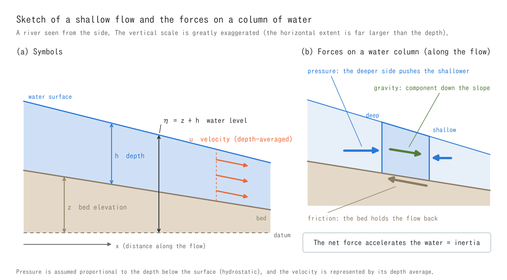
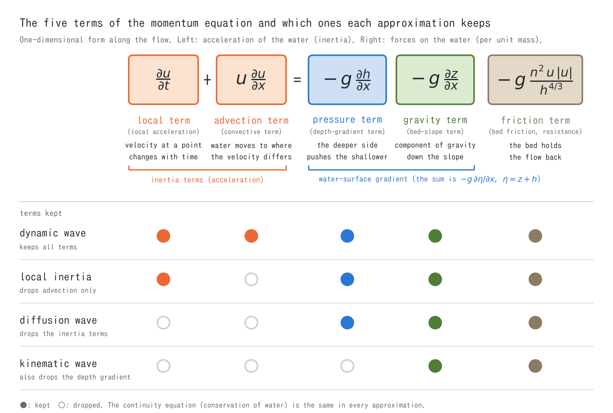
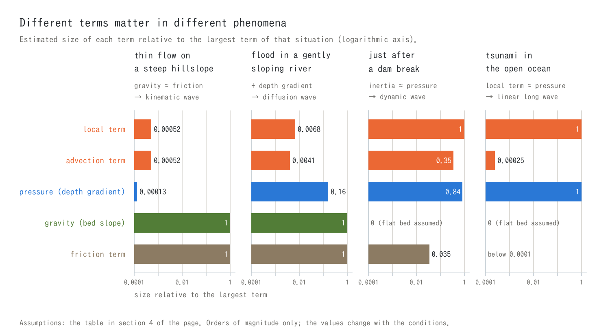
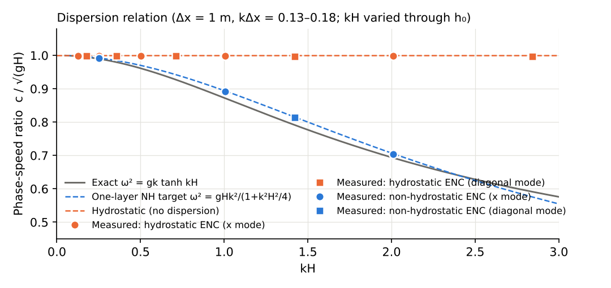
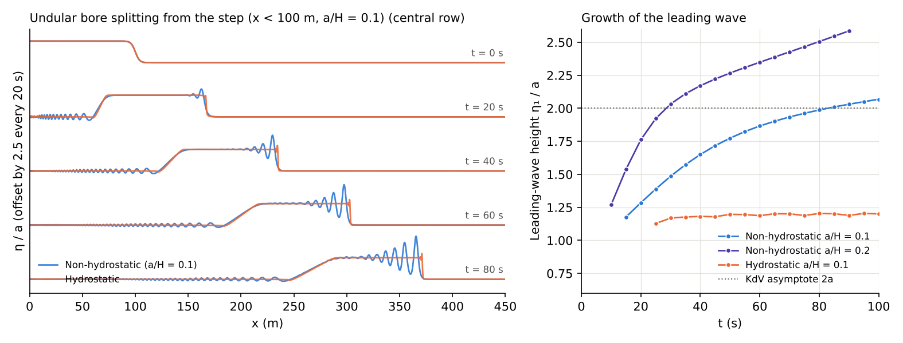

# The shallow water equations and the dynamic, diffusion and kinematic waves (primer for the shallow water chapter)

> English mirror of docs/users_guide/shallow_water.md. The Japanese file is the master copy.

[Back to the shallow water chapter](swflow.md) | [Back to the user's guide index](../users_guide.md) | [How the equations are solved (ENC grid and time integration)](encgrid.md)

**"Which balance of forces is driving this flow right now?" We look at the terms of the shallow water equations one at a time.**

This page is a primer for people meeting flow computation for the first
time. The tutorials and examples keep using words such as "dynamic wave",
"diffusion wave", "kinematic wave", "advection term" and "pressure term".
The page explains, in order, which part of the equations each of them
refers to, in which phenomena each matters, and why ENCflow uses the
dynamic wave by default. Equations do appear, but the notation is
explained from the start and no knowledge of fluid mechanics is assumed.
How the equations are solved on the grid is described in
[ENC grid and time integration](encgrid.md) and
[Advection schemes](advection.md).

If you are in a hurry, [the figure of section 3](#terms), [the table of
section 6](#wave-models) and [section 9](#encflow) are enough.

[Names and meaning of the terms](#terms) · [Dynamic, diffusion and kinematic waves](#wave-models) · [Which equations for which phenomena](#phenomena) · [The ENCflow setting](#encflow) · [Limits of the hydrostatic approximation](#hydrostatic) · [Addendum: Saint-Venant and unsteady-flow equations](#names)

<a id="shallow"></a>

## 1. What "shallow water" means -- depth small compared with the extent

A river, flood water on a plain, rain water running down a hillslope, the
tide moving in a bay. What they share is that **the depth is much smaller
than the horizontal extent**. A river 100 m wide and 3 m deep is like
that, and so is an inundation 1 m deep spreading over several kilometres.
The flow of such a "thin layer of water" is called **shallow flow**.

"Shallow" is not about the depth itself. A tsunami in the open ocean
travels over water 4,000 m deep, but its wavelength exceeds 100 km, so
the depth is only a few hundredths of the wavelength and the flow is
still "shallow".

In a thin layer two simplifications are possible.

1. **Pressure depends only on the depth below the surface (hydrostatic
   pressure).** The water moves almost horizontally and its vertical
   acceleration is very small, so the pressure at a point is given by
   "the weight of the water above it".
2. **The velocity is represented by its depth average.** The difference
   in velocity between the bed and the surface is not followed; one
   averaged velocity stands for the motion of the whole layer.

The unknowns are then only the **depth** and the **velocity** at each
place, and a three-dimensional flow can be solved as a problem in the
horizontal plane. The equations obtained with these simplifications are
the **shallow water equations**.[^vreug]



| Symbol | Meaning | Unit | ENCflow output |
|---|---|---|---|
| $`x,\ y`$ | horizontal position | m | — |
| $`t`$ | time | s | — |
| $`z`$ | bed elevation (height of the ground above the datum) | m | Z |
| $`h`$ | depth | m | H |
| $`\eta = z + h`$ | water level (height of the water surface) | m | E |
| $`u,\ v`$ | velocity (in $`x`$ and $`y`$; depth-averaged) | m/s | u, v |
| $`q = hu`$ | unit-width discharge (discharge per metre of width) | m²/s | Q (magnitude) |
| $`g`$ | gravitational acceleration | m/s² | — |
| $`n`$ | Manning's roughness coefficient (roughness of the surface) | s/m^(1/3) | — |

<a id="equations"></a>

## 2. The shallow water equations -- one for the amount of water, one for its motion

The shallow water equations are a pair of equations. For readability
they are written here in one direction along the flow ($`x`$).

**Continuity equation (conservation of the amount of water)**

```math
\frac{\partial h}{\partial t} + \frac{\partial (hu)}{\partial x} = r
```

It says: "the depth at a place rises or falls by the difference between
what flows in and what flows out (plus sources and sinks $`r`$ such as
rain)".

**Momentum equation (motion of the water)**

```math
\frac{\partial u}{\partial t} + u\,\frac{\partial u}{\partial x}
 = -\,g\,\frac{\partial h}{\partial x} \;-\; g\,\frac{\partial z}{\partial x}
 \;-\; g\,\frac{n^2\,u\,|u|}{h^{4/3}}
```

This is "acceleration = force ÷ mass" (Newton's law of motion) applied to
a column of water. The left side is the acceleration of the water; the
right side is the force acting on it (per kilogram of water).

**Reading the notation.** $`\partial/\partial t`$ is "the rate of change
with time, seen at a fixed place"; $`\partial/\partial x`$ is "the rate
of change with position, seen at a fixed time (a gradient)". For example
$`\partial h/\partial x`$ is the gradient of the depth: 0.001 if the
depth becomes 0.1 m larger 100 m further on.

In the horizontal plane the velocity becomes a vector
$`\mathbf{u} = (u, v)`$.

```math
\frac{\partial h}{\partial t} + \nabla\cdot(h\mathbf{u}) = r,
\qquad
\frac{\partial \mathbf{u}}{\partial t} + (\mathbf{u}\cdot\nabla)\,\mathbf{u}
 = -\,g\,\nabla(z + h) \;-\; \frac{g\,n^2\,|\mathbf{u}|}{h^{4/3}}\,\mathbf{u}
```

ENCflow solves these two-dimensional equations. The terms and their
meaning are the same as in one dimension, so the rest of the page uses
the one-dimensional form.

<a id="terms"></a>

## 3. Names and meaning of the terms



Each of the five terms of the momentum equation has a name. The names
differ between fields and textbooks, so the other names are listed
too.[^chow88]

| Term | Name (other names) | Meaning | Where it becomes large |
|---|---|---|---|
| $`\dfrac{\partial u}{\partial t}`$ | **local term** (local acceleration, unsteady term, time-derivative term) | the velocity at a fixed place changes with time | when the flow changes quickly: dam break, tsunami, gate operation |
| $`u\,\dfrac{\partial u}{\partial x}`$ | **advection term** (convective term, convective acceleration) | the water moves on to a place where the velocity is different; the flow carries its own momentum | where the velocity varies in space: sudden contraction and expansion, steps, bends, confluences, hydraulic jumps |
| $`-g\,\dfrac{\partial h}{\partial x}`$ | **pressure term** (depth-gradient term) | the water on the deeper side pushes the water on the shallower side | where the depth varies in space: backwater, the front of a wave, the edge of ponded water |
| $`-g\,\dfrac{\partial z}{\partial x}`$ | **gravity term** (bed-slope term) | on sloping ground, gravity pulls the water towards the lower side | steep hillslopes and channels |
| $`-g\,\dfrac{n^2 u\lvert u\rvert}{h^{4/3}}`$ | **friction term** (bed friction, resistance term) | the bed holds the flow back; it acts against the flow | shallow fast flow, rough ground |

Groups of terms have names too.

- **Inertia terms** (acceleration terms) = local term + advection term.
  This is the acceleration seen when following a parcel of water.
  "Inertia" is the property that water neither starts nor stops moving
  at once.
- **Water-surface gradient term** = pressure term + gravity term. Their
  sum is $`-g\,\partial(z + h)/\partial x = -g\,\partial\eta/\partial x`$,
  which says "water is pushed from where the surface is high to where it
  is low".
- The friction term is written here with Manning's formula. Other
  resistance laws play the same role.

### Saying it with slopes

Dividing the whole momentum equation by $`g`$ turns every term into a
"slope" (a number without units).

```math
S_f = S_0 \;-\; \frac{\partial h}{\partial x}
 \;-\; \frac{u}{g}\frac{\partial u}{\partial x}
 \;-\; \frac{1}{g}\frac{\partial u}{\partial t},
\qquad
S_0 = -\frac{\partial z}{\partial x},
\quad
S_f = \frac{n^2\,u\,|u|}{h^{4/3}}
```

$`S_0`$ is the **bed slope** and $`S_f`$ the **friction slope** (energy
slope). It reads: "the slope carried by friction is the bed slope minus
the depth gradient and the share of inertia". Hydraulics textbooks often
write the equation this way, and the approximations of section 6 are
easiest to see in this form.

### Pressure and gravity terms -- written separately or together

The pressure and gravity terms can be combined into the single
water-surface gradient term $`-g\,\partial\eta/\partial x`$.
Mathematically the two ways of writing are the same, but each has its
tradition.

- **Written separately (split form)** $`g\,(S_0 - \partial h/\partial x)`$.
  This is the natural form in one-dimensional river hydraulics, where the
  channel slope $`S_0`$ is a given value. The depth gradient is read as
  the departure from the flow in which gravity and friction balance
  ($`S_0 = S_f`$, uniform flow). The kinematic wave of section 6 drops
  the depth gradient in addition to the inertia terms and keeps only the
  bed slope, so it is thought of in this form.
- **Written together (combined form)** $`-g\,\partial\eta/\partial x`$.
  This is the natural form for computations in the horizontal plane over
  uneven terrain. If the water surface is level the force is zero, so it
  is evident from the equation that "water at rest stays at rest whatever
  the shape of the bed".

On a computer the difference can show up in the results. If the pressure
and gravity terms are computed in different ways, water that should be at
rest over an uneven bed feels a force left over from incomplete
cancellation, and a spurious flow appears. Methods that keep still water
still are called well-balanced schemes, and methods that hold pressure
and bed slope in different forms need special care to achieve
it.[^bv94][^audusse04]

ENCflow takes the difference of the bed elevation and the difference of
the depth between two neighbouring cells as the same two-point
differences and adds them. The sum is the difference of the water level
itself (combined form), so the driving force is zero when the surface is
level ([ENC grid and time integration](encgrid.md), section 5).

### Beyond these five terms

In ENCflow the following terms are added to the momentum equation
according to the settings.

- diffusion term (mixing of momentum by turbulence; [Diffusion term](diffusion.md))
- drag of groups of buildings ([Geographic information](geoinfo.md))
- non-hydrostatic correction ([section 10](#hydrostatic))
- forcing by the coastal wave field ([Coastal wave field](wavefield.md))

On steep slopes the gravity and friction terms are corrected
([Steep-slope gravity correction](steep_slope.md)). There is, on the
other hand, no term for the rotation of the earth (Coriolis force) and
none for wind stress. The target is the range that can be solved in a
projected coordinate system.

<a id="which-terms"></a>

## 4. Different terms matter in different phenomena

The five terms are not always of the same size. Depending on the
phenomenon, some of them hardly matter. We estimate and compare their
sizes in four typical situations.



The figure shows the size of each term relative to the largest term of
that situation. The table gives the underlying values (each term divided
by $`g`$, a slope) and the assumed conditions.

| Situation | Assumed | Local term | Advection term | Pressure term (depth gradient) | Gravity term (bed slope) | Friction term |
|---|---|---:|---:|---:|---:|---:|
| Thin flow on a steep hillslope | rain of 10.8 mm/h on a slope 800 m long with gradient 0.05 and $`n`$ = 0.015; depth 5 mm, velocity 0.45 m/s, 29 minutes until the discharge settles | 3×10⁻⁵ | 3×10⁻⁵ | 7×10⁻⁶ | 5×10⁻² | 5×10⁻² |
| Flood in a gently sloping river | gradient 1/5000, $`n`$ = 0.03; the depth rises from 3 m to 6 m in 12 hours | 1×10⁻⁶ | 8×10⁻⁷ | 3×10⁻⁵ | 2×10⁻⁴ | 2×10⁻⁴ |
| Just after a dam break | flat bed; over a reach of 300 m and within 30 seconds, depth 10 → 4 m and velocity 0 → 7 m/s; $`n`$ = 0.03 | 2×10⁻² | 8×10⁻³ | 2×10⁻² | 0 | 8×10⁻⁴ |
| Tsunami in the open ocean | depth 4,000 m, amplitude 1 m, period 20 minutes; flat bed assumed | 3×10⁻⁵ | 7×10⁻⁹ | 3×10⁻⁵ | 0 | 2×10⁻¹¹ |

*Estimates made for this page. With $`\Delta U`$ the change of velocity
and $`T`$ and $`L`$ the time and distance over which it changes, the
local term is estimated as $`\Delta U/(gT)`$, the advection term as
$`U\Delta U/(gL)`$, the depth gradient as $`\Delta h/L`$ and the friction
term as $`n^2U^2/h^{4/3}`$ (the tsunami is computed as a sine wave). The
first row is the hillslope of
[examples/benchmark/v-shaped](../../../examples/benchmark/v-shaped/en/README.md).
The computation is in the figure script
`docs/figs/guide/fig_shallow_water.py`. These are orders of magnitude
only; the values change with the conditions.*

The table shows the following.

- In the **thin flow on a steep hillslope**, gravity and friction
  balance and the other three terms are a thousandth of them or less.
  Keeping only the gravity and friction terms is enough (→ kinematic
  wave).
- In the **flood in a gently sloping river** gravity and friction still
  lead, but the depth gradient is 10 to 20 % of them. It cannot be
  dropped (→ diffusion wave). The inertia terms are below 1 %.
- **Just after a dam break**, the inertia terms and the pressure term
  lead and friction is secondary. All terms are needed (→ dynamic wave).
- The **tsunami in the open ocean** is a balance of the local term and
  the pressure term alone. Both the advection term and the friction term
  are negligible (→ linear long wave; [addendum](#names)).

**Which terms matter differs from phenomenon to phenomenon, and, within
one catchment, from place to place and from time to time.** That is why
the shallow water equations have several kinds of approximation.

<a id="froude"></a>

## 5. The Froude number -- subcritical and supercritical flow

One number that separates kinds of flow is the **Froude number**: the
ratio of the flow velocity to the speed $`\sqrt{gh}`$ at which a wave on
the surface travels relative to the water.

```math
Fr = \frac{u}{\sqrt{g h}}
```

| Froude number | Name | Character |
|---|---|---|
| $`Fr < 1`$ | **subcritical flow** | waves can travel upstream too; conditions downstream (a weir, a confluence, the tide level) reach upstream (backwater) |
| $`Fr = 1`$ | **critical flow** | the boundary between subcritical and supercritical |
| $`Fr > 1`$ | **supercritical flow** | waves cannot travel upstream; the flow is set by the conditions upstream alone |

Where supercritical flow returns to subcritical, the surface rises
abruptly in a **hydraulic jump**, and part of the kinetic energy of the
flow is lost into eddies.

The Froude number is also tied to the sizes of the terms of section 3.
In a flow of constant discharge, **the ratio of the advection term to the
pressure term is about $`Fr^2`$**.

- In a flow with small $`Fr`$ (slow subcritical flow) the advection term
  is small compared with the pressure term, and dropping it changes the
  result little.
- In a flow with $`Fr`$ near 1, or in supercritical flow, the advection
  term is as large as the pressure term. The change between
  supercritical and subcritical flow and the hydraulic jump cannot be
  represented without the advection term.

The Froude number alone does not decide, however. The "thin flow on a
steep hillslope" of section 4 is supercritical with $`Fr \approx 2`$,
yet both the inertia and the pressure terms are a thousandth or less of
the gravity and friction terms, and the kinematic wave represents it.
What the Froude number tells is "which is larger, inertia or pressure";
"whether those two matter compared with gravity and friction" is a
different question.

ENCflow can output the distribution of the Froude number (`f_out_fr`;
[Input and output formats](io.md)).

<a id="wave-models"></a>

## 6. Dynamic, diffusion and kinematic waves -- which terms are kept

The equations have names according to whether all the terms of the
momentum equation are kept or the small ones are dropped. "Wave" refers
to the flood wave, that is, the way a rise of the water surface
travels.[^chow88]

| Name (other names) | Local term | Advection term | Pressure term | Gravity term | Friction term | Momentum equation |
|---|:---:|:---:|:---:|:---:|:---:|---|
| **dynamic wave** (full dynamic wave) | ○ | ○ | ○ | ○ | ○ | the equation of section 2 as it is |
| **local inertia** (local inertial approximation) | ○ | — | ○ | ○ | ○ | $`\dfrac{1}{g}\dfrac{\partial u}{\partial t} = -\dfrac{\partial \eta}{\partial x} - S_f`$ |
| **diffusion wave** (diffusive wave, zero-inertia approximation) | — | — | ○ | ○ | ○ | $`S_f = -\dfrac{\partial \eta}{\partial x}`$ |
| **kinematic wave** | — | — | — | ○ | ○ | $`S_f = S_0`$ |

○ marks a term that is kept and — one that is dropped. **The continuity
equation is the same in all of them.** Only the momentum equation
differs.

### 6.1 Kinematic wave -- gravity balances friction

Dropping the inertia terms and the depth gradient leaves $`S_f = S_0`$,
the statement that "gravity and friction are always in balance". Solved
for the velocity, it is Manning's formula for uniform flow.

```math
u = \frac{1}{n}\,h^{2/3}\,\sqrt{S_0}
```

The velocity is set by the local depth and the slope of the ground
alone.

- A flood wave travels **downstream only** (at about 5/3 of the flow
  velocity).
- Conditions downstream do not reach upstream. Backwater and ponding
  cannot be represented.
- On flat ground there is no driving force (bed slope), so the water
  does not move. Water that enters a depression cannot leave it.
- In theory the wave travels without becoming lower (it does not
  attenuate).

The name is due to Lighthill and Whitham. Because the way the wave
travels follows from the continuity equation, a bookkeeping of
quantities (kinematics), without using the law of motion (dynamics),
they called it "kinematic", and they called the waves that need the law
of motion "dynamic".[^lw55]

**Where it is used:** rain water running down steep hillslopes, runoff
routing in steep mountain rivers.

### 6.2 Diffusion wave -- adding the depth gradient

Dropping only the inertia terms gives $`S_f = -\partial\eta/\partial x`$,
the statement that "the water-surface gradient and friction are in
balance".

```math
u = \frac{1}{n}\,h^{2/3}\,\sqrt{\left|\frac{\partial \eta}{\partial x}\right|}
\qquad(\text{directed towards the lower surface})
```

Putting this into the continuity equation shows that the depth obeys a
"diffusion" equation (an equation of the same form as the spreading of
heat). That is where the name comes from.

- A flood wave becomes **lower and flatter** as it travels
  (attenuation).
- The influence of the water level downstream travels upstream
  (backwater).
- Even on flat ground and in depressions the water flows if the surface
  has a gradient.
- Phenomena in which inertia matters cannot be represented: oscillation
  and reflection of waves, bores, hydraulic jumps, supercritical flow,
  jets and eddies carried by their momentum.

**Where it is used:** propagation of floods in gently sloping rivers,
slow inundation of floodplains, rainfall-runoff of catchments.

> **The "diffusion wave" and the "diffusion term" are different
> things.** The "diffusion" of the diffusion wave refers to a rise of the
> water surface spreading out smoothly. The diffusion term of ENCflow
> (`f_diffusion_term`) represents the mixing of momentum by turbulence
> and is a separate feature that can be added to any of the equations
> ([Diffusion term](diffusion.md)).

### 6.3 Local inertia -- dropping only the advection term

Of the inertia terms, only the advection term is dropped and the local
term is kept. Bates and co-workers proposed it for two-dimensional
inundation computations.[^bates10]

The motive was speed. When the diffusion wave is solved by a method that
obtains the values at the next time directly from the present ones (an
explicit method), the time step for which the computation stays stable
shrinks in proportion to the square of the cell size, and the
computation becomes extremely slow on fine grids. Keeping the local term
changes the limit on the time step into one proportional to the cell
size (a Courant-number condition), and fine grids can be computed fast.

- Waves on the surface travel in both directions at $`\sqrt{gh}`$.
- For slow subcritical inundation the result is close to the dynamic
  wave. Good agreement is reported for Froude numbers below 0.5, with
  the accuracy decreasing above that.[^dab13]
- Phenomena carried by the advection term cannot be represented:
  supercritical flow, hydraulic jumps, the correct speed of bores, the
  exchange of momentum at contractions, bends and steps.

**Where it is used:** inundation computations over wide areas of
lowland and coast.

### 6.4 Dynamic wave -- all the terms

No term is dropped; these are the shallow water equations themselves.
The other three are special cases of the dynamic wave in which small
terms are dropped, so **whatever the approximate equations can
represent, the dynamic wave can in principle represent too**. On top of
that it handles phenomena the approximations cannot.

- bores, hydraulic jumps, the change between supercritical and
  subcritical flow
- dam breaks, tsunami run-up, the back-and-forth flow of the tide
- jets spreading from a narrow opening, eddies behind obstacles

**Where it is used:** computations containing the phenomena above in
general; detailed computations of rivers and inundation, inundation by
tsunami and storm surge.

The dynamic wave is not all-powerful either. The premises of the shallow
water equations themselves (hydrostatic pressure and depth averaging)
remain ([section 10](#hydrostatic)).

<a id="phenomena"></a>

## 7. Which equations are used for which phenomena

| Equations | Can represent | Cannot represent | Main uses and examples of models that adopt them |
|---|---|---|---|
| kinematic wave | flow towards downstream set by gravity and friction | backwater, ponding, flow on flat ground and in depressions, attenuation of waves, phenomena in which inertia matters | rain water on steep hillslopes, runoff routing in mountain rivers (for instance the equivalent-roughness method long used in runoff analysis in Japan) |
| diffusion wave | in addition, backwater, ponding, attenuation of flood waves | phenomena in which inertia matters (oscillation and reflection of waves, bores, hydraulic jumps, supercritical flow) | rainfall-runoff and inundation of catchments (RRI, GSSHA), inundation of floodplains (one of the options of HEC-RAS 2D) |
| local inertia | in addition, propagation of surface waves (slow subcritical flow) | phenomena carried by the advection term (supercritical flow, hydraulic jumps, speed of bores, exchange of momentum) | inundation over wide areas of lowland and coast (LISFLOOD-FP, CAESAR-Lisflood, SFINCS) |
| dynamic wave | in addition, supercritical flow, hydraulic jumps, bores, tsunami run-up, jets and eddies | what lies outside the premises of the shallow water equations ([section 10](#hydrostatic)) | detailed computations of rivers and inundation, tsunami and storm surge (TELEMAC-2D, Delft3D, TUFLOW, Iber, iRIC Nays2DH, one of the options of HEC-RAS 2D, ENCflow) |

*The models are representative examples. Later versions may offer more
equations to choose from, so check the documentation of each model and
[Comparison with other models](../comparison.md).*

### Rules of thumb for choosing

Simple rules of thumb are known for estimating whether the approximate
equations can be used. $`S_0`$ is the bed slope, $`h`$ and $`u`$ are a
representative depth and velocity, $`L`$ is the length of the slope and
$`T`$ is the period of the flood wave (the time from rise to recession).
In the first row $`h`$ and $`Fr`$ are the values at the foot of the
slope once the flow has settled.

| Equations | Rule of thumb | Source |
|---|---|---|
| kinematic wave | $`k = \dfrac{S_0 L}{h\,Fr^2} > 20`$ | Woolhiser and Liggett[^wl67] |
| kinematic wave | $`T\,S_0\,\dfrac{u}{h} \ge 171`$ | Ponce et al.[^ponce78] |
| diffusion wave | $`T\,S_0\,\sqrt{\dfrac{g}{h}} \ge 30`$ | Ponce et al.[^ponce78] |
| local inertia | $`Fr \lesssim 0.5`$ | de Almeida and Bates[^dab13] |

They read: **the steeper the slope and the slower the change of the
wave, the better the approximation holds**. The hillslope flow of
section 4 has $`k \approx 1900`$, and the kinematic wave is sufficient.
For the gently sloping river of section 4, with a period of one day,
$`T S_0 u/h \approx 5`$, far short of the rule for the kinematic wave,
and $`T S_0 \sqrt{g/h} \approx 26`$, on the borderline of the rule for
the diffusion wave.

These are rules of thumb for the propagation of a flood wave when the
flow is viewed **smoothly at the scale of a reach**. They do not apply
to local phenomena that appear at the scale of a cell, such as steps,
sudden expansions and confluences. The distinction is examined in detail
in
[the supplement of the chichibu tutorial](../../../tutorials/chichibu/en/README.md#result-3-the-advection-term-and-resolution-dependence).

<a id="why-not-dynamic"></a>

## 8. Why the dynamic wave is not always used

If the dynamic wave contains everything, it would seem best always to
solve the dynamic wave. There are reasons why the approximate equations
have nevertheless been used widely.

1. **The advection term is hard to compute.** It is a product of
   velocities; it steepens the front of a flow and creates
   discontinuities such as bores and hydraulic jumps. A naive
   computation across a discontinuity produces oscillations, or fails to
   conserve momentum and gets the speed of the bore wrong. Methods that
   treat discontinuities correctly are needed
   ([Advection schemes](advection.md)).
2. **The constraints for a stable computation are severe.** In an
   explicit method the time step has to be shorter than "the time to
   cross one cell at the velocity plus the wave speed $`\sqrt{gh}`$"
   ([Courant number and how to choose the time step](courant.md)). Deep
   water has a large wave speed and forces a small time step. The
   boundary between dry and wet ground (the waterline) and the strong
   friction of thin water also need special care.
3. **The computational effort is large,** because there are more terms
   to compute and the time step is small. In hydrology, where whole
   catchments are computed over long periods, connecting hillslopes and
   channels by one-dimensional kinematic waves was the realistic choice
   that matched the capacity of the computers.
4. **In many situations dropping terms does not change the result.** As
   in section 4, in rain water on a steep hillslope the inertia terms
   are a thousandth of the gravity term. If the answer is the same with
   and without them, the simple equations are enough (the V-shaped
   catchment in "Seeing it in examples" of section 9 is such a case).
   The uncertainty of the terrain and the roughness is often larger.

Approximating does not, however, always make the computation faster (the
explicit diffusion wave of section 6.3). And if the approximate
equations are used outside the range where they apply (supercritical
flow, hydraulic jumps, bores, steep channels in which inertia matters),
the result looks plausible and is wrong. Judging before the computation,
place by place and time by time, whether one is inside or outside that
range is not easy.

<a id="encflow"></a>

## 9. ENCflow uses the dynamic wave by default

ENCflow aims to solve every flow of water on the land surface seamlessly
in one model (the basic policy,
[developer.md section 0](../developer.md)). The thin flow on mountain
slopes, the supercritical flow of steep channels, the ponding of
floodplains and the run-up of tsunamis appear at the same time in the
same computation. Which approximation holds changes with place and time,
so instead of choosing an approximation ENCflow makes **the dynamic
wave, which has all the terms, the default**.

The user does not have to decide beforehand "whether this phenomenon
needs the inertia terms". Where a term does not matter, it simply
becomes small.

The difficulties of section 8 are dealt with as follows.

| Difficulty | What ENCflow does | Explanation |
|---|---|---|
| advection term and discontinuities | an advection term in momentum-conserving form (the default `f_advection_scheme = 3`) | [Advection schemes](advection.md) |
| constraint on the time step | stays explicit and recomputes in several stages only where the discharge changes abruptly (adaptive Runge-Kutta); monitors the Courant number | [ENC grid and time integration](encgrid.md), sections 6-7; [Courant number and how to choose the time step](courant.md) |
| strong friction of thin water | treats the friction term semi-implicitly | [ENC grid and time integration](encgrid.md), section 5 |
| waterline | limits outflow that would use up the water; caps the edge depth | [ENC grid and time integration](encgrid.md), sections 3 and 5 |
| computational effort | parallelises a simple explicit method with OpenMP and MPI | [Parallel execution](parallel.md) |

### Correspondence with the setting (`f_govequation`)

The governing equations are switched with `f_govequation` in
`&list_sysparam` ([the shallow water chapter](swflow.md)).

| `f_govequation` | Name | Terms computed | In the classification of section 6 |
|---|---|---|---|
| 0 (default) | dynamic wave | all terms | dynamic wave |
| 1 | local inertia (no advection term); formerly written "diffusive wave" | drops the advection term; the local, pressure, gravity and friction terms remain | local inertia |
| 2 | kinematic wave | drops the advection term and the pressure term (depth gradient); the local, gravity and friction terms remain | the kinematic wave with the local term kept |

`f_govequation = 1` uses the procedure of the dynamic-wave computation
as it is and sets only the advection term to zero. The local term
remains, so in the classification of section 6 it is not the diffusion
wave but **local inertia**. Because this setting was long called the
"diffusive wave" (or "diffusion wave"), that wording remains in the text
and figures of the examples and tutorials and in the comments of the
parameter files (DifWE). Where you read "diffusive wave
(`f_govequation = 1`)", it means this local-inertia computation.

If the flow changes slowly the local term is small and local inertia and
the diffusion wave give the same result (rainfall-runoff is such a
case). Where waves travel back and forth they differ: with local inertia
waves on the surface propagate, with the diffusion wave they do not (the
"wave in a tank" in the table below). `f_govequation = 2` likewise keeps
the local term, and the velocity approaches the uniform-flow value at a
rate set by friction.

Settings 1 and 2 are for sensitivity experiments and for comparison with
other models. They only skip the computation of terms; the limit on the
time step (the Courant-number monitor) is the same as for the dynamic
wave, so the computation does not become much faster (in Step 1 of
tutorials/wave the run time is shorter by 4 % with 1 and by 10 % with
2). For computations containing inundation of dry ground or run-up, keep
the dynamic wave.

### Seeing it in examples

| Example | When the governing equations are changed | What it shows |
|---|---|---|
| Rainfall-runoff of a V-shaped catchment ([examples/benchmark/v-shaped](../../../examples/benchmark/v-shaped/en/README.md#governing-equations-supplement-10-m)) | **A case with no difference.** The outlet discharges of the dynamic wave, local inertia and the kinematic wave differ by at most 2 % of the peak; the timing of the rise is the same | thin slow flow on a hillslope is set by the balance of gravity and friction; the same with any of the equations |
| Rainfall-runoff of a stepped slope ([test/hillslope](../../../test/hillslope/en/README.md)) | **A case with no difference.** The outlet discharges of the dynamic wave and local inertia coincide (peaks 210.69 and 210.68 m³/s) | even with steps of 10 m, inertia does not matter if the flow is thin and slow |
| Steep channels of real terrain ([the supplement of tutorials/chichibu](../../../tutorials/chichibu/en/README.md#result-3-the-advection-term-and-resolution-dependence)) | **A case with a difference.** Dropping the advection term makes the peak discharge near the catchment outlet 1.5 to 2.3 times that of the dynamic wave, and larger and earlier the finer the grid | the mechanisms that restrain the acceleration at steps of the bed (a loss corresponding to a hydraulic jump, the exchange of momentum) are in the advection term |
| Wave in a tank (add one line with `f_govequation` to `&list_sysparam` of Step 1 of [tutorials/wave](../../../tutorials/wave/en/README.md)) | With the kinematic wave (2) the mound of water does not move at all (velocity still 0 after 8 seconds). With local inertia (1) the wave spreads and its toe is where the dynamic wave puts it, but the front is less steep (the 1.1 m water level on the front is 36.7 m from the centre; 38.1 m for the dynamic wave) | on a flat bed the bed slope is zero, so the kinematic wave has no driving force; for a wave of appreciable height the advection term matters too |
| Bore of a dam break (set `f_govequation` to 1 in [test/dambreak](../../../test/dambreak/en/README.md)) | Dropping the advection term makes the distance the bore travels in 30 seconds 22 % shorter than the analytical solution and the depth behind it 37 % too large (dynamic wave: +1.3 %, −1.4 %) | the speed and height of a bore are set by conservation of momentum; the advection term is needed |

The first three rows are the values of the README of each example (the
READMEs write local inertia as "diffusive wave" or "no advection
term"). The last two rows were computed for this page (they are not
covered by the regression tests).

### Limits that remain with the dynamic wave

- **What lies outside the premises of the shallow water equations
  cannot be represented** ([section 10](#hydrostatic)).
- **The result of a flow the grid cannot resolve depends on details of
  the numerical method.** For a channel about as wide as a cell there
  are cases in which details of the computation of the advection term
  alone change the flood peak by 10 to 20 %
  ([One-cell-wide channels and the upwind donors of the advection term](advection_donor.md)).
- **Solving the equations correctly and matching reality are different
  things.** Having all the terms does not guarantee that the result
  matches observations
  ([Time-step design policy](timestep_policy.md), section 5).

<a id="hydrostatic"></a>

## 10. Limits of the hydrostatic approximation -- what the shallow water equations themselves cannot represent

The dynamic wave contains everything "within the range of the shallow
water equations". Those equations stand on the two simplifications of
section 1. Here we look at the limits of the first one, **hydrostatic
pressure**.

The hydrostatic assumption breaks down **when the vertical acceleration
of the water can no longer be neglected**. That happens when the
horizontal length over which the flow changes becomes as short as the
depth.

### Short waves travel more slowly (dispersion)

In the shallow water equations waves of every wavelength travel at the
same speed $`\sqrt{gh}`$. Real waves on a water surface travel more
slowly the shorter they are. This property is called **dispersion**.
With $`\lambda`$ the wavelength, the speed $`c`$ of a real wave is given
by the following formula.[^dd91]

```math
c = \sqrt{\frac{g\lambda}{2\pi}\tanh\!\left(\frac{2\pi h}{\lambda}\right)}
```

| Wavelength ÷ depth | Real wave speed ÷ $`\sqrt{gh}`$ | Excess of the shallow-water wave speed |
|---:|---:|---:|
| 100 | 0.999 | 0.1 % |
| 50 | 0.997 | 0.3 % |
| 20 | 0.984 | 1.6 % |
| 10 | 0.941 | 6 % |
| 5 | 0.82 | 22 % |
| 2 | 0.56 | 78 % |

If the wavelength is more than 20 times the depth, the error is 2 % or
less. This is the rule of thumb for what may be called "shallow water"
or a "long wave". Changes of the water surface in floods and inundation,
the tide and tsunamis in the open ocean are well within this range. Wind
waves and swell are not, except very close to the shore.



*Wave speed measured from standing waves in a closed tank (figure of
[test/nhwave](../../../test/nhwave/en/README.md)). kH on the horizontal
axis is $`2\pi \times`$ depth ÷ wavelength; shorter waves are to the
right. Hydrostatic ENCflow (orange) stays at 1 whatever the wavelength,
that is, it has no dispersion. The grey solid line is the theory of real
surface waves; with the non-hydrostatic correction (blue; see below) the
result approaches the theory.*

### A steep front breaks up into a train of waves

In the shallow water equations the front of a wave of appreciable height
steepens as it travels and becomes a bore (a discontinuity). In reality,
once the width of the front has shrunk to a few times the depth,
dispersion begins to act, and instead of a bore a train of waves (an
undular bore, soliton fission) may form. It is seen in tsunamis running
up rivers.



*A step of the water level travelling (figure of
[test/nhbore](../../../test/nhbore/en/README.md)). With hydrostatic
pressure (orange) it travels on as a bore; in the computation with the
non-hydrostatic correction (blue) it splits into a train of waves from
the front.*

### Other places where the hydrostatic assumption breaks down

- **Flow over weirs, drops and abrupt steps.** The flow bends strongly
  and vertical acceleration matters.
- **The inside of a hydraulic jump.** The shallow water equations treat
  a jump as a "discontinuity" and give the relation between the depth
  and velocity on either side correctly, but they do not represent the
  length of the jump or the eddies inside it.
- **Breaking waves.** The breaking process itself cannot be represented.
- **Tsunamis from sources short compared with the depth,** such as
  submarine landslides.
- **Steep slopes.** The shallow water equations presuppose gentle slopes
  (the [steep-slope gravity correction](steep_slope.md) of ENCflow makes
  up for part of this).

### Limits of depth averaging

The other simplification, "representing the velocity by its depth
average", has limits too. The following do not appear in the equations.

- the vertical distribution of the velocity (slower near the bed, faster
  near the surface)
- the secondary flow in bends (a spiral flow)
- layers of water of different density (salt water intruding under fresh
  water)
- the motion of individual water particles in short waves such as wind
  waves

Where necessary ENCflow makes up for these with separate models (the
secondary-flow correction of the direction of sediment transport --
[Sediment and landform change](geomorph.md); two layers of fresh and
salt water -- [Fresh and salt water layers](salt.md); the averaged
action of short waves -- [Coastal wave field](wavefield.md)).

### The non-hydrostatic correction of ENCflow

ENCflow has a **one-layer non-hydrostatic correction**
(`f_nonhydrostatic = 1`; for research) that approximates the vertical
acceleration with one layer and corrects the pressure. It is meant for
phenomena in which dispersion is essential: the undular bore of a
tsunami running up a river, the generation region of a tsunami caused by
a submarine landslide, a solitary wave in a reservoir
([Non-hydrostatic correction](nonhydrostatic.md)).

- The default is hydrostatic. Rainfall-runoff, river floods and
  inundation, storm surge and ordinary long-wave tsunamis do not need
  it.
- The cell size has to be half the depth or less, and the run time is
  1.5 to 3 times that of the hydrostatic computation.
- On a coarse grid a hydrostatic computation also shows fine
  oscillations at a steep front. They are an error of the computation
  (numerical dispersion), not physical dispersion. They are to be
  removed with the grid and the time step, not by adding the
  non-hydrostatic correction
  ([supplement of the wave tutorial](../../../tutorials/wave/en/README.md#supplement-what-the-front-oscillation-is----grid-refinement-and-physical-dispersion)).

The difference between hydrostatic and non-hydrostatic computations can
be seen in the following verification cases.

| Case | What it shows |
|---|---|
| [supplement of tutorials/wave](../../../tutorials/wave/en/README.md#supplement-what-the-front-oscillation-is----grid-refinement-and-physical-dispersion) | the same wave in a tank solved with and without hydrostatic pressure; the distinction between numerical and physical dispersion |
| [test/nhwave](../../../test/nhwave/en/README.md), [test/nhwave_nh](../../../test/nhwave_nh/en/README.md) | the period of a standing wave; when the wavelength is about 6 times the depth (kH = 1), 6.33 s non-hydrostatic against 5.65 s hydrostatic (12 % longer) |
| [test/nhsolitary](../../../test/nhsolitary/en/README.md) | a solitary wave; non-hydrostatic, it travels keeping its shape; hydrostatic, its front steepens into a bore and it becomes lower |
| [test/nhbore](../../../test/nhbore/en/README.md) | a step splitting into a train of waves (the figure above) |
| [test/nhshelf](../../../test/nhshelf/en/README.md) | a solitary wave riding onto a shallow shelf and splitting into several waves |
| [test/nhbreak](../../../test/nhbreak/en/README.md) | run-up of a breaking wave on a beach; the switch that treats the broken wave as a hydrostatic bore |
| [test/nhbottom](../../../test/nhbottom/en/README.md) | waves made by a moving bottom (corresponding to a submarine landslide) |

<a id="summary"></a>

## 11. Summary

- The shallow water equations describe the flow of a thin layer of water
  with the **continuity equation** (amount of water) and the **momentum
  equation** (motion of the water).
- The momentum equation has five terms: the **local and advection
  terms** (inertia), the **pressure and gravity terms** (water-surface
  gradient) and the **friction term**.
- Which terms matter depends on the phenomenon. Keeping all of them is
  the **dynamic wave**, dropping the advection term is **local
  inertia**, dropping the inertia terms is the **diffusion wave**, and
  dropping the depth gradient as well is the **kinematic wave**.
- The approximate equations are fast and simple where they hold and give
  wrong results outside that range.
- ENCflow makes **the dynamic wave the default** in order to solve every
  flow on the land surface seamlessly.
- Even with the dynamic wave the premises of the shallow water
  equations, **hydrostatic pressure and depth averaging**, remain.

[Back to the names and meaning of the terms](#terms) · [The shallow water chapter](swflow.md) · [wave tutorial](../../../tutorials/wave/en/README.md) · [chichibu tutorial](../../../tutorials/chichibu/en/README.md)

---

<a id="names"></a>

## Addendum: other names for the same equations -- Saint-Venant, unsteady-flow and long-wave equations

The shallow water equations have been called by different names in
different fields. Whatever the name, the content is the equations of
section 2, or their one-dimensional or approximate forms.

### A.1 The Saint-Venant equations

The **Saint-Venant equations** are the one-dimensional equations for the
change in time of the flow of a river, derived in 1871 by Barré de
Saint-Venant in France.[^sv1871] They describe the river by its "cross
section" at right angles to the flow.

```math
\frac{\partial A}{\partial t} + \frac{\partial Q}{\partial x} = q_L,
\qquad
\frac{\partial Q}{\partial t}
 + \frac{\partial}{\partial x}\!\left(\frac{\beta\,Q^2}{A}\right)
 + g A\,\frac{\partial \eta}{\partial x}
 + g A\,S_f = 0,
\qquad
S_f = \frac{n^2\,Q\,|Q|}{A^2\,R^{4/3}}
```

$`A`$ is the area of the cross section occupied by the flowing water,
$`Q`$ the discharge, $`R`$ the hydraulic radius (the area divided by the
length along which the water touches the bed and banks), $`q_L`$ the
lateral inflow, and $`\beta`$ a coefficient (close to 1) that allows for
the non-uniformity of the velocity within the section.

| Term of the Saint-Venant equations | Name on this page |
|---|---|
| $`\partial Q/\partial t`$ | local term |
| $`\partial(\beta Q^2/A)/\partial x`$ | advection term |
| $`gA\,\partial\eta/\partial x`$ | pressure term + gravity term (water-surface gradient term); also written split as $`gA\,(\partial h/\partial x - S_0)`$ |
| $`gA\,S_f`$ | friction term |

For a wide rectangular section of width $`B`$, $`A = Bh`$, $`Q = Bhu`$
and $`R \approx h`$. Dividing the equations by $`B`$ gives the shallow
water equations written with the unit-width discharge $`q = hu`$, and
rearranging with the continuity equation gives the velocity form of
section 2. In other words, **the Saint-Venant equations are the
one-dimensional shallow water equations**. The difference is that they
handle an arbitrary shape of the section and a hydraulic radius that
includes the friction of the banks. The classification of section 6 into
kinematic, diffusion and dynamic waves was originally made for these
one-dimensional equations.

Some of the literature calls the shallow water equations in the
horizontal plane the "two-dimensional Saint-Venant equations".

ENCflow represents channels too by the cells of the two-dimensional grid
and does not use one-dimensional channel equations. Friction is computed
with the depth $`h`$ (the wide-section approximation $`R \approx h`$)
and does not include the friction of the banks. A channel narrower than
a cell is represented by giving the cell the width and the shape of the
section of the channel ([Channels](channel.md)).

### A.2 Uniform, non-uniform and unsteady flow

Hydraulics and river engineering in Japan divide the flow in a channel
into three kinds according to whether it changes in time and in space
(the Japanese terms are 等流 *tōryū*, 不等流 *futōryū* and 不定流
*futeiryū*).[^jsce]

| Name | Change in time | Change in space | Basic equation | Correspondence on this page |
|---|---|---|---|---|
| **uniform flow** (等流) | no | no | $`S_0 = S_f`$ (Manning's formula) | the kinematic wave takes this relation to hold at every place and time |
| **non-uniform flow** (不等流; steady, gradually varied flow) | no | yes | $`\dfrac{d}{dx}\!\left(z + h + \dfrac{u^2}{2g}\right) = -S_f`$ | the dynamic wave without the local term only; used to compute the shape of the water surface (backwater) |
| **unsteady flow** (不定流) | yes | yes | the Saint-Venant equations | dynamic wave |

- A flow that does not change in time is called steady (定流), one that
  changes **unsteady** (不定流). **The "equations of unsteady flow"
  (不定流の式, 不定流の基礎式) are the Saint-Venant equations, that is,
  the dynamic-wave equations.**
- A "one-dimensional unsteady flow computation" (一次元不定流計算)
  solves the Saint-Venant equations for a channel. A "plane
  two-dimensional unsteady flow model" (平面二次元不定流モデル) is an
  inundation computation that solves the two-dimensional shallow water
  equations of section 2; ENCflow is of this kind.
- Expanding the derivative in the equation of non-uniform flow gives
  $`(u/g)\,du/dx + dh/dx = S_0 - S_f`$, the equation of section 3
  without the local term.
- The equation of non-uniform flow is written as a balance of energy.
  For smooth flow it gives the same result as the momentum equation, but
  energy is lost across a hydraulic jump, so there the momentum equation
  is used ([Advection schemes](advection.md), section 1).

### A.3 Names by field

| Name | Main field | Content |
|---|---|---|
| shallow water equations (shallow-water flow equations, shallow-water wave equations; SWE) | fluid mechanics, numerical computation | the equations of section 2 |
| Saint-Venant equations | river hydraulics (one-dimensional); also used for the two-dimensional equations | the same; in one dimension, the form integrated over the section |
| equations of unsteady flow (one-dimensional unsteady flow, plane two-dimensional unsteady flow) | hydraulics, river engineering and inundation analysis in Japan | the same (dynamic wave) |
| equations of nonlinear long-wave theory (shallow-water theory) | tsunami, coastal engineering | the same; often written with the water level and the discharge |
| equations of linear long-wave theory | tsunami (propagation in the open ocean) | the form with the advection and friction terms dropped and the continuity equation simplified too (the "tsunami in the open ocean" of section 4) |
| dynamic-wave equations (full dynamic wave) | hydrology | the same; a name that distinguishes them from the kinematic and diffusion waves |
| depth-averaged model (depth-integrated model), horizontal two-dimensional model | numerical computation of rivers and coasts | the same; a diffusion term for turbulence is often added |

Some things are **similar but different**.

- **Boussinesq equations and non-hydrostatic models** add the effect of
  dispersion to the shallow water equations
  ([section 10](#hydrostatic)).
- **Three-dimensional hydrostatic models** solve the vertical
  distribution of the velocity, but the pressure is still hydrostatic.

There is also the distinction between the **conservative and the
non-conservative form**. The equations written with the depth and the
discharge ($`h`$, $`hu`$) are the conservative form; the form of
section 2, written with the depth and the velocity ($`h`$, $`u`$), is
the non-conservative form. For smooth flow they are the same equations,
but across a bore or a hydraulic jump a computation based on the
conservative form gives the correct speed and height
([Advection schemes](advection.md), section 1).

### A.4 Notation in the ENCflow documents

The ENCflow documents and parameter files write the same things as
follows.

| Name on this page | Other notation |
|---|---|
| dynamic wave | DynWE (comments of parameter files) |
| local inertia (`f_govequation = 1`) | diffusive wave, diffusion wave, "no advection term", DifWE (comments of parameter files); all are the former wording ([section 9](#encflow)) |
| kinematic wave | KinWE (comments of parameter files) |

The Japanese pages use more than one word for the dynamic and kinematic
waves (力学波 and 動的波; 運動波 for the setting `f_govequation` and
運動学的波 for the theory). The English pages write "dynamic wave" and
"kinematic wave" throughout.

## References

[^vreug]: Vreugdenhil, C. B. (1994): *Numerical Methods for Shallow-Water Flow*. Kluwer Academic Publishers, Dordrecht. (Derivation and premises of the shallow water equations.)
[^chow88]: Chow, V. T., Maidment, D. R. and Mays, L. W. (1988): *Applied Hydrology*. McGraw-Hill, New York. (Names of the terms of the Saint-Venant equations and the classification into kinematic, diffusion and dynamic waves.)
[^lw55]: Lighthill, M. J. and Whitham, G. B. (1955): On kinematic waves. I. Flood movement in long rivers. *Proceedings of the Royal Society of London, Series A*, 229(1178), 281–316. (The names kinematic wave and dynamic wave.)
[^wl67]: Woolhiser, D. A. and Liggett, J. A. (1967): Unsteady, one-dimensional flow over a plane — the rising hydrograph. *Water Resources Research*, 3(3), 753–771. (The kinematic flow number of overland flow. The threshold of 20 is taken from later literature citing the paper; the original has not been checked.)
[^ponce78]: Ponce, V. M., Li, R. M. and Simons, D. B. (1978): Applicability of kinematic and diffusion models. *Journal of the Hydraulics Division*, ASCE, 104(HY3), 353–360. (Conditions for keeping 95 % accuracy after one period of propagation. The thresholds are taken from the authors' later accounts; the original has not been checked.)
[^bates10]: Bates, P. D., Horritt, M. S. and Fewtrell, T. J. (2010): A simple inertial formulation of the shallow water equations for efficient two-dimensional flood inundation modelling. *Journal of Hydrology*, 387(1–2), 33–45. doi:10.1016/j.jhydrol.2010.03.027. (Local inertia. The explicit time step scales with the square of the cell size for the diffusion wave and with the cell size for local inertia.)
[^dab13]: de Almeida, G. A. M. and Bates, P. (2013): Applicability of the local inertial approximation of the shallow water equations to flood modeling. *Water Resources Research*, 49(8), 4833–4844. doi:10.1002/wrcr.20366. (Range of applicability of local inertia; good agreement with the dynamic wave for Froude numbers below 0.5.)
[^bv94]: Bermúdez, A. and Vázquez, M. E. (1994): Upwind methods for hyperbolic conservation laws with source terms. *Computers & Fluids*, 23(8), 1049–1071. (The condition for preserving still water.)
[^audusse04]: Audusse, E., Bouchut, F., Bristeau, M.-O., Klein, R. and Perthame, B. (2004): A fast and stable well-balanced scheme with hydrostatic reconstruction for shallow water flows. *SIAM Journal on Scientific Computing*, 25(6), 2050–2065. (An example of a well-balanced scheme.)
[^dd91]: Dean, R. G. and Dalrymple, R. A. (1991): *Water Wave Mechanics for Engineers and Scientists*. World Scientific, Singapore. (Dispersion relation of surface waves and the division into shallow and deep water.)
[^sv1871]: de Saint-Venant, A. J. C. Barré (1871): Théorie du mouvement non permanent des eaux, avec application aux crues des rivières et à l'introduction des marées dans leurs lits. *Comptes Rendus de l'Académie des Sciences*, 73, 147–154, 237–240.
[^jsce]: Japan Society of Civil Engineers, Committee on Hydroscience and Hydraulic Engineering, editorial subcommittee of the handbook (ed.) (2019): *Suiri Kōshikishū* (Hydraulic Formulae), 2018 edition. JSCE (distributed by Maruzen Publishing). In Japanese. (Basic equations of uniform, non-uniform and unsteady open-channel flow.)
