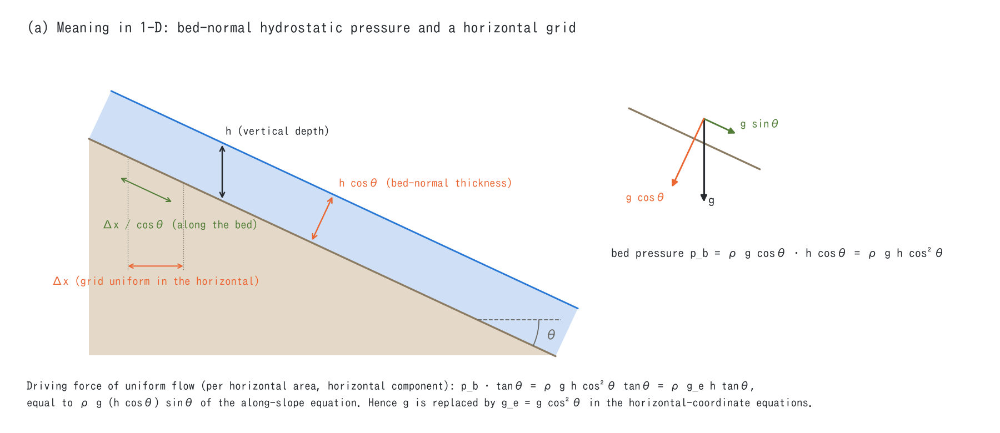
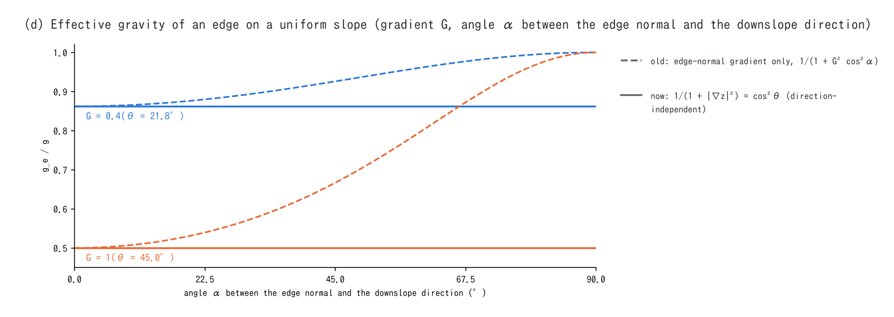
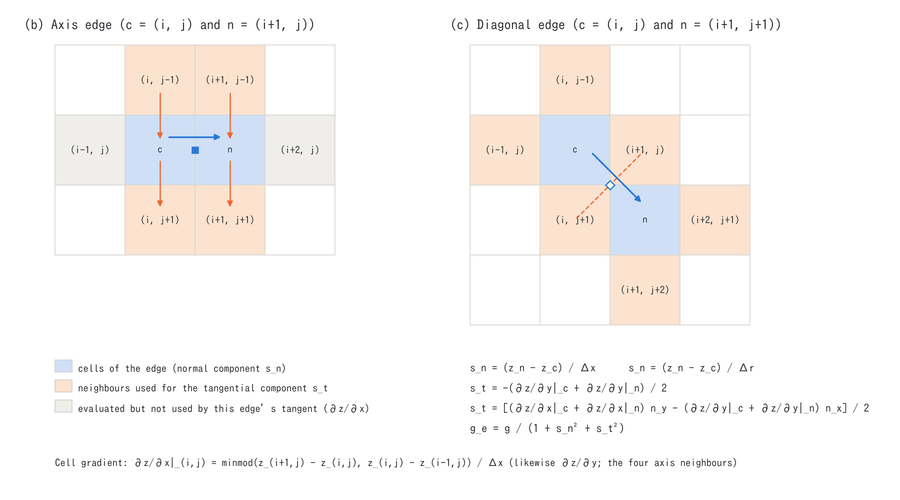

# Steep-slope gravity correction (supplement to the shallow water chapter)

> English mirror of docs/users_guide/steep_slope.md. The Japanese file is the master copy.

[Back to the shallow water chapter](swflow.md) | [ENC grid and time integration](encgrid.md) | [Back to the user's guide index](../users_guide.md)

This page explains the correction that lets the horizontal-coordinate shallow
water equations handle water flowing down steep slopes (`f_gravity_correction` in
`&list_enc`). It goes from what is corrected → formulation → discretization
(which stencil gives the gradients, and which gradient each edge equation uses)
→ verification → treatment in published models → what it cannot do and its
accuracy limits → choosing a value. The essentials are also in
[ENC grid and time integration](encgrid.md) §5. Derivations not found in the
literature are marked "derived for ENCflow". The history of the decisions and the
verification records are in developer.md §91 and §93.

| `f_gravity_correction` | Content |
|---|---|
| 0 | no correction (classical horizontally projected shallow water equations) |
| 1 | the effective gravity $`g_e = g\cos^2\theta`$ multiplies the slope, pressure and friction terms (the default until 2026-11-05) |
| 2 (default) | 1 plus friction and the shear of sediment transport and erosion evaluated with the slope-parallel speed and the bed-normal depth |

---

## 1. What is corrected

ENCflow solves, on an equally spaced raster in **horizontal coordinates**
$`(x, y)`$, the **vertically measured depth** $`h`$ and the discharge per unit
width of the horizontal plane $`(m, n) = h\,(u, v)`$ ($`(u, v)`$ is the horizontal
velocity). It does not use coordinates along the ground, so that any terrain
(valleys, ridges, embankments) can be handled as a raster. When these
horizontally projected shallow water equations are used for thin flow on steep
slopes, two assumptions of the classical (mild-slope) equations break down.

1. **Direction of the hydrostatic pressure**: in a thin flow parallel to the
   ground, the hydrostatic pressure is distributed normal to the ground, not
   vertically. The gravity component normal to the ground is $`g\cos\theta`$ and
   the thickness normal to the ground is $`h\cos\theta`$, so the bed pressure is
   $`p_b = \rho g \cos\theta \cdot h\cos\theta = \rho g h\cos^2\theta`$ ($`\theta`$ is
   the inclination of the ground).
2. **Grid spacing**: the grid is equally spaced horizontally, and the length along
   the ground is $`\Delta x/\cos\theta`$.



The bed pressure acts normal to the ground, so its horizontal component per unit
horizontal area is $`p_b\tan\theta = \rho g h\cos^2\theta\,\tan\theta`$. This is the
driving force of the along-slope equations, $`\rho g\,(h\cos\theta)\sin\theta`$ (the
along-slope component of gravity per unit area along the ground), converted to a
horizontal component per unit horizontal area. The slope term of the classical
horizontally projected equations is $`\rho g h\tan\theta`$, so replacing its $`g`$ by

```math
g_e = g\cos^2\theta = \frac{g}{1 + \tan^2\theta}
```

makes them agree. This is the correction by an "apparent gravity". In one
dimension it corresponds to expressing, as a replacement of the gravitational
acceleration, the transformation that maps the familiar shallow water equations
written along the slope (the downstream coordinate axis) to equations on the
horizontal axis (the equations are followed in §2.1). The same replacement also
represents the acceleration of a rigid block sliding on a slope exactly
(horizontal component $`g\sin\theta\cos\theta - \mu g\cos^2\theta = g_e(\tan\theta - \mu)`$;
test test/dbonset in §4).

The classical equations (no correction) over-estimate the driving force by a
factor of $`1/\cos^2\theta = 1 + \tan^2\theta`$ (3 % at 10°, 13 % at 20°, 33 % at
30°).

Besides the driving force, **friction (bed shear) also acts along the slope**. In
the along-slope equations the friction is set by the speed along the slope and the
depth normal to the ground. The default 2 also evaluates it this way, so that the
depth and velocity of uniform flow and the shear of sediment transport and erosion
agree with the along-slope equations (§2.3, §2.4).

## 2. Formulation

### 2.1 One dimension: the along-slope equations and the horizontal-coordinate equations

On a slope of constant inclination $`\theta`$, the thin-layer equations with a
hydrostatic pressure normal to the ground (Savage–Hutter type; thickness normal to
the ground $`h_n`$, depth-averaged velocity along the slope $`u_s`$, coordinate
along the slope $`s`$) are

```math
\frac{\partial u_s}{\partial t} + u_s\frac{\partial u_s}{\partial s}
= g\sin\theta - g\cos\theta\,\frac{\partial h_n}{\partial s} - \frac{\tau_b}{\rho h_n}
```

($`\tau_b`$ is the bed shear stress per unit area along the ground). When the water
surface is nearly parallel to the ground, $`h_n = h\cos\theta`$,
$`u_s = u/\cos\theta`$ and $`\partial/\partial s = \cos\theta\,\partial/\partial x`$
map them to horizontal coordinates (derived for ENCflow):

```math
\frac{\partial u}{\partial t} + u\frac{\partial u}{\partial x}
= -\,g\cos^2\theta\,\frac{\partial z}{\partial x}
  - g\cos^4\theta\,\frac{\partial h}{\partial x}
  - \frac{\tau_b}{\rho h}
```

($`\partial z/\partial x = -\tan\theta`$). Three things can be read from this.

- **The slope term (driving force) is exact with $`g_e = g\cos^2\theta`$**. The
  driving force of flows of uniform depth, of sliding and of uniform flow agrees
  with the along-slope equations under the effective-gravity replacement.
- **The coefficient of the depth-gradient term (pressure) is $`g\cos^4\theta`$**,
  smaller than $`g_e`$ by another $`\cos^2\theta`$. Building the term from the
  pressure on a vertical section in horizontal coordinates gives the same
  coefficient if the bed pressure is evaluated with the thickness normal to the
  ground (derived for ENCflow).
- **Friction is $`\tau_b/(\rho h)`$** (divided by the vertical depth). Evaluating
  $`\tau_b`$ with the speed along the slope $`u/\cos\theta`$ and the depth normal to
  the ground $`h\cos\theta`$ is what corresponds to the along-slope equations
  (§2.3).

Many horizontal-coordinate steep-slope models, ENCflow included, use the form that
multiplies **both** the slope term and the pressure term by $`g_e = g\cos^2\theta`$,

```math
\frac{\partial u}{\partial t} + u\frac{\partial u}{\partial x}
= -\,g_e\,\frac{\partial (z + h)}{\partial x} - (\text{friction})
```

(CAR of Ni et al. 2019, the printed equations of MSW-GC of Van Emelen et al. 2014,
and the uniform-depth case of Juez et al. 2013 and Denlinger & Iverson 2004; §5).
Compared with the thin-layer equations above, the driving force is the same and the
depth-gradient term is $`1/\cos^2\theta`$ times larger. In exchange, **still water
with a horizontal surface (a lake) is balanced exactly** (the slope and pressure
terms carry the same $`g_e`$, so a zero surface gradient gives zero force). The
$`\cos^4\theta`$ of the thin-layer equations rests on the assumption that the surface
is nearly parallel to the ground and does not apply to a lake with a horizontal
surface. Yuan et al. (2016) correct $`g'`$ with the product
$`\nabla h\cdot\nabla b`$ of the depth and ground gradients and derive a form that
gives $`g\cos^2\theta`$ for a uniform depth and returns to $`g`$ for a horizontal
surface (expanded to first order it agrees with the $`\cos^4\theta`$ above; checked
for ENCflow).

Hence **the one-dimensional driving force (the slope term) reduces to the same
content in every steep-slope formulation**, while **the coefficient of the pressure
term and the evaluation of friction differ between formulations**. Maranzoni &
Tomirotti (2022) also conclude that in one dimension the formulations agree with
the along-slope equations and that the differences in two dimensions lie mainly in
how the slope effect enters the pressure. The difference shows in the wave speed:
the horizontal wave speed in the downslope direction is $`\cos^2\theta\sqrt{gh}`$ in
the thin-layer equations ($`\sqrt{g\cos\theta\,h_n}`$ along the slope),
$`\cos\theta\sqrt{gh}`$ in the effective-gravity form and $`\sqrt{gh}`$ in the
classical equations (the equations of Maranzoni & Tomirotti, which carry the
velocity as components in the tangent plane of the ground, give the same wave speed
as the thin-layer equations).

In two dimensions the coefficient of the pressure term of the thin-layer equations
depends on the direction. Along the contours (the horizontal direction across the
slope) there is neither stretching of the coordinate nor vertical motion, so the
coefficient is $`g\cos^2\theta`$ and the wave speed $`\cos\theta\sqrt{gh}`$ (derived
for ENCflow). ENCflow's direction-independent $`g_e`$ agrees with the thin-layer
equations across the slope and is $`1/\cos^2\theta`$ times larger downslope (§6.2).

### 2.2 The edge momentum equation of ENCflow and the terms the correction multiplies

ENCflow solves the normal velocity $`u_k`$ of an edge $`k`$ (joining the centre cell
$`c`$ and the neighbour cell $`n`$; eight neighbours) ([encgrid.md](encgrid.md) §5).
$`g_e`$ is computed per edge (§3.3) and multiplies the following terms.

| Term | Expression (edge $`k`$, $`\Delta s_k`$ is the distance between the cell centres) | $`g_e`$ |
|---|---|---|
| Slope and pressure (water-surface gradient) | $`-\,g_e\,g_v\,(\eta_n - \eta_c)/\Delta s_k`$, $`\eta = z + h`$ | yes ($`g'`$ with 3; §2.6) |
| Manning friction (semi-implicit; the coefficient $`F`$ multiplies $`u_k`$) | 1: $`F = -\,g_e\,g_v\,n^2\,|\mathbf V|_e/h_f^{4/3}`$; 2: the expression below | 1 only |
| Yield (Coulomb) of mixture flows and the turbulent term of Voellmy | $`a_y = g_e\tan\phi\,sC/(1+sC)`$, $`g_e V^2/(\xi h)`$ | yes with 1; rewritten in the slope-parallel form with 2 (§2.3) |
| Curvature term (centrifugal acceleration; f_dbcurv) | gravity normal to the ground $`g_n = \sqrt{g\,g_e} = g\cos\theta`$ | yes |
| Pressure of the sediment column of mixtures | $`-\,g_e\,g_v\,(h_{s,n} - h_{s,c})/\Delta s_k`$ | yes |
| Advection, diffusion, building drag, wave forcing | — | no |

With 2 (default), the coefficient $`F`$ of the Manning friction
([encgrid.md](encgrid.md) §5) is evaluated with the slope-parallel speed
$`|\mathbf V_s|`$, the bed-normal depth $`h\cos\theta`$ and $`g`$ (§2.3; $`\cos\theta`$
and $`|\mathbf V_s|`$ come from the field gradient of §3.4).

```math
F = -\,g\,g_v\,\frac{n^2\,|\mathbf V_s|_e}{(h_f\cos\theta)^{4/3}},
\qquad
|\mathbf V_s| = |\mathbf V|\sqrt{1 + (\hat{\mathbf V}\cdot\nabla z)^2}
```

$`g_e`$ and the friction factor of 2 are computed once per edge from the ground
$`z`$ and the velocities at the head of the step and are not changed between the
Runge–Kutta stages ($`z`$ changes only through landform-change updates).

### 2.3 Uniform flow and friction (the difference between 1 and 2)

**With 1, $`g_e`$ also multiplies the friction**, so $`g_e`$ drops out of the steady
uniform-flow balance $`g_e h S = g_e n^2 u^2/h^{1/3}`$ ($`S = \tan\theta`$), leaving

```math
u = \frac{1}{n}\,h^{2/3}\,S^{1/2}\qquad(h:\ \text{vertical depth},\ u:\ \text{horizontal velocity},\ S = \tan\theta)
```

the classical horizontally projected Manning formula (the same as without the
correction). The gravity correction of 1 therefore **leaves the depth and velocity
of uniform flow unchanged and changes the unsteady part (acceleration and start of
motion, the wave speed $`\sqrt{g_e h}`$, spreading by the pressure across the
slope)**. Seen in the equations, multiplying the slope, pressure and friction terms
all by $`g_e/g`$ is the same as multiplying the inertia (local acceleration and
advection) by $`1 + |\nabla z|^2`$: it counts the inertia of the vertical motion of
water running down the slope (the square of the downslope speed is
$`|\mathbf V|^2(1 + |\nabla z|^2)`$).

The two corrections of §1 act in uniform flow only up to the driving force; **how
the friction is evaluated (horizontal or slope-parallel velocity, vertical or
bed-normal depth) changes the uniform-flow depth**. **2 (default)** evaluates the
bed shear stress with the Manning law from the slope-parallel speed $`|\mathbf V_s|`$
and the bed-normal depth $`h_n = h\cos\theta`$
($`\tau_b/\rho = g\,n^2|\mathbf V_s|^2/h_n^{1/3}`$; with $`g`$, not $`g_e`$).
Converting the force on the slope area $`1/\cos\theta`$ to the horizontal area gives
a deceleration of the horizontal velocity of $`g\,n^2|\mathbf V_s|\,\mathbf V/h_n^{4/3}`$
(derived for ENCflow); relative to the friction of 1 the factor is

```math
(1 + |\nabla z|^2)^{5/3}\sqrt{1 + (\hat{\mathbf V}\cdot\nabla z)^2}
```

Uniform flow in the direction of steepest descent is
$`u_s = h_n^{2/3}\sin^{1/2}\theta/n`$ (horizontal velocity $`u = u_s\cos\theta`$), and in
terms of the (horizontal) unit discharge $`q`$

```math
h\cos\theta = \left(\frac{n^2 q^2}{\sin\theta}\right)^{3/10}
```

the uniform flow of the along-slope equations (Chow 1959; MSW of Van Emelen et al.
2014). For the same $`q`$, the vertical depth of 1 (the same as the classical
horizontally projected formula) is $`\cos^{13/10}\theta`$ times that of 2, and the
horizontal velocity $`\cos^{-13/10}\theta`$ times (derived for ENCflow; agrees with
the values in Fig. 7 of Van Emelen et al. 2014).

| Slope angle | 5° | 10° | 15° | 20° | 25° | 30° | 35° | 40° | 45° |
|---|---|---|---|---|---|---|---|---|---|
| Gradient $`\tan\theta`$ | 0.087 | 0.176 | 0.268 | 0.364 | 0.466 | 0.577 | 0.700 | 0.839 | 1.000 |
| Over-estimate of the driving force by the classical equations $`1/\cos^2\theta`$ | 1.008 | 1.031 | 1.072 | 1.132 | 1.217 | 1.333 | 1.490 | 1.704 | 2.000 |
| Vertical depth of uniform flow (same $`q`$) 1 / 2 | 0.995 | 0.980 | 0.956 | 0.922 | 0.880 | 0.829 | 0.772 | 0.707 | 0.637 |
| Horizontal velocity of uniform flow (same $`q`$) 1 / 2 | 1.005 | 1.020 | 1.046 | 1.084 | 1.136 | 1.206 | 1.296 | 1.414 | 1.569 |
| Bed shear (same $`q`$) 1 / 2 | 1.003 | 1.011 | 1.025 | 1.045 | 1.071 | 1.106 | 1.150 | 1.205 | 1.275 |
| Downslope horizontal wave speed (1 and 2 alike) / thin-layer equations $`1/\cos\theta`$ | 1.004 | 1.015 | 1.035 | 1.064 | 1.103 | 1.155 | 1.221 | 1.305 | 1.414 |

If Manning's $`n`$ was calibrated with a horizontally projected model, part of this
difference is absorbed in $`n`$ (in the 12° flume experiment of Ni et al. 2019 the
difference showed only in the calibrated roughness). A literature value of $`n`$
(measured in mild-slope channels) is a value for slope-parallel quantities and can be
used as it is with 2 (§7).

With 2, the resistance laws of mixture flows (the debris-flow model) are also
evaluated with the slope-parallel speed and the bed-normal thickness (developer.md
§101, in Japanese). When the resistance stress $`\tau`$ is given along the slope, the
deceleration of the horizontal velocity is
$`\tau\,\mathbf V/(\rho_m h\cos\theta\,|\mathbf V_s|)`$, so the factors relative to the
horizontal form (1) are ($`r = |\mathbf V_s|/|\mathbf V|`$; $`1/\cos\theta`$ for flow in the
direction of steepest descent, 1 for flow along a contour)

| Resistance term | Factor | Direction of steepest descent (30°) |
|---|---|---|
| Yield (Coulomb, the $`\mu`$ of Voellmy, a constant yield stress, the yield of Egashira and Takahashi) | $`1/(r\cos\theta)`$ | 1 |
| Resistance proportional to the square of the velocity (the turbulent term $`g V^2/(\xi h)`$ of Voellmy, the laminar law of Egashira, the stony type of Takahashi–Nakagawa) | $`r/\cos^3\theta`$ | $`1/\cos^4\theta`$ = 1.78 |
| Bedload-like collective flow of Takahashi–Nakagawa | $`r/\cos^2\theta`$ | $`1/\cos^3\theta`$ = 1.54 |

For a mixture flowing in the direction of steepest descent the yield does not change
(the gradient at which a mixture at rest starts to move, $`\tan\theta = \mu`$, is the
same; the onset check uses the factor for the direction of the driving force), and
the resistance proportional to the square of the velocity grows, so the fast parts of
the flow become slower. Uniform flow with Voellmy follows
$`V_s^2 = \xi\,h\cos\theta\,(\sin\theta - \mu\cos\theta)`$ as in RAMMS, and the
slope-parallel speed at the same depth is $`\cos^2\theta`$ times that of 1 (0.75 at 30°;
test/dbslope). The literature values of $`\mu`$ and $`\xi`$ (RAMMS) and the speed and
thickness in the formulas of Egashira and Takahashi are slope-parallel quantities, so
they can be used as they are with 2. The Manning term of the laws combined with
Manning (`f_dbres` = 1, 5) and edges that fall back to Manning on the dilute side get
the same friction factor of 2 as water flow (until 2026-11-05, 2 made only the Manning
terms slope-parallel).

### 2.4 Shear of sediment transport and erosion

The dimensionless shear stress of bedload, suspended load, hillslope erosion,
bedrock incision and bank erosion is evaluated with the Manning-closed shear
$`\tau_* = n^2|\mathbf V|^2/(s\,d\,h^{1/3})`$ ([sediment transport
supplement](sediment.md) §1). 1 keeps the horizontal velocity and the vertical
depth, which over-estimates it by the bed-shear row of the table in §2.3 (1.11 at
30°; the transport rate goes roughly with the 1.5th power of the shear, so even
more). Van Emelen et al. (2014) state that above 10° the Shields number should be
evaluated with the bed-normal depth and that the classical horizontal-coordinate
equations over-estimate the sediment transport above 15°.

2 (default) uses the same bed shear stress as the friction of the momentum
equation:

```math
\tau_* = \frac{n^2\,|\mathbf V_s|^2}{s\,d\,(h\cos\theta)^{1/3}},
\qquad
\text{factor relative to 1}\ (1 + (\hat{\mathbf V}\cdot\nabla z)^2)\,(1 + |\nabla z|^2)^{1/6}
```

In uniform flow on a slope $`\tau_b = \rho g\,h\cos\theta\,\sin\theta`$. The same
factor multiplies the dimensional shear $`\tau_b`$ of bedrock incision. It is not
applied to the erosion and deposition of debris flows or to the driving stress of
bedrock erosion by debris flows (developer.md §91).

### 2.5 Two dimensions: $`\theta`$ is the inclination of the ground (a field quantity)

In two dimensions $`\theta`$ is **the angle between the normal of the ground and the
vertical**, i.e. the inclination in the direction of steepest descent, with
$`\tan\theta = |\nabla z|`$. The bed pressure $`p_b = \rho g h\cos^2\theta`$ is set
by the inclination of the ground alone; the horizontal component of the force
normal to the ground is $`-\,p_b\,\nabla z`$ per unit horizontal area, and its
component in the direction $`\mathbf e_k`$ of an edge $`k`$ is
$`-\,\rho\,g\cos^2\theta\,h\,(\nabla z\cdot\mathbf e_k)`$. On an edge of any
direction the same $`g_e = g/(1 + |\nabla z|^2)`$ multiplies the classical slope
term, so **$`g_e`$ does not depend on the direction of the edge**.

```math
g_e = g\cos^2\theta = \frac{g}{1 + |\nabla z|^2}
```

**For comparison: the per-edge gradient (the definition until 2026-11-04)**.
ENCflow previously computed $`g/(1 + (\Delta z/\Delta s_k)^2)`$ from the gradient in
the normal direction of the edge alone. On a uniform slope of gradient $`G`$, an
edge at an angle $`\alpha`$ to the downslope direction then gets
$`g/(1 + G^2\cos^2\alpha)`$: the more oblique the edge, the weaker the correction,
and an edge across the slope ($`\alpha = 90°`$) is not corrected at all (figure d).
The direction of the edges is set by the orientation of the grid, so this was **a
bias in which the same slope had a different effective gravity depending on the
orientation of the grid** (+7.4 % on an edge at 45° and +16 % on an edge across the
slope at a gradient of 0.4).



### 2.6 Variable gravity of the water-surface gradient term (3; experimental)

In addition to 2, 3 replaces the $`g_e`$ of the water-surface gradient term (the
ground-gradient term, the depth-gradient term and the sediment-column term of debris
flows) with the variable gravity of eq. 42 of Yuan et al. (2016) (for water, without
the term of the basal friction angle)

```math
g' = \frac{g\cos^2\theta}{1 + \cos^2\theta\,\nabla h\cdot\nabla z}
   = \frac{g}{1 + |\nabla z|^2 + \nabla z\cdot\nabla h}
   = \frac{g}{1 + \nabla z\cdot\nabla\eta}
```

($`\eta = z + h`$ is the water surface; with debris flows the depth is $`h + h_s`$).
This form has the following properties (checked for ENCflow).

- **Uniform depth** ($`\nabla h = 0`$): $`g' = g\cos^2\theta = g_e`$, so the driving
  force of thin flows is the same as with 2.
- **Horizontal water surface** ($`\nabla\eta = 0`$): $`g'`$ returns to $`g`$, and waves
  in deep water over steep lake shores, reservoir slopes or steep coasts travel at
  $`\sqrt{gh}`$ ("deep water over a steep bed" in §6.2). Because the force is
  proportional to $`\nabla\eta`$, a lake at rest stays exactly in balance.
- **Around a uniform flow**, the coefficient of the force $`-g'\,\partial\eta/\partial n`$
  with respect to the depth gradient is $`g\cos^4\theta`$ downslope and
  $`g\cos^2\theta`$ across the slope, as in the thin-layer equations (§2.1). The
  horizontal wave speed downslope is $`\cos^2\theta\sqrt{gh}`$, slower than the
  $`\cos\theta\sqrt{gh}`$ of 1 and 2 ("coefficient of the pressure term" in §6.2).

On an edge, the normal components of the gradients are edge differences (for the
ground, as for $`g_e`$ in §3.3) and the tangential components are the averages of the
minmod gradients of the two cells (for the ground as in §3.2, and the same minmod for
the depth). At steep fronts and steps $`\nabla z\cdot\nabla h`$ becomes large and the
denominator approaches zero or becomes negative, so $`\nabla z\cdot\nabla h`$ is limited
to $`[-|\nabla z|^2,\ |\nabla z|^2]`$ ($`g/(1 + 2|\nabla z|^2) \le g' \le g`$; our
simplification; Yuan et al. use an empirical damping factor). It is implemented by
adding the difference force $`-(g' - g_e)\,g_v\,(\eta_n - \eta_c)/\Delta s_k`$ for the
water-surface difference at time $`n`$ as an external force of the edge, like the
advection and diffusion terms; the change of the depths between the Runge–Kutta stages
is multiplied by $`g_e`$ (our simplification; developer.md §100, in Japanese). Friction,
sediment shear and the velocity terms of the resistance laws of mixture flows are the same
as with 2, and the normal stress of the yield of mixture flows that is set by gravity
(Coulomb type) is evaluated with $`g'`$ (as in Yuan et al.; the driving force and the yield
share the same $`g'`$, so the threshold at which a mixture at rest starts to move is the
same as with 2).

## 3. Discretization: which gradient each edge equation uses

### 3.1 Edges of the ENC grid

Each cell is joined to its eight neighbours by edges (four along the axes, four
diagonal). The length of edge $`k`$ (the distance between the cell centres) is
$`\Delta x`$ or $`\Delta y`$ along the axes and $`\Delta r = \sqrt{\Delta x^2 + \Delta y^2}`$
on the diagonals; the unit normal is $`\mathbf e_k = (n_x, n_y)`$ (`geo%n8x`, `n8y` in
the code; $`(\pm\Delta x, \pm\Delta y)/\Delta r`$ on the diagonals) and the tangent
$`\mathbf t_k = (n_y, -n_x)`$.

### 3.2 Ground gradient of a cell (`gravity_prepare`, `zdiff_minmod`)

Every step, the ground gradient $`(\partial z/\partial x, \partial z/\partial y)`$ of
each cell is computed from **the minmod of the differences to the two neighbours
along each axis** (four neighbours; `sx%gzx`, `gzy`).

```math
\left.\frac{\partial z}{\partial x}\right|_{i,j}
= \frac{1}{\Delta x}\,\mathrm{minmod}\left(z_{i+1,j} - z_{i,j},\ z_{i,j} - z_{i-1,j}\right),
\qquad
\mathrm{minmod}(a, b) =
\begin{cases}
a & ab > 0,\ |a| < |b| \\
b & ab > 0,\ |b| \le |a| \\
0 & ab \le 0
\end{cases}
```

$`\partial z/\partial y`$ likewise. If only one of the two neighbours is in the
computational domain (mask `g%x` > 0), the one-sided difference is used; if neither
is, 0. The ground of sea cells is included (the bed is continuous). This gradient is
used for the tangential component of $`g_e`$ in §3.3 and for all components of the
factors of 2 in §3.4.

### 3.3 Effective gravity $`g_e`$ of an edge (`correct_ge`)

$`|\nabla z|^2`$ of edge $`k`$ is the sum of the squares of **the normal component**
and **the tangential component**:

```math
s_n = \frac{z_n - z_c}{\Delta s_k},\qquad
s_t = \tfrac12\left(\nabla z|_c + \nabla z|_n\right)\cdot\mathbf t_k,\qquad
g_e = \frac{g}{1 + s_n^2 + s_t^2}
```

- **The normal component $`s_n`$** is the difference along the edge itself (the axial
  neighbour for an axial edge, the diagonal neighbour for a diagonal edge). It is the
  same difference as in the slope term of the momentum equation and the same term as
  in the definition before 2026-11-04.
- **The tangential component $`s_t`$** is the mean of the gradients of the two cells
  of the edge (the minmod of §3.2) projected onto the tangent of the edge. An edge has
  no difference in its tangential direction, so it is supplied from the cell
  gradients.



**Which cells each edge uses** (figures b and c; $`c = (i, j)`$):

| Edge | Normal component $`s_n`$ | Cells read by the tangential component $`s_t`$ | Total |
|---|---|---|---|
| Axial (x) $`c`$–$`(i{+}1, j)`$ | $`z_{i+1,j} - z_{i,j}`$ over $`\Delta x`$ | $`\partial z/\partial y`$ of both cells: $`(i, j{\pm}1)`$, $`(i{+}1, j{\pm}1)`$ | 6 cells |
| Axial (y) $`c`$–$`(i, j{+}1)`$ | $`z_{i,j+1} - z_{i,j}`$ over $`\Delta y`$ | $`\partial z/\partial x`$ of both cells: $`(i{\pm}1, j)`$, $`(i{\pm}1, j{+}1)`$ | 6 cells |
| Diagonal $`c`$–$`(i{+}1, j{+}1)`$ | $`z_{i+1,j+1} - z_{i,j}`$ over $`\Delta r`$ | $`\partial z/\partial x`$ and $`\partial z/\partial y`$ of both cells: $`(i{\pm}1, j)`$, $`(i, j{\pm}1)`$, $`(i{+}2, j{+}1)`$, $`(i{+}1, j{+}2)`$ | 8 cells |

On an axial edge the gradients of both cells in the direction of the edge (for an x
edge, $`\partial z/\partial x`$) are also computed, but for $`g_e`$ they are multiplied
by zero in the projection onto the tangent and not used. **The field gradient is
obtained, as the cell gradient, from the four axial neighbours, and the normal
component of $`g_e`$ is taken from the difference along the edge itself (one of the
eight directions, axial or diagonal).**

### 3.4 Factors of the slope-parallel friction and sediment shear (2)

The $`\nabla z`$ of the factors of 2 (§2.3, §2.4) is taken, **for both the normal and
the tangential component, from the mean of the gradients of the two cells (the
minmod of §3.2)**, i.e. from the field gradient.

```math
\overline{\nabla z} = \tfrac12\left(\nabla z|_c + \nabla z|_n\right),\qquad
|\nabla z|^2 = \left(\overline{\nabla z}\cdot\mathbf e_k\right)^2 + \left(\overline{\nabla z}\cdot\mathbf t_k\right)^2
```

$`\hat{\mathbf V}`$ is the direction of the mean of the velocities $`(u, v)`$ of the two
cells, and when there is no flow it is the normal of the edge (only the velocity of
that edge starts to move). On an axial edge the normal component also uses the cells
$`(i{-}1, j)`$ and $`(i{+}2, j)`$, grey in figure b. The factor of the shear of
sediment transport and erosion is computed from the cell gradient and the direction
of the cell velocity; for transport across an edge (bedload) it is the mean of the
factors of the two cells. The cell gradient is the value of §3.2 computed from $`z`$
at time $`n`$ at the head of the flow step and is read as it is (the factor never
reads a value that a landform-change process is rewriting cell by cell).

Unlike the normal component of $`g_e`$ (the difference along the edge), the field
gradient is used for these reasons:

- **The same on a plane**: the minmod is exact on a plane, so the normal component
  of the field gradient equals the difference along the edge and uniform flow follows
  the along-slope equations (the values of test/slopefric in §4 are the same to four
  digits as with the difference along the edge).
- **A step of a single edge is treated as with 1**: where the ground changes a lot
  across one edge, such as a wall, a kerb or a step in the DEM, the minmods of the two
  cells are nearly zero (flat above and below the step) and the factor is nearly 1.
  At a step the water falls and the shallow-water assumptions do not hold in the first
  place, so the geometry of a thin film on a slope is not applied and the step stays
  as with 1. With the difference along the edge, the friction coefficient of flow down
  a step of gradient 2 (63°) would be $`5^{13/6} = 33`$ times that of 1.
- **Friction and sediment shear with the same gradient**: the factor of the sediment
  and erosion shear also uses the minmod gradient of the cells, so it is the same bed
  shear as the friction of the momentum equation.

### 3.5 Why this combination ($`g_e`$)

- **The normal component stays the difference along the edge**: it is the same
  difference as the slope term of the momentum equation and is local. On a
  one-dimensional slope inclined along an axis, $`s_t`$ of the axial edges is 0 and
  the value is the same as before 2026-11-04 (on the diagonal edges it changes from
  $`G^2/2`$ of the old definition to $`G^2`$).
- **The tangential component uses the minmod**: exact on a plane, and at breaks such
  as between a valley floor and its walls or at the shoulder of an embankment it
  takes the gentler side, so the gradient of the valley walls does not enter the
  cells of the floor. With a central difference half of the wall gradient enters the
  floor cells, and on coarse grids (a floor of one or two cells) the effective
  gravity of the floor drops (by about a tenth for 35° walls). In cells where the
  differences on the two sides have opposite signs, such as ridges and valley
  floors, the tangential component is 0 and only the normal component acts.
- **The steepest slope (D∞; developer.md §92) is not used**: D∞ chooses the steepest
  descent from the cell and so picks up the steep side going down from a ridge such
  as the crest of an embankment. The $`\cos^2\theta`$ of the gravity correction is a
  quantity of the inclination of the ground (the direction of its normal), and
  picking up the steep side at a break would lower the effective gravity too much.
  The steepest slope $`\tan\theta`$ used for the safety factor, equilibrium
  concentration and stopping of mixture flows is D∞, because there the "steepest
  descent" is what matters.

### 3.6 Properties

- **Exact on a plane**: the minmod returns the exact gradient on a plane and the mean
  and the projections are exact, so $`s_n^2 + s_t^2 = |\nabla z|^2`$ on edges of any
  direction. The factors of 2 are also exact on a plane.
- **Balance of still water (well-balanced)**: $`g_e`$ multiplies the whole
  water-surface difference $`\eta_n - \eta_c`$, so still water with a horizontal
  surface stays force-free whatever the value of $`g_e`$.
- **Boundaries**: one-sided differences and 0 (§3.2). Wall edges carry no
  discharge.
- **Parallel runs**: $`z`$ has a halo of width 2 exchanged at the head of the step,
  and `gravity_prepare` computes the gradients of rows `js−1..je+1` of the band from
  $`z`$ of rows `js−2..je+2`. The edges on the band interfaces are computed
  redundantly by both ranks from the same inputs with the same expressions, so MPI
  runs with np = 1, 2 and 4 are bit-identical to the serial run (the factors of 2
  included). The results do not depend on the number of OpenMP threads either.
- **Cost**: for both 1 and 2, two real arrays of the size of the band (the cell
  gradients) and one pre-computation per step. The factors of 2 are computed on the
  spot per edge and per cell and add no arrays. 0 allocates and computes nothing.
- **The zero-velocity branch**: `correct_ge` has a branch that corrects only when the
  speed of the edge is positive, but the speed has already been raised to the lower
  bound `vv` of the friction (default 0.01 m/s; the smallest representable positive
  value even when 0 is given), so the correction is always applied (the branch never
  acts in practice). In the literature some forms switch the correction with the
  velocity: eq. (6) of Ni et al. (2019) gives $`g' = 0`$ at zero velocity, and eq. (15)
  of Maranzoni & Tomirotti (2022) uses $`k = 1`$ at rest.
- **Other uses**: the $`g_e`$ of the driving stress of bedrock erosion by debris flows
  is also $`g/(1 + (\partial z/\partial x)^2 + (\partial z/\partial y)^2)`$ from the same
  cell gradient (a cell-centred quantity, so there is no normal component;
  developer.md §91).

## 4. Verification

- **test/dbonset** (rigid sliding of a layer covering a uniform slope; gradients
  $`G`$ = 1.1 $`\mu`$ and 1.3 $`\mu`$, slope directions 0°, 22.5° and 45°, eight and four
  neighbours, with the gravity correction): against the analytic solution
  $`V(T) = g_e(G - \mu)T`$ with $`g_e = g/(1 + G^2)`$ the ratios are 1.0016–1.0017 at
  1.1 $`\mu`$ and 0.9976–0.9977 at 1.3 $`\mu`$, independent of the direction and the
  neighbourhood. With the old definition of §2.5, 10 of the 12 cases FAILed (only 0°
  with four neighbours passed; the old definition is right only for the axial edges of
  a slope along an axis).
- **test/slopefric** (a uniform 30° slope with 300 mm/h of rain, steady thin flow;
  slope directions 0°, 22.5° and 45°, eight and four neighbours): the mean of
  $`h/h_{analytic}`$ from the depth and the discharge is 1.0022–1.0033 against the
  classical formula with 1 and 1.0025–1.0040 against the along-slope formula with 2,
  independent of the direction and the neighbourhood. Measured with the formula of 1,
  the depth of 2 is $`\cos^{-13/10}30° = 1.206`$ times larger, so the two formulas can
  be told apart. The position where bedload erosion starts agrees with the analytic
  position where the dimensionless shear stress reaches the threshold (1: 25.37 m,
  2: 30.00 m).
- **Steps**: in a schematic 1 m urban block (rain on the roofs of 8 m buildings) and in
  overtopping of a 2 m wall, the results of 2 are the same as those of 1 (§3.4;
  developer.md §93).
- **test/dbslope** (resistance laws of mixture flows; §2.3): the depth of uniform flow
  on a strip of a 30° slope (4 neighbours) agrees within 0.03 % with the along-slope
  equations with 2 and with the horizontal equations with 1, for all four laws
  (Voellmy, Egashira, the stony type and the bedload-like collective flow of
  Takahashi–Nakagawa; the ratio of the depths of 2 and 1 for the same discharge is
  1.11–1.21).
- **test/steepwave** (the check of 3; §2.6): a lake at rest against a steep shore
  (gradient 1, slope direction 30°, 8 neighbours) stays exactly at rest with 2 and 3.
  For a small long wave crossing a steep lake bed (gradient 0.5, depth 40 → 4 m), the
  arrival times of the crest with 3 agree with no correction (0; exact for deep water
  with a nearly horizontal surface) and are 1.002–1.015 times the long-wave travel time
  $`\int dx/\sqrt{gh}`$; with 2 they are 1.038–1.101 times (slower because
  $`g_e = g\cos^2\theta`$ over the slope). For a small bump on a uniform layer
  (bed-normal thickness 1 m) on a frictionless 30° slope, the speed at which it splits
  into two is, relative to $`2\sqrt{g\cos\theta\,h_n}`$ of the thin-layer equations,
  1.007 with 3, 1.156 with 2 ($`1/\cos\theta = 1.155`$) and 1.353 with 0
  ($`1/\cos^2\theta = 1.333`$). The thin flow and the onset of bed-load erosion in
  test/slopefric also follow the same along-slope equations with 3 as with 2.
- **Indications of the impact of 3** (trial computations; the settings of the example
  are unchanged): in the four configurations of examples/landslide_tsunami (lake shore
  gradient 0.4), the waves of the lake with 3 are close to those without correction (0)
  (the leading wave of the rockslide at x = 298 m is 1.34 m with 0, 1.41 m with 1 and 2,
  and 1.33 m with 3). In the configuration where a debris flow runs down on land and is
  handed over to the bed layer in the lake, the deposit in the shore band is 1,070 m³
  with 3 against 608 m³ with 2 (1,165 m³ with 0; slide volume 19,110 m³). developer.md
  §100 (in Japanese).
- **Indications of the impact of the default 2**: in the steep mountain catchment of
  test/chichibu (Δx = 100 m), the peak of the maximum unit discharge is −2.1 %
  relative to 1; in test/chichibu_icmap the maximum unit discharge is −4.4 % and the
  maximum depth −4.0 %. The differences in the budgets of the mild-slope water-quality
  and groundwater cases are about 1 % or less. In strong wet erosion of the 56° cliff
  of examples/badland_storm (Δx = 2 m, 10 cycles), the eroded volume goes from
  37,500 to 20,800 m³ (−45 %) and the deepest incision from 16.6 to 11.2 m. For the
  same discharge, 1 over-estimates the bed shear by $`\cos^{-0.7}\theta`$ (1.50 at 56°),
  and threshold erosion laws and the positive feedback of gullies widen this to about
  a factor of 2 (developer.md §93).
- **Impact of the field-gradient $`g_e`$ (2026-11-04)**: in test/chichibu the maximum
  unit discharge $`Q_{max}`$ rises by 0.72 % in the rising limb of the flood. In
  examples/debris_fan, the arrival at the fan apex with four neighbours, which had been
  39 s and earlier than with eight neighbours whatever the grid, became 41–42 s, in line
  with eight neighbours (43–44 s), and the difference between maps with the orientation
  of the valley on the 5 m grid with eight neighbours went from 10 to 9 %
  (developer.md §91).

## 5. Treatment in published models

The following five papers are compared by coordinates and variables, the treatment
of gravity, $`\theta`$ in two dimensions, discretization and friction.

| Paper | Coordinates, variables | Treatment of gravity | $`\theta`$ in 2D | Discretization | Speed and depth of the friction |
|---|---|---|---|---|---|
| CAR of Ni, Cao & Liu (2019) | horizontal coordinates, vertical depth $`h`$, horizontal velocity $`(u, v)`$ | $`g' = g\cos^2\theta`$ on both the pressure flux and the slope term (eqs. 5, 6) | magnitude of the cell-centred central-difference gradient (eq. 8); the same $`\theta`$ in the x and y momentum equations and the friction | finite volumes, MUSCL, the scheme of Hou et al. (2013) that turns the slope term into a flux (C-property), a central FORCE flux because $`g'`$ differs between cells | Manning, $`g`$ (uncorrected), bed-normal depth $`h\cos\theta`$, a factor $`1/\cos\theta`$ (eq. 7) |
| Van Emelen, Zech & Soares-Frazão (2014) | 1D; slope coordinates (LC) and horizontal coordinates (GC) | MSW-GC: $`g\cos^2\alpha`$ on the pressure and slope terms (eq. 10, as printed) | (1D) | first-order finite volumes, HLL, upwinding of the slope term | Manning with the bed-normal depth $`H\cos\alpha`$ × $`\cos\alpha`$ (eqs. 10, 11) |
| Hergarten & Robl (2015) | horizontal coordinates, vertical depth $`h_v`$, horizontal velocity $`\mathbf v_h`$ | slope and pressure stay with $`g`$; a friction-like term reduces only the acceleration along the flow to $`\cos^2\varphi`$ (eqs. 9–13, 19–21) | magnitude of the gradient of the water surface or of the ground $`\tan\varphi = |\mathbf s|`$ (eq. 7) | GERRIS (cell-centred symmetric-difference gradient), the correction is a pointwise operation per cell | Voellmy, normal stress $`\rho g h_v\cos^2\varphi`$, turbulent term with the slope-parallel speed $`|\mathbf v_h|/\cos\psi`$ (eq. 18) |
| Yuan et al. (2016) | horizontal coordinates, vertical depth, horizontal velocity; with a non-hydrostatic correction | variable $`g'`$ on the pressure flux, slope and friction (eq. 42; $`g\cos^2\theta`$ for a uniform depth, $`g`$ for a horizontal surface) | $`\tan\theta = |\nabla b|`$, normal vector | finite volumes (Godunov type, MUSCL, HLL), pointwise sources | Coulomb, slope-parallel sliding speed $`\sqrt{u^2 + v^2 + (u b_x + v b_y)^2}`$ |
| Maranzoni & Tomirotti (2022) | horizontal coordinates $`(x, y)`$ and vertical depth $`h`$; the velocity as (non-orthogonal) $`\xi`$ and $`\eta`$ components in the tangent plane of the ground | $`k = \cos^2\psi = 1/(1 + \tan^2\theta_x + \tan^2\theta_y)`$ on the pressure flux (when flowing; $`k = 1`$ at rest), slope term $`gh\sin\theta_x`$ (sine, not tangent) (eqs. 11–15) | has directional $`\theta_x`$ and $`\theta_y`$, but the correction factor $`k`$ is a direction-independent quantity from the normal vector; criticizes formulations with direction-dependent factors | not treated in Part I (Part II uses MUSCL-type finite volumes with a FORCE flux) | 2D Manning, the true speed along the ground $`\lVert\mathbf v\rVert`$, vertical depth, the slope-area factor $`\sqrt{1 + \tan^2\theta_x + \tan^2\theta_y}`$ (eq. 14) |
| **ENCflow** | horizontal coordinates, vertical depth, horizontal discharge | $`g_e = g\cos^2\theta`$ on the slope and pressure | $`g_e`$ per edge with $`|\nabla z|^2 = s_n^2 + s_t^2`$; the factors of 2 from the field gradient of the two cells (§3) | edge momentum equation (ENC grid); the normal component of $`g_e`$ from the difference along the edge, the rest from the minmod cell gradients | Manning. 2 (default): $`g`$, slope-parallel speed $`|\mathbf V_s|`$, bed-normal depth $`h\cos\theta`$. 1: $`g_e`$, horizontal velocity, vertical depth |

Key points of each paper (equation and page numbers of the originals):

- **Ni, Cao & Liu (2019)**: compare the horizontal-coordinate 2D model CAR with the
  1D SWE in slope coordinates and the classical SVE. CAR assumes "hydrostatic pressure
  normal to the ground" and from geometry sets the pressure to
  $`p = \rho g\cos^2\theta\,(z_s - z)`$ (eq. 2). $`\cos\theta`$ is the magnitude of the
  cell-centred central-difference gradient (eq. 8); directional angles are not used.
  In a frictionless dam break on 30°, the front of SVE is 1.32–1.35 times faster
  (read from the figure; $`1/\cos^2 30° = 1.33`$) while CAR and SWE agree well with the
  analytic solution. In a 12° flume experiment the difference appears only in the
  calibrated roughness. In the breach of a natural dam on a 22 % gradient the flood of
  CAR is slower and deeper, and raising the roughness of SVE does not make them the
  same (the slope effect cannot be replaced by more resistance). Friction includes the
  slope (eq. 7); 2 of ENCflow follows the same idea (bed-normal depth and $`g`$).
- **Van Emelen, Zech & Soares-Frazão (2014)**: compare in 1D the classical (CSW) and
  modified (MSW, Savage–Hutter type) equations in slope and horizontal coordinates.
  The differences are small in sharp transients such as dam breaks, but **in uniform
  flow they show above 10°**: the error of the vertical depth of the classical
  horizontal-coordinate equations (CSW-GC; the same as the uniform flow of 1 in
  ENCflow, $`H = (n^2q^2/\tan\alpha)^{3/10}`$) is −2, −4.4, −7.8 and −17 % at 10°, 15°,
  20° and 30° (computed from eqs. 21, 22; agrees with Fig. 7). Above 10° the Shields
  number of bedload should be evaluated with the bed-normal depth, and CSW-GC
  over-estimates the sediment transport above 15°. Substituting eqs. (8) and (9), the
  pressure flux of MSW-GC becomes $`g\cos^4\alpha H^2/2`$, not the printed
  $`g\cos^2\alpha`$ (a check within what was read; the same coefficient as the
  thin-layer equations of §2.1).
- **Hergarten & Robl (2015)**: corrections for using the horizontal-coordinate shallow
  water equations for snow avalanches and rock avalanches. (i) The actual acceleration
  is parallel to the surface while the equations only have its horizontal component,
  and (ii) $`|\mathbf s| = \tan\varphi`$ while the acceleration on a slope is
  proportional to $`\sin\varphi`$; each contributes a $`\cos\varphi`$, together
  $`\cos^2\varphi`$ (a restatement of the two points of §1 of this page). The
  implementation keeps the slope term with $`g`$, reduces only the acceleration along
  the flow by a friction-like term and does not correct the acceleration normal to the
  flow (the authors call this a small limitation unavoidable as long as only friction
  opposite to the flow is used in Cartesian coordinates). $`\varphi`$ is the magnitude
  of the gradient (a field quantity); they compare versions taking it from the water
  surface and from the ground and recommend the ground, since in finite volumes and on
  staggered grids a gradient different from the internal discretization may produce
  artificial behaviour. They state **the error of carrying the horizontal velocity
  only** (without forces the horizontal velocity is conserved, so on a convex slope the
  slope-parallel speed increases artificially and on a concave slope it decreases).
- **Yuan et al. (2016)**: a non-hydrostatic granular-flow model in horizontal
  coordinates. From a hydrostatic pressure normal to the ground and a Taylor expansion
  they derive $`g'`$ (eq. 42): $`g\cos^2\theta`$ for a uniform depth (as Denlinger &
  Iverson 2004 and Juez et al. 2013), returning to $`g`$ in a lake with a horizontal
  surface (they point out that $`h_n = h\cos\theta`$ of Juez et al. gives a bed pressure
  of $`\rho g h\cos^2\theta`$ in a lake, which is not correct). $`\theta`$ is the
  magnitude of the gradient. Friction is evaluated with the slope-parallel sliding
  speed. The classical equations (model C) are fastest on steep slopes and deviate the
  most.
- **Maranzoni & Tomirotti (2022)**: 2D steep-slope shallow water equations that keep
  the horizontal coordinates as independent variables and carry the velocity as
  components in the tangent plane of the ground. The pressure is linear in the
  vertical; generalizing to 2D that "in parallel flow on a slope the pressure head on a
  vertical section is $`\cos^2\theta`$ times the vertical depth" (Chow 1959, Henderson
  1966), they multiply the pressure term by a direction-independent factor
  $`k = \cos^2\psi`$ ($`\psi`$ is the angle between the normal of the ground and the
  vertical; the same factor as Juez et al. 2013, Xia & Liang 2018 and Ni et al. 2019).
  At rest they switch to $`k = 1`$ to keep a horizontal surface. The slope term uses the
  sine and friction acts on the slope area. In 1D it is equivalent to the along-slope
  steep-slope equations, and **the differences between 2D formulations lie mainly in
  "how the slope effect enters the pressure"**. Among earlier formulations, they
  criticize **those using different pressure correction factors for x and y** (the
  equations of Chaudhry 1993, and $`gh\cos\theta_x\,\partial h/\partial x`$ and
  $`gh\cos\theta_y\,\partial h/\partial y`$ of Nakagawa & Takahashi 1997 (in Takahashi
  2007)), arguing that the factor should be set by the inclination of the ground (a
  symmetric function of $`\theta_x`$ and $`\theta_y`$), and call FLATModel (Medina et
  al. 2008), whose factor changes with the flow direction, "not physical". The
  threshold for small slopes is 1:10 (about 6°; Chow 1959). The difference in the time
  scale of a frictionless dam break is $`1 - \cos\theta`$, about 30 % at 45°. The wave
  speed along the ground is $`\sqrt{gh}\cos\theta = \sqrt{g\cos\theta\,h_n}`$, the same as
  the thin-layer equations of §2.1 (because the velocity is carried in the tangent
  plane of the ground; the forms of ENCflow and Ni et al., which carry the horizontal
  velocity, are $`1/\cos\theta`$ times this).

**Summary of the comparison**:

1. **Whether the correction factor is a field gradient**: the four papers that treat
   two dimensions (Ni et al., Hergarten & Robl, Yuan et al., Maranzoni & Tomirotti) all
   define the correction factor through the magnitude of the gradient (or the normal
   vector), **a field quantity**. Formulations with direction-dependent factors also
   exist (Chaudhry 1993, Nakagawa & Takahashi 1997), and Maranzoni & Tomirotti
   criticize them on the grounds that "the factor is set by the inclination of the
   ground and should be symmetric under exchanging x and y". The old definition of
   ENCflow (§2.5; the gradient in the normal direction of the edge only) amounts to
   such a directional correction applied per edge and draws the same criticism (the
   effective gravity changes with the orientation of the grid). The current definition
   builds $`|\nabla z|`$ per edge, so the factor does not depend on the direction of the
   edge.
2. **Discretization**: the papers that present numerical schemes all use cell-centred
   finite volumes (Part I of Maranzoni & Tomirotti does not treat the discretization),
   compute the correction factor from cell-centred gradients (Ni et al. and Hergarten
   & Robl state central differences) and treat the sources pointwise or as fluxes.
   ENCflow solves the momentum on the edges (staggered) and has to bring cell-centred
   values to the edges: the normal component of $`g_e`$ is the difference along the edge
   and the tangential component the mean of the gradients of the two cells (the same
   idea as averaging the transverse velocity component to the edge for the friction
   speed on a C grid). Using the minmod instead of a central difference for the
   tangential component and for the factors of 2 is ENCflow's choice, to handle breaks
   between a valley floor and its walls on coarse grids and not to apply the slope
   geometry to steps of a single edge (§3.4, §3.5).
3. **Form of the gravity correction**: that the driving force along the flow becomes
   $`g\sin\theta`$ along the slope (horizontal component
   $`g\sin\theta\cos\theta = g\cos^2\theta\tan\theta`$) is common to all papers; the
   representations differ: multiplying the slope term by $`g\cos^2\theta`$ (Ni et al.,
   Van Emelen et al., Yuan et al., ENCflow), writing it with the sine (Maranzoni &
   Tomirotti; the velocity in the tangent plane of the ground), or reducing the
   acceleration along the flow by a friction-like term (Hergarten & Robl). For the
   pressure term: $`g\cos^2\theta`$ (Ni et al., the printed equations of Van Emelen et
   al., ENCflow), $`g`$ (Hergarten & Robl), a variable $`g'`$ (Yuan et al.), and
   $`k = \cos^2\psi`$ together with the velocity in the tangent plane of the ground
   (Maranzoni & Tomirotti) (§2.1).
4. **Friction**: all five papers include a slope effect in the friction (the
   bed-normal depth, the slope-parallel speed, the slope area, or $`\cos^2\theta`$ in
   the normal stress). 2 (default) of ENCflow also evaluates it with the slope-parallel
   speed, the bed-normal depth and $`g`$ (§2.3). 1 keeps the horizontal velocity and the
   vertical depth and multiplies the friction by $`g_e`$, so its uniform flow is the
   classical equations (CSW-GC of Van Emelen et al.).

## 6. Meaning of the variables, what it cannot do and accuracy limits

### 6.1 Meaning of the variables of ENCflow

The velocity $`\mathbf V = (u, v)`$ of ENCflow is the **horizontal velocity** and the
depth $`h`$ is the **vertical depth**. Mass is conserved exactly on the horizontal
area (the pair of $`h`$ and the horizontal discharge $`h\mathbf V`$ represents the same
quantity as the discharge along the slope). The actual speed along the slope, with
the downslope component stretched, is

```math
|\mathbf V_s| = \sqrt{|\mathbf V|^2 + (\mathbf V\cdot\nabla z)^2}
\qquad(|\mathbf V|/\cos\theta\ \text{for flow in the direction of steepest descent})
```

and the depth normal to the ground is $`h\cos\theta`$. 2 uses these to evaluate the
friction and the sediment shear, but the variables and the outputs remain the
horizontal velocity and the vertical depth. Comparing output velocities (including
the maximum velocity V9999) with speeds along the slope needs a conversion.

### 6.2 What it cannot do and accuracy limits

- **Coefficient of the pressure term (wave speed)**: as in §2.1, the pressure term of
  ENCflow is, with both 1 and 2, $`1/\cos^2\theta`$ times larger than the thin-layer
  equations in the downslope direction, and the horizontal wave speed downslope is
  $`1/\cos\theta`$ times larger (last row of the table in §2.3; the same across the
  slope). Van Emelen et al. find the difference between the classical and modified
  equations "not large" for a dam break on 30°, and Ni et al. find that CAR (with
  $`g\cos^2\theta`$ also on the pressure) agrees with the analytic solution. 3
  (experimental) gives the thin-layer coefficient around a uniform flow (§2.6).
- **Convex and concave slopes (curvature)**: with equations that carry only the
  horizontal velocity, the horizontal velocity is conserved without forces, so on a
  convex slope (gradient increasing) the slope-parallel speed increases artificially
  and on a concave slope it decreases (Hergarten & Robl 2015). The change of the normal
  stress by the centrifugal acceleration (the curvature term) is included only in the
  yield friction of mixture flows (`f_dbcurv`; developer.md §28.10; what Fischer et al.
  2012 added to RAMMS). It is not included for water flow (overtopping of
  embankments, the curved face of a spillway).
- **Deep water over a steep bed**: $`g_e`$ is computed from the ground gradient and
  applies whatever the depth. Over steep lake shores, reservoir slopes or steep coasts,
  the surface of deep water is nearly horizontal and the vertical hydrostatic pressure
  (Yuan et al.'s $`g' = g`$) is correct, but ENCflow slows the wave speed by a factor
  $`\cos\theta`$ with $`g_e < g`$. The tsunami examples (examples/tsunami_coast,
  tsunami_fault) set `f_gravity_correction = 0`. examples/landslide_tsunami, where a
  landslide enters a lake, has both states in one computation: the flow of the
  landslide material needs the correction and the waves of the lake do not (the
  correction on the 0.4 slope edges of the lake shore changed the leading wave from
  +1.37 to +1.41 m; developer.md §91). 3 (experimental) returns to $`g`$ for a
  horizontal water surface and handles both in one computation (§2.6).
- **Limits of 3 (experimental)**: at steep fronts and bores the limit on
  $`\nabla z\cdot\nabla h`$ acts, and the result departs from both the thin-layer
  equations and the formula of Yuan et al. No correction is added on boundary edges
  (they keep $`g_e`$). The normal stress of the yield (Coulomb type) of mixture flows is
  evaluated with $`g'`$ (as in Yuan et al.; smaller at fronts and larger at tails and in
  hollows where the surface is gentler than the bed), but there is no analytic check in
  combination with debris flows. The combination with the non-hydrostatic model
  (`fn_nh`) has not been verified.
- **Steps and free overfalls**: at a step of a single edge (wall, kerb, step in the
  DEM) the water falls and the shallow-water assumptions do not hold. 2 treats a step
  as with 1 (§3.4). With 0, 1 and 2 alike, at a free overfall (the edge of a roof, the
  crest of a wall) the cell at the brink tends to dry, and the water surface upstream
  can become deeper than the friction-controlled estimate (6.2 mm on a schematic flat
  roof on a 1 m grid, against an estimate of about 4 mm at the centre of the roof from
  friction; developer.md §93).
- **Range of the resistance laws**: 2 evaluates the Manning friction and the
  resistance laws of mixture flows along the slope (§2.3). The building drag and the
  extra term of the wave–current friction (`wv_flow = 2`) get no factor (on the beach
  slopes where wave fields are used the factor is nearly 1). The terminal speed of the
  Voellmy law of the inertia-free bed layer (`f_bedslide`),
  $`V = \sqrt{\xi\,h_b\,(S - \mu b)}`$, stays in the horizontal form and is
  $`1/\cos^2\theta`$ times the speed of the slope-parallel form (1.16 at a gradient of
  0.4; developer.md §101). The factor of the yield for a mixture flowing obliquely
  across the slope (how $`r`$ acts) is not checked by the uniform-flow check
  (test/dbslope).
- **Speed on curved streamlines**: the $`\hat{\mathbf V}`$ of 2 is the direction of the
  mean velocity of the two cells, computed per edge. Where the flow turns sharply at an
  edge (confluences, strong bends), the estimate of the slope-parallel speed is
  coarse.

## 7. Choosing a value and the parameter

| Value | When to use |
|---|---|
| 2 (default) | flow and erosion on steep slopes; computations that use a literature value of Manning's $`n`$ (measured in mild-slope channels; a value for slope-parallel quantities) or literature values for mixture flows (such as the $`\mu`$ and $`\xi`$ of RAMMS) as they are |
| 1 | computations with a Manning's $`n`$ or parameters of the resistance laws of mixture flows calibrated in a horizontally projected model, and reproducing computations made before 2026-11-05 (before 2026-11-06 for mixture flows); a notice is printed at start-up |
| 0 | computations dominated by deep water over a steep bed (lakes, reservoirs, tsunamis on steep coasts; §6.2), and comparisons with the classical shallow water equations |
| 3 (experimental) | computations with both flow on steep slopes and waves in deep water over steep lake shores or coasts (a landslide entering a lake, etc.; §2.6). Whether to make it the default is under consideration (indications of its impact in §4) |

On gentle slopes the differences between 0, 1 and 2 are very small (at a gradient of
0.1 = 1:10, $`g_e/g = 0.990`$ and the friction factor of 2 for flow in the direction of
steepest descent is $`(1 + |\nabla z|^2)^{13/6} = 1.022`$; at 1:50, 1.001), so for floods
on gentle plains the choice makes little difference. Only the values 0, 1, 2 and 3
are accepted. An example setting is in
[List_samples/en/list_enc.txt](../../../examples/List_samples/en/list_enc.txt).

The figures are produced by `python3 docs/figs/make_guide_figs.py steepslope`
(`docs/figs/guide/fig_steepslope.py`) (schematic figures and closed-form expressions;
no result files needed).

## References

- Chaudhry, M. H. (1993): *Open-Channel Flow*. Prentice-Hall, Englewood Cliffs, NJ.
  (as cited by Maranzoni & Tomirotti)
- Chow, V. T. (1959): *Open-Channel Hydraulics*. McGraw-Hill, New York. (uniform flow
  in steep channels: Manning law with the bed-normal depth and the sine of the slope;
  p. 33 as cited by Maranzoni & Tomirotti)
- Denlinger, R. P. and Iverson, R. M. (2004): Granular avalanches across irregular
  three-dimensional terrain: 1. Theory and computation. *J. Geophys. Res.*, 109,
  F01014. doi:10.1029/2003JF000085. (as cited by Yuan et al. and Ni et al.)
- Fischer, J.-T., Kowalski, J. and Pudasaini, S. P. (2012): Topographic curvature
  effects in applied avalanche modeling. *Cold Reg. Sci. Technol.*, 74–75, 21–30.
  doi:10.1016/j.coldregions.2012.01.005.
- Henderson, F. M. (1966): *Open Channel Flow*. Macmillan, New York. (as cited by
  Maranzoni & Tomirotti; p. 28)
- Hergarten, S. and Robl, J. (2015): Modelling rapid mass movements using the shallow
  water equations in Cartesian coordinates. *Nat. Hazards Earth Syst. Sci.*, 15,
  671–685. doi:10.5194/nhess-15-671-2015.
- Hou, J., Liang, Q., Simons, F. and Hinkelmann, R. (2013): A 2D well-balanced shallow
  flow model for unstructured grids with novel slope source term treatment. *Adv.
  Water Resour.*, 52, 107–131. (as cited by Ni et al.)
- Juez, C., Murillo, J. and García-Navarro, P. (2013): 2D simulation of granular flow
  over irregular steep slopes using global and local coordinates. *J. Comput. Phys.*,
  255, 166–204. (as cited by Yuan et al., Ni et al. and Van Emelen et al.)
- Maranzoni, A. and Tomirotti, M. (2022): New formulation of the two-dimensional
  steep-slope shallow water equations. Part I: Theory and analysis. *Adv. Water
  Resour.*, 166, 104255. doi:10.1016/j.advwatres.2022.104255.
- Medina, V., Hürlimann, M. and Bateman, A. (2008): Application of FLATModel, a 2D
  finite volume code, to debris flows in the northeastern part of the Iberian
  Peninsula. *Landslides*, 5(1), 127–142. (as cited by Maranzoni & Tomirotti)
- Ni, Y., Cao, Z. and Liu, Q. (2019): Mathematical modeling of shallow-water flows on
  steep slopes. *J. Hydrol. Hydromech.*, 67(3), 252–259. doi:10.2478/johh-2019-0012.
- Savage, S. B. and Hutter, K. (1989): The motion of a finite mass of granular material
  down a rough incline. *J. Fluid Mech.*, 199, 177–215. (as cited by each paper)
- Takahashi, T. (2007): *Debris Flow: Mechanics, Prediction and Countermeasures*.
  Taylor & Francis, London. (as the source of the equations of Nakagawa & Takahashi
  1997; as cited by Maranzoni & Tomirotti)
- Tarboton, D. G. (1997): A new method for the determination of flow directions and
  upslope areas in grid digital elevation models. *Water Resour. Res.*, 33(2),
  309–319.
- Van Emelen, S., Zech, Y. and Soares-Frazão, S. (2014): Limitations of the shallow
  water assumptions for problems involving steep slopes: Application to a dike
  overtopping test case. In: Schleiss et al. (Eds.), *River Flow 2014*, Taylor &
  Francis, London, 1669–1677. ISBN 978-1-138-02674-2.
- Xia, X. and Liang, Q. (2018): A new depth-averaged model for flow-like landslides
  over complex terrains with curvatures and steep slopes. *Eng. Geol.*, 234, 174–191.
  (as cited by Maranzoni & Tomirotti)
- Yuan, L., Liu, W., Zhai, J., Wu, S. F., Patra, A. K. and Pitman, E. B. (2016):
  Refinement on non-hydrostatic shallow granular flow model in a global Cartesian
  coordinate system. arXiv:1602.03299v2 [physics.geo-ph]. (the journal version,
  *Comput. Geosci.*, 22, 2018, not checked)
