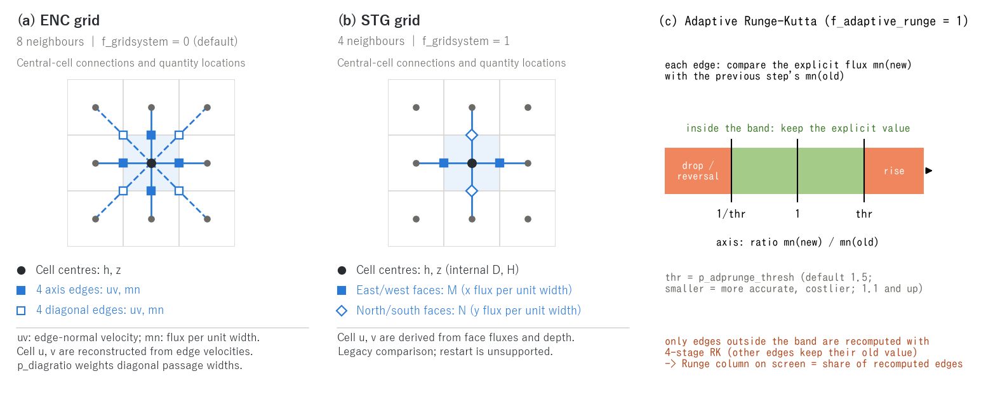

# Shallow water flow computation (&list_enc and numerical constants)

> English mirror of docs/users_guide/swflow.md (based on commit 97edd21). The Japanese file is the master copy.

[Back to the user's guide index](../users_guide.md)

Tuning parameters for the core surface water computation (the shallow
water equations on the ENC grid). **The defaults are set so that the
model runs reasonably as is** -- the settings in this chapter are for
accuracy/cost tuning and numerical experiments; in ordinary
computations the only one you may need to touch is the threshold of the
adaptive Runge-Kutta scheme.



**(a) ENC grid.** Depth h and ground elevation z are at cell centres.
Edges to the eight surrounding cells (four axis and four diagonal directions)
carry the normal velocity uv and flux per unit width mn. Filled squares mark
axis-edge quantities; open squares mark diagonal-edge quantities. Cell-centre
velocities u, v are reconstructed by combining edge velocities with geometric
weights. p_diagratio controls the allocation of diagonal passage widths.

**(b) STG grid.** This is a four-neighbour staggered grid for legacy comparisons.
Depth and ground elevation are at cell centres (internal arrays D and H).
The x-direction flux per unit width M is on east/west faces (squares), and
the y-direction flux per unit width N is on north/south faces (diamonds).
Output cell velocities u, v are the mean flux on the two opposing faces divided
by cell depth (zero below the threshold depth). Restart, subgrid channels and
levees, and internal hydraulic structures are unsupported in STG.

Panels (a)/(b) are square-cell schematics highlighting the connections and
quantity locations associated with the central cell. **(c) Adaptive Runge-Kutta
decision band.** The explicit candidate flux per unit width is compared with
its previous-step value; edges outside the threshold band are recomputed with
four RK stages. Zero previous flux, the exclusion of levee-wall edges and the
Runge display statistic are explained under "Time integration" below.
Run `python docs/figs/make_guide_figs.py swflow` to generate the Japanese and
English PNG/SVG figures.

## Choice of scheme (&list_sysparam)

| Parameter | Default | Meaning |
|---|---|---|
| f_gridsystem | 0 | 0: ENC grid (default), 1: STG (staggered grid; legacy-compatible, for comparison only. New features and restart are not supported) |
| f_govequation | 0 | 0: dynamic wave (advection + pressure; default), 1: diffusive wave (pressure only), 2: kinematic wave |
| f_check_cfl | 1 | Courant number monitoring. 0: monitor only (no stop), 1: display the state and stop when Cn > 1 (default), 2: judge and stop on the advective Courant number ignoring the wave speed (the definition of the Cn column and Cn output also switches to the advective Cn) |

The diffusive and kinematic waves are for sensitivity experiments and
comparison with other models. For inundation and runup involving
wetting and drying, keep the dynamic wave.

## Numerical constants (&list_sysparam)

| Parameter | Default | Meaning |
|---|---|---|
| dd | 0.001 | threshold depth (m). Water movement is computed on cells at or above this depth |
| dv | 0.001 | virtual depth (m). Computational lower bound for depths below this |
| vv | 0.01 | lower bound of the velocity in the friction term (m/s) |
| gg | 9.8 | gravitational acceleration (m/s^2) |
| cm / cd / kk | 2.0 / 1.0 / 0.5 | added-mass coefficient, drag coefficient, and drag correction factor of building clusters (used together with gv/bb of the geographic information; [geographic information chapter](geoinfo.md)) |

## Tuning the ENC computation (&list_enc)

Enabled via `fn_enc` (even without it, the core runs with the
defaults).

```
&list_enc
  p_adprunge_thresh = 1.1        ! threshold of the adaptive Runge-Kutta scheme (1.1 ~)
/
```

**Time integration (adaptive Runge-Kutta)**

| Parameter | Default | Meaning |
|---|---|---|
| f_adaptive_runge | 1 | adaptive Runge-Kutta (recompute eligible edges with four RK stages when the change in flux per unit width mn falls outside the decision band; the advection term stays at its time-level-n value during recomputation). Its purpose is to avoid shrinking dt for the whole domain because of a few extreme cells; if the Runge column reaches tens of percent, reducing dt is the proper remedy |
| p_adprunge_thresh | 1.5 | threshold thr for recomputation based on the change in flux per unit width (at least 1.1; smaller values narrow the decision band and select more edges for recomputation) |

When f_adaptive_runge is enabled, eligible edges other than levee-wall edges
compare the explicit candidate mn(new) with the previous-step value mn(old).
For mn(old) ≠ 0, recomputation occurs if the ratio r = mn(new) / mn(old) satisfies
**r < 1/thr or r > thr**. Reversal (r < 0) is included; the endpoints r = 1/thr
and r = thr are inside the band. If mn(old) = 0, no ratio is taken: nonzero
mn(new) triggers recomputation, while two zero values do not. The implementation
uses sign-dependent multiplication comparisons to make this decision.

Virtual levee-wall edges are excluded because their weir flux is set later.
During the RK updates of provisional depths, other edges contribute their
previous-step fluxes, and the advection term remains at time level n.
The **Runge column** reports the maximum, over the screen-output interval, of
`100 × recomputed edge count / (valid cell count × 4)`.
The band is a switching criterion based on flux changes; assess accuracy
together with the time step dt.

The meaning and effect of the threshold are demonstrated in
[tutorial Step 2](../../../tutorials/wave/en/README.md#step-2-setting-enc-parameters).
The Runge column on the screen shows the application rate.

**Flux and stabilization**

| Parameter | Default | Meaning |
|---|---|---|
| f_gravity_correction | 1 | gravity correction (corrects the slope-direction gravity error on steep terrain) |
| f_exflux_reduction | 1 | suppression of excessive outgoing fluxes. Prevents negative depths at fronts advancing over dry ground (recommended to keep on in computations with dry beds) |
| f_hcap_upwind | 1 | depth at the cell interface (mass flux). 0: mean of both cells, 1: the mean capped by the upwind-side depth (default), 2: the upwind-side depth itself (as in the continuity equation of Stelling & Duinmeijer; removes the one-cell pile-up spike at a bore front. It increases the outflow of a front onto dry ground, so check ex_flux and the front propagation in inundation runs) |
| f_friction_fastmath | 0 | fast evaluation of the friction term. 0: exact (default), 1-5: table approximation (larger = coarser and faster) |
| p_diagratio | 2/(2+sqrt(2)) | weight of the diagonal components in the 8-direction fluxes (normally no need to change) |

**Advection and diffusion terms**

The advection schemes themselves (equations, the momentum control volume of the
conservative form, stencils, the limiter) are explained on a separate page,
[Advection schemes](advection.md).

| Parameter | Default | Meaning |
|---|---|---|
| f_advection_scheme | 3 | scheme of the advection term. 1: cell-centre gradient (former default; a weighted 3×3 gradient projected onto the edge by averaging both cells. Non-conservative: bores lag and on real terrain the runoff gets faster and larger with grid refinement without converging), 2: momentum-conservative, first-order upwind, 3: momentum-conservative + MUSCL (van Leer; default). Schemes 2 and 3 extend the staggered-grid formulation of Stelling & Duinmeijer (2003) to the 8-direction ENC edges and give the correct speed of bores and hydraulic jumps (wet-bed dam break: bore position error 1%, versus a 15% lag with the former default 1). p_adv_upwind_index acts on scheme 1 only |
| f_advection_donor | 0 | restriction of the upwind momentum donors of the momentum-conservative advection (f_advection_scheme 2, 3). 0: every wet cell (default), 1: on edges between channel cells (fn_rw mask, rw > 0) the donor in the flow direction is limited to channel cells (a flow-direction face whose donor is a non-channel cell uses ū = u_e; lateral faces are not affected, so the deceleration by lateral inflow from the hillslopes remains). Prevents the artificial loss that accumulates at bends, confluences and irregular 2-cell-wide reaches when the upwind edge on the control-volume line falls onto a flooded valley-floor or hillslope cell whose slow water then becomes the momentum donor (developer.md §68.18). In the real-terrain test (chichibu 100 m) the outlet peak rises by 16% and arrives 0.5 h earlier, closing about 40% of the gap to the non-conservative scheme 1. It also cuts the momentum exchange between the main channel and flooded valley-floor cells, so judge its validity against observations. Requires the channel mask; no effect with scheme 1 || f_dry_head_cap | 1 | cap the edge depth toward a dry cell by the energy head. 0: off, 1: on (default). When the receiving cell is dry (h < dd) the depth an edge can carry is capped at max(η + u_n²/2g − z_receiver, 0); an edge that cannot be overtopped gets zero velocity. Water never climbs onto dry ground above the water surface plus velocity head (leaks and blow-ups in 1–2 cell wide incised channels). Never triggers in the wave/dambreak/chichibu tests |
| f_opening_dynamic | 1 | dynamic reassignment of blocked openings. 0: off, 1: edges between channel cells only (default; inactive without the channel mask fn_rw), 2: all edges. Passage-width shares that cannot be used because the diagonal neighbour's ground is above the water surface are reassigned to the open edges every step (edge velocity would otherwise be about 2.4× the cell velocity in a 1-cell channel, which amplifies the advection term). Use 2 for inundation, incised channels and dam breaks without a channel mask |
| p_adv_upwind_index | 0.5 | upwinding index of the advection term (0-1; scheme 1 only, unused with the default scheme 3). 0: central difference, 1: first-order upwind difference |
| f_diffusion_term | 0 | diffusion term. 0: none (default), 1: constant viscosity, 2: zero-equation model (nu = nu0 + alpha * u_star * h) |
| p_diffusion_nu | -- | kinematic eddy viscosity nu0 (m^2/s). **For model 1 a positive value must be specified explicitly** (unset is an error stop). For model 2 an optional background viscosity |
| p_diffusion_alpha | 0.41/6 | coefficient alpha of the zero-equation model (default is the Elder type) |

If you just want to try adding a diffusion term, **model 2 is
recommended** -- without specifying a single coefficient, a viscosity
that scales physically with the flow, nu = alpha * u_star * h (alpha
defaults to the Elder type), takes effect. The constant viscosity of
model 1 depends on the grid spacing and the scale of the flow, so there
is no universally recommended value and an explicit value is mandatory
(forgetting to set it stops the run at initialization, so it never
becomes silently inactive). The equations, eddy-viscosity models,
discretisation and stability condition are explained on a separate page,
[Diffusion term](diffusion.md).

**Non-hydrostatic correction (research option)**

The one-layer non-hydrostatic correction is a research option for
phenomena in which frequency dispersion (shorter waves travel more slowly)
is essential: soliton fission and undular bores of tsunamis running up
rivers, near-field generation of landslide tsunamis, solitary waves in
reservoirs. Rainfall runoff, flood inundation, storm surges and ordinary
long-wave tsunamis do not need it, and the default is hydrostatic (when off
there is no extra computation, memory or communication and the results are
bit-identical to before). The equations, the projection algorithm, the
active set, breaking, the bottom terms, and the models and literature the
implementation drew on are explained on a separate page,
[Non-hydrostatic correction](nonhydrostatic.md).

To just try it, one line is enough (CG solver, whole-domain solve,
flat-bed one-layer model).

```
&list_enc
  f_nonhydrostatic = 1    ! one-layer non-hydrostatic correction (everything else at the defaults)
/
```

**Practical points** (details in [§8 of the explanation](nonhydrostatic.md#8-range-of-validity-and-practical-points))

- **Grid spacing at most half the depth** (Δx ≲ H/2; the verification used
  H/4–H/8). On a coarser grid the correction is buried in the numerical
  dispersion of the grid and meaningless. The cost is set by this
  resolution requirement rather than by the solver.
- **Add options step by step as needed**: `f_nh_adaptive = 1` to limit the
  cost (solve only where dispersion matters). With breaking or bores,
  `f_nh_breaking = 1` + `f_hcap_upwind = 2` (required); for quantitative
  run-up add `nh_break_visc = 1.44` and friction n ≈ 0.01 and check
  convergence at Courant ≲ 0.1 and Δx ≲ H/8. `f_nh_slope = 1` for abrupt
  bathymetry (shelves, submarine landslides), `f_nh_bottom = 1` for the
  near field of landslide tsunamis.
- **Where it degrades to hydrostatic automatically**: depth below nh_hmin,
  the sea mask, levee walls, sub-grid channel width and cross-section,
  building-occupied cells, breaking cells, the neighbourhood of forced
  boundaries (nh_bc_margin).
- **Restrictions**: cannot be combined with debris flow (f_debris). A
  restart is a cold start (the private non-hydrostatic state is not saved).
  A nested child receives the parent's φ in the band
  ([Nesting](nest.md), nest_nh).
- **Cost**: solved on the whole domain, 2–3 times the hydrostatic run
  (10–90 CG iterations per step). With the active set the regions of long
  waves, steady flow and inundation carry no cost.
- **Verification cases**: dispersion relation of standing waves
  [test/nhwave_nh](../../../test/nhwave_nh/README.md), solitary wave
  [test/nhsolitary](../../../test/nhsolitary/README.md), undular bore
  [test/nhbore](../../../test/nhbore/README.md), soliton fission on a shelf
  [test/nhshelf](../../../test/nhshelf/README.md), breaking run-up
  [test/nhbreak](../../../test/nhbreak/README.md), moving bottom
  [test/nhbottom](../../../test/nhbottom/README.md) (READMEs in Japanese; the
  results are summarised in §8 of the explanation).

| Parameter | Default | Meaning (details in the § of the [explanation](nonhydrostatic.md)) |
|---|---|---|
| f_nonhydrostatic | 0 | 0: hydrostatic (default), 1: one-layer non-hydrostatic correction (β = h²/4, projection at the end of the step; §2–3) |
| nh_hmin | 0.1 | cells shallower than this depth (m) stay hydrostatic; must exceed dd (§4) |
| nh_solver | 2 | iterative solver. 2: CG (default), 1: Jacobi (for comparison; slow for Δx ≪ H) (§3) |
| nh_itmax | 500 | maximum number of iterations (a warning is printed and the run continues when exceeded) |
| nh_tol | 1e-6 | relative convergence criterion |
| nh_bc_margin | 0 | margin kept hydrostatic next to forced boundaries (prescribed stage, reach inflow, free outflow, radiation); cells, 0: automatic 2H/Δx (§4) |
| f_nh_adaptive | 0 | active set. 1: solve only on the detected cells plus a margin (§5) |
| nh_detector | 1 | detector. 1: dispersion ratio χ (default), 2: absolute form (for comparison) (§5) |
| nh_chi_on | 0.06 | detection threshold (the level of a 3% phase-speed difference) (§5) |
| nh_margin | 0 | width of the margin (cells; 0: automatic 2H/Δx) (§5) |
| nh_amin | 1e-5 | absolute floor of the detector (m/s²) (§5) |
| nh_arel | 1e-3 | relative floor of the detector (fraction of the domain maximum) (§5) |
| f_nh_breaking | 0 | breaking switch. 1: breaking cells and their margin become hydrostatic and dissipate as a bore. Required for breaking waves running up a slope; use with f_hcap_upwind=2 (§6) |
| nh_break_type | 3 | breaking detector. 1: surface rise rate (SWASH type), 2: Froude number, 3: surface slope (default) (§6) |
| nh_break_alpha | 0.6 | onset threshold α of detector 1 |
| nh_break_beta | 0.3 | threshold β of detector 1 for cells adjacent to breaking cells |
| nh_break_fr | 0.6 | Froude threshold of detector 2 |
| nh_break_slope | 0.3 | surface-slope threshold of detector 3 |
| nh_break_margin | 0 | hydrostatic margin around breaking cells (cells; 0: automatic 2H/Δx) (§6) |
| nh_break_visc | 0 | breaking eddy-viscosity coefficient δ_b² (0: off; 1.44 corresponds to the literature value). Dissipates through the [diffusion term](diffusion.md) (§6) |
| f_nh_slope | 0 | bottom-slope terms (Version 2). 1: for waves over slopes, shelves and abrupt bathymetry; about twice the iterations (§7) |
| f_nh_bottom | 0 | moving-bottom acceleration term. 1: for the near field of landslide tsunamis (one-layer approximation of the Kajiura filter); acts on f_bedslide, fn_bedmotion, morphological change and API updates of z (§7) |

**Others**

| Parameter | Default | Meaning |
|---|---|---|
| f_rivermouth_drop | 0 | free overfall from the river mouth to the sea (legacy scheme; cannot be combined with the tide feature fn_tide -- using [tide](tide.md) + [boundary conditions](boundary.md) is now recommended) |

## Just try it (minimal input)

Everything in this chapter **runs with the defaults** - fn_enc need not be
written. The defaults enable the wet/dry front stabilization
(f_exflux_reduction), the steep-slope gravity correction
(f_gravity_correction) and the adaptive Runge-Kutta (threshold 1.5), a
safe combination for tsunamis, inundation and flood runoff alike.

## Recommended values by pattern

| Type | Recommended settings | Why |
|---|---|---|
| Tsunami / storm-surge run-up | Defaults (p_adprunge_thresh 1.2-1.5); f_check_cfl=1 to watch Cn | The default stabilization handles both the front over dry ground and the reflected waves |
| Steep mountain floods, debris flows | f_gravity_correction=1 (default); dt such that Cn_max stays below about 0.5 | Corrects the slope-direction gravity term. Sediment is in [landform change](geomorph.md) |
| River low flow, velocity distribution of gentle flow | f_diffusion_term=2 (no coefficient needed) | Flow-scaled eddy viscosity smooths the transverse velocity distribution |
| Urban inundation (building clusters) | Defaults + fn_gv/fn_bb ([geographic information](geoinfo.md)); cm/cd/kk at the defaults | Storage loss and drag are expressed on the geographic side |
| Wide-area / long runs (cost first) | p_adprunge_thresh 2-3, f_friction_fastmath 3-5, f_govequation=1 (diffusive wave) if needed | Cuts the recomputation rate and the friction cost. The diffusive wave ignores inertia, so not for inundation fronts or tsunamis |
| Accuracy checks, numerical experiments | p_adprunge_thresh 1.1, f_friction_fastmath 0, dt such that Cn_max stays below about 0.5 | High-accuracy side; a few tens of percent more cost. Reducing dt is more reliable than lowering the threshold (the threshold cannot close the gap between dt 0.01 and 0.05; tutorials/wave Step 2) |
| Bores, hydraulic jumps, tsunami run-up (flows with discontinuities) | default (f_advection_scheme 3) | Momentum-conservative advection: correct bore speed and no oscillations behind the bore. The former default 1 lags the bore and oscillates behind it |
| Inundation, incised channels, dam breaks without a channel mask | f_opening_dynamic 2 | the default 1 acts only on edges between channel cells; 2 corrects the conveyance along walls and in incised channels on every edge |
| Reproducing cases calibrated with older versions | f_advection_scheme 1, f_opening_dynamic 0, f_dry_head_cap 0 | the defaults before 2026-10-03. Moving to scheme 3 needs a roughness recalibration (the momentum-conservative form resolves the jump losses and the momentum exchange with the valley floor, so it is slower and lower) |

## Format examples

Annotated list of all parameters (with the defaults spelled out):
[examples/List_samples/list_enc.txt](../../../examples/List_samples/en/list_enc.txt).

## Relation to verification

Many of these switches change the computed results. The regression
tests (reference in test/) were created with the defaults, so compare
results obtained with modified settings against your own baseline.
