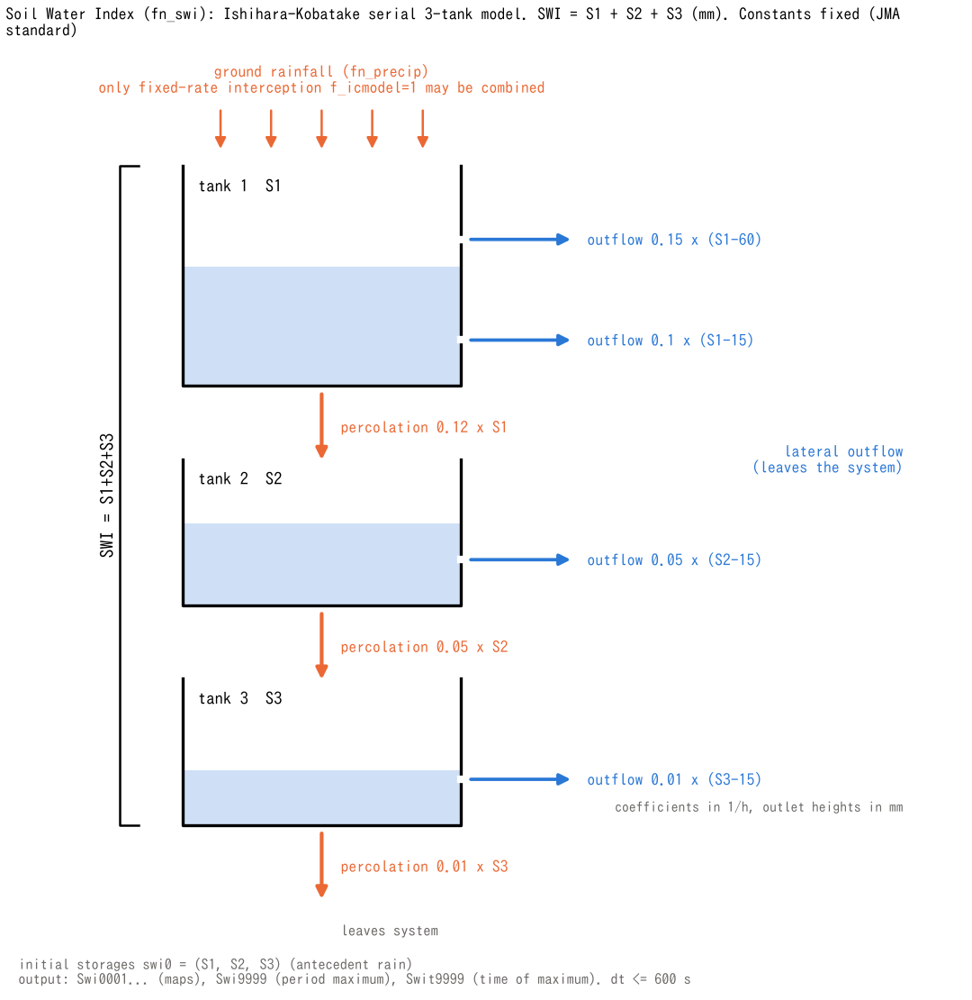

# Soil Water Index (fn_swi)

> English mirror of docs/users_guide/swi.md. The Japanese file is the master copy.

[Back to the User's Guide index](../users_guide.md)

Computes the **Soil Water Index** (SWI) — the operational indicator
used for sediment-disaster (landslide/debris-flow) early warning in
Japan — for every cell. It implements the serial three-tank model of
Ishihara and Kobatake[^ishihara79] with the **nationally uniform standard
constants used by the Japan Meteorological Agency, unchanged** (they
cannot be modified). Rain fills the tanks and drains through lateral
outlets and bottom percolation. The index (mm) represents antecedent
moisture in this conceptual model; it is distinct from physical-model
water content, saturation or measured soil depth. Using the same fixed
constants does not by itself reproduce the official JMA product. Also
check rainfall processing, initial states and time integration when
comparing with official values.



(a) Discharge through each side outlet is `α × max(S − L, 0)`.
The snapshot `(S1,S2,S3)=(40,30,10)` mm is an illustration, not solver
output or recommended initial conditions. Water levels and outlet heights
share one vertical scale across the three tanks. The upper outlet of
tank 1 and the outlet of tank 3 are above water, so they have zero
discharge and no arrows. Bottom percolation `βS` enters the next tank
from tanks 1 and 2, and leaves the tank system from tank 3. Widths,
spacing and arrow lengths are schematic.

(b) Tank parameters are fixed; `swi0(1:3)` sets the initial storages.
(c) shows map and maximum-value outputs and the state carried over on
restart.

## Enabling and settings

Specify `fn_swi` in `&list_sysparam`. There is almost nothing to
configure (the tank constants are fixed to preserve the official
definition):

```
&list_swi
  f_swi = 1                 ! 0 to disable temporarily
  swi0 = 0.0, 0.0, 0.0      ! initial tank storages (mm) (antecedent rain)
/
```

The minimal input to "just try it" is **fn_swi = "-" with an empty
&list_swi** (f_swi=1 and swi0=0 are the defaults) plus rainfall
([Rainfall and meteorology](forcing.md)).

**Usage patterns**

| Type | Rainfall | Settings | What to look at |
|---|---|---|---|
| Comparing with the official product | prtype=3 with 1 km analyzed rainfall | dx=dy=1 km, dt <= 600 s; also check rainfall processing, initial states and integration | Compare SWI at matching times; warning criteria also require 60-minute rainfall, etc. |
| Checking a design / assumed rainfall | prtype=1 rectangular pulse (double the end point) | defaults | Time series extracted from the same cell in Swi maps, and its maximum |
| Antecedent rainfall | either of the above | Set swi0 from the three preceding tank storages, or restart including swi.dat | Difference in the rise; total SWI alone cannot determine the three storages |
| Comparison with the physical model | the same rainfall | a separate run (groundwater saturation Hg/(sy0 sd), soil depth, ...) side by side | Correspondence between the index and saturation |

## Discharge equations and units

Storages `S1,S2,S3` and outlet heights `L` are in mm; α and β are in 1/h.
Lateral discharge `q` and bottom percolation `b` are in mm/h. Multiply
by `Δt_h = dt / 3600` [h] to obtain the amount transferred in one step.
These rates are not volumetric discharges [m³/s]. The general form of
the lateral discharge and bottom percolation of tank $`i`$ is

```math
q_i = \sum_j \alpha_{ij}\,\max(S_i - L_{ij},\ 0),
\qquad
b_i = \beta_i\,S_i
```

and with the constants inserted it becomes the following table.

| Tank | Lateral discharge q [mm/h] (leaves the tank system) | Bottom percolation b [mm/h] |
|---|---|---|
| 1 | `q1 = 0.1 max(S1−15,0) + 0.15 max(S1−60,0)` | `b1 = 0.12 S1` → tank 2 |
| 2 | `q2 = 0.05 max(S2−15,0)` | `b2 = 0.05 S2` → tank 3 |
| 3 | `q3 = 0.01 max(S3−15,0)` | `b3 = 0.01 S3` → outside the tank system |

Lateral discharge is zero at or below the outlet. Bottom percolation has
no outlet-height threshold: positive storage still drains from the bottom
even when no side outlet flows, as illustrated by tank 3. For the snapshot,
`q1=2.5, q2=0.75, q3=0` mm/h, `b1=4.8, b2=1.5, b3=0.1` mm/h, and
`SWI=80` mm. The fixed heights and coefficients match
[Table 1 of JMA's Soil Water Index explanation](https://www.jma.go.jp/jma/kishou/know/bosai/dojoshisu.html).

ENCflow computes the index independently in each valid land cell. Water
leaving the tank system is not transferred to neighbouring cells, rivers
or groundwater in the physical model. The implementation first adds
`R_step = 1000 × s%pre × dt` [mm] to tank 1, using ground rainfall
`s%pre` [m/s]. It evaluates q and b from this rain-augmented tank-1
storage and the old tank-2 and tank-3 storages, then updates explicitly
(S1 on the right-hand side below includes that rainfall):

- `S1_new = S1 − (q1 + b1) Δt_h`
- `S2_new = S2 + (b1 − q2 − b2) Δt_h`
- `S3_new = S3 + (b2 − q3 − b3) Δt_h`

The sum after the update is the output SWI. The JMA computation (the
appendix of Okada et al.[^okada01]) uses Δt = 20 min (the hourly rainfall is
split into three equal parts), evaluates discharge and percolation from the
storage S(t) before the rainfall is added, and then adds the rainfall. The
discretization differs from ENCflow's, so matching the official constants
and grid alone does not guarantee identical values. In a trial calculation
(three rainfall shapes: constant, triangular and a short intense burst), the
period-maximum SWI of ENCflow is 2–4 % smaller than with the appendix's
method at dt = 600 s and still 0–2 % smaller at dt ≤ 60 s. As dt decreases,
ENCflow approaches the continuous-time solution (within 0.2 % at dt = 60 s);
the remaining difference is the discretization error of the appendix's
20-min step itself (larger for short intense rain).

## Contract (dedicated runs)

**SWI is computed in a dedicated run**. The following restrictions
separate the rainfall-driven diagnostic from physical model states:

- The only module that may be combined is **fixed-rate interception**
  (f_icmodel=1 in &list_intercept). Specifying `fn_gwflow`, `fn_evap`,
  `fn_snow`, `fn_glacier`, `fn_geomorph`, `fn_wq`, `fn_salt` or `fn_meteo`
  stops the run. With fixed-rate interception, the input is **rainfall
  after interception**. Omit `fn_intercept` when comparing calculations
  that use the original precipitation without that reduction.
- `dt` must be **600 s or less** (the JMA computation interval of
  10 minutes); larger values stop the run.
- Any grid is valid (the index does not depend on cell area), but if
  `dx,dy` is not 1 km a warning notes that the conditions differ from
  the official 1-km product. A 1-km grid and analyzed rainfall are only
  part of the comparison conditions; they do not make the calculation
  identical to the official product.

To compare with physical model states (e.g., groundwater saturation),
run a separate case with the same rainfall.

## Output and monitoring

The three ways a field gets written (automatic / flag / riding on a flag) and the area basis of column quantities are explained in [Input and output formats](io.md#how-state-variables-are-written); a reverse lookup from the quantity you want to the output is at the end of that section.

**Fields** (rasters in `result/`)

| File | How | Contents |
|---|---|---|
| Swi0001... | automatic | distribution of the Soil Water Index SWI (mm), every `dt_file` |
| Swi9999 | automatic | maximum over the computed interval of the SWI after each update (mm) |
| Swit9999 | automatic | time of that maximum (min) |

No calculation is done on cells of the sea mask (fn_sw); the sea area of
Swi and Swi9999 is 0 (the same treatment of the sea area as in
[Input and output formats](io.md)).

**Ledgers and log**

- No SWI-specific ledger or log column (it is a diagnostic and not part
  of the S water-budget column).

**Measurements** (probe and transect columns)

- The probe CSV has no SWI column; extract the same cell of `Swi0001...`
  at each output time. The maximum statistics are updated every step, so
  they can differ from a maximum picked from the `dt_file` frames.

**Restart**

- The three tank storages are saved to and restored from `swi.dat`, and
  the current SWI is rebuilt from their sum. **The maximum and its time
  are not saved** and restart from the resumed interval; for the maximum
  over a split run, combine the per-interval maxima and times yourself.

**How to read and check**

- Warning levels combine the SWI with the 60-minute rainfall at the same
  time (CL lines), so `Swi9999` alone cannot be used for a warning
  ([Relation to warning criteria](#relation-to-warning-criteria) below).
- When comparing with official values, check the rainfall processing,
  the initial storages swi0 and the time integration
  ([Contract](#contract-dedicated-runs)).

## Relation to warning criteria

A CL-line assessment uses SWI together with 60-minute rainfall at the
same time. The period maximum `Swi9999` alone cannot be compared with a
CL line to determine a warning. ENCflow computes the index; its SWI
output does not implement JMA's assessment using local criteria and
forecast values. See
[JMA's explanation of landslide risk-map assessment](https://www.jma.go.jp/jma/kishou/know/bosai/doshakeikai.html).

## Notes

- The rainfall time series table (prtype=1) is **linearly
  interpolated**. To give a rectangular rainfall pulse, repeat the end
  point (e.g., `(0,30),(180,30),(181,0)`).
- Sources of the model and constants: Ishihara and Kobatake[^ishihara79],
  Okada et al.[^okada01] and [JMA's Soil Water Index explanation](https://www.jma.go.jp/jma/kishou/know/bosai/dojoshisu.html). See
  developer.md §49 for the implementation record.

## Parameters and the basis of their defaults

The labels in the Basis column are explained in [How to read the basis of a default](../users_guide.md#how-to-read-the-basis-of-a-default). The tank constants are fixed and cannot be changed by the
user, but they are listed here to show where the values come from.

| Parameter | Default | Meaning | Basis |
|---|---:|---|---|
| swi0(1:3) | 0, 0, 0 mm | initial storage of the three tanks | **given** effect of antecedent rainfall; 0 to start dry |
| outlet heights L (fixed) | 15, 60 / 15 / 15 mm | two outlets of tank 1 / tank 2 / tank 3 | **literature value** nationwide constants of the Japan Meteorological Agency[^okada01] (appendix). The values are the granite row of the values that Ishihara & Kobatake[^ishihara79] classified into four geology types (volcanic rock, granite, Palaeozoic, Tertiary and Quaternary; Table 5), identified for computing flood runoff from small mountain sub-basins with an average area of 15–18 km². In tank 1, α = 0.1 belongs to the 15 mm outlet and α = 0.15 to the 60 mm outlet |
| outflow coefficients α (fixed) | 0.1, 0.15 / 0.05 / 0.01 /h | lateral outflow | **literature value** same[^okada01] |
| percolation coefficients β (fixed) | 0.12 / 0.05 / 0.01 /h | bottom percolation | **literature value** same[^okada01] |
| dt (&list_sysparam) | ≤ 600 s | time step of the run | **method** the JMA computation interval of 10 min or less is required (the run stops otherwise) |

**Where to look when revising the defaults**

- For initial storages that reflect antecedent rainfall, run the model on
  official rainfall from 2–3 weeks before the target date and give the
  three per-tank storages to swi0 (the total SWI alone does not fix the
  split between tanks). Okada et al.[^okada01] require starting the
  computation at least two weeks earlier to reproduce the steady state in
  which antecedent rainfall drains from tank 3.
- The constants and the model origin are in Ishihara & Kobatake[^ishihara79]
  and Okada et al.[^okada01]; the official definition is on the
  [JMA "Soil Water Index" page](https://www.jma.go.jp/jma/kishou/know/bosai/dojoshisu.html) (in Japanese).

## Tests and examples

- [test/swi](../../../test/swi/en/README.md): comparison with a fine-step RK4 reference solution of the three tanks, checking the final value, period maximum, its time and spatial uniformity. The case also shows the short ramp in the rainfall table and the checks in `Check_swi.py`.

## References

[^ishihara79]: Ishihara, Y. and Kobatake, S. (1979): Runoff model for flood forecasting. *Bull. Disaster Prev. Res. Inst., Kyoto Univ.*, 29(1), No. 260, 27–43. (the serial three-tank model Fig. 8; values identified for five basins Table 1; values by geology Table 5)
[^okada01]: Okada, K., Makihara, Y., Shimpo, A., Nagata, K., Kunitsugu, M. and Saitoh, K. (2001): Soil Water Index (SWI) (in Japanese). *Tenki*, 48(5), 349–356. (JMA's operation; the appendix gives the tank model's structure, computation and constants)
