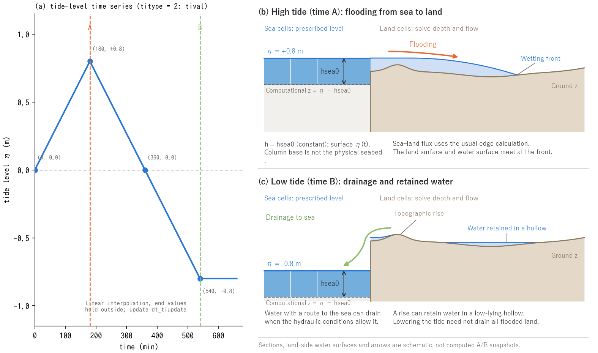

# Tide Level and Sea Surface (&list_tide)

> English mirror of docs/users_guide/tide.md (based on commit 6c5acfc). The Japanese file is the master copy.

[Back to the User's Guide index](../users_guide.md)

Gives a time series of tide level (sea surface elevation) to sea
cells, to compute coastal flooding by storm surge or rising tide, and
drainage toward low tide. Enable it with `fn_tide`.

**Prerequisite**: the sea area must be specified by the sea mask
`fn_sw` of the geographic information
([the geographic information chapter](geoinfo.md)). The tide level is
prescribed on the sea cells. Their depth and cell velocities are not
updated as in ordinary land cells; the sea acts as a prescribed-level
boundary. However, **the flux between sea and land is calculated by the
usual ENC edge calculation**. This flux changes the land-side depth;
flooding and drainage are computed together with the land-side flow.

```
&list_tide
  titype = 2                     ! uniform time series
  hsea0 = 1.0                    ! apparent water column thickness of sea cells (m)
  tival(1:2,1) = 0,    0.0       ! (time (min), tide level (m))
  tival(1:2,2) = 180,  0.8
  tival(1:2,3) = 360,  0.0
  tival(1:2,4) = 540, -0.8
/
```

## How the tide level is given (titype)

| titype | How it is given | Parameters used |
|---|---|---|
| 1 | Uniform fixed value | ti0 |
| 2 | Uniform time series (linear interpolation) | tival |
| 3 | One distribution x multiplier time series | fn_timap, tival (multiplier) |
| 4 | List of distribution files (linear interpolation between adjacent frames) | fn_timaplist, dt_timaplist |

| Parameter | Default | Meaning |
|---|---|---|
| titype | 1 | Tide type (table above). When unspecified, 1 (uniform fixed level ti0) is adopted and printed with "(default)" |
| ti0 | 0 | titype=1: uniform fixed tide level (m; same elevation datum as z). Default 0 = mean sea level |
| tival | - | titype=2, 3: time series `(time (min), tide level (m) or multiplier)` |
| fn_timap | "" | titype=3: tide level distribution file (m) |
| fn_timaplist / dt_timaplist(_c) | "" / 60 | titype=4: list of distribution files and their time interval (min). Frame i is at time (i-1) x interval; outside the range the end values persist |
| dt_tiupdate | 1 | Tide level update interval (min) |
| hsea0 | 1.0 | Apparent water column thickness of sea cells (m) (see below) |

## hsea0 - apparent water column thickness of sea cells

At each tide update, active sea-mask cells are assigned `z = η − hsea0`
and `h = hsea0`, so that their surface `z + h` equals the prescribed tide
level η. The constant column thickness `hsea0` belongs to this boundary
representation; it does not specify the physical sea depth or seabed.
As the tide changes, the computational z changes while h stays constant.
Use the same elevation datum for η and the land-side ground elevation.

In flooding where the sea is the supplying side (storm surge, rising
tide), this water column of the sea cells provides the dry test, the
depth at cell interfaces, and the friction. **Several tens of times
the threshold depth dd or more** is recommended (too small a value
makes the sea-to-land flooding discharge too small; a value at or
below dd is an error). Typically start around 1 m, and if the
sensitivity of the flooding discharge to hsea0 is a concern, vary the
value and check.



(a) shows the tival input example above, with linear interpolation and
end values held outside the supplied range. (b) illustrates flooding at
the high tide level of time A. Sea cells have η = +0.8 m and h = hsea0;
the flux across sea–land edges brings water onto land. The land-side
surface is determined by the shallow-water calculation, rather than
being set everywhere to the sea level. The water region ends where its
surface meets the ground. (c) illustrates drainage and retained water at
the low tide level of time B (η = −0.8 m). Water with a route to the sea
can drain when the hydraulic conditions allow it, while a topographic
rise can retain water in a low-lying hollow.

The terrain, land-side water surfaces and flow arrows in (b)(c) are
schematic; they are not numerical results obtained from the time series
in (a). Generate the Japanese and English PNG/SVG files with
`python docs/figs/make_guide_figs.py tide`. Panel (a) retains the published
PNG region at its original position and resolution, with the same image
embedded in the SVG. Panels (b)(c) are vector drawings.

## Usage patterns

- **Flooding by storm surge / rising tide**: raise the tide level with
  a titype=2 time series. Combined with seawalls
  ([the geographic information chapter](geoinfo.md)), protection
  before overtopping and breach is represented.
- **Drainage toward low tide**: lower the tide level and calculate
  drainage according to the available routes and hydraulic conditions.
  Low-lying areas separated by higher ground or embankments may not
  drain simply because the tide is lowered.
- **Steady operation at a warning tide level**: a fixed value with
  titype=1.
- **Tsunami (incidence from the boundary)**: not the tide feature -
  the basic setup is the long-wave radiation edge boundary (type 2)
  combined with water-level-prescribed cells and an initial water
  level ([the boundary conditions chapter](boundary.md)). When the
  domain contains a sea area, use fn_sw and fn_seaside for the sea
  surface initialization and the seaside test of breakwaters.

## Recommended values by pattern

The minimal input to "just try it" is the sea mask fn_sw and **an empty
&list_tide in fn_tide** (= fixed tide level 0 m and hsea0 1 m: the
simplest use of the sea as a "drain at level 0"; developer.md §67). Tide
levels are given data, but guides by type:

```
&list_tide
/
```

| Type | titype | Guide for the tide level | Used together with |
|---|---|---|---|
| Astronomical tide (tidal reach) | 2 | Semidiurnal sine of 12.42 h. Amplitude 0.5-1 m on the Pacific coast of Japan, 1.5-3 m in the Seto Inland Sea and Ariake Sea | Segment inflow (river), fresh/salt two-layer |
| Storm surge | 2 | Superpose a typhoon surge of 1-3 m as a 3-6 h hump on the astronomical tide | Seawalls fn_seawall, building clusters fn_gv |
| Drainage toward low tide | 2 or 1 | Lower to / fix at a low tide level (about -1 m) | Drainage pumps, sluice gates |
| Steady warning tide level | 1 | ti0 = design high tide level | Seawalls |
| Tsunami | - | Not the tide feature but boundary incidence ([boundary conditions](boundary.md)) | fn_seaside |

Start hsea0 at several tens of the threshold depth dd (typically 1 m).

## Constraints and notes

- ENC grid system only (not available in the legacy STG).
- Sea-mask cells do not solve the flow, and **none of the
  landform-change (sediment) processes act on sea cells**. To handle
  tsunami / storm-surge resuspension and deposition of bottom mud or
  sand, represent the water body as ordinary cells + an initial water
  level (see the suspended-sediment section of
  [Sediment and landform change](geomorph.md)).
- The tide update phase is based on the absolute step number, so after
  a [restart](restart.md) updates occur at the same timing as an
  uninterrupted run (a restart round trip with tide enabled is also
  bit-identical).
- Working example: [test/tide](../../../test/tide/) (drainage -> rising-tide
  flooding). Worked examples of the format:
  [examples/List_samples/list_tide.txt](../../../examples/List_samples/en/list_tide.txt).
